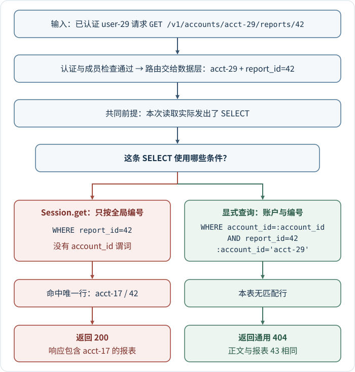

# 怎样把一份缺陷报告变成可证伪的反例，并用证据审查修复？

本章回答：收到一份“别的账户能读到我们的报表”的缺陷报告后，怎样把它写成可观察的输入和输出，用一个最小反例去推翻或确认根因假设，沿调用路径找到丢失的条件，并用别人能复核的证据审查修复。读者手上有一份症状描述、出问题的代码和一组仍然全绿的测试。

**案例。** 主线五跟随账户报表服务的一次修复发布，从缺陷一直走到生产。服务里，账户 `acct-17` 的报表 42（标题 `Service health`）只应由该账户成员读取：成员 `user-17` 读到 `200`；另一个账户 `acct-29` 的已认证成员 `user-29` 猜中编号 42 时，应得到与读取不存在的报表 43 完全相同的通用 `404`。一次重构把读取改成了 SQLAlchemy 的 `Session.get(Report, 42)`，之后有人报告 `user-29` 读到了 acct-17 的报表；现有测试只让 `user-17` 读自己的报表，仍然全绿。

这次重构已经随生产稳定版上线，所以缺陷就在线上：本主线把这个带缺陷的稳定版镜像记作 `d-old`，修复版记作 `d-new`。本章找到根因并审查修复。后续各章接着做：证明测试能区分修复前后，把修复提交进 Git，构建成镜像，逐步放量并观察它。数据都是合成的教学数据；示例代码按 SQLAlchemy 2.0 核对。

## 先把症状写成可证伪的契约

“别的账户能读到报表”还不能直接拿来查。先把这条需求写成对每类主体的预期结果，让每一行都能被一次请求证实或推翻。本例的表结构里，`report_id` 是全局主键，`account_id` 记录报表属于哪个账户；表中只有一行 `(42, acct-17, Service health)`。

| 主体 | 请求 | 预期结果 |
| --- | --- | --- |
| `user-17`（acct-17 成员） | `GET /v1/accounts/acct-17/reports/42` | `200`，返回 `Service health` |
| `user-29`（acct-29 成员） | `GET /v1/accounts/acct-29/reports/42` | `404`，状态码和正文与请求 `/v1/accounts/acct-29/reports/43` 完全相同 |
| `user-29` | `GET /v1/accounts/acct-17/reports/42` | `404`，同样的通用正文（成员检查已拒绝） |
| 无有效凭据 | `GET /v1/accounts/acct-17/reports/42` | `401`，带 `WWW-Authenticate` 质询 |

隐藏式 `404` 是这个服务的策略：对无权访问的主体，不透露报表是否存在。为什么这样选、它与 `403` 怎样取舍，见[服务怎样逐次确认这个主体能对这份资源做这个动作？](../services/per-request-authorization.md)。

能暴露问题的**最小反例**只需要两样东西：数据库里属于 acct-17 的报表 42，以及可信主体 `user-29` 的一次读取。关键是选对路径。`user-29` 请求 `/accounts/acct-17/...` 会先在成员检查处被拒，根本碰不到被重构的那一行取数代码；请求自己账户下的 `/accounts/acct-29/reports/42` 才能通过前面所有检查，让取数层单独接受检验。

要验证“不透露存在性”，还要把这次请求与确实不存在的报表 43 比较：两者的状态码和正文必须完全相同。只看到 `404` 状态码，不能证明正文没有带出 acct-17 的数据。

现有测试为什么没发现问题？它只让 `user-17` 读自己的报表，证明了所有者能读，却从没检验过授权边界。重构前后它都会通过。

## 一次观察能说明什么

拿反例去跑一次，结果只能缩小调查范围，不能直接给出根因：

| `user-29` 读 `/accounts/acct-29/reports/42` 的结果 | 能说明什么 | 接下来核对什么 |
| --- | --- | --- |
| `200` | 契约被违反，保护条件可能丢失；但还不知道丢在哪一层 | 当前主体、实际入口、取数调用及结果归属、缓存命中、响应映射 |
| `404` | 状态码符合预期，但还没证明没泄露 | 测试是否走到同一入口、确实使用 `user-29`、装入了 acct-17 的 42；响应正文是否与 43 相同 |

即使状态码是 `404`，正文若透露报表归属，同样违反隐藏策略。如果 SQL 正确限定了账户、查不到可见的行，响应里却仍有 acct-17 的数据，就继续追旁路缓存、备用读取或序列化分支。反例证明出了问题，它本身不是根因证据。

## 主键读取不是所有权检查

重构前，读取同时按账户和编号过滤；重构后变成：

~~~python
report = session.get(Report, report_id)
~~~

`Session.get()` 按主键取对象，有两条路径：

- 对象已在当前 Session 的 identity map (身份映射表) 里、且没有完全过期时，直接返回这个对象，**不发 SELECT**。
- 对象不在 identity map 里或已完全过期时，按主键查询数据库；传 `populate_existing=True` 也会强制查询。

无论走哪条路径，它都不会加上当前主体的账户条件。本例的 `report_id` 是全局主键，所以 `session.get(Report, 42)` 是一次合法的主键读取，却不是所有权检查。表若使用复合主键，要把相应的键元组交给 `get`，仍需另行确认主体有权访问。Session 怎样借用连接、对象怎样进出 identity map，见[ORM 会话怎样借用连接，连接池为什么会耗尽？](../data/orm-sessions-and-connection-pools.md)。

这也决定了排查方法：不能预设“数据库一定发了查询”。若发出了 SQL，就核对最终的 WHERE 条件和绑定值；若直接从 identity map 返回，就核对调用时用的主键和返回对象的归属。

## 沿调用路径找到丢失的条件

从公开入口向数据层追踪同一个请求，逐段核对条件是否还在：

1. **入口。** 请求到达哪条公开路由，是否经过认证依赖。
2. **主体。** 认证依赖返回的主体来自已验证的会话或令牌，而不是请求里任意填写的字段。
3. **参数传递。** 路由是否把 `report_id` 和已通过成员检查的 `account_id` 都传给了数据层。
4. **实际取数。** 取数用了什么方式和参数；若执行了查询，最终 SQL 或 ORM 条件里有没有两个绑定值；返回的对象属于哪个账户；缓存是否绕过了同一授权范围。
5. **响应。** 错误映射和序列化有没有把“查不到当前主体可见的行”改成成功响应。

在这个案例里，前三段都没问题：路由拿到了 `account_id`，但第 4 段的 `session.get` 只按全局主键取记录，根本没用到这个值。图只画两种写法都实际发出 SELECT 的情况；`Session.get` 从 identity map 直接返回时结果相同，只是没有 SQL 可看。

修复是把报表编号和账户一起作为查询条件，`account_id` 只取已经通过成员与动作检查的那个值：

~~~python
report = session.scalar(
    select(Report).where(
        Report.account_id == account_id,
        Report.report_id == report_id,
    )
)
~~~

改完还要核对 ORM 生成的查询，确认两个绑定值都进入了最终 SQL，而不是只留在调用方的局部变量里。显式查询每次都按账户条件执行，不再从 identity map 直接返回对象。

**同一条路径上的旁路：缓存。** 如果成功响应被缓存在只含 `report_id` 的键下（例如 `report:42`），即使数据库查询修好了，`user-29` 的请求仍可能命中 acct-17 留下的缓存条目。缓存键必须包含账户等授权维度，而且授权检查要在查缓存之前完成；缓存键限制副本的范围，本身不是授权凭据。缓存键该包含哪些维度，见[加了缓存之后，读到的数据最多会旧多久？](../data/caching-and-staleness.md)。

修完后，用同一入口和同样的输入重放契约表的四行：`user-17` 仍得到 `200`；`user-29` 读 acct-29 下的 42 和 43 得到相同的通用 `404`；读 acct-17 下的 42 也是同样的 `404`；匿名请求得到 `401` 和质询头。再检查相邻的参数校验、错误映射和缓存路径，确认修复没有改变无关响应，也没有留下另一条绕行路径。

这次复验只覆盖所测的路由和缓存状态。后台导出、其他查询入口各有独立的访问路径，要按各自的数据边界核对。

## 一条审查意见要带什么证据

修复要经过代码审查，审查意见可能来自人，也可能来自安全扫描或代码审查 Agent。无论来源，一条 finding (审查发现) 都应让另一位工程师能沿着同一份差异和执行路径复核。

**报告层面**要固定：

- 检查的基准提交与候选提交；
- 覆盖了哪些范围、跳过了哪些；
- 每个 finding 的位置。

**每条结论**要给出：

- 所依据的调用路径、授权条件和成立前提；
- 可观察的影响；
- 能重新打开的引用，例如准确的差异行、测试名和运行记录、授权检查或响应证据；
- 严重度和置信度各自的依据；
- 若问题依赖未改动的上下文，说明它怎样与这次差异共同改变行为。

拿本例对照：报告“`user-29` 可读取 acct-17 的报表 42”，证据应能沿可信主体 `user-29`、实际读取或缓存范围、对象归属和 HTTP 响应逐项回查，并指向一个通过认证入口运行的回归测试。只写“缺少账户过滤”，不能证明数据进入了 `user-29` 的响应；只列一个 `404` 测试，也不能证明它走过了这条路径。

## 核实误报，给结论分类，分清谁能批准

**核实误报。** 假如一条 finding 只因 `session.get` 没有账户条件就断定泄露，审查者要沿同一个 `user-29` 请求继续检查路由、数据层、identity map、缓存和序列化：下游是否有可靠的对象归属检查，而且它在响应或缓存返回之前执行？再用 acct-29 下的 42 与 43 验证实际入口的状态码和正文。只有路径证据与测试结果共同表明 acct-17 的对象不会进入 `user-29` 的响应，才能判为误报。否则标为“已确认”或“证据不足”，不要从函数名、单条 `404` 或测试标签推断结论。

**结论分类。** 复核后的结论分为四类，并附依据：

| 结论 | 含义 | 后续 |
| --- | --- | --- |
| 已确认 | 路径证据与测试都表明问题成立 | 进入回归测试集 |
| 误报 | 路径证据与测试共同表明问题不成立 | 回头检查检测规则或报告门槛 |
| 重复 | 与已有 finding 是同一问题 | 合并到原条目 |
| 证据不足 | 无法重现或证据链断开 | 指明要补的上下文或证据 |

**独立验收。** 本例涉及跨账户数据，可以请熟悉这条授权边界、没参与写补丁的工程师独立验收。验收人拿到基准与候选提交、finding 的引用和固定的测试夹具后，独立确认主体来源、实际读取路径和测试入口，并重放契约表。保留验收人、候选版本、测试运行记录和未覆盖的路径。

**权限分工。** 自动审查的结果只是供审查者核验的证据。修复提交、仓库写入权限和合并审批仍按仓库策略授权；对访问控制变更，团队可以指定专人审批，并要求附上同一反例在修复前后的结果。Agent 工具本身的逐次授权见[为什么提示注入防不住“模型听话”，应用该在哪里拦？](../../ai-engineering/actions/prompt-injection-as-permission-confusion.md)。

> [!info] 实例：自动审查产品怎样分工（核对于 2026-11-25）
> - **Claude Ship**（Anthropic，2026 年 11 月发布）：Code Review 提出并复核问题；PR Steward 可处理失败的检查并修改 PR；Claude Approvals 按默认分支上的团队策略决定能否批准。合并仍受仓库的必需检查和分支保护约束。发布时 Code Review 已正式推出，PR Steward 与 Claude Approvals 为 beta。
> - **Codex Security**（OpenAI）：审查代码变更时输出安全上下文、检查范围、finding 和覆盖状态。具体字段以所用版本为准，对目标仓库的效果需另行评估。

## 本章产出与下一步

本章产出三样东西：一张可证伪的读取契约表，一个能通过所有前置检查、直达取数层的最小反例，以及按 `(account_id, report_id)` 显式查询的修复。审查结论已经按证据分了类。

还剩一个问题：修复后测试变绿，能说明这组测试真的检查了账户条件吗？同一个人或同一个模型写出的实现和测试，可能共享同一个遗漏的假设。下一章[一次改动该在哪一层测试，怎样证明测试能区分对错？](testing-by-failure-boundary.md)把契约表写成经过真实路由的测试，并证明换回 `Session.get` 时它一定会失败。

> [!info]- 来源
> - **`Session.get` 的 identity map 路径、过期刷新、`populate_existing` 与复合主键**（“主键读取不是所有权检查”）：SQLAlchemy 2.0, [Session API — `Session.get`](https://docs.sqlalchemy.org/en/20/orm/session_api.html#sqlalchemy.orm.Session.get)，核对于 2026-11-12，包版本 2.0.44。
> - **401 必须带适用的 `WWW-Authenticate`；可用 404 隐藏禁止访问的资源**（“先把症状写成可证伪的契约”）：IETF [RFC 9110](https://www.rfc-editor.org/rfc/rfc9110.html) §§15.5.2、15.5.4–15.5.5，核对于 2026-11-12。正文是否披露归属仍要由响应与测试保证。
> - **在 PR 中阅读差异、对具体改动评论和提交审查**（“一条审查意见要带什么证据”）：GitHub Docs, [Reviewing proposed changes in a pull request](https://docs.github.com/en/pull-requests/how-tos/review-pull-requests/reviewing-proposed-changes-in-a-pull-request)、[About pull request reviews](https://docs.github.com/en/pull-requests/concepts/giving-reviews)，核对于 2026-11-12。
> - **自动安全审查的范围与发现报告**（“一条审查意见要带什么证据”与实例 callout）：OpenAI, [Building Security Review into Your SDLC with Codex Security](https://developers.openai.com/blog/building-security-review-into-your-sdlc-with-codex-security)，2026-11-23，“Review at the right level”“Security context gives reviewers something to reason from”“An automated review loop returns reports”；[Review code changes for security](https://developers.openai.com/codex/security/plugin/code-changes)，在线文档，核对于 2026-11-25。
> - **审查、修改与批准的权限分工**（“核实误报……分清谁能批准”与实例 callout）：Anthropic, [Introducing Claude Ship](https://claude.com/resources/articles/introducing-claude-ship)，2026-11-23。
