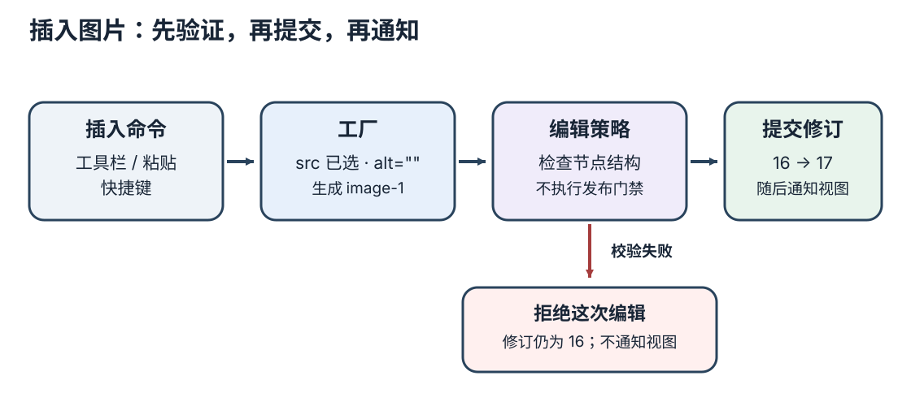
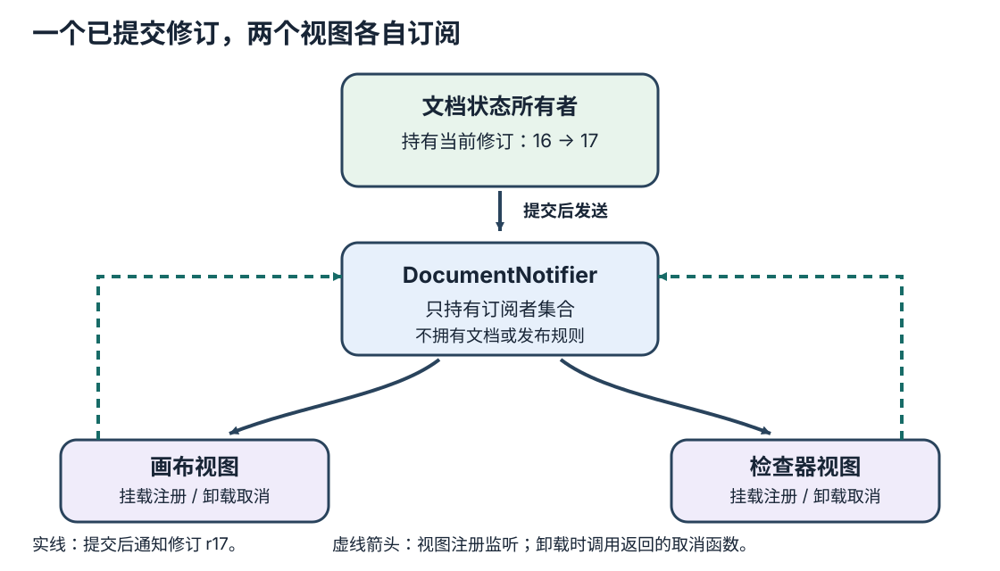

# 工厂、策略、观察者和单例各解决什么协作问题，何时多余？

本章回答：页面编辑器里的四种常见模式（工厂、策略、观察者、单例）各解决哪个对象协作问题，什么时候它们只是多出来的间接层。读者已经有[上一章](design-for-change.md)的判断顺序：先看变化会传播到哪里，再决定抽象。模式是这些判断的常见落点，本章把它们放回同一次编辑里检查。

**案例。** 沿用上一章的页面编辑器：公开版是 r16，`section-1` 下有 `button-1` 和 `heading-1`。编辑者从工具栏插入一张图片 `image-1`（`alt` 还空着），文档所有者提交 r17 后，画布与检查器都要显示 r17。插入要依次经过四步：创建节点、草稿检查、提交修订、通知视图。

## 模式给协作起名，不替系统决定所有权

**design pattern (设计模式)** 给反复出现的对象协作方式起了名字。GoF（Gamma、Helm、Johnson、Vlissides 四位作者）的《设计模式》介绍每个模式时，都写明适用情境、参与者、结果和取舍，并恰好用一个文档编辑器作贯穿案例。模式不是可以机械套用的类图。

模式也不替系统回答所有权问题：谁拥有文档，哪些规则只在发布时检查，订阅何时结束。这些仍要由设计决定。判断是否需要某个模式，先看哪种变化在反复出现。如果一次普通函数调用或一个稳定的分支已经让修改范围很清楚，再加对象、注册步骤和清理责任，只会让读代码的人多跳几次。

下面三段代码各自独立，可以单独运行。

## 工厂：多个入口共享同一套创建规则

工具栏、粘贴和快捷键都能创建节点。如果每个入口各自填默认属性、各自分配 ID，节点形状会逐渐不一致。**factory (工厂)** 把这些创建规则集中到一处，最初通常只是一个函数：

~~~javascript
const defaults = new Map([
  ['heading', { text: '', level: 2 }],
  ['button', { label: '按钮' }],
  ['image', { src: '', alt: '' }],
]);

function nextId(type, existingIds) {
  let serial = 1;
  while (existingIds.has(`${type}-${serial}`)) serial += 1;
  return `${type}-${serial}`;
}

function createNode(type, existingIds, overrides = {}) {
  const initialProps = defaults.get(type);
  if (!initialProps) throw new RangeError(`unknown component type: ${type}`);
  return { id: nextId(type, existingIds), type, props: { ...initialProps, ...overrides }, children: [] };
}

const existingIds = new Set(['section-1', 'button-1', 'heading-1']);
console.log(JSON.stringify(createNode('image', existingIds, { src: '/media/diagram.png' })));
// {"id":"image-1","type":"image","props":{"src":"/media/diagram.png","alt":""},"children":[]}
console.log(createNode('heading', existingIds).id); // heading-2
createNode('constructor', existingIds);              // 抛出 RangeError
~~~

几处值得注意：

- **空 `alt` 只是编辑期默认值。** “发布时 alt 非空”属于发布门禁，不应塞进节点创建。
- **用 `Map` 登记类型。** `Map` 只认显式登记的键；普通对象会顺着原型链把 `constructor` 这类名字当成已有属性。
- **ID 只在当前文档、单个写入者内不重复。** `nextId` 跳过文档里已有的 ID，所以新标题得到 `heading-2`。多窗口协作或多个写入者并发时，需要由服务端分配或使用 UUID 这类全局唯一方案。
- **什么时候多余。** 如果整个页面只有一处创建这种固定对象，直接写对象字面量更清楚。

这个函数也不是 GoF 的 **Factory Method (工厂方法)** 或 **Abstract Factory (抽象工厂)**：前者让子类决定实例化哪个类，后者创建一族相关对象。本例没有这两类变化需求。

## 策略：同一契约下可互换的校验算法

工厂产出的节点在提交前要做草稿检查。不同类型有各自的结构规则；不想每加一种类型就往一个越来越长的条件块里加分支，可以把每种类型的检查写成独立函数，按类型查找。**strategy (策略)** 模式就是让调用方通过同一个契约使用这些可互换的算法。上一章注册表里每个类型的 `validateDraft`，就是一个策略。

~~~javascript
const draftValidators = new Map([
  ['heading', node =>
    typeof node.props.text === 'string' &&
    Number.isInteger(node.props.level) && node.props.level >= 1 && node.props.level <= 6
      ? [] : ['标题需要字符串文本和 1–6 级层级']],
  ['image', node =>
    typeof node.props.src === 'string' && typeof node.props.alt === 'string'
      ? [] : ['图片需要字符串 src 和 alt']],
]);

function validateDraftNode(node) {
  const validate = draftValidators.get(node.type);
  return validate ? validate(node) : [`未知组件类型：${node.type}`];
}

const image = { id: 'image-1', type: 'image', props: { src: '/media/diagram.png', alt: '' }, children: [] };
console.log(validateDraftNode(image));                                   // []
console.log(validateDraftNode({ ...image, props: { src: image.props.src } })); // ['图片需要字符串 src 和 alt']
console.log(validateDraftNode({ ...image, type: 'video' }));             // ['未知组件类型：video']
~~~

`alt` 为空字符串的图片通过草稿检查；缺少 `alt` 字段的节点不通过。策略的职责边界很窄：

- 它只校验已解析节点的类型特有字段。来自服务器或文件的数据，要先经过通用的结构解析。
- 它不负责授权，也不检查发布规则。“编辑时合法”和“可以发布”由不同流程负责。

如果类型和规则数量少且稳定，`switch` 更直接；只有变化确实分散到多处时，策略注册才值得额外维护。

## 状态所有者先提交，观察者再通知

校验通过的节点要提交进文档，并让画布和检查器看到同一个修订。这里有两个角色：

- **状态所有者**持有当前文档，是唯一能提交修订的模块。它自己调用策略，不相信调用者传来的错误列表。有错误就拒绝，修订保持 r16，不通知任何视图；没有错误才创建 r17、冻结、提交。
- **通知器**只持有订阅列表，不持有文档。提交完成后，所有者把已提交的 r17 交给它，由它分发给每个订阅者。

**observer (观察者)** 模式描述的正是后一半：一个主体管理多个接收者，状态变化后通知它们。“先提交再通知”保证视图收到的总是一份已经生效、不会再变的修订。

> [!example]- 状态所有者与通知器的可运行实现
>
> ~~~javascript
> class DocumentNotifier {
>   #listeners = new Set();
>
>   subscribe(listener) {
>     this.#listeners.add(listener);
>     return () => this.#listeners.delete(listener);
>   }
>
>   notify(document) {
>     for (const listener of [...this.#listeners]) listener(document); // 先复制，再遍历
>   }
> }
>
> function freezeDocument(document) {
>   return Object.freeze({
>     ...document,
>     nodes: Object.freeze(document.nodes.map(node => Object.freeze({
>       ...node,
>       props: Object.freeze({ ...node.props }),
>       children: Object.freeze([...node.children]),
>     }))),
>   });
> }
>
> function draftErrors(node) {
>   if (node.type !== 'image') return [];
>   return typeof node.props.src === 'string' && typeof node.props.alt === 'string'
>     ? [] : ['图片需要字符串 src 和 alt'];
> }
>
> class DocumentOwner {
>   #current;
>   #notifying = false;
>   notifier = new DocumentNotifier();
>
>   constructor(document) { this.#current = freezeDocument(document); }
>   get current() { return this.#current; }
>
>   insert(node) {
>     if (this.#notifying) return { ok: false, errors: ['通知期间不能同步提交'] };
>     const errors = draftErrors(node);                  // 所有者自己调用策略
>     if (errors.length) return { ok: false, errors, revision: this.#current.revision };
>
>     this.#current = freezeDocument({
>       ...this.#current,
>       revision: this.#current.revision + 1,
>       nodes: [...this.#current.nodes, node],
>     });                                                // 先提交
>     this.#notifying = true;
>     try {
>       this.notifier.notify(this.#current);             // 再通知
>     } finally {
>       this.#notifying = false;
>     }
>     return { ok: true, revision: this.#current.revision };
>   }
> }
>
> const owner = new DocumentOwner({
>   revision: 16,
>   nodes: [
>     { id: 'button-1', type: 'button', props: { label: '报名' }, children: [] },
>     { id: 'heading-1', type: 'heading', props: { text: '欢迎', level: 1 }, children: [] },
>   ],
> });
> const received = [];
> const stopCanvas = owner.notifier.subscribe(doc => received.push(`canvas r${doc.revision}`));
> const stopInspector = owner.notifier.subscribe(doc => received.push(`inspector r${doc.revision}`));
>
> const image = { id: 'image-1', type: 'image', props: { src: '/media/diagram.png', alt: '' }, children: [] };
> console.log(owner.insert({ ...image, props: { src: image.props.src } }));
> // { ok: false, errors: ['图片需要字符串 src 和 alt'], revision: 16 }，received 仍为空
> console.log(owner.insert(image), received.join(', '));
> // { ok: true, revision: 17 } 'canvas r17, inspector r17'
> stopCanvas();     // 视图卸载时取消订阅
> stopInspector();
> ~~~
>
> 为聚焦对象协作，这里把文档简化成节点数组，草稿检查也只写了图片一种类型。按 ID 索引的完整文档树见[页面编辑器的数据模型](page-editor-data-model.md)。

## 通知期间会发生什么：快照、重入、异常与退订

观察者最容易出错的地方不在“注册—通知”本身，而在通知进行到一半时发生的事。下面四条规则决定了视图看到的顺序和内容。

**1. 遍历前复制接收者列表。** JavaScript 的 `Set` 迭代是“实时”的：遍历中删除一个尚未访问的成员，它会被跳过；遍历中新加入的成员，本轮也会被访问。`notify()` 先复制一份 `[...this.#listeners]` 再遍历，本轮的接收者集合就固定了：本轮中有人退订，对方仍会收到本轮通知；新订阅者从下一轮开始接收。`Set` 实时迭代的细节和事件总线里的实例，见[同步事件总线在分发途中增删监听器会怎样？](../../frontend/javascript/event-bus-and-observer-patterns.md)。

**2. 文档内容靠不可变更新保护。** 复制列表只固定了接收者，不保护文档。每次提交都复制并冻结文档、节点、属性和子节点数组，画布和检查器只能读。`Object.freeze` 是浅冻结：示例的属性值只有字符串和数字，所以冻结到 `props` 为止；属性里若有嵌套对象，要逐层冻结或采用其他不可变约定。

**3. 通知期间拒绝同步重入提交。** 假设画布在收到 r17 时立刻又提交了一次。没有保护时，内层提交产生的更新修订会先发给所有人，外层循环再继续把 r17 发给检查器：检查器先收到更新的修订、后收到 r17，最终停在旧修订上。所以所有者在通知期间拒绝同步提交，`finally` 保证通知结束后解除这个限制。

**4. 监听器抛错会中断本轮。** 某个监听器抛出的异常会传回提交的调用者，本轮排在它后面的监听器收不到通知；但修订在通知前已经提交，不会因此回滚。若要求每个视图都必须收到，可以在通知边界逐个捕获错误或安排重试。这会改变错误语义，要明确约定，不必为此另造一个事件队列。

**退订随视图生命周期结束。** `subscribe()` 返回取消函数，视图卸载时调用它。忘记退订的视图会继续收到通知，并让通知器一直引用它。

## 观察者、发布订阅、回调还是 EventTarget？

“有多个接收者”不等于需要全局事件总线。几种机制的差别在于谁知道谁：

| 机制 | 发送方知道什么 | 适合 | 代价 |
| --- | --- | --- | --- |
| 普通回调 | 唯一的接收函数 | 父子组件之间只有一个接收者 | 接收者多了就要自己管理列表 |
| 观察者 | 自己的订阅列表 | 画布和检查器天然属于这份文档，直接订阅文档通知器 | 订阅清理、只读约定和错误传播要明确 |
| publish-subscribe (发布订阅) | 只知道主题，由中介路由 | 多个互不相识的插件监听 `document:saved` | 主题字符串和跨模块调用让消息来源更难追踪 |
| `EventTarget` | 浏览器内置的监听列表 | DOM 节点和需要捕获、冒泡、取消语义的场景 | 带着事件传播的额外语义 |

发布订阅的中介可以持有 `Map<topic, Set<listener>>`，订阅者用返回的取消函数从同一主题的集合里移除自己。`EventTarget` 让对象直接管理自己的监听器，可看作内置的观察者式 API；页面级事件分发见[一次点击怎样传播到处理器？](../../frontend/browser/dom-events.md)。

## 单例：先说清“唯一”指什么范围

工厂和策略都依赖一份“组件类型 → 默认值或校验函数”的注册表。如果要求所有面板用同一份注册表，先要说清“同一份”的范围。**singleton (单例)** 把“只有一个实例”和“全局访问点”绑在一起，但它不能自动保证浏览器多个标签页、worker、多个进程或被重复打包的模块副本共享同一个对象。

多数编辑器只需要在组合入口创建一个 `EditorRuntime`，再把注册表显式传给画布、检查器和命令处理器。这样在一个应用内确实共享同一实例，测试也能各自创建独立的运行时。全局单例则有几个问题：

- 依赖被隐藏，读代码时看不出谁用了它。
- 一个页面上的两个编辑器实例，或不同测试之间，会相互污染。
- JavaScript 模块级变量只在该模块实例内共享，不保证不同模块副本共用。
- 类的构造器若仍公开，`getInstance()` 也挡不住调用方 `new` 出额外的对象。

只有全局访问点本身能解决一个明确问题时，才值得承担这种耦合。

## 用设计原则复核这些模式

沿“插入图片”流程复核一遍责任边界：工厂只负责初始属性与 ID；草稿策略只负责节点结构；状态所有者根据策略结果决定是否提交修订；观察者只通知已提交的只读状态；发布门禁另行检查一个指定修订能否公开。r17 发布被拒，不影响它已经被保存、预览和继续编辑。

模式不会自动带来开闭原则。新增一种节点类型时，开发者可能仍要改类型定义、渲染器和发布规则；只有新变化能在局部扩展、而调用契约保持稳定时，修改范围才真正缩小。上层流程依赖“提交后通知”的契约、通知器实现这个契约，是依赖倒置的一种接法。

本章产出的是一条已确认的协作链：创建 → 草稿检查 → 提交 → 通知。所有者提交的修订怎样组织成文档树、撤销怎样与修订号共存、r17 为什么进不了公开页面，见[页面编辑器怎样建模文档、编辑会话和发布快照？](page-editor-data-model.md)。

> [!info]- 来源
> - **模式的适用情境、结果与取舍，以文档编辑器为贯穿案例**（“模式给协作起名”）：Gamma, Helm, Johnson, Vlissides, *Design Patterns: Elements of Reusable Object-Oriented Software*, Addison-Wesley, 1994：[出版页](https://www.oreilly.com/library/view/design-patterns-elements/0201633612/)。
> - **`Set` 的删除、迭代入口与实时迭代行为**（“通知期间会发生什么”第 1 条）：ECMAScript 2026, Keyed Collections, §§24.2.4.4、24.2.4.17–18、24.2.6.1：[规范](https://tc39.es/ecma262/2026/multipage/keyed-collections.html#sec-set-iterator-objects)，2026-11-12 核对。
> - **`EventTarget` 的监听列表、注册、移除与事件分发**（“观察者、发布订阅、回调还是 EventTarget”）：WHATWG DOM Standard, §§2.7、2.9：[规范](https://dom.spec.whatwg.org/#interface-eventtarget)，2026-11-12 核对。
> - **设计原则与模式的关系**（“用设计原则复核这些模式”）：Robert C. Martin, “Design Principles and Design Patterns,” 2000, p. 4：[PDF](https://objectmentor.com/resources/articles/Principles_and_Patterns.pdf)。
