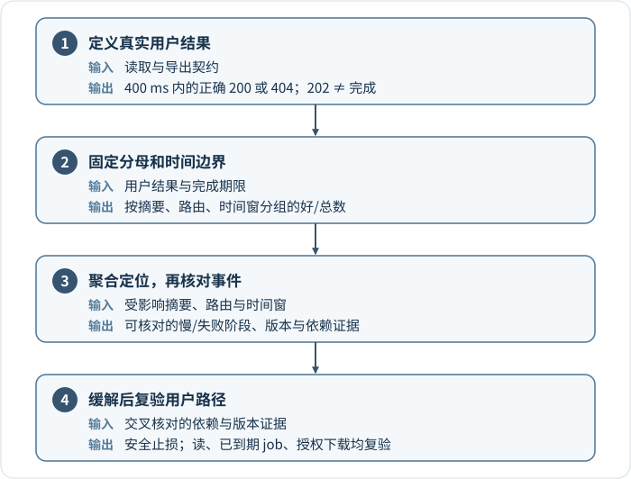
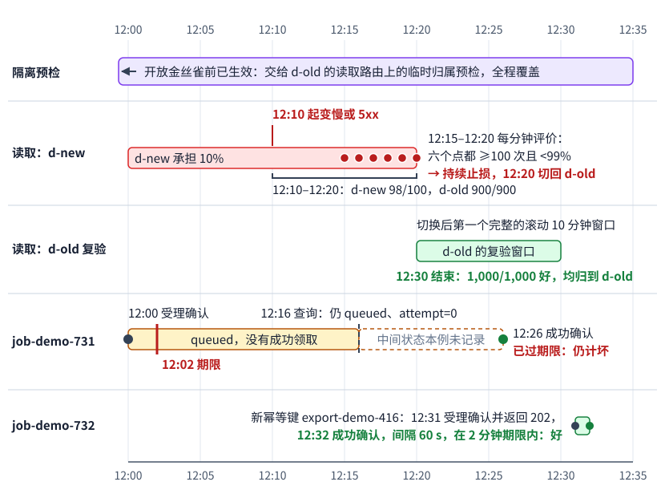

# 发布后用户结果变坏，怎样从信号走到根因并确认恢复？

沿用主线五的案例。`d-new` 正承担 10% 的金丝雀流量。12:10 起，用户读取 acct-17 的报表 42 变慢或遇到 `5xx`；同一时段，导出请求已收到 `202 Accepted`，结果却迟迟不来。[SLI 章](slis-slos-and-error-budgets.md)已经定义了怎样判断这两种用户结果的好坏，[金丝雀章](canary-rollout-and-rollback.md)给出了止损与回退的条件。本章回答剩下的问题：metrics (指标)、traces (追踪) 和 logs (日志) 各能把人带到哪里；两个同时出现的症状怎样下结论而不把相关当成根因；怎样按证据缓解，并用同一口径确认真的恢复了；遥测怎样既可诊断，又不爆炸、不泄露。文中的时间、计数和日志都是教学构造。

下图是全章的总览，把从信号到复验压成四个交接，每步的输出是下一步的输入。它与后文“按证据缓解与复验的六步”的对应关系是：图中第 1、2 步的用户结果和分母沿用 SLI 章的定义，落在六步的第 1、2 步（确认影响与信号质量、核对任务停在哪个持久边界）；图中第 3 步是“指标、追踪和日志”与案例两节的内容，也是六步的第 3 步；图中第 4 步对应六步的第 4、5 步；六步的第 6 步（事后改进）不在图中。

## 指标、追踪和日志各回答什么

三种信号分工不同：指标把人带到受影响的窗口和范围，追踪指出出问题的阶段，日志解释某一次操作的具体结果。

### 指标：影响何时出现、范围多大

指标把大量事件聚合成按时间窗的计数、比率、分布或当前积压，回答影响何时出现、范围多大、是否集中在某个摘要或依赖上。先用取值有限的标签定位到 `d-new`：路由模板、响应类别、区域、服务角色、依赖名和受控的版本标签。然后看：

- 计数器的分母、延迟分布与分位数；
- 连接池等待、数据库饱和度；
- 最老的 outbox 意图、`queued` job 和 broker 消息各等了多久；
- 实际占用的 worker 执行槽、重试和容量失败；支持的 broker 还要看未确认消息数和转入 dead-letter queue (死信队列) 的消息。

两个常见误读：broker 队列很短，不证明数据库里的 outbox 或 `queued` job 没有积压，每个交接点要分段观测（见[队列确认章](../services/queue-delivery-and-acknowledgement.md)）；租约到期只让恢复器有资格竞争接管，既不表示接管已提交，也不表示旧 attempt 已停止，所以租约到期、接管提交、已被栅栏挡住却仍占资源的 attempt 要分别观察（原理见[条件领取与栅栏章](../services/job-claims-leases-and-fencing.md)）。

### 追踪：哪个阶段慢或失败

trace 把一次操作拆成有父子关系的 span (操作区间)。同步调用通过 context propagation (上下文传播) 传递关联信息，把入口、授权、数据库和对象存储的 span 串成一条链。父子 span 或并发 span 的时长会重叠，不能把各 span 的时长直接相加当总延迟。

异步导出的链路在受理请求结束之后才继续，需要专门接起来：

- relay 用已提交 outbox 中保存的 trace context 创建发布 span，并把上下文附在 broker 消息上；
- worker 每次成功领取后创建一个独立的 attempt span，再用 span link (跨度链接) 指向消息里的创建上下文，接回因果链；
- 受控的 `jobId` 用来跨多次 attempt 查询持久状态。

不要让 HTTP span 一直挂到整个任务完成；每次 attempt 的执行阶段应能单独定位。trace 有采样时，要检查采样率、时间戳、导出是否正常和覆盖范围；找不到样本，不能证明请求或故障不存在。

> [!info] 实例：OpenTelemetry 的消息语义约定（semconv 1.45.0，核对于 2026-11-12）
> 当前的消息 span 语义约定默认用 link 关联生产与消费；只有处理单条消息等特定情形，才考虑把消息的创建上下文作为 parent (父 span)。

### 日志：这一次操作的具体结果

在结构化日志里放入 trace ID、span ID，以及受控的 `jobId`、`attempt`、状态转换和有限的错误码，就能从一个有代表性的 span 找到实际错误，再对照发布摘要和事件时间。

## 案例：12:10–12:20 的两个症状

下图先把本例的所有时刻放在一条时间轴上：前三行是隔离预检和读取的症状、止损与复验，后两行是两个导出任务。本节讲 12:20 之前的症状，12:20 之后的复验在后面第 5 步：

### 读取变慢：先确认缺口真实，再下钻

在 12:10–12:20 这个窗口里，同一路由、同一区域的 `d-new` 收到 100 次合格读请求，98 次在 400 ms 内给出了与授权关系一致的结果；稳定版 `d-old` 是 900/900（它带着跨账户缺陷，这些读取之所以都好，是因为受影响入口已按金丝雀章隔离）。按 SLI 章的规则，只看 `d-new` 自身（[为什么不能合并](slis-slos-and-error-budgets.md#金丝雀不能和稳定版合在一起评估)），它低于 99% 的门槛。门禁每分钟评价一次，图中六个评价点首末相隔整 5 分钟，每个点上 `d-new` 的滚动 10 分钟窗口都满足样本数和比例条件，所以满足持续止损条件。事先运行的冒烟核验也确认，钉到 `d-new` 的 `user-17` 得到 `200` 和已知标记，`user-29` 经 acct-29 读 42 得到与报表 43 相同的 `404`，所以这个缺口不是把正当的拒绝误算成了失败。

接着从指标下钻到 trace。同一窗口里一条慢读请求总耗时 900 ms：

- 其中授权与报表读取阶段（去掉重叠后的墙钟时间）720 ms；
- 这 720 ms 里，从数据库连接池 checkout (签出连接) 等了 600 ms，SQL 执行约 120 ms；
- 其余约 180 ms 在其他阶段。

这些阶段层层包含，不能把 900、720、600 相加。这条 trace 把慢请求定位到“等数据库连接”，却没有证明是 `d-new` 引起的，也推不出 worker 与 API 共用同一个连接池。

### 导出不来：从权威状态查起

导出症状要从数据库里的权威状态查起，而不是从队列深度猜。12:16 按 `job-demo-731` 查询 job 行、attempt 和 outbox：

- 受理提交确认在 12:00，所以完成 SLI 的期限是 12:02；
- 到 12:16 状态仍是 `queued`、`attempt=0`；
- outbox 已发布，broker 也有唤醒记录，却没有成功领取，也没有结果对象引用、`succeeded` 或 `report.ready`。

期限早已过去仍未成功，用户的导出确实受到了影响。worker 的结构化日志显示，获取数据库连接失败发生在领取之前，所以这项工作根本还没开始执行；只看“最老待处理任务等了多久”，看不出停在这个阶段。

### 相关不等于根因

两个症状出现在同一个故障窗口，都指向数据库连接。但 API 和 worker 的连接池是分开配置的，同时出现还不足以证明二者同因。在补齐数据库饱和度、各连接池的使用率和查询时长对照之前，“共享数据库压力”只是一个待验证的假设，不能写成根因。

## 按证据缓解与复验的六步

定位到阶段之后，处置沿着“用户结果 → SLI → 依赖阶段 → 可逆动作 → 用同一用户路径复验”推进，每一步都把操作和判断依据分开记录：

1. **确认用户影响与信号质量。** 确定事件起止时间、受影响的接口和区域、API 与 worker 各自运行的摘要，以及读取 SLI 的分子和分母。检查遥测是否新鲜、采样和导出是否正常；无响应的请求仍是坏事件，不能因为没有 span 就移出分母。

2. **核对任务停在哪个持久边界。** 对超时的导出 `POST`，按 `(account_id, principal_id, idempotency_key)` 查询 `export-demo-415` 的幂等记录，结果不明的先标为待定；受理事务一旦提交就算一个 accepted job，即使客户端没收到 `202`，而明确返回 `429`/`503` 的请求按约定没有创建 job。再分别看 outbox 发布、broker 投递与确认、worker 领取、attempt、数据库终态和结果读取；ACK 只说明当前这条消息交接完成。已到期仍为 `queued`/`running` 的任务在完成 SLI 中算坏，未到期的暂不进分母，但保留其等待时长作为证据。

3. **用多条证据定位。** 按摘要和路由对照金丝雀与基线的同期窗口，挑有代表性的慢或失败 trace，再用 span ID 和 job/attempt 等受控键查日志。交叉检查 API 与 worker 的连接池等待、数据库连接数与查询耗时、最老的 outbox/job/消息、对象存储错误码。单条 trace、进程健康探针或 broker 队列深度都不能直接当根因。

4. **先降低影响，再选安全路径。**
   - **止损。** `d-new` 已满足持续止损条件，停止为它加流。
   - **回退目标。** 回退目标要过金丝雀章的[三个条件](canary-rollout-and-rollback.md#回退前先确认目标当前安全、数据兼容、有容量)，而 `d-old` 过不了“当前安全”：它正是带着跨账户缺陷的旧版本，简单切回去就是让全部读取重新走有缺陷的代码。所以先隔离受影响的入口，再回退到已证明安全且兼容的版本，或者前向修复。本例的隔离（交给 `d-old` 的读取路由上的临时归属预检）在开放金丝雀前就已生效；值班人先复核它仍覆盖全部交给 `d-old` 的流量，才把 `d-new` 的 10% 切回 `d-old`。这只是争取时间的临时状态：缺陷仍在 `d-old` 里，修复版要在查清读取变慢的原因后前向发布。
   - **依赖。** 连接池等待还不能证明 API 和 worker 出自同一故障源，所以先比较两者的连接预算与数据库活动，再按证据限流或降载，不要只是调大每个进程的连接池（连接预算怎样算，见[连接池章](../data/orm-sessions-and-connection-pools.md)）。
   - **新导出。** 对尚未受理的新导出请求，可以按准入约定在 `202` 之前返回 `429`/`503`；已经受理的任务要保持可查询、可恢复，不能把拒绝新请求伪装成 job 失败。

5. **用同一用户结果复验，再考虑放量。**
   - **读取。** 切回 `d-old` 后，等切换后第一个完整的滚动 10 分钟窗口结束，用同一个读取 SLI 口径复验：时间线图中这个窗口的合格读请求全部为好事件，且每个请求都能归到 `d-old`。样本不足或归属缺失就维持当前流量，不能拿切换前的数据或跨摘要的总量代替。业务核验另从实际部署的入口做：`user-17` 读报表 42 得到 `200` 和已知标记；`user-29` 经 acct-29 读 42 得到与报表 43 相同的 `404`。这个 `404` 来自隔离预检而不是 `d-old` 的代码，它证明的是隔离仍然有效，不是缺陷已修好。
   - **旧任务。** `job-demo-731` 观察到成功提交确认后，按当前授权下载并核对了文件。它在原期限之后才成功，在完成 SLI 里仍是坏事件；而且 API 回退并不控制 worker，这次迟到的完成不能直接归功于回退，只说明这个旧任务后来可用了。
   - **新请求的完整路径。** 旧任务恢复代替不了新请求的复验。用新的幂等键 `export-demo-416` 发起导出，创建 `job-demo-732`：确认受理提交后返回 `202`；观察到成功提交确认时，结果引用与 `report.ready` outbox 已原子提交；然后从同一入口按授权下载并核对文件。时间线图中 60 秒的确认间隔满足 2 分钟的完成 SLI（它不证明实际 COMMIT 间隔，见 SLI 章）。
   - **不能当作恢复证据的。** 告警没有持续触发满 5 分钟，可能只是尚未触发或刚刚解除；队列 ACK 不代表用户拿到了文件；通知是否送达要按独立的通知 SLI 复验。30 天的长期错误预算继续单独跟踪。

6. **记录可执行的事后改进。** 记下用户受影响的时间窗、各 SLI 的分子与分母、摘要和阶段证据、采取的缓解措施（含切回 `d-old` 依赖的那道隔离何时生效、何时撤除）、前向修复的计划、相关测试，以及现有门禁为什么没有更早发现问题。只写“服务已恢复”，没有用户路径和时间窗，就无法判断是否真正止损。

## 遥测既要可诊断，又不能爆炸或泄露

上面的定位依赖标签和关联 ID，它们也可能让时序数量爆炸或泄露数据。

**指标标签取自有限集合**：规范化的路由模板 `/v1/accounts/{account_id}/reports/{report_id}`、响应类别、区域、`service_role=api|worker`、依赖名和受控的 release channel (发布通道)。每种标签组合都会成为一条独立的 time series (时间序列)，所以 cardinality (基数，即不同取值的数量) 必须有上限。不要把 `request_id`、trace ID、job ID、用户或账户 ID、原始 URL、报表标题、提示词、结果内容或任意错误文本作为指标维度。镜像摘要适合短期的发布对比，但要限制保留时长和组合数量，避免每次构建都让时序无限增长。

**追踪和日志只记必要字段。** 在有访问控制和保留期限的前提下，它们可以包含用于关联的操作 ID，但不得记录 access token、cookie、授权请求头、报表正文或原始用户内容。优先用有界的事件分类，例如 `authorization=allow|deny`、`db_error=timeout|unavailable`、`job_state=queued|running|succeeded|failed|cancelled`、`error_code=capacity_exhausted|attempts_exhausted`。跨账户授权错误要靠独立的安全审计和回归测试排查，不能靠在指标里暴露账户 ID。

## 这次事故留下了什么

本章从一个变坏的用户结果出发，走完了定位、止损和复验：三种信号各自把范围缩小一步，两个同期症状只有补齐对照证据才能归因，缓解按可逆动作推进，恢复用切换后完整窗口里同一口径的 SLI 和一条新的端到端导出证明。主线五到此结束。事后改进通常会回到前面几章：把漏掉的条件写成[能区分对错的测试](testing-by-failure-boundary.md)，把没起作用的信号加进[放量门禁](canary-rollout-and-rollback.md)。

> [!info]- 来源
> - **指标、追踪、日志的模型与上下文传播**（“指标、追踪和日志各回答什么”）：OpenTelemetry，[Signals](https://opentelemetry.io/docs/concepts/signals/)、[Traces](https://opentelemetry.io/docs/concepts/signals/traces/)、[Metrics](https://opentelemetry.io/docs/concepts/signals/metrics/)、[Logs](https://opentelemetry.io/docs/concepts/signals/logs/)、[Context propagation](https://opentelemetry.io/docs/concepts/context-propagation/)，核对于 2026-11-12。
> - **异步消息的 span link**（追踪一节与 OpenTelemetry 实例）：OpenTelemetry，[Messaging spans: consumer spans](https://opentelemetry.io/docs/specs/semconv/messaging/messaging-spans/#consumer-spans)，semconv 1.45.0，核对于 2026-11-12；默认以 link 关联生产与消费，单条消息等情形才用创建上下文作 parent。采样与敏感字段约束是本例的应用边界。
> - **标签与基数**（“遥测既要可诊断，又不能爆炸或泄露”）：Prometheus，[Metric and label naming](https://prometheus.io/docs/practices/naming/)，核对于 2026-11-12；标签组合形成时序、高基数标签有风险。这是实践建议，不是所有遥测系统的强制规范。
> - **按用户结果定义 SLI、长短窗口告警**（案例中的门禁与复验口径）：Google SRE Workbook，[Implementing SLOs](https://sre.google/workbook/implementing-slos/)、[Alerting on SLOs](https://sre.google/workbook/alerting-on-slos/)，核对于 2026-11-12；本章的窗口与阈值沿用 SLI 章的合成教学值。
> - **job 受理、成功提交的原子性与 attempt 归属**（“导出不来：从权威状态查起”与六步中的第 2 步）：本领域主线四的持久受理、条件领取与队列确认三章；数据库是任务状态的权威。
