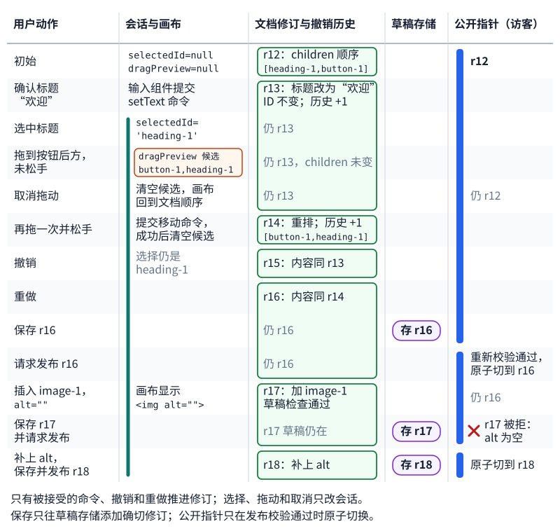

# 页面编辑器怎样建模文档、编辑会话和发布快照？

本章回答：页面编辑器里哪些数据进入可保存的文档，哪些只属于这次编辑会话，一个已保存的修订又怎样成为访客看到的公开页面。读者已经有设计章的结论：文档所有者是唯一能产生修订的模块，草稿检查与发布门禁分开。本章给出它们背后的数据模型，并说明 r17 为什么进不了公开页面。

**案例。** 沿用[设计章](design-for-change.md)的页面编辑器，把起点往前推到 r12。页面 `page-home` 当前是修订 r12，访客读到的也是由 r12 生成的公开快照。分组 `section-1` 下有标题 `heading-1`（“首页”）和报名按钮 `button-1`。编辑者依次改标题、重排、撤销与重做、保存并发布 r16，然后插入 `alt` 为空的图片得到 r17，补上 `alt` 得到 r18。数据模型要保证两件事：选择或拖动不会误写页面；访客始终知道自己看到的是哪一个已校验的修订。

## 三种数据，三种生命周期

编辑器同时持有几类生命周期不同的数据。把它们混在一起，选择节点就会推进修订，拖动就会写进撤销历史：

| 数据 | 记录什么 | 案例初值 | 生命周期 | 所有者 |
| --- | --- | --- | --- | --- |
| 页面文档 | 页面本身的事实：稳定 ID、类型、属性、子节点、顶层顺序 | r12，`section-1.children = ['heading-1','button-1']` | 可保存、可撤销、可作为预览和发布的输入 | 文档所有者 |
| 编辑会话 | 当前选择、打开的面板、拖动中的候选位置 | `selectedId=null`、`openPanel='inspector'`、`dragPreview=null` | 本次编辑器会话；不进入文档 | 会话控制器 |
| 组件局部状态 | 输入焦点、光标、尚未确认的输入缓冲 | — | 对应组件挂载期间 | 输入组件 |
| 公开快照 | 某个修订加上固定的渲染依赖 | 活动指针指向 r12 的快照 | 新草稿不断产生时保持不变，直到下一次发布成功 | 发布服务与快照存储 |

选择某个节点不推进修订，不进入撤销历史，也不影响发布。哪些字段属于文档，取决于产品语义而不是字段名：产品要保存布局，`style` 就属于文档；某个样式只服务于拖动中的临时预览，就跟 `dragPreview` 一起留在会话里。前端各类状态（URL、查询缓存、全局 store、组件）由谁持有的通用判断，见[一份界面状态该由谁持有？](../../frontend/ui-state/state-ownership-and-composition.md)；本章只看编辑器这一个所有者。

## 用扁平 ID 表表示一片森林

文档用 `rootIds` 记录顶层节点及其顺序，用按 ID 索引的 `nodes` 保存节点；`children` 只存子节点的 ID：

~~~javascript
const documentState = {
  schemaVersion: 1,
  revision: 12,
  rootIds: ['section-1'],
  nodes: {
    'section-1': { id: 'section-1', type: 'section', props: { label: '首页内容' },
                   children: ['heading-1', 'button-1'] },
    'heading-1': { id: 'heading-1', type: 'heading', props: { text: '首页', level: 1 }, children: [],
                   style: { position: 'absolute', top: 100, left: 200 } },
    'button-1':  { id: 'button-1', type: 'button',
                   props: { label: '报名', action: { kind: 'navigate', pageId: 'form' } }, children: [] },
  },
};

const editorSession = { selectedId: null, openPanel: 'inspector', dragPreview: null };
~~~

按 ID 索引让检查器能直接定位 `heading-1` 并局部更新；重排兄弟节点只改 `section-1.children`，不必挪动节点对象。

代价是结构约束不再由嵌套自动保证。已提交的文档必须是一片合法的 forest (森林)，即若干棵互不相交的树：

- 根 ID 不重复，根节点不能同时是别人的子节点。
- 每条父子边只出现一次，每个非根节点恰好有一个父节点。
- 所有节点都能从某个根到达，且没有环。

只检查“ID 唯一、引用存在、无环”还不够：两个分组可能同时引用同一个子节点，文档里也可能留下无法从根到达的孤儿节点。这些条件可以用一次父节点计数加一次从根出发的遍历检查，算法和错误定位见[怎样遍历一棵树，又怎样把扁平记录安全地还原成树？](../computation/trees-traversal-and-reconstruction.md)。产品若允许尚未挂进树的新节点草稿，可以先暂存在会话里，提交时再要求整棵树满足约束。

较小的编辑器也可以直接用嵌套对象表示树，不必过早拆成扁平表；但“每个节点只有一个父节点、都属于某个根”的规则不变。

## 视图只发命令，文档所有者产生修订

数组下标会随插入和排序变化，不能作节点的长期身份；稳定 ID 让检查器、历史记录和协作消息都能指向同一个节点。在此之上，编辑遵循 unidirectional data flow (单向数据流)：所有者把当前文档交给视图，视图只能用 **command (命令)** 请求变化，例如“把 `heading-1` 的 `text` 改成‘欢迎’”或“把 `heading-1` 移到 `button-1` 之后”。命令是可校验的意图，调用方不能直接改所有者持有的对象。

所有者处理命令时，在副本上应用改动，校验整份文档，通过才分配新修订：

~~~javascript
function commit(candidate, { recordHistory = true } = {}) {
  const next = structuredClone(candidate);
  next.revision = current.revision + 1;                 // 修订号只增不减
  const errors = validateDocument(next);                 // 森林约束 + 各类型的草稿检查
  if (errors.length) return { ok: false, errors, revision: current.revision };

  if (recordHistory) { past.push(current); future.length = 0; }
  current = deepFreeze(next);
  return { ok: true, revision: current.revision };
}
~~~

命令被拒绝时，错误返回给发起方，文档和撤销栈都不变。React 文档里“把需要协调的状态提升到最近的共同父组件”是同一种所有权思路，但这不意味着所有状态都要搬进一个全局对象，只要选中项、输入草稿和已提交文档各自由谁持有是清楚的。

如果浏览器端只是草稿缓存，服务端保存时还要检查客户端基于哪个版本，防止较旧的客户端覆盖较新的提交。HTTP 层用 ETag 与 `If-Match` 做这件事，见[两个客户端同时修改同一资源时，API 怎样防止互相覆盖？](../services/conditional-updates-and-etags.md)；表单怎样处理这类冲突见[编辑表单怎样在别人同时修改时安全保存？](../../frontend/ui-state/editing-sessions-and-conditional-writes.md)。

## 拖动只改临时投影

拖动过程中，鼠标每移动一次，候选顺序就变一次。如果每次都提交命令，撤销历史和保存任务会记下几十个无意义的中间状态。所以拖动只改会话：

- 拖动开始时，会话的 `dragPreview` 记录父节点和候选顺序，例如 `{ parentId: 'section-1', children: ['button-1', 'heading-1'] }`。
- 画布显示的是**临时投影**：已提交文档加上 `dragPreview` 合成的结果，不写回文档。不读会话的普通预览（例如预览页）仍只按文档顺序显示。
- 取消拖动就清空候选，画布回到文档顺序，修订和撤销栈都不变。
- 松手确认后才发出移动命令，由所有者生成新修订；成功后清空候选。命令被拒绝时，候选留在会话里，由界面决定提示或清除。

## 撤销与重做也产生新修订

撤销和重做恢复的是文档内容，但修订号仍在当前最大值上加一。r14 撤销得到 r15（内容同 r13），再重做得到 r16（内容同 r14）。这样撤销永远不会改写已经保存或发布过的修订，任何修订号都只对应一份内容。

历史怎样存是一个取舍：

- **整份快照。** `past` 和 `future` 各存完整文档，实现直观，但占用随历史长度和文档大小增长。
- **逆命令或操作日志。** 只存改动，省空间；但必须为移动、删除以及之后发生的变更正确定义反向操作。协作写入时，还要说明每个操作基于哪个版本。

撤销历史只存在于当前编辑会话里，保存的草稿和公开快照各有独立的生命周期。要在应用重启后仍能撤销，需要另外持久化历史或命令日志。

## 从 r12 到 r18：每一步改了哪份状态

下图把案例走完：从上往下是用户动作，四条泳道是生命周期不同的四份状态，跨越多行的块或竖条表示那份状态在这段时间里没有变：

图里的发布每次都由发布服务重新校验那个已保存的确切修订，r17 能通过草稿检查却过不了发布门禁；两类规则的分工见下文“schema 管形状”与“发布”两节。

## 所有者交出的是不可变副本

视图拿到的文档不能被它改写，否则一次误改就会绕过命令和校验。示例用 `structuredClone` 复制、`deepFreeze` 逐层冻结来表达这条边界：所有者从不把可变的内部对象直接交给视图。

~~~javascript
function deepFreeze(value) {
  if (value && typeof value === 'object' && !Object.isFrozen(value)) {
    for (const child of Object.values(value)) deepFreeze(child);
    Object.freeze(value);
  }
  return value;
}
~~~

示例的值都限于 JSON 能表示的形状。实际框架可以用不可变数据结构、序列化边界或受控更新实现同样的隔离。还要注意示例能证明什么：它只模拟单个编辑会话，不能据此推断并发保存是安全的；下文发布代码里对活动指针的一次同步赋值，只是标出切换的边界。

## schema 管形状，业务规则管含义

发布前要检查的规则分两类。JSON Schema 2020-12 的 `type`、`required`、数组和数值约束能表达单个节点的大部分结构条件，例如 `alt` 必须是字符串、标题层级是 1 到 6 的整数。但有些规则不是“形状”：

- 跨节点的图约束：每个节点只有一个父节点、都能从根到达。标准关键字无法表达，需要应用代码。
- 引用目标是否存在、当前用户能否操作、发布时 `alt` 是否非空：这些是产品和服务端规则。

规则也分布在不同环节：

1. **从存储载入时**，先解析结构，返回能定位到具体节点的错误。
2. **执行编辑命令时**，检查本次变更是否让文档仍然合法。
3. **发布时**，对选定的修订重新确认结构、引用、权限和所需的外部资源。

浏览器里的即时校验能更早提示，但不能替代可信边界上的校验。渲染器也不应把无效节点静默渲染成空白，否则读者分不清“内容本来为空”和“数据已损坏”。

## 发布：绑定确切修订，固定渲染依赖，原子切换指针

保存不等于发布。保存只把一个修订放进草稿存储；只有编辑者明确请求发布某个已保存的修订，发布服务才开始工作：

1. **锁定一个确切的已保存修订**，而不是“当前最新”。否则校验期间又有新编辑提交，公开出去的可能是一份没校验过的内容。
2. **重新校验**这个修订的结构、组件属性、引用目标、当前用户权限和外部资源。
3. **生成不可变快照**，记录 `documentId`、`revision`、`schemaVersion`、组件注册表版本和渲染器版本。
4. **原子切换活动指针**，访客从此读新快照。

~~~javascript
function publishRevision(revision) {
  const document = savedDrafts.get(revision);           // 只接受已保存的确切修订
  if (!document) return { ok: false, error: 'publish requires a saved revision' };

  const errors = [...validateDocument(document), ...publishRuleErrors(document)];
  if (errors.length) return { ok: false, errors, activeRevision: activeSnapshot.revision };

  activeSnapshot = deepFreeze({                          // 多进程服务里是一次原子的指针更新
    documentId: 'page-home',
    revision,
    schemaVersion: document.schemaVersion,
    componentRegistryVersion: 'components-v1',
    rendererVersion: 'renderer-v1',
    document: structuredClone(document),
  });
  return { ok: true, activeRevision: revision };
}
~~~

在案例里，`publishRevision(17)` 因“`image-1` 的 alt 为空”返回错误，活动指针仍是 r16；`publishRevision(18)` 通过，指针切到 r18。示例中的同步赋值只标出切换点；多进程服务需要用数据库事务或等效的原子更新来切换持久化的指针。

**为什么要固定渲染依赖。** 只固定文档修订不足以复现画面。组件渲染代码更新后，旧修订可能渲染出不同的结果；`image-1` 引用的 `/media/diagram.png` 若被原地替换，旧快照显示的图片也会跟着变。系统可以固定这些依赖的版本，也可以保存确切的构建产物并固定外部资源引用。

**草稿与公开版并存。** r17 被拒期间，编辑者可以继续编辑，访客仍读 r16。失败的发布不删除草稿，也不改写当前页面。

**回滚不是撤销。** 回滚是把活动指针重新指向一个仍然可用的既有快照，作用在公开版；撤销作用在编辑历史，产生新的草稿修订。二者解决不同问题。

产品也可以设计“保存即发布”，但要说清哪些校验在编辑期、保存期和发布期执行，不能让同一条规则在一个入口允许、在另一个入口意外阻断。

## 文档顺序不等于绘制顺序

`section-1.children` 的顺序决定组件在图层面板里的逻辑顺序，但浏览器的绘制顺序还受 CSS 定位、`z-index` 和 **stacking context (层叠上下文)** 影响。重排两个兄弟节点只改变树顺序；如果某个组件创建了独立的层叠上下文，把它在数组里移到另一个节点后面，不保证它在视觉上盖住另一个上下文里的元素。

所以编辑器若提供“置顶”或“置底”，要说明它改的是树的兄弟顺序、同一层叠上下文内的层级，还是另一个独立的渲染模型。层叠上下文怎样形成见[定位元素参照谁，为什么大 z-index 还会被盖住？](../../frontend/html-css/positioning-and-stacking.md)。

## 多人协作：传输、排序和冲突解决分开设计

前面的模型只有一个编辑会话。多人同时编辑时要分开回答三个问题：

- **怎样传输。** WebSocket 这类通道只把编辑事件送到对方，不决定两人同时移动 `heading-1` 时以谁为准。推送通道的选型与断线续读见[服务端要持续推送更新时，怎样选通道，断线后又怎样接上？](../services/real-time-channels-and-resume.md)。
- **怎样排序。** 单写者模型由服务端按顺序处理命令；版本条件或锁可以拒绝并发写入，代价是更多冲突提示或等待。
- **怎样解决冲突。** **operational transformation (操作转换，OT)** 根据已发生的并发操作改写后到的操作，以维持规定的一致性；**conflict-free replicated data type (无冲突复制数据类型，CRDT)** 把数据类型设计成满足特定数学条件，使各副本无论以什么顺序收到更新，合并后都收敛到同一状态。两者都还要定义操作格式、删除与移动语义、版本兼容和树约束。

按离线需求、实时合并要求、服务端排序能力和审计要求选择机制。即使采用 OT 或 CRDT，节点类型校验、树的父子约束和发布规则仍然要执行。

## 本章产出

页面编辑器的数据被分成三份：文档只经命令产生单调递增的修订，会话承载选择与拖动，公开快照绑定一个已保存的确切修订和它的渲染依赖，靠原子切换指针生效。r17 能保存却进不了公开页面，因为发布门禁只对锁定的那个修订放行。

“发布绑定确切的、已验证的输入，回滚只是重新指向既有产物”这一思路在主线五后面还会出现：服务的镜像按摘要晋级、按版本回退，见[已验证的产物怎样原样晋级到生产？](build-once-promote-by-digest.md)。

> [!info]- 来源
> - **JSON Schema 能表达的结构约束**（“schema 管形状，业务规则管含义”）：JSON Schema Draft 2020-12, Validation §6 的 `type`、`required`、数组与数值关键字：[规范](https://json-schema.org/draft/2020-12/json-schema-validation)，2026-11-12 核对。
> - **绘制顺序与层叠上下文**（“文档顺序不等于绘制顺序”）：W3C CSS 2.2, Appendix E “Elaborate description of Stacking Contexts”：[规范](https://www.w3.org/TR/CSS22/zindex.html)，2026-11-12 核对。
> - **共享状态的所有权与状态提升**（“视图只发命令”）：React, “Sharing State Between Components”：[原文](https://react.dev/learn/sharing-state-between-components)，2026-11-12 核对。
> - **客户端校验只作即时反馈，可信边界仍要校验**（“schema 管形状”“发布”）：OWASP *Input Validation Cheat Sheet*, “Common Pitfalls · Client-only checks”：[原文](https://cheatsheetseries.owasp.org/cheatsheets/Input_Validation_Cheat_Sheet.html#common-pitfalls)，2026-11-12 核对。
> - **发布时按请求重新校验权限**（“发布”第 2 步）：OWASP *Authorization Cheat Sheet*, “Validate the Permissions on Every Request”：[原文](https://cheatsheetseries.owasp.org/cheatsheets/Authorization_Cheat_Sheet.html#validate-the-permissions-on-every-request)，2026-11-12 核对。
> - **CRDT 的收敛条件**（“多人协作”）：Shapiro 等, *Conflict-free Replicated Data Types*, SSS 2011, §§2–3：[论文](https://perso.lip6.fr/Marc.Shapiro/papers/2011/CRDTs_SSS-2011.pdf)。
> - **OT 的一致性性质**（“多人协作”）：Sun 等, *Achieving Convergence, Causality Preservation, and Intention Preservation in Real-Time Cooperative Editing Systems*, 1998：[论文](https://www.cs.cityu.edu.hk/~jia/research/reduce98.pdf)。
