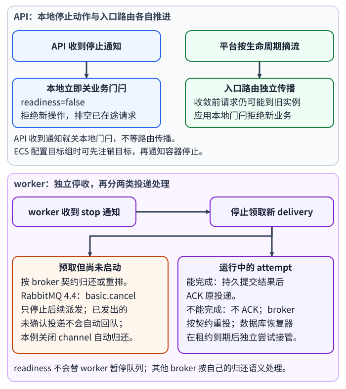
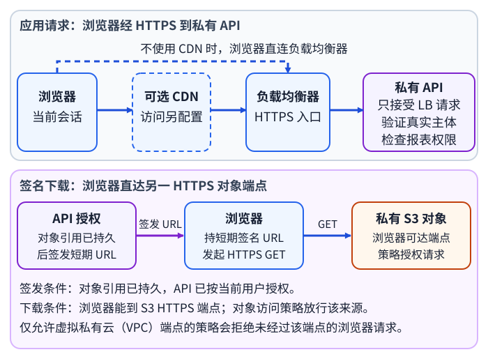

# 服务该跑在哪种运行时上，平台怎样启动、探测和停止它？

沿用主线五的案例。[上一章](build-once-promote-by-digest.md)让 `d-new` 获批并在生产启动，但还没有用户流量。报表服务在生产里不是一个进程，而是几个角色：

- **API**：对外接收读取和导出请求（HTTP）。
- **worker**：常驻等待队列，领取导出 job，执行 attempt，把结果写进私有对象存储。
- **outbox relay (发件箱中继)**：把数据库里已提交的待发意图发布到消息代理。
- **lease recoverer (租约恢复器)**：扫描租约已过期的 job，按条件接管或收尾。

这几个角色做什么、为什么这样设计，在主线四的[持久受理与 outbox](../services/durable-job-acceptance-and-outbox.md)和[条件领取与栅栏](../services/job-claims-leases-and-fencing.md)里讲过。本章只关心平台这一侧：它们该跑在哪种运行时上，平台替你管什么、不管什么，怎样判断进程可以接流量，停止时按什么顺序关门，每个角色拿着什么网络身份和凭据，以及组件信号能说明什么。

API 与 worker 用同一个 `d-new` 摘要、不同的启动命令运行，不重新构建。relay 只有在镜像里确实包含它的执行入口时才复用这个摘要，否则要交接它自己核验过的摘要。

## 按时长、并发和停止行为选运行时

选运行时不看“云上”或“无服务器”这样的标签，而看几个问题：工作何时开始，最长会运行多久，并发怎样到达，能否安全重试，需要哪些连接和状态，平台停止进程时能否完成当前交接。

| 运行形态 | 适合的约束 | 必须核对的边界 |
|---|---|---|
| function service (函数托管服务) | 事件触发、每次工作有明确上限，供应商的重试、并发和执行上下文与业务匹配 | 单次时长上限、冷启动、并发与配额、网络与连接池、触发及重试语义；要持久进度时用平台支持的状态编排，不把内存当跨调用状态 |
| managed container service (托管容器服务) | HTTP 服务或队列消费者需要长期进程、明确的并发上限、连接生命周期和停止钩子 | 健康检查怎样影响流量、扩容是否够快、停止宽限期能否覆盖排空、多个副本怎样共享外部数据库与队列而不共享进程内状态 |
| virtual machine (虚拟机，VM) | 依赖主机级配置、守护进程、内核能力或遗留运行环境 | 主机补丁、容量与故障替换由团队负责；托管 VM 产品要按其服务合同重新划定责任 |

再按峰值与稳态负载、最低常驻容量、启动延迟容忍度、长连接、并行度、单次执行限制和团队运维能力比较。“自动扩展”有两个常被忽略的边界：它不保证尖峰请求立即拿到新实例，也不会给数据库增加连接容量。每加一个副本，就按“副本 × 每副本进程 × 每进程池上限”多占数据库连接；worker 副本还同时增加物理执行槽。这些账怎样一起算，见[容量与准入章](../services/capacity-admission-and-backpressure.md)和[连接池章](../data/orm-sessions-and-connection-pools.md)。

报表服务的选择是：API 要持续接收读请求，worker 常驻等待队列并在停止时完成当前 attempt 或安全交还投递，所以 API、relay 和 worker 作为三个可独立扩缩容的托管容器服务运行，各自配置并发、容量、网络和身份。relay 单独控制，避免把它错误地包进 API 的健康状态或 worker 的暂停开关。只有导出能拆成明确有界的事件步骤，且平台的触发、重试、最长时长和连接约束都合适时，才把计算阶段拆成函数。

> [!info]- 实例：AWS Lambda 的三种模式时长不同（核对于 2026-11-12）
> AWS Lambda 文档区分默认函数调用、Lambda Managed Instances 和 durable functions (持久函数)：默认单次调用最长 15 分钟；Managed Instances 的异步或事件源映射调用可到 90 分钟；持久函数用检查点跨多次调用，异步执行最长可到一年。三者的状态、并发和恢复语义不同，不能用“函数最长多久”一句话概括。默认执行环境可能复用全局对象和 `/tmp`，可以做可丢弃的缓存或连接复用；但环境会被回收，不能当跨调用的持久数据，未完成的后台回调也不能指望以后继续执行。重复事件要求处理幂等。

## 托管平台管什么，应用仍负责什么

托管减少的是平台运维，不会替工作负载选择安全配置：

| 层 | 平台通常负责 | 应用团队仍负责 |
|---|---|---|
| 计算 | 按服务方案提供主机维护、调度和运行环境 | 镜像、启动与退出、资源上限、扩缩容策略、健康规则 |
| 数据库 | 所选配置包含的基础设施、补丁、备份或故障切换 | schema 与迁移、查询与连接行为、权限授予、保留期、恢复演练 |
| 对象存储 | 服务可用性与文档承诺的持久性机制 | 私有命名、保留与生命周期、上传上限、谁能拿到签名 URL 及其过期与撤权 |
| 队列 | 在服务合同和配置限制内存储并投递消息 | 幂等处理、重试退避、毒消息处理、队列年龄、dead-letter queue (死信队列) 恢复 |

托管数据库不会修复缺索引的查询或连接风暴；托管队列也不会让一个非幂等的 worker 在重试时变得安全。

## 平台怎样判断进程可以接流量

平台对一个进程要回答三个不同的问题，各用一种探针：

- **启动完成了吗？** startup probe (启动探针)。慢启动的进程在它成功之前不该被当成“卡死”。
- **还活着吗？** liveness probe (存活探针)。进程卡死、无法自愈时，重启它。
- **现在能接新请求吗？** readiness probe (就绪探针)。暂时不能接时，先别给它发流量，但不重启。

Kubernetes 中，Pod 是承载一个或多个容器的调度单元，三种探针的行为如下：

- 配置了 startup probe 时，kubelet (节点上的容器管理代理) 在它成功之前不执行另两种探针。
- startup 或 liveness 失败达到 `failureThreshold` 后，kubelet 终止容器，再按 Pod 的重启策略重启。Deployment 的 Pod 模板只允许 `restartPolicy: Always`。
- readiness 失败不会重启容器。它把 Pod 标成未就绪：默认 EndpointSlice (端点切片) 仍保留这个地址，但把 `ready` 置为 `false`，匹配的 Service 不再把它当作就绪端点发送常规新流量。Service 设置了 `publishNotReadyAddresses: true` 时，这个条件被忽略。

liveness 不要依赖每个短暂的下游故障。数据库抖动一下，所有副本的 liveness 一起失败、一起重启，只会放大故障；下游暂时不可用更适合反映在 readiness 或请求错误上。

不论哪种探针，就绪只说明平台可以把新流量发给这个实例，不说明 `user-29` 读不到 acct-17 的报表 42，也不说明导出 job 能完成。业务路径要在开放流量前另做生产冒烟检查，见[金丝雀章](canary-rollout-and-rollback.md)。

> [!info] 版本说明
> 以上是 Kubernetes v1.37 的行为（核对于 2026-11-12）。其他平台要查各自的语义；Docker 与 Compose 的 healthcheck 见 [Compose 支线](compose-local-stack.md)。

## 停止时各角色怎样关门

扩缩容、部署和故障替换都会停止进程。进程内部的关停顺序在[主线二的优雅关停章](../runtime/graceful-shutdown.md)：先拒绝新工作，再排空在途工作；每种资源要等到可证明的完成状态才释放；内部 deadline 必须早于外部的强杀时刻。本章讲平台一侧：各角色收到停止信号后该做什么，平台按什么顺序摘流、什么时候强杀。

### 各角色在自己的控制面立即关门

进程收到停止信号后，每个服务立即在自己的控制面开始关闭，不等入口路由更新传播完，也不等其他服务先结束：

- **API**：收到通知就关闭本地业务门闩，拒绝开始新的业务操作，开始排空在途请求；同时让 readiness 返回未就绪，让平台异步更新路由目标。路由摘除传播期间仍可能有请求到达，所以本地门闩不能依赖探针传播。已开始的请求在宽限期内完成或按应用契约安全中止，然后关闭连接池、线程、临时文件和 telemetry exporter (遥测导出器)。
- **worker**：独立停止领取新的 delivery (消息投递)，再分两类处理。运行中的 attempt 能在截止前完成，就先持久提交业务结果、再 ACK；不能完成就不 ACK，让 broker 重新投递，由租约恢复器按租约规则接管。已预取但还没启动的投递，按 broker 的关闭与归还契约放回队列（各 broker 的做法见[队列确认章](../services/queue-delivery-and-acknowledgement.md)）。readiness 不会替 worker 暂停队列消费。
- **outbox relay**：停止认领新的待发意图，宽限期内等待已开始的发布得出可判定的结果。只有 broker 的确认、路由和持久性条件都满足、且数据库里的 `published` 更新成功，才把意图标为完成；缺确认或更新未提交时不伪记成功，释放认领（或等认领租约过期），由新的 relay 重试。重复发布同一个 job ID 是允许的，worker 的持久条件领取负责去重。

### 平台的摘流顺序不能当成一条通用时间线

不同平台摘流和发停止信号的先后不同，不能合并成一条通用时间线，也不能假设只把 readiness 置为 false 就完成了摘流。

> [!info] 实例：Kubernetes 与 Amazon ECS 的停止顺序（核对于 2026-11-12）
> **Kubernetes v1.37。** 删除 Pod 时，控制面更新 EndpointSlice 与 kubelet 在节点上开始容器的优雅停止**同时**进行。终止中的 endpoint 可以暂时留在 EndpointSlice 里，但标为 `ready: false`，不是物理删除。默认的 Service 代理通常忽略 terminating (正在终止) 的 endpoint；若所有可用端点都在终止，可能路由到同时处于 `serving` 和 `terminating` 的端点；设置了 `publishNotReadyAddresses` 的 Service 会把 `ready` 置为 true。集群代理、入口控制器和 Service 配置都会影响实际路由。
>
> **Amazon ECS。** 只有 service task 配置了负载均衡目标组时，任务才会**先**在 `DEACTIVATING` 注销目标，**再**进入 `STOPPING`，通知 Linux 容器停止。正常停止信号默认是 `SIGTERM`；超过容器定义字段 `stopTimeout` 后发 `SIGKILL`。Fargate 未设置时默认 30 秒、最大 120 秒；ECS on EC2 未设置时用 agent 的 `ECS_CONTAINER_STOP_TIMEOUT`，都没配置则默认 30 秒。

### 宽限期要覆盖整条关停路径

平台给的宽限期必须覆盖停止领取、排空、提交或归还、清理全部步骤。反过来说，进程自己的内部 deadline 加上实测的清理余量，必须落在平台的强杀时刻之前。主线二的关停回放用 1 秒内部 deadline 演示分支，在 Fargate 默认 30 秒的宽限期里有足够余量；换到下面 PM2 的默认值，就要重新核对。外部的强杀只是让进程消失，不能替代持久任务的恢复和未知副作用的对账。

> [!info] 实例：PM2 的停止信号与截止时间（核对于 2026-11-12）
> PM2 是 Node.js 常用的进程管理器，可以显式指定实例数（如 `pm2 start app.js --name api -i 2`），用 `pm2 list` 或 `pm2 monit` 查看，用 `pm2 reload api` 发起集群重载；reload 超时后会退回普通 restart。在支持 POSIX 信号的平台上，PM2 在 stop、restart 和 reload 时默认先发 `SIGINT`（可用 `PM2_KILL_SIGNAL` 改成别的信号），`kill_timeout` 默认 1600 ms，到期后发 `SIGKILL`。应用要处理部署环境实际发来的那个信号，并让自己的排空 deadline 加清理余量小于 `kill_timeout`，或者相应调大它。

## 网络可达、工作负载身份、用户授权三层不可互替

每个角色上线前都要回答“它能连到哪、能对哪些资源做什么、替谁做”。这是三层不同的控制，任何一层都替代不了另外两层：

1. **网络可达**：路由、防火墙或安全组决定“谁能连到哪个地址”。
2. **工作负载身份**：服务主体及资源策略决定“这个进程能对哪个资源做什么”。
3. **用户业务授权**：API 和 worker 的业务逻辑决定“当前用户能否读取 acct-17 的报表 42、能否导出它”，规则在[逐次授权章](../services/per-request-authorization.md)。

HTTPS 只加密浏览器到入口之间的传输，不替 API 授权当前主体。常见拓扑只公开应用的 HTTPS 入口；API 只接受负载均衡器转来的请求；数据库只允许 API、worker、relay 和租约恢复器各自的私有网络身份接入，并配合最小 SQL 权限：

| 角色 | 网络上要到达 | 身份与数据权限边界 |
|---|---|---|
| API | 数据库；签名下载 URL 可用本地凭据生成，不必代理对象文件 | 从真实会话或令牌取得当前主体，逐请求检查账户与报表权限；按账户范围读报表、成员关系、授权与 job 状态；只写受理事务需要的 job、outbox 与等待槽；签名身份只获准读对应的结果对象 |
| outbox relay | 数据库 + broker | 只认领待发意图并更新同一条意图；只向获准的队列发布；不承载用户授权 |
| worker | 数据库 + broker + 私有对象存储 | 按 job 的账户范围读取报表输入和当前授权；只更新被条件领取的 job/attempt；对象写入限制在报表前缀；先持久业务结果，再 ACK |
| 租约恢复器 | 用独立私有网络身份直连数据库；重排意图由 relay 另行发布 | 独立数据库主体（如 `runtime_recovery`），只读扫描与竞争所需的 job 标识、状态、attempt、租约截止时间和取消标志；用条件事务接管、重排（同时预留等待槽并插入待发意图）或写终态；不读报表内容，没有 broker 发布权，不替用户授权 |
| 浏览器下载 | 持 URL 直达浏览器可达的对象存储 HTTPS 端点，不经 API | URL 只授予被签名的那个对象操作、有效期有限；对象存储的资源策略仍须允许这条来源路径；浏览器拿不到 worker 的云角色 |

worker 的一条规则值得单独说：队列消息只带 job ID，worker 读输入前要以服务身份复核发起主体当前仍有 `report:export`；已被撤销就持久写入 `failed` 和有界错误码 `authorization_revoked`，不读报表。消息 ID、worker 的云角色或“当初提交时有权限”都不能代替这次复核。

## 每个运行角色拿着哪种凭据

“凭据”在运行时里至少有三种，它们代表不同的主体：

| 凭据 | 代表谁、用来做什么 | 谁能读取或验证 | 怎样撤销 |
|---|---|---|---|
| 工作负载临时凭据（如 ECS task role） | 一个运行中的任务调用云 API，例如 worker 向报表前缀写对象 | 该任务里的应用容器 | 角色、目标资源策略或任务凭据失效；不能替用户授予报表访问权 |
| HMAC 共享密钥（如 webhook 签名密钥） | 发送端签名、接收端验证同一来源的消息 | 两端都持有同一个密钥值 | 接收端停用 keyId，部署移除旧值，并停掉持有旧值的进程 |
| 用户 OAuth grant (用户授权) | 某个用户允许应用访问特定下游资源和 scope | 只在绑定的用户、账户、audience 和 scope 上下文中使用 | 用户撤权、授权到期或 provider 撤销；不影响其他用户的 grant |

三条要点：

- **工作负载凭据不是用户授权。** 它说明“这个进程能写这个前缀”，不说明“这个用户能导出这份报表”。支持的 SDK 标准凭据提供程序会自动取得并更新临时凭据；应用不要把它复制成长期静态密钥。
- **HMAC 是对称的。** 持有密钥的任何一方都能算出有效签名。把发送端和接收端拆成不同进程、不同角色，能缩小其他 Secret 和业务动作的暴露面，却不能在密码学上保证接收端“只能验、不能签”；真要分离签名权与验证权，就用非对称签名。
- **用户 grant 按用户隔离。** Refresh Token 不进所有 worker 共享的环境、日志、模型上下文或恢复快照，只为已绑定的那个用户 grant 取用。会话与令牌的身份边界见[会话与浏览器边界章](../services/sessions-and-browser-boundaries.md)。

> [!info] 实例：ECS 的两种角色与任务隔离（核对于 2026-11-12）
> ECS 区分 task execution role (任务执行角色) 和 task role (任务角色)。task definition (任务定义) 引用 Secrets Manager 中的 Secret ARN，不写密钥值；execution role 授予 ECS agent 在启动任务时读取指定 ARN 的 `secretsmanager:GetSecretValue`（用客户自管 KMS key 时还要 `kms:Decrypt`），用来取值并注入，不直接提供给应用代码。task role 只控制应用运行期的 AWS API 动作。Linux Fargate 在 task 之间提供隔离边界，但同一个 task 里的多个容器共享该 task 的权限，互不信任的应用不要放进同一个 task；ECS on EC2 上并置 task 与宿主机的访问边界不同，ECS 文档明确说明容器本身不是安全边界。

## 注入的密钥要替换任务才会更新

许多平台在进程启动时把密钥注入环境变量。这带来一条运行时规则：**改了密钥存储里的值，运行中的进程不会知道，必须启动新进程。** 所以进程能安全停止和替换，是凭据轮换的前提。

几条做法：

- **一次读取拿到一致的一组值。** 若把 keyId 和 key 分成两个值分别注入，两次读取之间当前版本可能恰好移动，结果新 key 配上旧 keyId；把它们放在同一个 JSON 值里注入就避免了这种错配。
- **轮换靠替换任务。** 跟随“当前版本”标签时，移动标签后要强制滚动部署；固定版本号时，先发布引用新版本的任务定义修订，再替换任务。删除 Secret 的值也清不掉进程里已注入的副本，同样要替换任务。
- **环境变量会被读到。** 容器内的应用、日志和调试工具都可能读环境变量：不要 dump 环境，不要在异常里回显配置，也不要把密钥放进镜像层、版本库、命令参数、前端 bundle、请求日志或模型的 prompt 与检查点。
- **轮换顺序由协议决定。** 共享密钥的正常轮换是“接收端先同时接受新旧键 → 发送端切到新键 → 等旧签名在每个接收端都已过期且在途验证结束 → 接收端移除旧键”；密钥泄漏时不留新旧双接受窗口。完整序列与等待时长的推导在 [webhook 支线](../services/webhook-delivery-and-verification.md)，本章只负责“每一步都要替换对应的任务”。

> [!info]- 实例：ECS 注入 Secrets Manager 密钥与审计（核对于 2026-11-12）
> ECS `valueFrom` 可以引用完整 secret、其中的 JSON key、version-stage 或 VersionId；不指定 stage 或 VersionId 时默认读取 `AWSCURRENT`，两种版本选择不能同时指定。Linux Fargate 注入特定 JSON key 或版本要求平台版本 1.4.0 或更高，注入完整 secret 至少要 1.3.0。Secret 在 task 启动时注入，移动 staging label 不会更新运行中任务的环境变量，必须启动新 task 或强制服务滚动部署。
>
> 把 Secret 读取与业务 API 调用分开审计。`GetSecretValue` 会产生 CloudTrail 事件，可以查哪个授权主体请求了哪个 Secret ARN，但不能假设事件里带 taskArn 或 API 响应中的 VersionId；API 响应本身含 VersionId，SecretString/SecretBinary 不进入 CloudTrail。要证明每个运行中的 task 实际解析了哪个版本，就固定 VersionId，或使用平台确实提供的非敏感解析版本证据；只凭任务定义修订和标签移动时间线，断言不了竞态期间每个 task 读到哪一版。应用用 task role 调用 AWS API 的 CloudTrail 会话可带 taskArn，但这条业务调用审计替代不了 Secret 注入审计；审计轨迹也不能单独证明 IAM 策略和对象前缀已经最小化。

## 预签名下载 URL 是持有者凭据

导出结果的下载走另一条路径。只有任务结果和对象引用已持久、API 已按当前用户授权，API 才签发一个短期 URL；浏览器随后直接向对象存储请求，不经过 API 的数据路径。

这个 URL 是 bearer token (持有者令牌)：谁拿到谁就能用，不能当成可以公开缓存的普通地址。它有三个容易被误解的性质：

- **它按签发者的权限授权，而不是按用户。** 应用撤销用户的业务权限，不会撤销已经签发的 URL。所以有效期要短，签发前的授权检查不能省。
- **它在有效期内可以重复使用。** 实际有效期还不超过签发所用临时凭据的到期时间；这些凭据被撤销、删除或停用，URL 也随之失效。
- **“对象私有”不等于“浏览器连不上”。** 浏览器必须能到达被签名的对象存储端点，资源策略也要允许这个请求上下文；若策略只允许来自指定 VPC endpoint 的请求，没经过该端点的浏览器即使签名正确也会被拒绝。

浏览器网络不能直达对象存储时，可以经应用代理或配置私有源站的 CDN 提供下载。CDN 还需要单独设置签名访问、私有源站和缓存策略，保证用户不能绕过 CDN 直接访问源对象；不能照搬公共静态文件的缓存规则，CDN 签名 URL 与对象存储签名 URL 的签名方式也不是一回事。

> [!info] 实例：Amazon S3 与 CloudFront（核对于 2026-11-12）
> 本例的对象存储是 Amazon S3。worker 的 task role 只需写指定的报表对象前缀，IAM 策略还应限定目标 bucket、前缀和动作；签发下载 URL 的 API task role 需要对目标对象有 `GetObject` 权限。经 CloudFront 分发私有对象时，用其 signed URL 或 signed cookie，并限制直达源站的路径。

## 组件信号只说明组件

每个组件都要预先列出计划中的失败、观察信号和成本边界：

| 组件 | 计划中的失败 | 观察信号 | 成本与限制 |
|---|---|---|---|
| 负载均衡 / 网络 | 错路由、无健康目标、出站受阻、证书过期 | 请求错误、连接失败、健康目标数 | 请求与字节、网络地址转换、数据传输 |
| 计算服务 | 启动失败、崩溃循环、CPU 或内存饱和、扩容慢 | 就绪实例、CPU/内存、重启次数、请求排队 | 最低副本与运行时间；扩容不是瞬时容量 |
| 数据库 | 连接耗尽、锁等待、I/O 或存储、故障切换 | 连接池等待、连接数、查询时延、锁 | 计算、存储、I/O、备份保留 |
| 对象存储 | 权限错误、路由故障、对象意外公开、无限保留 | API 错误、对象增长、下载量 | 存储、请求、生命周期、复制、出站流量 |
| outbox relay | relay 停摆、确认缺失、待发意图反复重试 | 最老待发意图的年龄、认领过期数、发布确认失败 | relay 运行时间、数据库扫描与发布请求 |
| 队列 / worker | 重复或延迟投递、毒消息、积压上升、执行槽耗尽、过期租约被接管 | 最老消息年龄、队列深度、未确认数、死信队列、执行槽占用、过期租约与恢复结果 | 消息保留、worker 计算、积压排空与孤儿对象清理 |

这些信号只反映平台和组件的状态。CPU 不高不证明报表 42 能被正确读取；队列有消费者不代表报表已经生成；relay 停摆时，broker 队列深度看起来反而“正常”，所以要盯最老待发意图的年龄。组件信号要连到用户结果上才有意义。

## 交给下一步的是什么

到这里，`d-new` 的每个角色都有了明确的运行形态、探针、停止顺序、网络身份和凭据，平台能启动、探测和替换它们。但平台说“就绪”、组件信号全绿，都还没有回答用户关心的事：`user-17` 能否在 400 ms 内读到报表，导出能否按时完成。下一章先把这些用户结果定义成可计数的 SLI，再决定还能不能放量：见 [SLI、SLO 与错误预算](slis-slos-and-error-budgets.md)。

> [!info]- 来源
> - **函数服务的时长、重试与环境复用**（Lambda 实例 callout）：AWS Lambda，[Designing Lambda applications](https://docs.aws.amazon.com/lambda/latest/dg/concepts-application-design.html) §“Build for on-demand data instead of batches”、[Lambda execution environment lifecycle](https://docs.aws.amazon.com/lambda/latest/dg/lambda-runtime-environment.html) §“Invoke phase”，核对于 2026-11-12；只适用于所列 Lambda 模式。
> - **探针语义与 EndpointSlice 条件**（“平台怎样判断进程可以接流量”）：Kubernetes v1.37 文档，[Liveness, Readiness, and Startup Probes](https://kubernetes.io/docs/concepts/workloads/pods/probes/)、[EndpointSlice conditions](https://kubernetes.io/docs/concepts/services-networking/endpoint-slices/#conditions)、[Deployment API](https://kubernetes.io/docs/reference/kubernetes-api/apps/deployment-v1/)，核对于 2026-11-12。探针文档正文说 EndpointSlice 控制器“移除”Pod IP；v1.37.1 控制器的 [`podToEndpoint`](https://github.com/kubernetes/kubernetes/blob/v1.37.1/staging/src/k8s.io/endpointslice/utils.go#L33-L53) 实际保留地址并写入 `ready: false`，本章按 API 对象行为描述。
> - **Pod 终止与摘流并发**（Kubernetes 停止顺序实例）：Kubernetes v1.37，[Pod Lifecycle](https://kubernetes.io/docs/concepts/workloads/pods/pod-lifecycle/)、[EndpointSlice conditions](https://kubernetes.io/docs/concepts/services-networking/endpoint-slices/#conditions)，核对于 2026-11-12；删除 Pod 时 EndpointSlice 更新与 kubelet 本地终止同时开始，全部端点终止时可路由到 `serving && terminating` 端点。
> - **ECS 停止顺序与超时**（ECS 停止顺序实例）：AWS，[ECS task lifecycle](https://docs.aws.amazon.com/AmazonECS/latest/developerguide/task-lifecycle-explanation.html)（配置目标组时 DEACTIVATING 先注销）、[ContainerDefinition API](https://docs.aws.amazon.com/AmazonECS/latest/APIReference/API_ContainerDefinition.html)（`stopTimeout`；Fargate 默认 30 秒、最大 120 秒；EC2 上 agent 默认），核对于 2026-11-12。
> - **PM2 信号与截止时间**（PM2 实例 callout）：PM2，[Cluster Mode](https://pm2.keymetrics.io/docs/usage/cluster-mode/)（reload 失败回退 restart）、[Graceful Start/Shutdown](https://pm2.keymetrics.io/docs/usage/signals-clean-restart/)（默认 `SIGINT`，`kill_timeout` 1.6 秒后 `SIGKILL`）、[Environment Variables](https://pm2.keymetrics.io/docs/usage/environment/)（`PM2_KILL_SIGNAL`），核对于 2026-11-12。
> - **工作负载角色、Secret 注入与任务隔离**（“每个运行角色拿着哪种凭据”“注入的密钥要替换任务才会更新”及 ECS 实例）：AWS，[ECS task IAM role](https://docs.aws.amazon.com/AmazonECS/latest/developerguide/task-iam-roles.html)、[Task execution IAM role](https://docs.aws.amazon.com/AmazonECS/latest/developerguide/task_execution_IAM_role.html)、[IAM roles best practices](https://docs.aws.amazon.com/AmazonECS/latest/developerguide/security-iam-roles.html)、[Pass Secrets Manager secrets through environment variables](https://docs.aws.amazon.com/AmazonECS/latest/developerguide/secrets-envvar-secrets-manager.html)（版本引用规则、平台版本要求、需强制新部署），核对于 2026-11-12；AWS SDK，[Standardized credential providers](https://docs.aws.amazon.com/sdkref/latest/guide/standardized-credentials.html)、[Container credential provider](https://docs.aws.amazon.com/sdkref/latest/guide/feature-container-credentials.html)，核对于 2026-11-12。
> - **Secret 读取审计**（ECS 注入与审计实例）：AWS，[GetSecretValue API](https://docs.aws.amazon.com/secretsmanager/latest/apireference/API_GetSecretValue.html)（响应含 VersionId，Secret 值不写入 CloudTrail，客户自管 KMS key 需 `kms:Decrypt`）、[CloudTrail entries for Secrets Manager](https://docs.aws.amazon.com/secretsmanager/latest/userguide/cloudtrail_log_entries.html)，核对于 2026-11-12；API 响应字段不等于 CloudTrail 事件字段。
> - **HMAC 是共享密钥构造**（凭据一节）：IETF，[RFC 2104](https://www.rfc-editor.org/rfc/rfc2104.html) §2；签名与验证依赖同一密钥，RFC 不规定 webhook 的 keyId、请求字段或时间期限。
> - **预签名 URL、VPC endpoint 策略与私有 CDN 内容**（“预签名下载 URL 是持有者凭据”）：Amazon S3，[Download and upload objects with presigned URLs](https://docs.aws.amazon.com/AmazonS3/latest/userguide/using-presigned-url.html)、[Controlling access from VPC endpoints with bucket policies](https://docs.aws.amazon.com/AmazonS3/latest/userguide/example-bucket-policies-vpc-endpoint.html)；Amazon CloudFront，[Serve private content with signed URLs and signed cookies](https://docs.aws.amazon.com/AmazonCloudFront/latest/DeveloperGuide/PrivateContent.html)、[Restrict access to files](https://docs.aws.amazon.com/AmazonCloudFront/latest/DeveloperGuide/private-content-overview.html)，核对于 2026-11-12。
> - **队列取消与归还**（停止一节中 worker 的预取投递）：RabbitMQ 4.4，[Consumers: Cancelling a consumer](https://www.rabbitmq.com/docs/consumers#cancelling-a-consumer-unsubscribing)、[Negative Acknowledgement and Requeuing](https://www.rabbitmq.com/docs/confirms#consumer-nacks-requeue)，核对于 2026-11-12；细节在队列确认章。
