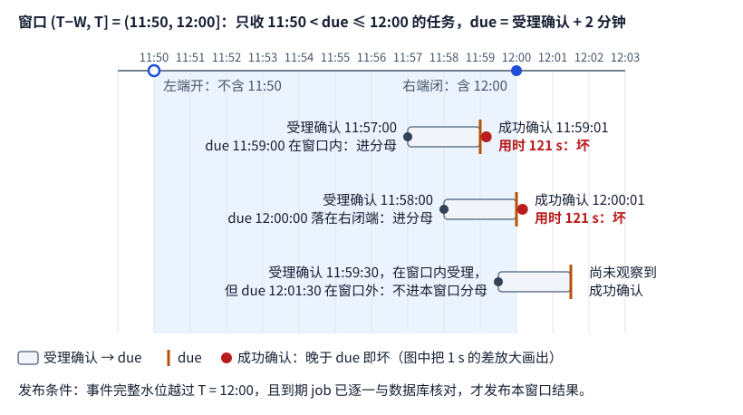

# 怎样用用户结果衡量一个服务，并决定还能不能放量？

沿用主线五的案例。`d-new` 已在生产启动，[生产运行时章](production-runtime.md)的探针和组件信号都说它正常，但它们回答不了用户关心的事：`user-17` 能不能及时读到报表 42，`user-29` 是否仍然读不到，导出能不能按时生成、下载。本章把这些用户结果定义成可计数的 service level indicator (服务等级指标，SLI)，再用错误预算和分钟级门禁决定新版本还能不能加流。

本章依次回答：一次用户意图该数成什么单位；一个可下结论的 SLI 要写清哪些要素；读取、受理、完成、下载各怎样判好坏；异步任务的完成率怎样不漏掉还在排队的任务；长期目标和发布决策为什么用不同的时间尺度；新版本为什么不能和稳定版合在一起评估。文中阈值（400 ms、99.5%、2 分钟、10 分钟/100 个/99%/5 分钟）都是本例的合成教学数字，不是通用推荐。

## 先决定数什么：request、job、attempt

同一次“导出报表”的意图，在系统里会留下三种不同的计数单位。分母选错，结论就错：

| 单位 | 怎样计数 | 用来判断什么 |
|---|---|---|
| request (请求) | 每次到达已定义服务边界、满足该 SLI 入选条件的 API 往返；客户端重试会增加请求数 | 按该 API 的用户结果判好坏；未响应的调用不能删掉 |
| job (任务) | 每个唯一的 job ID 一次；受理事务一提交就计入，即使 `202` 响应丢了 | 到自己的完成期限时判定成功、失败或仍未完成 |
| attempt (执行尝试) | worker 每次在数据库里成功领取一次 | 诊断执行耗时、重试和资源占用；不作为用户完成率的分母 |

本例每个 job 最多 3 次 attempt（首次也算一次）。只有数据库里的领取事务提交了，才开始一轮 attempt；broker 的重复投递只是唤醒 worker 的线索，不算新的 attempt。这三种单位来自主线四：job 和 attempt 的定义在[条件领取与栅栏章](../services/job-claims-leases-and-fencing.md)，同一请求重放为什么指向同一个 job 在[未知结果与重试章](../services/deadlines-retries-and-unknown-outcomes.md)。

## SLI、SLO、SLA 各是什么

- **SLI** 测量一项明确的用户结果，例如“读请求在 400 ms 内得到与授权关系一致的结果的比例”。
- **service level objective (服务等级目标，SLO)** 是团队给某个 SLI 定的内部目标值，例如“30 天内 99.5%”。
- **service level agreement (服务等级协议，SLA)** 是带对外承诺和违约后果的约定。把内部阈值换个名字，并不会变成 SLA。

一个 SLI 不能只写“成功率”。它至少要规定五样东西：测量边界（在哪一层观察）、分母（哪些事件入选）、好事件（什么算好）、时间窗口、数据延迟（多久之后的数才算齐）。另外，按请求加权的汇总值不能证明每个 region (区域) 或用户群的体验一致，必要时按稳定、取值有限的维度（如区域）分开查看。

## 读取 SLI：按授权关系判好坏

**分母**：每次进入 API 的 `GET /v1/accounts/{account_id}/reports/{report_id}`，前提是可信的身份层已确认调用主体、报表 ID 格式有效。身份服务在确认主体之前的失败，另计入入口认证 SLI。

**好事件**：API 在 400 ms 内给出与授权关系一致的结果。`user-17` 是 acct-17 成员，读报表 42 应得到 `200` 和预期报表；`user-29` 属于另一个账户 acct-29，无论经哪个账户路径请求 42，都应得到与不存在的报表 43 相同的通用 `404`。所以 `404` 是好是坏，取决于主体和资源的关系，不能只按状态码分类。

**坏事件**：有权的请求得到 `404`、超时、无响应或 `5xx`；无权的请求得到 `200`。最后这一种正是本主线修复的缺陷：只按全局主键取数时，`user-29` 经 `GET /v1/accounts/acct-29/reports/42` 读到 acct-17 的报表 42，得到 `200`。

入口为每次合格请求记录时间、路由模板、区域和实际处理它的镜像摘要，即使服务没有响应也保留记录。未响应的请求即使归不到某个摘要，也仍是坏事件；它只是不能用来证明新版本健康。

状态码和耗时只是便于观测的代理信号，单凭它们证明不了正文正确。本例另外用 `user-17`、`user-29` 两个受控测试身份和报表中的已知标记核验授权与内容；要声称每次真实响应的内容都正确，就需要每次响应都有可信的内容与授权判定证据。这个 SLI 的边界也不包括用户设备和响应发出后的网络，不能替代跨账户授权测试与审计。

## 受理 SLI：请求与 job 分开数

导出的受理用主线四的例子：`POST /v1/accounts/acct-17/reports`，`Idempotency-Key: export-demo-415`，受理后返回 `202` 和 `Location: /v1/jobs/job-demo-731`。

**请求分母**：每次进入导出 API 的调用，前提是身份已确认、调用主体对 acct-17 有 `report:export`、请求格式有效。同一幂等键的每次重试各算一次请求。

**job 分母**：首次有效请求在同一个数据库事务里提交 job、outbox 待发意图和一个等待槽，才产生一个 accepted job（202 承诺的内容见[持久受理章](../services/durable-job-acceptance-and-outbox.md)；本例要求 `202` 之前已持久化，比 HTTP 规范对 `202 Accepted` 的通用语义更严格）。job 是否存在以数据库提交为准，与响应是否送达无关；正常返回的 `202` 只是服务看到提交成功后发给客户端的证据。

几种情况怎样计：

- 同一幂等键、同一请求指纹的重放，正确行为是指向原 job 并返回其当前状态：算一条好请求，不增加 job 数，也不占新的等待槽。
- 明确返回 `429`（速率限制）或 `503`（等待槽满）：算坏请求，但按约定不创建 job。
- 在本 SLI 的服务边界内观察到超时或无响应：坏请求。服务已经返回、之后才发生的客户端网络断开，不计入这个 SLI。
- 同一幂等键却带不同正文：客户端违反约定，单独计数，不进可靠性分母。

没收到 `202` 不能推断任务未受理；客户端该怎样用原键原正文重放、取回同一个 job，在[未知结果与重试章](../services/deadlines-retries-and-unknown-outcomes.md)。

## 完成 SLI：测的是提交确认时刻

**分母是 job**：每个已提交的唯一 job 只计一次，投递、重试和 attempt 都不增加分母。任务成功指 `succeeded`、结果对象引用和 `report.ready` outbox 在同一事务中原子提交。本例的业务目标是受理后 2 分钟内生成并提交结果。

业务目标说的是“提交”时刻，现有遥测未必测得到。本例能取到的是**提交确认**时刻：应用收到 `COMMIT` 成功响应后，再向同一数据库查询 `clock_timestamp()` 并记录，得到 `accepted_commit_confirmed_at` 和 `succeeded_commit_confirmed_at`。完成 SLI 据此定义：从受理确认起算 2 分钟内，是否观察到成功确认。

这两个确认是分别采集的，它们的差不一定比真实提交间隔更保守。设物理提交间隔为 121 秒，受理那次确认等了 10 秒、成功那次只等了 1 秒，观测到的间隔就是 `121 + 1 − 10 = 112` 秒，低估了实际间隔；反过来也可能高估。受理确认甚至可能晚于成功确认，这时本口径视为达标，但推不出两次提交的实际先后。所以它是一种独立的服务观测口径；要验证“数据库必须在 2 分钟内提交”这一物理时限，需要经过验证的权威提交时刻。

> [!info] 实例：PostgreSQL 里哪个时间是提交时刻（PostgreSQL 18，核对于 2026-11-12）
> 事务内写入的 `accepted_at`、`succeeded_at` 不能直接当提交时刻：`now()`（以及 `current_timestamp`）返回的是事务开始时间，`clock_timestamp()` 才随墙钟变化。开启 `track_commit_timestamp` 后可以用 `pg_xact_commit_timestamp` 查询事务的提交时间，但只对开启之后的事务有效，且这些信息会被 vacuum 清理；不能假设它已开启，也不能假设历史一直保留。

## 成熟窗口：只数已经到期的 job

只统计已经成功或失败的任务，会悄悄漏掉仍在排队的任务：队列越堵，分母越小，完成率反而好看。解决办法是给每个 job 定一个观测期限 `due = accepted_commit_confirmed_at + 2 min`，只在期限到了之后才判它：以 `T` 为窗口结束时刻、`W` 为窗口长度，窗口 `(T−W, T]` 只收入满足 `T−W < due ≤ T` 的“成熟”任务。下图用 12:00 结束的十分钟窗口看三个任务怎样归入，时间均为提交**确认**时刻：

- 好事件：`succeeded_commit_confirmed_at ≤ due`。坏事件：`failed`、`cancelled`、到期仍为 `queued` 或 `running`，以及过了期限才成功。本例把受理后的取消也算未完成；若要排除用户主动取消，要另行定义可审计的取消来源和分母规则。
- 期限未到的任务暂不进分母，但要同时观察其中最老任务已经等了多久。
- 图中的“坏”只针对确认口径的 SLI：用时 121 秒推不出物理提交也晚了 1 秒；即使第二个任务事务内的 `succeeded_at` 写的是 11:59:59，也不改变本口径。

窗口结果什么时候能发布：只有当 watermark (事件时间完整水位) 越过 `T`，即 `T` 之前的事件都已收齐，且到期的 job 已逐一与数据库核对后，才发布。任务是否存在仍以数据库中的 job 行为准。缺少受理确认、算不出期限时，把窗口标为“测量不完整”，发布门禁保持不放行；期限已确定、水位越过后仍没有成功确认，就计为坏。不能悄悄删掉缺遥测的任务，也不能用“它现在已经成功了”改写它当时是否按期完成。这套观测期限不改变任务本身的业务期限或租约约定。

## 下载与通知各需要自己的 SLI

完成 SLI 只说明按时观察到了成功提交，不说明用户拿到了文件：

- **下载**：分母是通过身份与资源授权的下载请求（`GET /v1/jobs/job-demo-731/result`），好事件要求服务实际返回该结果引用对应的文件；未授权请求按安全策略单独统计。文件大小差别大时按大小分组设时限，不能套用读取接口的 400 ms。
- **通知**：`report.ready` 还在等 relay 发布，并不撤销已提交的成功。若产品承诺通知必达，就另设通知投递 SLI。broker 确认或消费者 ACK 只说明消息交接到了哪一步（见[队列确认章](../services/queue-delivery-and-acknowledgement.md)）。

若报表包含模型生成的内容，HTTP 可用性和任务完成率只衡量服务有没有交付；内容质量要单独评估，不混进同一个 SLI，见 AI 部分的[生产 trace 与指标分母](../../ai-engineering/evaluation-and-release/production-traces-and-metric-denominators.md)。

## 错误预算：长期目标允许多少坏事件

SLO 再进一步，就能算出 error budget (错误预算)。本例读取 SLO 是 30 天 99.5%。若窗口内有 10,000 个合格读请求，其中 9,940 个在 400 ms 内给出了正确结果：

- SLI 为 `9,940 ÷ 10,000 = 99.4%`。
- 允许的坏请求数是 `(1 − 0.995) × 10,000 = 50`。
- 实际坏请求 60 个，超预算 10 个，即用掉了 `60 ÷ 50 = 120%` 的预算。

错误预算的单位是窗口里的坏事件数，不是百分比或毫秒。burn rate (错误预算消耗率) 是实际坏事件率与 SLO 允许的坏事件率之比：这里 `0.6% ÷ 0.5% = 1.2`：大于 1 表示预算消耗得比 SLO 允许的快，照 1.2 的速率，30 天的预算约在第 `30 ÷ 1.2 = 25` 天用完。长期 SLO 告警可以按 burn rate 组合一长一短两个窗口：长窗口确认问题不是偶发，短窗口让告警在问题消失后尽快复位。Google SRE Workbook 给出的是配置方法和起始示例，其中具体的比例和窗口不应直接套到所有服务。

## 金丝雀门禁用分钟级窗口

30 天的目标用来跟踪长期预算；金丝雀决策要在分钟级做出，等不到 30 天结束。本例的发布门禁：

- **统计对象**：按目标摘要、路由模板和区域分别统计。
- **样本条件**：滚动 10 分钟窗口内至少有 100 个合格读请求。
- **止损条件**：满足样本条件时，好事件比例低于 99%，并**持续 5 分钟**。“持续 5 分钟”定义为每分钟评价一次，从 `t` 到 `t+5` 的六个评价点都满足样本数和比例条件。

所以只观察到一次 `98/100`，只够暂缓加流，还不满足持续止损条件；`99/100` 恰好达到比例门槛，但仍要通过身份与内容检查。有另一条告警需要连续越界 5 分钟才触发时，“告警没响”也不能代替当前的放量条件。这条门禁怎样变成“加流、保持还是止损”的判定，在[金丝雀章](canary-rollout-and-rollback.md)。

告警要附上好与坏事件数、分母、窗口、摘要、路由与区域，以及指标和追踪的查询链接，让值班人能核对门槛是否基于同一个 SLI。导出完成率另按成熟 job 窗口计数，同时看未成熟 job 中最老任务的等待时长，以免“完成率还没变差”掩盖排队正在变长。

## 金丝雀不能和稳定版合在一起评估

新版本只承担一小部分流量，合并统计会把它的问题平均掉。设同一路由、同一区域、同一窗口里，`d-new` 是 `98/100`，稳定版 `d-old` 是 `900/900`：

- `d-new` 自身是 98%，低于 99% 的门槛；
- 合并后是 `998/1,000 = 99.8%`，看起来完全健康。

`d-old` 的 900/900 也不说明它安全：它正带着跨账户缺陷，这 900 个读取都好，只是因为受影响的入口已经隔离（见[金丝雀章](canary-rollout-and-rollback.md#就绪之后、开流之前：生产冒烟检查)），跨账户读取到不了它的缺陷代码。

所以门禁只统计能归因到目标摘要的请求（多平台发布还要归到实际运行的平台子摘要）。归不到摘要的无响应请求仍留在总分母里，但它们不能当作目标版本的健康样本，发布判断应保持不放量。判断恢复时也用同样的口径：看变更后实际运行的摘要，用新的时间窗口。

## 交给下一步的是什么

本章产出了一组可以下结论的度量：读取、受理、完成、下载各自的分母和好事件，按成熟窗口判定的完成率，30 天错误预算，以及按摘要分开统计的分钟级门禁。下一章用它们回答：`d-new` 开放首轮小流量之前要做什么检查，每一轮怎样在加流、保持和止损之间判定，出问题时又能撤回什么，见[金丝雀放量与回退](canary-rollout-and-rollback.md)。

> [!info]- 来源
> - **用户结果型 SLI、错误预算与 burn rate 告警**（“SLI、SLO、SLA 各是什么”“错误预算：长期目标允许多少坏事件”“金丝雀门禁用分钟级窗口”）：Google SRE Workbook，[Implementing SLOs](https://sre.google/workbook/implementing-slos/)、[Alerting on SLOs](https://sre.google/workbook/alerting-on-slos/)（burn rate 定义与多窗口告警），核对于 2026-11-12。本章的 30 天、400 ms、99.5%、2 分钟与 10 分钟/100 个/99%/5 分钟是合成教学数字，不是该书的统一建议。
> - **`202 Accepted` 的通用语义**（“受理 SLI：请求与 job 分开数”）：IETF，[RFC 9110](https://www.rfc-editor.org/rfc/rfc9110.html#section-15.3.3) §15.3.3，核对于 2026-11-12；通用语义不承诺操作最终成功，“提交后才回 202”是本例更强的应用合同。
> - **事务时间与提交时间**（PostgreSQL 实例 callout）：PostgreSQL 18，[Current Date/Time](https://www.postgresql.org/docs/18/functions-datetime.html#FUNCTIONS-DATETIME-CURRENT)（`now()` 为事务开始时间，`clock_timestamp()` 随墙钟变化）、[System Information Functions](https://www.postgresql.org/docs/18/functions-info.html)（`pg_xact_commit_timestamp` 依赖 `track_commit_timestamp`，信息会被清理），核对于 2026-11-12。
> - **job、outbox 与等待槽的受理合同、成功提交的原子性**（受理与完成 SLI 的计数依据）：本领域主线四的持久受理、条件领取与队列确认三章；数据库是任务状态的权威。
