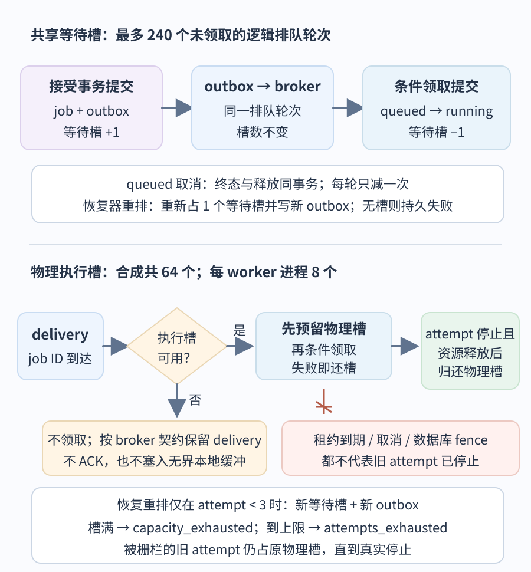

# 如何估算并限制异步工作管线？

**案例：** application programming interface (API，应用程序接口) 收到 `acct-17` 的报表导出请求，事务写入 job（任务）、outbox（事务发件箱）和一个共享等待槽后才返回 202。worker（工作进程）有限地读取数据库，生成 Comma-Separated Values (CSV，逗号分隔值) 文件并上传私有结果对象；只有结果引用与 `succeeded` 同时提交，结果才对用户可用。这是“先接受、后台继续、之后可查”的持久路径。直接以 Hypertext Transfer Protocol (HTTP，超文本传输协议) 流式返回 CSV 属于另一种请求内工作：发送正文期间仍占用请求连接和处理资源，断开后的读取不会自动变成可查询 job。

容量不是一个“队列长度”数字。准入速率限制新逻辑 job（任务）的到达，等待槽限制已经承诺但尚未领取的工作量，执行槽限制同时运行的 attempt（一次物理执行尝试）；连接池和对象存储又各有自己的资源预算。队列只能改变工作等在哪里，不能提高下游服务率。

admission control（准入控制）决定新逻辑 job 是否进入系统；backpressure（背压）则把下游已满的信号传回上游，使上游减速、延后或停止提交。HTTP 调用方若不能被动调速，服务就必须在返回 202 之前明确拒绝这次未受理的请求，而不能先承诺接受再丢弃。两者的边界不同：速率限制新 job 的到达，等待槽限制已承诺但未领取的工作量。

本例的 idempotency key (幂等键) 按 `(account_id, principal_id, key)` 唯一，绑定报表 ID、期间和格式等规范化请求的 fingerprint (指纹)。相同范围、同键、同指纹表示重放原意图，返回既有 job；同键异指纹则冲突。准确重放不消耗新 job 的速率令牌或等待槽，但“先查、后扣额”不能解决不同 key 争用最后一个槽。

数据库事务先尝试插入带唯一范围的 job 身份；同键并发败方回滚后读取胜者并核对指纹，同指纹返回原 job，异指纹冲突。只有唯一约束确认新意图胜出，才竞争一条**整条管线共用**的准入额度记录：本例的 7 个/秒令牌、30 枚桶深和 240 个等待槽由所有 API/worker 副本、账户和新 key 共享；不能各实例各自保留一份完整额度。事务先锁这条额度行，按数据库时钟补充令牌，再检查至少一枚令牌及 `waiting_count < 240`，一次更新扣令牌并加等待计数，然后补全 job、参数和 outbox。

两个不同 key 争最后一槽时会在同一额度行上串行，先提交者占槽，后者看到已满后回滚自己的临时 job 身份；令牌、计数、job 和 outbox 同事务提交或一起回滚。令牌不足时在接受前返回 `429 Too Many Requests`，等待槽已满时按暂时过载返回 `503 Service Unavailable`；两种拒绝都不留下 job。若实现为条件原子更新，也必须让令牌和槽检查/递增成为同一事务的唯一胜者操作。每账户限流可以叠加，不能代替这个全管线预算。若额度行在独立外部限流器，数据库回滚不能替它退回令牌，须另建幂等预留/补偿合同。

等待槽的 240 覆盖所有尚未领取轮次，不论 outbox 尚待发布还是 job 已在 broker；它随同一逻辑 job 的位置迁移而不变。领取提交时释放，`queued` 取消与状态终结同事务释放一次，重试重排须重新预留一个槽并写新 outbox。

worker 不能因为 broker 有消息就直接领取：先取得本进程的物理执行槽，再尝试条件领取 job。没有槽时不领取，不无限预取或塞入本地缓冲；这只会推迟领取，不会把已受理 job 判为 `capacity_exhausted`。若条件领取失败，因为重复、已取消或 job 已经终态，worker 归还刚预留的执行槽。领取提交后，job 变为 `running`，attempt（一次物理执行尝试）加一、有界租约写入，逻辑等待槽释放；物理执行槽继续归该 attempt。

fencing（写权栅栏）是恢复器提交接管后拒绝旧 attempt 再提交当前 job 的结果；租约到期本身只让独立恢复器得到竞争资格，不会自动停止旧 attempt。恢复器先处理取消；可重试且未达到上限时，重排事务原子取得新的共享等待槽并写新 outbox；如果这项**已受理 job 的重排**拿不到槽，则提交 `failed` 和 `capacity_exhausted` 错误码。即使恢复器已栅栏旧 attempt，它仍占物理槽，直到该 attempt 实际停止并释放连接、游标或上传句柄。worker 进程可以继续处理其他 job；物理槽归还跟随 attempt 停止，不要求整个进程退出。旧 attempt 停止后的孤儿对象清扫由独立清理任务负责，不必继续占用已归还的 worker 执行槽。

图中两个槽位属于不同的量纲和所有者。等待槽记未领取的逻辑排队轮次，不随着 outbox 到 broker 的迁移而变；物理执行槽记仍在运行且占有处理器时间、连接、游标或上传句柄的 attempt。worker 结束一次业务操作后可以持久决定重排；该 job 可先占新等待槽，而旧 attempt 的物理槽要等它真正停止并释放资源才归还。worker 进程通常留在池中继续工作。租约恢复可能在旧 attempt 停顿时提交新排队轮次，之后新 worker 可另占一个物理槽；若两次 attempt 短暂重叠，必须分别计算和占用两个槽。

## 用平均在途量估算，不要把平均值当峰值保证

Little's law（利特尔定律）给出稳定系统的长期平均关系：

~~~text
平均系统内任务数 L = 平均有效到达率 λ × 平均系统停留时间 W
~~~

三个量必须属于同一个边界和同一种任务。若系统只算 worker 的执行，`W` 用平均 attempt 执行时间；若系统包括等待，`W` 也包含队列时间。`λ` 是该边界实际接纳并进入系统的平均速率，不是已被拒绝的原始 HTTP 请求速率。公式使用长期稳定状态下的有限均值；若无界到达持续超过服务能力而队列一直增长，就不能借这个公式假设一个有限的稳态等待量。

例如某个稳定服务平均接纳 40 个请求/秒，每个请求从进入到离开该服务平均 0.2 秒，那么服务内平均有 `40 × 0.2 = 8` 个在途请求。Little 定律是平均量恒等关系；它不预测突发峰值、等待时间的 p95/p99，也不单独证明一个容量上限安全。到达批次、服务时间长尾、失败重试、拒绝策略和下游瓶颈仍须另行分析。若边界是等待队列，queue depth（队列深度）说明有多少工作在等，queue age（队列年龄）说明最老的工作等了多久；二者揭示不同故障。

## 合成账户报表要预留多少执行槽？

以下是用于演算的显式合成输入，既不是生产测量，也不是服务目标或默认推荐值。

| 输入 | 教学假设 |
| --- | ---: |
| 新幂等键产生的平均提交速率 / 十分钟峰值提交速率 | 5 / 20 个新 job 每秒 |
| 单个请求正文 | 8 KiB |
| API 提交事务借用数据库连接 | 10 ms/job |
| 每份报表的顺序索引读取 | 12 次；每次借连接 20 ms |
| 单个 worker attempt 平均处理时间 | 6 s |
| 平均结果对象 / 每个 job 元数据 | 128 KiB / 2 KiB |
| 结果对象保留期 / 终态及幂等元数据保留期 | 7 天 / 终态后 14 天 |

先只计算每个新 job 一个 attempt，假定六秒平均处理时间已包括生成与上传；重试、租约接管重叠、失败清理与下载另计。若五个新 job/s 实际被接纳并稳定处理，且每个只用一次平均六秒的 attempt，平均有 `5 × 6 = 30` 个在执行的 attempt。峰值时若希望持续处理每秒 20 个新 job，且每个只需一个 attempt，则容量需求为 `20 × 6 = 120` 个平均并发 attempt；这是跟上输入的规划需求，不是当前 worker 的实际执行率。每个 worker 副本有两个进程、每进程八个 attempt 槽，共四个副本时只有 `4 × 2 × 8 = 64` 个物理执行槽，理想上限 `64 / 6 ≈ 10.67 attempt/s`，因此在该负载下不能形成稳定的 20/s 执行流，等待会增长或新 job 被拒绝。

若 64 槽都持续有工作，按六秒平均服务时间折算的理想平均服务率是 `64 / 6 ≈ 10.67 attempt/s`。这是忽略调度空隙和所有额外工作的上界型估算，不是压测吞吐。规划时先把平均利用率假设为 70%，可算出 `64 × 0.70 / 6 ≈ 7.47 attempt/s`。于是本例将新 job 的准入目标暂设为每秒 7 个：若平均每个新 job 只运行一次 attempt，则占槽 `7 × 6 = 42` 个，即 `42 / 64 ≈ 65.6%`。70% 目标相当于每秒 `44.8` 个 attempt 槽秒；以 7 个新 job/s 均摊，最多约 `44.8 ÷ (7 × 6) ≈ 1.067` 个六秒 attempt/job 才不超过该规划预算。70% 和 7/s 是待负载测试验证的起点。重试、租约接管重叠、处理时间长尾和运维任务都会改变实际服务率。

这里要分清三种控制：

| 控制量 | 合成上限 | 解决的问题 | 不能推出什么 |
| --- | ---: | --- | --- |
| token bucket（令牌桶）新 job 速率 | 补充 7 个/秒 | 平滑长期新工作到达 | 不保证下游一定及时完成 |
| token bucket 瞬时 burst（突发） | 最多 30 个新 job | 允许短时成批提交 | 不提供无限等待区 |
| 共享未领取等待槽 | 最多 240 个逻辑排队轮次 | 限制已承诺但尚未执行的工作量 | 不限制正在执行 attempt 的物理资源 |
| worker 执行槽 | 64 个 attempt 槽 | 限制并发计算与实时资源 | 不限制 queued/outbox backlog |

这些门槛要共同生效。假设账户十分钟都以 20 个**新幂等键**每秒提交，共有 `20 × 600 = 12,000` 个新逻辑意图。若令牌桶开始时有 30 个令牌、此后以 7/s 补充，则令牌桶单独最多放行 `7 × 600 + 30 = 4,230` 个；在等待槽和其他限额均未先行拒绝的条件下，至少 `12,000 − 4,230 = 7,770` 个新任务不会受理。真实队列故障、worker 停机或重排可能更早占满 240 槽。相同幂等键重放不属于这些新意图，不再耗一枚令牌或一个等待槽；但每次重放仍占用 API 的认证、网络和服务处理资源。

等待槽数量限制了承诺了多少尚未领取的工作，不直接设定队列可等待多久。举例：开始时无积压且令牌桶已满、上游有足够的新 key、其他额度都不冲突、worker 连续 30 秒不能领取，也没有重试重排；令牌桶可让 `30 + 7 × 30 = 240` 个新 job 进入，正好填满 240 个等待槽，之后即使仍有速率令牌也必须拒绝。已有积压或其他重排会让等待槽更早占满；若 worker 停领超过 30 秒，填满后后续符合速率条件的新 job 会持续被拒绝，直到有槽释放。240 是本案例的等待工作量边界，不代表最长等待 30 秒；容量应按业务可接受的排队 service-level objective (SLO，服务等级目标) 和实测服务/恢复速度校准，队列年龄持续上升时要降速或拒绝。

本例每个 job 固定最多三次 attempt（含首次），即最多两次重试；这是为说明有界恢复而设的案例策略，不是队列或框架默认值。worker 遇到可重试暂时错误并结束当前工作后，与租约到期后取得竞争资格的恢复器，都要按当前 job/attempt 条件决定下一步：取消优先；永久错误或达到三次上限写终态；其余只有成功取得等待槽时，才同事务写 `queued`、退避后的 `available_at` 和新的 `pending` outbox。relay 必须在到期时可靠唤醒；过早到达的重复投递仍受数据库可领取时间条件约束，未确认到期唤醒已持久安排时不能提前 ACK。槽不足则持久写 `failed/capacity_exhausted`；达到上限则持久写 `failed/attempts_exhausted`。旧投递只带 job ID，即使来自上一轮也可以唤醒并竞争当前 queued 轮次；数据库条件让一轮最多被领取一次，它不能自行增加 attempt。租约到期只让恢复器有资格竞争，恢复事务提交才 fence 旧 attempt。fence 后，旧 attempt 仍占原物理执行槽，直到该 attempt 停止并释放连接、游标、上传等资源；三次上限限制启动总数，有限读取/上传截止时间和可观察的停止路径才限制物理重叠持续多久。相关提交、ACK 与租约条件见[怎样设计一个可持久查询的账户报表？](../architecture/system-design-fundamentals.md#%E5%B7%A5%E4%BD%9C%E8%BF%9B%E7%A8%8B%E9%87%8D%E8%AF%95%E6%80%8E%E6%A0%B7%E9%81%BF%E5%85%8D%E6%97%A7%E7%BB%93%E6%9E%9C%E8%A6%86%E7%9B%96%E6%96%B0%E7%BB%93%E6%9E%9C%EF%BC%9F)和[报表任务的发布确认、消费者确认与业务完成各证明什么？](queue-delivery-and-acknowledgement.md)。

## 进程内连接池怎样叠加成数据库总预算？

SQLAlchemy 的连接池由进程内 Engine（引擎对象）持有；扩容应用进程会复制连接上限。本例假定 API 和 worker 各有四个副本、每副本两个进程，每个进程一个同步 `QueuePool`，设置 `pool_size=8` 与 `max_overflow=2`。该池最多允许每进程十条并发连接；超出常驻池容量的连接在归还时关闭，空闲池最多保留八条。若使用异步 Engine，则使用 `AsyncAdaptedQueuePool`；SQLite 内存数据库也有不同默认池行为，所以其他数据库、池实现或进程模型都要重算。

| 连接使用者 | 配置最大值计算 | 连接数上限 |
| --- | ---: | ---: |
| API：4 个副本，每副本 2 个进程 | `4 × 2 × (8 + 2)` | 80 |
| worker：4 个副本，每副本 2 个进程 | `4 × 2 × (8 + 2)` | 80 |
| 其他共用数据库的服务 | 本例预留 | 40 |
| 应用配置总上限 | `80 + 80 + 40` | 200 |
| 教学用数据库连接预算 | 本例假设 | 240 |
| 配置上限之外的余量 | `240 − 200` | 40 |

这是池可同时借出的配置上限，不代表数据库此刻有 200 条活跃查询；连接池会按需打开连接，也可能保留已打开的空闲连接。此预算还必须核对迁移程序、运维连接及数据库自身保留额度；教学用的 240 已把其他共享服务列为 40，但不等于任意数据库都能把 240 条分配给应用。

按每页借连接 20 ms，单个 report attempt 的读取是 `12 × 0.020 = 0.24` 连接秒；新 job 提交事务另占 `0.010` 连接秒。连接池平均借用量要用各自边界内**实际**速率计算：`0.24 × λ_attempt + 0.010 × λ_accepted_job`，其中 `λ_attempt` 是实际执行 attempt/s，`λ_accepted_job` 是实际接受的新 job/s。若本例稳定地处理 5 个新 job/s、每个一个 attempt，则约为 `5 × 0.24 + 5 × 0.010 = 1.25` 条平均连接。若 workers 实际达到规划的 7 attempts/s 且 API 同时接受 7 jobs/s，则预测约 `7 × 0.24 + 7 × 0.010 = 1.75` 条；这是按规划速率估算，不是测量。峰值 20 jobs/s 若要稳定处理且每个只跑一个 attempt，需要约 `4.8` 条读取连接和 `0.2` 条提交连接，共 5 条；但当前 64 槽无法稳定达到这个 worker 速率，所以这组 20/s 数字是假设扩容后的需求，不是当前系统的平均实际借用量。重试会让 attempt 速率高于新 job 速率。以上均不含长事务、慢查询、池等待或上传期间误持连接；池上限仍须按各进程的并发配置求和。

## 结果存储和请求字节量会涨到多少？

若每个请求正文都读完整，5 个请求/s 的平均入口正文约为 `5 × 8 KiB = 40 KiB/s`；20 个请求/s 的十分钟峰值约为 `20 × 8 KiB = 160 KiB/s`，累计 `20 × 600 × 8 KiB = 93.75 MiB`。这是按**到达的 HTTP 请求**算的入口量，不是新 job 的接纳率：速率令牌只约束创建 job，已读完才拒绝的请求、幂等重放和同 key 冲突仍耗用网络及解析资源；若服务在读正文前拒绝，实际正文流量会更低。这里未计 HTTP 头、Transport Layer Security (TLS，传输层安全协议)、重传或响应字节。

若长期每秒有五个 job 成功完成、每份结果 128 KiB 且保留七天，结果对象约占：

~~~text
128 KiB × 5 个/s × 604,800 s ÷ 1,048,576 KiB/GiB
= 369.140625 GiB ≈ 369 GiB
~~~

这是仅含对象正文的平均体量，不含副本、元数据、版本、压缩差异或删除延迟。另按稳态每秒 5 个 job 转为终态（成功、失败或取消）计算，每个 2 KiB 终态与幂等记录保留在终态后 14 天，元数据约占：

~~~text
2 KiB × 5 个/s × 1,209,600 s ÷ 1,048,576 KiB/GiB
= 11.5356 GiB ≈ 11.54 GiB
~~~

这项估算不含索引；示例中的 2 KiB 已包含每个 job 一条持久记录（其状态原位更新为终态）和幂等元数据，失败 job 也包含在每秒 5 个终态 job 的假设里，不应再把失败重复加成一条 job 记录。若系统把 attempt 历史或诊断事件另存为行，它们和清理滞后会增加额外空间。若每秒 7 份都成功完成，平均结果写入约 `7 × 128 KiB = 896 KiB/s = 0.875 MiB/s`；本例 30 个突发任务全部成功会写入 `30 × 128 KiB = 3.75 MiB`。64 槽按六秒平均服务时间的理想完成率 10.67 attempts/s，在每个 attempt 都成功且产出平均结果的条件下，对应约 `1.33 MiB/s`；这是理想完成量，不是观测写入率，对象存储限速和数据库提交也会降低实际值。下载流量是读取负载，应另外估算，不能和生成带宽混为一谈。

## 如何确认最先到达的瓶颈？

峰值输入是 20 个新 job/s；若都被接纳并想稳定完成、每个只需一个六秒 attempt，就需要平均 120 个并发 attempt。当前 64 槽在理想条件下最多支撑约 10.67 attempts/s，实际吞吐还会受调度、失败重试和下游影响，所以 120 是需求量，不是当前 worker 的实测并发或吞吐。若新 job 准入目标设为 7/s 且每个 job 平均一次六秒 attempt，规划平均并发是 42 槽；这是假设值，不是 SLO 或容量保证。与 200 条应用连接配置上限对比只能帮助排查哪项预算可能先紧，不能排除单进程池等待、数据库处理器/输入输出/锁或对象存储瓶颈。

用代表性的请求大小、12 页读取扇出和结果体量逐步加压，再分别尝试 20/s 十分钟峰值、30 个突发、240 槽满、慢查询、对象上传变慢、重试、worker 丢失和租约重叠。每个场景记录 API 受理延迟、排队等待时长、执行时长、结果下载时长以及 p50、p95、p99（第 50、95、99 百分位）时延；六秒只是假设的平均 attempt 时长，不是 p95 目标。观察 token 放行与拒绝、等待槽占用、最老 outbox / queued / broker age、活跃与被栅栏但仍存活的 attempt、数据库连接池借出与 checkout（借出连接）等待、structured query language (SQL，结构化查询语言) 查询耗时、对象体量、重试、取消和终态码。若 broker 深度下降而数据库 queued 年龄继续上升，工作只是换了积压位置。再按用户实际 SLO 决定调整准入、资源或查询计划，而不是只扩队列。

API 在新 job 还未接受时因共享速率令牌不足而拒绝，或因等待槽已满而拒绝；案例可分别按限流返回 `429 Too Many Requests`、按暂时过载返回 `503 Service Unavailable`。这些是受理边界的拒绝，不能伪装成已经接受的 job 失败。调用方按同一幂等键重试受理结果未知的提交。已经受理的 job 若重试或租约恢复时预留不到共享等待槽，才持久为 `failed/capacity_exhausted`；attempt 耗尽则是 `failed/attempts_exhausted`。worker 本地物理槽不足只推迟领取，不把 queued job 改为容量失败。HTTP 流式路径则由请求自己的截止时间、连接和流背压决定能持续发送多久，不应把异步队列的等待槽公式挪过去。

**接下来：** [持久报表任务状态与恢复](../architecture/system-design-fundamentals.md)说明 job、等待槽、attempt 和结果如何同数据库状态交接；[队列确认页](queue-delivery-and-acknowledgement.md)展开 prefetch、发布确认与消费者 ACK；[数据访问与连接池](../backend/data-access-and-connection-pools.md)解释每进程 object-relational mapping (ORM，对象关系映射) 连接池与 Session 的使用边界；[可观测性、SLO 与事件响应](observability-slos-and-incident-response.md)说明阶段信号怎样支持饱和判断。

> [!info]- 来源
> - Little 定律及其有限均值、严格平稳条件：[Little, “A Proof for the Queuing Formula: L = λW,” Operations Research 9(3), 1961](https://pubsonline.informs.org/doi/abs/10.1287/opre.9.3.383)，DOI `10.1287/opre.9.3.383`；核对于 2026-11-12。文中只把它用于均值与单位一致的演算，不据此推导尾部或安全容量。
> - `QueuePool` 同时连接上限 `pool_size + max_overflow`、常驻连接数、异步池与 SQLite 特例：[SQLAlchemy 2.1.8, Connection Pooling](https://docs.sqlalchemy.org/en/21/core/pooling.html)，当前版本与官网文档核对于 2026-11-12。示例明确配置两个值，不依赖默认值。
> - 服务级目标与用户可见可靠性：[Google SRE Workbook, Implementing SLOs](https://sre.google/workbook/implementing-slos/)，核对于 2026-11-12；压测方案和 70% 利用率是本合成案例的工程假设。
> - 异步请求已接受但尚未完成的 HTTP 语义：[RFC 9110 §15.3.3](https://datatracker.ietf.org/doc/html/rfc9110#section-15.3.3) 定义 202 Accepted；受理事务先提交才返回，是本案例附加的持久性合同。令牌桶的 `rT+b` 关系见 [RFC 2216 §2](https://datatracker.ietf.org/doc/html/rfc2216#section-2)；该 RFC 描述数据流量上界，本例把它改作“每个新逻辑 job 一枚令牌”的准入模型。
> - 过量请求与临时不可用的 HTTP 状态码：[RFC 6585 §4](https://datatracker.ietf.org/doc/html/rfc6585#section-4) 定义 429 Too Many Requests；[RFC 9110 §15.6.4](https://datatracker.ietf.org/doc/html/rfc9110#section-15.6.4) 定义 503 Service Unavailable。本文把速率令牌耗尽映射为前者、等待槽全满映射为后者，是示例 API 的状态映射，不是必须的数据库或队列实现。
> - 等待队列在持续过载时会增加等待时间并占用资源：[Google SRE Book, Queue Management](https://sre.google/sre-book/addressing-cascading-failures/#queue-management)，核对于 2026-11-12。该来源解释队列与过载，不给出本例 240 的 SLO；这个数量须由本服务允许的等待时长和负载测试选择。
> - 同 key 新意图的唯一胜者可依赖数据库唯一约束；[PostgreSQL 18, 63.5 Index Uniqueness Checks](https://www.postgresql.org/docs/18/index-unique-checks.html) 说明未提交冲突行可能让插入方等待并复查。不同 key 争最后一槽则靠所有受理者共用的额度行：[PostgreSQL 18, 13.2.1 Read Committed](https://www.postgresql.org/docs/18/transaction-iso.html#XACT-READ-COMMITTED) 说明并发 `UPDATE` 等待已锁行后会在更新版本上重新检查条件。本文不指定 PostgreSQL 为唯一实现；事务数据库若不能提供等效的唯一性仲裁和原子条件更新/行锁，不可照搬该额度行设计。
> - 本页所有负载、预算、速率、保留期及对象大小均为教学设定；百分比和容量运算由这些显式假设重算，不是线上观察结果。
