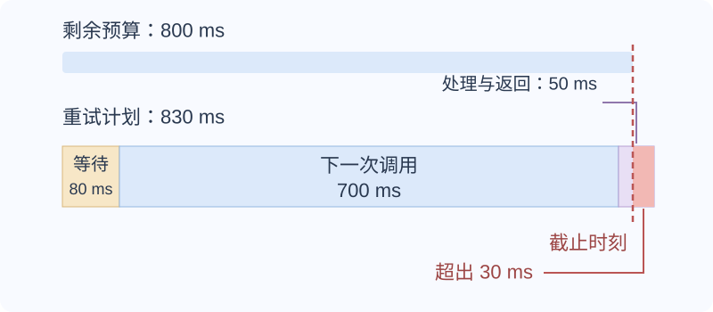

# 请求超时后如何确认结果并安全重试？

**案例：** 账户 `acct-17` 的主体 `user-17` 用操作键 `reserve-demo-208` 预留 SKU-7 的最后一件库存。数据库已经提交，HTTP 响应却丢失了。调用方看到超时，不知道请求没到服务器、事务回滚，还是扣减已经完成。要恢复结果，服务需要识别“这是刚才那次预留的重试”，而不是再扣一次库存。

本例沿用[库存事务页](../databases/database-fundamentals.md)的契约：成功提交才绑定操作键；库存失败回滚且不占键；同键同参数重放返回同一笔预留的**当前状态**。下面先跟完一次响应丢失的恢复，再解释如何设计键、控制重试成本和处理取消。

~~~mermaid
sequenceDiagram
    participant C as 客户端
    participant A as API
    participant D as 数据库
    C->>A: POST 预留，键 reserve-demo-208
    A->>D: 扣库存 + 写预留记录
    D-->>A: 同一事务提交
    A--xC: 响应在途中丢失
    Note over C,D: 此时库存为 0；客户端尚不知道已成功
    C->>A: 重放原 POST，沿用键与参数
    A->>D: 授权后按作用域键读记录
    D-->>A: 已存在的预留及其当前状态
    A-->>C: 返回同一笔预留，不再扣库存
~~~

## 超时和截止时间让调用方处于什么状态？

timeout（超时）限定一次等待或操作的时长；deadline（截止时间）是整条调用链最晚允许完成的时间点。每经过一层都重新开始完整 timeout，会让多个串行下游调用的总耗时远超最初预算。服务应传递剩余时间或截止时限，并为清理和响应留出时间。连接建立、TLS 和响应读取是否都包含在一次库的 timeout 内，要按客户端 API 检查。

当写入可能已经执行而响应丢失，调用方得到的是 unknown outcome（未知结果）：它无法从自己的连接状态区分“请求没到”与“效果已提交但响应丢失”。图中 `available` 已从 1 变成 0，预留记录为 `reserved`。客户端没有按键查询的 GET 接口，因此重放原 POST；服务重新授权并核对参数后，找到同一笔记录，不再扣库存。若期间这笔预留已被另一个合法操作取消，就返回当前的 `cancelled`，不会把它重新激活。这恢复的是同一业务操作，不要求逐字节重放首次 HTTP 响应。

查不到记录时，不能立即断言“原请求失败了”：原事务可能仍在执行，尚未提交。重放必须继续经过数据库的原子约束；普通的先查后写无法排除并发。只读状态查询也必须保持只读，不能因为查无记录就偷偷启动原操作。

HTTP 202 Accepted 是另一种显式状态：API 确认任务已受理，但没有表示已完成。账户报表契约没有按幂等键查询的 GET；若 202 响应丢失，客户端用相同 `report-demo-208` 和相同请求正文重放 POST，服务返回已存在的 `job-demo-731` 与状态 URL，再 GET 该已知 URL。连接断开不会自动取消已经持久接受的 job；需要取消时使用明确的取消请求。完整作业生命周期见[怎样设计可持久查询的账户报表？](../architecture/system-design-fundamentals.md)。

## 怎样定义可安全重放的幂等键？

idempotency key（幂等键）是客户端为一次逻辑意图生成并在重试时保持不变的标识。服务必须定义它的唯一范围、保留时间、请求参数关系和结果重放规则。账户报表示例把键作用域定义为 (account_id, principal_id, key)；不能让另一个主体靠猜到键读取私有结果。服务还保存规范化请求指纹：同一个键、同一参数返回已存结果；同一键却换了 period 或 format，则返回明确冲突，不能默默把旧结果解释成新意图。

RFC 9110 对 HTTP 方法的幂等性定义为：重复一次或多次相同请求，其预期服务端效果等同于只执行一次；这不禁止每次请求分别记录日志。它是 HTTP 方法的语义。给某个 POST 另加稳定幂等键，则是应用层的去重和结果重放约定，两者不能互相代替。

去重记录和本地数据库效果必须处于同一事务；若扣库存提交后才单独写 reserve-demo-208 操作记录，中间崩溃会让重试无法识别原操作：本例最后一件已被扣完时会误报无库存；若其后补货，重试还可能再次扣减。

在库存例中，复合唯一键是 `(account_id, principal_id, idempotency_key)`。两次尝试都走到插入记录时，只能有一个提交；冲突方须回滚**整笔事务**，撤销自己的临时库存扣减，再用新事务读取已提交记录和比较参数。

库存更新没有返回行时，也要先回滚，再以新事务按操作键查记录。假如 A 刚扣完最后一件并提交，B 重放相同 POST，等到 A 释放行锁后发现库存为零，就会走这条分支：B 查回 A 的同键同参数记录，仍返回同一笔预留；只有回查未见已提交结果时，才报告本次库存失败。查不到不证明另一个原请求已经失败。

这个方案不是在请求一到达时就抢占键。一次真正无库存的失败不保存操作记录，相同 POST 日后可能在补货后成功。同键改参数、更新另一 SKU 的并发请求，也可能在另一请求尚未提交时先得到无库存失败。若产品要求“第一次尝试就固定键与结果，包括失败”，需要另行设计前置占键与处理中状态，不能从这个最小库存事务推导出来。具体时序见[同一请求并发到达时，库存与操作记录怎样保持一致？](../databases/database-fundamentals.md)。

服务还要明确保证的重放窗口，并在窗口内保留识别同一键所需的记录。窗口过后若删掉所有信息，服务无法仅凭键字符串判断它是旧操作还是新意图；对于本例这种不带可验证有效期的键，若要在删除结果后仍拒绝过期旧键，就得继续保留可识别该旧键的墓碑记录。窗口外的重试保证必须写清楚，调用方不能把旧操作当成新请求重做。

若操作会调用外部支付或发消息，单库事务无法覆盖远端系统。durable outbox（持久发件箱）只让本地结果与待发布指令一起提交，并使 relay 能在崩溃后重发；它不会替远端付款去重。避免重复付款仍需要收款方按相同业务键幂等处理；如果没有这样的保证，超时后不能盲目重发，应先向权威交易记录查证。对账可以发现重复，但自身不阻止重复扣款。超时也不自动撤销远端副作用。

## 重试时间和总工作量怎样受控？

先判断失败是否可能恢复、操作是否可安全重放，再决定是否重试。参数校验失败和同键异参数冲突应先修正意图；把它们原样反复提交不会恢复。对可恢复失败，使用有上限的 exponential backoff (指数退避) 并加入 full jitter（全抖动），分散再次到达的请求：

~~~text
cap(n) = min(max_delay, base_delay × 2^n)
wait(n) = 从 0 到 cap(n) 均匀随机选择
~~~

假定 base_delay 为 100 ms、max_delay 为 800 ms，第一次失败后的 `n=0`，前几次等待区间依次为 0–100 ms、0–200 ms、0–400 ms；客户端实际次数还须受剩余 deadline 限制。若最多 3 次尝试，初次请求失败后只在剩余预算装得下下一次调用和必要回包时重试。base、上限和次数是服务策略，不是通用常数。若服务要求等待一段时间，例如响应携带 `Retry-After`，也要结合接口契约与剩余预算处理，不能退避后立即绕过该等待。

避免多个调用层各自放大工作量：一条串行调用链上，5 层调用者都最多尝试 3 次，且每次都耗尽后再向上失败，则最深层最多收到 `3⁵ = 243` 次调用。这是最深层的次数，不是整条链所有调用的总和。通常由最了解端到端预算的一层承担重试，其余层明确失败边界。

> [!example] 响应截止时间下的重试复盘
> 客户端总截止时间为 2 秒，第一次（共最多 3 次尝试中的第 1 次）请求用了 1.2 秒后超时，剩余 0.8 秒。第一次失败后的退避是 `n=0`，所以等待上限为 100 毫秒；下一次调用至少需要 700 毫秒，并为处理/返回预留 50 毫秒，能容纳的等待最多只有 `800−700−50=50` 毫秒。若全抖动抽到 80 毫秒（合法，因为低于 100 毫秒），总计要 `80+700+50=830` 毫秒，超过剩余预算，应停止并把状态留作未知。最多 3 次尝试包括初次调用，因此总共最多只有两次退避，后续上限才是 200 毫秒。

图中的 700 毫秒是这个教学例子选定的最小调用预算；真实请求并没有可预知的固定耗时。应根据服务时延目标、观测数据和取消能力设预算，并把剩余 deadline 传给下游。客户端停止等待后，尚未查证的写入仍然是未知结果，不能自动改成“失败且未生效”。

## 取消如何作为协作式信号？

cancellation（取消）是通知仍在运行的工作“结果不再需要”。把信号传给下游，并在安全检查点停止多余计算、释放资源；不同运行时能否中止远端调用取决于 API。对已返回 202 且已持久接受的账户报表，浏览器断开只结束这次连接，不会取消后台 job；客户端必须向已知 job URL 显式请求取消。尚未接受的请求级工作则可在断开后结束。取消也不证明已经提交的数据库副作用回滚，提交状态仍要从权威业务记录确认。

**接下来：** 账户报表把幂等键、202、outbox 和后台尝试组合成一个可长期查询的流程，见[怎样设计可持久查询的账户报表？](../architecture/system-design-fundamentals.md)。队列发布确认与消费者 acknowledgement 的 broker 语义归[发布者确认和消费者确认分别证明什么？](queue-delivery-and-acknowledgement.md)，连接借用预算归[如何限定 ORM Session 并排查连接池耗尽？](../backend/data-access-and-connection-pools.md)。

> [!info]- 来源
> - HTTP 幂等方法、202 受理与 Retry-After 语义：[IETF RFC 9110](https://www.rfc-editor.org/rfc/rfc9110.html)，§9.2.2、§15.3.3、§10.2.3，核对于 2026-11-11；库存键绑定和当前状态重放是本例声明的应用契约。
> - 副作用、超时、重试安全与请求令牌：[AWS Builders’ Library, Making retries safe with idempotent APIs](https://aws.amazon.com/builders-library/making-retries-safe-with-idempotent-APIs/)，核对于 2026-11-11。
> - timeout、backoff 与 jitter：[AWS Builder Center, Timeouts, retries, and backoff with jitter](https://builder.aws.com/content/3EumjoZascWd1oZiEgL8ORlv3qE/timeouts-retries-and-backoff-with-jitter)，原文 2019-12-05，核对于 2026-11-11。
> - Full jitter 的均匀等待区间：[AWS Architecture Blog, Exponential Backoff and Jitter](https://aws.amazon.com/blogs/architecture/exponential-backoff-and-jitter/)，2015-03-04、2023 年补充 SDK 说明；本文只使用其算法定义，不将模拟负载的收益当成通用性能保证。
> - deadline 传播和协作式取消：[gRPC Deadlines](https://grpc.io/docs/guides/deadlines/)，核对于 2026-11-11；具体行为仍取决于各 API。
