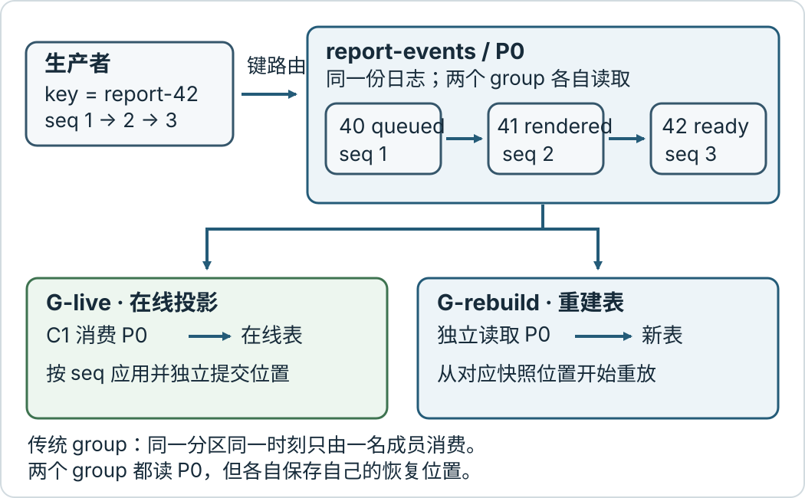
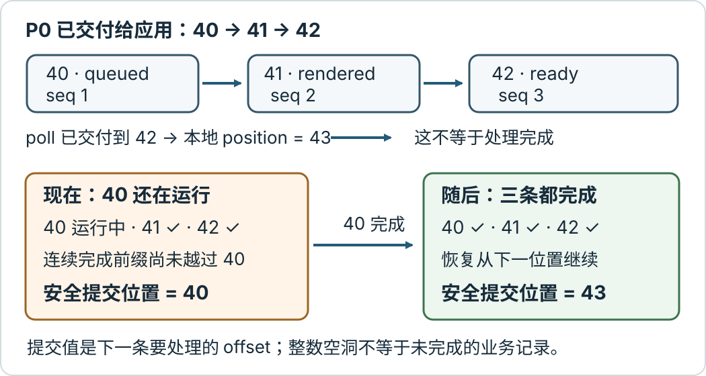

# 怎样用 Kafka 分区保序、推进偏移并安全接手？

**合成案例：** 报表服务按业务序号为 `reportId=42` 发布 `queued`、`rendered`、`ready` 三条状态记录。在线消费者把它们写入数据库里的 projection (投影)，也就是供查询的报表状态表；值班时，还要把同一份投影重建到一张新表。在线写入和重建分属两个 consumer group (消费者组)，各自维护读取位置。本页沿这三条记录说明：Kafka 保证什么顺序，消费者怎样记录进度，以及进程失联或组成员变化后为什么会重放。案例中的 offset (偏移量) 都是讲解用的位置，不是线上测量值。

先看端到端边界：生产者用稳定的键把同一报表的记录送进同一个分区；分区只给出 broker (代理节点) 实际追加的顺序；每个传统 consumer group（即非 share group 的普通消费者组，后文详述）独立读取并保存自己的位置；外部数据库写入是否完成，要由数据库自己的事务和业务序号判断。Kafka 的 offset 不能替数据库确认业务效果。



图中的 `G-live`（在线组）和 `G-rebuild`（重建组）是两个组，因此各有一份进度，都独立读取同一分区的全部可见记录。在同一个传统组内，一个分区在任一时刻只分配给一位成员。不过，组收到记录的顺序仍不等于并行数据库写入的完成顺序。

## 哪个顺序由分区保证？

Kafka 的 topic (主题) 由多个 partition (分区) 组成。每个分区是一条按追加位置排列的日志，由分区 leader (主副本) 决定追加顺序；offset 标识记录在分区内的位置，不同分区之间没有天然的全局次序。Kafka 4.4 Java producer (生产者) 使用默认的 `BuiltInPartitioner` (内置分区器) 时，会根据记录 key (键) 序列化后的字节选择分区：只要分区数、序列化方式和分区策略不变，`report-42` 这个键的记录总会进入同一分区。下面的计算假定：key serializer (键序列化器) 按 UTF-8 编码，未覆盖 `partitioner.class`，发送时未显式指定分区，且 `partitioner.ignore.keys=false`（默认值）。换用自定义 partitioner、改变字节编码或忽略 key，都可能改变这一映射。

本例固定三个分区，由一个生产者按业务序号串行发送，并保留 Kafka 4.4 默认的 `enable.idempotence=true` 及其配套约束。报表 42 的三条记录在载荷中带有 `reportId=42`、业务序号 `seq` 和稳定的 `event_id`；表末的 `report-17` 只用来对照另一个键的路由，不属于报表 42：

| 分区与 offset | key | 业务序号 | 记录 |
| --- | --- | ---: | --- |
| `report-events / P0 / 40` | `report-42` | 1 | `queued` |
| `report-events / P0 / 41` | `report-42` | 2 | `rendered` |
| `report-events / P0 / 42` | `report-42` | 3 | `ready` |
| `report-events / P2 / 18` | `report-17` | 1 | `queued` |
| `report-events / P2 / 19` | `report-17` | 2 | `ready` |

对 key 的 UTF-8 字节，Kafka 4.4 Java 内置路由计算 `toPositive(murmur2(keyBytes)) % partitionCount`：`report-42` 的正值 hash (散列值) 为 `1051128390`，模 3 得 `P0`；`report-17` 的正值为 `417961679`，模 3 得 `P2`。这些值按 Kafka 4.4.0 的 `Utils.murmur2` 和 `BuiltInPartitioner.partitionForKey` 复算得出，不是 broker 现场日志。offset `40–42` 只是示意位置，业务序号 `1–3` 才是报表状态的因果顺序。Kafka 会按 `P0` 的日志次序交付可见记录，但不会替业务判断哪个事件应该先发生。如果多个生产者并发发布同一个键，broker 仍会形成某个追加顺序，却不保证它符合业务序号；应由上游定义序号，由应用检查缺口或拒绝旧序号。

在同一个传统 consumer group 中，每个分区由组内一位活跃成员负责。因此三个分区最多带来三路分区级并行；组内再加第四个消费者，它只会闲置，不会凭空多出第四个分区。`G-rebuild` 组从自己的位置读取同一份日志，不会移动 `G-live` 的 offset。Kafka 4.4 另有 share group (共享组)，按单条记录分发，允许多个成员同时处理同一分区；本页只讨论需要分区内有序处理的传统 consumer group，不把两种模型混用。

扩分区也会改变顺序边界，因为默认的 key→partition 映射取决于分区数。保持上述 producer、serializer 和分区器不变，把分区数从 3 增到 4，`report-42` 的同一个 hash 从 `1051128390 % 3 = 0` 变为 `1051128390 % 4 = 2`，也就是从 `P0` 移到 `P2`；`report-17` 则从 `P2` 移到 `P3`。新旧分区的 offset 互不可比，不能用它们推导 `report-42` 的跨分区顺序。如果变更分区数时必须保序，就要安排可验证的迁移边界：先暂停该键的新发送，等旧分区里已发布的记录处理到约定序号，再切换路由；消费者仍校验 `seq`，发现缺口就等待或修复。仅仅换一个自定义分区器，并不能让两个分区的日志获得全局顺序。

### 生产者的确认与重试各证明什么？

`acks` 是 producer acknowledgment (生产者确认) 配置，决定生产者等到哪一级复制完成才把发送视为成功。它既不证明消费者已经处理，也不证明数据库里已有报表结果。

| 配置 | 成功响应边界 | 仍需考虑的条件 |
| --- | --- | --- |
| `acks=0` | 不等待 broker 响应 | 生产者连 broker 是否收到都不知道，也就无法据此判断是否需要重试 |
| `acks=1` | 分区 leader 将记录写入自己的日志 | leader 在复制给 follower (从副本) 前故障时，记录可能丢失 |
| `acks=all` | 当前 in-sync replicas (同步副本集，ISR) 全部确认 | 只等当前 ISR，不等 `replication.factor` 规定的全部副本；若持有已确认数据的副本全部永久丢失，确认本身无法恢复那份数据 |

这张表只说明生产者等到哪一级确认。副本故障后谁能接任 leader，还取决于集群配置：Kafka 4.4 新集群默认启用 eligible leader replicas (合格主副本，ELR)，当 ISR 小于 `min.insync.replicas` 时，高水位（消费者可读的已提交位置）不会前进，leader 选举也会把 ELR 纳入候选。所以不能只凭 `acks=all` 推断副本丢失后的结果，还要核对 `replication.factor`、`min.insync.replicas`、ELR 是否启用，以及持有已提交记录的副本是否仍然存活。

生产者超时时，它无法知道请求是在追加前还是追加后失去响应。Kafka 的 producer idempotence (生产者幂等性) 用生产者 ID 和每个分区上的批次序号，去掉同一次发送在客户端重试时产生的重复。Kafka 4.4 在没有冲突配置时默认开启幂等性，它要求 `acks=all`、启用重试，且 `max.in.flight.requests.per.connection <= 5`。若关闭幂等性、又启用重试并允许同一连接上有多个未确认请求，那么较早的批次在重试时，后发的批次可能先写入。即使幂等生产者工作正常，它也无法判断应用重新调用的两次 `send` 是否属于同一业务事件；应用层的重发仍要靠 `event_id` 或同类业务键去重。

## 提交的 offset 为什么是“下一个要读的位置”？

Kafka consumer (消费者) 有两个容易混淆的位置。`position` (当前位置) 是这个消费者下一次要取的位置，每次 `poll()` 交付记录后都会前进。committed offset (已提交偏移量) 是持久保存的位置，进程重启或分区重新分配后从这里恢复。`poll()` 把记录交给应用，不代表数据库处理已经完成；本地 `position` 也不能直接当成可以安全提交的业务进度。

以 `P0` 为例，成功处理 offset `40` 后提交 `41`，表示下次从 offset `41` 继续；Kafka Java consumer API 要求提交的正是下一条要处理记录的 offset。假如 `40、41、42` 都已交付，consumer 的当前位置可能已是 `43`；但只要异步 worker (工作线程) 还没处理完 `40`，安全的持久进度就仍是 `40`，即最早未完成的可见记录。若提交得更靠后，崩溃恢复时就会跳过它。



如果同一分区的记录交给多个 worker 并行处理，就要按**已交付记录的顺序**维护“连续完成前缀”：从最早交付的记录数起，中间没有未完成记录的那一段。假设 `41`、`42` 已完成而 `40` 仍在运行，可提交位置保持 `40`；等 `40` 也完成，才推进到 `43`。若 `40`、`42` 已完成而 `41` 还在运行，安全位置是 `41`。worker 只把完成结果交回 consumer 线程：`KafkaConsumer` 不是线程安全的，poll、分区分配、前缀状态和提交都应由同一个 consumer 线程负责。处理可以串行也可以并行，但提交的总是最早未完成记录的 offset；某个分区所有已交付记录都完成后，才提交最后一条可见记录之后的下一个 offset。

例如，offset `40` 的数据库事务提交成功，且 consumer 仍拥有 `P0` 时，只提交这一分区的安全位置：

```java
consumer.commitSync(Map.of(
    new TopicPartition("report-events", 0),
    new OffsetAndMetadata(41L)
));
```

如果某次 `poll()` 已交付 `40、41、42`，之后调用无参 `commitSync()`，提交的是最近一次 poll 后的位置，可能是 `43`；此时若 worker 还没完成 `40`，恢复后就会跳过一条尚未写入数据库的记录。所以要用显式 map 只提交连续完成前缀。分区一旦被收回，旧分配下迟到的完成通知也不能计入新分配的前缀。

offset 整数不一定连续：日志压缩会移除同键的旧记录，`read_committed` 隔离级别会隐藏已中止事务的记录，事务控制标记也占用 offset。假设应用实际只收到 `40` 和 `42`，`41` 不可见，那么完成 `40` 后，下一条要处理的可见记录就是 `42`，不必等待不存在的 `41`；此时提交 `41` 只是给出一个稍早的扫描起点，读取时会自动越过空洞。看到 offset 有缺口，不能断定业务记录丢失；`42` 尚未完成时，也不能把进度提交到它之后。此外，`read_committed` 只读到 last stable offset (最后稳定偏移) 为止，也就是第一个未结束事务之前，所以消费者可能暂时看不到日志末尾的记录。

连续完成前缀只约束恢复位置，不会让外部副作用自动按业务序号发生。若并行 worker 先写入 `seq=2 rendered`、再写入 `seq=1 queued`，数据库状态仍可能倒退。按 `event_id` 去重只能防止同一事件重复生效，不能纠正不同事件之间的乱序。

如果投影保存的是可以被最新完整快照直接替换的状态，而不是每一步都必须执行的转换，就可以用业务序号拒绝旧快照。本例预先创建一行 `report_id=42, last_seq=0`（`last_seq` 非 NULL），并让每条记录都携带完整状态：

```sql
UPDATE report_projection
SET status = :status, last_seq = :seq
WHERE report_id = :report_id AND last_seq < :seq;
```

先应用 `seq=2 rendered`、再应用 `seq=3 ready` 之后，迟到的 `seq=1 queued` 只会更新零行，投影保持 `ready/3`。这条旧快照已被更新的快照取代，所以“更新零行”是一次成功的空操作；它完成后，offset `40` 才算处理完，连续前缀才能前进。此写法**只适用于可跳过中间状态的完整快照**。若 `queued → rendered → ready` 每一步都有不可省略的副作用，就应按 `reportId` 顺序提交，或要求 `seq = last_seq + 1` 并把缺口留待补齐，不能用 `last_seq < seq` 假装所有转换都执行过了。

## 崩溃发生在处理与提交的哪一边？

假设 `G-live` 接下来要处理 offset `40` 的 `queued`：效果写入 PostgreSQL，消费位置保存在 Kafka。这两个系统之间没有一次性的原子提交，所以崩溃落在哪一侧决定了结果：

| 崩溃/确认边界 | 数据库中的状态 | 恢复起点 | 结果 |
| --- | --- | --- | --- |
| 数据库事务提交后、Kafka offset 尚未提交 | `event_id` 对应效果已持久 | 仍从 `40` 起 | offset `40` 会重放；数据库须在同一本地事务中用 inbox (收件箱)/唯一 `event_id` 去重，或让完整快照条件更新成为无操作 |
| Kafka 已提交 `41`、数据库事务还未提交 | 事件 `40` 效果不存在 | 从 `41` 起 | Kafka 不会再交付 `40`，投影漏掉这次更新 |

因此，写外部数据库的消费者通常先提交数据库事务，再提交 Kafka offset，接受“至少一次”处理和可能的重放。还要关闭自动 offset 提交（`enable.auto.commit=false`），否则后台自动提交可能抢在数据库事务之前。如果数据库提交成功但响应丢失，就重新查询 inbox 或投影，再安全地重放；Kafka offset 提交成功的响应不能证明数据库已提交。无论两步谁先谁后，都消除不了中间的崩溃窗口，做不到“两边恰好各成功一次”。

生产端也有类似问题：记录已追加，发送确认却可能丢失。幂等性保证同一个 producer 在协议层的重试不会再追加重复记录；但如果应用拿到不确定的结果后，把它当作一次新的业务调用重新发布，仍需要用业务 `event_id` 去重，或先查询是否已经发布。也就是说，生产端只消除了有限范围内的重试重复，消费端仍要自己处理数据库与 offset 之间的崩溃窗口。

## 再均衡怎样拒绝旧成员的提交？

成员加入、退出，或两次 poll 的间隔超过上限，都会触发 rebalance (再均衡)，重新分配分区。下面的时序明确使用 classic group protocol (经典组协议) 和 eager assignor (整体撤销式分配器)：消费者 C1 持有 `P0`，已提交位置是 `40`；C2 加入后，组的 generation (组代次) 从 5 变为 6，`P0` 改分配给 C2。

| C1 的提交时机 | offset 提交结果 | C2 起点 |
| --- | --- | --- |
| C1 停止派发、等 offset `40` 的数据库事务确认成功，并在代次 5 仍有效时提交 `41` | 持久位置变为 `41` | 从 `41` 起 |
| 携带旧代次 5 的请求在代次 6 生效后抵达 | coordinator (协调器)拒绝；仍被识别的成员使用旧代次时为 `ILLEGAL_GENERATION`，成员已移出时先报 `UNKNOWN_MEMBER_ID`；持久位置仍为 `40` | 从 `40` 重放 |

拒绝的依据是 C1 提交时携带的成员 ID 或代次已过期，而不是“`P0` 已改给 C2”。Kafka 4.4 的 classic coordinator 只校验 group、member 和 generation 状态，不会再逐个检查提交的分区是否仍分配给该成员。因此应用仍应只提交当前分配内已完成的前缀；而且这项服务端校验只保护 offset 提交，不能替外部数据库写入做 fencing (栅栏)。

有序交接时会调用 `onPartitionsRevoked`：consumer 线程停止派发，在有限时间内等待正在执行的数据库事务确认成功，再趁旧成员资格仍有效时提交已完成的连续前缀。异常情况下，可能直接调用 `onPartitionsLost`：这时分区可能已归其他成员，C1 不再尝试提交旧进度，只停止派发并丢弃旧分配的完成通知；C2 从最后一次成功保存的位置恢复，已写数据库但未提交 offset 的记录会被重放。两个回调都不会终止已经在运行的后台任务，所以外部存储仍要防止旧任务迟到的写入。

Kafka 4.4 Java consumer 的默认值仍是 `group.protocol=classic`。新的 consumer rebalance protocol (消费者再均衡协议，KIP-848) 从 Kafka 4.0 起正式可用，但要设置 `group.protocol=consumer` 才会启用；它按分区增量调整分配，不能照搬 classic 的整组撤销时序。classic 的 generation 和新协议的 member epoch (成员代次) 都用于校验 offset 提交者的成员身份，但两种协议的分配方式和配置不同，具体回调时机要按所选协议核实。交接时排空工作也受成员存活和 poll 时限约束：如果等数据库等得超过时限，旧成员可能先失去分区，提交随之失败，留下需要重放的记录。

Kafka 的 group fencing (组成员栅栏) 只保护消费者组的分配和 offset 提交。如果 C1 已把工作交给后台线程，分区被撤销时，那个线程不会自动停止，它已经提交的数据库事务也不会被撤回。应用必须在撤销时停止派发，等待或取消未完成的工作；如果旧任务仍可能迟到，就要让目标数据库自己执行持久的所有权栅栏。下面是一个简化的 PostgreSQL 约定：每个 topic/partition 有唯一一条 owner row (所有权行)，其中保存当前所有者的 token (令牌)；C2 先以旧 token 为条件把它改成新 token 并提交，再开始业务写入；C1 的每个写入事务都先锁住同一行、核对 token，再写投影，锁一直持有到该事务提交。这张 owner 表只服务 `G-live` 的在线投影；同时运行的 `G-rebuild` 应使用独立的 owner 表，或把 `projection_id` 加进唯一键和每个所有权条件，否则两个合法的消费者组会互相夺走所有权。

```sql
-- C2：新所有者 token=6 先落库。业务写入只能在这个事务提交后开始。
BEGIN;
UPDATE partition_owners
SET owner_token = 6
WHERE topic = 'report-events' AND partition_id = 0 AND owner_token = 5;
-- 必须恰好更新一行；否则此 worker 没有取得新的持久所有权。
COMMIT;

-- C1：owner 检查和投影效果在同一事务中；FOR UPDATE 的锁保持到 COMMIT。
BEGIN;
SELECT owner_token
FROM partition_owners
WHERE topic = 'report-events' AND partition_id = 0
FOR UPDATE;
-- 应用只在查到 owner_token=5 时继续；否则 ROLLBACK 并丢弃旧任务。
UPDATE report_projection
SET status = :status, last_seq = :seq
WHERE report_id = 42 AND last_seq < :seq;
COMMIT;
```

互斥的关键在于：token 切换和投影写入都要经过同一条 owner row 的行锁。若 C1 先拿到行锁，C2 的 token 更新要等 C1 提交后才能执行；若 C2 已提交 token 6，C1 之后锁行就会读到 6 并放弃写入。如果只用普通 `SELECT` 读 token、稍后再 `UPDATE`，即使两句在同一个 Read Committed 事务里，也得不到这种互斥。业务 `seq` 能拒绝旧快照，却不能证明当前写入者有权写；这里的数据库 fencing 与报表 job 自己的 attempt (运行尝试)/lease (租约) 是两套独立的约定。另外，捕获 `CommitFailedException` 只说明 offset 提交失败，撤不回已经提交的 SQL。

## 回放能重建到哪里？

在线投影由 `G-live` 持续消费；重建表则由独立的 `G-rebuild` 读取。重建从一份数据库初始快照开始，并与它对应的每分区位置向量 `S[p]` 一起保存（`p` 表示分区）：快照恰好包含每个分区中所有 offset `< S[p]` 的效果，不含任何 `>= S[p]` 的效果；重建组就从 `S` 开始读。`S` 是快照的恢复起点；稍后选定的 `T` 是在线投影与重建投影共同对齐、准备切换的边界，二者不是同一个位置。注意，若直接重置 `G-live` 的 offset，改变的只是在线投影自己的恢复点，并不会多出第二份进度。

以 `P0` 为例：数据库快照已包含 offset `<40` 的投影效果，且没有任何 `>=40` 的效果，因此 `S[P0]=40`。在线投影和新表都处理仍可见的 `40、41、42`；选定 `T[P0]=43` 后，两边都暂停应用 `>=43` 的事件，并确认各自已写入数据库的连续前缀和 committed offset 都停在 `43`。此刻两张表都应恰好等于“快照 + `[40,43)` 中可见记录的效果”，且不含 `[43,…)` 的效果。确认两边状态一致后切到新表，由 `G-rebuild` 从 `43` 继续消费。这里的 `[40,43)` 是一个分区内半开 offset 区间；多分区时每个分区分别有自己的 `S[p]` 和 `T[p]`，不能把它们合成全局时间。

如果在线表与重建表都用 inbox 去重，去重键至少要包含 `(projection_id, event_id)`，或者给每张投影单独建 inbox。若 inbox 只按 `event_id` 全局唯一，在线组处理过某个事件后，重建组会误以为新表也处理过，从而跳过它。还要保证每个分区的 `[S[p],T[p])` 仍完整可读，并在切换期间保留 `>=T[p]` 的事件。如果压缩或保留策略已删掉所需记录，就停止切换，改从与快照匹配的历史来源恢复，不能靠 `auto.offset.reset=earliest` 悄悄补齐。offset 中可能有压缩或事务造成的不可见空洞；例中的 40、41、42 是这个合成分区里的可见记录。对齐只要求所有可见记录都已应用，不要求 offset 整数连续。

重建能力还受 retention (保留) 和 compaction (压缩) 策略限制。如果要读的 offset 已早于当前最早可读位置，`auto.offset.reset=earliest` 只能从**现在仍保留的最早记录**开始，找不回已删除的记录。日志压缩只保留每个 key 的较新值，不保证留下同一 key 的全部历史状态转换。若要从空白重建完整事件历史，主题必须按重建耗时和最慢的消费速度留足未压缩的记录，或者提供带匹配 offset 向量的快照。

前面的崩溃窗口来自“数据库”和“Kafka”是两个系统。如果输出也写回 Kafka，Kafka 的 transaction (事务) 就能把输入分区的消费位置与输出 topic 的记录一起提交。典型的 Kafka→Kafka 流程中，每个并发 producer 实例使用唯一、且重启后沿用的 `transactional.id`。新实例启动时先调用 `initTransactions()`：旧实例失败时遗留的进行中事务会被中止；若旧事务已经开始提交或中止，就等它结束；同时，新的 producer epoch 会拒绝旧实例继续写入。只要输入 topic 含有事务记录、且只应处理已成功提交的记录，消费者就应设置 `isolation.level=read_committed`，以免把已中止的记录当成业务输入。处理时关闭自动 offset 提交，改由 producer 调用 `sendOffsetsToTransaction(offsets, consumer.groupMetadata())`，把下一读取位置和当前 consumer group metadata (消费者组元数据) 加入当前事务，不再另行手动提交这些 offset。配置正确、并妥善处理提交与中止时，Kafka 输出和输入消费位置会一起提交或一起中止；但这并不保证“一次 poll 的所有分区输出原子地一起可见”。事务中止后，组的已提交位置仍是旧值，输入可以重新处理；不过消费者内存中的 `position` 不会自动倒回，应用要重新回到已提交位置，例如调用 `seek`、重启 consumer，或等待组内重新分配。

但 Kafka 事务管不到 PostgreSQL `UPDATE`、对象存储写入或 HTTP 调用。若 `ready` 已写入 PostgreSQL，随后 Kafka 事务中止，数据库里的变更不会跟着回滚。从 Kafka 写往外部系统，仍需外部系统配合：要么在数据库的同一事务里写业务结果、inbox 和数据库自己保存的消费位置，恢复时从这个位置 `seek`；要么先提交数据库效果、再提交 Kafka offset，并让业务写入在重放时保持幂等。数据库 outbox (发件箱) 负责把已提交的数据库变更可靠地发布出去，但它不会推进 Kafka consumer 的读取位置。远端 API 则必须按稳定的操作键，对重复请求做到业务幂等。相关报表任务合同见[怎样设计一个可持久查询的账户报表？](../architecture/system-design-fundamentals.md)，消息确认与未知结果见[报表任务的发布确认、消费者确认与业务完成各证明什么？](queue-delivery-and-acknowledgement.md)。

> [!info]- 来源与版本边界
> 核对日期：2026-11-13。Apache Kafka 官方 Downloads 将 4.4.0 列为受支持版本，发布公告日期为 2026-10-22；下列 Kafka 4.4 文档用于核对当前术语与配置，案例中的事件、offset、分区数、崩溃点和完成顺序均为合成推演。
>
> - [Apache Kafka Downloads](https://kafka.apache.org/downloads/) 与 [4.4.0 发布公告](https://kafka.apache.org/blog/2026/10/22/apache-kafka-4.4.0-release-announcement/)：支持版本列表与发布日。
> - [Apache Kafka 4.4 Design](https://kafka.apache.org/44/design/design/) 与 [Eligible Leader Replicas](https://kafka.apache.org/44/operations/eligible-leader-replicas/)：key 到分区的语义路由、分区内全序、传统消费者组成员与位置、producer 可靠性、Kafka 事务及外部系统边界、share group 与传统 group 的区别、复制和 ELR/min ISR 边界。
> - [Apache Kafka 4.4 Producer Configs](https://kafka.apache.org/44/configuration/producer-configs/) 与 [KafkaProducer 4.4 Javadoc](https://kafka.apache.org/44/javadoc/org/apache/kafka/clients/producer/KafkaProducer.html)：`acks`、默认幂等性、重试排序、`transactional.id` 和 `sendOffsetsToTransaction`。
> - [KafkaConsumer 4.4 Javadoc](https://kafka.apache.org/44/javadoc/org/apache/kafka/clients/consumer/KafkaConsumer.html)：consumer position 与 committed position、offset 可有空洞、提交的 next offset、提交失权时的失败，以及传统组撤销/分配回调。
> - [Apache Kafka 4.4 Consumer Configs](https://kafka.apache.org/44/configuration/consumer-configs/) 与 [Consumer Rebalance Protocol](https://kafka.apache.org/44/operations/consumer-rebalance-protocol/)：`enable.auto.commit`、`read_committed`、`auto.offset.reset`、`max.poll.interval.ms`，及 `classic` / `consumer` 协议的选择边界。Kafka 4.4 的 Java consumer 默认 `classic`；新协议从 4.0 起 GA，但仍需显式选择。
> - [Kafka 4.4 Protocol](https://kafka.apache.org/44/design/protocol/) 和 [Topic Configs](https://kafka.apache.org/44/configuration/topic-configs/)：offset 提交的 generation/member epoch 字段，主题保留与压缩配置。本文关于扩分区引起的跨分区排序缺口，是 key 哈希路由与多分区独立日志的推论；迁移步骤是应用侧合同，不是 Kafka 自动提供的排序。
> - [Kafka 4.4.0 `BuiltInPartitioner`](https://github.com/apache/kafka/blob/4.4.0/clients/src/main/java/org/apache/kafka/clients/producer/internals/BuiltInPartitioner.java)、[`Utils.murmur2`](https://github.com/apache/kafka/blob/4.4.0/clients/src/main/java/org/apache/kafka/common/utils/Utils.java) 与 [`UtilsTest`](https://github.com/apache/kafka/blob/4.4.0/clients/src/test/java/org/apache/kafka/common/utils/UtilsTest.java)：用于限定上述 UTF-8 hash 与分区数计算；不是所有客户端都必须采用相同语言实现。
> - [Kafka 4.4.0 `ClassicGroup.validateOffsetCommit`](https://github.com/apache/kafka/blob/4.4.0/group-coordinator/src/main/java/org/apache/kafka/coordinator/group/classic/ClassicGroup.java#L798-L874)、[PostgreSQL 18 Read Committed](https://www.postgresql.org/docs/18/transaction-iso.html#XACT-READ-COMMITTED) 与 [Explicit Locking](https://www.postgresql.org/docs/18/explicit-locking.html)：classic commit 检查组状态/成员/代次，Read Committed 下的语句快照以及行锁直到事务结束并在等待后返回更新行的依据。数据库 owner row 的互斥写入流程是应用合同；本文所述隔离与锁语义依据 PostgreSQL 18 文档。
