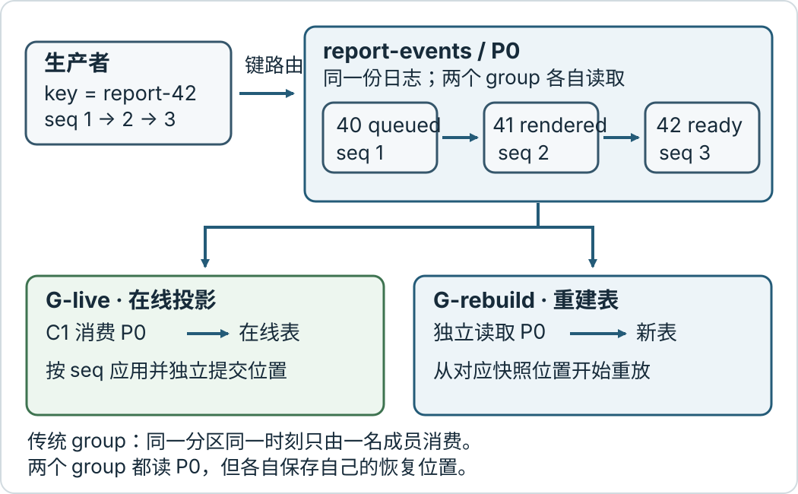
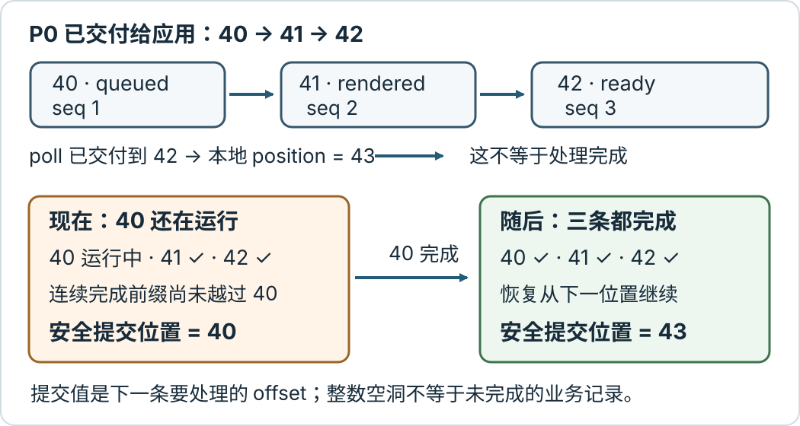

# 怎样用 Kafka 分区保序、推进偏移并安全接手？

**合成案例：** 报表服务为 `reportId=42` 按业务序号发布 `queued`、`rendered`、`ready` 三条记录。在线消费者把它们应用到数据库 projection (投影)；值班时，同一报表投影还要重建到一张新表。两个 consumer group (消费者组) 各自维护读取位置。本页沿这三条记录说明 Kafka 保证什么顺序、消费者怎样记录进度，以及进程失联或组成员变化后为何会重放。案例中的 offset (偏移量) 是讲解用位置，不是线上测量值。

先看端到端边界：生产者用稳定的键把同一报表送往同一个分区；分区只给出 broker (代理节点) 实际追加的顺序；每个传统 consumer group (消费者组) 独立读取并保存位置；外部数据库写入是否完成，要由数据库自己的事务和业务序号判断。Kafka 的 offset 不能替数据库确认业务效果。



图中的 `G-live` 和 `G-rebuild` 是两个组，所以它们各有一份进度；两组都独立读取同一分区的全部可见记录。同一个传统组内，一个分区在某一时刻只交给一位成员。组收到的记录顺序仍不代表并行数据库写入完成顺序。

## 哪个顺序由分区保证？

Kafka 的 topic (主题) 由多个 partition (分区) 组成；每个分区是一条按追加位置排列的日志，分区 leader (主副本) 决定该分区的追加顺序。分区内的 offset (偏移量) 标识位置，不同分区之间没有天然的全局次序。Kafka 4.4 Java producer (生产者) 在默认 `BuiltInPartitioner` (内置分区器) 下，会用记录 key (键) 序列化后的字节计算语义分区：同一个 `report-42` 键在分区数量、序列化和分区策略都稳定时会被路由到同一分区。下面的具体计算固定 UTF-8 key serializer (键序列化器)、未覆盖 `partitioner.class`、未显式指定 partition (分区)，且 `partitioner.ignore.keys=false`；后者是默认值。自定义 partitioner (分区器)、不同字节编码或忽略 key 都可以改变映射。

本例固定三个分区、一个生产者按业务序号串行发送，使用 Kafka 4.4 默认的 `enable.idempotence=true` 且不覆盖其约束。报表 42 的三条载荷记录带有 `reportId=42`、`seq` 和稳定 `event_id`；表末的 `report-17` 只是另一条路由计算，不属于报表 42：

| 分区与 offset | key | 业务序号 | 记录 |
| --- | --- | ---: | --- |
| `report-events / P0 / 40` | `report-42` | 1 | `queued` |
| `report-events / P0 / 41` | `report-42` | 2 | `rendered` |
| `report-events / P0 / 42` | `report-42` | 3 | `ready` |
| `report-events / P2 / 18` | `report-17` | 1 | `queued` |
| `report-events / P2 / 19` | `report-17` | 2 | `ready` |

对给定 UTF-8 字节，Kafka 4.4 Java 内置路由先算 `toPositive(murmur2(keyBytes)) % partitionCount`：`report-42` 的正值 hash (散列值) 为 `1051128390`，模 3 得 `P0`；`report-17` 的正值为 `417961679`，模 3 得 `P2`。这是按 Kafka 4.4.0 的 `Utils.murmur2` 和 `BuiltInPartitioner.partitionForKey` 复算出的路由，不是 broker 现场日志。offset `40–42` 是示意位置；业务序号 `1–3` 才是报表状态的因果顺序。Kafka 会按 `P0` 日志次序交付可见记录，但不会替业务判断哪个事件应该先发生。若多个生产者并发发布同一个键，broker 仍会形成一个追加顺序，却不保证它就是业务所需的序号顺序；应让上游定义序号，并在应用侧检查缺口或拒绝旧序号。

同一传统 consumer group 中，分区由组内一位活跃成员负责。三个分区最多提供三份这种分区级并行度；组内增加第四个消费者不会分出第四个分区。另一个 `G-rebuild` 组可以从自己的位置读取相同日志，不会移动 `G-live` 的 offset。Kafka 4.4 另有 share group (共享组)这种逐记录协作模型，它允许多个成员处理同一分区；本页讨论的是用于分区有序处理的传统 consumer group，不把两种模型混用。

扩分区也会改变顺序边界：默认的 key→partition 映射受分区数影响。保持上述 producer、serializer 和分区器不变，把分区数从 3 增到 4，`report-42` 的同一个 hash 从 `1051128390 % 3 = 0` 变为 `1051128390 % 4 = 2`，也就是从 `P0` 移到 `P2`；`report-17` 则从 `P2` 移到 `P3`。新分区 offset 与旧分区 offset 不能比较，因此不能靠它们推导 `report-42` 的跨分区顺序。若必须在变更分区数时保序，应安排可验证的迁移边界：暂停该键的新发送、等待旧分区已发布记录处理到约定序号，再切换路由；消费者仍校验 `seq` 并在缺口时等待或修复。仅更换一个自定义分区器不会为两条分区日志建立全局顺序。

### 生产者的确认与重试各证明什么？

`acks` 是 Kafka producer (生产者) acknowledgment (确认) 的配置，决定生产者等到什么复制边界才把发送视为成功；它不证明消费者已处理，也不证明数据库里已有报表结果。

| 配置 | 成功响应边界 | 仍需考虑的条件 |
| --- | --- | --- |
| `acks=0` | 不等待 broker 响应 | 可能连 broker 是否收到都不知道，重试也无法据此判断失败 |
| `acks=1` | 分区 leader 将记录写入自己的日志 | leader 在复制给 follower (从副本) 前故障时，记录可能丢失 |
| `acks=all` | 当前 in-sync replicas (同步副本集，ISR) 确认 | 等待当前 ISR，不等 `replication.factor` 中的所有副本；若唯一持有已确认数据的副本永久丢失，确认本身不能恢复那份数据 |

这张表只说明生产者等到的确认边界。Kafka 4.4 新集群默认启用 eligible leader replicas (合格主副本，ELR)：当 ISR 小于 `min.insync.replicas` 时，高水位不会前进，leader 选举资格也会考虑 ELR。因此，不能只看 `acks=all` 推断副本丢失后的接管结果；还要核对 `replication.factor`、`min.insync.replicas`、ELR 是否启用，以及持有已提交记录的副本是否仍存活。

若生产者超时，它可能不知道请求是在追加前还是追加后失去响应。Kafka 的 producer idempotence (生产者幂等性)用生产者身份和分区序号去重同一次生产者重试；Kafka 4.4 默认开启幂等性，前提是没有冲突配置，幂等配置要求 `acks=all`、启用重试且 `max.in.flight.requests.per.connection <= 5`。若关闭幂等性、启用重试且同一连接允许多个未确认请求，早先批次重试期间，后发批次可能先写入。即使幂等生产者工作正常，它也不判断两个由应用重新发起的 `send` 是否代表同一个业务事件；应用级重放仍需用 `event_id` 或同等业务键去重。

## 提交的 offset 为什么是“下一个要读的位置”？

Kafka consumer (消费者) 有两个容易混淆的位置。`position` (当前位置) 是当前消费者下一步要取的位置；每次 `poll()` 交付记录后会前进。committed offset (已提交偏移量) 是持久保存、进程重启或重新分配后要恢复到的位置。`poll()` 已把记录交给应用，不代表数据库处理完成；也不能把本地 `position` 自动当成可安全提交的业务进度。

对 `P0` 而言，成功处理 offset `40` 后，提交 `41` 表示下次从 offset `41` 起继续；Kafka Java consumer API 要求提交的是下一条要处理记录的 offset。若已经交付 `40、41、42`，consumer 的当前位置可以是 `43`，但异步 worker (工作线程) 还没完成 offset `40` 时，安全的持久进度仍是 `40`：它是最早未完成的可见记录位置，否则崩溃恢复会跳过它。



同一分区若派给并行 worker，就按**已交付记录的顺序**维护连续完成前缀：假设 `41`、`42` 完成而 `40` 仍运行，可提交位置保持 `40`；等 `40` 也完成后，才推进到 `43`。若 `40` 已完成、`41` 还在运行而 `42` 已完成，安全位置是最早未完成记录 `41` 的 offset。worker 只把完成结果交还 consumer 线程；`KafkaConsumer` 本身非线程安全，由同一个 consumer 线程拥有 poll、分区分配、前缀状态和提交。可以串行处理分区，也可以并行计算，但只能让提交器提交最早未完成记录的 offset；一个分区所有已交付记录均完成时，再提交最后一条可见记录之后的 next offset。

例如，offset `40` 的数据库事务提交成功后、且 consumer 仍有效拥有 `P0` 时，只提交这一分区的安全位置：

```java
consumer.commitSync(Map.of(
    new TopicPartition("report-events", 0),
    new OffsetAndMetadata(41L)
));
```

如果在一次 `poll()` 已交付 `40、41、42` 后调用无参 `commitSync()`，它提交的是最近一次 poll 的位置，可能是 `43`；当 worker 的 `40` 尚未完成时，这会让恢复跳过尚无数据库效果的记录。用显式 map 只提交连续完成前缀；失去分区后，应用不能把旧完成通知带入新分配的前缀。

offset 整数不一定连续。日志压缩会移除同键的旧记录；`read_committed` 隔离级别会隐藏已中止事务的记录。因此，假设应用实际收到 `40` 和 `42`，而 `41` 在日志中不可见，完成 `40` 后，下一条要处理的可见记录是 `42`，不必等待不存在的 `41`；提交 `41` 也只是一个更早的扫描起点，会在读取时越过空洞。不能因为看见 offset 数字有缺口就认为一条业务记录丢失，也不能在 `42` 尚未完成时把进度提交到它后面。`read_committed` 还会等未完成事务的边界（last stable offset (最后稳定偏移)），所以消费者可能暂时看不到日志尾部的后续记录。

连续完成前缀限制的是恢复位置，不会自动让外部副作用按业务序号发生。若 worker 先写 `seq=2 rendered`、再写 `seq=1 queued`，数据库状态仍可能倒退。相同 `event_id` 的去重只能阻止同一事件重复产生效果，不能修正不同事件的乱序。

如果投影存的是“可由最新完整快照替换”的状态，而非每一步都要执行的转换，可以用业务序号拒绝旧快照。本例先创建 `report_id=42, last_seq=0`（非 NULL）的一行，并让每条记录都携带完整状态：

```sql
UPDATE report_projection
SET status = :status, last_seq = :seq
WHERE report_id = :report_id AND last_seq < :seq;
```

先应用 `seq=2 rendered`、再应用 `seq=3 ready` 后，迟到的 `seq=1 queued` 影响零行，投影保留 `ready/3`；这条旧快照被较新快照替代，因此是成功的无操作，之后 offset `40` 才算完成并允许连续前缀前进。此写法**只适用于可跳过中间状态的完整快照**。若 `queued → rendered → ready` 每一步都有不可省略的副作用，就应按 `reportId` 顺序提交，或要求 `seq = last_seq + 1` 并把缺口留待补齐，不能用 `last_seq < seq` 假装所有转换都执行过了。

## 崩溃发生在处理与提交的哪一边？

假设 `G-live` 当前应从 offset `40` 处理 `queued`，效果写入 PostgreSQL，消费位置保存在 Kafka。两个系统之间没有普通的单次原子提交：

| 崩溃/确认边界 | 数据库中的状态 | 恢复起点 | 结果 |
| --- | --- | --- | --- |
| 数据库事务提交后、Kafka offset 尚未提交 | `event_id` 对应效果已持久 | 仍从 `40` 起 | offset `40` 会重放；数据库须在同一本地事务中用 inbox (收件箱)/唯一 `event_id` 去重，或让完整快照条件更新成为无操作 |
| Kafka 已提交 `41`、数据库事务还未提交 | 事件 `40` 效果不存在 | 从 `41` 起 | Kafka 不会再交付 `40`，投影漏掉这次更新 |

所以写外部数据库的一般消费者会先让数据库事务提交，再提交 Kafka offset，接受至少一次处理和可能重放。外部处理要关闭自动 offset 提交（`enable.auto.commit=false`），否则后台自动提交可能先于数据库事务。如果数据库提交成功但响应丢失，重新查询数据库的 inbox/投影并安全重放；不要把 Kafka offset 的提交响应当成数据库提交证明。不能靠交换两条语句的先后消除“两边都恰好成功一次”的窗口。

反过来，producer 的发送确认也可能在记录追加后丢失。幂等性让同一个 producer 的协议重试不再追加重复副本；如果应用收到不确定结果后作为一次新业务调用重新发布，仍需要业务 `event_id` 去重或查询已发布状态。这样，生产端消除的是限定范围的重试重复，消费端仍要自己对付数据库与 offset 的崩溃窗口。

## 再均衡怎样拒绝旧成员的提交？

组成员加入、退出、poll 超过允许间隔等情况会触发 rebalance (再均衡)，改变分区分配。先看一个明确使用 classic group protocol (经典组协议)和 eager assignor (整体撤销式分配器)的时序：C1 持有 `P0`，已提交位置是 `40`；C2 加入，组从代次 5 进入代次 6，把 `P0` 交给 C2。

| C1 的提交时机 | offset 提交结果 | C2 起点 |
| --- | --- | --- |
| C1 停止派发、等 offset `40` 的数据库事务确认成功，并在代次 5 仍有效时提交 `41` | 持久位置变为 `41` | 从 `41` 起 |
| 携带旧代次 5 的请求在代次 6 生效后抵达 | coordinator (协调器)拒绝；仍被识别的成员使用旧代次时为 `ILLEGAL_GENERATION`，成员已移出时先报 `UNKNOWN_MEMBER_ID`；持久位置仍为 `40` | 从 `40` 重放 |

这次拒绝的根据是 C1 交来的成员/代次已过期；不能写成“只要 P0 改给 C2，broker 就一定拒绝 C1”。Kafka 4.4 classic coordinator 验证 group/member/generation 状态，再对每个 partition offset 不做额外的分配归属校验。应用仍应只提交当前分配中已完成的前缀；这条服务端验证不是外部数据库写入的 fencing。

正常的 `onPartitionsRevoked` 回调发生在有序交接时：consumer 线程停止派发，可以在有界时间内等待正在执行的数据库事务确认成功，再在旧成员资格仍有效时提交已完成的连续前缀。异常情况下可能直接收到 `onPartitionsLost`：此时分区可能已由别的成员拥有，C1 不再尝试提交旧进度，而是停止派发、丢弃旧分配的完成通知；C2 从最后一次成功保存的位置恢复，未提交的数据库效果可能重放。回调不会撤销已经运行的后台任务，因此外部存储仍须防止旧任务迟到写入。

Kafka 4.4 的 `group.protocol=classic` 是 Java consumer 默认值。新 consumer rebalance protocol (消费者再均衡协议，KIP-848)从 Kafka 4.0 起已正式可用，但需设置 `group.protocol=consumer` 选择；它按分区增量调整成员，不应照搬 classic 的整组撤销时序。classic 下的 generation (组代次) 和新协议下的 member epoch (成员代次) 都参与组提交的成员校验，但协议差异会影响分配与配置方式，具体回调时机应按所选协议核实。排空工作也必须受该协议的成员存活与 poll 时限约束；若等待数据库时超过时限，旧成员可能先失去分区，提交就会失败并留下重放。

Kafka 的 group fencing (组成员栅栏)只保护 consumer group 的分配和 offset 提交。若 C1 已将异步工作派给后台线程，组撤销不会自动停止那个线程，也不会撤销它已经写入数据库的事务。应用须在撤销时停止派发并等待或取消仍未完成的工作；若旧任务可能迟到，就让目标数据库也执行持久所有权栅栏。下面是简化的 PostgreSQL 合同：每个 topic/partition 有一条唯一 owner row (所有权行)；C2 以当前 token (令牌)作条件更新并提交，再开始新所有者的业务写入；C1 的每个副作用事务先锁同一所有权行、验证 token，再写投影，锁保持到同一事务提交。 这里的 owner 表专属于 `G-live` 的在线投影；同时运行的 `G-rebuild` 应使用独立的 owner 表，或把 `projection_id` 加入唯一键及每条所有权读写条件，否则两个合法消费者组会互相撤销所有权。

```sql
-- C2：新所有者 token=6 先落库。业务写入只能在这个事务提交后开始。
BEGIN;
UPDATE partition_owners
SET owner_token = 6
WHERE topic = 'report-events' AND partition_id = 0 AND owner_token = 5;
-- 必须恰好更新一行；否则此 worker 没有取得新的持久所有权。
COMMIT;

-- C1：owner 检查和投影效果在同一事务中；FOR UPDATE 的锁保持到 COMMIT。
BEGIN;
SELECT owner_token
FROM partition_owners
WHERE topic = 'report-events' AND partition_id = 0
FOR UPDATE;
-- 应用只在查到 owner_token=5 时继续；否则 ROLLBACK 并丢弃旧任务。
UPDATE report_projection
SET status = :status, last_seq = :seq
WHERE report_id = 42 AND last_seq < :seq;
COMMIT;
```

两个所有权代次和投影写入都必须遵守同一 owner row。若 C1 先取得行锁，C2 的 token 更新要等 C1 提交后才能生效；若 C2 已提交 token 6，之后 C1 锁行会看到 6 并拒绝写入。普通 `SELECT` 读 token 再稍后 `UPDATE`，即使两句放在 Read Committed 同一事务，也没有这项互斥。业务 `seq` 仍能拒绝旧快照，却不能单独证明当前写入者有权；数据库 fencing 与报表 job 自己的 attempt (运行尝试)/lease (租约)是两个独立合同。仅捕获 `CommitFailedException` 不能撤回已提交的 SQL。

## 回放能重建到哪里？

在线投影用 `G-live` 持续消费；同一报表投影的重建表应由独立 `G-rebuild` 读取。把数据库初始快照与它对应的每分区位置向量 `S[p]` 一起保存：快照包含每个分区所有 offset `< S[p]` 的效果，且不包含任何 `>= S[p]` 的效果；重建组从 `S` 开始。`S` 是快照的恢复起点，之后选择的 `T` 是在线与重建投影共同对齐的切换边界，二者不是同一个位置。若重置 `G-live` 的 offset，改变的是在线投影自身的恢复点，不是复制出第二份进度。

以 `P0` 为例：数据库快照已经包含 offset `<40` 的投影效果，而且没有任何 `>=40` 的效果，因此 `S[P0]=40`。在线投影和新表都处理当前仍可见且保留的 `40、41、42`；选 `T[P0]=43` 后，两边都暂停应用 `>=43` 的事件，并确认各自的安全数据库效果前缀和 committed offset 都停在 `43`。此刻每张表都应恰好等于“快照 + `[40,43)` 中可见记录的效果”，且没有 `[43,…)` 的效果。确认两边状态相同后，切到新表，由 `G-rebuild` 从恢复位置 `43` 继续。这里的 `[40,43)` 是一个分区内半开 offset 区间；多分区时每个分区分别有自己的 `S[p]` 和 `T[p]`，不能把它们合成全局时间。

在线表与重建表如果都用 inbox 去重，应让去重键至少包含 `(projection_id, event_id)`，或给每张投影单独 inbox。若 inbox 只以 `event_id` 全局唯一，在线组处理过 `event_id` 后，重建组会误以为新表也已处理，跳过重建事件。还要保证每个分区的 `[S[p],T[p])` 仍完整可读，并在切换期间保留 `>=T[p]` 的事件；compact/retention 已删掉所需记录时，停止切换并恢复与快照匹配的历史来源，不能靠 `auto.offset.reset=earliest` 静默补齐。offset 中可能有压缩或事务导致的不可见空洞，例子中的 40、41、42 是该合成分区内的可见记录；对齐条件针对全部可见且已应用的记录，不要求整数连续。

重建能力还受 retention (保留)和 compaction (压缩)策略限制。offset 已超出当前最早可读范围时，`auto.offset.reset=earliest` 只能从**现在仍保留的最早记录**开始，不能找回已删除记录。日志压缩保留每个 key 的较新值，不承诺保留同一 key 的所有历史状态转换；若要从空白重建完整事件历史，主题必须按重建时间和最慢速度留足未压缩记录，或提供匹配 offset 向量的快照。

Kafka 的 transaction (事务)能把输入分区的消费位置与 Kafka 输出 topic 的记录一起提交。典型 Kafka→Kafka 流程让每个并发 producer instance 使用唯一、重启后可复用的 `transactional.id`；新实例先调用 `initTransactions()`：旧实例失败时仍在进行的事务会被中止；若旧事务已经开始提交或中止，则等待该过程结束，同时通过新的 producer epoch 拒绝旧实例。对任何包含事务记录、且只应处理成功提交记录的输入 topic，消费者都应设置 `isolation.level=read_committed`，不把已中止的记录当成业务输入。处理时关闭自动 offset 提交，通过 producer 的 `sendOffsetsToTransaction(offsets, consumer.groupMetadata())` 把下一读取位置及当前 consumer group metadata (消费者组元数据)加入当前事务，不再另行手动提交这些 offset。正确配置并处理提交与中止时，Kafka 输出与输入消费位置一起提交或一起中止；这不是“单次 poll 原子返回所有分区输出”的保证。中止后组提交位置仍是旧值，输入可以重处理；消费者内存中的 `position` 不会自动倒回，应用要重新读取已提交位置，例如调用 `seek`、重启 consumer 或等组接手。

但 transaction 不会把 PostgreSQL `UPDATE`、对象存储写入或 HTTP 调用拉入 Kafka 事务。若 `ready` 已写入 PostgreSQL、随后 Kafka transaction 中止，数据库副作用不会跟着回滚。Kafka 到外部系统仍需该系统合作：数据库可在同一事务写业务结果、inbox 和数据库自己的消费位置，并在恢复时从这个持久位置 `seek`；或先提交数据库效果，再提交 Kafka offset，并让业务写入对重放幂等。数据库 outbox (发件箱)负责可靠发布已经提交的数据库变更，但它本身不会推进 Kafka consumer 的读取位置。远端 API 则须以稳定操作键对重复请求提供业务幂等性。相关报表任务合同见[怎样设计一个可持久查询的账户报表？](../architecture/system-design-fundamentals.md)，消息确认与未知结果见[报表任务的发布确认、消费者确认与业务完成各证明什么？](queue-delivery-and-acknowledgement.md)。

> [!info]- 来源与版本边界
> 核对日期：2026-11-13。Apache Kafka 官方 Downloads 将 4.4.0 列为受支持版本，发布公告日期为 2026-10-22；下列 Kafka 4.4 文档用于核对当前术语与配置，案例中的事件、offset、分区数、崩溃点和完成顺序均为合成推演。
>
> - [Apache Kafka Downloads](https://kafka.apache.org/downloads/) 与 [4.4.0 发布公告](https://kafka.apache.org/blog/2026/10/22/apache-kafka-4.4.0-release-announcement/)：支持版本列表与发布日。
> - [Apache Kafka 4.4 Design](https://kafka.apache.org/44/design/design/) 与 [Eligible Leader Replicas](https://kafka.apache.org/44/operations/eligible-leader-replicas/)：key 到分区的语义路由、分区内全序、传统消费者组成员与位置、producer 可靠性、Kafka 事务及外部系统边界、share group 与传统 group 的区别、复制和 ELR/min ISR 边界。
> - [Apache Kafka 4.4 Producer Configs](https://kafka.apache.org/44/configuration/producer-configs/) 与 [KafkaProducer 4.4 Javadoc](https://kafka.apache.org/44/javadoc/org/apache/kafka/clients/producer/KafkaProducer.html)：`acks`、默认幂等性、重试排序、`transactional.id` 和 `sendOffsetsToTransaction`。
> - [KafkaConsumer 4.4 Javadoc](https://kafka.apache.org/44/javadoc/org/apache/kafka/clients/consumer/KafkaConsumer.html)：consumer position 与 committed position、offset 可有空洞、提交的 next offset、提交失权时的失败，以及传统组撤销/分配回调。
> - [Apache Kafka 4.4 Consumer Configs](https://kafka.apache.org/44/configuration/consumer-configs/) 与 [Consumer Rebalance Protocol](https://kafka.apache.org/44/operations/consumer-rebalance-protocol/)：`enable.auto.commit`、`read_committed`、`auto.offset.reset`、`max.poll.interval.ms`，及 `classic` / `consumer` 协议的选择边界。Kafka 4.4 的 Java consumer 默认 `classic`；新协议从 4.0 起 GA，但仍需显式选择。
> - [Kafka 4.4 Protocol](https://kafka.apache.org/44/design/protocol/) 和 [Topic Configs](https://kafka.apache.org/44/configuration/topic-configs/)：offset 提交的 generation/member epoch 字段，主题保留与压缩配置。本文关于扩分区引起的跨分区排序缺口，是 key 哈希路由与多分区独立日志的推论；迁移步骤是应用侧合同，不是 Kafka 自动提供的排序。
> - [Kafka 4.4.0 `BuiltInPartitioner`](https://github.com/apache/kafka/blob/4.4.0/clients/src/main/java/org/apache/kafka/clients/producer/internals/BuiltInPartitioner.java)、[`Utils.murmur2`](https://github.com/apache/kafka/blob/4.4.0/clients/src/main/java/org/apache/kafka/common/utils/Utils.java) 与 [`UtilsTest`](https://github.com/apache/kafka/blob/4.4.0/clients/src/test/java/org/apache/kafka/common/utils/UtilsTest.java)：用于限定上述 UTF-8 hash 与分区数计算；不是所有客户端都必须采用相同语言实现。
> - [Kafka 4.4.0 `ClassicGroup.validateOffsetCommit`](https://github.com/apache/kafka/blob/4.4.0/group-coordinator/src/main/java/org/apache/kafka/coordinator/group/classic/ClassicGroup.java#L798-L874)、[PostgreSQL 18 Read Committed](https://www.postgresql.org/docs/18/transaction-iso.html#XACT-READ-COMMITTED) 与 [Explicit Locking](https://www.postgresql.org/docs/18/explicit-locking.html)：classic commit 检查组状态/成员/代次，Read Committed 下的语句快照以及行锁直到事务结束并在等待后返回更新行的依据。数据库 owner row 的互斥写入流程是应用合同；本文所述隔离与锁语义依据 PostgreSQL 18 文档。
