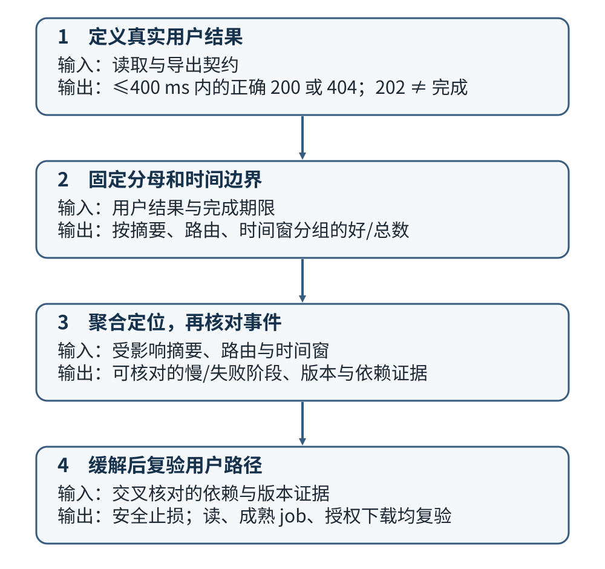

# 怎样从报表服务信号定位发布后的故障？

**案例背景。** 本页另设一份独立的合成金丝雀事故演练。报表服务 `report-api` 把少量流量交给镜像摘要（image digest）为 `d-new` 的新版本，观察能否继续放量；本演练中的 `d-new` 与 `d-old` 是局部标识。此时，用户读取账户 `acct-17` 的报表 42 变慢或遇到 `5xx`；同一时段，CSV 导出请求已收到 HTTP `202 Accepted`，却迟迟没有结果。本页先定义怎样衡量这两种用户体验，再用 metrics（指标）、trace（追踪）和 logs（日志）定位受影响的阶段，最后验证缓解后的读取、生成与下载。文中数字、身份和故障记录均为教学构造。

导出流程沿用报表系列的合成案例：账户 `acct-17` 用幂等键 `report-demo-208` 请求导出报表 `42`，服务在数据库事务中创建任务 `job-demo-731`，事务提交后这个任务 ID 才是持久、可查询的事实。读请求、导出受理、后台任务完成和结果下载是四个不同的边界：`202 Accepted` 只表示服务已按本例约定持久接收了任务，不表示任务完成；只有数据库提交了 `succeeded` 和私有结果对象的引用，任务才算生成完成；发送 `report.ready` 通知或收到消费者 ACK（消费者确认）也不等于用户下载成功。先分清这些结果，才不会因为分母或信号选错而误判事故。

发布门禁（决定是否继续放量的检查）应按实际发布的镜像摘要和下文的 SLI 评估；从构建到接入流量的完整过程见[测试验收与发布流程](../infrastructure/application-deployment-and-ci-cd.md)。队列中的受理、尝试和 ACK 由[发布确认与消费者 ACK](queue-delivery-and-acknowledgement.md)定义，本页沿用那里“数据库是任务状态权威”的约定。

## 从一个用户请求关联三种信号

要关联信号，先把一次用户意图拆成可计数的单位。`request`（请求）是每次 API 往返，`job`（任务）是一个唯一的持久任务，`attempt`（尝试）是 worker（工作进程）每次实际领取后的执行轮次。客户端重试会增加请求数；同一个任务执行多次 attempt，仍只算一项用户工作。

| 单位 | 分母如何计数 | 结果归属 |
|---|---|---|
| API request | 每次到达已定义服务边界且满足该 SLI 入选条件的调用 | 按该 API 的用户结果判好坏；不能把未响应的调用删掉 |
| accepted job | 每个唯一 `jobId` 一次；只要受理事务提交，就计入，即使 `202` 响应丢失 | 到自己的完成期限时判断成功、失败或仍待处理 |
| worker attempt | 每次数据库成功领取一次 | 诊断执行耗时、重试和资源占用；不作为用户完成率分母 |

本例每个 job 最多 3 次 attempt（首次领取也算一次）。只有数据库中的领取事务提交，才开始一轮 attempt；broker（消息代理）的重复投递只是唤醒 worker 的线索，不能算作新的尝试。

### 先定义读请求和导出的 SLI

service level indicator（服务等级指标，SLI）测量一项明确的用户结果；service level objective（服务等级目标，SLO）为它设定目标值。两者都要先规定测量边界、分母、什么算好事件、时间窗口和数据延迟，不能只写一个“成功率”。

#### 读取：按权限关系判断响应是否正确

分母是每次进入 API 的 `GET /api/reports/{id}`，前提是可信的身份层已确认调用主体，且报表 ID 格式有效。有权主体 `principal-P17` 对 `acct-17` 的 `report 42` 有读取权；独立身份 `principal-PB` 无权读它，本例按策略返回 `404`。好事件要求 API 在 400 ms 内给出与这项权限关系一致的结果：有权请求返回 `200` 和预期报表，无权请求返回正确的 `404`。因此 `404` 是否为好事件取决于主体和资源的授权关系，不能只按状态码分类。有权请求误得 `404`、超时、无响应或 `5xx` 都是坏事件。

入口为每次合格请求记录时间、路由、区域和实际处理它的镜像摘要，即使服务没有响应也保留记录。未响应的请求即使无法归到某个摘要，也仍是坏事件；它只是不能拿来证明金丝雀健康。

响应码和耗时只是便于观测的代理信号，单凭它们不能证明正文正确；本例另外用有权和无权的测试身份、以及报表中的已知标记来核验授权和内容。若要声称每次真实响应的内容都正确，就需要每次响应都有可信的内容与授权判定证据。身份服务在确认主体之前的失败，另计入入口认证 SLI。这里的测量边界不包括用户设备和响应发出后的网络，也不能替代跨租户授权测试与审计。

#### 受理：一次请求与一个持久任务分别计数

请求分母是每次进入导出 API 的调用，前提是身份已确认、调用主体对该账户有导出权限、请求格式有效；同一幂等键的每次重试各算一次请求。首次有效请求要在同一个数据库事务里提交 job、待发布的 outbox（事务发件箱）意图和一个等待槽（数据库中限制排队任务数的准入名额），才产生一个 accepted job。是否已有 job 以数据库提交为准，与响应是否送达无关。正常返回的 `202` 只是服务看到提交成功后发给客户端的证据，不是任务分母的定义。

同一幂等键、同一请求指纹（请求内容的摘要）的重放，正确行为是指向原 job 并返回其当前持久状态，不增加 job 数，也不占新的等待槽；这样的重放仍算一条好请求。

明确返回 `429`（速率限制）或 `503`（等待槽满）算作受理请求的坏结果，但按本例约定不会创建 job。在本 SLI 的服务边界内观察到超时或无响应，也记为坏请求；服务已经返回、之后才发生的客户端网络断开，不计入这个 API SLI。客户端不确定是否已受理时，应按[幂等重放契约](api-reliability-and-async-delivery.md)用原键 `report-demo-208` 和相同请求正文重放 POST；成功受理后再 GET 响应返回的状态 URL。若首次请求已提交，本例会复用原任务 `job-demo-731`；若此前未创建任务，本次重放通过校验和准入后才会创建新任务。运维排查则可在授权的数据库查询中按 `(account_id, principal_id, idempotency_key)` 核对幂等记录与 job 行。没收到 `202` 本身不能推断任务未受理。同一幂等键却带不同正文，属于客户端违反约定，单独计数，不进入本例的可靠性请求分母。这样，请求 SLI 衡量服务怎样响应一个合格的意图，而 job 分母只由数据库提交决定。注意，本例要求 `202` 之前必须已持久化，这比 HTTP 规范对 `202 Accepted` 的通用语义更严格。

#### 完成：先说清测到的是提交，还是提交确认

完成 SLI 的分母是 job：每个已提交的唯一 job 只计一次，投递、重试和 attempt 都不增加分母。任务成功时，`succeeded`、结果对象引用与 `report.ready` outbox 在同一事务中原子提交；客户端有没有收到 `202`，都不改变数据库里的事实。本例的业务目标是：结果应在受理后 2 分钟内生成并提交。

但业务目标说的时刻，现有遥测未必能直接测到。本页假设能取到的是“提交确认”事件：应用收到 `COMMIT` 成功响应后，再向同一数据库查询 `clock_timestamp()` 并记录下来，即 `accepted_commit_confirmed_at` 和 `succeeded_commit_confirmed_at`。它们测量的是服务确认提交的时间，不是提交本身的时间。下文据此计算**提交确认完成 SLI**：从受理确认起算 2 分钟作为观测期限，看期限内是否观察到成功确认。由于两次确认分别采集，受理确认的记录可能反而晚于成功确认；这时本口径视为达标，但不能据此推断两次提交的实际先后。若要验证“数据库必须在 2 分钟内提交”这一物理时限，还需要经过验证的权威提交时刻。

> [!info] 两次确认的时间差为什么不一定更保守？
>
> 受理提交和成功提交之后，各自等到确认的时间可能不同。设物理提交间隔为 121 秒，若受理那次确认等了 10 秒、成功那次只等了 1 秒，观测到的间隔就是 `121 + 1 − 10 = 112` 秒，低估了实际间隔；反过来也可能高估。所以本例只把它当作一种独立的服务观测口径。事务内写入的 `accepted_at`、`succeeded_at` 也不能直接当作提交时刻，因为 PostgreSQL 的 `now()` 返回的是事务开始时间。开启 `track_commit_timestamp` 后可以查询事务的提交时间，但只对开启之后的事务有效，且旧记录会被 vacuum 清理；不能假设已经开启，也不能假设历史会一直保留。

有了时刻，还要防止“只统计已完成任务”的偏差：如果只数已经成功或失败的任务，仍在排队的任务就被悄悄漏掉。为此给每个 job 定义观测期限 `due = accepted_commit_confirmed_at + 2 min`。以 `T` 为窗口结束时刻、`W` 为窗口长度，窗口 `(T−W, T]` 只收入满足 `T−W < due ≤ T` 的“成熟”任务，也就是期限落在本窗口内的任务。好事件要求 `succeeded_commit_confirmed_at ≤ due`；`failed`、`cancelled`、到期仍为 `queued`/`running`，以及过了期限才成功，都算坏事件。本例把受理后的取消也视为未完成；若要排除用户主动取消，应另行定义可审计的取消来源和分母规则。期限未到的任务暂不进分母，但要同时观察其中最老任务的等待时长。

> [!example] 12:00 结束的十分钟窗口，哪些任务已经到期？
>
> 以下均使用提交**确认**时间；窗口为 `(11:50, 12:00]`。表中“坏”只裁决确认 SLI。
>
> | 接受确认 → 期限 | 成功确认 | 这个窗口怎样计数 |
> | --- | --- | --- |
> | 11:57:00 → 11:59:00 | 11:59:01 | 121 秒，计坏；不能据此认定物理提交也晚了 1 秒 |
> | 11:59:30 → 12:01:30 | 尚未观察到 | 期限还没到，不进本窗口分母 |
> | 11:58:00 → 12:00:00 | 12:00:01 | 121 秒，计坏；即使事务内 `succeeded_at` 写为 11:59:59，也不改变本口径 |

任务是否存在，仍以数据库中的 job 行为准。只有当 watermark（事件时间完整水位）越过 `T`，即 `T` 之前的事件都已收齐，且到期的 job 已逐一与数据库核对后，才发布这个窗口的结果。若缺少受理确认、无法算出期限，就把窗口标为“测量不完整”，发布门禁保持不放行；若期限已确定，而水位越过后仍没有成功确认，这个任务在本 SLI 中计为坏。不能悄悄删掉缺少遥测的任务，也不能用“它现在已经成功了”来改写它当时是否按期完成。这套观测期限不改变任务本身的业务期限或租约约定。

#### 下载与通知：继续核验用户是否拿到了结果

上面的完成 SLI 只衡量是否按时观察到成功提交确认，不代表用户拿到了文件。下载要另定义结果读取 SLI：分母是通过身份与资源授权的下载请求，好事件要求服务实际返回该结果引用对应的文件；未授权请求按安全策略单独统计。文件大小差别大时，要按大小分组设定时限，不能直接套用元数据接口 `GET /api/reports/{id}` 的 400 ms。`report.ready` 还在等待 relay（转发进程）发布，并不撤销已经提交的任务成功；若产品承诺通知必达，就另外定义通知投递 SLI。broker 确认或消费者 ACK 只说明消息交接到了哪一步。

#### 错误预算和发布门禁使用不同时间尺度

SLO 再进一步，就能算出错误预算。例如，30 天读取 SLO 设为 99.5%。若窗口内 10,000 个符合条件的读请求有 9,940 个在 400 ms 内返回预期结果，则 SLI 为 `9,940 ÷ 10,000 = 99.4%`。该窗口允许的坏请求数是 `(1 − 0.995) × 10,000 = 50`；实际 60 个坏请求，超预算 10 个。错误预算的单位是该窗口里的请求数，不是百分比或毫秒。SLI 是测量结果，SLO 是内部目标；service level agreement（服务等级协议，SLA）是带有对外承诺和违约后果的约定，不能把内部阈值改个名字就当成 SLA。按请求加权的汇总值也不能证明每个 region（区域）或用户群的体验一致，必要时按稳定、取值有限的区域维度分开查看。

30 天目标用于跟踪长期错误预算；金丝雀决策看分钟级发布窗口，不等到 30 天结束。本例的示例门槛是：按目标摘要、路由和区域分别统计，在滚动 10 分钟窗口内至少有 100 个合格读请求时，如果好事件比例低于 99% 并持续 5 分钟，就停止放量。“持续 5 分钟”定义为每分钟评价一次，从 `t` 到 `t+5` 的六个评价点都满足样本数和比例条件。只观察到一次 `98/100`，只够暂缓增加流量，还不能证明已满足持续止损条件；`99/100` 恰好达到比例门槛，但仍须通过身份和内容检查。这些数值是本例的合成门槛，不是通用推荐。

不能把 `d-new` 的结果与稳定版本合并后再决定是否放量：例如 `d-new` 为 `98/100`，稳定摘要为 `900/900`，`d-new` 自身只有 98%，合并后却显示 `998/1000 = 99.8%`。若某些无响应请求无法归到目标摘要，它们仍留在分母里，但发布判断应保持不放量，而不是把它们当成目标版本的健康样本。判断恢复时，也按同样口径查看变更后实际运行的摘要和新的时间窗口。

告警应附上好/坏事件数、分母、窗口、摘要、路由/区域，以及指标和追踪的查询链接，让值班人能核对门槛是否基于同一个 SLI。长期 SLO 告警可以按 burn rate（错误预算消耗率）组合长短两个窗口；Google 的 Site Reliability Engineering（站点可靠性工程，SRE）Workbook 给出的是配置方法和起始示例，不应把其中某组比例直接套到所有服务。任务完成率另按成熟 job 窗口计数，同时看未成熟 job 中最老任务的等待时长，以免“完成率还没变差”掩盖排队正在变长。

### 从聚合指标下钻到追踪与日志

SLI 告诉我们用户结果变差了，接下来要找出是哪个阶段出了问题。metrics 把大量事件聚合成按时间窗的计数、比率、分布或当前积压，回答影响何时出现、范围多大、是否集中在某个摘要或依赖上。先用取值有限（低基数）的标签定位 `d-new`：路由模板、响应类别、区域、服务角色、依赖名和受控的版本标签。然后检查计数器分母、延迟分布与分位数、连接池等待、数据库饱和度、最老的 outbox/job/broker 消息等待时长、实际占用的 worker 执行槽、重试和容量失败；对支持的 broker，还要看未确认消息数，以及按策略转入 dead-letter queue（死信队列）的消息。租约到期只是让恢复器有资格竞争接管，既不表示它已提交写权栅栏（fence），也不表示旧 attempt 已停止；所以要分别观察租约到期、恢复器接管提交，以及已被栅栏挡住却仍占资源的 attempt。broker 队列很短，也不能证明数据库里的 outbox 或 `queued` job 没有积压。

trace 把一次操作拆成有父子关系的 span（操作区间），回答这个请求或任务在哪个阶段变慢或失败。同步调用通过 context propagation（上下文传播）传递关联信息，把入口、授权、数据库和对象存储的 span 串成一条链。

异步导出的链路在受理请求结束后才继续：relay 用已提交 outbox 中保存的 trace context 创建发布 span，并把上下文附在 broker 消息上；worker 每次成功领取后创建独立的 attempt span，再用 span link（跨度链接）指向消息里的创建上下文，接回发布的因果链；受控的 `jobId` 则用来跨多次重试查询持久状态。不要让 HTTP span 一直挂到整个任务完成，每次 attempt 的执行阶段应能单独定位。OpenTelemetry 的消息语义约定默认用 link 关联生产与消费，只有处理单条消息等特定情形，才考虑把消息的创建上下文作为 parent（父 span）。父子 span 或并发 span 的时长可能重叠，不能把各 span 时长直接相加当作总延迟。

logs 记录各阶段发生的具体事件。在结构化日志里放入 trace ID、span ID，以及受控的 `jobId`、`attempt`、状态转换和有限的错误码，就能从一个有代表性的 span 找到实际错误，再对照发布摘要和事件时间。三者分工是：指标把人带到受影响的窗口，trace 指出出问题的阶段，日志解释某次操作的具体结果。如果 trace 有采样，要检查采样率、时间戳、导出是否正常和覆盖范围；找不到样本，不能证明请求或故障不存在。

### 用同一窗口解释两个症状

下面把这些信号合成一份可以下结论的事故记录；数字和日志都是教学构造，不是线上测量。在 12:10–12:20 这个窗口里，同一路由、同一区域的 `d-new` 收到 100 次合格读请求。合成数据假定每次请求应得的授权结果已知，其中 98 次在 400 ms 内给出了正确结果；这并不表示真实服务能逐条判定响应正文。同一窗口中稳定摘要 `d-old` 为 900/900，合并后是 998/1000（99.8%），但单看 `d-new` 仍低于门槛。门禁每分钟评价一次：在 12:15 到 12:20 的六个评价点上，`d-new` 各自的滚动 10 分钟窗口都至少有 100 次请求，好事件率都低于 99%，首末相隔整 5 分钟，因此停止增加 `d-new` 的流量。事先运行的合成核验也确认：有权的 `principal-P17` 读 `acct-17` 的报表 42 得到 `200` 和已知标记，无权的 `principal-PB` 得到本例策略规定的 `404`。可见 `d-new` 的好事件率缺口，并不是把正当的拒绝误算成失败造成的。

接着从指标下钻到 trace。同一窗口里一条慢读请求的 trace 总耗时 900 ms：其中授权与报表读取阶段的墙钟时间（去掉重叠后）是 720 ms，这 720 ms 又包含从数据库连接池 checkout（签出连接）的 600 ms 等待和约 120 ms 的 SQL 执行；剩下约 180 ms 在其他阶段。这些阶段是层层包含的关系，不能把 900、720、600 相加。这条 trace 把慢请求定位到等待数据库连接，却没有证明是 `d-new` 引起的，也不能推出 worker 与 API 共用同一个连接池。

导出症状要从权威状态查起。12:16，按 `job-demo-731` 查询数据库中的 job 行、attempt 和 outbox：受理提交确认在 12:00，所以本 SLI 的期限是 12:02；到 12:16 状态仍是 `queued`、attempt=0，outbox 已发布、broker 也有唤醒记录，却没有成功领取，也没有结果对象引用、`succeeded` 或 `report.ready`。期限早已过去仍未成功，说明用户的导出结果确实受到了影响。worker 的关联结构化日志显示，获取数据库连接失败发生在领取（claim）之前，所以这项工作根本还没开始执行；仅看最老待处理任务的等待时长，无法得出这个阶段。它与读请求变慢发生在同一故障窗口，但 API 和 worker 的连接池分开配置，还不足以证明二者同因。在补齐数据库饱和度、连接池使用和查询时长的对照之前，“共享数据库压力”只是假设，不能把相关性写成根因。

## 让遥测可诊断，但不泄露报表内容

上面的定位依赖标签和关联 ID，但它们也可能导致时序爆炸或泄露数据。指标标签应取自有限集合，例如规范化的 route template（路由模板）`/api/reports/{id}`、响应类别、区域、`service_role=api|worker`、依赖名和受控的 release channel（发布通道）。标签的 cardinality（基数，即不同取值的数量）必须有上限，因为每种标签组合都会成为一条独立的 time series（时间序列）。不要把 `request_id`、trace ID、job ID、用户或 tenant（租户）ID、原始 URL、报表标题、提示词、结果内容或任意错误文本作为指标维度。镜像摘要适合用于短期的发布对比，但要限制保留时长和组合数量，避免每次构建都让时序数量无限增长。

在有访问控制和保留期限的前提下，trace 与日志可以包含用于关联的操作 ID，但只记录必要字段。不得记录 access token（访问令牌）、cookie、授权 header（请求头）、报表正文或原始用户内容。优先用有界事件分类，如 `authorization=allow|deny`、`db_error=timeout|unavailable`、`job_state=queued|running|succeeded|failed|cancelled`、`error_code=capacity_exhausted|attempts_exhausted`。跨租户授权错误需要独立的安全审计和回归测试，不能靠指标里暴露 tenant ID 来排查。

## 按证据缓解并确认恢复

定位到阶段后，处置沿着“用户结果 → SLI → 依赖阶段 → 可逆动作 → 用同一用户路径复验”推进。每一步都把操作和判断依据分开记录：

1. **确认用户影响与信号质量。** 确定事件起止时间、受影响的接口和区域、API 与 worker 各自运行的摘要，以及读请求 SLI 的分子和分母。检查遥测是否新鲜、采样和导出是否正常；无响应的请求仍是坏事件，不能因为没有 span 就移出分母。
2. **核对任务停在哪个持久边界。** 对超时的导出 `POST`，按账户、主体和幂等键 `report-demo-208` 查询幂等记录，结果不明的先标记为待定；受理事务一旦提交就算一个 accepted job，即使客户端没收到 `202`。反之，明确返回 `429`/`503` 的请求按约定没有创建 job。分别观察 outbox 发布、broker 投递与确认、worker 领取、attempt、数据库终态和结果读取；ACK 只说明当前这条消息交接完成。已到期仍为 `queued`/`running` 的任务在完成 SLI 中算坏；未到期的任务暂不进分母，但保留其等待时长作为证据。
3. **用多条证据定位。** 按摘要和路由对照金丝雀与基线的同期窗口，挑选有代表性的慢或失败 trace，再用 span ID 和 job/attempt 等受控键查日志。交叉检查 API 与 worker 的连接池等待、数据库连接数与查询耗时、最老的 outbox/job 消息、对象存储错误码；单条 trace、进程健康探针或 broker 队列深度都不能直接当成根因。
4. **先降低影响，再选择安全路径。** 示例中 `d-new` 已连续 5 分钟满足止损条件（见上一节），因此停止为它增加流量。假设发布记录已核实 `d-old` 满足当前的安全要求，就把流量切回 `d-old`；如果旧版本也有同样的跨租户漏洞，就不能盲目回滚，而应隔离受影响的入口或向前修复。连接池等待还不能证明 API 和 worker 出自同一故障源，所以先比较两者的连接预算与数据库活动，再按证据限流或降载，不要只是调大每个进程的连接池。对尚未受理的新导出请求，可以按准入约定返回 `429`/`503`；已经受理的任务要保持可查询、可恢复，不能把拒绝新请求伪装成 job 失败。
5. **用同一用户结果复验，再考虑放量。** 示例在 12:20 把流量切回 `d-old`，等到切换后第一个完整的滚动 10 分钟窗口在 12:30 结束，再用同一个读 SLI 口径复验：该窗口 100/100 个合格请求都是好事件，且每个请求都能归到摘要。若样本不足或归属缺失，就维持当前流量，不能拿切换前的数据或跨摘要的总量代替。业务核验另从实际部署的入口确认：有权主体 `principal-P17` 读 `acct-17` 的报表 42 得到 `200` 和已知标记，无权主体 `principal-PB` 得到本例约定的 `404`。

   导出路径也要复验。`job-demo-731` 在 12:16 仍是 `queued`；流量切回 `d-old` 后，12:26 才观察到成功提交确认，随后按当前授权下载并核对了文件。它在原期限之后才成功，而且这次迟到的完成不能直接归功于回退；它只证明旧任务后来可用。为了验证新请求的完整路径，再用新的幂等键 `report-demo-209` 创建 `job-demo-732`：12:31 确认受理提交并返回 `202`，12:32 观察到成功提交确认，结果引用与 `report.ready` outbox 已原子提交，然后从同一入口按授权下载并核对文件。这 60 秒的确认间隔满足本页的确认 SLI，但不能证明实际 COMMIT 间隔。旧任务后来恢复，不能代替新请求的受理、执行与下载复验。通知是否送达按独立的通知约定复验；队列 ACK 仍不代表用户拿到了文件。告警没有持续触发满 5 分钟，可能只是尚未触发或刚刚解除，不等于已经恢复；30 天的长期预算继续单独跟踪。
6. **记录可执行的事后改进。** 记下用户受影响的时间窗、各 SLI 的分子与分母、摘要和阶段证据、采取的缓解措施、确认安全的旧版本或向前修复、相关测试，以及现有门禁为什么没有更早发现问题。如果只写“服务已恢复”，没有用户路径和时间窗，就无法判断是否真正止损。

如果报表包含模型生成的内容，HTTP 可用性和任务完成率只衡量服务有没有交付；内容质量需要单独的评估与反馈，不应混进同一个 SLI。用户主动评分的样本偏向愿意反馈的人群，不能直接当作全体用户的质量分布。见[LLM 任务评估方法](../../ai-engineering/evaluation/llm-evaluation-methods.md)和[生产反馈信号](../../ai-engineering/systems/ai-production-observability-and-feedback.md)。

> [!info]- 来源与核对范围
> - OpenTelemetry 官方文档：[Signals](https://opentelemetry.io/docs/concepts/signals/)、[Traces](https://opentelemetry.io/docs/concepts/signals/traces/)、[Metrics](https://opentelemetry.io/docs/concepts/signals/metrics/)、[Logs](https://opentelemetry.io/docs/concepts/signals/logs/)、[Context propagation](https://opentelemetry.io/docs/concepts/context-propagation/) 与[消息 span 语义](https://opentelemetry.io/docs/specs/semconv/messaging/messaging-spans/#consumer-spans)，核对于 2026-11-12：核对指标/追踪/日志各自模型、span 字段、异步操作的 span link（跨度链接）和跨服务上下文传播；当前消息语义以 link 关联生产与消费为默认，单消息等条件下才采用消息创建上下文作 parent。该语义页面标记版本 1.45.0；本例的采样与敏感字段约束是应用边界。
> - Prometheus 官方[指标与标签命名实践](https://prometheus.io/docs/practices/naming/)，核对于 2026-11-12：核对单位命名建议、标签组合形成时序及高基数标签风险；该页面是实践建议，不是所有遥测系统强制规范。
> - Google SRE Workbook：[Implementing SLOs](https://sre.google/workbook/implementing-slos/) 与 [Alerting on SLOs](https://sre.google/workbook/alerting-on-slos/)，核对于 2026-11-12：核对用户结果型 SLI、错误预算、短长窗口与 burn rate（错误预算消耗率）告警方法。本文的 30 天、400 ms、99.5%、2 分钟、10 分钟/100 请求/99%/5 分钟均为合成教学数字，不是该书给所有服务的统一建议。
> - PostgreSQL 18 [日期/时间函数](https://www.postgresql.org/docs/current/functions-datetime.html#FUNCTIONS-DATETIME-CURRENT) 与[事务提交信息函数](https://www.postgresql.org/docs/current/functions-info.html)，核对于 2026-11-12：核对 `now()`/`current_timestamp` 使用事务开始时间，而 `clock_timestamp()` 随墙钟变化；`pg_xact_commit_timestamp` 只在启用 `track_commit_timestamp` 后对启用后的事务有用，且信息会被 vacuum 清理。本文将提交确认间隔定义为服务观察 SLI；两次确认延迟可能不同，所以它相对物理提交间隔可双向偏差。
> - [RFC 9110 §15.3.3](https://www.rfc-editor.org/rfc/rfc9110.html#section-15.3.3)，核对于 2026-11-12：通用 `202 Accepted` 不承诺后续操作最终成功；本文要求先提交 job、outbox 与等待槽是本例更具体的应用合同。
> - [怎样设计一个可持久查询的账户报表？](../architecture/system-design-fundamentals.md)、[如何估算并限制异步工作管线？](api-capacity-and-backpressure.md) 与[发布确认与消费者 ACK](queue-delivery-and-acknowledgement.md)，核对到本例任务与队列合同：job/outbox/等待槽持久受理、`succeeded`/结果引用/`report.ready` 原子提交、租约与 attempt 归属。容量、租期与 broker 行为以对应章节合同为准。
