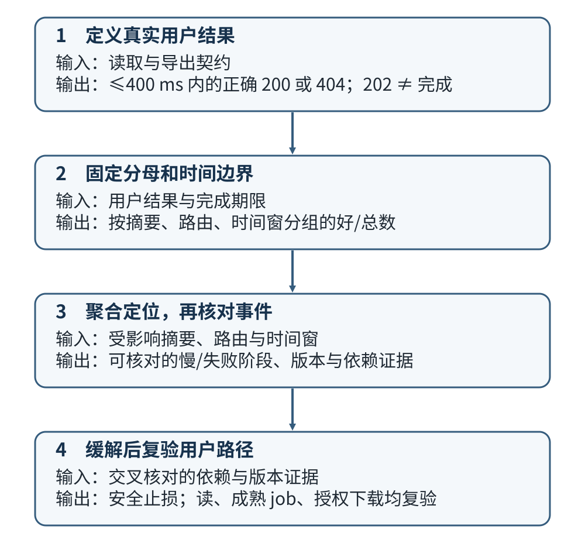

# 怎样从报表服务信号定位发布后的故障？

**案例背景。** 报表服务 `report-api` 正在把少量流量交给新镜像摘要 `d-new`，观察它是否可以继续放量。用户读取账户 `acct-17` 的报表 42 时变慢或遇到 `5xx`；同一时段，CSV（逗号分隔值）导出请求已收到 HTTP（超文本传输协议）`202 Accepted`，却迟迟没有结果。本页先定义怎样衡量这两种用户体验，再用 metrics（指标）、trace（追踪）和 logs（日志）定位受影响阶段，最后验证缓解后的读取、生成与下载。数字、身份和故障记录均为教学构造。

本例沿用合成账户 `acct-17`、报表 `42`、幂等键 `report-demo-208` 和任务 `job-demo-731`。事务里先尝试写入稳定任务 ID；提交后该 ID 才是持久且可查询的事实。读请求、导出受理、后台任务完成和结果下载是不同边界：`202 Accepted` 只表示服务已按本例合同持久化接收任务，不表示任务完成；任务只有在数据库提交 `succeeded` 和私有结果对象引用后才算生成完成；`report.ready` 的发送和消费者 ACK（消费者确认）也不是下载成功。先分清这些结果，才不会让错误的分母或信号带偏事故判断。

发布门禁应按已发布镜像摘要和目标 SLI 评估，完整构建到流量的边界见[测试验收与发布流程](../infrastructure/application-deployment-and-ci-cd.md)。队列中的受理、尝试和 ACK 由[发布确认与消费者 ACK](queue-delivery-and-acknowledgement.md)定义；本页沿用其数据库权威状态合同。

## 从一个用户请求关联三种信号

先把一次用户意图拆成可度量的单位。`request`（请求）衡量每次 API（应用程序接口）往返，`job`（任务）衡量唯一持久任务，`attempt`（尝试）衡量 worker（工作进程）每次实际领取的执行轮次。客户端重试会增加请求数；同一个任务的多次 attempt 仍只是一项用户工作。

| 单位 | 分母如何计数 | 结果归属 |
|---|---|---|
| API request | 每次到达已定义服务边界且满足该 SLI 入选条件的调用 | 按该 API 的用户结果判好坏；不能把未响应的调用删掉 |
| accepted job | 每个唯一 `jobId` 一次；只要受理事务提交，就计入，即使 `202` 响应丢失 | 到自己的完成期限时判断成功、失败或仍待处理 |
| worker attempt | 每次数据库成功领取一次 | 诊断执行耗时、重试和资源占用；不作为用户完成率分母 |

沿用本例最多 3 次 attempt（首次领取也计一次）。只有数据库领取提交才开始一轮 attempt；重复 broker（消息代理）投递只是唤醒线索，不能重复算成一次新尝试。

### 先定义读请求和导出的 SLI

service level indicator（服务等级指标，SLI）是对明确用户结果的测量；service level objective（服务等级目标，SLO）给它设定目标。两者都要先规定边界、分母、好事件、时间窗口和数据延迟，不能只写“成功率”。

#### 读取：按权限关系判断响应是否正确

以可信身份边界已确认主体、且报表 ID 格式有效后进入 API 的每次 `GET /api/reports/{id}` 为分母。有权主体 `principal-P17` 对 `acct-17` 的 `report 42` 有读取权；独立身份 `principal-PB` 无权读它，本例按策略返回 `404`。好事件要求 API 在 400 ms 内给出与这项权限关系一致的结果：有权请求返回 `200` 和预期报表，无权请求返回正确的 `404`。因此 `404` 是否为好事件取决于主体和资源的授权关系，不能只按状态码分类。有权请求误得 `404`、超时、无响应或 `5xx` 都是坏事件。

入口记录每次合格请求的时间、路由、区域和实际目标摘要，即使服务没有响应也保留；未响应请求即使没有摘要归属，也仍是坏事件，但不能拿它证明金丝雀健康。

只读响应码和耗时是可观测代理，不能单独证明正文正确；本例另外用有权与无权测试身份、已知报表标记核验授权和内容。若要声称每次真实响应都内容正确，就需要每次响应都有可信的内容/授权判定证据。身份服务在主体确认前的失败另计入口认证 SLI。这里的响应边界不覆盖用户设备或响应后的网络，也不能替代跨租户授权测试与审计。
#### 受理：一次请求与一个持久任务分别计数

以每次进入导出 API、身份已确认、调用主体对该账户有导出权限且请求格式有效的调用为请求分母；每次同键重试各算一次请求。首次有效意图只有在同一数据库事务提交 job、待发 outbox（事务发件箱）意图和一个等待槽后才创建 accepted job；数据库提交是裁决点，响应返回与否不改变是否已有一个 job。正常返回的 `202` 是服务观察到提交成功后给客户端的响应证据，不是任务分母的定义。

正确的同键、同指纹重放应指向原 job 并返回其当前持久状态，不增加 job 数或等待槽；它仍是一条好请求。

明确返回 `429`（速率限制）或 `503`（等待槽满）是受理请求的坏结果，但依本例受理合同没有创建 job；在本 SLI 的服务响应边界内观察到的超时或无响应记请求坏；服务已返回后才发生的客户端网络断开不归入这个 API SLI。客户端对是否已经受理保持未知，按 `(account_id, principal_id, key)` 查权威状态，不能由客户端没收到 `202` 推断未受理。相同幂等键却不同正文是客户端契约冲突，单列计数并排除在本例可靠性请求分母之外。这样，请求 SLI 衡量服务对一个合格意图的响应，job 分母只由数据库提交裁决。本例 `202` 的强持久化要求比 HTTP 对 `202 Accepted` 的通用语义更具体。
#### 完成：先说清测到的是提交，还是提交确认

一个已提交的唯一 job 只计一次，投递、重试和 attempt 不增加分母。成功事务将 `succeeded`、结果对象引用与 `report.ready` outbox 原子提交；客户端有没有收到 `202` 都不改变数据库里的事实。沿用本例业务目标，结果应在接受后 2 分钟内生成并提交。

但业务目标与现有遥测未必使用同一个时刻。本页假设可取得的是应用收到成功 `COMMIT` 响应后，再向同一数据库查询 `clock_timestamp()` 所记录的确认事件：`accepted_commit_confirmed_at` 和 `succeeded_commit_confirmed_at`。它们测量的是服务确认提交的时间。下文据此计算**提交确认完成 SLI**：以受理确认为起点，判断截至其后 2 分钟的观测期限是否已观察到成功确认。受理端确认采集可能更迟；若成功确认已先观察到，本口径视为已达标，不能由确认先后推断物理提交顺序。如果要验证“数据库必须在 2 分钟内提交”的物理时限，还需要经验证的权威提交时刻。

> [!info] 两次确认的时间差为什么不一定更保守？
>
> 接受提交与成功提交后的确认等待可能不同。物理提交间隔 121 秒，若前一次确认等了 10 秒、后一次等了 1 秒，观测间隔就成了 `121 + 1 − 10 = 112` 秒；反过来也可能高估。本例只把它当作独立的服务观察口径。事务内的 `accepted_at`、`succeeded_at` 也不能自动当成提交时刻：PostgreSQL 的 `now()` 使用事务开始时间。`track_commit_timestamp` 开启后可查询部分事务提交时间，但该信息会被 vacuum 清理，不能假设配置已开启或历史永远保留。

接下来要防止只统计已完成任务的偏差。给每个 job 定义观测期限 `due = accepted_commit_confirmed_at + 2 min`，窗口 `(T−W, T]` 只收进 `T−W < due ≤ T` 的成熟任务；也就是期限落在本窗口的任务。成功确认必须满足 `succeeded_commit_confirmed_at ≤ due`。`failed`、`cancelled`、到期仍 `queued`/`running` 和迟到才成功都计坏。本例把已受理后的取消视为未完成；若要排除用户主动取消，应另定义可审计的取消来源和分母规则。期限还没到的任务暂不进分母，同时观察其最老待处理年龄。

> [!example] 12:00 结束的十分钟窗口，哪些任务已经到期？
>
> 以下均使用提交**确认**时间；窗口为 `(11:50, 12:00]`。表中“坏”只裁决确认 SLI。
>
> | 接受确认 → 期限 | 成功确认 | 这个窗口怎样计数 |
> | --- | --- | --- |
> | 11:57:00 → 11:59:00 | 11:59:01 | 121 秒，计坏；不能据此认定物理提交也晚了 1 秒 |
> | 11:59:30 → 12:01:30 | 尚未观察到 | 期限还没到，不进本窗口分母 |
> | 11:58:00 → 12:00:00 | 12:00:01 | 121 秒，计坏；即使事务内 `succeeded_at` 写为 11:59:59，也不改变本口径 |

数据库 job 行仍裁决任务是否存在。只有当 watermark（事件时间完整水位）越过 `T`，即该时间之前的事件已收齐，并且到期 job 已逐一与数据库对账后，才发布窗口结果。接受确认缺失、无法重建期限时，窗口标为测量不完整并保持发布门禁；期限已确定，而完整水位之后仍缺成功确认的任务，在本确认 SLI 中计坏。不能把缺失遥测的任务静默删除，也不能用事后“现在已经成功”改写它当时是否按期确认。这套观测期限不修改任务的业务期限或租约合同。

#### 下载与通知：继续核验用户是否拿到了结果

本页确认完成 SLI 衡量是否按时观察到成功提交确认；下载另按通过身份与资源授权的请求定义结果读取 SLI，成功要求服务实际返回该引用对应的文件；未授权请求按安全策略单列。文件大小不同时要定义合适的时限/大小分组，不能直接套用元数据 `GET /api/reports/{id}` 的 400 ms。`report.ready` 尚待 relay（转发进程）发布不撤销已经提交的任务成功；若产品承诺通知送达，另定义通知投递 SLI。broker 确认或消费者 ACK 只属于消息交接边界。

#### 错误预算和发布门禁使用不同时间尺度

例如，30 天读取 SLO 设为 99.5%。若窗口内 10,000 个符合条件的读请求有 9,940 个在 400 ms 内返回预期结果，则 SLI 为 `9,940 ÷ 10,000 = 99.4%`。该窗口允许的坏请求数是 `(1 − 0.995) × 10,000 = 50`；实际 60 个坏请求，超预算 10 个。单位是该窗口里的请求数，不是百分比或毫秒。SLI 是测量结果，SLO 是内部目标；service level agreement（服务等级协议，SLA）是带对外承诺及可能后果的约定，不能仅把内部阈值改名为 SLA。请求加权汇总也不证明每个 region（区域）或用户群体验一致，必要时按稳定、低基数的区域维度查看。

30 天目标用于跟踪长期错误预算；金丝雀决策看分钟级发布窗口，不等到 30 天结束。保留一个简单示例门槛：按目标摘要、路由和区域分别统计，滚动 10 分钟至少有 100 个符合条件的读请求，若好事件比例低于 99% 并持续 5 分钟，则触发短期停止放量；本例把“持续 5 分钟”定义为每分钟评价一次，`t` 到 `t+5` 的六个评价点都满足样本数和比例条件；`98/100` 的单次观察只足以不增加流量，不能单独证明已满足持续止损条件，`99/100` 恰好达到比例门槛，仍须通过身份和内容检查。这些数值是本例的合成门槛，不是通用推荐。

不得把 `d-new` 的失败与稳定摘要合并后决定放量：例如目标 `d-new` 为 `98/100`、已知稳定摘要为 `900/900`，目标自身只有 98%，而汇总看起来却有 `998/1000 = 99.8%`。若无响应请求无法归入目标摘要，分母仍保留，但发布判断须保持而非把它算作健康目标样本。恢复也按相同口径查看变更后的实际摘要和新时间窗。

告警应附好/坏事件数、分母、窗口、摘要、路由/区域和指标/追踪查询链接，使值班人能检查门槛是否基于同一 SLI。长期 SLO 告警可按 burn rate（错误预算消耗率）使用长短窗口组合；Google Site Reliability Engineering（站点可靠性工程，SRE）Workbook 给出的是配置方法和起始示例，不应把其中某组比例直接套成所有服务的门槛。任务完成另按成熟 job 窗口计数，同时看未成熟 job 的最老年龄，避免“完成率尚未变坏”掩盖排队正在拉长。

### 从聚合指标下钻到追踪与日志

metrics 把大量事件聚合成时间窗、计数、比率、分布或当前积压，回答影响何时出现、范围多大、是否集中在某个摘要或依赖。先用低基数的路由模板、响应类别、区域、服务角色、依赖名和受控版本标签定位 `d-new`；检查计数器分母、延迟分布/分位数、连接池等待、数据库饱和度、最老 outbox/job/broker 年龄、实际活跃物理槽、重试和容量失败；对适用的 broker 还看未确认消息数，以及按系统策略转入 dead-letter queue (死信队列) 的消息。租约到期只让恢复器有资格竞争，不表示它已提交写权栅栏（fence），也不表示旧 attempt 已停止；分别观察租约到期、恢复提交和被栅栏但仍占资源的 attempt。broker 队列浅不证明数据库 outbox 或 `queued` job 没有积压。

trace 把一次操作拆成有父子关系的 span（操作区间），回答该请求或任务在哪个阶段慢或失败。同步调用通过 context propagation（上下文传播）传递关联信息，使入口、授权、数据库和对象存储 span 可以串起。

异步导出在受理请求结束后，由 relay 根据已提交 outbox 中保留的 trace context 创建发布 span，并把它连到 broker 消息；worker 每次成功领取后创建独立 attempt span，通过消息创建上下文的 span link（跨度链接）关联回发布因果链，受控 `jobId` 则用于跨重试查询持久状态。不要让 HTTP span 挂起到整个任务完成；每次 attempt 的执行阶段应能单独定位。OpenTelemetry 消息语义默认用链接关联生产与消费；只有单条消息等约定情形才可考虑用消息创建上下文作 parent（父 span）。父子或并发 span 的持续时间可能重叠，不能把各 span 时长直接相加当总延迟。

logs 记录阶段发生的具体事件。把 trace ID、span ID 与受控的 `jobId`、`attempt`、状态转换、有限错误码放在结构化日志中，可以从代表性 span 回到实际错误；对照发布摘要和事件时间。指标把人带到受影响的窗口，trace 指出阶段，日志解释一次操作的结果。若 trace 有采样，查样本率、时间戳、导出健康度和覆盖范围；样本缺失不证明请求或故障不存在。

### 用同一窗口解释两个症状

下面把这些信号合成一份可判定的事故记录，数字和日志均为教学构造，不是线上测量。12:10–12:20 同路由、同区域的目标摘要 `d-new` 窗口有 100 次合格读请求，合成数据假设逐次预期权限结果已知，其中 98 次在 400 ms 内符合该结果；这不是对真实服务逐响应正文判定能力的声称。同一窗口稳定摘要 `d-old` 为 900/900，合并后是 998/1000（99.8%），但分开看 `d-new` 仍低于门槛。门禁每分钟评价一次：12:15、12:16、12:17、12:18、12:19、12:20 六个相隔一分钟的点，各自的滚动 10 分钟目标摘要窗口都有至少 100 次请求，且好事件率都低于 99%，首末相隔完整 5 分钟，因此停止增加 `d-new` 流量。预先运行的合成核验还确认：有权的 `principal-P17` 读 `acct-17` 的报表 42 得到 `200` 和已知标记；无权的 `principal-PB` 得到符合本例策略的 `404`。目标摘要的正确率缺口不是把有效拒绝误算成成功造成的。

一条同窗口读取 trace 总耗时 900 ms。按阶段去重后的授权与报表读取墙钟时间是 720 ms，其中数据库连接池 checkout（从池中签出连接）等待 600 ms；这些阶段有包含关系，不能把 900、720、600 相加。查询 span 的 Structured Query Language（结构化查询语言，SQL）执行约 120 ms，剩余约 180 ms 在其他阶段。它把这条慢请求定位到取连接等待，却没有证明 `d-new` 是因果，也不能推出 worker 共用同一个池。

在同一 12:10–12:20 窗口于 12:16 按 `job-demo-731` 查权威 job 行、attempt 与 outbox：接受提交确认在 12:00，对应本确认 SLI 的 12:02 期限；12:16 查到状态仍是 `queued`、attempt=0，outbox 已发布且有 broker 唤醒记录，却没有成功领取、结果对象引用、`succeeded` 或 `report.ready`。权威状态在期限后仍未成功，完成用户结果显然已受影响；worker 的关联结构日志显示连接池获取失败发生在 claim 前，因此这项用户工作还未开始执行，最老待处理年龄本身不能给出这个阶段。它与读请求慢发生在同一故障窗口，但 API 与 worker 池分开配置，尚不足以证明二者同因。若数据库饱和度、池使用和查询时长对照仍缺，继续保留“共享数据库压力”的假设，不把相关性写成根因。

## 让遥测可诊断，但不泄露报表内容

指标标签应使用有限集合，例如规范化的 route template（路由模板）`/api/reports/{id}`、响应类别、区域、`service_role=api|worker`、依赖名和受控 release channel（发布通道）。标签的 cardinality（基数）要有界；每个标签组合都会成为独立 time series（时间序列）。不要把 `request_id`、trace ID、job ID、用户/tenant（租户）ID、原始 URL、报表标题、提示词、结果内容或任意错误文本作为指标维度。版本摘要适合短期发布比较，但需限制保留和组合数量，避免每次构建无限扩张时序。

trace 与日志可在有访问控制和保留期限的前提下包含用于关联的操作 ID；只记录必要字段。不得记录 access token（访问令牌）、cookie、授权 header（请求头）、报表正文或原始用户内容。优先用有界事件分类，如 `authorization=allow|deny`、`db_error=timeout|unavailable`、`job_state=queued|running|succeeded|failed|cancelled`、`error_code=capacity_exhausted|attempts_exhausted`。跨租户授权错误需要独立的安全审计和回归测试，不能靠指标里暴露 tenant ID 来排查。

## 按证据缓解并确认恢复

发布事故处置沿着“用户结果—SLI—依赖阶段—可逆动作—同一用户路径复验”推进。把操作和判据分开记录：

1. **确认用户影响与信号质量。** 固定事件起止、受影响接口、区域、API 与 worker 各自运行摘要，以及读请求 SLI 的分子/分母。检查遥测是否新鲜、采样和导出是否正常；请求无响应仍是坏事件，不能因为没有 span 而移出分母。
2. **核对任务处在哪个持久边界。** 对 `POST` 超时按 `(account_id, principal_id, report-demo-208)` 查询幂等记录，未知结果先标记为待裁决；受理事务一旦提交就计一个 accepted job，即使客户端没收到 `202`。相反，明确 `429`/`503` 依合同没有创建 job。分别观察 outbox 发布、broker 投递/确认、worker 领取、attempt、数据库终态和结果读取；ACK 只确认当前消息交接。已成熟的 `queued`/`running` 任务按完成 SLI 算坏，尚未成熟的任务暂不进分母但保留 pending-age 证据。
3. **用多条证据定位。** 按摘要和路由对照 canary 与基线窗口，选代表性的慢/失败 trace，再用 span 与 job/attempt 受控键查日志。交叉检查 API/worker 池等待、数据库连接数与查询耗时、最老 outbox/job 消息、对象存储错误码；不要把单条 trace、进程健康探针或 broker 队列深度当成根因。
4. **先降低影响，再选择安全路径。** 示例中 `d-new` 在 12:15 至 12:20 的六个每分钟评价点上，各自滚动 10 分钟分母均至少 100、好事件率均低于 99%，持续满 5 分钟，因此停止增加该摘要流量。假设发布记录已核实 `d-old` 满足当前安全不变量，就把新流量回到 `d-old`；若旧版本含相同跨租户漏洞，不能盲目回滚，应隔离受影响入口或前向修复。连接池等待尚未证明 API 和 worker 共用故障源，因此先比较各自连接预算与数据库活动，再按证据限流/降载，不要仅增大每个进程池。对未受理的新导出请求可按准入合同返回 `429`/`503`；已经接受的任务保持可查询、可恢复，不把拒绝伪装成 job 失败。
5. **以同一用户结果复验后再放量。** 示例在 12:20 将流量回到实际运行摘要 `d-old` 后，等待第一个完整的变更后滚动 10 分钟窗口于 12:30 结束，再用同一读 SLI 口径复验：该窗口 100/100 个合格请求为好事件，摘要归属完整。若样本不足或归因缺失就继续保持流量，不以切换前数据或跨摘要总量代替。业务核验另从已装配入口确认有权主体 `principal-P17` 读取 `acct-17` 的 `report 42` 得到 `200` 和已知标记，独立无权主体 `principal-PB` 得到本例约定的 `404`。

   `job-demo-731` 在 12:16 仍是 queued；流量回到 `d-old` 后，12:26 才观察到成功提交确认并按当前授权下载、核对文件。它在原期限之后才可观察为成功，且其晚完成不能归因给回退本身；这只证明旧任务后来可用。为验证新请求路径，再用新意图键 `report-demo-209` 创建 `job-demo-732`：12:31 确认受理提交并返回 `202`，12:32 观察到成功提交确认、结果引用与 `report.ready` outbox 已原子提交，然后从同一入口按授权下载并核对文件。该 60 秒确认间隔通过本页的确认 SLI；它不是物理 COMMIT 间隔的证明。旧任务后来恢复不替代这条新意图的受理、执行与下载复验。通知 outbox 是否送达按独立通知合同复验；队列 ACK 仍不代表用户拿到了文件。告警未持续满足 5 分钟可能只表示尚未触发/解除，不等于恢复；长期 30 天预算继续单独跟踪。
6. **记录可行动的事后改进。** 记用户影响时间窗、各 SLI 分子与分母、摘要和阶段证据、采取的缓解、确认安全的旧版本或前向修复、关联测试，以及为何现有门禁未更早发现。若只记“服务恢复”而无用户路径和窗口，无法判断是否真正止损。

若报表包含模型生成内容，HTTP 可用性和任务完成只衡量服务是否交付；内容质量需要独立评估与反馈，不应混成一个 SLI。用户主动评分的样本可能偏向更愿意反馈的人群，不能直接当成所有用户的质量分布。见[LLM 任务评估方法](../../ai-engineering/evaluation/llm-evaluation-methods.md)和[生产反馈信号](../../ai-engineering/systems/ai-production-observability-and-feedback.md)。

> [!info]- 来源与核对范围
> - OpenTelemetry 官方文档：[Signals](https://opentelemetry.io/docs/concepts/signals/)、[Traces](https://opentelemetry.io/docs/concepts/signals/traces/)、[Metrics](https://opentelemetry.io/docs/concepts/signals/metrics/)、[Logs](https://opentelemetry.io/docs/concepts/signals/logs/)、[Context propagation](https://opentelemetry.io/docs/concepts/context-propagation/) 与[消息 span 语义](https://opentelemetry.io/docs/specs/semconv/messaging/messaging-spans/#consumer-spans)，核对于 2026-11-12：核对指标/追踪/日志各自模型、span 字段、异步操作的 span link（跨度链接）和跨服务上下文传播；当前消息语义以 link 关联生产与消费为默认，单消息等条件下才采用消息创建上下文作 parent。该语义页面标记版本 1.45.0；本例的采样与敏感字段约束是应用边界。
> - Prometheus 官方[指标与标签命名实践](https://prometheus.io/docs/practices/naming/)，核对于 2026-11-12：核对单位命名建议、标签组合形成时序及高基数标签风险；该页面是实践建议，不是所有遥测系统强制规范。
> - Google SRE Workbook：[Implementing SLOs](https://sre.google/workbook/implementing-slos/) 与 [Alerting on SLOs](https://sre.google/workbook/alerting-on-slos/)，核对于 2026-11-12：核对用户结果型 SLI、错误预算、短长窗口与 burn rate（错误预算消耗率）告警方法。本文的 30 天、400 ms、99.5%、2 分钟、10 分钟/100 请求/99%/5 分钟均为合成教学数字，不是该书给所有服务的统一建议。
> - PostgreSQL 18 [日期/时间函数](https://www.postgresql.org/docs/current/functions-datetime.html#FUNCTIONS-DATETIME-CURRENT) 与[事务提交信息函数](https://www.postgresql.org/docs/current/functions-info.html)，核对于 2026-11-12：核对 `now()`/`current_timestamp` 使用事务开始时间，而 `clock_timestamp()` 随墙钟变化；`pg_xact_commit_timestamp` 只在启用 `track_commit_timestamp` 后对启用后的事务有用，且信息会被 vacuum 清理。本文将提交确认间隔定义为服务观察 SLI；两次确认延迟可能不同，所以它相对物理提交间隔可双向偏差。
> - [RFC 9110 §15.3.3](https://www.rfc-editor.org/rfc/rfc9110.html#section-15.3.3)，核对于 2026-11-12：通用 `202 Accepted` 不承诺后续操作最终成功；本文要求先提交 job、outbox 与等待槽是本例更具体的应用合同。
> - [怎样设计一个可持久查询的账户报表？](../architecture/system-design-fundamentals.md)、[如何估算并限制异步工作管线？](api-capacity-and-backpressure.md) 与[发布确认与消费者 ACK](queue-delivery-and-acknowledgement.md)，核对到本例任务与队列合同：job/outbox/等待槽持久受理、`succeeded`/结果引用/`report.ready` 原子提交、租约与 attempt 归属。容量、租期与 broker 行为以对应章节合同为准。
