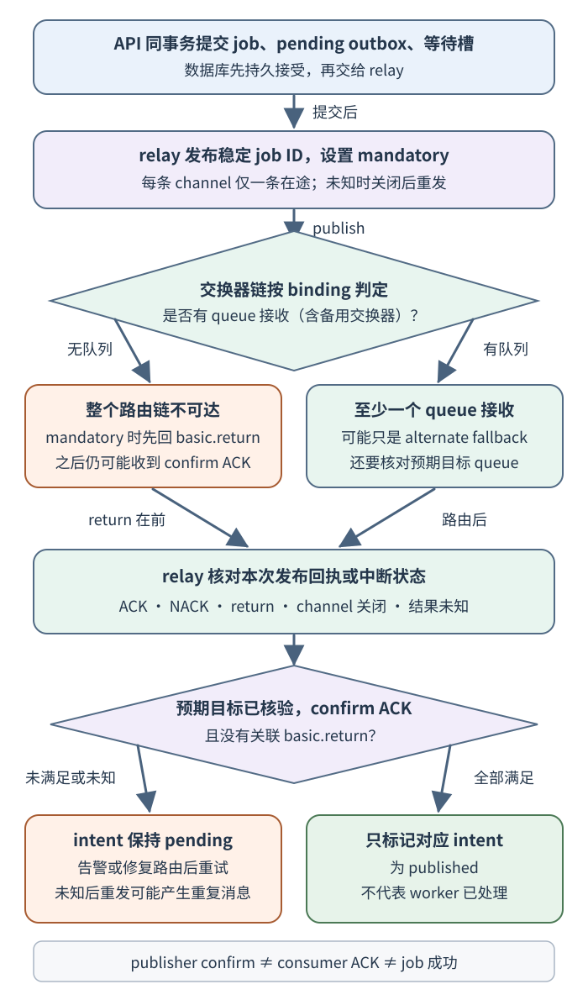
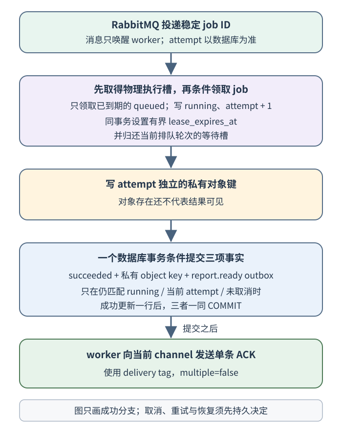

# 报表任务的发布确认、消费者确认与业务完成各证明什么？

案例中，账户 acct-17 发起 report 42 的 CSV 导出；断线后调用方仍要能查状态，并在成功后按授权下载私有对象。application programming interface（API，应用程序接口）在一个数据库事务里创建稳定 job ID（任务 ID）`job-demo-731`、待发布的 outbox（事务发件箱）意图和一个等待槽。等待槽是数据库中的准入计数：每个尚未领取的逻辑排队轮次占一个；领取后归还；重试或租约恢复器重新排队时再次预留；重复消息不增槽。它不是 RabbitMQ 的 consumer prefetch（消费者预取上限），也不是 BullMQ 的 job lock（任务锁）。客户端 idempotency key（幂等键）`report-demo-208`、报表 ID 42 与 job ID 是不同身份；读取报表状态、完成一个 job 和读取结果对象也是不同用户结果。

这条路径有三个能被不同组件观察的事实：数据库是否持久接受 job；broker（消息代理）是否按所配置的路由与持久性契约接受一次发布；应用是否提交了最终业务结果。relay（转发进程）把 outbox 意图发给 broker。publisher confirm（发布者确认）只证明 broker 侧的发布边界；consumer acknowledgement（消费者确认，ACK）只结束 broker 对当前 delivery（消息投递）的待确认状态。按应用的恢复合同，ACK 前还可以是成功、失败、取消等已提交终态，或已持久安排好的重试/接管路径；它本身不证明报表成功。只有 `succeeded` 与私有 object key（对象键）一起提交，才是本例的业务完成。各事实不能互相推导。

图一使用 RabbitMQ 的 mandatory 发布：如果整条路由没有 queue 接收，broker 会先发 `basic.return`，随后仍可能发 confirm ACK。因此，本例只有收到并核对本次 confirm ACK、没有本次 `basic.return`，且预期目标拓扑与持久性条件均满足，才将该 outbox intent 标为 `published`。每条 publisher channel 只有一次在途发送，使回执能对应到单次发布；未知时弃用旧 channel 再重发，具体关联方式在下一节展开。

`published` 是 relay 记录的发布结果，不是 worker 开始执行的前提。broker 可以先把消息交给 worker，relay 之后才收到 confirm、回写 outbox；图二从消息到达 worker 继续，不需要等待这次回写。

图二只画成功分支。worker（工作进程）先取得本进程物理执行槽，再在领取事务中同时递增 attempt（尝试号）、写入有界租约并归还逻辑等待槽；对象写好后，成功状态、对象引用与 `report.ready` outbox 意图在同一数据库事务提交，再按当前 RabbitMQ delivery tag 单条 ACK。取消、失败、持久重试和租约恢复分支见下文。

没有数据库与 broker 共享的原子事务时，持久 outbox 消除“数据库已提交、但进程在发布前崩溃”的双写空档；relay 和 worker 仍须接受重复。这里不把“最终业务效果只发生一次”简称为 exactly-once（恰好一次）：它依赖应用状态条件、幂等键、远端效果契约和恢复路径，而不是 broker 的一次确认。

## 发布者确认只回答 broker 是否接收

relay 先为发布 channel 启用 publisher confirms（AMQP 0-9-1 的 `confirm.select` 或客户端对应 API）；`mandatory` 本身不会开启 confirm，它只影响不可路由时是否退回消息。

publisher confirm 覆盖 publisher（发布者）到 RabbitMQ 的通信。它不知道 worker 是否已收到、确认或完成消息。如果 broker 接收了 publish，但 confirm 在网络中丢失，relay 无法区分“broker 未收到”和“broker 已收到但回复丢失”，重发便可能为同一 job 产生重复载荷。outbox 每次调度意图有独立唯一 ID，relay 用这个 ID 更新相应的发布状态；消息载荷只需 job ID。

confirm 的含义还受消息和 queue（队列）类型影响。RabbitMQ exchange（交换器）按 binding（绑定）把 publish 路由到零个或多个 queue；publisher confirm 不是路由保证。mandatory 发布的不可路由消息会以该次 publish 的 basic.return（不可路由返回通知）先于 confirm ACK 返回，因此必须将同一次发布的 return 和 confirm 一起关联；即使有 confirm ACK 且没有 return，也只能说明至少路由到一个 queue。备用 exchange（alternate exchange）可能把消息送往别处，所以预先核验交换器、绑定和目标 queue，不能只以“没有 return”判断目标正确。普通 durable queue 中的 persistent 消息在持久数据写入磁盘后才确认；quorum queue 在 quorum 副本接受并确认后才确认。放在 durable queue 中的 transient 消息即使会写到磁盘，也会在节点重启时被丢弃；要保留重启后的消息，队列和消息持久性都要满足所需契约。

outbox relay 按 intent 读取待发记录，发布它指向的稳定 job ID；publish attempt 的 channel 与 confirm 序号只在内存里关联到这条发送，数据库回写仍以 intent ID 为条件。`basic.ack`/`basic.nack` 在 channel 上带发布序号，可能用 `multiple=true` 一次确认此前多个序号；单条在途约定下，relay 仍核对当前发送对应的 channel 和序号。`basic.return` 是另一条异步回执，不带 confirm 序号；RabbitMQ 保证 mandatory 且不可路由的 return 先于该 publish 的 confirm，单条在途约定让它对应当前唯一未决发送。只有本次 confirm ACK 已按 channel 和序号核实、没有本次 `basic.return`、目标拓扑已核验且所选队列的持久性条件已满足，才把该 intent 标为 `published`。NACK、return、channel 异常/关闭、confirm 缺失或结果未知时保留 intent；若结果未知，关闭并弃用旧 channel 后才由新 channel 重发。这样不能消除 broker 已接受但数据库尚未回写时的重复：RabbitMQ 不按业务 job ID 替应用去重。数据库事务和 RabbitMQ 事务不是一个原子事务，worker 必须按持久 job 状态幂等领取。账户报表如何把 job、outbox 和等待槽同事务提交见[怎样设计一个可持久查询的账户报表？](../architecture/system-design-fundamentals.md)。

## 消费者在业务结果持久后才 ACK

本节标题概括成功路径；所有 ACK 都要求应用已持久化终态，或已提交可恢复的重试/接管路径。RabbitMQ AMQP 0-9-1 用当前接收 channel 上的 delivery tag 确认一条投递，不能拿业务 job ID 代替；并行处理时使用单条 ACK（multiple=false），若设 multiple=true，会一并确认该 channel 上更早的未确认 delivery，可能误确认尚未完成的工作。basic.ack 是发送给 broker 的单向方法，没有逐条 ACK 回执；连接在发送后断开时，ACK 是否到达 broker 是未知的，重投后仍按 job 状态判断。

队列载荷只带稳定 job ID，不带 attempt（尝试号）。delivery 是唤醒 worker 查询权威 job 状态的线索，不能自行生成尝试。worker 先取得本进程的可用物理执行槽，再竞争数据库领取；领取事务只允许 `queued` 且 `available_at` 已到期的任务，把状态改为 `running`、增加 attempt、设置有界 `lease_expires_at`，并归还当前等待槽。首次任务可把 `available_at` 设为当前时刻；若需要延迟重试，就把它作为 job 的持久字段，并确保到期时有已提交的新 outbox intent 或其他可靠唤醒。

收到重复 delivery 后，先读权威 job，再决定是否能 ACK 当前这条消息：

| 数据库看到的状态 | worker 可以做什么 | 何时能 ACK 当前 delivery |
| --- | --- | --- |
| 排队已到期 | `status='queued'` 时先取得物理执行槽，再竞争条件领取；只有一个事务能转为 `running` 并增加 attempt。 | 领取成功后继续处理；此处不 ACK；领取失败则重读状态。 |
| 排队未到期 | `status='queued'` 不能让旧的早到消息越过退避。 | 只有后续到期唤醒已经持久安排好时，才能 ACK 早到的重复消息；否则按 broker 契约延后或保留未确认。 |
| 运行中租约有效 | `status='running'` 时不能另起并行 attempt。 | 只有确认独立、持久的数据库租约恢复器会在过期后接管并重排时，才可 ACK 重复消息；否则保留或延后。 |
| 运行中租约过期 | `status='running'` 时 worker 不能自助领取下一代；到期只让独立恢复器有资格竞争接管。 | 恢复器把取消、容量失败或重新排队决定持久提交后，旧 delivery 才有可确认的终态或新唤醒路径；接管提交前不能把过期当作旧 attempt 已失权。 |
| 已到终态 | `succeeded`、`failed` 或 `cancelled` 时不再计算；按既定清理和可查询结果策略处理。容量耗尽以 `failed` 加 `error_code='capacity_exhausted'` 表示，不另造状态。 | 终态、错误码及必要清理/保留决定已持久后可 ACK。 |

取消也要按状态归还等待槽。API 取消一个仍为 `queued` 的 job 时，在一个条件事务中将其改为 `cancelled`、保存清理/保留决定，并只归还该排队轮次仍占有的槽；已发布或之后才发布的唤醒消息只会读到终态，不会领取或增加 attempt。领取与取消并发时由同一 job 行的条件更新决胜：若领取先提交，领取事务已归还等待槽，API 只能对 `running` 写 `cancel_requested=true`，不能再次归还等待槽；若取消先提交，worker 无法领取。

已领取当前 attempt 的 worker 要在有界工作步骤和成功提交前检查取消标志。看到 `cancel_requested=true` 时，由持有该 attempt 的 worker 以 `job_id`、`status='running'`、当前 attempt 和取消标志为条件提交 `cancelled` 与清理/保留决定；它不再归还共享等待槽，因为领取时已归还，只在停止执行时释放自己的物理槽。取消事务若先赢，成功更新将返回零行；若成功终态先赢，取消请求读到该终态，不改写它。若 worker 在持久取消终态前失联，保留可恢复信号，由租约到期后的恢复器先提交 `cancelled` 与同一清理/保留决定；delivery 仅在该决定持久后确认。

这里的 canonical 租期合同与下文独立 SQL 例的严格租期判断不同：领取时在同一事务中设置有界 `lease_expires_at`；到期只赋予数据库恢复器尝试接管的资格，不自动撤销旧 worker 的提交权。旧 worker 与恢复器以 job 当前状态、attempt 和 `cancel_requested` 条件竞争；谁先提交，谁决定后续状态。取消仍能单独阻止成功。只有恢复器接管事务先提交后，状态/代次栅栏才阻止旧 attempt 继续提交。领取、重试、恢复使用哪个 broker，也不改变数据库是业务状态权威这一点。

把同一个 `job-demo-731` 的接管时序展开，就能看清过期、接管和 ACK 不是同一个事件：

| 时点 | 持久状态变化 | 等待槽与 outbox | delivery 处理 |
| --- | --- | --- | --- |
| A 领取 | `queued → running`，`attempt=1`，同一领取事务写入有界租约。 | A 领取时归还该轮等待槽。 | A 处理当前投递；不能在领取后就 ACK。 |
| 租约到期、恢复器尚未提交接管 | 仅恢复器取得竞争接管资格；行仍为 `running / attempt=1`。 | 不变。 | 若 A 的完成事务先提交，job 成为成功且一同写入结果引用与 `report.ready` 意图；恢复器看到终态后不重排。 |
| 恢复器先提交且有取消请求 | 条件转为 `cancelled`，并持久化对象清理/保留决定。 | 不需等待槽。 | 取消终态与清理决定提交后可 ACK。 |
| 恢复器先提交、未取消且 240 个共享等待槽已满 | 条件写入 `status='failed'` 和可查询的 `error_code='capacity_exhausted'`。 | 不预留槽，不写新 outbox。 | 失败状态和错误码提交后可 ACK。 |
| 恢复器先提交、未取消且有空槽 | 同一事务将 job 改回 `queued`，清除旧租约。 | 原子预留一个等待槽并插入新的 `pending` outbox；relay 后续重发该意图。 | 重排、槽位和唤醒意图均持久后，旧 delivery 可 ACK。 |
| B 领取新唤醒 | `queued → running`，`attempt=2`，同一事务写新有界租约。 | B 领取时归还新排队轮次的等待槽。 | A 随后迟到的成功条件更新因状态或 attempt 不匹配而返回零行。 |

若 A 与恢复器同时争夺有效状态，条件更新以行锁与提交顺序选出一个胜者。租约到期本身不等于恢复器已提交；worker 也不能只因时钟已过期就自助递增 attempt。对 `running` 的重复投递，仅在独立恢复器确实会在租约到期后持续接管时，才能安全 ACK；否则要保留唤醒信号。

对象存储不是数据库事务的一部分。worker 先写 attempt 专属的私有对象键，再以 `job_id`、`status='running'`、当前 attempt 和 `cancel_requested=false` 为条件提交 `succeeded` 与对象 key。为保证“已就绪”只对应实际成功的结果，job 更新和 `report.ready` outbox 也必须在同一数据库事务中提交。以下假定 `report_outbox.operation_key` 有唯一约束，outbox 还记录 attempt、正文字节摘要和待发布正文；示例正文是紧凑 UTF-8 JSON，摘要按正文这些字节计算：

~~~sql
BEGIN;
WITH completed AS (
  UPDATE report_jobs
  SET status = 'succeeded', result_object_key = :object_key
  WHERE job_id = :job_id
    AND status = 'running'
    AND attempt = :attempt
    AND cancel_requested = FALSE
  RETURNING job_id, attempt
)
INSERT INTO report_outbox(operation_key, job_id, attempt, request_sha256, payload)
SELECT 'job-demo-731:report-ready:v1',
       job_id,
       attempt,
       'c0cbaddfd93fc90c8af3c368e008d39b71a35d461dc5e59494b3fd99ee31b42a',
       '{"jobId":"job-demo-731","reportId":42,"type":"report.ready"}'
FROM completed
RETURNING operation_key, attempt;
COMMIT;
~~~

只有 `INSERT ... RETURNING` 得到一行且应用确认 `COMMIT` 成功后，才能 ACK 当前 delivery；此时状态、私有对象引用和 ready 意图来自同一次提交。若 CTE 没有完成行，INSERT 也没有 ready 行，worker 必须按零行分支重新读 job 和 outbox。若 `COMMIT` 已发出但结果未观察到，持久结果未知，不能 ACK 或宣称回滚；可用新数据库连接查 job 与 ready 意图，或让 broker 重投后按权威状态恢复。**零行结果不能按普通成功 ACK，也不能与领取时遇到重复 delivery 混为一谈。** worker 重新读取 job 与 outbox，判定后续工作是否已由数据库持久接管：

- 若 job 已是成功、失败或取消终态，且结果/清理策略已持久，当前 delivery 已无待办工作，可 ACK。
- 若恢复器已将旧 attempt 原子重排为 `queued`，等待槽和新 outbox intent 都已提交，旧 delivery 可 ACK；relay 按 `available_at` 到期发布新唤醒，领取谓词阻止旧消息提前运行。
- 若后继 worker 已领取更大的 `running` attempt，只有在 claim 已提交、且独立租约恢复路径可靠时，旧 delivery 才可 ACK。
- 若恢复器尚未提交接管，或重排的槽/outbox 还没有持久化，仍需保住可恢复信号；同样，当前 attempt 仍有效且没有后续恢复保障时不能丢掉 delivery。
- `cancel_requested=true` 仍只是取消请求，不是持久取消终态。旧 worker 的报错或已上传对象都不能替代 `cancelled` 和配套清理/保留决定。
- 若成功 CTE 因 `cancel_requested=true` 返回零行，而该 worker 仍持有相同的 `running` attempt，它走上面的取消提交分支；只有 `cancelled` 与清理/保留决定提交后才能 ACK。若行已是另一 attempt 或其他终态，则按重读后的权威状态处理，不能由旧 worker 替它编造取消结果。

故障位置决定消息、job 和外部对象的关系：

| 失败时点 | broker 可能的动作 | 应用须保住的事实 |
| --- | --- | --- |
| broker 接受 publish，relay 没收到 confirm | relay 按 outbox 重发，同一 job ID 可出现多条消息 | 每个 outbox intent 用自己的 ID 回写；worker 仍以 job 的条件领取与终态更新消重。 |
| worker 在持久结果前崩溃且尚未 ACK | RabbitMQ 在连接或 channel 关闭后会重排未确认 delivery | 重投只触发读取 job；有效 attempt 不并行，租约过期还要等恢复器提交接管。 |
| 数据库已提交 `succeeded`，ACK 是否到达未知 | delivery 可再次到达 | 后继 worker 读到终态后 ACK，不重复生成/覆盖结果。 |
| 先 ACK，再提交结果前崩溃 | broker 可删除 delivery，不会因这条消息自动重投 | 任务是否可恢复只取决于独立、持久的租约扫描和重排；没有它，job 可能永久滞留。 |

若对象已写而数据库提交失败，会留下不可见对象。使用 attempt 隔离的不可变 key；清理时逐个检查候选对象键不被任何已提交 job 结果引用，而不要求整个 job 没有结果——例如 B 的不同键已成为结果，A 的键仍是孤儿。

清理计时从数据库提交 attempt 已不再当前的栅栏或 job 终态开始，不从租约过期开始。只有运行环境能保证旧 attempt 此后不能再发起 PUT，且 fence 时已开始的 PUT 有最大持续时间，才能在此上界、对象存储传播余量和安全宽限都过去后执行一次清扫。若停顿的旧进程仍可能在 fence 后开始 PUT，单轮扫描不足以证明它不会再出现；旧写入能力被撤销或到期后，还要从最后可能开始 PUT 的时刻等待最大上传时长与宽限，再做最终清扫。权限未设有限失效时间时，持续重扫候选键；每次删除前重查该键是否仍被结果引用。

数据库成功提交而 ACK 是否到达未知时，job 终态和 attempt 条件要让重复 handler 只确认已完成，不能再次产生业务副作用或覆盖引用。

## 重试、并发窗口与顺序会改变负载

RabbitMQ 4.4 的手动确认模式下，未 ACK 的 delivery 在 channel 或 connection 关闭后可被重新排队；这是 RabbitMQ 的行为，不能推广到所有 broker。automatic acknowledgement（自动确认）模式在 broker 发送后就视为已交付，worker 若尚未持久结果便崩溃，broker 不会为这条 delivery 自动重投。可靠工作使用手动 ACK，并在 ACK 前持久化终态或可恢复的后续路径。发送后 ACK 是否到达 broker 是未知的网络结果；basic.ack 不会再得到逐条 ACK 回执。

当前 attempt 遇到不可重试的业务错误时，以仍持有该 `running` attempt、且未请求取消为条件，先持久写入 `failed` 和有界错误码，再 ACK。若取消已请求或其他状态转移先赢，则重读 job，走相应的取消或恢复分支。

worker 遇到可重试的瞬时错误时，不能只对旧 delivery 执行 nack(requeue=true) 并期望它自然成为下一 attempt：job 若仍在 running，条件领取仍会拒绝它，快速重排还可能形成热循环。先按 job/attempt 条件锁定并重读取消状态：若已请求取消，持久写 `cancelled` 并完成清理决定；若尝试耗尽，持久写 `failed` 和有界错误码；若没有可预留的等待槽，在本例 240 个共享槽的上限下持久写 `status='failed'`、`error_code='capacity_exhausted'`。只有未取消、仍可重试且有容量时，才在同一数据库事务中把 job 改回 `queued`、写 `available_at=next_retry_at`、清除旧 lease、重新预留一个等待槽并插入新的 pending outbox intent。新时间、槽位和唤醒意图提交后才 ACK 旧 delivery；relay 在时间到期后发布，worker 领取条件再次核验数据库时钟。格式错误、无法映射有效 job 的消息不能无限重排；将它隔离到配置好的 dead-letter queue（死信队列，DLQ）或可告警拒绝路径。

RabbitMQ 的 consumer prefetch（消费者预取上限）限制尚未 ACK 的 delivery 数，决定 broker 可提前压到 worker 缓冲区多少任务。对 Advanced Message Queuing Protocol 0-9-1（高级消息队列协议，AMQP 0-9-1），`basic.qos(count)` 在 RabbitMQ 中按每个 consumer 分别施加；例如同一 channel 上三个 consumer 各设 4，可同时各有 4 条未确认消息。值 `0` 表示无限；若消费者没显式配置，broker 也可应用管理员设置的默认值。全局 per-channel QoS 从 RabbitMQ 4.3 起弃用并默认禁用。预取不是业务并发保证：还要看 handler 并发、进程内队列、数据库/对象存储容量和可用执行槽；过大预取会把等待从 broker 搬进 worker 内存，也延长停机时未确认工作的回收。

若业务要求按账户、订单或报表顺序处理，先定义顺序键与所需的提交顺序。first-in, first-out（先进先出，FIFO）队列只能描述某些消息的排队/交付次序；多个 consumer 并行执行时，较早 delivery 仍可能较晚完成。要保持业务完成顺序，需按键串行处理、单一有序分区，或用持久序号条件更新拦住越序提交。

## BullMQ 的租锁失效为什么会让任务重复执行？

BullMQ 6.7.5（2026-11-11 发布）将 job 状态存于 Redis。若 PostgreSQL job 行仍是报表状态、attempt、租期和结果引用的权威来源，BullMQ 只负责唤醒与调度。每条 outbox 意图有稳定 UUID；将 `outbox-` 前缀与该 UUID 拼成 BullMQ custom job ID 可避开纯数字和冒号。相同意图重发复用该 ID，恢复器生成的新 outbox 意图使用新 ID。BullMQ 6.7.5 官方文档要求 custom job ID 不能只由数字组成，也不能包含冒号；版本源码的校验会拒绝 `42` 和带冒号的 `a:b`，但前导零数字串 `0042` 会通过该校验块，因此不要依赖源码边缘行为，始终添加非数字前缀。custom ID 仅在该 queue 内唯一，job 保留时重复 add 被忽略，移除或自动清理后同 ID 可再次添加。

BullMQ worker 领取 job 后取得有时限的 Redis lock，并需在处理期间续租。进程异常退出、Redis 连接故障或 Node.js 事件循环被 CPU 密集工作占满，都可能使续租未及时到达；stalled checker（停滞任务检查器）随后把 job 放回 waiting 让 worker 重跑，超过 maxStalledCount 后转入 failed 集合。BullMQ 6.7.5 默认 maxStalledCount 为 1；普通处理器异常的 attempts/backoff 重试与锁丢失后的 stalled 恢复计数是两条路径。观察 stalled 事件并让 CPU 工作周期性把控制权交还事件循环；调大 lock duration 会延迟识别真实崩溃，单独调时间不会阻止业务副作用重复。

在本报表合同中，Redis lock 只影响 BullMQ 何时重新投递，不授予或撤销报表写权限。每个外部业务意图仍绑定 job、attempt、请求摘要和数据库状态栅栏；对象键带 attempt，由当前状态/attempt 的数据库条件提交决定哪个对象引用生效。外部操作键应以权威且唯一的 job ID 与操作类型组成，例如 job-demo-731:report-ready:v1；客户端幂等键 report-demo-208 可能只在账户/主体范围内唯一，不能未经范围限定就假设全局唯一。该外部 operation key 可以包含冒号，但不能直接用作 BullMQ job ID。远端按稳定操作键与相同请求摘要去重，并提供按键查询或明确保留期：查询确认完成就记录并停止；结果仍未知（包括查询不可用）且同键同摘要保证仍有效，才可重试原键；否则保留未知并对账，不换新键盲目再发。BullMQ/Redis 的持久化需由部署显式配置；若允许已确认 job 丢失，运维还须从长期停滞的数据库 queued job 发现并重建唤醒。通用未知效果边界见[请求超时后如何确认结果并安全重试？](api-reliability-and-async-delivery.md)。

## SQL job 表怎样短时领取并阻止过期 worker 回写？

若任务状态已经权威地保存在 PostgreSQL，也可把 job 表用作 queue-like（类似队列的）工作池。FOR UPDATE SKIP LOCKED 让并发领取者跳过当前被其他事务锁住的候选行，避免把同一个候选同时发给多个 worker；它刻意返回不完整视图，只适合这种竞争领取，不适合作为普通一致性读取。领取事务选一行、提交 running 与递增 attempt/lease 后立即释放行锁；昂贵工作在事务外执行，短事务降低锁等待。这个选择把轮询、候选扫描和行锁压力留在数据库；需要观察空轮询、领取时延与锁等待，负载升高时再决定是否需要独立 broker。

以下独立 SQL 合成任务 ID 为 `pg-job-demo-42`，与上方 RabbitMQ 报表 `job-demo-731` 无关。代码可在 PostgreSQL 14+ 的单个 `psql` 会话从头运行；`psql` 默认每条独立语句自动提交，显式 `BEGIN/COMMIT` 块是示例事务边界，临时表仅在该会话有效。本例使用 PostgreSQL 默认的 `READ COMMITTED`；每条新语句取得新快照，所以在锁住 job 行的事务中，后续 `record_processing` 命令按当时已提交的状态判断当前写权。所有能写同一 job 意图的 worker 都必须先锁该 job 行，避免唯一键冲突来自绕过状态门的并发写入。若系统采用 `REPEATABLE READ` 或 `SERIALIZABLE`，必须按该隔离级别处理并发异常并在需要时重试整笔事务，不能假设仍看到同一结果。表结构故意缩小到 attempt、租约与意图，未建模 canonical 案例的账户授权、共享 240 等待槽或外部 broker。

这个 SQL 示例**特意采用严格租期变体**：每次领取写入 `lease_expires_at`；成功写入还要求条件 UPDATE 执行时租期仍有效，到期即拒绝旧 worker，即使恢复器尚未接管。`report.processing` 是示例中允许在最终结果前发送的事实，用来演示当前 attempt 下的唯一键与摘要判断；它与同一 job 的完成通知不同。前文 `job-demo-731` 的 canonical 合同不同：到期只让恢复器获得竞争接管资格，旧 worker 仍可在恢复器提交前先完成。一个系统必须为同一 job 状态选定一种合同，不能把两套条件混用。

先沿一次执行读结果，再按需展开后面的完整 SQL：

| 时点 | 当前状态与结果 |
| --- | --- |
| A 领取 | job 为 `running / attempt=1`，得到 30 秒租约。 |
| A 到期，B 尚未接管 | A 尝试完成，严格租期谓词不成立，更新零行。 |
| B 接管 | job 为 `running / attempt=2`，写新租约；B 登记 `report.processing` 意图，重复登记的结果见下表。 |
| B 正常完成 | 同一事务写 `succeeded`、`reports/42/attempt-2` 与唯一 `report.ready` 意图。 |
| A 迟到 | attempt 与状态条件均不满足，更新零行，不覆盖 B 的对象引用。 |

这个变体仍把 `report.ready` 与成功状态及对象引用放在同一 PostgreSQL 事务中。worker 先写 attempt 专属私有对象；只有成功条件更新影响一行，job 转为 `succeeded`，结果 key 与 ready outbox 意图才一起提交。若 UPDATE 返回零行，CTE `completed` 没有行，INSERT 也不写意图；因此后来失败或被取消的 attempt 不会发送“已就绪”通知。若 COMMIT 已提交但客户端没读到确认，应用应在新连接上查询持久的 job 与 outbox 表；本示例用临时表，只能在当前 `psql` 会话展示 COMMIT 后两行同时可见，连接结束后临时表也会消失。读取两行是核实事务结果，不是再次发通知。运行中的 B 若随后失联，ready 意图只会由 relay 在成功事务提交后发布；若业务终态是 `failed` 或 `cancelled`，同一事务从未创建 ready。

`record_processing` 的结果列依次是 `authorized`、`inserted`、`existing_intent`、`same_request`。`authorized=false` 时，查询结果不返回 outbox 摘要或比较结果；worker 没有写权，必须停止本次操作。`authorized=true, inserted=true` 表示这次事务新建意图，提交后由 relay 发布。`authorized=true, inserted=false, existing_intent=true` 才表示本次有权查看已存在的唯一键：同摘要是同一持久意图，异摘要是冲突，均不新增或覆盖行。相同摘要只确认意图内容，不授予 worker 绕过 outbox 直接发送或提交 job 的权力；实际发布仍由 relay 按自己的持久状态完成。若授权成立、没有插入但也找不到既有行，说明唯一键/保留假设被破坏，应回滚并告警，不能把 NULL 当成成功。

示例查询结果如下；`NULL` 表示本次没有读摘要：

| 情况 | `authorized, inserted, existing_intent, same_request` | 处理 |
| --- | --- | --- |
| B attempt 2 首次登记 | `true, true, false, NULL` | 提交这条新意图，交给 relay |
| B 同键同摘要重放 | `true, false, true, true` | 只确认原意图已存在，不再插入 |
| B 同键异摘要 | `true, false, true, false` | 报告冲突；不覆盖或再次发送 |
| B 租约已过期或已请求取消 | `false, false, false, NULL` | 无写权；查询结果不返回摘要或比较结果 |
| B 已领取 attempt 2 后的 A attempt 1 | `false, false, false, NULL` | 查询结果不返回 B 的摘要或比较结果，也不提交旧 attempt |

若直接 `INSERT` 抛唯一约束异常，PostgreSQL 当前事务已失败，先回滚再在新事务核查，不能在失败事务里继续 `SELECT`。

`report.processing` 是可在任务完成前发出的事实，与最终的 `report.ready` 分开；后者只由成功状态更新原子生成。成功后的重投只能只读查看既有 ready 意图。若同一 operation key 的摘要不同，它是数据冲突，不能覆盖旧意图或再次发布。外部副作用仍需远端按稳定 operation key 与同一请求摘要去重；远端结果未知且没有仍有效的去重保证时，保留未知并人工对账。

SQL 租期续期也须在锁定 job 行后，以新鲜 clock_timestamp() 检查当前状态、attempt 和未过期 lease；否则已过期 worker 可能等待锁后还把自己的租约续活。严格 SQL 变体里的租期谓词不适用于上方 canonical 报表案例。canonical 接管的完整选择、等待槽与旧 worker 时序见前文，另有[持久报表任务的状态与恢复合同](../architecture/system-design-fundamentals.md)。

> [!example]- 完整 SQL：严格租期下的领取、意图去重与完成
>
> ~~~sql
> CREATE TEMP TABLE report_jobs (
>   job_id text PRIMARY KEY,
>   status text NOT NULL,
>   attempt integer NOT NULL DEFAULT 0,
>   available_at timestamptz NOT NULL,
>   lease_expires_at timestamptz,
>   cancel_requested boolean NOT NULL DEFAULT false,
>   result_key text
> );
> INSERT INTO report_jobs(job_id, status, attempt, available_at)
> VALUES ('pg-job-demo-42', 'queued', 0, clock_timestamp() - interval '1 second');
>
> CREATE TEMP TABLE job_effect_outbox (
>   operation_key text PRIMARY KEY,
>   job_id text NOT NULL REFERENCES report_jobs(job_id),
>   attempt integer NOT NULL,
>   request_sha256 text NOT NULL,
>   payload text NOT NULL
> );
>
> -- Worker A：取得执行槽后领取并提交；返回 attempt=1 和新的有界 lease_expires_at。
> WITH candidate AS (
>   SELECT job_id
>   FROM report_jobs
>   WHERE cancel_requested = false
>     AND ((status = 'queued' AND available_at <= clock_timestamp())
>       OR (status = 'running' AND lease_expires_at <= clock_timestamp()))
>   ORDER BY available_at, job_id
>   LIMIT 1
>   FOR UPDATE SKIP LOCKED
> )
> UPDATE report_jobs AS j
> SET status = 'running',
>     attempt = j.attempt + 1,
>     lease_expires_at = clock_timestamp() + interval '30 seconds'
> FROM candidate AS c
> WHERE j.job_id = c.job_id
>   AND j.cancel_requested = false
> RETURNING j.job_id, j.status, j.attempt, j.lease_expires_at;
>
> -- 为了不等待 30 秒，演示中把 Worker A 的 lease 手动置为已过期。
> UPDATE report_jobs
> SET lease_expires_at = clock_timestamp() - interval '1 second'
> WHERE job_id = 'pg-job-demo-42' AND attempt = 1;
>
> -- 严格租期变体：A 到期后、B 尚未接管时尝试完成，返回 0 行。
> BEGIN;
> SELECT job_id FROM report_jobs WHERE job_id = 'pg-job-demo-42' FOR UPDATE;
> UPDATE report_jobs
> SET status = 'succeeded', result_key = 'reports/42/attempt-1', lease_expires_at = NULL
> WHERE job_id = 'pg-job-demo-42'
>   AND status = 'running'
>   AND attempt = 1
>   AND cancel_requested = false
>   AND lease_expires_at > clock_timestamp()
> RETURNING job_id, status, attempt;
> COMMIT;
>
> -- B 接管过期任务并提交 attempt=2 与新的有界租约。
> WITH candidate AS (
>   SELECT job_id
>   FROM report_jobs
>   WHERE cancel_requested = false
>     AND ((status = 'queued' AND available_at <= clock_timestamp())
>       OR (status = 'running' AND lease_expires_at <= clock_timestamp()))
>   ORDER BY available_at, job_id
>   LIMIT 1
>   FOR UPDATE SKIP LOCKED
> )
> UPDATE report_jobs AS j
> SET status = 'running',
>     attempt = j.attempt + 1,
>     lease_expires_at = clock_timestamp() + interval '30 seconds'
> FROM candidate AS c
> WHERE j.job_id = c.job_id
>   AND j.cancel_requested = false
> RETURNING j.job_id, j.status, j.attempt, j.lease_expires_at;
>
> -- 每个写 intent 的尝试都先锁 job 行；relay 只读 outbox，不绕过此写权门。
> -- 该单条语句仅在当前 attempt 有权时才插入，或比较一个既有同键意图。
> -- existing 与 eligible 连接，所以无写权时查询结果不返回摘要或比较结果；MATERIALIZED 让本次
> -- 决策使用同一条锁定行、当前 attempt、未取消状态和严格租期判定。
> PREPARE record_processing(text, integer, text, text, text) AS
> WITH eligible AS MATERIALIZED (
>   SELECT job_id, attempt
>   FROM report_jobs
>   WHERE job_id = $1
>     AND status = 'running'
>     AND attempt = $2
>     AND cancel_requested = false
>     AND lease_expires_at > clock_timestamp()
> ),
> inserted AS (
>   INSERT INTO job_effect_outbox(operation_key, job_id, attempt, request_sha256, payload)
>   SELECT $3, e.job_id, e.attempt, $4, $5
>   FROM eligible AS e
>   ON CONFLICT (operation_key) DO NOTHING
>   RETURNING operation_key, attempt
> ),
> existing AS MATERIALIZED (
>   SELECT o.request_sha256
>   FROM eligible AS e
>   JOIN job_effect_outbox AS o
>     ON o.job_id = e.job_id
>    AND o.operation_key = $3
>   WHERE NOT EXISTS (SELECT 1 FROM inserted)
> )
> SELECT EXISTS (SELECT 1 FROM eligible) AS authorized,
>        EXISTS (SELECT 1 FROM inserted) AS inserted,
>        EXISTS (SELECT 1 FROM existing) AS existing_intent,
>        (SELECT request_sha256 = $4 FROM existing) AS same_request;
>
> -- B 用 attempt=2 首次登记可在完成前发送的 report.processing；摘要对应下面的原始 JSON 字节。
> BEGIN;
> SELECT job_id FROM report_jobs WHERE job_id = 'pg-job-demo-42' FOR UPDATE;
> EXECUTE record_processing(
>   'pg-job-demo-42', 2, 'pg-job-demo-42:report-progress:v1',
>   '55799e91985ab0123fa1b56b65fb4112ad1bd06e50945da075bfe1705f365817',
>   '{"jobId":"pg-job-demo-42","type":"report.processing"}'
> );
> COMMIT;
>
> -- B 同 attempt、同操作键、同摘要重放；授权仍成立，识别既有 intent，不再插入一行。
> BEGIN;
> SELECT job_id FROM report_jobs WHERE job_id = 'pg-job-demo-42' FOR UPDATE;
> EXECUTE record_processing(
>   'pg-job-demo-42', 2, 'pg-job-demo-42:report-progress:v1',
>   '55799e91985ab0123fa1b56b65fb4112ad1bd06e50945da075bfe1705f365817',
>   '{"jobId":"pg-job-demo-42","type":"report.processing"}'
> );
> COMMIT;
>
> -- B 仍有写权但用同一键提交异正文：结果显示摘要冲突，不覆盖既有 intent。
> BEGIN;
> SELECT job_id FROM report_jobs WHERE job_id = 'pg-job-demo-42' FOR UPDATE;
> EXECUTE record_processing(
>   'pg-job-demo-42', 2, 'pg-job-demo-42:report-progress:v1',
>   '7d5a6ce6ab778ec8937d1dd76a25e4a3d1b5f9e4cb5c3d7fb43196f3ea8a77f3',
>   '{"jobId":"pg-job-demo-42","type":"report.processing","phase":"other"}'
> );
> COMMIT;
>
> -- B 先过期：即使同键、同摘要 intent 已存在，查询结果也不返回摘要；B 无权发起外部动作。
> UPDATE report_jobs
> SET lease_expires_at = clock_timestamp() - interval '1 second'
> WHERE job_id = 'pg-job-demo-42' AND attempt = 2;
> BEGIN;
> SELECT job_id FROM report_jobs WHERE job_id = 'pg-job-demo-42' FOR UPDATE;
> EXECUTE record_processing(
>   'pg-job-demo-42', 2, 'pg-job-demo-42:report-progress:v1',
>   '55799e91985ab0123fa1b56b65fb4112ad1bd06e50945da075bfe1705f365817',
>   '{"jobId":"pg-job-demo-42","type":"report.processing"}'
> );
> COMMIT;
>
> -- 恢复租期但请求取消：同摘要行仍不可由该 attempt 读取或再次驱动。
> UPDATE report_jobs
> SET lease_expires_at = clock_timestamp() + interval '30 seconds',
>     cancel_requested = true
> WHERE job_id = 'pg-job-demo-42' AND attempt = 2;
> BEGIN;
> SELECT job_id FROM report_jobs WHERE job_id = 'pg-job-demo-42' FOR UPDATE;
> EXECUTE record_processing(
>   'pg-job-demo-42', 2, 'pg-job-demo-42:report-progress:v1',
>   '55799e91985ab0123fa1b56b65fb4112ad1bd06e50945da075bfe1705f365817',
>   '{"jobId":"pg-job-demo-42","type":"report.processing"}'
> );
> COMMIT;
>
> -- 当前 job 仍为 B/attempt=2，但租期有效且取消未请求；A attempt=1 无写权，查询结果不返回 B 的摘要。
> UPDATE report_jobs
> SET cancel_requested = false,
>     lease_expires_at = clock_timestamp() + interval '30 seconds'
> WHERE job_id = 'pg-job-demo-42' AND attempt = 2;
> BEGIN;
> SELECT job_id FROM report_jobs WHERE job_id = 'pg-job-demo-42' FOR UPDATE;
> EXECUTE record_processing(
>   'pg-job-demo-42', 1, 'pg-job-demo-42:report-progress:v1',
>   '55799e91985ab0123fa1b56b65fb4112ad1bd06e50945da075bfe1705f365817',
>   '{"jobId":"pg-job-demo-42","type":"report.processing"}'
> );
> COMMIT;
> DEALLOCATE record_processing;
>
> -- 只有当前 attempt=2 成功条件更新时，才在同一事务创建 report.ready 意图。
> -- 若 UPDATE 无权提交或影响 0 行，completed 为空，下面 INSERT 也写入 0 行。
> BEGIN;
> SELECT job_id FROM report_jobs WHERE job_id = 'pg-job-demo-42' FOR UPDATE;
> WITH completed AS (
>   UPDATE report_jobs
>   SET status = 'succeeded',
>       result_key = 'reports/42/attempt-2',
>       lease_expires_at = NULL
>   WHERE job_id = 'pg-job-demo-42'
>     AND status = 'running'
>     AND attempt = 2
>     AND cancel_requested = false
>     AND lease_expires_at > clock_timestamp()
>   RETURNING job_id, attempt
> )
> INSERT INTO job_effect_outbox(operation_key, job_id, attempt, request_sha256, payload)
> SELECT 'pg-job-demo-42:report-ready:v1',
>        job_id,
>        attempt,
>        'c4dd0f89af3442f1d58ade3561dc85ed51e5e458c7bc58873c2069d0fc97a27c',
>        '{"jobId":"pg-job-demo-42","reportId":42,"type":"report.ready"}'
> FROM completed
> RETURNING operation_key, attempt;
> COMMIT;
>
> -- 核实 succeeded、对象引用与 ready 意图来自同一提交。
> SELECT j.status, j.attempt, j.result_key,
>        o.operation_key, o.attempt AS intent_attempt,
>        o.request_sha256 = 'c4dd0f89af3442f1d58ade3561dc85ed51e5e458c7bc58873c2069d0fc97a27c' AS same_request
> FROM report_jobs AS j
> JOIN job_effect_outbox AS o USING (job_id)
> WHERE j.job_id = 'pg-job-demo-42'
>   AND o.operation_key = 'pg-job-demo-42:report-ready:v1';
>
> -- A 在 B 提交成功后再迟到完成，仍返回 0 行。
> BEGIN;
> SELECT job_id FROM report_jobs WHERE job_id = 'pg-job-demo-42' FOR UPDATE;
> UPDATE report_jobs
> SET status = 'succeeded', result_key = 'reports/42/attempt-1', lease_expires_at = NULL
> WHERE job_id = 'pg-job-demo-42'
>   AND status = 'running'
>   AND attempt = 1
>   AND cancel_requested = false
>   AND lease_expires_at > clock_timestamp()
> RETURNING job_id, status, attempt;
> COMMIT;
>
> -- 在本会话核实 COMMIT 后的权威状态和 ready 意图；若真实连接断开，应使用永久表的新连接查询。
> SELECT j.status, j.attempt, o.operation_key,
>        o.request_sha256 = 'c4dd0f89af3442f1d58ade3561dc85ed51e5e458c7bc58873c2069d0fc97a27c' AS same_request
> FROM report_jobs AS j
> LEFT JOIN job_effect_outbox AS o
>   ON o.job_id = j.job_id
>  AND o.operation_key = 'pg-job-demo-42:report-ready:v1'
> WHERE j.job_id = 'pg-job-demo-42';
> ~~~

## 观测每个交接点，不能只数 ACK

单独记录 publish 尝试、confirm/return、queue depth 和 oldest-message age、unacked 数、重投、重试、ACK、DLQ、job succeeded/failed 及对象引用提交。oldest-message age 持续增长表示结果延迟，即使队列还在接受消息。broker 继续接收并不代表 worker 有容量；worker 发 ACK 也只表示应用确认到达选择的处理边界，不等于用户后来成功下载了报告。更完整的事故定位见[如何从报表服务信号定位发布故障？](observability-slos-and-incident-response.md)。

调用方断线后仍从持久 job 行查询进度；只有 job 到达 `succeeded`，API 才按当前主体权限提供私有结果对象的授权下载。

> [!info]- 来源
> - RabbitMQ 4.4.0（官方 Release Information 标为 2026-10-20 发布；当前文档版本为 4.4，核对于 2026-11-12）：[Consumer Acknowledgements and Publisher Confirms](https://www.rabbitmq.com/docs/confirms)，publisher confirm 与 consumer ACK 的方向、delivery tag 的 channel 范围、发布序号与 `multiple` 确认、持久消息/queue 与 quorum queue 的确认责任、unroutable 消息在 confirm ACK 前发 `basic.return`、手动/自动确认及关闭 channel/connection 后的未确认消息处理；[AMQP 0-9-1 extended specification](https://github.com/rabbitmq/amqp-0.9.1-spec/blob/main/xml/amqp0-9-1.extended.xml)，`basic.return` 的方法字段不含 confirm 序号；[Java client unroutable handling](https://www.rabbitmq.com/client-libraries/java-api-guide#unroutable)，return callback 接收退回消息属性与正文；[Reliability Guide](https://www.rabbitmq.com/docs/reliability)，故障中途状态与重发；[Consumer Prefetch](https://www.rabbitmq.com/docs/consumer-prefetch)，RabbitMQ 的 per-consumer QoS、`0` 无上限、可配置默认值和 4.3 起 per-channel global QoS 弃用/默认关闭；[Release Information](https://www.rabbitmq.com/release-information)，当前维护版本。队列副本、持久性、exchange/binding/alternate exchange 和客户端 API 仍须按实际部署核实。
> - BullMQ 6.7.5（GitHub 官方发布记录显示 2026-11-11 发布，核对于 2026-11-12）：[Important Notes](https://github.com/taskforcesh/bullmq/blob/v6.7.5/docs/gitbook/bull/important-notes.md) 与 [Stalled Jobs](https://github.com/taskforcesh/bullmq/blob/v6.7.5/docs/gitbook/guide/workers/stalled-jobs.md)，至少一次运行、锁续期、事件循环阻塞与达到 stalled 上限后转失败；[WorkerOptions](https://github.com/taskforcesh/bullmq/blob/v6.7.5/src/interfaces/worker-options.ts) 的 `maxStalledCount` 默认值为 1；[Retrying failing jobs](https://github.com/taskforcesh/bullmq/blob/v6.7.5/docs/gitbook/guide/retrying-failing-jobs.md)，普通失败重试与 backoff；[Job IDs](https://github.com/taskforcesh/bullmq/blob/v6.7.5/docs/gitbook/guide/jobs/job-ids.md)，队列范围内的自定义 ID、保留期间重复 add 的行为、自动移除后的去重边界，以及不能含 `:` 或仅由数字构成的文档约束；版本源码 [job.ts](https://github.com/taskforcesh/bullmq/blob/v6.7.5/src/classes/job.ts#L1278-L1289) 实际拒绝 `"42"`、`"a:b"`，但前导零 `"0042"` 通过该校验块；[Going to production](https://docs.bullmq.io/guide/going-to-production)，Redis 后端持久化需由部署显式配置；[release](https://github.com/taskforcesh/bullmq/releases/tag/v6.7.5)，版本日期。BullMQ/Redis 接收后的持久性仍取决于部署设置。
> - PostgreSQL 当前文档版本 18：[SELECT 的 locking clause](https://www.postgresql.org/docs/18/sql-select.html)，`SKIP LOCKED` 会跳过不能立即加锁的行、并刻意提供不一致视图，适合 queue-like 多消费者领取；[Explicit Locking](https://www.postgresql.org/docs/18/explicit-locking.html)，行锁生命周期与竞争写入；[Date/Time Functions](https://www.postgresql.org/docs/18/functions-datetime.html)，`clock_timestamp()` 与事务起始时间的区别；[INSERT](https://www.postgresql.org/docs/18/sql-insert.html)，`ON CONFLICT` 和 `RETURNING` 只报告实际插入的行；[Transaction Isolation](https://www.postgresql.org/docs/18/transaction-iso.html)，默认 `READ COMMITTED` 为每条语句取新快照，重复读和可串行化事务须处理异常/重试。代码在隔离的 PostgreSQL 14.24 临时实例实跑；该版本核查时列于官方支持版本。应用级 attempt、lease 与外部副作用合同不由 PostgreSQL 定义。
> - job/outbox/等待槽/恢复器的 canonical 报表状态见[怎样设计一个可持久查询的账户报表？](../architecture/system-design-fundamentals.md)；外部未知结果与操作键见[请求超时后如何确认结果并安全重试？](api-reliability-and-async-delivery.md)。
