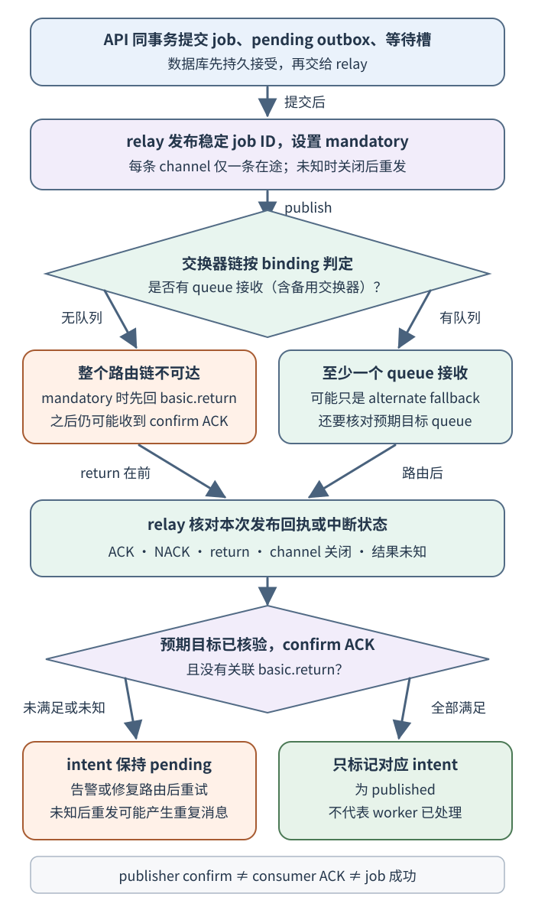
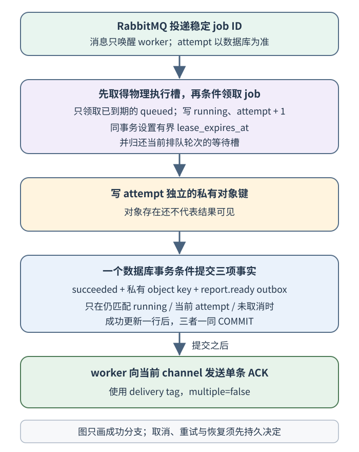

# 报表任务的发布确认、消费者确认与业务完成各证明什么？

**案例：** 账户 `acct-17` 发起报表 42 的 CSV 导出；调用方断线后仍要能查询状态，并在成功后按授权下载私有结果对象。API (应用程序接口) 在一个数据库事务里创建稳定的 job ID（任务 ID）`job-demo-731`、一条待发布的 outbox（事务发件箱）意图和一个等待槽。等待槽是数据库中的准入计数：每个尚未被领取的排队轮次占一个，被领取时归还；重试或租约恢复器重新排队时再预留一个；重复消息不占新槽。它既不是 RabbitMQ 的 consumer prefetch（消费者预取上限），也不是 BullMQ 的 job lock（任务锁）。客户端的 idempotency key（幂等键）`report-demo-208`、报表 ID 42 和 job ID 是三种不同的身份；读取报表状态、完成一个 job、读取结果对象，也是三种不同的用户结果。

这条路径上有三个分别由不同组件观察的事实：数据库是否持久接受了 job；broker（消息代理）是否按配置的路由与持久性约定接受了一次发布；应用是否提交了最终业务结果。relay（转发进程）负责把 outbox 意图发给 broker。publisher confirm（发布者确认）只证明 broker 接受了发布；consumer acknowledgement（消费者确认，ACK）只结束 broker 对当前 delivery（消息投递）的待确认状态。按本例的恢复约定，worker 在 ACK 之前必须已提交某个终态（成功、失败或取消），或已持久安排好重试或接管；因此 ACK 本身并不证明报表成功。只有 `succeeded` 与私有 object key（对象键）一起提交，才算本例的业务完成。这三个事实不能互相推导。

图一中的发布带有 RabbitMQ 的 `mandatory` 标志：如果没有任何 queue 能接收这条消息，broker 会先发回 `basic.return`，随后仍可能发出 confirm ACK。因此，本例只有在核对到本次的 confirm ACK、没有收到本次的 `basic.return`，且目标拓扑和持久性条件都符合预期时，才把这条 outbox 意图标为 `published`。每条 publisher channel 同时只有一次在途发送，这样回执才能对应到唯一一次发布；结果不明时，弃用旧 channel 再重发。具体的关联方式在下一节展开。

`published` 只是 relay 记录的发布结果，不是 worker 开始执行的前提。broker 可能先把消息投递给 worker，relay 之后才收到 confirm 并回写 outbox；图二从消息到达 worker 开始，不需要等这次回写。

图二只画成功分支。worker（工作进程）先取得本进程的一个物理执行槽（同时能运行的任务数上限），再在领取事务中递增 attempt（尝试号）、写入有期限的租约，并归还数据库里的等待槽；结果对象写好后，把成功状态、对象引用与 `report.ready` outbox 意图放在同一个数据库事务中提交，最后按当前 RabbitMQ delivery tag 单条 ACK。取消、失败、持久重试和租约恢复等分支见下文。

数据库和 broker 之间没有共享的原子事务。持久 outbox 消除的是“数据库已提交、进程却在发布前崩溃”这一双写空档；relay 和 worker 仍然必须容忍重复。本文不把“最终业务效果只发生一次”简称为 exactly-once（恰好一次），因为它靠的是应用的状态条件、幂等键、远端的效果约定和恢复路径，而不是 broker 的某一次确认。

## 发布者确认只回答 broker 是否接收

relay 先为发布用的 channel 开启 publisher confirms（AMQP 0-9-1 的 `confirm.select`，或客户端库的对应 API）。`mandatory` 本身不会开启 confirm，它只决定消息无法路由时是否退回。

publisher confirm 只覆盖 publisher（发布者）到 RabbitMQ 这一段，它不知道 worker 是否已经收到、确认或完成消息。如果 broker 已接收消息、confirm 却在网络中丢失，relay 无法区分“broker 没收到”和“已收到但回复丢了”，重发就可能为同一个 job 产生重复消息。每次调度产生的 outbox 意图都有独立的唯一 ID，relay 用它回写对应的发布状态；消息载荷里只需带 job ID。

confirm 的含义还取决于消息和 queue（队列）的类型。RabbitMQ 的 exchange（交换器）按 binding（绑定）把消息路由到零个或多个 queue，publisher confirm 并不保证路由成功。带 `mandatory` 的不可路由消息，会先收到该次发布的 `basic.return`（不可路由退回通知），再收到 confirm ACK，所以必须把同一次发布的 return 和 confirm 放在一起判断。即使收到 confirm ACK 且没有 return，也只说明消息至少进了一个 queue：alternate exchange（备用交换器）可能把它送到别处，所以要事先核验交换器、绑定和目标 queue，不能只凭“没有 return”判断目标正确。对于普通（classic）durable queue 中的 persistent 消息，broker 在数据写入磁盘后才确认；quorum queue 则在多数副本接受后才确认。放进 durable queue 的 transient 消息即使写过磁盘，节点重启时也会被丢弃；要让消息在重启后保留，队列和消息都必须是持久的。

具体关联方式如下。relay 逐条读取待发的 outbox 意图，发布它指向的稳定 job ID；这次发送用的 channel 和 confirm 序号只保存在内存里，数据库回写仍以意图 ID 为条件。`basic.ack`/`basic.nack` 携带 channel 上的发布序号，也可能用 `multiple=true` 一次确认之前的多个序号；在“每条 channel 只有一次在途发送”的约定下，relay 仍要核对当前发送的 channel 和序号。`basic.return` 是另一条异步回执，不带 confirm 序号；RabbitMQ 保证带 `mandatory` 的不可路由消息先收到 return、再收到 confirm，而单条在途的约定让这个 return 只可能对应当前唯一的未决发送。只有本次 confirm ACK 已按 channel 和序号核实、没有本次的 `basic.return`、目标拓扑已核验、所选队列的持久性条件也满足，才把该意图标为 `published`。遇到 NACK、return、channel 异常或关闭、confirm 缺失或结果不明时，都保留这条意图；结果不明时，要先关闭并弃用旧 channel，再用新 channel 重发。这样仍无法消除“broker 已接受、数据库还没回写”造成的重复：RabbitMQ 不会按业务 job ID 替应用去重。数据库事务和 RabbitMQ 也不在同一个原子事务里，所以 worker 必须根据持久的 job 状态幂等地领取任务。账户报表如何把 job、outbox 和等待槽同事务提交见[怎样设计一个可持久查询的账户报表？](../architecture/system-design-fundamentals.md)。

## 消费者在业务结果持久后才 ACK

本节标题说的是成功路径；更一般地，任何 ACK 都要求应用已持久化终态，或已提交可恢复的重试或接管路径。RabbitMQ 的 AMQP 0-9-1 用接收该消息的 channel 上的 delivery tag 确认一条投递，不能用业务 job ID 代替。并行处理时要单条 ACK（`multiple=false`）；若设 `multiple=true`，会连带确认该 channel 上更早的所有未确认 delivery，可能把尚未完成的工作也确认掉。`basic.ack` 是发给 broker 的单向消息，broker 不会逐条回执；如果连接在发送后断开，ACK 是否到达就是未知的，消息重投后仍要按 job 状态判断。

消息载荷只带稳定的 job ID，不带 attempt。delivery 只是唤醒 worker 去查询权威 job 状态的线索，本身不能产生一次尝试。worker 先取得本进程的空闲物理执行槽，再去数据库竞争领取：领取事务只接受状态为 `queued` 且 `available_at` 已到的任务，把状态改为 `running`、attempt 加一、设置有期限的 `lease_expires_at`，并归还当前等待槽。首次执行时可把 `available_at` 设为当前时刻；需要延迟重试时，就把它作为 job 的持久字段，并确保到时有一条已提交的新 outbox 意图或其他可靠的唤醒方式。

收到重复 delivery 后，先读权威 job，再决定是否能 ACK 当前这条消息：

| 数据库看到的状态 | worker 可以做什么 | 何时能 ACK 当前 delivery |
| --- | --- | --- |
| 排队已到期 | `status='queued'` 时先取得物理执行槽，再竞争条件领取；只有一个事务能转为 `running` 并增加 attempt。 | 领取成功后继续处理；此处不 ACK；领取失败则重读状态。 |
| 排队未到期 | `status='queued'` 不能让旧的早到消息越过退避。 | 只有后续到期唤醒已经持久安排好时，才能 ACK 早到的重复消息；否则按 broker 契约延后或保留未确认。 |
| 运行中租约有效 | `status='running'` 时不能另起并行 attempt。 | 只有确认独立、持久的数据库租约恢复器会在过期后持久处理（提交终态或可恢复的重排）时，才可 ACK 重复消息；否则保留或延后。 |
| 运行中租约过期 | `status='running'` 时 worker 不能自助领取下一代；到期只让独立恢复器有资格竞争接管。 | 恢复器把取消、尝试耗尽、容量失败或重新排队决定持久提交后，旧 delivery 才有可确认的终态或新唤醒路径；接管提交前不能把过期当作旧 attempt 已失权。 |
| 已到终态 | `succeeded`、`failed` 或 `cancelled` 时不再计算；按既定清理和可查询结果策略处理。容量耗尽以 `failed` 加 `error_code='capacity_exhausted'` 表示，不另造状态。 | 终态、错误码及必要清理/保留决定已持久后可 ACK。 |

取消同样要按当前状态处理等待槽。API 取消一个仍为 `queued` 的 job 时，在一个条件事务里把它改为 `cancelled`、保存结果对象的清理或保留决定，并归还这个排队轮次占着的槽；已经发布或之后才发布的唤醒消息只会读到终态，不会再领取或增加 attempt。领取与取消同时发生时，由同一 job 行上的条件更新决出胜负：若领取先提交，等待槽已在领取时归还，API 只能对 `running` 的 job 写入 `cancel_requested=true`，不能再归还一次；若取消先提交，worker 就领取不到。

持有当前 attempt 的 worker 要在每个有限的工作步骤之间、以及提交成功之前检查取消标志。看到 `cancel_requested=true` 时，由它以 `job_id`、`status='running'`、当前 attempt 和取消标志为条件，提交 `cancelled` 以及清理或保留决定。它不再归还共享等待槽（领取时已经归还），只在停止执行时释放自己的物理槽。如果取消事务先提交，成功更新会返回零行；如果成功终态先提交，取消请求会读到这个终态，不去改写它。如果 worker 在持久写入取消终态之前失联，就保留可恢复的信号，由租约到期后的恢复器提交 `cancelled` 和同样的清理或保留决定；这条 delivery 要等该决定持久化后才能 ACK。

本报表案例采用的租期约定（下文称 canonical 合同，以区别于后文独立 SQL 示例的严格租期变体）是：领取时在同一事务里设置有期限的 `lease_expires_at`；租约到期只让数据库恢复器获得尝试接管的资格，并不自动取消旧 worker 的提交权。旧 worker 与恢复器都以 job 的当前状态、attempt 和 `cancel_requested` 为条件竞争，谁先提交，谁决定后续状态；取消请求仍能单独阻止成功。只有恢复器的接管事务先提交后，状态和 attempt 构成的栅栏才会阻止旧 attempt 继续提交。无论领取、重试和恢复用的是哪种 broker，数据库都是业务状态的权威来源。

把同一个 `job-demo-731` 的接管时序展开，就能看清过期、接管和 ACK 不是同一个事件：

| 时点 | 持久状态变化 | 等待槽与 outbox | delivery 处理 |
| --- | --- | --- | --- |
| A 领取 | `queued → running`，`attempt=1`，同一领取事务写入有界租约。 | A 领取时归还该轮等待槽。 | A 处理当前投递；不能在领取后就 ACK。 |
| 租约到期、恢复器尚未提交接管 | 仅恢复器取得竞争接管资格；行仍为 `running / attempt=1`。 | 不变。 | 若 A 的完成事务先提交，job 成为成功且一同写入结果引用与 `report.ready` 意图；恢复器看到终态后不重排。 |
| 恢复器先提交且有取消请求 | 条件转为 `cancelled`，并持久化对象清理/保留决定。 | 不需等待槽。 | 取消终态与清理决定提交后可 ACK。 |
| 恢复器先提交、未取消、尚有尝试额度但 240 个共享等待槽已满 | 条件写入 `status='failed'` 和可查询的 `error_code='capacity_exhausted'`。 | 不预留槽，不写新 outbox。 | 失败状态和错误码提交后可 ACK。 |
| 恢复器先提交、未取消、尚有尝试额度且有空槽 | 同一事务将 job 改回 `queued`，清除旧租约。 | 原子预留一个等待槽并插入新的 `pending` outbox；relay 后续重发该意图。 | 重排、槽位和唤醒意图均持久后，旧 delivery 可 ACK。 |
| B 领取新唤醒 | `queued → running`，`attempt=2`，同一事务写新有界租约。 | B 领取时归还新排队轮次的等待槽。 | A 随后迟到的成功条件更新因状态或 attempt 不匹配而返回零行。 |

如果 A 与恢复器同时争夺状态，条件更新会靠行锁和提交顺序选出唯一的胜者。租约到期本身不等于恢复器已经提交接管；worker 也不能仅凭时钟显示已过期，就自己给 attempt 加一。对处于 `running` 的 job 收到的重复投递，只有在独立恢复器确实会在租约到期后可靠接管时，才能安全 ACK；否则要保留唤醒信号。

接下来看成功提交本身。对象存储不在数据库事务之内，所以 worker 先把结果写到这个 attempt 专属的私有对象键，再以 `job_id`、`status='running'`、当前 attempt 和 `cancel_requested=false` 为条件，提交 `succeeded` 与对象键。为了保证“已就绪”通知只对应真正成功的结果，job 更新和 `report.ready` outbox 也必须在同一个数据库事务中提交。下面假定 `report_outbox.operation_key` 有唯一约束，outbox 还记录 attempt、正文的 SHA-256 摘要和待发布正文；示例正文是紧凑的 UTF-8 JSON，摘要按这些字节计算：

~~~sql
BEGIN;
WITH completed AS (
  UPDATE report_jobs
  SET status = 'succeeded', result_object_key = :object_key
  WHERE job_id = :job_id
    AND status = 'running'
    AND attempt = :attempt
    AND cancel_requested = FALSE
  RETURNING job_id, attempt
)
INSERT INTO report_outbox(operation_key, job_id, attempt, request_sha256, payload)
SELECT 'job-demo-731:report-ready:v1',
       job_id,
       attempt,
       'c0cbaddfd93fc90c8af3c368e008d39b71a35d461dc5e59494b3fd99ee31b42a',
       '{"jobId":"job-demo-731","reportId":42,"type":"report.ready"}'
FROM completed
RETURNING operation_key, attempt;
COMMIT;
~~~

只有 `INSERT ... RETURNING` 返回一行、且应用确认 `COMMIT` 成功后，才能 ACK 当前 delivery；这时状态、私有对象引用和 ready 意图来自同一次提交。若名为 `completed` 的 CTE（`WITH` 子句）没有更新任何行，INSERT 也不会写出 ready 行，worker 必须走下面的零行分支，重新读取 job 和 outbox。若 `COMMIT` 已发出却没收到结果，持久结果就是未知的，既不能 ACK，也不能宣称已回滚；可以用新的数据库连接查询 job 和 ready 意图，或者等 broker 重投后按权威状态恢复。**零行结果不能当作普通成功去 ACK，也不要和领取时遇到的重复 delivery 混为一谈。** worker 要重新读取 job 与 outbox，判断后续工作是否已由数据库持久接管：

- 若 job 已是成功、失败或取消终态，且结果/清理策略已持久，当前 delivery 已无待办工作，可 ACK。
- 若恢复器已将旧 attempt 原子重排为 `queued`，等待槽和新 outbox intent 都已提交，旧 delivery 可 ACK；relay 按 `available_at` 到期发布新唤醒，领取谓词阻止旧消息提前运行。
- 若后继 worker 已领取更大的 `running` attempt，只有在 claim 已提交、且独立租约恢复路径可靠时，旧 delivery 才可 ACK。
- 若恢复器尚未提交接管，或重排的槽/outbox 还没有持久化，仍需保住可恢复信号；同样，当前 attempt 仍有效且没有后续恢复保障时不能丢掉 delivery。
- `cancel_requested=true` 仍只是取消请求，不是持久取消终态。旧 worker 的报错或已上传对象都不能替代 `cancelled` 和配套清理/保留决定。
- 若成功 CTE 因 `cancel_requested=true` 返回零行，而该 worker 仍持有相同的 `running` attempt，它走上面的取消提交分支；只有 `cancelled` 与清理/保留决定提交后才能 ACK。若行已是另一 attempt 或其他终态，则按重读后的权威状态处理，不能由旧 worker 替它编造取消结果。

故障位置决定消息、job 和外部对象的关系：

| 失败时点 | broker 可能的动作 | 应用须保住的事实 |
| --- | --- | --- |
| broker 接受 publish，relay 没收到 confirm | relay 按 outbox 重发，同一 job ID 可出现多条消息 | 每个 outbox intent 用自己的 ID 回写；worker 仍以 job 的条件领取与终态更新消重。 |
| worker 在持久结果前崩溃且尚未 ACK | RabbitMQ 在连接或 channel 关闭后会重排未确认 delivery | 重投只触发读取 job；有效 attempt 不并行，租约过期还要等恢复器提交接管。 |
| 数据库已提交 `succeeded`，ACK 是否到达未知 | delivery 可再次到达 | 后继 worker 读到终态后 ACK，不重复生成/覆盖结果。 |
| 先 ACK，再提交结果前崩溃 | broker 可删除 delivery，不会因这条消息自动重投 | 任务是否可恢复只取决于独立、持久的租约扫描和重排；没有它，job 可能永久滞留。 |

如果对象已经写入、数据库提交却失败，就会留下一个没人引用的对象。因此对象键要按 attempt 区分且不可覆盖；清理时逐个检查候选键是否被任何已提交的 job 结果引用，而不是要求整个 job 没有结果。例如 B 的对象键已成为结果，A 的对象键仍是需要清理的孤儿。

清理的计时起点，是数据库提交了“该 attempt 已不再是当前 attempt”的栅栏或 job 终态的时刻，而不是租约过期的时刻。只有当运行环境能保证旧 attempt 之后不会再发起 PUT，且栅栏生效时已在进行的 PUT 有最长耗时上限，才能在这个上限、对象存储的传播余量和安全宽限都过去后，做一次清扫。如果停顿的旧进程仍可能在栅栏之后才开始 PUT，单轮扫描就无法保证孤儿对象不会再出现；要等旧进程的写入权限被撤销或过期，再从它最后可能开始 PUT 的时刻起，等过最长上传时间和宽限期，再做最终清扫。若写入权限没有设定失效时间，就要持续重扫候选键；每次删除前都重新确认该键没有被结果引用。

数据库已成功提交、但不知道 ACK 是否送达时，job 终态和 attempt 条件要保证重复到来的处理器只确认“已完成”，不会再产生业务副作用或覆盖结果引用。

## 重试、并发窗口与顺序会改变负载

前面的分支都假设 broker 会重投未确认的消息。在 RabbitMQ 4.4 的手动确认模式下，未 ACK 的 delivery 会在 channel 或 connection 关闭后重新入队；这是 RabbitMQ 的行为，不能推广到所有 broker。automatic acknowledgement（自动确认）模式则在 broker 发出消息时就视为已交付，worker 若在持久化结果前崩溃，broker 不会重投这条 delivery。所以可靠的任务处理要用手动 ACK，并在 ACK 之前持久化终态或可恢复的后续路径。

当前 attempt 遇到不可重试的业务错误时，以 job 仍是该 attempt 的 `running` 状态且未请求取消为条件，先持久写入 `failed` 和取值有限的错误码，再 ACK。如果取消已被请求，或其他状态转移先提交了，就重新读取 job，走相应的取消或恢复分支。

worker 遇到可重试的瞬时错误时，不能只对旧 delivery 执行 `nack(requeue=true)`，指望它自然变成下一次 attempt：job 仍处于 `running`，条件领取会拒绝它，快速重排还可能形成热循环。正确做法是先按 job/attempt 条件锁定该行，重新读取取消状态：若已请求取消，持久写 `cancelled` 并完成清理决定；若尝试耗尽，持久写 `failed` 和有界错误码；若没有可预留的等待槽，在本例 240 个共享槽的上限下持久写 `status='failed'`、`error_code='capacity_exhausted'`。只有未取消、仍可重试且有容量时，才在同一数据库事务中把 job 改回 `queued`、写 `available_at=next_retry_at`、清除旧 lease、重新预留一个等待槽并插入新的 pending outbox intent。新的可执行时间、槽位和唤醒意图都提交后，才 ACK 旧 delivery；relay 在时间到后发布新意图，worker 领取时再按数据库时钟核验一次。格式错误或对应不到有效 job 的消息不能无限重排，应隔离到配置好的 dead-letter queue（死信队列，DLQ），或走会触发告警的拒绝路径。

重试和重投都会增加负载，broker 侧能限制的是预取量。RabbitMQ 的 consumer prefetch（消费者预取上限）限制每个 consumer 未 ACK 的 delivery 数，也就决定了 broker 能提前把多少任务塞进 worker 的缓冲区。在 RabbitMQ 的 AMQP 0-9-1（Advanced Message Queuing Protocol，高级消息队列协议）实现中，`basic.qos(count)` 按每个 consumer 分别生效；例如同一 channel 上三个 consumer 各设 4，就能各自同时持有 4 条未确认消息。值 `0` 表示不限；consumer 没有显式设置时，broker 也可能套用管理员配置的默认值。按整个 channel 计算的 global QoS 从 RabbitMQ 4.3 起已弃用并默认禁用。预取量不等于业务并发度：还要看处理器并发数、进程内队列、数据库和对象存储容量，以及可用的执行槽。预取过大只会把等待从 broker 挪进 worker 内存，并让 worker 停机时有更多未确认工作需要回收。

如果业务要求按账户、订单或报表的顺序处理，先定义顺序键和需要保证的提交顺序。first-in, first-out（先进先出，FIFO）队列只描述消息的排队和投递次序；多个 consumer 并行执行时，较早投递的消息仍可能较晚完成。要保证业务完成顺序，需要按键串行处理、使用单一有序分区（见 [Kafka 分区与偏移量](kafka-partitions-and-offsets.md)），或用持久序号做条件更新，拦住越序的提交。

## BullMQ 的租锁失效为什么会让任务重复执行？

前面以 RabbitMQ 为例；换成基于 Redis 的 BullMQ，重复执行的来源有所不同。BullMQ 6.7.5（2026-11-11 发布）把 job 状态存放在 Redis 中。如果报表状态、attempt、租期和结果引用仍以 PostgreSQL 的 job 行为准，BullMQ 就只负责唤醒和调度。每条 outbox 意图都有稳定的 UUID，在前面加上 `outbox-` 作为 BullMQ 的自定义 job ID，就能避开纯数字和冒号。同一条意图重发时复用这个 ID，恢复器生成的新意图使用新 ID。BullMQ 6.7.5 官方文档要求自定义 job ID 不能只由数字组成，也不能含冒号；该版本源码的校验会拒绝 `42` 和 `a:b`，但带前导零的 `0042` 能通过，所以不要依赖这种边缘行为，始终加上非数字前缀。自定义 ID 只在所属 queue 内唯一：job 还保留着时，重复 add 会被忽略；job 被移除或自动清理后，同一 ID 可以再次添加。

BullMQ worker 领取 job 时会取得一把有时限的 Redis lock，处理期间要不断续期。进程异常退出、Redis 连接故障，或 Node.js 事件循环被 CPU 密集工作占满，都可能让续期没有按时完成；随后 stalled checker（停滞任务检查器）会把 job 放回 waiting，让 worker 重新执行，停滞次数超过 `maxStalledCount` 后转入 failed。BullMQ 6.7.5 的 `maxStalledCount` 默认为 1。处理器抛出普通异常时按 attempts/backoff 重试，锁丢失则走 stalled 恢复，两者分别计数。应监控 stalled 事件，并让 CPU 密集工作定期把控制权交还事件循环；调大 lock duration 会推迟发现真正的崩溃，单靠调整时间也无法阻止业务副作用重复发生。

在本报表的约定中，Redis lock 只影响 BullMQ 何时重新投递，既不授予也不撤销报表的写权限。每个外部业务意图仍绑定到 job、attempt、请求摘要和数据库状态栅栏；对象键带有 attempt，哪个对象引用生效，由按当前状态和 attempt 做条件提交的数据库事务决定。外部操作键应由权威且唯一的 job ID 加操作类型组成，例如 `job-demo-731:report-ready:v1`；客户端幂等键 `report-demo-208` 可能只在账户或主体范围内唯一，不加范围限定时不能假设它全局唯一。这类外部操作键可以含冒号，但不能直接用作 BullMQ job ID。远端服务应按稳定的操作键和相同的请求摘要去重，并提供按键查询或明确的保留期：查询确认已完成，就记录结果并停止；结果仍未知（包括查询不可用），且同键同摘要的去重保证仍然有效，才可以用原键重试；否则保留未知状态并人工对账，不要换个新键盲目重发。BullMQ/Redis 的持久化需要部署时显式配置；如果允许已确认的 job 丢失，运维还要能发现数据库里长期停在 `queued` 的 job，并重建唤醒。通用未知效果边界见[请求超时后如何确认结果并安全重试？](api-reliability-and-async-delivery.md)。

## SQL job 表怎样短时领取并阻止过期 worker 回写？

既然任务状态本来就以 PostgreSQL 为准，也可以干脆不用 broker，把 job 表直接当作类似队列的工作池。`FOR UPDATE SKIP LOCKED` 让并发的领取者跳过已被其他事务锁住的候选行，避免同一行同时交给多个 worker；它有意返回不完整的视图，只适合这种竞争领取，不适合普通的一致性读取。领取事务选中一行，提交 `running`、attempt 加一和新租约后立即释放行锁；耗时的工作在事务之外执行，短事务能减少锁等待。代价是轮询、候选扫描和行锁的压力都落在数据库上，需要观察空轮询、领取延迟和锁等待，负载升高后再决定是否引入独立的 broker。

下面的独立 SQL 示例使用合成任务 ID `pg-job-demo-42`，与上文 RabbitMQ 案例的 `job-demo-731` 无关。代码可以在 PostgreSQL 14 及以上版本的单个 `psql` 会话中从头运行：`psql` 默认每条语句自动提交，显式的 `BEGIN/COMMIT` 块标出示例的事务边界，临时表只在该会话内有效。本例使用 PostgreSQL 默认的 `READ COMMITTED` 隔离级别，每条语句都取新快照，所以在已锁住 job 行的事务里，后面的 `record_processing` 会按当时已提交的状态判断当前是否有写权。所有能为同一 job 写入意图的 worker 都必须先锁住该 job 行，以免绕过状态检查的并发写入引发唯一键冲突。若系统使用 `REPEATABLE READ` 或 `SERIALIZABLE`，就要按该隔离级别处理并发异常，必要时重试整个事务，不能假设结果不变。表结构有意只保留 attempt、租约和意图，没有建模上文案例中的账户授权、240 个共享等待槽或外部 broker。

这个 SQL 示例**特意采用严格租期变体**：每次领取都写入 `lease_expires_at`，成功写入时还要求条件 UPDATE 执行的那一刻租约仍然有效；租约一到期就拒绝旧 worker，即使恢复器还没接管。这与前文 `job-demo-731` 的 canonical 合同不同：那里租约到期只让恢复器获得竞争接管的资格，旧 worker 仍可能在恢复器提交前抢先完成。一个系统必须为同一种 job 状态选定一种约定，不能混用两套条件。示例中的 `report.processing` 是允许在最终结果之前发送的“处理中”通知，用来演示当前 attempt 下的唯一键与摘要判断；它不同于完成通知 `report.ready`。

先沿一次执行读结果，再按需展开后面的完整 SQL：

| 时点 | 当前状态与结果 |
| --- | --- |
| A 领取 | job 为 `running / attempt=1`，得到 30 秒租约。 |
| A 到期，B 尚未接管 | A 尝试完成，严格租期谓词不成立，更新零行。 |
| B 接管 | job 为 `running / attempt=2`，写新租约；B 登记 `report.processing` 意图，重复登记的结果见下表。 |
| B 正常完成 | 同一事务写 `succeeded`、`reports/42/attempt-2` 与唯一 `report.ready` 意图。 |
| A 迟到 | attempt 与状态条件均不满足，更新零行，不覆盖 B 的对象引用。 |

这个变体同样把 `report.ready` 与成功状态、对象引用放在同一个 PostgreSQL 事务里。worker 先写入 attempt 专属的私有对象；只有成功条件更新命中一行、job 转为 `succeeded` 时，结果键和 ready outbox 意图才会一起提交。若 UPDATE 返回零行，`completed` 为空，INSERT 也不写意图，所以失败或被取消的 attempt 不会发出“已就绪”通知。若 COMMIT 已执行但客户端没收到确认，应用应在新连接上查询持久的 job 表和 outbox 表；本示例用的是临时表，只能在当前 `psql` 会话里展示 COMMIT 后两行同时可见，连接一断，临时表也随之消失。读取这两行是为了核实事务结果，不是再发一次通知。如果 B 提交成功后失联，ready 意图仍由 relay 发布；如果业务终态是 `failed` 或 `cancelled`，就从未创建过 ready 意图。

完整 SQL 中的预备语句 `record_processing` 负责登记 `report.processing` 意图，结果列依次是 `authorized`、`inserted`、`existing_intent`、`same_request`。`authorized=false` 表示 worker 没有写权，查询结果不会透露 outbox 摘要或比较结果，worker 必须停止本次操作。`authorized=true, inserted=true` 表示本事务新建了意图，提交后由 relay 发布。`authorized=true, inserted=false, existing_intent=true` 表示该唯一键已有意图且本次有权查看：摘要相同就是同一条持久意图，摘要不同就是冲突，两种情况都不新增或覆盖行。摘要相同只确认意图内容一致，并不允许 worker 绕过 outbox 直接发送或提交 job；实际发布仍由 relay 按自己的持久状态完成。如果有写权、没有插入、却也找不到已有行，说明唯一键或保留期的假设被破坏，应回滚并告警，不能把 NULL 当作成功。

示例查询结果如下；`NULL` 表示本次没有读摘要：

| 情况 | `authorized, inserted, existing_intent, same_request` | 处理 |
| --- | --- | --- |
| B attempt 2 首次登记 | `true, true, false, NULL` | 提交这条新意图，交给 relay |
| B 同键同摘要重放 | `true, false, true, true` | 只确认原意图已存在，不再插入 |
| B 同键异摘要 | `true, false, true, false` | 报告冲突；不覆盖或再次发送 |
| B 租约已过期或已请求取消 | `false, false, false, NULL` | 无写权；查询结果不返回摘要或比较结果 |
| B 已领取 attempt 2 后的 A attempt 1 | `false, false, false, NULL` | 查询结果不返回 B 的摘要或比较结果，也不提交旧 attempt |

如果不用 `ON CONFLICT`、直接 `INSERT` 而触发唯一约束异常，PostgreSQL 的当前事务就已失败，要先回滚，再在新事务里核查，不能在失败的事务里继续 `SELECT`。

`report.ready` 只会随成功状态更新原子生成；任务成功后再收到的重投，只能只读地查看已有的 ready 意图。同一操作键若出现不同摘要，就是数据冲突，不能覆盖旧意图，也不能再次发布。外部副作用仍要靠远端按稳定的操作键和相同请求摘要去重；远端结果未知、又没有仍然有效的去重保证时，保留未知状态并人工对账。

续租同样要在锁住 job 行之后，用当下的 `clock_timestamp()` 检查当前状态、attempt 和租约是否未过期；否则一个已过期的 worker 可能等到锁之后，又把自己的租约续活。严格变体里的租期条件不适用于上文的 canonical 报表案例；后者的接管选择、等待槽与旧 worker 时序见前文，以及[持久报表任务的状态与恢复合同](../architecture/system-design-fundamentals.md)。

> [!example]- 完整 SQL：严格租期下的领取、意图去重与完成
>
> ~~~sql
> CREATE TEMP TABLE report_jobs (
>   job_id text PRIMARY KEY,
>   status text NOT NULL,
>   attempt integer NOT NULL DEFAULT 0,
>   available_at timestamptz NOT NULL,
>   lease_expires_at timestamptz,
>   cancel_requested boolean NOT NULL DEFAULT false,
>   result_key text
> );
> INSERT INTO report_jobs(job_id, status, attempt, available_at)
> VALUES ('pg-job-demo-42', 'queued', 0, clock_timestamp() - interval '1 second');
>
> CREATE TEMP TABLE job_effect_outbox (
>   operation_key text PRIMARY KEY,
>   job_id text NOT NULL REFERENCES report_jobs(job_id),
>   attempt integer NOT NULL,
>   request_sha256 text NOT NULL,
>   payload text NOT NULL
> );
>
> -- Worker A：取得执行槽后领取并提交；返回 attempt=1 和新的有界 lease_expires_at。
> WITH candidate AS (
>   SELECT job_id
>   FROM report_jobs
>   WHERE cancel_requested = false
>     AND ((status = 'queued' AND available_at <= clock_timestamp())
>       OR (status = 'running' AND lease_expires_at <= clock_timestamp()))
>   ORDER BY available_at, job_id
>   LIMIT 1
>   FOR UPDATE SKIP LOCKED
> )
> UPDATE report_jobs AS j
> SET status = 'running',
>     attempt = j.attempt + 1,
>     lease_expires_at = clock_timestamp() + interval '30 seconds'
> FROM candidate AS c
> WHERE j.job_id = c.job_id
>   AND j.cancel_requested = false
> RETURNING j.job_id, j.status, j.attempt, j.lease_expires_at;
>
> -- 为了不等待 30 秒，演示中把 Worker A 的 lease 手动置为已过期。
> UPDATE report_jobs
> SET lease_expires_at = clock_timestamp() - interval '1 second'
> WHERE job_id = 'pg-job-demo-42' AND attempt = 1;
>
> -- 严格租期变体：A 到期后、B 尚未接管时尝试完成，返回 0 行。
> BEGIN;
> SELECT job_id FROM report_jobs WHERE job_id = 'pg-job-demo-42' FOR UPDATE;
> UPDATE report_jobs
> SET status = 'succeeded', result_key = 'reports/42/attempt-1', lease_expires_at = NULL
> WHERE job_id = 'pg-job-demo-42'
>   AND status = 'running'
>   AND attempt = 1
>   AND cancel_requested = false
>   AND lease_expires_at > clock_timestamp()
> RETURNING job_id, status, attempt;
> COMMIT;
>
> -- B 接管过期任务并提交 attempt=2 与新的有界租约。
> WITH candidate AS (
>   SELECT job_id
>   FROM report_jobs
>   WHERE cancel_requested = false
>     AND ((status = 'queued' AND available_at <= clock_timestamp())
>       OR (status = 'running' AND lease_expires_at <= clock_timestamp()))
>   ORDER BY available_at, job_id
>   LIMIT 1
>   FOR UPDATE SKIP LOCKED
> )
> UPDATE report_jobs AS j
> SET status = 'running',
>     attempt = j.attempt + 1,
>     lease_expires_at = clock_timestamp() + interval '30 seconds'
> FROM candidate AS c
> WHERE j.job_id = c.job_id
>   AND j.cancel_requested = false
> RETURNING j.job_id, j.status, j.attempt, j.lease_expires_at;
>
> -- 每个写 intent 的尝试都先锁 job 行；relay 只读 outbox，不绕过此写权门。
> -- 该单条语句仅在当前 attempt 有权时才插入，或比较一个既有同键意图。
> -- existing 与 eligible 连接，所以无写权时查询结果不返回摘要或比较结果；MATERIALIZED 让本次
> -- 决策使用同一条锁定行、当前 attempt、未取消状态和严格租期判定。
> PREPARE record_processing(text, integer, text, text, text) AS
> WITH eligible AS MATERIALIZED (
>   SELECT job_id, attempt
>   FROM report_jobs
>   WHERE job_id = $1
>     AND status = 'running'
>     AND attempt = $2
>     AND cancel_requested = false
>     AND lease_expires_at > clock_timestamp()
> ),
> inserted AS (
>   INSERT INTO job_effect_outbox(operation_key, job_id, attempt, request_sha256, payload)
>   SELECT $3, e.job_id, e.attempt, $4, $5
>   FROM eligible AS e
>   ON CONFLICT (operation_key) DO NOTHING
>   RETURNING operation_key, attempt
> ),
> existing AS MATERIALIZED (
>   SELECT o.request_sha256
>   FROM eligible AS e
>   JOIN job_effect_outbox AS o
>     ON o.job_id = e.job_id
>    AND o.operation_key = $3
>   WHERE NOT EXISTS (SELECT 1 FROM inserted)
> )
> SELECT EXISTS (SELECT 1 FROM eligible) AS authorized,
>        EXISTS (SELECT 1 FROM inserted) AS inserted,
>        EXISTS (SELECT 1 FROM existing) AS existing_intent,
>        (SELECT request_sha256 = $4 FROM existing) AS same_request;
>
> -- B 用 attempt=2 首次登记可在完成前发送的 report.processing；摘要对应下面的原始 JSON 字节。
> BEGIN;
> SELECT job_id FROM report_jobs WHERE job_id = 'pg-job-demo-42' FOR UPDATE;
> EXECUTE record_processing(
>   'pg-job-demo-42', 2, 'pg-job-demo-42:report-progress:v1',
>   '55799e91985ab0123fa1b56b65fb4112ad1bd06e50945da075bfe1705f365817',
>   '{"jobId":"pg-job-demo-42","type":"report.processing"}'
> );
> COMMIT;
>
> -- B 同 attempt、同操作键、同摘要重放；授权仍成立，识别既有 intent，不再插入一行。
> BEGIN;
> SELECT job_id FROM report_jobs WHERE job_id = 'pg-job-demo-42' FOR UPDATE;
> EXECUTE record_processing(
>   'pg-job-demo-42', 2, 'pg-job-demo-42:report-progress:v1',
>   '55799e91985ab0123fa1b56b65fb4112ad1bd06e50945da075bfe1705f365817',
>   '{"jobId":"pg-job-demo-42","type":"report.processing"}'
> );
> COMMIT;
>
> -- B 仍有写权但用同一键提交异正文：结果显示摘要冲突，不覆盖既有 intent。
> BEGIN;
> SELECT job_id FROM report_jobs WHERE job_id = 'pg-job-demo-42' FOR UPDATE;
> EXECUTE record_processing(
>   'pg-job-demo-42', 2, 'pg-job-demo-42:report-progress:v1',
>   '7d5a6ce6ab778ec8937d1dd76a25e4a3d1b5f9e4cb5c3d7fb43196f3ea8a77f3',
>   '{"jobId":"pg-job-demo-42","type":"report.processing","phase":"other"}'
> );
> COMMIT;
>
> -- B 先过期：即使同键、同摘要 intent 已存在，查询结果也不返回摘要；B 无权发起外部动作。
> UPDATE report_jobs
> SET lease_expires_at = clock_timestamp() - interval '1 second'
> WHERE job_id = 'pg-job-demo-42' AND attempt = 2;
> BEGIN;
> SELECT job_id FROM report_jobs WHERE job_id = 'pg-job-demo-42' FOR UPDATE;
> EXECUTE record_processing(
>   'pg-job-demo-42', 2, 'pg-job-demo-42:report-progress:v1',
>   '55799e91985ab0123fa1b56b65fb4112ad1bd06e50945da075bfe1705f365817',
>   '{"jobId":"pg-job-demo-42","type":"report.processing"}'
> );
> COMMIT;
>
> -- 恢复租期但请求取消：同摘要行仍不可由该 attempt 读取或再次驱动。
> UPDATE report_jobs
> SET lease_expires_at = clock_timestamp() + interval '30 seconds',
>     cancel_requested = true
> WHERE job_id = 'pg-job-demo-42' AND attempt = 2;
> BEGIN;
> SELECT job_id FROM report_jobs WHERE job_id = 'pg-job-demo-42' FOR UPDATE;
> EXECUTE record_processing(
>   'pg-job-demo-42', 2, 'pg-job-demo-42:report-progress:v1',
>   '55799e91985ab0123fa1b56b65fb4112ad1bd06e50945da075bfe1705f365817',
>   '{"jobId":"pg-job-demo-42","type":"report.processing"}'
> );
> COMMIT;
>
> -- 当前 job 仍为 B/attempt=2，但租期有效且取消未请求；A attempt=1 无写权，查询结果不返回 B 的摘要。
> UPDATE report_jobs
> SET cancel_requested = false,
>     lease_expires_at = clock_timestamp() + interval '30 seconds'
> WHERE job_id = 'pg-job-demo-42' AND attempt = 2;
> BEGIN;
> SELECT job_id FROM report_jobs WHERE job_id = 'pg-job-demo-42' FOR UPDATE;
> EXECUTE record_processing(
>   'pg-job-demo-42', 1, 'pg-job-demo-42:report-progress:v1',
>   '55799e91985ab0123fa1b56b65fb4112ad1bd06e50945da075bfe1705f365817',
>   '{"jobId":"pg-job-demo-42","type":"report.processing"}'
> );
> COMMIT;
> DEALLOCATE record_processing;
>
> -- 只有当前 attempt=2 成功条件更新时，才在同一事务创建 report.ready 意图。
> -- 若 UPDATE 无权提交或影响 0 行，completed 为空，下面 INSERT 也写入 0 行。
> BEGIN;
> SELECT job_id FROM report_jobs WHERE job_id = 'pg-job-demo-42' FOR UPDATE;
> WITH completed AS (
>   UPDATE report_jobs
>   SET status = 'succeeded',
>       result_key = 'reports/42/attempt-2',
>       lease_expires_at = NULL
>   WHERE job_id = 'pg-job-demo-42'
>     AND status = 'running'
>     AND attempt = 2
>     AND cancel_requested = false
>     AND lease_expires_at > clock_timestamp()
>   RETURNING job_id, attempt
> )
> INSERT INTO job_effect_outbox(operation_key, job_id, attempt, request_sha256, payload)
> SELECT 'pg-job-demo-42:report-ready:v1',
>        job_id,
>        attempt,
>        'c4dd0f89af3442f1d58ade3561dc85ed51e5e458c7bc58873c2069d0fc97a27c',
>        '{"jobId":"pg-job-demo-42","reportId":42,"type":"report.ready"}'
> FROM completed
> RETURNING operation_key, attempt;
> COMMIT;
>
> -- 核实 succeeded、对象引用与 ready 意图来自同一提交。
> SELECT j.status, j.attempt, j.result_key,
>        o.operation_key, o.attempt AS intent_attempt,
>        o.request_sha256 = 'c4dd0f89af3442f1d58ade3561dc85ed51e5e458c7bc58873c2069d0fc97a27c' AS same_request
> FROM report_jobs AS j
> JOIN job_effect_outbox AS o USING (job_id)
> WHERE j.job_id = 'pg-job-demo-42'
>   AND o.operation_key = 'pg-job-demo-42:report-ready:v1';
>
> -- A 在 B 提交成功后再迟到完成，仍返回 0 行。
> BEGIN;
> SELECT job_id FROM report_jobs WHERE job_id = 'pg-job-demo-42' FOR UPDATE;
> UPDATE report_jobs
> SET status = 'succeeded', result_key = 'reports/42/attempt-1', lease_expires_at = NULL
> WHERE job_id = 'pg-job-demo-42'
>   AND status = 'running'
>   AND attempt = 1
>   AND cancel_requested = false
>   AND lease_expires_at > clock_timestamp()
> RETURNING job_id, status, attempt;
> COMMIT;
>
> -- 在本会话核实 COMMIT 后的权威状态和 ready 意图；若真实连接断开，应使用永久表的新连接查询。
> SELECT j.status, j.attempt, o.operation_key,
>        o.request_sha256 = 'c4dd0f89af3442f1d58ade3561dc85ed51e5e458c7bc58873c2069d0fc97a27c' AS same_request
> FROM report_jobs AS j
> LEFT JOIN job_effect_outbox AS o
>   ON o.job_id = j.job_id
>  AND o.operation_key = 'pg-job-demo-42:report-ready:v1'
> WHERE j.job_id = 'pg-job-demo-42';
> ~~~

## 观测每个交接点，不能只数 ACK

既然每个确认只证明一段交接，观测也要分段记录：publish 尝试次数、confirm/return、queue depth（队列深度）和 oldest-message age（最老消息等待时长）、未确认数、重投、重试、ACK、DLQ、job 的 succeeded/failed，以及对象引用的提交。即使队列还在接收消息，最老消息等待时长持续增长，也说明结果在延迟。broker 还在接收，不代表 worker 有处理能力；worker 发出 ACK，也只表示应用到达了自己选定的处理边界，不等于用户后来成功下载了报表。更完整的事故定位见[怎样从报表服务信号定位发布后的故障？](observability-slos-and-incident-response.md)。

回到开头的调用方：断线后，它仍从持久的 job 行查询进度；只有 job 到达 `succeeded`，API 才按当前主体的权限提供私有结果对象的授权下载。

> [!info]- 来源
> - RabbitMQ 4.4.0（官方 Release Information 标为 2026-10-20 发布；当前文档版本为 4.4，核对于 2026-11-12）：[Consumer Acknowledgements and Publisher Confirms](https://www.rabbitmq.com/docs/confirms)，publisher confirm 与 consumer ACK 的方向、delivery tag 的 channel 范围、发布序号与 `multiple` 确认、持久消息/queue 与 quorum queue 的确认责任、unroutable 消息在 confirm ACK 前发 `basic.return`、手动/自动确认及关闭 channel/connection 后的未确认消息处理；[AMQP 0-9-1 extended specification](https://github.com/rabbitmq/amqp-0.9.1-spec/blob/main/xml/amqp0-9-1.extended.xml)，`basic.return` 的方法字段不含 confirm 序号；[Java client unroutable handling](https://www.rabbitmq.com/client-libraries/java-api-guide#unroutable)，return callback 接收退回消息属性与正文；[Reliability Guide](https://www.rabbitmq.com/docs/reliability)，故障中途状态与重发；[Consumer Prefetch](https://www.rabbitmq.com/docs/consumer-prefetch)，RabbitMQ 的 per-consumer QoS、`0` 无上限、可配置默认值和 4.3 起 per-channel global QoS 弃用/默认关闭；[Release Information](https://www.rabbitmq.com/release-information)，当前维护版本。队列副本、持久性、exchange/binding/alternate exchange 和客户端 API 仍须按实际部署核实。
> - BullMQ 6.7.5（GitHub 官方发布记录显示 2026-11-11 发布，核对于 2026-11-12）：[Important Notes](https://github.com/taskforcesh/bullmq/blob/v6.7.5/docs/gitbook/bull/important-notes.md) 与 [Stalled Jobs](https://github.com/taskforcesh/bullmq/blob/v6.7.5/docs/gitbook/guide/workers/stalled-jobs.md)，至少一次运行、锁续期、事件循环阻塞与达到 stalled 上限后转失败；[WorkerOptions](https://github.com/taskforcesh/bullmq/blob/v6.7.5/src/interfaces/worker-options.ts) 的 `maxStalledCount` 默认值为 1；[Retrying failing jobs](https://github.com/taskforcesh/bullmq/blob/v6.7.5/docs/gitbook/guide/retrying-failing-jobs.md)，普通失败重试与 backoff；[Job IDs](https://github.com/taskforcesh/bullmq/blob/v6.7.5/docs/gitbook/guide/jobs/job-ids.md)，队列范围内的自定义 ID、保留期间重复 add 的行为、自动移除后的去重边界，以及不能含 `:` 或仅由数字构成的文档约束；版本源码 [job.ts](https://github.com/taskforcesh/bullmq/blob/v6.7.5/src/classes/job.ts#L1278-L1289) 实际拒绝 `"42"`、`"a:b"`，但前导零 `"0042"` 通过该校验块；[Going to production](https://docs.bullmq.io/guide/going-to-production)，Redis 后端持久化需由部署显式配置；[release](https://github.com/taskforcesh/bullmq/releases/tag/v6.7.5)，版本日期。BullMQ/Redis 接收后的持久性仍取决于部署设置。
> - PostgreSQL 当前文档版本 18：[SELECT 的 locking clause](https://www.postgresql.org/docs/18/sql-select.html)，`SKIP LOCKED` 会跳过不能立即加锁的行、并刻意提供不一致视图，适合 queue-like 多消费者领取；[Explicit Locking](https://www.postgresql.org/docs/18/explicit-locking.html)，行锁生命周期与竞争写入；[Date/Time Functions](https://www.postgresql.org/docs/18/functions-datetime.html)，`clock_timestamp()` 与事务起始时间的区别；[INSERT](https://www.postgresql.org/docs/18/sql-insert.html)，`ON CONFLICT` 和 `RETURNING` 只报告实际插入的行；[Transaction Isolation](https://www.postgresql.org/docs/18/transaction-iso.html)，默认 `READ COMMITTED` 为每条语句取新快照，重复读和可串行化事务须处理异常/重试。代码在隔离的 PostgreSQL 14.24 临时实例实跑；该版本核查时列于官方支持版本。应用级 attempt、lease 与外部副作用合同不由 PostgreSQL 定义。
> - job/outbox/等待槽/恢复器的 canonical 报表状态见[怎样设计一个可持久查询的账户报表？](../architecture/system-design-fundamentals.md)；外部未知结果与操作键见[请求超时后如何确认结果并安全重试？](api-reliability-and-async-delivery.md)。
