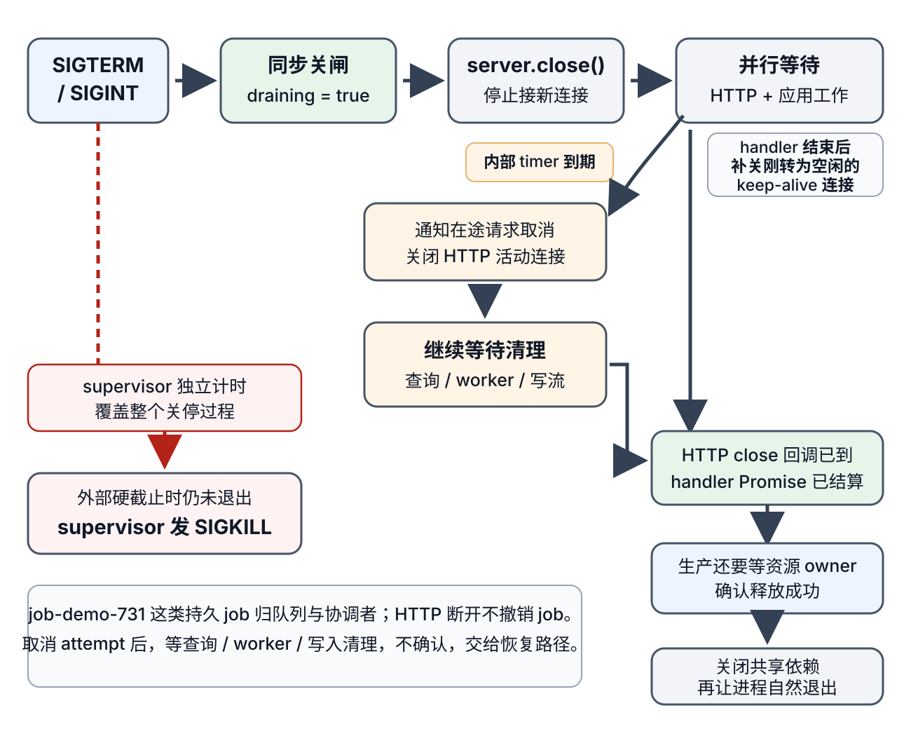

# 服务进程收到停止信号后，怎样排空工作并安全退出？

本章回答：部署平台给进程发来 `SIGTERM` 之后，进程应该按什么顺序拒绝新工作、等待在途工作、关闭各类资源，最后自己退出；哪些“已完成”的信号足以让它关掉某项依赖，哪些不够。读者手上有前几章的结论：取消只是请求，流的各个完成信号只证明一段，发布与取消由同一个协调者串行裁决。本章是主线二的最后一章。

## 收到 SIGTERM 时，手上有哪两类工作？

沿用主线二的案例。平台要滚动发布新版本，给报表服务的两个进程都发了 `SIGTERM`（部署系统要求进程终止时最常发的信号）：

- **API 进程**正把 `acct-17` 的三行 CSV 逐行流给一个 HTTP 响应。这是请求内的工作，所有者是这次请求：请求取消，流就随之结束，不留下需要以后查询的结果。
- **worker 进程**正在执行 `job-demo-731` 的 attempt 1。这个 job 已经被持久受理，所有者是持久的 job 记录和队列：最初发起导出的 HTTP 请求早已结束，客户端断开或这次停机都不能把它当作“已取消”。

两类工作的所有者不同，停机时的处理也不同：请求内的流可以在截止时间到时协作取消；持久作业则要么在预算内做完，要么不确认、交给恢复路径接手。下面先讲 API 进程，再讲 worker。

## 为什么先拒绝新工作，再关连接？

停止接活和关闭连接之间有时间差，顺序反了就会丢请求或接下做不完的工作。API 进程收到信号后按这个顺序做：

1. **同步关闸。** 在信号处理里同步设置 `draining = true`，再把 readiness (就绪状态) 标为 false。
2. **handler 自查。** 负载均衡器或编排器发现实例不就绪需要一段时间，这期间仍可能有新请求进来；所以 handler 在开始新报表或产生副作用之前，自己检查 `draining`。已建立的 keep-alive 连接上也可能来新请求，对它们直接回 `503` 并带 `Connection: close`。
3. **停止接受新连接。** 调用 `server.close()`。从 Node.js v19 起，它还会顺带关闭调用时处于空闲状态的连接，正在进行的响应可以继续写完。
4. **补关刚变空闲的连接。** 在途 handler 全部结束后，再调用一次 `server.closeIdleConnections()`，关掉那些在关停期间刚变空闲的 keep-alive 连接。不补这一次，HTTP 的关闭回调可能一直拖到截止时间。

## HTTP 关闭完成为什么不等于工作结束？

`server.close()` 的回调只说明它管理的普通 HTTP 连接都已收尾，不能证明已经启动的 handler、数据库游标、worker、文件写入或后台任务都已停下。反过来，到截止时间调用 `server.closeAllConnections()` 能强行关闭 HTTP(S) 连接，却不会取消 handler 正在等的查询或 CPU 工作。

所以进程要分别等两件事：HTTP 关闭完成，以及在途的应用工作全部结束。`closeAllConnections()` 要放在 `server.close()` 之后调用，以免关停期间又进来新连接。服务若还提供 WebSocket 或 HTTP/2，要由对应协议的 server 或 session 的管理方负责停止接收、关闭会话并确认结束，普通 HTTP Server 的回调管不到它们。

## 关停代码怎样组织？

下面的回放让 API 进程把 `acct-17` 的三行 CSV 流给当前客户端，用可取消的计时器代替数据库查询：默认每行间隔 100 ms，加 `--slow` 时每行 600 ms；内部截止时间 1 s。这些是为走到不同分支而选的教学参数。真实驱动若不支持取消，在途查询完成之前不能关闭它所用的连接池。

实现的要点有五个，代码在其后折叠：

- **跟踪完整的 handler Promise。** `inFlight` 登记的是每个 handler 的完整 Promise，包括流结束和 `finally` 里的清理；等待它们才知道应用工作是否结束。
- **客户端断开即取消本请求。** 响应的 `close` 事件在正文写完前触发时，中止这次请求的 `AbortController`。
- **截止时间先协作取消，再强关连接。** 到 1 s 时，先对所有在途请求发出取消，再调用 `closeAllConnections()`。
- **两项等待都结算后才清理依赖。** HTTP 关闭和在途 handler 都结算后，才关闭共享依赖；任一项失败，就保留依赖并记录失败退出码。只有本请求的 signal 已经触发时，才把 `AbortError` 或 `ERR_STREAM_PREMATURE_CLOSE` 当作预期的停止。
- **重复信号复用同一次关停。** `shutdown()` 返回同一个 `shutdownPromise`，第二个 `SIGTERM` 不会再启动一遍流程，也不会触发 Node 默认的信号退出。

> [!example]- 可运行的关停回放
> ~~~javascript
> // 保存为 shutdown-demo.cjs；node shutdown-demo.cjs [--slow]
> const http = require('node:http');
> const { Readable } = require('node:stream');
> const { pipeline } = require('node:stream/promises');
> const { setTimeout: sleep } = require('node:timers/promises');
>
> const rowDelayMs = process.argv.includes('--slow') ? 600 : 100;
> const rows = ['event-1,acct-17,12', 'event-2,acct-17,8', 'event-3,acct-17,-2'];
> const inFlight = new Set();
> const requestControllers = new Set();
> let draining = false;
> let shutdownPromise;
>
> function track(promise) {
>   inFlight.add(promise);
>   promise.then(() => inFlight.delete(promise), () => inFlight.delete(promise));
>   return promise;
> }
>
> async function waitForInFlight() {
>   while (inFlight.size > 0) await Promise.allSettled([...inFlight]);
> }
>
> async function* acct17Csv(signal) {
>   try {
>     yield 'id,accountId,amount\n';
>     for (const row of rows) {
>       await sleep(rowDelayMs, undefined, { signal });
>       signal.throwIfAborted();
>       yield row + '\n';
>     }
>   } finally {
>     console.log('report source cleanup complete');
>   }
> }
>
> async function handleRequest(request, response) {
>   if (draining) {
>     response.writeHead(503, { Connection: 'close' });
>     response.end('service draining');
>     return;
>   }
>   if (request.method !== 'GET' || request.url !== '/reports/acct-17.csv') {
>     response.writeHead(404, { Connection: 'close' });
>     response.end('not found');
>     return;
>   }
>
>   const controller = new AbortController();
>   requestControllers.add(controller);
>   const abortOnPrematureClose = () => {
>     if (!response.writableFinished) controller.abort(new Error('client disconnected'));
>   };
>   response.once('close', abortOnPrematureClose);
>
>   try {
>     response.writeHead(200, { 'Content-Type': 'text/csv; charset=utf-8' });
>     await pipeline(
>       Readable.from(acct17Csv(controller.signal), { objectMode: false }),
>       response,
>       { signal: controller.signal },
>     );
>   } catch (error) {
>     const cancelledClose = controller.signal.aborted && error.code === 'ERR_STREAM_PREMATURE_CLOSE';
>     if (error.name !== 'AbortError' && !cancelledClose) throw error;
>     console.log('report response stopped:', error.message);
>   } finally {
>     response.off('close', abortOnPrematureClose);
>     requestControllers.delete(controller);
>   }
> }
>
> const server = http.createServer((request, response) => {
>   track(handleRequest(request, response)).catch(error => {
>     console.error('request failed:', error);
>     process.exitCode = 1;
>     if (!response.destroyed) response.destroy(error);
>   });
> });
>
> function markReadiness(ready) {
>   console.log('ready:', ready);
> }
>
> async function closeOwnedResources() {
>   // 本回放没有外部资源；生产在这里逐个等待资源所有者确认释放。
>   console.log('resource cleanup complete');
> }
>
> const listening = new Promise((resolve, reject) => {
>   const onListening = () => { server.off('error', onError); resolve(); };
>   const onError = error => { server.off('listening', onListening); reject(error); };
>   server.once('listening', onListening);
>   server.once('error', onError);
> });
> listening.catch(error => {
>   console.error('server startup failed:', error);
>   process.exitCode = 1;
> });
> server.listen(0, '127.0.0.1', () => {
>   if (!draining) markReadiness(true);
>   console.log('listening:', server.address().port);
> });
>
> function shutdown(signal) {
>   if (shutdownPromise) return shutdownPromise;
>   draining = true;
>   markReadiness(false);
>   console.log('received:', signal);
>
>   const deadline = setTimeout(() => {
>     console.log('deadline: abort in-flight request streams and close HTTP connections');
>     for (const controller of requestControllers) controller.abort(new Error('shutdown deadline'));
>     server.closeAllConnections();
>   }, 1_000);
>
>   const serverClosed = listening.then(() => new Promise((resolve, reject) => {
>     server.close(error => (error ? reject(error) : resolve()));
>   }));
>
>   shutdownPromise = (async () => {
>     try {
>       const workResults = await Promise.allSettled([waitForInFlight()]);
>       server.closeIdleConnections();
>       const httpResults = await Promise.allSettled([serverClosed]);
>       const failures = [...workResults, ...httpResults].filter(r => r.status === 'rejected');
>       if (failures.length > 0) {
>         for (const failure of failures) console.error('shutdown wait failed:', failure.reason);
>         process.exitCode = 1;
>         return;                       // 无法确认 HTTP 或应用工作已结束：保留依赖
>       }
>       clearTimeout(deadline);
>       try {
>         await closeOwnedResources();
>       } catch (error) {
>         console.error('resource cleanup failed:', error);
>         process.exitCode = 1;
>       }
>     } finally {
>       clearTimeout(deadline);
>     }
>   })();
>   return shutdownPromise;
> }
>
> function onShutdown(signal) {
>   shutdown(signal).catch(error => {
>     console.error('shutdown failed:', error);
>     process.exitCode = 1;
>   });
> }
>
> process.on('SIGTERM', onShutdown);
> process.on('SIGINT', onShutdown);
> ~~~

在 Node.js v26.13.1 上，让一个客户端请求这份 CSV，在它收到第一个响应块（表头）后立即向服务进程发送 `SIGTERM`，结果如下：

- **默认模式（每行 100 ms）**：三行约 300 ms 发完，在 1 s 截止时间之前。客户端收到完整的 CSV；生成器清理、HTTP 关闭和资源清理都在截止时间前完成，退出码为 0。
- **`--slow` 模式（每行 600 ms）**：第一行在约 600 ms 发出，第二行要到约 1,200 ms，晚于截止时间。客户端只收到表头和 `event-1`；截止时间到时进程发出取消并强关连接，生成器执行 `finally`，管线以 `ERR_STREAM_PREMATURE_CLOSE` 结束，handler 随后全部结算，进程仍以 0 退出。
- **重复信号**：慢模式下间隔 150 ms 连发两次 `SIGTERM`，两次拿到的是同一个 `shutdownPromise`，流程只走一遍，退出码为 0。

去掉第 4 步那次补调的 `closeIdleConnections()` 做对照，正文仍完整送达，但 HTTP 的关闭回调一直拖到了 1 s 截止时间。

## 各类资源等到什么状态才能关闭？

“收到信号”“连接断了”和“任务结束”是三件不同的事。回放里两项等待都结算，只证明 HTTP 关闭和 handler 的 Promise 都已结算，而 `waitForInFlight()` 并不要求 handler 本身成功。生产环境还要等每项资源的所有者确认释放成功；清理失败或状态未知时，就不要关闭仍可能在用的那项依赖。各类资源要等到的状态如下：

| 资源或副作用 | 等到什么状态才能关闭或归还 | 不能据此推出什么 |
| --- | --- | --- |
| HTTP listener 与普通 HTTP(S) 连接 | `server.close()` 的回调；超时的强制路径可以不等回调，在 `server.close()` 之后调用 `closeAllConnections()` | 响应被强制关掉，不代表 handler 里的 JavaScript、查询或 worker 已结束；WebSocket、HTTP/2 由各自的 server 或 session 关闭并确认 |
| 请求内的 CSV 流 | `pipeline()` 结算：fulfilled 是正常结束，rejected 是失败或取消路径已收尾，本例生成器也已完成 `finally` | 已发出的部分字节不能撤回；也不证明客户端完整读取或保存了正文 |
| 数据库游标与连接 | 挂起的 `next()` 返回，或驱动确认已取消，然后关闭游标、释放连接 | Node 的 `AbortSignal` 不会自动变成任意驱动的取消请求 |
| worker 与批次 | 当前页的写出、尾块或停止确认已到达，压缩状态已清除，槽按协议归还一次 | 发出取消消息或关闭 HTTP socket，不等于 worker 已停 |
| 临时文件与发布 | 文件流结束并关闭；若已进入发布，以 `rename` 的真实成功或失败为准 | 写入被本地取消，不能证明文件或远端没有副作用 |
| 已持久受理的 job（如 `job-demo-731`） | 停止领取新 job；当前 attempt 在预算内完成，或清理后不确认、交给恢复路径 | API 客户端断开不撤销已持久受理的 job |

handler 的 Promise 结算，本身不是资源已释放的证明。

## 持久作业在关停中怎样处理？

worker 进程收到 `SIGTERM` 后，第一步是让队列消费者**停止领取**新 job，这对应 API 进程的“先关闸”。broker 已经预先推给 worker、还没开始处理的投递不算在途工作：显式退回 broker，或随连接关闭由 broker 重新入队。然后看手上的 attempt 1：

- **能在预算内做完，就做完。** 读完剩余页、压缩、写出、发布，由协调者按 attempt 条件提交结果，再确认这条消息。
- **做不完，就不确认。** 若策略要求到截止时间就取消，由同一个协调者依次停止拉取新页、取消查询并等它结束、等 worker 的停止或收尾确认以及已提交的写入完成，然后清理本 attempt 的临时目录。之后**不发 ACK**，进程退出。

主线四的结论是：未完成的 attempt 不发 ACK，消息会被重新投递；租约到期后，由恢复者按持久状态接管，旧 attempt 迟到的结果因 attempt 编号不匹配而写不进去。断开的连接不等于取消了 job，协调者不能把请求连接关闭误记为 job 已取消。领取、租约与栅栏见[怎样保证一个任务同一时刻只由一个 worker 推进？](../services/job-claims-leases-and-fencing.md)，ACK 的时机见[发布确认、消费者确认和业务完成各证明什么？](../services/queue-delivery-and-acknowledgement.md)。

停机时取消与发布仍可能竞争，裁决规则不变：attempt 还在 `running` 且取消先被接受，就不提交发布；已进入 `publishing` 并提交了 `rename`，就等真实结果，晚到的取消不能覆盖它（见[流一章的发布裁决](stream-backpressure-and-partial-output.md#中途失败留下什么：部分输出与发布裁决)）。若进程在提交 `rename` 后被强杀，结果未知；重启后要按 job ID、attempt 专属路径和持久状态核对，或幂等地重试，不能凭进程退出推断“肯定没发布”。客户端已经收到部分流响应，也不能回滚先前已提交的数据库或对象存储副作用。

## 内部截止时间与外部硬截止怎样分工？

进程内部的截止时间（回放里的 1 s）和外部 supervisor（部署管理器、编排器等负责强停进程的一方）的硬截止各管一段：

- 内部截止时间决定何时从“等待自然结束”转为“协作取消”。它必须早于 supervisor 的硬截止，中间留出按实测清理时长确定的余量，用来完成停止接单、协作取消、查询与 worker 清理、文件关闭和资源池关闭。
- 内部计时器依赖事件循环；同步代码长时间阻塞时，它也不能准时触发（见[事件循环一章](node-event-loop-and-microtasks.md#长同步回调对计时器做了什么？)）。
- supervisor 到硬截止后可以强杀进程（如 `SIGKILL`）。强杀不能替代持久任务的恢复，也不能替代对未知副作用的对账。

在支持这些信号的 POSIX 系统上，注册 `SIGTERM` 或 `SIGINT` 监听器会移除 Node 对相应信号的默认退出行为，应用要自己走完关停流程。几条实现规则：

- 不要在清理之前直接调用 `process.exit()`；用 `process.exitCode` 记录失败，让已关闭的 handle 自然结束进程。
- 截止时间计时器保持引用（不调用 `unref()`），避免事件循环空闲时进程在它触发之前就退出。
- 不响应取消的请求仍持有数据库连接时，等待会继续；不能为了按时退出而提前关闭仍在使用的依赖，宁可交给外部硬截止。

PM2、Kubernetes、ECS 各自发什么信号、默认等多久，以及平台怎样先摘流量再停进程，见[服务该跑在哪种运行时上，平台怎样启动、探测和停止它？](../practice/production-runtime.md)。

## 本主线的产出：一个能被安全停止的进程

主线二到此得到一个资源有界、能被安全停止的进程：执行位置按 I/O 和 CPU 分开，每个池、槽、队列和缓冲都有上限；共享状态各有一种所有权规则；背压把“慢下来”传回源头；取消被当作请求，每项资源等到可证明的完成状态才释放；停机时先拒绝新工作，再排空，持久作业做不完就不确认，交给恢复路径。

这些上限都按“每进程”计数，跨进程、跨副本时要相乘再核对：连接池的总连接数、worker 的总执行槽。而跨副本的共享状态和持久完成，进程内的锁和协调者都管不到，要交给数据库。主线三从这里接手：两个请求同时抢最后一件库存时，怎样把条件附着在写语句上，只预留一次，见[两个请求争夺最后一件库存时，怎样保证只预留一次？](../data/conditional-writes-and-idempotent-records.md)。

> [!info]- 来源
> - `server.close()` 停止接受新连接，并自 Node.js v19 起关闭调用时的空闲连接；`server.closeIdleConnections()`：[Node.js v26.13.1, HTTP, `server.close()`](https://nodejs.org/download/release/v26.13.1/docs/api/http.html#serverclosecallback)、[`server.closeIdleConnections()`](https://nodejs.org/download/release/v26.13.1/docs/api/http.html#servercloseidleconnections)，2026-11-12 核对。
> - `server.closeAllConnections()` 关闭现有 HTTP(S) 连接，应在 `server.close()` 之后调用；不负责 WebSocket 等其他协议，HTTP/2 由自己的 session 收尾：[Node.js v26.13.1, HTTP, `server.closeAllConnections()`](https://nodejs.org/download/release/v26.13.1/docs/api/http.html#servercloseallconnections)，2026-11-12 核对。
> - 注册 `SIGTERM` / `SIGINT` 监听器会移除默认处理：[Node.js v26.13.1, Process, Signal events](https://nodejs.org/download/release/v26.13.1/docs/api/process.html#signal-events)，2026-11-12 核对。
> - 活动的 `Timeout` 默认保持事件循环运行，`unref()` 后进程可能先退出：[Node.js v26.13.1, Timers, `timeout.unref()`](https://nodejs.org/download/release/v26.13.1/docs/api/timers.html#timeoutunref)，2026-11-12 核对。
> - 带 `AbortSignal` 的 `pipeline()` 销毁管线流并以 `AbortError` 结束，只有接收该 signal 的操作才会协作取消：[Node.js v26.13.1, Stream, Promises API](https://nodejs.org/download/release/v26.13.1/docs/api/stream.html#streams-promises-api)，2026-11-12 核对。
> - 关停回放：默认、`--slow`、重复信号与去掉补调 `closeIdleConnections()` 的对照，于 Node.js v26.13.0 与 v26.13.1 运行，结果一致。
