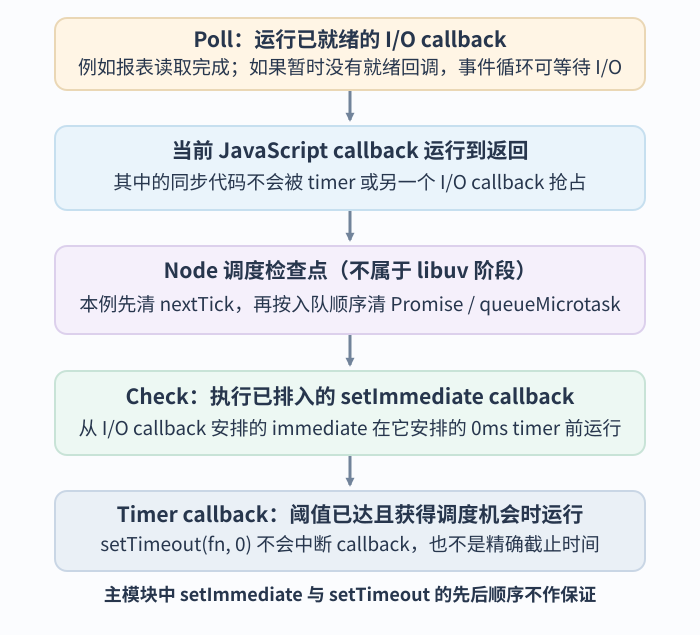
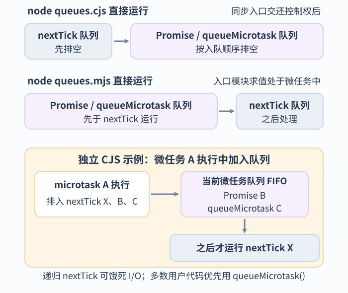

# Node.js 的事件循环怎样安排计时器、I/O 回调和微任务？

本章回答：Node.js 只有一条 JavaScript 主线程，它怎样在计时器、I/O 回调、`setImmediate`、`process.nextTick` 和 Promise 回调之间决定下一个运行谁；哪些顺序可以依赖，哪些只是某次运行的偶然结果。读者手上有前两章的结论：异步 I/O 让等待不占线程，事件循环是一个单写者循环，回调之间不会交错。

沿用主线二的案例：`job-demo-731` 所在 worker 进程的主线程上，异步生成器向数据库要一页数据，等待期间线程去处理别的回调；这一页返回时，驱动的 I/O 回调被安排回主线程。为了能离线运行，下面的演示用 `fs.readFile` 读取脚本自身来代表“一页数据就绪”，用 `node` 直接运行的脚本（CLI 主模块）顶层代码代表发起读取的那段同步代码。浏览器的事件循环有自己的 task 与渲染规则，见前端的[浏览器事件循环](../../frontend/browser/event-loop-tasks-and-rendering.md)，不能把下面的阶段图套过去。

## 一条线程怎样同时照看许多 I/O？

主 JavaScript 线程一次只运行一个同步调用栈。代码调用异步 I/O API 时，只是登记“完成后运行哪个回调”，然后立即返回；数据就绪后，Node 把对应的回调安排回这条线程，等当前调用栈清空后再运行它。底层 I/O 由驱动、操作系统和 libuv（Node 使用的跨平台 I/O 库）完成；某个数据库驱动具体怎样传输数据，不能仅凭它返回 Promise 推断。

因此有两个直接后果：一个回调开始运行后，计时器和其他 I/O 回调都不能打断它；回调之间谁先谁后，由事件循环的阶段和检查点决定。

## 事件循环分哪几个阶段？

libuv 的事件循环反复经过下面几个阶段，每个阶段处理一类回调。表只说明各阶段的职责，不是每一轮的精确时间线：

| 阶段 | 职责 |
| --- | --- |
| timers (计时器) | 运行已经越过时间门槛的 `setTimeout` / `setInterval` 回调；越过门槛后仍要等到调度机会 |
| pending callbacks (待处理回调) | 运行少数被推迟到下一轮的系统回调 |
| idle、prepare | libuv 内部阶段，不运行一般应用代码 |
| poll (轮询) | 处理大多数 I/O 回调；没有可运行的回调时，可能在这里等待新事件 |
| check (检查) | 运行 `setImmediate` 排入的回调 |
| close callbacks (关闭回调) | 处理部分 handle 的关闭事件 |

计时器的毫秒数是门槛，不是精确时钟。Node 把 `setTimeout(fn, 0)` 当作 1 ms 门槛处理；计时器不会切断正在运行的回调，也不保证在指定的那一毫秒运行。

> [!info] 版本差异：到期计时器在哪里检查
> 从 libuv 1.45.0 起（随 Node.js v20.3.0 引入），默认循环模式在 poll 之后检查到期计时器；为兼容旧行为，进入循环前仍有一次预检查。更早的版本在每轮 poll 之前也会检查。本章的演示在 Node.js v26.13.1 上运行。

## nextTick 和微任务在什么时候运行？

`process.nextTick()` 的回调进入 Node 管理的 nextTick 队列；Promise 的 reaction（`then` 等处理回调）和 `queueMicrotask()` 共用 JavaScript 的 microtask (微任务) 队列。这两个队列不是 libuv 阶段，它们在**调度检查点**被清空。

检查点出现在：Node 派发的一个 JavaScript 回调返回、Node 重新拿回控制权的时候。这时 Node 先清空 nextTick 队列，再清空微任务队列，然后才继续调度下一个回调。检查点不只在阶段之间出现，同一阶段的两个回调之间也有；而普通 JavaScript 函数 `return` 给它的调用方，仍在同一个调用栈内，不触发检查点。

同一个 check 阶段里排了两个 `setImmediate`：

~~~javascript
setImmediate(() => {
  console.log('immediate 1');
  process.nextTick(() => console.log('nextTick'));
  queueMicrotask(() => console.log('microtask'));
});
setImmediate(() => console.log('immediate 2'));
~~~

输出是 `immediate 1 → nextTick → microtask → immediate 2`：第一个回调返回后，Node 先清空两个队列，才运行第二个 immediate。

## setImmediate 和 0 ms 计时器谁先？

把“一页数据就绪”的 I/O 回调和这些队列放在一起看。下面的脚本在顶层和 I/O 回调里各排一组工作：

~~~javascript
// 保存为 io-demo.cjs；node io-demo.cjs
const fs = require('node:fs');
console.log('main module starts');
process.nextTick(() => console.log('nextTick (top level)'));
Promise.resolve().then(() => console.log('Promise reaction (top level)'));
setTimeout(() => console.log('timeout (top level)'), 0);
setImmediate(() => console.log('immediate (top level)'));

fs.readFile(__filename, error => {
  if (error) return console.log('read failed');
  console.log('I/O callback: page ready');
  process.nextTick(() => console.log('nextTick from I/O'));
  Promise.resolve().then(() => console.log('Promise from I/O'));
  queueMicrotask(() => console.log('queueMicrotask from I/O'));
  setTimeout(() => console.log('timer from I/O'), 0);
  setImmediate(() => console.log('immediate from I/O'));
});
~~~

可以依赖的只有下面这些局部顺序：

- 顶层同步代码跑完后，先输出 `nextTick (top level)`，再输出 `Promise reaction (top level)`。
- I/O 回调返回后，先清空它排入的 nextTick，再按入队顺序清空 Promise 和 `queueMicrotask`。
- 同一个 I/O 回调排入的 immediate，一定先于它排入的 0 ms 计时器：I/O 回调在 poll 阶段运行，同一轮接下来就是 check 阶段，计时器要等后面的 timers 检查。

其余顺序都不保证。CLI 主模块顶层的 timeout 与 immediate 谁先，取决于进入循环时是否已经过了 1 ms 门槛；文件读取何时完成，又决定它们排在 I/O 回调之前还是之后。同一脚本多次运行，`timeout (top level)` 有时排在 I/O 回调之前、有时排在 `immediate (top level)` 之后；`immediate (top level)` 也可能出现在 I/O 回调之前或之后。一次运行记录只是一种可能的交错，不是固定序列。

图只放大 I/O 回调 → 检查点 → check → timer 这一段交接，不表示所有阶段都只走这条路径。

## 长同步回调对计时器做了什么？

计时器只负责“到点后安排一段代码”。如果事件循环正在运行一个长同步回调，计时器只能等它结束：

~~~javascript
const t0 = Date.now();
setTimeout(() => console.log('100 ms timer ran at', Date.now() - t0, 'ms'), 100);
setTimeout(() => {
  const end = Date.now() + 120;
  while (Date.now() < end) {}          // 120 ms 的同步计算
  console.log('sync callback finished at', Date.now() - t0, 'ms');
}, 0);
~~~

一次运行输出 `sync callback finished at 121 ms`，随后才是 `100 ms timer ran at 122 ms`：100 ms 的门槛早已越过，计时器回调仍要等 120 ms 的同步回调跑完。

这说明了计时器不能做什么：它不会中断回调，也不会取消尚未完成的数据库查询。判断请求是否超时，要用明确的 deadline (截止时间)；要取消底层操作，必须调用驱动支持的取消机制。“取消只是请求”的跨运行时原则见[主线二首章](processes-threads-and-async-io.md#取消能证明什么？)。

## nextTick 与 Promise 微任务谁先？

“nextTick 先于 Promise”只在特定执行上下文里成立。在直接运行的 CommonJS (CJS) 主模块里：

~~~javascript
// queues.cjs
const { nextTick } = require('node:process');
Promise.resolve().then(() => console.log('promise'));
queueMicrotask(() => console.log('microtask'));
nextTick(() => console.log('nextTick'));
~~~

输出 `nextTick → promise → microtask`：同步入口返回后的检查点先清空 nextTick，再清空微任务；Promise 与 `queueMicrotask` 在同一个先进先出的队列里，按登记顺序运行。

如果此刻**正在处理微任务**，顺序就反过来了。下面的微任务 A 在运行时又排入了 nextTick X、Promise B 和微任务 C：

~~~javascript
Promise.resolve().then(() => {
  console.log('microtask A');
  process.nextTick(() => console.log('nextTick X'));
  Promise.resolve().then(() => console.log('microtask B'));
  queueMicrotask(() => console.log('queueMicrotask C'));
});
~~~

输出 `microtask A → microtask B → queueMicrotask C → nextTick X`：当前微任务队列要先清空，Node 才回头处理新排入的 nextTick。

### 进阶：ESM 入口与 `require(esm)`

把 `queues.cjs` 原样改写成 ES module (ESM)：

~~~javascript
// queues.mjs
import { nextTick } from 'node:process';
Promise.resolve().then(() => console.log('promise'));
queueMicrotask(() => console.log('microtask'));
nextTick(() => console.log('nextTick'));
~~~

直接运行 `node queues.mjs` 输出 `promise → microtask → nextTick`。原因与上面的嵌套例子相同：ESM 入口模块是在微任务处理过程中求值的，模块代码排入的微任务先于 nextTick。

但扩展名并不独自决定执行上下文。在 CJS 主模块里同步加载同一个文件：

~~~javascript
// require-esm-context.cjs，与 queues.mjs 放在同一目录
require('./queues.mjs');
console.log('CJS require returned');
~~~

输出 `CJS require returned → nextTick → promise → microtask`：这次 `queues.mjs` 在 CJS 的同步调用栈里求值，回到了 CJS 的顺序。同步 `require(esm)` 只适用于不含顶层 `await` 的 ESM 依赖图。

## 还该用 process.nextTick 吗？

Node.js v26 把 `process.nextTick()` 标为 Legacy (历史遗留)，建议多数用户代码改用 `queueMicrotask()`。原因有两个：

- `queueMicrotask()` 在浏览器等其他 JavaScript 环境里行为一致。
- 递归调用 `nextTick` 会让 Node 一直忙于清空 nextTick 队列，迟迟进不了 poll 阶段，I/O 回调因此无法推进。

旧代码里仍会见到 nextTick 的两种用法：工厂函数先返回一个事件发射器，再在当前调用栈退栈后发出 `ready`，让调用方来得及注册监听器；回调式 API 用它延后交付同步发现的参数错误。下面是第一种：

~~~javascript
const { EventEmitter } = require('node:events');

function createEmitter() {
  const emitter = new EventEmitter();
  process.nextTick(() => emitter.emit('ready'));
  return emitter;
}

createEmitter().on('ready', () => console.log('ready'));
~~~

旧库可能依赖 nextTick 特有的顺序或额外参数，迁移时要先确认这些调用契约。新代码若只想让一段代码在当前同步代码之后立刻运行，用 `queueMicrotask()`。

## 下一步：哪些工作不在这条线程上

本章的产出是一组可依赖的顺序规则：回调之间不会互相打断；每个回调返回后先清 nextTick 再清微任务（正在处理微任务时例外）；同一个 I/O 回调排入的 immediate 先于 0 ms 计时器；其余跨阶段的先后不作保证；计时器不取消任何操作。这条线程只负责运行 JavaScript 回调，真正的文件读写、压缩和 DNS 查询可能发生在别处。下一章回答 [Node.js 的工作实际在哪个线程或进程上执行](node-threads-processes-and-workers.md)。

> [!info]- 来源
> - 阶段职责、poll 对 I/O 与计时器的调度、CLI 主模块与 I/O 回调中 timer/immediate 的顺序、nextTick 检查点：[Node.js Learn, The Node.js Event Loop](https://nodejs.org/learn/asynchronous-work/event-loop-timers-and-nexttick)，2026-11-12 核对。
> - libuv 1.45.0 改变计时器检查位置，并由 Node.js v20.3.0 引入：[Node.js v20.3.0 release notes](https://nodejs.org/en/blog/release/v20.3.0)；同上 Learn 文档，2026-11-12 核对。
> - libuv 循环阶段，网络 I/O 回调在循环线程上运行：[libuv Design overview, The I/O loop](https://docs.libuv.org/en/v1.x/design.html#the-i-o-loop)，2026-11-12 核对。
> - `setTimeout` 小于 1 的 delay 按 1 处理，计时器不保证准点：[Node.js v26.13.0, Timers, `setTimeout()`](https://nodejs.org/download/release/v26.13.0/docs/api/timers.html#settimeoutcallback-delay-args)，2026-11-12 核对。
> - `process.nextTick()` 的 Legacy 状态、额外参数与递归饿死 I/O；CJS 与 ESM 的队列顺序：[Node.js v26.13.0, Process, `process.nextTick()`](https://nodejs.org/download/release/v26.13.0/docs/api/process.html#processnexttickcallback-args)、[When to use queueMicrotask vs process.nextTick](https://nodejs.org/download/release/v26.13.0/docs/api/process.html#when-to-use-queuemicrotask-vs-processnexttick)，2026-11-12 核对。
> - 同步 `require()` 加载 ESM 的条件（无顶层 `await`）：[Node.js v26.13.0, Modules, Loading ECMAScript modules using require()](https://nodejs.org/download/release/v26.13.0/docs/api/modules.html#loading-ecmascript-modules-using-require)，2026-11-12 核对。
> - 本章各段代码的输出：于 Node.js v26.13.0 与 v26.13.1 运行；`io-demo.cjs` 顶层 timeout 与 immediate 相对 I/O 回调的位置在不同运行间变化，其余局部顺序一致。
