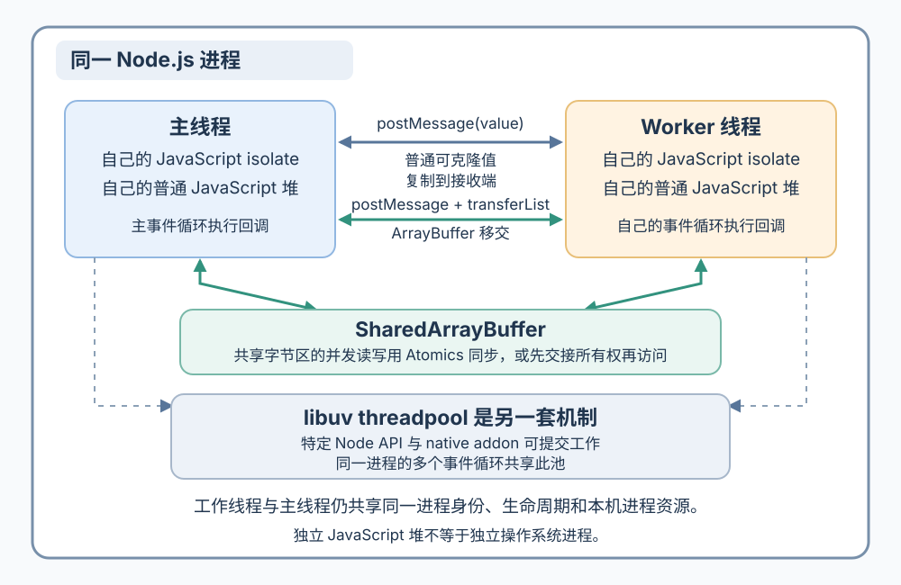
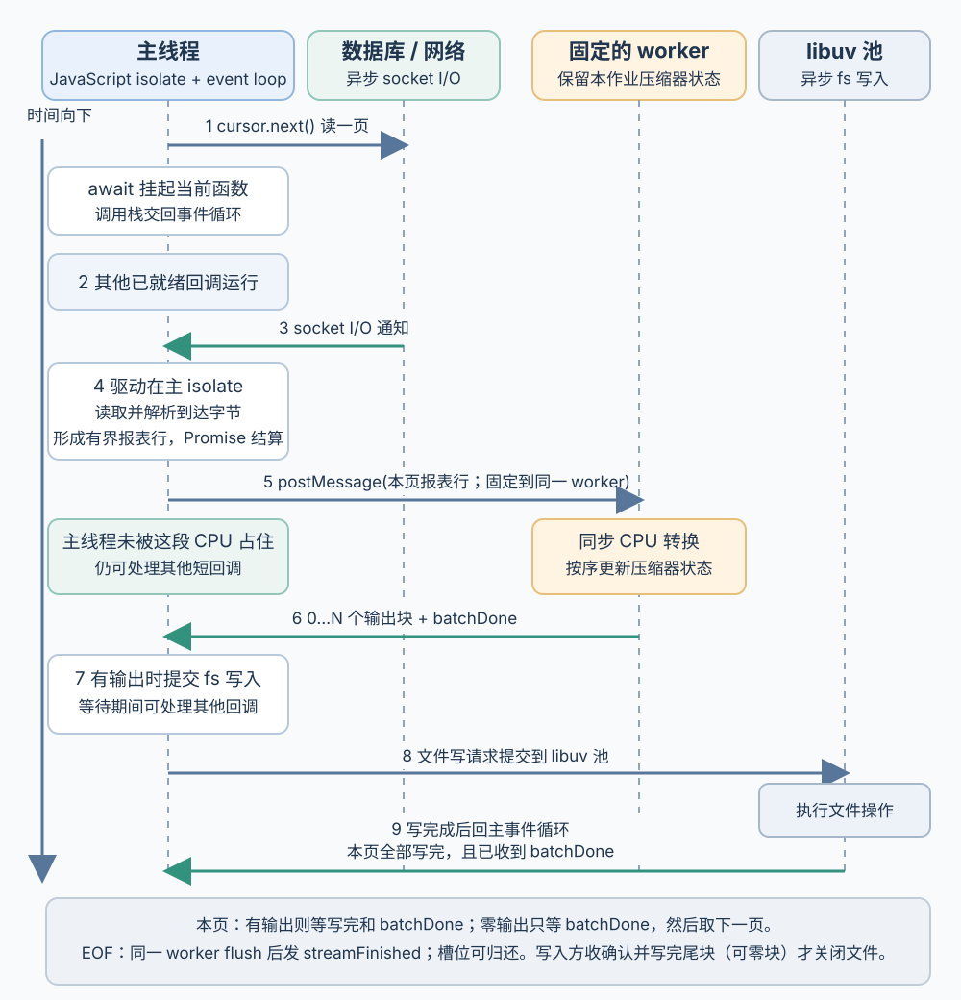
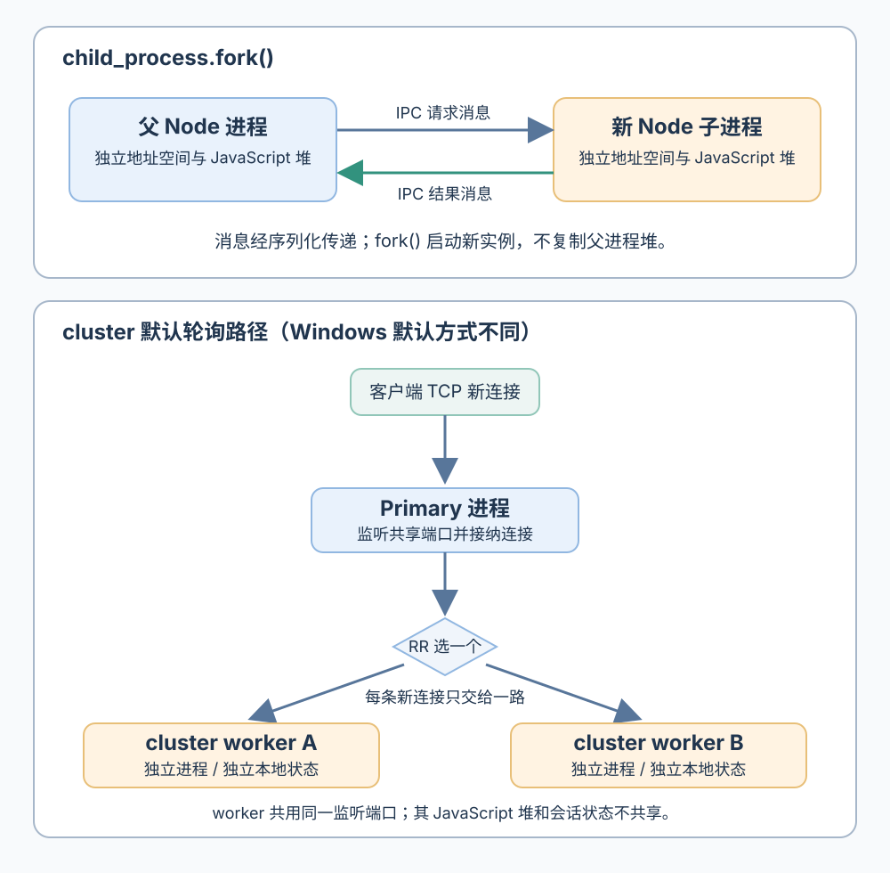

# Node.js 的工作实际在哪个线程或进程上执行？

本章回答：一个 Node.js 服务里，网络等待、文件读写、压缩、普通 JavaScript 计算分别在哪个线程或进程上执行；把 CPU 工作交给 `worker_threads`、子进程或 cluster 时，数据怎样传过去，取消和容量又怎样计算。读者手上有[上一章](node-event-loop-and-microtasks.md)的事件循环模型：一条主线程按阶段和检查点运行回调。

沿用主线二的案例。`job-demo-731` 的 attempt 1 逐页读取报表 42 的数据（每页最多 100 行、最多 12 页），压缩后写入临时文件。本章先说明默认方案（内置 gzip）里各步在哪里执行，再展开对照方案：自建的同步增量压缩器放进 `worker_threads` 后，主线程和 worker 之间要遵守怎样的协议。

## await 之后的代码在哪里继续？

Node.js 进程里每个 JavaScript isolate (隔离环境) 都有自己的 JavaScript 执行线程和事件循环。主线程是一个 isolate，每个 `worker_threads` 又是一个。

`await` 不会把工作搬到别的线程。被等待的 Promise 结算后，`async` 函数的剩余部分作为 JavaScript 工作回到发起它的那个 isolate 继续运行。网络读取失败时，驱动的 Promise 被拒绝，异常也在同一个 isolate 里处理。Node 不会自动重试，调用方不再等待时也不会自动取消底层操作；连接能否取消、怎样释放，由驱动和应用的契约决定（原则见[主线二首章的取消一节](processes-threads-and-async-io.md#取消能证明什么？)）。

## 各类 API 实际在哪里执行？

工作在哪里执行，要看调用的是哪个 API。下表合并了常见的几类路径（Node.js v26.13.0）：

| 工作或 API | 等待或计算发生在哪里 | 回调在哪里继续 | 占用什么、要注意什么 |
| --- | --- | --- | --- |
| 网络 socket、本例假设的异步数据库驱动 | 操作系统的异步 socket 机制（就绪通知或完成通知，取决于平台）；数据传输期间主调用栈不必等待 | 发起操作的 isolate 的事件循环 | 不占线程，但在途请求占连接和缓冲区；驱动若另有实现，以驱动文档为准 |
| `node:fs` 回调式与 Promise 式 API（`fs.FSWatcher` 除外）、`dns.lookup()`、`crypto.pbkdf2()` / `scrypt()` / 回调式 `randomBytes()` 等、异步 `node:zlib` | libuv threadpool (线程池) | 提交任务的那个事件循环 | 任务全程占一个池线程，阻塞在系统调用里的时间也算；排队任务要等空闲线程；长任务会拖慢同池的其他 API |
| 普通同步 JavaScript | 当前 isolate 的线程；Node 不会因为它耗 CPU 就自动搬走 | 运行完之前，同一事件循环不能运行别的回调 | 长计算直接推迟所有回调和计时器 |
| `node:worker_threads` | 应用创建的工作线程，运行 JavaScript，可与主线程并行 | 结果作为消息，在接收方的事件循环里处理 | 每个 worker 有自己的 isolate 和堆；线程数、排队任务和输入字节都要有上限 |
| `child_process.fork()` | 新的 Node.js 进程 | 父进程通过 IPC 消息收到结果 | 启动、内存和序列化成本；地址空间独立，但不是权限沙箱 |
| `node:cluster` | 多个 Node.js 进程共同对外提供服务 | 各进程各自的事件循环 | 每个进程有自己的堆、缓存和连接池；按连接分配，不按请求 |

libuv threadpool 和应用创建的 `worker_threads` 不是同一个池。Node.js v26.13.0 自带 libuv 1.52.1，这个线程池由同一进程内的所有事件循环共享，只执行特定 Node API 和 native addon 提交的工作，不执行任意 JavaScript。DNS 是常见的分界：`dns.lookup()` 用这个池，`dns.resolve()` 直接发异步 DNS 网络请求，不占池。反过来，`worker_threads` 也不是处理网络等待的捷径，网络等待用内置的异步 API 更合适。

按这张表，`job-demo-731` 的默认方案是：等数据库返回在主线程的事件循环上；收到的字节在主 isolate 里由驱动解析成报表行；内置 gzip 压缩和临时文件写入都在 libuv threadpool 里执行，完成回调回到主事件循环。

## 该把计算放在哪种执行资源上？

| 选择 | 适合什么工作 | 成本与条件 |
| --- | --- | --- |
| 主事件循环上的异步 API | 已有合适异步 API 的数据库、网络等 I/O 等待 | 让出调用栈不代表在途操作和缓冲区消失 |
| libuv threadpool 里的 API | Node 明确放进这个池的文件、DNS、加密和压缩操作 | 共享有限的池线程；它不是能任意提交 JavaScript 的应用工作池 |
| `worker_threads` | CPU 密集型 JavaScript，且值得承担消息传递和线程管理成本 | 同进程里的另一条 JavaScript 线程；要限制线程数、排队任务和输入字节 |
| `child_process` | 需要独立进程生命周期、地址空间或更强故障边界的工作 | 启动、内存和 IPC 成本；进程边界本身不限制权限 |
| `cluster` | 多个 Node 进程共同提供 HTTP/TCP 服务 | 进程间不共享会话和缓存；吞吐不保证随进程数线性增长 |

对照方案换掉了内置 gzip：自建的同步增量压缩器每处理一页都要占用超过主线程响应预算的 CPU 时间，所以放进 `worker_threads`。如果改回内置的异步 zlib，计算就回到 libuv threadpool，占用的是另一种共享资源。

多个导出任务同时到达时，不能每来一个就新建一个 worker。应使用大小固定的 worker pool (工作线程池) 加有界等待队列；队列满时，由服务明确选择拒绝、等待，还是向上游施加背压。有界等待队列可以用环形缓冲区或头下标实现，避免 `shift()` 逐个搬移元素的成本，见[待处理的工作该用队列还是栈，各怎样实现？](../computation/queues-stacks-and-empty-states.md)；整条异步管线各段的容量怎样估算，见[一条异步管线能接多少工作，超出时在哪里拒绝？](../services/capacity-admission-and-backpressure.md)。

## 主线程和 worker 之间怎样传数据？

worker 有自己的 isolate 和普通堆，主线程里的普通对象不会因为同处一个地址空间就对它可见；但两者仍属同一个操作系统进程，共享进程的生命周期和身份。双方用 `postMessage()` 传数据，有三种方式：

- 普通可克隆值经 structured clone (结构化克隆) 复制一份。发送 `Buffer` 时，接收方得到的是 `Uint8Array`，需要 Buffer API 时在接收侧再转换。
- 把可转移的 `ArrayBuffer` 放进 transfer list (转移列表)，就把这块内存的所有权交给对方，发送方原来的视图随即不可用。转移的内存必须由本次任务独占，例如单独分配的 `new ArrayBuffer(n)`；不要转移池化 `Buffer`（Node 从共享内存池中切出的小 Buffer）的 `.buffer`，它通常不能转移，克隆时还可能把整个池一起复制。
- 只有 `SharedArrayBuffer` 让双方访问同一块字节。可能同时访问时，要用 `Atomics` 同步，或用消息明确交接访问权（见[共享状态一章的所有权规则](shared-state-races-and-deadlocks.md#共享不变量要选哪种所有权规则？)）。

无论复制还是转移，消息数量、数据量和等待队列都要受控。`job-demo-731` 每次发给 worker 的是一页报表行，最多 100 行，大小有界。

## 有状态的压缩怎样逐页交给 worker？

自建压缩器有内部状态，同一个 job 的各页必须按顺序交给同一个 worker。主线程上推进 job 状态的代码称为协调者；它与 worker 遵守下面的协议，使在途输入最多只有一页：

1. **占槽。** job 从有界等待队列取出、分到一个 worker 槽后，就固定在这条线程上；还在排队的 job 不占槽。等待读库或写文件时 worker 可能空闲，但这个运行中的 job 仍占着槽。
2. **逐页处理。** 协调者读到一页后发给 worker。worker 同步压缩这一页，按顺序回传零个或多个压缩块，再单独发一条 `batchDone`。完成确认与块数无关，所以一页没有产出字节也能正常结束。
3. **写完再取下一页。** 协调者按顺序提交这一页输出的异步文件写入；只有写入全部完成**并且**收到 `batchDone`，才请求下一页。这比普通的流背压更严格：流的 `write()` 返回 `true` 只说明可以继续提交，返回 `false` 才需要等 `drain`（流一章细讲），而这里要求本页写入已经完成。写入完成也不等于数据已持久落盘。
4. **收尾与归还槽。** 游标读到末尾后，协调者通知同一个 worker flush 压缩流。worker 发完全部尾块、清除这个 job 的压缩状态后，发出 `streamFinished`，表示它不会再产出字节；协调者收到后才把槽归还线程池。写入方确认所有尾块（也可能没有尾块）都已写完，才关闭临时文件。

图是一种可能的交错，不按时间比例。读图时注意三点：socket 通知只说明字节到了，驱动还要在主 isolate 里解析出一页报表行，`cursor.next()` 的 Promise 才结算；worker 压缩或 libuv 池写文件期间，主事件循环仍可运行其他回调；worker 的消息和写入的完成回调，都要等对应的事件循环轮到它们才执行。临时文件写完后怎样发布、发布与取消同时到达时谁说了算，见[流一章的发布裁决](stream-backpressure-and-partial-output.md#中途失败留下什么：部分输出与发布裁决)。

## worker 为什么收不到取消消息？

取消一个正在压缩的 job 时，协调者会给 worker 发一条 `stop` 消息。但 worker 正在执行同步 JavaScript 时，它自己的消息回调也要等当前回调返回才能运行。如果 worker 在一次同步调用里连续处理所有片段，只在片段之间检查一个“由消息回调设置的变量”，它永远看不到新值，因为消息回调根本没有机会运行。

让取消生效有两种办法：

- 在片段之间把控制权交还事件循环，例如 `await setImmediate()`（来自 `node:timers/promises`），让消息回调有机会运行。
- 协调者对一块 `SharedArrayBuffer` 执行 `Atomics.store()` 设置停止标志，worker 在片段之间用 `Atomics.load()` 检查。这种方式不需要让出事件循环。

> [!example]- 可运行的对照：三种 worker 停止方式
> 每段约 20 ms 的同步计算代表一片压缩工作，主线程在 50 ms 时同时发出 `stop` 消息并设置共享标志。
>
> ~~~javascript
> // 保存为 worker-stop.cjs；node worker-stop.cjs none|yield|atomics
> const { Worker, isMainThread, parentPort, workerData } = require('node:worker_threads');
> const { setImmediate: yieldToLoop } = require('node:timers/promises');
>
> function compressSegment() {
>   const end = Date.now() + 20;
>   while (Date.now() < end) {}
> }
>
> if (isMainThread) {
>   const stop = new Int32Array(new SharedArrayBuffer(4));
>   const worker = new Worker(__filename, { workerData: { mode: process.argv[2], stop } });
>   worker.on('message', message => { console.log(message); worker.terminate(); });
>   setTimeout(() => {
>     worker.postMessage('stop');
>     Atomics.store(stop, 0, 1);
>   }, 50);
> } else {
>   const { mode, stop } = workerData;
>   let stopRequested = false;
>   parentPort.on('message', message => { if (message === 'stop') stopRequested = true; });
>   (async () => {
>     for (let segment = 1; segment <= 20; segment++) {
>       compressSegment();
>       if (mode === 'atomics' && Atomics.load(stop, 0) === 1) {
>         return parentPort.postMessage(`stopped after segment ${segment} (Atomics)`);
>       }
>       if (mode === 'yield') await yieldToLoop();
>       if (stopRequested) return parentPort.postMessage(`stopped after segment ${segment} (message)`);
>     }
>     parentPort.postMessage('finished all 20 segments');
>   })();
> }
> ~~~
>
> 在 Node.js v26.13.1 上，`none` 模式跑完全部 20 段才结束，消息回调始终没有运行；`yield` 和 `atomics` 模式都在几段之后停下。具体段数取决于 worker 启动耗时。

无论哪种办法，worker 都只能在当前片段结束后响应，所以“停止确认”要在片段结束、压缩状态清理之后才发出，协调者收到确认才归还槽。

worker 的故障边界也有限：worker 抛出未捕获的 JavaScript 错误时，父线程可以通过 `Worker` 的 `error` 事件处理；但 worker 不是独立进程，native 代码崩溃会波及整个进程。

## 子进程给了哪些隔离？

需要更强的隔离时，可以把计算交给子进程。`child_process.fork()` 启动一个新的 Node.js 进程并建立 IPC (进程间通信) 通道。它不是 POSIX 的 `fork(2)`，不会复制正在运行的父进程内存。`send()` 发出的消息先序列化，再在另一侧解析，默认格式是 JSON；传较大的数据批次时，序列化和复制都有成本。也可以显式传递受支持的 socket 或其他 handle (句柄)。

子进程有独立的地址空间，但如果不另行设置运行身份和操作系统策略，父进程用户能访问的资源它照样能访问；进程边界也不会自动隔开磁盘、网络、CPU 配额或数据库连接额度。

> [!example]- 可运行的最小示例：父子进程交换一条计算请求
> ~~~javascript
> // 保存为 report-child.cjs；node report-child.cjs
> const { fork } = require('node:child_process');
>
> function fib(n) {
>   let a = 0;
>   let b = 1;
>   for (let i = 0; i < n; i++) [a, b] = [b, a + b];
>   return a;
> }
>
> if (process.argv[2] === 'worker') {
>   process.on('message', ({ n }) => process.send({ result: fib(n) }));
> } else {
>   const child = fork(__filename, ['worker']);
>   child.once('error', error => { console.error(error); process.exitCode = 1; });
>   child.once('message', ({ result }) => { console.log(result); child.disconnect(); });
>   child.send({ n: 10 });
> }
> ~~~
>
> 输出 `55`。它只展示请求与结果消息的往返，计算量太小，不能说明进程能加速；也没有排队上限、重复任务保护或进程监管者的重启策略。

## cluster 怎样分配连接，容量怎样按进程相乘？

前面两种方式是把一段计算交出去；`cluster` 解决另一个问题：让多个 Node 进程一起对外提供服务。cluster 的 worker 是子进程，不是 `worker_threads`。

除 Windows 外，cluster 默认采用 round-robin (轮询)：primary (主进程) 在监听端口上接收新的 TCP 连接，再依次交给一个 worker；Windows 默认由各 worker 自行接受连接。分配单位是连接，不是 HTTP 请求：同一条持久连接上的多个请求都落到同一个进程。登录会话和缓存不会在 worker 之间共享，需要共享时用进程外存储或明确的通信协议。

~~~javascript
// 保存为 cluster-report.cjs；node cluster-report.cjs
const cluster = require('node:cluster');
const http = require('node:http');
const { availableParallelism } = require('node:os');

const configuredLimit = 2;    // 教学配置
const workerCount = Math.min(availableParallelism(), configuredLimit);

if (cluster.isPrimary) {
  for (let i = 0; i < workerCount; i++) cluster.fork();
  cluster.on('exit', (worker, code, signal) => {
    console.error('worker exited', worker.id, code, signal);
  });
} else {
  http.createServer((request, response) => {
    response.end(`report API served by process ${process.pid}`);
  }).listen(8000);
}
~~~

示例中 worker 退出时只记日志：Node 不会自动补起退出的进程，也不替你决定重启退避策略。Node 文档建议用 `os.availableParallelism()` 而不是 `os.cpus().length` 估算可用并行度；实际进程数还要按容器 CPU 配额、请求时延和每个进程的连接池等总资源决定。每个进程有独立的 JavaScript 堆、缓存和池，进程越多内存需求通常越高，不过操作系统可能让进程共享只读内存页，所以不一定严格成倍增长。

容量要按“每进程”计数再相乘。本例运行 2 个 cluster worker，每个配 2 个 CPU 工作线程槽、最多 5 个数据库连接，整个服务的配置上限就是 2 × 2 = 4 个计算槽、2 × 5 = 10 个数据库连接。4 个槽不保证有 4 个处理器核心能同时运行它们；如果共享的 CPU 配额或数据库容量更小，请求仍会排队。连接总数是否超过数据库允许的上限，按[整套部署最多会开多少数据库连接？](../data/orm-sessions-and-connection-pools.md#整套部署最多会开多少数据库连接？)的连接预算核对。用 PM2 这类进程管理器管理多个实例时的停止信号与超时，见[服务该跑在哪种运行时上，平台怎样启动、探测和停止它？](../practice/production-runtime.md)。

## 下一步：同样的问题在 Python 里

本章的产出是一张执行位置表和一份有界的 worker 槽协议：网络等待留在事件循环，文件、DNS、加密、压缩按 API 进入 libuv threadpool，CPU 密集的 JavaScript 进入固定大小的 worker 池，一页一确认、收尾确认后才归还槽；容量按每进程的槽和连接相乘。如果服务用 Python 写，同样的问题换了一套规则：`async def` 路由为什么仍会卡住事件循环，取消和资源怎样收尾，见[下一章](python-asyncio-and-fastapi.md)。

> [!info]- 来源
> - `worker_threads` 的 CPU 用途、`postMessage` 的结构化克隆、转移列表与 `SharedArrayBuffer`：[Node.js v26.13.0, Worker threads](https://nodejs.org/download/release/v26.13.0/docs/api/worker_threads.html)、[`worker.postMessage()`](https://nodejs.org/download/release/v26.13.0/docs/api/worker_threads.html#workerpostmessagevalue-transferlist)，2026-11-12 核对。
> - 转移后发送方视图失效、池化 Buffer 不能直接转移、Buffer 接收为 Uint8Array：[Node.js v26.13.0, Worker threads, Considerations when transferring TypedArrays and Buffers](https://nodejs.org/download/release/v26.13.0/docs/api/worker_threads.html#considerations-when-transferring-typedarrays-and-buffers)，2026-11-12 核对。
> - 多线程共享字节区的同步：[ECMAScript Shared Memory Guidelines](https://tc39.es/ecma262/multipage/memory-model.html#sec-shared-memory-guidelines)，2026-11-12 核对。
> - 异步文件 API、`dns.lookup()` 与 `dns.resolve()` 的不同实现、`crypto.pbkdf2()` / `scrypt()` 等与异步 zlib 使用 libuv 线程池：[Node.js v26.13.0, File system](https://nodejs.org/download/release/v26.13.0/docs/api/fs.html#threadpool-usage)、[DNS, Implementation considerations](https://nodejs.org/download/release/v26.13.0/docs/api/dns.html#implementation-considerations)、[Crypto](https://nodejs.org/download/release/v26.13.0/docs/api/crypto.html)、[Zlib](https://nodejs.org/download/release/v26.13.0/docs/api/zlib.html#threadpool-usage-and-performance-considerations)，2026-11-12 核对。
> - libuv 线程池由进程内所有事件循环共享，完成回调回到事件循环：[libuv 1.x, Thread pool work scheduling](https://docs.libuv.org/en/v1.x/threadpool.html)；Node.js v26.13.0 自带 libuv 1.52.1：[`deps/uv/include/uv/version.h`](https://github.com/nodejs/node/blob/v26.13.0/deps/uv/include/uv/version.h)、[Node.js 发布索引](https://nodejs.org/dist/index.json)，2026-11-16 核对。
> - `Writable.write()` 的 `true` / `false` 与 `drain`：[Node.js v26.13.0, Stream, `writable.write()`](https://nodejs.org/download/release/v26.13.0/docs/api/stream.html#writablewritechunk-encoding-callback)，2026-11-12 核对。
> - 让出事件循环的 Promise 版 `setImmediate()`：[Node.js v26.13.0, Timers](https://nodejs.org/download/release/v26.13.0/docs/api/timers.html#timerspromisessetimmediatevalue-options)，2026-11-12 核对；三种停止方式的对照脚本于 Node.js v26.13.1 运行。
> - `child_process.fork()` 启动新 Node 实例、IPC 序列化与默认 JSON：[Node.js v26.13.0, Child processes, `fork()`](https://nodejs.org/download/release/v26.13.0/docs/api/child_process.html#child_processforkmodulepath-args-options)，示例于该版本重放输出 `55`。
> - cluster 共享端口、连接调度方式与进程内状态不共享：[Node.js v26.13.0, Cluster, How it works](https://nodejs.org/download/release/v26.13.0/docs/api/cluster.html#how-it-works)，2026-11-12 核对。
> - `availableParallelism()` 与 `os.cpus().length` 的区别：[Node.js v26.13.0, OS](https://nodejs.org/download/release/v26.13.0/docs/api/os.html#osavailableparallelism)，2026-11-12 核对。
