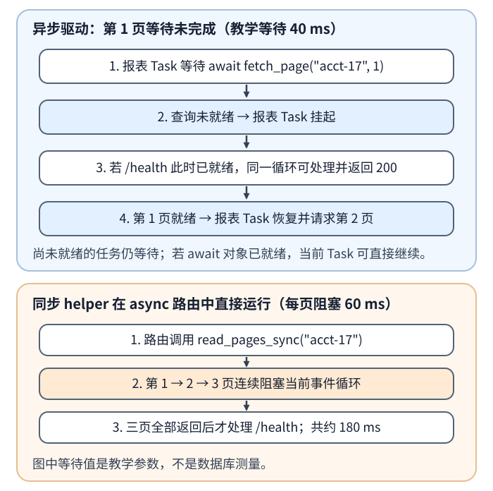
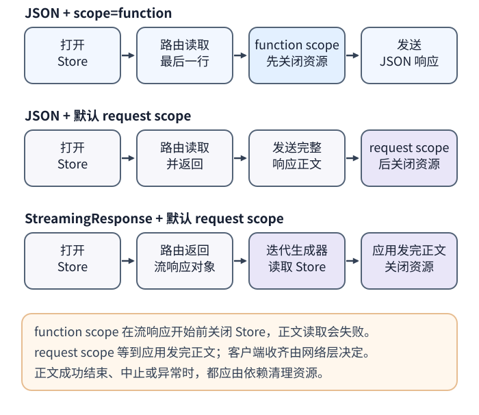

# 异步 FastAPI 接口为什么仍会阻塞，取消和资源又怎样收尾？

本章回答三个问题：`async def` 写的 FastAPI 接口为什么仍可能卡住整个事件循环；任务被取消或超时时，协程、线程和远端操作各自会怎样；数据库会话这类资源应该保持打开到什么时候。读者手上有前几章的 Node 模型：一条线程上的事件循环只在让出点切换，取消只是请求，CPU 工作要交给有界的线程或进程。Python 的 asyncio 在这些原则上相同，具体规则不同。

**案例。** 同一个报表服务的 API 也有 Python 实现。FastAPI 路由为账户 `acct-17` 分三页读取报表数据：第 1 页还没返回时，处理这个请求的 Task 挂起；如果此时有一个 `/health` 请求已经可以处理，同一个事件循环就先处理它。下面的演示用合成等待代替数据库：异步读取每页等 40 ms，同步读取每页阻塞 60 ms。版本：CPython 3.11.13、FastAPI 0.128.0、Starlette 0.47.2、AnyIO 4.12.1。

## 协程什么时候让出事件循环？

调用 `async def` 函数并不立即执行函数体，而是先得到一个 coroutine object (协程对象)。FastAPI 在为请求创建的 Task 里调用路由，由 event loop (事件循环) 驱动这个 Task 运行。Task 是事件循环推进协程的调度单位；同一个事件循环上，同一时刻只有一个 Task 在执行代码。

只有当 Task 等待一个尚未就绪的 Future（异步结果对象）或 I/O 而挂起时，事件循环才有机会推进其他就绪的 Task。这就是 asyncio 的让出点。由此有三点推论：

- `await` 不保证每次都切换任务：被等待的对象已经就绪时，当前 Task 可以直接继续。
- `async def` 不会把函数放到别的线程执行。
- 在协程里直接调用 `time.sleep()`、同步数据库驱动或长时间的 Python 计算时，没有任何让出点，事件循环要等它返回才能处理其他任务。

## FastAPI 里各种写法在哪里执行？

| 写法 | 执行位置 | 要注意什么 |
| --- | --- | --- |
| 在 `async def` 里 `await` 原生异步数据库或 HTTP API | 事件循环线程；I/O 未完成时挂起当前 Task | 这是报表分页的主路径 |
| 在 `async def` 里直接调用同步辅助函数 | 事件循环线程 | FastAPI 不会拦截你自己调用的普通函数，整个循环被占住 |
| 把路由或依赖本身声明为 `def` | FastAPI/Starlette 通过 AnyIO 的工作线程执行 | 线程容量有限，超出的调用排队等待 |
| 在异步路由里用 `asyncio.to_thread()` 运行短时阻塞 I/O | asyncio 默认 executor (执行器) 的线程 | 容量与 AnyIO 的限额分开配置 |
| 把纯 Python 的 CPU 密集工作交给有界进程池或独立 worker 进程 | 其他进程 | 能多核并行；要承担进程调度、序列化和内存成本 |

在这个案例里：`/reports/acct-17` 每等一页都让出事件循环；`/blocking/acct-17` 在路由里直接执行三次同步读取，事件循环要等 3 × 60 = 180 ms 的合成阻塞结束才能处理 `/health`。`/offloaded` 把同一个同步函数放进 asyncio 默认 executor，`/sync-route` 由 FastAPI 交给 AnyIO 工作线程；这两条路都让事件循环继续运行，但各自占用不同的线程容量，而且把工作挪到线程上并不减少下游数据库或文件操作本身的开销。`/reports` 还通过 `Depends(load_settings)` 用了一个普通 `def` 依赖：由 FastAPI 调用的同步依赖会进入 AnyIO 工作线程，这和在 `async` 路由里自己调用同步函数是两回事。

> [!example]- 可运行示例：四种写法
> ~~~python
> import asyncio
> import time
>
> from fastapi import Depends, FastAPI
>
> app = FastAPI()
>
> async def fetch_page(account: str, page: int) -> dict[str, object]:
>     await asyncio.sleep(0.04)  # 合成的异步 I/O 等待
>     return {"account": account, "page": page}
>
> def fetch_page_sync(account: str, page: int) -> dict[str, object]:
>     time.sleep(0.06)  # 合成的同步阻塞
>     return {"account": account, "page": page}
>
> async def read_pages_async(account: str) -> list[dict[str, object]]:
>     rows = []
>     for page in range(1, 4):
>         rows.append(await fetch_page(account, page))
>     return rows
>
> def read_pages_sync(account: str) -> list[dict[str, object]]:
>     return [fetch_page_sync(account, page) for page in range(1, 4)]
>
> def load_settings() -> dict[str, str]:
>     return {"region": "demo"}
>
> @app.get("/reports/{account}")
> async def report(account: str, settings: dict[str, str] = Depends(load_settings)):
>     return {"region": settings["region"], "rows": await read_pages_async(account)}
>
> @app.get("/blocking/{account}")
> async def blocking_report(account: str):
>     return {"rows": read_pages_sync(account)}
>
> @app.get("/offloaded/{account}")
> async def offloaded_report(account: str):
>     return {"rows": await asyncio.to_thread(read_pages_sync, account)}
>
> @app.get("/sync-route/{account}")
> def sync_route(account: str):
>     return {"rows": read_pages_sync(account)}
>
> @app.get("/health")
> async def health():
>     return {"status": "ok"}
> ~~~

## 交给线程的同步代码，容量有多大？

Starlette 用 AnyIO 运行同步路由、同步依赖和它自己的部分内部同步操作，这些调用共用 AnyIO 默认的 worker thread limiter：40 个并发令牌（AnyIO 4.12.1）。几点含义：

- 40 是上限，不是需要填满的目标。调高它会让更多线程同时执行，线程本身和下游数据库的压力都会上升，要按每个进程的线程与连接预算评估。
- asyncio 默认 executor 不受这个限额约束，`to_thread()` 用的是另一份容量。
- 并发上限只限制同时运行的调用数，不限制排队数。排队长度要按资源预算另设，并在入口做准入控制（全局的准入与拒绝见[一条异步管线能接多少工作，超出时在哪里拒绝？](../services/capacity-admission-and-backpressure.md)）。

## 线程能让 CPU 工作并行吗？

在默认的 CPython 构建里，Global Interpreter Lock (全局解释器锁，GIL) 使多个普通 Python 线程通常不能同时执行 Python 字节码。所以把 CPU 密集的纯 Python 函数放进 `asyncio.to_thread()`，只是不再直接占住事件循环，通常得不到多核并行；这类工作更适合交给进程池或独立的 worker 进程。

> [!info] 版本说明：free-threaded 构建
> CPython 3.13 起提供可选的 free-threaded (自由线程) 构建，3.14 起进入正式支持阶段（PEP 779），但仍需单独选择，默认构建依然带 GIL。某些扩展模块可能在 free-threaded 构建里重新启用 GIL；实际收益和线程安全要按所用解释器和依赖逐一验证。本章示例使用默认构建的 CPython 3.11。

## 怎样显式并发，会话怎样隔离？

回到分页：`await fetch_page(...)` 写在循环里，仍是一页一页顺序读取，`await` 不会自动创建并发任务。要并发查询多个页面，必须显式创建子 Task：`asyncio.create_task()`，或 Python 3.11 引入的 TaskGroup (任务组) 的 `create_task()`。创建者负责收集结果、等待子任务结束；TaskGroup 会在退出 `async with` 块之前等待组内任务全部完成。不要留下无人管理的后台 Task。

并发的 Task 不能共用同一个 SQLAlchemy `AsyncSession`：会话不是并发安全的，每个 Task 要有自己的会话；请求和 worker 的每次 attempt 也应各自持有短生命周期的会话。会话借出连接的时长怎样决定连接池的容量，见[ORM 会话怎样借用连接，连接池为什么会耗尽？](../data/orm-sessions-and-connection-pools.md)。

## 吞掉 CancelledError 会怎样？

客户端断开、超时或停机时，正在运行的 Task 会被取消。`Task.cancel()` 只是发出取消请求：事件循环在下一次调度这个 Task 时，向协程内部抛入 `CancelledError`。正确的处理方式是在 `finally` 里关闭游标、会话或临时文件，然后让 `CancelledError` 继续向外传播，使调用方按“已取消”处理。

如果捕获 `CancelledError` 后正常返回，取消就被吞掉了，后果是三处判断同时出错：

- 调用方看到的是正常结果，而不是取消。
- 若这次取消来自 `asyncio.timeout()`，超时作用域会正常退出，不抛 `TimeoutError`。
- TaskGroup 会把这个子任务当作正常完成，打乱调用方预期的取消流程。

~~~python
import asyncio

async def swallow():
    try:
        await asyncio.sleep(1)
    except asyncio.CancelledError:
        return "cleanup done, cancellation swallowed"

async def propagate():
    try:
        await asyncio.sleep(1)
    finally:
        print("cleanup done")

async def main():
    async with asyncio.timeout(0.01):
        print(await swallow())
    print("timeout scope exited normally")

    try:
        async with asyncio.timeout(0.01):
            await propagate()
    except TimeoutError:
        print("TimeoutError")

asyncio.run(main())
~~~

CPython 3.11.13 输出 `cleanup done, cancellation swallowed`、`timeout scope exited normally`、`cleanup done`、`TimeoutError`：吞掉取消的版本让超时“消失”了；在 `finally` 里清理后让取消传播的版本，超时照常报告。

## asyncio.timeout 为什么打不断同步阻塞？

`asyncio.timeout(秒数)` 也是靠事件循环调度一次取消来实现的。如果一个同步函数堵住了事件循环，截止时间到了，负责取消的回调也无法运行。

在 CPython 3.11.13 上运行：用 `asyncio.timeout(0.01)` 包住 `time.sleep(0.05)`，代码约 0.05 s 后正常离开作用域，没有 `TimeoutError`。阻塞调用返回后，只有协程还在作用域内**等待一个尚未就绪的异步操作**，迟到的取消才有机会生效：紧接着 `await asyncio.sleep(0)` 仍然正常退出，换成等待一段正时长（如 `await asyncio.sleep(0.001)`）才抛出 `TimeoutError`。

所以超时不是中断任意同步函数的机制，这一点与 Node 的计时器相同（见[事件循环一章](node-event-loop-and-microtasks.md#长同步回调对计时器做了什么？)）。

## 取消等待 to_thread 的 Task，线程会怎样？

取消一个正在等待 `asyncio.to_thread(blocking_call)` 的 Task，只是异步调用方不再等待。函数若已在线程里运行，Python 不会强行杀掉这个线程；只有还在 executor 队列里、尚未开始的工作，才可能在执行前被取消。

线程可能仍在使用文件、连接或其他资源，所以释放连接池、关闭共享句柄之前，要先确认线程已经结束。需要让线程协作停止时，给 `asyncio.to_thread()` 的函数传入一个 `threading.Event` 作为停止信号并定期检查；在 AnyIO 工作线程里，可以调用 `from_thread.check_cancelled()` 做协作式检查。

远端操作同样不受本地取消影响。客户端超时或断线时，一次写操作可能没到服务端，可能已回滚，也可能已提交而响应丢失；调用方只能通过权威状态查明结果，不能把断线当作失败。主线四的结论是：用同一个幂等键重放请求，取回同一操作的当前状态，见[写请求超时后，怎样查清结果并安全重试？](../services/deadlines-retries-and-unknown-outcomes.md)。

## yield 依赖应该何时释放资源？

取消之外，资源还有“何时关闭”的问题。带 `yield` 的依赖适合把资源的打开和清理写在一起：`yield` 之前打开数据库会话或游标，`yield` 之后（通常在 `finally` 里）清理。清理时点由依赖的作用域决定：

- 默认 request scope (请求作用域)：FastAPI 调用路由前打开资源，在应用发送完响应正文后清理。“发送完”指 ASGI 的最后一个 `http.response.body` 事件（`more_body=False`）已经发出，不代表客户端已经收齐所有字节。
- `Depends(scope="function")`（FastAPI 0.121.0 起支持）：function scope (函数作用域)，在路由函数返回之后、响应发送之前清理。

两者的差别在响应体的生成方式不同时才显现。返回小型 JSON 时，路由函数内已经读完所需数据，function scope 可以提前释放资源，缩短占用时间。返回 `StreamingResponse` 时，正文生成器要在路由返回**之后**才逐块读取数据库游标；若用 function scope，路由一返回资源就被关闭，后续读取会失败。所以流式响应应让 request scope 覆盖整个正文发送过程，并在依赖的 `finally` 里清理，无论正文正常发完、被中止还是出错。

下面的最小应用验证这个边界。`Store` 是合成对象：`close()` 之后再调用 `read_row()` 会抛 `RuntimeError`，这是教学用的资源契约，不代表某个数据库驱动的异常类型。

~~~python
import asyncio
from collections.abc import AsyncIterator
from typing import Annotated

from fastapi import Depends, FastAPI
from fastapi.responses import StreamingResponse

app = FastAPI()

class Store:
    def __init__(self) -> None:
        self.closed = False

    async def read_row(self) -> bytes:
        await asyncio.sleep(0)
        if self.closed:
            raise RuntimeError("Store is closed")
        return b"acct-17,42\n"

    async def close(self) -> None:
        self.closed = True

async def get_store() -> AsyncIterator[Store]:
    store = Store()
    try:
        yield store
    finally:
        await store.close()

@app.get("/row")
async def read_row(store: Annotated[Store, Depends(get_store, scope="function")]):
    row = await store.read_row()
    return {"row": row.decode().strip()}

@app.get("/stream")
async def stream_rows(store: Annotated[Store, Depends(get_store)]):
    async def body():
        yield b"account,report_id\n"
        yield await store.read_row()

    return StreamingResponse(body(), media_type="text/csv")
~~~

用合成 `Store` 记录 ASGI 事件顺序：`/row` 是 `open → read → close → 发送 JSON`；`/stream` 是 `open → 发送 CSV 表头 → 读取 Store → 发送正文结束 → close`。把 `/stream` 的依赖改成 `scope="function"` 再运行，顺序变成 `open → close → response.start(200) → CSV 表头 → read 抛 RuntimeError`，最后一帧正文也没有发出。

## 下一步：需要可查询的结果时

本章的产出是一组 Python 侧的规则：同步代码在 `async def` 里会卡住事件循环，要么换成异步 API，要么交给有上限的线程或进程；取消在 `finally` 里清理后必须继续传播；超时打不断同步阻塞，取消 `to_thread` 只停止等待；资源的作用域要覆盖它最后一次被使用的时刻。

直接流式响应把连接、游标和请求的生命周期绑在一起，客户端断开后也留不下可查询的结果。报表需要在后台可靠生成、稍后再下载时，应改用持久受理的 job：受理时写入持久记录，worker 的每次 attempt 重新获取会话和连接，见[耗时任务怎样被持久受理，并保证一定会被唤醒？](../services/durable-job-acceptance-and-outbox.md)。

本主线接下来回到 Node 的导出流水线，看[流怎样把“慢下来”传回源头](stream-backpressure-and-partial-output.md)。对 Python 对象模型本身（名字绑定、生成器、`with`、描述符与 MRO）有疑问的读者，可以先读支线[Python 的名字、对象和属性按什么规则工作](python-object-model.md)。

> [!info]- 来源
> - `async def` 返回协程、Task 等待 Future 时挂起、事件循环一次运行一个 Task；TaskGroup：[Python 3.11, Coroutines and Tasks](https://docs.python.org/3.11/library/asyncio-task.html#coroutines)，§Coroutines、§Task Object、[§Task Groups](https://docs.python.org/3.11/library/asyncio-task.html#task-groups)，2026-11-12 核对；调度示例于 CPython 3.11.13 重放。
> - `asyncio.timeout()` 通过取消当前 Task 实现，`asyncio.to_thread()` 在独立线程运行：[Python 3.11, Coroutines and Tasks, §Timeouts、§Running in Threads](https://docs.python.org/3.11/library/asyncio-task.html#timeouts)；已开始运行的 Future 不能被 `cancel()` 终止：[concurrent.futures, `Future.cancel()`](https://docs.python.org/3.11/library/concurrent.futures.html#concurrent.futures.Future.cancel)，2026-11-12 核对；阻塞超时分支与吞掉 `CancelledError` 的对照示例于 CPython 3.11.13 运行。
> - `to_thread()` 使用默认线程执行器，CPU 工作可用进程池：[Python 3.11, Event Loop, Executing code in thread or process pools](https://docs.python.org/3.11/library/asyncio-eventloop.html#executing-code-in-thread-or-process-pools)，2026-11-12 核对。
> - 不能强杀已运行线程，`threading.Event` 作停止信号：[Python 3.11, threading, Event objects](https://docs.python.org/3.11/library/threading.html#event-objects)；AnyIO 工作线程的 `from_thread.check_cancelled()`：[AnyIO, Working with threads, Reacting to cancellation in worker threads](https://anyio.readthedocs.io/en/stable/threads.html)，2026-11-12 核对。
> - FastAPI 的同步路由和同步依赖在线程池执行，直接调用的普通函数不受影响：[FastAPI, Concurrency and async / await, Very Technical Details](https://fastapi.tiangolo.com/async/)，FastAPI 0.128.0、Starlette 0.47.2、AnyIO 4.12.1 行为于 2026-11-12 核对。
> - Starlette 用 AnyIO 运行同步端点、依赖与内部同步操作，默认 40 tokens：[Starlette, Thread Pool, Concurrency Limitations](https://starlette.dev/threadpool/#concurrency-limitations)；AnyIO 限额不影响 asyncio 默认 executor：[AnyIO, Working with threads, Adjusting the default maximum worker thread count](https://anyio.readthedocs.io/en/stable/threads.html)，2026-11-12 核对。
> - 默认 CPython 的 GIL、free-threaded 构建与扩展模块重新启用 GIL：[Python support for free threading](https://docs.python.org/3/howto/free-threading-python.html)，§Installation、§The global interpreter lock in free-threaded Python；3.14 正式支持：[PEP 779](https://peps.python.org/pep-0779/)，§Abstract，2026-11-12 核对。
> - SQLAlchemy 2.0 的 `AsyncSession` 不可在并发 Task 间共享：[Using AsyncSession with Concurrent Tasks](https://docs.sqlalchemy.org/en/20/orm/extensions/asyncio.html#using-asyncsession-with-concurrent-tasks)，2026-11-12 核对。
> - `yield` 依赖默认 request scope，function scope 在路由返回后、响应发送前退出：[FastAPI, Dependencies with yield, Early exit and scope](https://fastapi.tiangolo.com/tutorial/dependencies/dependencies-with-yield/)；scope 参数自 [FastAPI 0.121.0](https://fastapi.tiangolo.com/release-notes/#01210) 加入；在 FastAPI 0.128.0、Starlette 0.47.2 上以本机 ASGI trace 核对，2026-11-12。
> - Starlette 0.47.2 的 `StreamingResponse` 逐块发送正文，断连或发送错误会结束流生成任务：[pinned responses.py](https://github.com/Kludex/starlette/blob/0.47.2/starlette/responses.py#L220-L278)，2026-11-12 核对；trace 不是 TCP 断线测试。
> - ASGI 最后一个 `http.response.body` 以 `more_body=False` 表示应用已发完正文：[ASGI HTTP, Response Body](https://asgi.readthedocs.io/en/stable/specs/www.html#response-body-send-event)，2026-11-12 核对。
