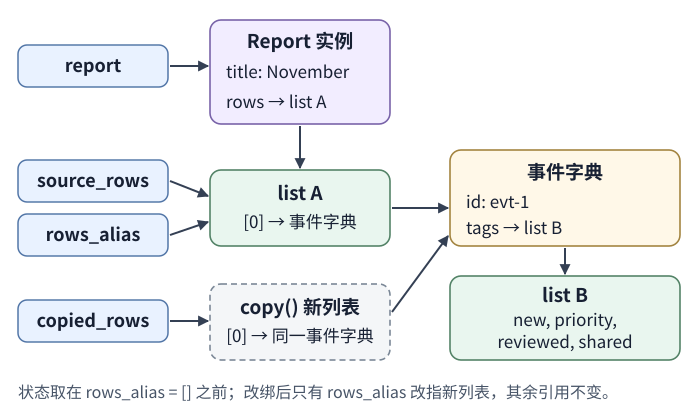
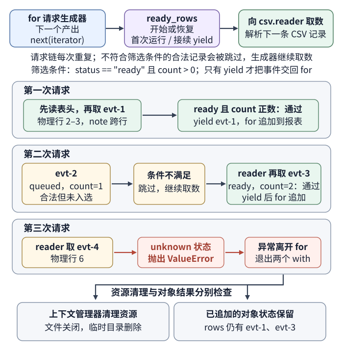
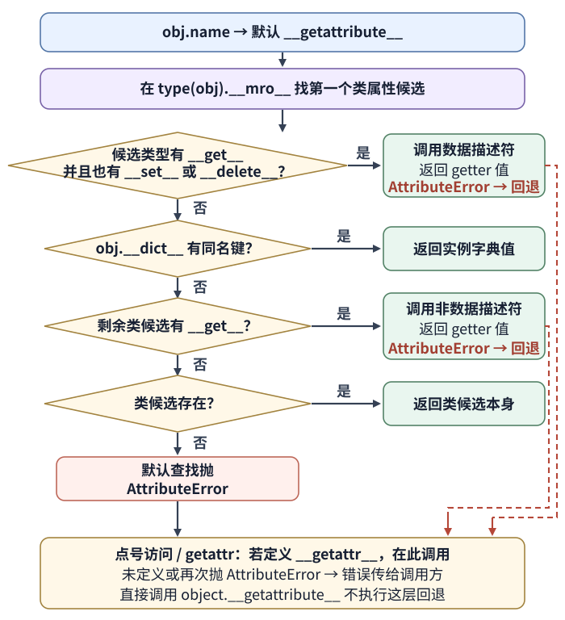
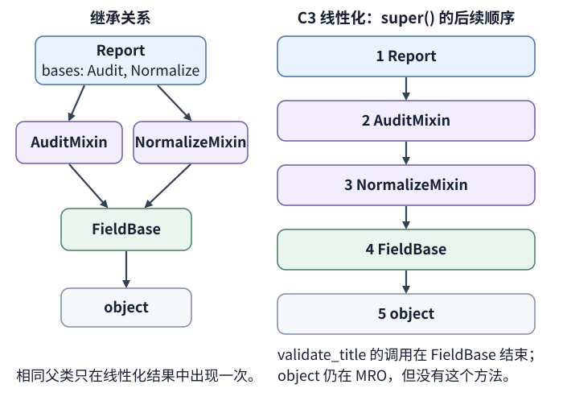

# Python 的名字、对象和属性按什么规则工作？

这是挂在 [asyncio 一章](python-asyncio-and-fastapi.md)后的支线，回答 Python 写服务时最常绊倒人的两组规则：名字、对象和资源之间是什么关系（修改会被谁看到，生成器何时执行，`with` 清理了什么）；读写 `obj.attr` 时，实例字典、类属性、描述符和多继承按什么顺序决定结果。主线二不依赖本章，读者遇到这些问题时再来查。

本章用一个独立的小例子，与主线二的 Node 导出无关：一个报表 worker 读取一份合成的 CSV 事件文件，把状态为 `ready` 且数量为正的事件加入月度报表 `Report("November", rows)`。文件里第一条事件有一个带引号的字段跨了两行，最后一条事件的状态无效。第二节给标题加上验证：输入 `"  November  "` 时读出规范化后的 `November`，全是空白的标题要拒绝。示例在 CPython 3.11.13 上运行。

## 名字、对象与资源

### 名字绑定到什么，修改会被谁看到？

Python 的数据都由对象表示，每个对象有 identity (身份)、type (类型) 和值：

- 身份在对象存续期间不变。`is` 判断两边是不是同一个对象；`id(obj)` 返回代表身份的整数，但对象销毁后，另一个对象可能复用同一个 `id()`，所以它不能当作跨运行或长期保存的业务标识。
- 类型决定对象支持哪些操作、值可以取哪些范围。
- `==` 比较值是否相等，规则可以由类型自己定义。

变量名只是 namespace (命名空间) 里的一个绑定。赋值让名字指向某个对象，不复制对象；多个名字指向同一个对象叫 aliasing (别名)。由此可以推出整套引用模型：

- 对可变对象（list、dict 等）原地修改，所有指向它的名字都能看到变化；给名字重新赋值，只改变这一个名字的绑定，别的名字不受影响。
- shallow copy (浅拷贝) 只新建最外层容器，里面的成员仍是原来那些对象的引用。要独立修改嵌套数据，就重建对应的内层对象；只有确实需要隔离整棵对象图时才用 `deepcopy`。
- 函数调用为形参建立新的局部名字，指向传入的对象。函数原地修改形参所指的列表，调用方能看到；函数把形参改绑到另一个列表，调用方的名字不变。
- 默认参数的表达式在执行 `def` 时只求值一次，后续调用共用同一个对象，所以可变默认值会在调用之间累积。
- “不可变”只管对象本身这一层：字符串不能原地改写；元组不能替换自己的成员，但成员若是列表，那个列表照样能改。对象不可变也不妨碍指向它的名字重新绑定。

普通类调用通常先由 `__new__` 取得实例，再由 `__init__` 初始化这个实例；`__init__` 不负责创建实例。下面的 `Report` 把传入的列表存为实例属性，再看别名、浅拷贝和改绑各影响到哪里：

~~~python
class Report:
    def __init__(self, title, rows):
        self.title = title
        self.rows = rows

source_rows = []
report = Report("November", source_rows)
rows_alias = report.rows
print(report.rows is source_rows, rows_alias is source_rows)   # True True

report.rows.append({"id": "evt-1", "tags": ["new", "priority"]})
rows_alias[0]["tags"].append("reviewed")
copied_rows = report.rows.copy()
copied_rows[0]["tags"].append("shared")
print(report.rows[0]["tags"])   # ['new', 'priority', 'reviewed', 'shared']

rows_alias = []
print(len(report.rows))         # 1
~~~

`self.rows = rows` 只保存了对列表的引用，所以 `source_rows`、`report.rows`、`rows_alias` 是同一个列表。`copy()` 新建了一个行列表，但 `copied_rows[0]` 和 `report.rows[0]` 仍是同一个事件字典，字典里的 `tags` 也是同一个列表，所以通过副本修改嵌套标签，原报表也能看到。最后把 `rows_alias` 改绑到新列表，`report.rows` 不受影响。这些普通属性保存在实例的 `__dict__` 里。

可变默认参数的累积：

~~~python
def unsafe_add(item, items=[]):
    items.append(item)
    return items

print(unsafe_add("first"), unsafe_add("second"))   # ['first', 'second'] ['first', 'second']

def add(item, items=None):
    if items is None:
        items = []
    items.append(item)
    return items

print(add("first"), add("second"))                 # ['first'] ['second']
~~~

两次 `unsafe_add` 返回的是同一个默认列表，打印时它已含两项。`add` 在没有传入列表时每次新建一个。如果 `None` 本身是有意义的输入，就另用一个独立的 sentinel (哨兵值) 表示“未提供”。

顺带区分两种容器：`set` 保存不重复的元素，没有下标；`dict` 把键映射到值，从 Python 3.7 起保持插入顺序是语言规范的保证（在 CPython 3.6 中只是实现细节）。

> [!info] 类型也不是绝对不可改
> 在 CPython 3.11.13 中，`class A: pass` 和 `class B: pass` 的实例内存布局兼容。对 `obj = A()` 先记下 `saved_id = id(obj)`，再执行 `obj.__class__ = B`，会得到 `type(obj) is B` 且 `id(obj) == saved_id`。这种受限的赋值只改了对象的类型，并没有换成另一个对象；两个类的布局（包括 `__slots__`）不兼容时会被拒绝。

### 生成器怎样按需交出记录？

iterable (可迭代对象) 能提供 iterator (迭代器)；迭代器每次返回一个值，没有下一个值时抛出 `StopIteration`，`for` 循环自动处理这个结束信号。含有 `yield` 的函数是生成器函数：调用它只返回一个生成器对象，函数体要等 `for` 或 `next()` 要下一个值时才执行，执行到下一个 `yield` 就暂停。`list(generator)` 则一口气取完所有产出，也就失去了逐条处理的内存优势。

这和 Node 流里的“按需源”是同一个思路：消费方要一个，生产方才做一个，背压因此能传回源头（见[流一章的按需源](stream-backpressure-and-partial-output.md#源头怎样按需生产？)）。

下面的生成器 `ready_rows` 借用调用方已经打开的文件，检查表头、列数、状态和数量，只交出 `status == "ready"` 且 `count > 0` 的事件；状态为 `queued` 的事件合法，但被过滤掉。

~~~python
import csv
from collections.abc import Iterator
from pathlib import Path
from tempfile import TemporaryDirectory
from typing import TextIO

def ready_rows(source: TextIO) -> Iterator[dict[str, object]]:
    reader = csv.reader(source)
    try:
        headers = next(reader)
    except StopIteration:
        return
    if headers != ["id", "status", "count", "tags", "note"]:
        raise ValueError("unexpected CSV header")
    for values in reader:
        line = reader.line_num
        if len(values) != len(headers):
            raise ValueError(f"CSV physical line {line}: wrong column count")
        fields = dict(zip(headers, values))
        status = fields["status"]
        if status not in {"ready", "queued"}:
            raise ValueError(f"CSV physical line {line}: unknown status {status!r}")
        try:
            count = int(fields["count"])
        except ValueError as error:
            raise ValueError(f"CSV physical line {line}: count must be an integer") from error
        if status == "ready" and count > 0:
            yield {**fields, "count": count, "tags": fields["tags"].split("|")}

CSV_TEXT = (
    "id,status,count,tags,note\n"
    'evt-1,ready,3,new|priority,"account\n'
    'export"\n'
    "evt-2,queued,1,backlog,skip\n"
    "evt-3,ready,2,review,year-end\n"
    "evt-4,unknown,1,bad,invalid\n"
)

rows = []
source = path = None
try:
    with TemporaryDirectory() as directory:
        path = Path(directory) / "events.csv"
        path.write_text(CSV_TEXT, encoding="utf-8")
        with path.open(encoding="utf-8", newline="") as source:
            for row in ready_rows(source):
                rows.append(row)
except ValueError as error:
    print(f"Rejected input: {error}")

print(source.closed, path.exists())
print([row["id"] for row in rows])
print(repr(rows[0]["note"]))
~~~

输出：

~~~text
Rejected input: CSV physical line 6: unknown status 'unknown'
True False
['evt-1', 'evt-3']
'account\nexport'
~~~

外层 `for` 每要一个值，生成器就从上次 `yield` 处恢复，再向 `csv.reader` 取一条记录：

1. 第一次请求：读表头，再取到占物理行 2–3 的 `evt-1`（`note` 字段含换行）。它满足条件，生成器 `yield`，循环把它追加到 `rows`。
2. 第二次请求：取到合法但状态为 `queued` 的 `evt-2`，不满足条件，生成器继续取下一条，`yield` 满足条件的 `evt-3`。
3. 第三次请求：读到物理行 6 的 `evt-4`，状态不合法，抛出 `ValueError`，不再产出。

> [!info] CSV 解析的两个落地细节
> `csv.reader` 的 `line_num` 是已经读过的源文件**物理行数**；只要有一条记录的引号字段跨了多行，它就大于记录序号，所以错误信息写的是“physical line 6”。打开文件时传 `newline=""`，是为了让 `csv` 模块按自己的规则处理字段内的换行。

### with 清理了资源，没有撤销什么？

上例打印的 `True False` 分别是 `source.closed` 和 `path.exists()`。异常离开 `for` 后，两个 context manager (上下文管理器) 由内向外退出：内层关闭文件，外层的 `TemporaryDirectory` 删除临时目录，然后异常才被 `except` 捕获。`source` 这个名字仍指向那个已关闭的文件对象，`path` 也仍是一个 `Path` 值，只是它指向的位置已经不存在。

但 `rows` 里已经追加的 `evt-1`、`evt-3` 没有被撤销。`with` 只负责调用上下文管理器的退出方法，退出时是否回滚由管理器自己决定；文件和临时目录的清理都不会回滚列表修改。结果必须“全部成功或全部不生效”时，应先验证并暂存，再在合适的事务边界一次提交。

还要注意，自定义上下文管理器的 `__exit__` 可以返回真值来吞掉块内异常，也可能在清理失败时抛出新异常；错误能否到达外层 `except`，要看退出方法怎么写。本例的两个管理器都在清理成功后让原异常继续传播。资源也不应等垃圾回收再关闭，`with` 把关闭放在确定的控制流边界上。

> [!info] 类型提示与虚拟环境各保证什么
> type hint (类型提示) 帮助读者、IDE 和静态类型检查器理解预期的数据形状；Python 运行时默认不会因为实际对象不符合注解就拒绝它。上例真正拦下坏数据的是表头检查、状态判断和 `int()` 转换。
>
> virtual environment (虚拟环境) 基于创建它时所用的 Python 解释器，只隔离项目安装的第三方包，不会另装一个不同版本的 Python。所以要在创建时选定解释器，之后用环境里的解释器运行程序和安装依赖（POSIX 路径）：
>
> ~~~sh
> python3.11 -m venv .venv
> .venv/bin/python -m pip install httpx
> .venv/bin/python app.py
> ~~~

## 属性查找与 MRO

本节只讨论普通类实例的显式读写：`report.title`、`report.title = value` 和 `getattr(report, name)`。类对象本身的元类查找、特殊语法隐式触发的特殊方法查找，不在这条路径上。代码沿用同一个 `Report` 例子，但重新定义了类，不依赖上一节的运行状态；完整可运行脚本在本节末尾。

method resolution order (方法解析顺序，MRO) 是 Python 从对象的类出发、沿基类查找属性时依次检查的类列表，可以用 `类名.__mro__` 查看。

### 描述符怎样接管 title 的读写？

descriptor (描述符) 是类型定义了 `__get__`、`__set__` 或 `__delete__` 的对象。只有放在类字典里（或被实例类型的某个基类继承）时，点号访问才会自动调用它；把描述符对象放进实例字典，读出来的只是那个普通对象。

`NonEmptyText` 对外提供 `title`，实际值存在实例字典的 `_title` 键里：

~~~python
class NonEmptyText:
    def __set_name__(self, owner, name):        # 类创建时得知自己的属性名
        self.public_name = name
        self.storage_name = "_" + name

    def __get__(self, instance, owner=None):
        if instance is None:                     # 经类访问时返回描述符本身
            return self
        try:
            return instance.__dict__[self.storage_name]
        except KeyError:
            raise AttributeError(self.public_name) from None

    def __set__(self, instance, value):
        if not isinstance(value, str):
            raise TypeError("title must be text")
        instance.__dict__[self.storage_name] = instance.validate_title(value)
~~~

它同时定义了 `__get__` 和 `__set__`，是 data descriptor (数据描述符)。`Report` 把它放在类上，并提供 `validate_title`。这个方法经过三个 mixin 协作完成审计、去空格和非空检查（协作顺序见本节最后两小节）：

~~~python
events = []

class FieldBase:
    def validate_title(self, value):
        events.append("FieldBase")
        if not value:
            raise ValueError("title must contain non-whitespace text")
        return value

class NormalizeMixin(FieldBase):
    def validate_title(self, value):
        events.append("NormalizeMixin.before")
        result = super().validate_title(value.strip())
        events.append("NormalizeMixin.after")
        return result

class AuditMixin(FieldBase):
    def validate_title(self, value):
        events.append("AuditMixin.before")
        result = super().validate_title(value)
        events.append("AuditMixin.after")
        return result

class Report(AuditMixin, NormalizeMixin):
    title = NonEmptyText()
    category = "monthly"

    def __init__(self, title, rows):
        self.title = title
        self.rows = rows

    def validate_title(self, value):
        events.append("Report.validate_title")
        return super().validate_title(value)

    def __getattr__(self, name):
        events.append(f"__getattr__({name})")
        if name == "row_count":
            return len(self.rows)
        raise AttributeError(name)

    def publish(self):
        return f"Published {self.title} ({len(self.rows)} events)"

report = Report("  November  ", [{"id": "evt-1"}, {"id": "evt-3"}])
~~~

`__init__` 里的 `self.title = title` 没有把字符串直接放进 `report.__dict__`，而是触发类上的数据描述符：去掉空格、检查非空，最后写入 `_title`。于是 `report.title` 和 `report.__dict__["_title"]` 都是 `November`。`Report.title is vars(Report)["title"]` 为 `True`：前者经类访问调用 `__get__(None, Report)`，本例返回描述符本身；后者直接从类字典取出它。

点号访问和直接改字典是两种操作。绕过描述符直接写一个同名键，再用正常赋值写入空白标题：

~~~python
report.__dict__["title"] = "forged"
print(report.title, report.__dict__["title"])   # November forged
report.title = "   "                           # ValueError: title must contain non-whitespace text
print(report.title)                             # November
~~~

直接写 `__dict__` 绕开了 `__set__`，但读取时数据描述符先于实例字典生效，伪造的值读不出来；正常赋值走 `__set__`，空白标题被拒绝，原值不变。描述符只约束普通的属性访问流程，不是防止任意代码篡改内部状态的安全机制。

### 实例属性按什么优先级读取？

默认读取 `obj.x` 时，Python 先沿 `type(obj).__mro__` 找到第一个定义了 `x` 的类属性（下表称“类候选”），再根据这个候选有哪些描述符方法、实例字典里有没有同名键，决定返回什么：

| 类 MRO 找到的候选 | 实例字典有同名键 | `obj.x` 的结果 |
| --- | --- | --- |
| 有 `__get__`，且有 `__set__` 或 `__delete__`（可读的数据描述符） | 有或没有 | 调用描述符的 `__get__` |
| 有 `__get__`，没有 `__set__` / `__delete__`（非数据描述符） | 有 | 返回实例字典的值 |
| 同上的非数据描述符 | 没有 | 调用描述符的 `__get__` |
| 没有 `__get__` 的类候选，包括只定义 `__set__` / `__delete__` 的描述符 | 有 | 返回实例字典的值 |
| 没有 `__get__` 的类候选 | 没有 | 返回类候选本身 |
| 没有类候选 | 有 | 返回实例字典的值 |
| 没有类候选 | 没有 | 默认查找抛 `AttributeError`，之后才尝试 `__getattr__` |

表假定实例有 `__dict__`；实例没有字典（例如用了 `__slots__`）时，跳过实例字典这一步。

### 赋值为什么另有一套分派？

赋值不套用读取表。类候选定义了 `__set__` 时，`obj.x = value` 调用它，setter 拒绝时异常向外传播。只定义了 `__delete__` 的数据描述符同样会拦截默认赋值，但因为没有 `__set__`，赋值抛出 `AttributeError`，实例字典里已有的同名键也不会被替换。只有类上没有拦截赋值的数据描述符、并且实例有 `__dict__` 时，默认赋值才写入实例字典；实例没有字典时，可能根本无法新增属性。

~~~python
class DeleteOnly:
    def __delete__(self, instance):
        pass

class Holder:
    value = DeleteOnly()

holder = Holder()
holder.__dict__["value"] = "kept"
holder.value = "new"          # AttributeError: __set__
print(holder.value)           # kept
~~~

赋值被拦截并报错，旧值不变；而读取时 `DeleteOnly` 没有 `__get__`，按读取表第四行返回实例字典里的 `kept`。

### 方法为什么会自动绑定 self？

类里定义的普通函数是非数据描述符。读取 `report.publish` 时调用函数的 `__get__`，得到一个 bound method (绑定方法)：它的 `__self__` 是 `report`，`__func__` 是类字典里的那个函数。只有放在类上、经实例读取的函数才会绑定；把函数直接存进实例字典，读出来的仍是原函数，不会自动补上 `self`。

因为函数是非数据描述符，实例字典里的同名键可以遮住它，这正是对单个实例做 monkey patch (运行时替换) 只影响那一个实例的原因。普通类属性也一样，在实例没有同名键时充当默认值：

~~~python
report.category = "draft"
print(report.category, Report.category)    # draft monthly

bound = report.publish
print(bound.__self__ is report, bound.__func__ is vars(Report)["publish"])   # True True
print(bound())                              # Published November (2 events)
report.__dict__["publish"] = "temporary label"
print(report.publish)                       # temporary label
del report.__dict__["publish"]
print(report.publish())                     # Published November (2 events)
~~~

### __getattribute__ 与 __getattr__ 怎样分工？

每次显式读取属性，入口都是 `__getattribute__`；默认实现 `object.__getattribute__` 包含上面那张优先级表。普通点号访问和两参数的 `getattr(obj, "x")` 外面还有一层：`__getattribute__` 抛出 `AttributeError` 时，调用类上定义的 `__getattr__(self, name)`。

- 这个 `AttributeError` 可以来自默认查找，也可以来自重写后的 `__getattribute__`，或来自描述符的 `__get__`。
- 类没有定义 `__getattr__`，或回退方法也抛 `AttributeError`，错误传给调用方。
- 直接调用 `object.__getattribute__` 只做默认查找，不会自行调用回退。
- 重写 `__getattribute__` 会接管整条默认路径。要保留默认行为，在实现里委托给 `object.__getattribute__(self, name)`，并避免在里面用 `self.other` 读取内部状态，否则会无限递归。

~~~python
events.clear()
print(report.row_count, getattr(report, "row_count"))   # 2 2
object.__getattribute__(report, "row_count")            # AttributeError，不调用 __getattr__
print(events)        # ['__getattr__(row_count)', '__getattr__(row_count)']
~~~

描述符 getter 出错时也一样走回退，而不会回头读实例字典。下面故意只调用 `Report.__new__` 而不运行 `__init__`，让 `_title` 缺失，同时在实例字典放一个同名的 `title` 键：

~~~python
events.clear()
incomplete = Report.__new__(Report)
incomplete.__dict__["title"] = "forged"
incomplete.title     # AttributeError
print(events)        # ['__getattr__(title)']
~~~

getter 抛出 `AttributeError` 后，点号访问转入 `__getattr__("title")`；回退也抛错，最终仍是 `AttributeError`，字典里的伪造值没有被读出。这只用来显露查找分支，正常对象仍通过 `Report(...)` 初始化。

### MRO 怎样从多继承中算出来？

`Report(AuditMixin, NormalizeMixin)` 声明审计 mixin 在前、规范化 mixin 在后，两者都继承 `FieldBase`，构成菱形继承。Python 用 C3 linearization (C3 线性化) 计算 MRO：保留每个基类自身 MRO 里的顺序，也保留子类声明直接基类的顺序，并让共同基类只出现一次。

记 `L(C)` 为类 `C` 的 MRO：

~~~text
L(AuditMixin)     = [AuditMixin, FieldBase, object]
L(NormalizeMixin) = [NormalizeMixin, FieldBase, object]
L(Report) = [Report] + merge(
    [AuditMixin, FieldBase, object],
    [NormalizeMixin, FieldBase, object],
    [AuditMixin, NormalizeMixin],
)
~~~

merge 每一轮依次查看各列表的首项，选出第一个“不出现在任何列表尾部（首项之后的部分）”的类，把它追加到结果里，并从所有以它开头的列表中移除：

1. 选 `AuditMixin`。剩余 `[FieldBase, object]`、`[NormalizeMixin, FieldBase, object]`、`[NormalizeMixin]`。
2. `FieldBase` 是第一张表的首项，但出现在第二张表的尾部，暂时不能选；选 `NormalizeMixin`。剩余 `[FieldBase, object]`、`[FieldBase, object]` 和空表。
3. 依次选出 `FieldBase`、`object`。

所以 `Report.__mro__` 是 `[Report, AuditMixin, NormalizeMixin, FieldBase, object]`。若某轮还有剩余项却选不出合法候选，继承约束相互冲突，类定义失败并抛出 `TypeError`。例如 `class Bad(FieldBase, AuditMixin)` 要求 `FieldBase` 排在 `AuditMixin` 之前，而 `AuditMixin` 自己的 MRO 要求相反，CPython 报 `Cannot create a consistent method resolution order (MRO) for bases FieldBase, AuditMixin`。

### super() 为什么会到达另一个 mixin？

不带参数的 `super()` 从“实例实际类型的 MRO”里找到“当前方法所在的类”，再从它**后面一个类**开始查找；它不会固定跳到当前类定义时写的直接父类。

所以标题校验的轨迹是 `Report.validate_title → AuditMixin.before → NormalizeMixin.before → FieldBase → NormalizeMixin.after → AuditMixin.after`。`AuditMixin` 里的 `super()` 到达的是 `NormalizeMixin`，而不是它定义时写的父类 `FieldBase`，因为在 `Report` 实例的 MRO 里，`AuditMixin` 后面就是 `NormalizeMixin`。`FieldBase` 是终点，不再向下委托。

改变直接基类的顺序，就改变了 MRO，也改变了同一套 `super()` 的执行顺序：

~~~python
class NormalizeFirst(NormalizeMixin, AuditMixin):
    pass

print([cls.__name__ for cls in NormalizeFirst.__mro__])
# ['NormalizeFirst', 'NormalizeMixin', 'AuditMixin', 'FieldBase', 'object']
events.clear()
print(NormalizeFirst().validate_title("  November  "), events)
# November ['NormalizeMixin.before', 'AuditMixin.before', 'FieldBase', 'AuditMixin.after', 'NormalizeMixin.after']
~~~

`NormalizeFirst` 只继承两个 mixin，没有 `Report.validate_title` 这一层，所以轨迹里也没有它。两个 mixin 的相对顺序随基类声明顺序改变，`super()` 的规则本身不变。

这种协作要求每层 mixin 遵守共同约定：参数形式相互兼容，并在需要链条继续时调用 `super()`；任何一层漏掉这次调用，后面的步骤都会被跳过。如果调用顺序很难讲清楚，改用显式组合对象，或直接按名字调用各个步骤，代码会更易读。

> [!example]- 本节完整可运行脚本
> ~~~python
> events = []
>
> class NonEmptyText:
>     def __set_name__(self, owner, name):
>         self.public_name = name
>         self.storage_name = "_" + name
>
>     def __get__(self, instance, owner=None):
>         if instance is None:
>             return self
>         try:
>             return instance.__dict__[self.storage_name]
>         except KeyError:
>             raise AttributeError(self.public_name) from None
>
>     def __set__(self, instance, value):
>         if not isinstance(value, str):
>             raise TypeError("title must be text")
>         instance.__dict__[self.storage_name] = instance.validate_title(value)
>
> class FieldBase:
>     def validate_title(self, value):
>         events.append("FieldBase")
>         if not value:
>             raise ValueError("title must contain non-whitespace text")
>         return value
>
> class NormalizeMixin(FieldBase):
>     def validate_title(self, value):
>         events.append("NormalizeMixin.before")
>         result = super().validate_title(value.strip())
>         events.append("NormalizeMixin.after")
>         return result
>
> class AuditMixin(FieldBase):
>     def validate_title(self, value):
>         events.append("AuditMixin.before")
>         result = super().validate_title(value)
>         events.append("AuditMixin.after")
>         return result
>
> class Report(AuditMixin, NormalizeMixin):
>     title = NonEmptyText()
>     category = "monthly"
>
>     def __init__(self, title, rows):
>         self.title = title
>         self.rows = rows
>
>     def validate_title(self, value):
>         events.append("Report.validate_title")
>         return super().validate_title(value)
>
>     def __getattr__(self, name):
>         events.append(f"__getattr__({name})")
>         if name == "row_count":
>             return len(self.rows)
>         raise AttributeError(name)
>
>     def publish(self):
>         return f"Published {self.title} ({len(self.rows)} events)"
>
> report = Report("  November  ", [{"id": "evt-1"}, {"id": "evt-3"}])
> print(Report.title is vars(Report)["title"], vars(Report)["title"].storage_name)
> print(report.title, report.__dict__["_title"])
> print(events)
>
> report.__dict__["title"] = "forged"
> print(report.title, report.__dict__["title"])
> try:
>     report.title = "   "
> except ValueError as error:
>     print(type(error).__name__, error, "|", report.title)
>
> report.category = "draft"
> print(report.category, Report.category)
> bound = report.publish
> print(bound.__self__ is report, bound.__func__ is vars(Report)["publish"], bound())
> report.__dict__["publish"] = "temporary label"
> print(report.publish)
> del report.__dict__["publish"]
> print(report.publish())
>
> events.clear()
> print(report.row_count, getattr(report, "row_count"))
> try:
>     object.__getattribute__(report, "row_count")
> except AttributeError:
>     print("direct object.__getattribute__: AttributeError")
> print(events)
>
> events.clear()
> incomplete = Report.__new__(Report)
> incomplete.__dict__["title"] = "forged"
> try:
>     incomplete.title
> except AttributeError as error:
>     print(type(error).__name__, events)
>
> class DeleteOnly:
>     def __delete__(self, instance):
>         pass
>
> class Holder:
>     value = DeleteOnly()
>
> holder = Holder()
> holder.__dict__["value"] = "kept"
> try:
>     holder.value = "new"
> except AttributeError as error:
>     print(type(error).__name__, error, holder.__dict__["value"])
> print(holder.value)
>
> print([cls.__name__ for cls in Report.__mro__])
>
> class NormalizeFirst(NormalizeMixin, AuditMixin):
>     pass
>
> print([cls.__name__ for cls in NormalizeFirst.__mro__])
> events.clear()
> print(NormalizeFirst().validate_title("  November  "), events)
>
> try:
>     class Bad(FieldBase, AuditMixin):
>         pass
> except TypeError as error:
>     print(error)
> ~~~

## 回到主线

本支线的产出是两张可查的规则：名字只是绑定，原地修改对所有别名可见，浅拷贝只复制一层，`with` 清理资源但不回滚对象状态；属性读取按[优先级表](#实例属性按什么优先级读取？)决定，赋值另有分派，`super()` 沿实例类型的 MRO 前进。主线二接下来回到 Node 的导出流水线：[流怎样把“慢下来”逐段传回源头](stream-backpressure-and-partial-output.md)。

> [!info]- 来源
> - 对象的身份、类型与值，可变性，不可变容器中的可变成员，不要依赖对象立即终结：[Python 3.15.2 Language Reference, Data model §3.1](https://docs.python.org/3.15/reference/datamodel.html#objects-values-and-types)，2026-11-12 核对。
> - `id()` 在对象生命周期内唯一且恒定，生命周期不重叠的对象可能复用：[Built-in Functions, `id`](https://docs.python.org/3.15/library/functions.html#id)；受限 `__class__` 赋值须布局兼容：[Data model, `__slots__`](https://docs.python.org/3.15/reference/datamodel.html#object.__slots__)，并于 CPython 3.11.13 验证（实现：[Objects/typeobject.c `compatible_for_assignment` / `object_set_class`](https://github.com/python/cpython/blob/v3.11.13/Objects/typeobject.c#L4715-L4869)）。
> - 类调用经 `__new__` 取得实例、`__init__` 初始化；名字与别名：[Data model, Basic customization](https://docs.python.org/3.15/reference/datamodel.html#classes)、[Tutorial §9.1](https://docs.python.org/3.15/tutorial/classes.html#a-word-about-names-and-objects)，2026-11-12 核对。
> - 默认参数在定义时求值：[Tutorial, Default Argument Values](https://docs.python.org/3.15/tutorial/controlflow.html#default-argument-values)；字典插入顺序自 3.7 起是语言保证：[Built-in Types, dict](https://docs.python.org/3.15/library/stdtypes.html#dict)，2026-11-12 核对。
> - 生成器函数与 `yield`：[Language Reference, Yield expressions](https://docs.python.org/3.15/reference/expressions.html#yield-expressions)；`reader.line_num` 的物理行计数与 `newline=""`：[`csv` library](https://docs.python.org/3.15/library/csv.html#csv.csvreader.line_num)，2026-11-12 核对；CSV 示例于 CPython 3.11.13 重放。
> - `with` 的进入、退出与异常传播：[Language Reference, The with statement](https://docs.python.org/3.15/reference/compound_stmts.html#the-with-statement)；文件在块退出时关闭：[`io.IOBase`](https://docs.python.org/3.15/library/io.html#io.IOBase)；临时目录退出时清理：[`tempfile.TemporaryDirectory`](https://docs.python.org/3.15/library/tempfile.html#tempfile.TemporaryDirectory)，2026-11-12 核对。
> - 运行时默认不强制注解：[`typing`](https://docs.python.org/3.15/library/typing.html)；虚拟环境隔离包并由创建命令选定解释器：[`venv`](https://docs.python.org/3.15/library/venv.html)，2026-11-12 核对。
> - 描述符的定义、须作为类属性才自动触发、`__set_name__`、实例读取优先级、函数绑定：[Python 3.15.2 Descriptor Guide](https://docs.python.org/3.15/howto/descriptor.html)，Descriptor Protocol、Invocation from an Instance、Automatic Name Notification、Functions and Methods，2026-11-12 核对。
> - `__getattribute__` 抛 `AttributeError` 时才回退到 `__getattr__`，描述符 getter 的错误也可进入回退：[Data model, Customizing Attribute Access](https://docs.python.org/3.15/reference/datamodel.html#customizing-attribute-access)；类候选与默认实例属性查找：[Data model, Custom classes](https://docs.python.org/3.15/reference/datamodel.html#custom-classes)，2026-11-12 核对。
> - CPython 3.11.13 的读取与赋值顺序（含只实现 `__delete__` 时赋值报 `__set__` 缺失）：[Objects/object.c `_PyObject_GenericGetAttrWithDict` / `_PyObject_GenericSetAttrWithDict`](https://github.com/python/cpython/blob/v3.11.13/Objects/object.c#L1242-L1438)、[Objects/typeobject.c `slot_tp_descr_set`](https://github.com/python/cpython/blob/v3.11.13/Objects/typeobject.c#L7822-L7839)。
> - C3 线性化：[Python 3.15.2 MRO HOWTO](https://docs.python.org/3.15/howto/mro.html#the-c3-method-resolution-order)；零参数 `super()` 沿实例类型 MRO 从当前类之后查找：[Built-in Functions, `super`](https://docs.python.org/3.15/library/functions.html#super)，2026-11-12 核对。
> - 第二节完整脚本（含 `Bad` 冲突例与 `holder.value` 读取）于 CPython 3.11.13 运行，输出与正文一致。
