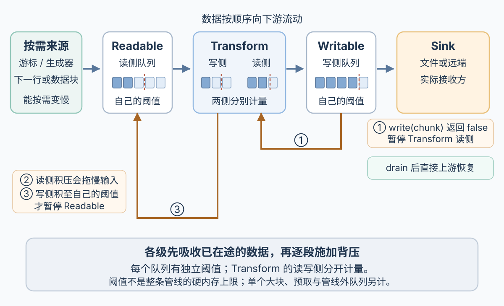

# 流怎样把“慢下来”逐段传回源头，中途失败又留下什么？

本章回答：Node.js 的流怎样让写得慢的一端把“慢下来”逐段传回数据源，使内存保持有界；流结束时各个完成信号分别证明了什么；取消或出错时，已经写出的部分数据和临时文件该怎样处理，谁来裁决这次导出算不算成功。读者手上有前几章的结论：文件写入和内置 gzip 在 libuv threadpool 里执行，取消只是请求。

沿用主线二的案例，这次看默认方案。`job-demo-731` 的 attempt 1 用一条 Node 原生管线导出报表 42：

~~~text
异步生成器（包装数据库游标，每页最多 100 行，最多 12 页）
  → Readable.from()  → createGzip()  → createWriteStream(临时文件)
  → 关闭后 rename 到 job 与 attempt 专属的路径
~~~

## write() 返回 false 意味着什么？

先认识四种流：Readable (可读流) 产生数据块，Writable (可写流) 接收数据块，Duplex (双工流) 的可读和可写两侧各自独立，Transform (转换流) 是一种 Duplex，从一侧接收输入、从另一侧输出转换后的块。gzip 就是一个 Transform。

backpressure (背压) 的契约落在 `Writable.write(chunk)` 的返回值上。对处于正常可写状态的 Writable：

- `write(chunk)` 总会先接收当前块。
- 返回 `true`：可以继续提交。它不表示这个块已经写完。
- 返回 `false`：当前块已被接收，但内部写缓冲已达到 `highWaterMark` (缓冲阈值)。这时应停止提交后续的块，等 `drain` 事件再继续。
- `drain` 只表示底层已经消化到可以恢复写入，不证明文件已持久化，也不证明远端应用收到了数据。

如果流已经结束、被销毁或出错，`false` 不再保证当前块被接收，之后也不保证会有 `drain`；这时要处理 `error`、`close` 或管线的失败结果，而不是一直等 `drain`。

下面的演示把阈值调到 64 字节，接收方每块处理 10 ms，手写循环遵守 `false` / `drain` 契约：

~~~javascript
// 保存为 write-drain.cjs；node write-drain.cjs
const { Writable } = require('node:stream');

const sink = new Writable({
  highWaterMark: 64,
  write(chunk, encoding, callback) { setTimeout(callback, 10); },
});
const rows = Array.from({ length: 6 }, (_, i) =>
  `r${String(i + 1).padStart(2, '0')},acct-17,report-42\n`);   // 每行 22 字节

let i = 0;
function writeMore() {
  while (i < rows.length) {
    const ok = sink.write(rows[i]);
    console.log(`write ${rows[i].trim()} -> ${ok}, buffered=${sink.writableLength}`);
    i++;
    if (!ok) {
      sink.once('drain', () => { console.log('drain'); writeMore(); });
      return;
    }
  }
  sink.end(() => console.log('finish'));
}
writeMore();
~~~

在 Node.js v26.13.1 上，前两行返回 `true`（缓冲 22、44 字节），第三行使缓冲达到 66 字节、返回 `false`；循环停下，等到 `drain` 后再写第四行。6 行共触发两次 `false` 和两次 `drain`，最后输出 `finish`。

## highWaterMark 管哪一段、按什么计量？

`highWaterMark` 是**每个流队列各自**的阈值：Readable 用它决定是否继续向源头拉数据，Writable 用它告诉上游是否该暂停交块。它不是整条管线的内存硬上限。

计量单位取决于队列里存的是什么：

- 存 Buffer 时按字节计。Writable 默认会把字符串转成 Buffer。
- 存 JavaScript 字符串时按 UTF-16 code unit (码元) 计，例如 Readable 调用了 `setEncoding()`，或 Writable 设置了 `decodeStrings: false`。
- object mode (对象模式) 下按对象个数计。`Readable.from()` 默认使用对象模式；本章明确设置 `objectMode: false`，让每行 CSV 文本按字节流处理。

Readable 和 Writable 各有一个队列，Transform 则分别维护写侧和读侧两份缓冲。估算一条管线的内存时，要把每段的阈值、单个特别大的块、驱动的预取，以及管线之外的队列都算进去。还要注意，背压只能让**按需生产**的源头慢下来：如果生产者另有后台预取，或者事先把全部行装进了数组，流无法自动限制那部分工作。

## 背压怎样逐段传回源头？

用 `pipe()` 或 `pipeline()` 连接的流之间，背压在相邻两段之间一段一段地传。以 `Readable → gzip Transform → 文件 Writable` 为例：

1. 文件 Writable 的 `write(chunk)` 返回 `false`，Node 暂停它的直接上游，也就是 gzip 的读侧。
2. gzip 继续产生的输出留在自己的读缓冲里；读缓冲积压到阈值后，gzip 延后处理新的输入，写侧的消化随之变慢。
3. gzip 的写侧还能吸收已经在途的数据；等它的队列也到达阈值，`Transform.write()` 才返回 `false`，于是更上游的 Readable 被暂停，不再向生成器要下一行。

`drain` 也是逐段恢复的：先让直接上游恢复，缓冲逐段消退后各段继续工作。这不是末端一次性向整条管线广播“暂停”。

`pipeline()` 替你遵守相邻流之间的 `false` / `drain` 契约，并统一处理错误和结束；手写 `write()` 循环则必须自己遵守。但 `pipeline()` 不会给管线之外的任务队列、数据库预取或远端副作用设上限。

## 源头怎样按需生产？

背压要发挥作用，源头必须是“要一行才产一行”。`job-demo-731` 把数据库游标包装成一个异步生成器：每次向数据库要一页，逐行格式化成 CSV 文本 `yield` 出去；`Readable.from()` 只在下游需要时才向生成器要下一行，生成器不另外保存整份 CSV。生成器在 `finally` 里关闭游标。分页规则是：一页不足 100 行就说明数据读完；第 12 页仍然满页，就以“范围超限”失败，而不是静默截断。

下面的演示去掉数据库和 gzip，只看源头被拉取的节奏。生成器产出 200 行，接收方每行处理 1 ms，记录“已产出 − 已接收”的最大差值：

~~~javascript
// 保存为 pull-on-demand.cjs；node pull-on-demand.cjs [default]
const { Readable, Writable } = require('node:stream');
const { pipeline } = require('node:stream/promises');

const small = process.argv[2] !== 'default';
let produced = 0;
let consumed = 0;
let maxGap = 0;

async function* csvRows() {
  for (let n = 1; n <= 200; n++) {
    produced++;
    maxGap = Math.max(maxGap, produced - consumed);
    yield `row-${n},acct-17,42\n`;
  }
}

const sink = new Writable({
  ...(small ? { highWaterMark: 64 } : {}),
  write(chunk, encoding, callback) { consumed++; setTimeout(callback, 1); },
});

pipeline(
  Readable.from(csvRows(), { objectMode: false, ...(small ? { highWaterMark: 64 } : {}) }),
  sink,
).then(() => console.log({ produced, consumed, maxGap }));
~~~

两段阈值都设为 64 字节时（Node.js v26.13.1），生成器最多只领先接收方 7 行：它几乎是被一行一行拉着走的。去掉这两个设置（参数 `default`）后，Writable 的默认阈值是 64 KiB，200 行共约 3.7 KB 的文本一次就装得下，`maxGap` 变成 199：生成器在接收方处理第一行时就产出了全部数据。两次运行用的是同一个按需源，差别完全来自阈值，这正说明阈值是每段各自的缓冲额度。

背压还有一个容易忽略的代价。如果生成器在整个导出期间一直持有同一个数据库游标，**下游背压会让持有游标的事务和连接一起变长**：文件写得慢，游标就停在那里，连接一直借着不还。这段时间必须计入连接池和 worker 槽的预算。另一种做法（也是主线三分页一章采用的默认）是每页用一个短事务，读完一页就归还连接，代价是各页不再来自同一个数据库快照。两种做法怎样取舍、分页游标怎样设计，见[怎样无重复、无遗漏地分页读取一个还在变化的集合？](../data/keyset-pagination-and-snapshots.md)。

## 各完成信号分别证明什么？

正常路径上，生成器读到不满 100 行的最后一页后返回，`finally` 关闭游标，然后不再产出。但“最后一行已送进 gzip”并不说明文件完整：Transform 的输出块数不必等于输入块数，gzip 在输入结束后还要产出尾块，写入方收到尾块并写完后，文件流才可能完成。管线里能观察到的每个信号只证明它那一段：

| 可观察的状态 | 说明了什么 | 没有证明什么 |
| --- | --- | --- |
| 源 Readable 的 `end` | 所有源输入都已被消费，没有更多输入 | gzip 已结束、下游已写完、文件已持久化 |
| Writable 的 `finish` | 调用 `end()` 后，所有写入的数据都已交给底层系统 | 数据在断电后仍可恢复；HTTP 客户端已收到完整正文 |
| 文件流的 `close` | 流及其文件描述符等底层资源已关闭 | 内容已满足所需的崩溃持久性 |
| `pipeline()` 的 Promise fulfilled | 整条管线按正常路径完成 | 报表已成功发布；对象存储已持久接受 |

本例的文件流默认自动关闭。要让本地文件经得起系统重启，需要按平台和文件系统的契约另外请求 `fsync` 一类的持久化操作（Node 里是 `FileHandle.sync()`），`finish` 和 `close` 都不报告这项保证。目标是 HTTP 响应或对象存储时，用相应协议或 SDK 的确认定义；服务器本地的响应流完成，不等于客户端收到并保存了全部字节。

## 取消一条流会停下什么？

取消走另一条路径。`pipeline(..., { signal })` 在信号触发时销毁仍参与管线的流，并以 `AbortError` 拒绝。它停下的只是流本身：

- 不再沿流发送数据，但已交给文件系统或远端的字节不会被撤回。
- 不会自动取消不属于流的数据库请求。若取消时生成器正在等 `cursor.next()` 或下一页，而驱动不支持取消，只有等这次查询返回，代码才能检查 signal 并进入 `finally`。
- `finally` 里等待 `cursor.close()` 返回，只说明调用并等待了关闭，不证明游标和连接已成功释放；连接的所有者要按驱动的结果确认状态，不能在查询还在进行时提前归还连接。

本章末尾的导出脚本用 `--abort-replay` 回放了这种情形：第一页查询开始后一直挂起，20 ms 时请求取消，100 ms 时查询才返回。日志顺序是：查询开始、请求取消、查询返回、游标关闭、管线以 `AbortError` 结束。也就是说，`finally` 和 `AbortError` 都出现在 100 ms 查询返回之后，而不是 20 ms 发出取消的时候。真实驱动有没有可用的取消 API、取消何时确认，要以驱动的契约为准。

## 中途失败留下什么：部分输出与发布裁决

**部分输出。** 文件写流遇到取消或错误时，已经写出的部分内容仍可能留在文件里。整块写入也一样：用 `AbortSignal` 取消 `fsPromises.writeFile()`，只会尽力取消内部缓冲，部分数据仍可能已写入文件。所以 attempt 1 一开始就用 `mkdtemp()` 建一个本 attempt 独占的临时目录，只往里写；管线失败且流已停止后，删除的也只是这个目录，不会碰到别的 attempt 或别的 job。

**发布要和取消串行裁决。** 临时文件写完、关闭之后，还要 `rename` 到最终路径。临时目录与最终路径必须在同一文件系统上：Linux 的 `rename` 在同一文件系统内是原子的，目标已存在时会被原子替换，所以最终路径按 job 和 attempt 区分，例如 `jobs/job-demo-731/attempt-1/report-42.csv.gz`，不会替换别人的文件。

取消可能在任何阶段到达。worker 进程里推进这次 attempt 的协调者运行在同一个事件循环上，由它串行裁决取消和发布，谁先被接受就走谁的路径（这是[共享状态一章](shared-state-races-and-deadlocks.md#共享不变量要选哪种所有权规则？)的单写者规则）：

~~~mermaid
stateDiagram-v2
    [*] --> running
    running --> publishing: 文件已关闭，紧接着提交 rename
    running --> cancelling: 取消先被接受
    publishing --> published: rename 成功
    publishing --> publish_failed: rename 失败
    cancelling --> cancelled: 在途工作都已结束、临时目录已删除
~~~

- **取消先到**（仍在 `running`）：转到 `cancelling`，不再提交 `rename`。停止拉取新页，按游标契约请求取消并丢弃迟到的行，等查询取消或结束；用 worker 方案时，若槽还没归还，就请求 worker 停止，等到 `streamFinished` 或停止确认后归还一次。再等已提交的文件写入结束，关闭并删除临时目录，最后标为 `cancelled`。
- **发布先到**：文件关闭后，协调者把状态从 `running` 转到 `publishing`，紧接着提交 `rename`，中间不等待任何其他事件。之后到达的取消不能覆盖结果，attempt 保持 `publishing`，直到 `rename` 的 Promise 给出真实的成功或失败。

**本地发布不等于任务成功。** 本地 `rename` 或对象存储上传成功，只说明产物已经就位；任务是否成功，由协调者以当前 attempt 为条件提交结果引用来裁决，迟到的旧 attempt 写不进去。这次条件提交怎样写、为什么能挡住旧 attempt，见[怎样保证一个任务同一时刻只由一个 worker 推进？](../services/job-claims-leases-and-fencing.md)。

**崩溃留下的残余。** 取消和普通错误路径上的本地清理，覆盖不了进程崩溃或被强杀：临时目录或已上传的私有对象可能遗留下来。它们要由独立的回收方在持久状态确认安全后删除，删除条件见[任务失败、被取消或 worker 失联后，怎样收尾而不重复也不留孤儿？](../services/job-retries-cancellation-and-cleanup.md)。如果一次远端写入结果未知，不能因为本地 Promise 被取消就假设远端没有生效，要用专属对象键、幂等标识或服务端状态查询来确认。

> [!example]- 可运行的导出脚本：分页源、gzip、临时目录与发布
> 合成游标为 `acct-17` 的报表 42 返回 250 行，分三页（100、100、50）。`exportRoot` 用一个新建的临时目录代替真实的导出根目录，临时目录和最终路径都在它下面，因此位于同一文件系统。这份几 KB 的输出在默认阈值下不会触发 `false` / `drain`，背压要看前面两段演示。
>
> ~~~javascript
> // 保存为 export-job.cjs；node export-job.cjs [--abort-replay]
> const { createWriteStream } = require('node:fs');
> const { mkdtemp, mkdir, rename, rm } = require('node:fs/promises');
> const { Readable } = require('node:stream');
> const { pipeline } = require('node:stream/promises');
> const { createGzip } = require('node:zlib');
> const { tmpdir } = require('node:os');
> const { join } = require('node:path');
>
> const PAGE_SIZE = 100;
> const MAX_PAGES = 12;
>
> function openCursor() {
>   let next = 1;
>   return {
>     async fetchPage() {
>       const rows = [];
>       while (rows.length < PAGE_SIZE && next <= 250) {
>         rows.push({ id: `r${next++}`, account: 'acct-17', value: 1 });
>       }
>       return rows;
>     },
>     async close() { console.error('cursor closed'); },
>   };
> }
>
> function openPendingCursor(controller) {
>   return {
>     fetchPage() {
>       console.error('1 fetchPage started; query pending');
>       setTimeout(() => { console.error('2 abort requested'); controller.abort(); }, 20);
>       return new Promise(resolve =>
>         setTimeout(() => { console.error('3 query returned'); resolve([]); }, 100));
>     },
>     async close() { console.error('4 cursor closed'); },
>   };
> }
>
> function csvCell(value) {
>   const text = String(value);
>   return /[",\r\n]/.test(text) ? '"' + text.replace(/"/g, '""') + '"' : text;
> }
>
> async function* csvLines(cursor, signal) {
>   try {
>     yield 'id,account,value\n';
>     for (let page = 1; page <= MAX_PAGES; page++) {
>       const rows = await cursor.fetchPage();
>       signal.throwIfAborted();
>       for (const row of rows) yield [row.id, row.account, row.value].map(csvCell).join(',') + '\n';
>       if (rows.length < PAGE_SIZE) return;
>     }
>     throw new Error('report exceeds 12 pages');
>   } finally {
>     await cursor.close();
>   }
> }
>
> async function runAttempt({ exportRoot, signal, cursor }) {
>   const tempDir = await mkdtemp(join(exportRoot, '.tmp-job-demo-731-attempt-1-'));
>   const tempPath = join(tempDir, 'report-42.csv.gz.part');
>   try {
>     await pipeline(
>       Readable.from(csvLines(cursor, signal), { objectMode: false }),
>       createGzip(),
>       createWriteStream(tempPath),
>       { signal },
>     );
>     const finalDir = join(exportRoot, 'jobs', 'job-demo-731', 'attempt-1');
>     await mkdir(finalDir, { recursive: true });
>     const finalPath = join(finalDir, 'report-42.csv.gz');
>     await rename(tempPath, finalPath);
>     return finalPath;
>   } finally {
>     await rm(tempDir, { recursive: true, force: true });
>   }
> }
>
> async function main() {
>   const abortReplay = process.argv.includes('--abort-replay');
>   const controller = new AbortController();
>   const exportRoot = await mkdtemp(join(tmpdir(), 'exports-'));
>   const cursor = abortReplay ? openPendingCursor(controller) : openCursor();
>   try {
>     console.log(await runAttempt({ exportRoot, signal: controller.signal, cursor }));
>   } catch (error) {
>     console.error('attempt stopped:', error.name);
>     if (!(abortReplay && error.name === 'AbortError')) process.exitCode = 1;
>   }
> }
>
> main();
> ~~~
>
> 正常运行时打印最终路径；`gzip -dc < 该路径` 得到表头加 250 行数据。`--abort-replay` 时 stdout 没有产物路径，stderr 依次是 1–4 四行日志和 `attempt stopped: AbortError`，退出码为 0，临时目录已删除。脚本没有实现协调者的状态机和数据库条件提交，它只演示流、清理和本地 `rename`。

## 下一步：进程本身要停下时

本章的产出是：背压沿相邻流逐段传回按需生产的源头，阈值是每段各自的额度；`end`、`finish`、`close`、`pipeline` fulfilled 各只证明一段，持久化另需 `fsync` 或协议确认；取消只停下流本身，部分输出留在本 attempt 的临时目录里，发布与取消由同一个协调者串行裁决，任务成败由按 attempt 的条件提交决定。平台发来 `SIGTERM` 时，这条管线、API 进程里的请求流和 worker 的 attempt 要一起被有序地停下，见下一章[服务进程收到停止信号后怎样排空工作](graceful-shutdown.md)。

> [!info]- 来源
> - `write()` 返回 `false` 后停止写入直到 `drain`；`highWaterMark` 是阈值；字节、字符串、对象模式的计量单位：[Node.js v26.13.1, Stream, Buffering](https://nodejs.org/download/release/v26.13.1/docs/api/stream.html#buffering)、[`writable.write()`](https://nodejs.org/download/release/v26.13.1/docs/api/stream.html#writablewritechunk-encoding-callback)、[`'drain'`](https://nodejs.org/download/release/v26.13.1/docs/api/stream.html#event-drain)，2026-11-12 核对。
> - `pipeline()` 的 Promise、`AbortSignal` 销毁流、流 API 不涵盖外部数据库请求：[Node.js v26.13.1, Stream, Promises API](https://nodejs.org/download/release/v26.13.1/docs/api/stream.html#streams-promises-api)，2026-11-12 核对。
> - `Readable.from()` 与对象模式、`'end'`、Transform 输出块数与 `_flush()` 尾块、Writable `'finish'` 与 `'close'`：[Node.js v26.13.1, Stream, `Readable.from()`](https://nodejs.org/download/release/v26.13.1/docs/api/stream.html#streamreadablefromiterable-options)、[`'end'`](https://nodejs.org/download/release/v26.13.1/docs/api/stream.html#event-end)、[`'finish'`](https://nodejs.org/download/release/v26.13.1/docs/api/stream.html#event-finish)、[`'close'`](https://nodejs.org/download/release/v26.13.1/docs/api/stream.html#event-close)、[`_flush()`](https://nodejs.org/download/release/v26.13.1/docs/api/stream.html#transform_flushcallback)，2026-11-12 核对。
> - gzip 是 Transform，异步 zlib 使用内部线程池，结束压缩流才完成 gzip 成员：[Node.js v26.13.1, Zlib](https://nodejs.org/download/release/v26.13.1/docs/api/zlib.html#zlib)、[Threadpool usage](https://nodejs.org/download/release/v26.13.1/docs/api/zlib.html#threadpool-usage-and-performance-considerations)、[Flushing](https://nodejs.org/download/release/v26.13.1/docs/api/zlib.html#flushing)，2026-11-12 核对。
> - `mkdtemp()` 建唯一临时目录；文件写流默认自动关闭；`fs.rm()` 与 `filehandle.sync()`：[Node.js v26.13.1, File system, `fsPromises.mkdtemp()`](https://nodejs.org/download/release/v26.13.1/docs/api/fs.html#fspromisesmkdtempprefix-options)、[`fs.createWriteStream()`](https://nodejs.org/download/release/v26.13.1/docs/api/fs.html#fscreatewritestreampath-options)、[`fs.rm()`](https://nodejs.org/download/release/v26.13.1/docs/api/fs.html#fsrmpath-options-callback)、[`filehandle.sync()`](https://nodejs.org/download/release/v26.13.1/docs/api/fs.html#filehandlesync)，2026-11-12 核对。
> - `fsPromises.writeFile()` 的 `AbortSignal` 只尽力取消内部缓冲，部分数据可能已写入：[Node.js v26.13.0, File system, `fsPromises.writeFile()`](https://nodejs.org/download/release/v26.13.0/docs/api/fs.html#fspromiseswritefilefile-data-options)，2026-11-12 核对，并于 Node.js v26.13.0 单独复现。
> - `fsPromises.rename()` 在 Promise 成功时完成改名；Linux 要求同一文件系统，目标已存在时原子替换：[Node.js v26.13.0, `fsPromises.rename()`](https://nodejs.org/download/release/v26.13.0/docs/api/fs.html#fspromisesrenameoldpath-newpath)、[Linux man-pages, rename(2)](https://man7.org/linux/man-pages/man2/rename.2.html)，2026-11-12 核对。
> - 本章的 `write-drain.cjs`、`pull-on-demand.cjs`、`export-job.cjs` 均于 Node.js v26.13.1 运行；取消时等待挂起查询的现象只是对本页合成游标的观察，不推广到任何数据库驱动。
