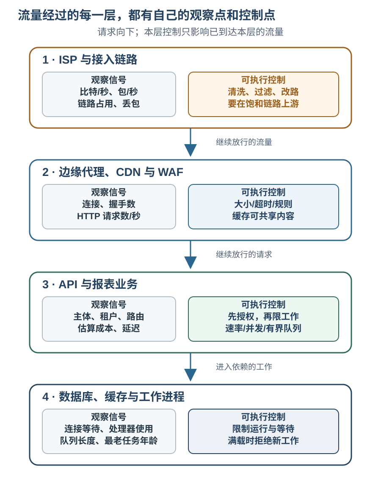

# Web 服务如何限制拒绝服务的影响？

denial of service (DoS，拒绝服务) 会用流量、连接或昂贵请求耗尽服务资源，让正常请求得不到响应；distributed denial-of-service (DDoS，分布式拒绝服务) 则由多个来源同时施压。能否缓解，取决于哪项资源先到上限，以及攻击流量到达了哪一层：如果上游链路已被占满，应用里的限流代码就收不到请求。

本例的报表对外提供 application programming interface (应用程序接口，API)，以 Hypertext Transfer Protocol (超文本传输协议，HTTP) 接收读取请求。边缘代理可以组合 Content Delivery Network (内容分发网络，CDN) 和 Web Application Firewall (Web 应用防火墙，WAF) 等服务；这些组件只在请求实际经过它们时才能发挥作用。

**合成案例。** `user-17` 有权读取 `tenant-a` 的报表 `42`。请求 `GET /reports/42?days=7` 只做短范围读取，按本例估算为 1 个工作点；`days=365` 会做长范围汇总，估算为 4 点。工作点只是本例的相对成本单位，不等于处理器秒或查询数。正常流量从 Internet Service Provider (互联网服务提供商，ISP) 经接入链路到边缘代理、报表 API 和数据库；上游清洗不是默认路径，只有 ISP 在应急时改路到清洗服务，清洗后的流量才继续到边缘。接入链路容量设为 1 Gbit/s；拟采用的 API 全局工作预算为突发 80 点、持续 40 点/秒，同时最多运行 12 个长汇总、等待队列最多 6 项。这些数值只供推演，没有对真实服务做过负载测试，不能直接当容量建议。

## 过载发生在哪一层，就在哪一层减压

先把链路利用率、边缘请求、API 工作量和数据库等待放在同一时间线上，再选择该层能执行的动作。单独看到流量升高或客户端失败，不能判断应用已经收到请求，也不能证明某个来源地址就是攻击者。

| 阶段与同时观察到的信号 | 解释与处理 |
| --- | --- |
| **平常流量。** 链路约 300 Mbit/s（容量的 30%）；边缘约 200 个 HTTP 请求/秒，其中进入报表 API 的短读取约 20 个/秒，即约 20 点/秒；API 与数据库等待稳定 | 这是本例基线，不是其他服务的正常值。这里的 200 个/秒是边缘总量，不是报表 API 的计费输入；20 点/秒低于拟采用的 40 点/秒全局持续预算。保留按链路、边缘、路由和数据库资源分层的时间序列。 |
| **网络洪泛。** 上游清洗尚未启用时，ISP 在其网络入口观测到约 1.4 Gbit/s 原始流量；服务接入接口容量为 1 Gbit/s，接口遥测显示占用 100% 且丢包上升；外部探针失败，API 请求数和数据库负载没有相应上升 | 1.4 Gbit/s 是清洗前 ISP 侧观测值，不是接入接口实际吞吐。接口饱和和丢包由接口遥测另行证实。通知 ISP/托管商按预案启用上游清洗并改路；应用限额和扩容碰不到未到达应用的流量。 |
| **应用洪泛。** 上游清洗和改路已生效；接入接口观测约 620 Mbit/s（容量的 62%），丢包回落，独立探针可到达边缘。应用侧工作预算和运行/等待上限启用前，边缘把每秒 250 个来自多个已认证主体且通过报表授权的长范围 HTTP 请求转给 API；数据库连接等待上升 | 此时有链路余量，过载转到应用和依赖。每次 4 点，入站工作约 1,000 点/秒，是拟采用的 40 点/秒全局持续预算的 25 倍；在昂贵查询前实施工作预算，并分别限制运行数与等待数。 |
| **降载后。** 链路和 API 错误下降；数据库等待、并发占用和队列年龄逐步回落；合法探针恢复 | 不因一次成功响应就撤掉规则。先用独立用户路径、容量信号和授权负例复验，再逐步撤销临时缓解。 |

这些观测是合成案例的输入，不是抓包、服务日志或压测结果。实践中要和该服务自身的正常基线、区域、路由和资源上限对照；合法突发也可能产生高请求数，攻击源还可能分散或伪装。把不同层的指标与外部用户探针并看，才能区分“流量没到 API”“请求到了但成本太高”和“依赖已排队”。

每种防护只能作用于它实际收到的流量：

| 层次 | 可用信号和控制 | 不能据此保证什么 |
| --- | --- | --- |
| ISP、托管商、上游网络 | 链路的比特率、包率、丢包及路由状态；预先约定上游清洗、封禁特定协议或流量改路 | 上游没提供清洗或改路时，源站应用无法恢复已被塞满的接入链路；清洗也须避免把合法用户一起丢弃。 |
| 边缘代理、CDN、WAF | 连接数、加密握手、请求大小、解析耗时和 HTTP 路由；限制头部/正文大小与超时，挡已识别的模式，缓存适合共享的公开表示 | Network Address Translation (网络地址转换，NAT) 会让多个合法用户共用一个地址，分布式来源也能绕开单来源地址阈值；规则看不到全部业务授权与查询成本。若请求可直连源站，也会绕过前置边缘。 |
| API 与业务逻辑 | 已认证主体、租户、路由、输入范围、估算工作量和响应延迟；按作用域限额，先授权再检查成本，在昂贵报表查询前限制并发 | 只按请求数计费会把一次廉价读取和一次长范围聚合算成同等工作；错误的用户范围或过低额度会误伤正常用户。 |
| 数据库、缓存、worker（工作进程）与队列 | 活跃连接和池等待、处理器使用率、队列长度及最老任务年龄；限制查询、并发、等待队列、执行时长和返回量 | 无界增加队列只会把过载延后，最终消耗内存、连接或存储并拉长恢复时间；应用降级也不能撤销已占满的上游网络。 |

边缘的 WAF 适合在它能看到请求的地方挡掉已知恶意模式或异常频率；它不是租户授权器，也未必能识别格式合法、却会触发昂贵查询的请求。不同边缘服务可检查的请求部分和超限处理方式也不同；例如 AWS WAF 可按请求部分大小匹配并阻止超限内容，但正文检查上限取决于前置服务；批量检查全部头部另有字节数与头部数量上限，单个头部检查不受这组批量限制。须明确配置超限时的规则行为，不能假设它检查了完整请求。CDN 可以吸收部分请求并从边缘返回重复的公开内容；租户私有报表不能作为未隔离的共享缓存对象返回。若架构依赖 CDN 作为唯一路径，还要限制源站只接受可信边缘转发的请求，否则攻击者可能绕过 CDN 直达源站。

应用在代理后看到的 `Forwarded` 或 `X-Forwarded-For` 字段，也不能直接当成可信客户端身份。RFC 7239 指出，转发链上任何节点（包括客户端）都可能修改 `Forwarded`；只有确认直连来源是可信代理、并让代理重写或正确维护字段后，才可据此使用来源地址。NAT 会让多个合法用户共用一个地址，僵尸网络又能分散来源，因此来源地址适合做早期信号或限额维度之一，不应是唯一额度键。

## 速率限制和工作上限怎样一起计算？

rate limit（速率限制）约束某个计数范围在一段时间内进入多少请求或工作点；quota（配额）约束较长周期内的总量；concurrency limit（并发上限）约束同一时刻运行多少操作；有界队列则限制已接受但尚未开始的工作。它们对应不同资源，不能互相替代。API 还要限制查询跨度、单次执行时间和结果大小，避免一个请求把资源占用拉得无限长。

本段单独演示账户令牌桶和“等令牌”的教学计算，不是主案例中的工作队列。假设一个账户的令牌桶初始有 8 点，每秒补充 4 点：20 个短读取同时到达且不开队列时，最多 8 个立即通过，其他 12 个拒绝；若这个教学示例另设最多 4 个请求等待令牌、下游有空槽且没有其他流量，令牌可每 0.25 秒再放行一个，到 `t=1` 秒边界时累计最多放行 `8 + 4 × 1 = 12` 点，仍有 8 个被拒绝。长汇总一次扣 4 点，因此单次突发最多放行 2 个；不是 8 个。桶满时，长度为 `T` 的窗口内最多可供给 `burst + rate × T` 点。该令牌预算上限不保证服务实际完成同样多的工作。

额度还要选对作用域。假设三个 API 进程各自维护一份同样的本地桶，每份都有 8 点突发、每秒补 4 点；各份桶在一秒内合计可供给 `3 × (8 + 4 × 1) = 36` 点。20 个单位成本请求在同一时刻按 `7、7、6` 分到三个进程，每份本地桶都能通过这一批，所以整个服务瞬间放行 20 点；按本例的单一账户策略，共享桶此刻原本只应突发放行 8 点。若预期是单一账户在一秒内最多消耗 12 点，就需要共享状态或分配总和不超过该额度的分片预算。共享计数会带来网络延迟和依赖可用性；选择前要明确计数近似到什么程度可接受。

每用户/租户的额度保护公平使用，全服务工作预算保护数据库总容量，二者叠加。若 250 个长汇总每秒到达，入站工作约 `250 × 4 = 1,000` 点/秒；当全局预算每秒补 40 点且全部分给这类请求时，稳态最多接受 `40 ÷ 4 = 10` 个/秒，其他业务工作会使实际上限更低，突发额度只能暂时延后拒绝。本例的主队列只存已通过身份和资源授权、已扣账户与全局工作预算、但暂时等运行槽的长汇总。受理时要原子地确认两级预算都有足够令牌，并预留一个运行位置**或**一个等待位置；前者可用就立即运行，运行槽已满但 6 个等待位尚有空位就入队。只有预算不足，或运行位和等待位都不可用时才快速拒绝；不要要求运行位与等待位同时空闲。若所有位置都空且各相关主体额度充足，80 点突发预算理论可支付 20 个长汇总，但 12 个运行位与 6 个等待位最多只收 18 个，共扣 72 点；位置先于令牌成为约束。运行上限 12 与队列上限 6 合计最多持有 18 个长汇总，不表示它们都能及时完成。

限流键要随认证阶段变化：未登录请求可先按连接、网络段和廉价端点策略限制；认证后再组合主体、租户、路由与估算成本。先做正文大小、语法等低成本检查，再认证与授权、估算已经验证过的请求成本，最后在昂贵查询前申请预算和执行槽。滥用防护不能把登录锁定做成攻击者可远程触发的封禁服务，也不能信任客户端自报的租户、权重或任意转发头。

图形人机验证可以为某些高滥用功能增加一道摩擦，例如限制自动化提交；它不能阻止填满上游链路的流量，也不能取代请求大小、连接、速率和工作量上限。OWASP 的 DoS 指引明确指出，人机谜题并不能防止 DoS 攻击。针对自动化滥用可以组合挑战、账户信誉和专用业务规则，但这只是应用层的一类控制。

正常业务的容量估算、数据库连接预算和异步任务准入见[如何估算并限制异步工作管线？](../reliability/api-capacity-and-backpressure.md)。本页的工作预算是在攻击者能分散请求时保持边界，不代表服务已测得的可持续吞吐量。

## 限额触发时如何让客户端和服务一起恢复？

当单个调用主体或其合同额度超限时，API 可以返回 `429 Too Many Requests（请求过多）`，并可用 `Retry-After` 告诉调用方何时再试；RFC 6585 也提醒，攻击期间为每个请求都生成 `429` 本身会消耗资源，服务不必对每个请求都如此响应，也可以在攻击时丢弃连接。若服务整体暂时无法处理，可以返回 `503 Service Unavailable（服务不可用）`，RFC 9110 允许附 `Retry-After` 建议等待时间。状态码表示当前响应的结果，不会自行清空排队工作或保证之后可用。

客户端应尊重等待提示和自身截止时间，并用有上限、带随机抖动的指数退避，避免许多客户端在同一秒重试形成第二波流量。不要让每一层代理和应用都自动重试同一失败，否则下游实际接收到的请求会倍增。对会产生副作用的 `POST`，按[请求超时后的结果确认与安全重试契约](../reliability/api-reliability-and-async-delivery.md)核实幂等条件后再重放。对于会启动异步导出的写请求，只有持久接受后才返回本例合同中的 `202`；容量不足时应在承诺前拒绝，具体受理事务见容量页。

过载时的 load shedding（负载削减）是停止接纳暂时无法处理的新工作，先保住仍能可靠提供的路径。例如，本例可暂停 365 天汇总，给短范围读取保留容量；若产品允许，也可从按租户隔离并经授权的缓存提供带时效说明的旧快照。不能因为想“快速响应”就从共享 CDN 返回其他租户的报表；读缓存仍要走正确身份和授权边界。配置 WAF 规则、验证码或 CDN 单独无法确保 API 与数据库会恢复。

缓解动作至少要在以下证据同时改善后，才逐步撤掉临时规则：

1. ISP/托管商确认清洗路由已生效；清洗后的接入接口低于本案例的 1 Gbit/s 容量，丢包回落，来自独立网络的探针能稳定到达边缘。仅凭清洗后的 620 Mbit/s 不能判断原始洪泛已经结束；停用清洗或改回原路由前，还要看 ISP 侧清洗前流量和提供商的安全回切判断，切换中继续观察接口丢包。
2. 边缘请求数和回源率回落；源站拒绝非可信代理直连的检查通过；对公开静态资源的缓存命中增加时，没有把私有报表送入共享缓存。
3. API 的长汇总并发不超过 12、队列不超过 6 且队列年龄下降；数据库池等待与查询延迟回到基线附近。缓解时限额拒绝可能先上升；要同时看合法用户成功率、被拒工作和依赖负载，不能只看 API 错误下降。
4. 用 `user-17` 请求 `tenant-a` 的短范围报表，核对内容正确；用无权访问该租户的 `user-guest` 重复探测，仍按 API 合同拒绝。按本例策略消耗尽单主体令牌后应得到限额响应，而不是继续启动重查询。
5. 若 365 天汇总曾暂停，先给 `user-17` 小流量放开一次合法长汇总，核验结果、查询耗时、数据库等待、并发和队列；稳定后再逐步恢复正常长汇总准入，并持续观察这些依赖信号。短读取通过不能证明长查询已经恢复。
6. 客户端收到 `Retry-After` 后确实等待；临时应用/边缘限制分步放宽时，重复同一组短读、长汇总和无权探针，观察合法成功率、拒绝率、链路和数据库信号。若任一条件回退，就恢复刚放宽的策略并重新定位瓶颈；常驻工作预算和并发/队列上限仍按测得容量保留。

这里的判据是合成案例的恢复清单，不是对线上服务的实测。应急结束后保存开始/结束时刻、受影响路由、各层信号、提供商和边缘动作、拒绝/误伤情况与恢复探针结果，再据此调整常驻额度与预案。攻击路径记录和事后响应步骤可参考[如何从报表服务信号定位发布后的故障？](../reliability/observability-slos-and-incident-response.md)；本页不把一次 HTTP 成功当作全服务恢复的证明。

> [!info]- 来源
> - DoS/DDoS 多层攻击面、资源密集型输入、限速、ISP 与过滤服务边界，以及 CAPTCHA（图形人机验证）的功能滥用局限：[OWASP Denial of Service Cheat Sheet](https://cheatsheetseries.owasp.org/cheatsheets/Denial_of_Service_Cheat_Sheet.html)，Fundamentals、Analyzing DoS attack surfaces、Application attacks、Input validation、Rate limiting、ISP-Level remediations、Global-Level remediations；核对于 2026-11-13。
> - 流量基线、攻击指标、联系 ISP/托管商、上游过滤/CDN 与事后分析：[CISA、FBI、MS-ISAC, Understanding and Responding to Distributed Denial-of-Service Attacks](https://www.cisa.gov/sites/default/files/2024-03/understanding-and-responding-to-distributed-denial-of-service-attacks_508c.pdf)，2024-03，What Steps Before、How to Know、How to Respond、After an Attack；核对于 2026-11-13。具体步骤须按组织的上游服务与应急约定裁剪。
> - `429 Too Many Requests` 和攻击期间不必对每个请求都生成 `429`：[IETF RFC 6585](https://www.rfc-editor.org/rfc/rfc6585.html)，§4、§7.2，2012-04；临时过载 `503` 与 `Retry-After`：[IETF RFC 9110](https://www.rfc-editor.org/rfc/rfc9110.html)，§10.2.3、§15.6.4，2022-06。
> - 过载时拒绝多余工作、限制连接负载与保护关键路径：[Google SRE Book, Handling Overload](https://sre.google/sre-book/handling-overload/)，Customer Quotas and Throttling、Criticality、Load from Connections、Conclusions；该书《Site Reliability Engineering: How Google Runs Production Systems》由 Google Research 记录为 O’Reilly 2016 年出版 ([书目记录](https://research.google/pubs/site-reliability-engineering-how-google-runs-production-systems/))。其中的实现经验不作为所有服务的固定配额。
> - 随机指数退避、限制重试次数，以及避免多层重试放大：[Google SRE Book, Addressing Cascading Failures—Retries](https://sre.google/sre-book/addressing-cascading-failures/#retries)，同属 2016 年版 SRE 书。
> - 令牌桶在时间窗 `T` 内的 `burst + rate × T` 供给上限：[IETF RFC 1363, A Proposed Flow Specification](https://www.rfc-editor.org/rfc/rfc1363.html)，Definition of Individual Fields 下的 Token Bucket Rate 和 Token Bucket Size，1992-09。这里引用其令牌桶模型说明算式，不表示该 1992 年提案是现代 API 限流的部署标准。
> - CDN 只应是实际请求路径的入口，并需保护源站免于被绕过：[AWS Best Practices for DDoS Resiliency, Protecting your origin (BP1, BP5)](https://docs.aws.amazon.com/whitepapers/latest/aws-best-practices-ddos-resiliency/protecting-your-origin-bp1-bp5.html)，核对于 2026-11-13；所列 CloudFront/VPC origin 配置是 AWS 的具体实现例，不是跨供应商要求。
> - 按请求正文/头部大小拦截超限内容及其检查字节范围：[AWS WAF, Oversize web request components](https://docs.aws.amazon.com/waf/latest/developerguide/waf-oversize-request-components.html)，核对于 2026-11-13。正文检查上限取决于前置 AWS 服务；批量头部检查另有大小/数量上限，单头检查不受该批量限制。允许超限内容通过时，WAF 未必检查完整组件；这是 AWS 配置例，不是所有边缘服务的统一行为。
> - 私有响应不得在共享缓存间复用的缓存指令：[IETF RFC 9111](https://www.rfc-editor.org/rfc/rfc9111.html)，§5.2.2.7，2022-06。应用是否另设授权隔离缓存仍属应用合同。
> - 代理转发地址头可能被链中节点或客户端修改：[IETF RFC 7239](https://www.rfc-editor.org/rfc/rfc7239.html)，§8.1，2014-06；nginx 的可信代理配置示例：[ngx_http_realip_module](https://nginx.org/en/docs/http/ngx_http_realip_module.html)，`set_real_ip_from` 与 `real_ip_header`，核对于 2026-11-13。
