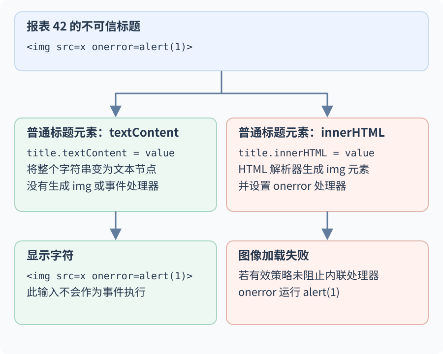
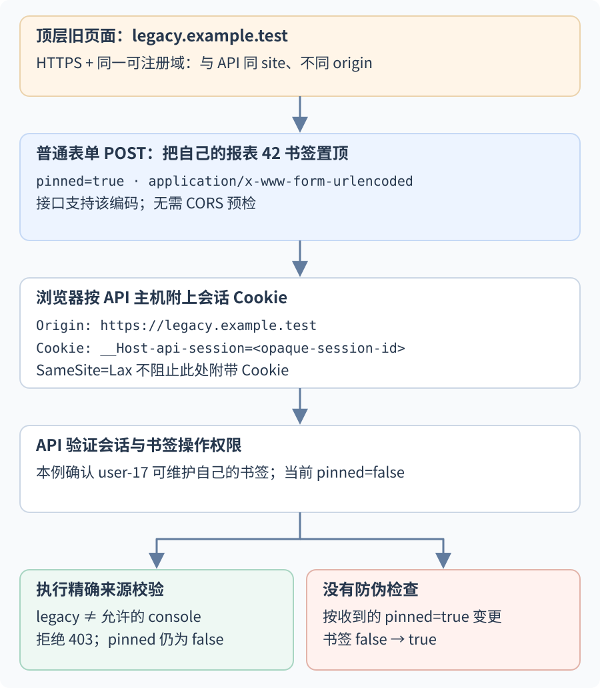
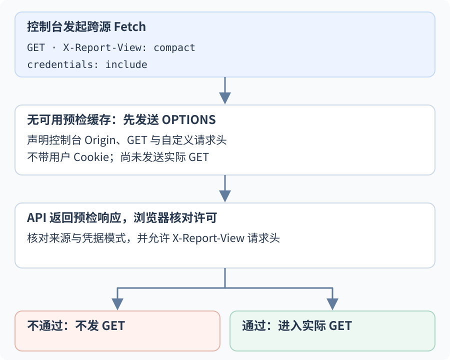
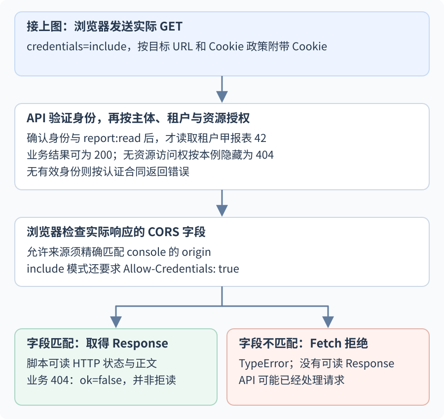

# 浏览器安全控制分别保护什么信任边界？

**案例背景。** 认证层已确认请求主体是 `user-17`；他是 `tenant-a` 的 `reader`，可读取租户甲的报表 42，报表内容为合成数据 `Service health`。页面由 `https://console.example.test` 提供，API 位于 `https://api.example.test`。API 设置 host-only 会话 Cookie `__Host-api-session`；本文讨论的登录态和权限均是案例输入，不代表浏览器控制本身会授予访问权。另有不可信的旧子域 `https://legacy.example.test`，用于检查“同站”是否足以代表可信。本例中用户直接打开这个旧子域页面，它是浏览器的顶层页面。

这些地址共用 `example.test`，只用于讲解。下面依次跟着一次连接、一段不可信标题、一项书签变更和一次跨源读取，看这些控制分别在何处生效：

| 边界 | 控制与成立条件 | 失败时会怎样 | 它不负责什么 |
| --- | --- | --- | --- |
| 网络链路 | HTTPS 的证书身份验证与 TLS 加密传输 | 验证失败时连接应终止或显示证书错误；若退回明文，链路保护消失 | 识别应用用户或决定用户能否读报表 |
| 页面解释数据 | 用适合目标上下文的安全 DOM 接口或编码；富文本另行消毒 | 不可信标记被 HTML 解析后，可能生成元素、事件处理器或可执行脚本 | 限制已经运行的同源脚本 |
| Cookie 自动发送 | CSRF token 或经审查的来源验证在服务端、状态变更前执行 | Cookie 仍可能随请求到达；防护失败会让伪造操作进入业务逻辑 | 认证本身、对象授权或脚本注入 |
| 浏览器跨源读取 | 预检时允许请求方法与请求头；实际响应的来源和凭据字段匹配请求 | 预检失败时浏览器不发后续的非简单请求；实际响应检查失败时脚本读不到响应 | 拦住所有请求、保护非浏览器客户端或授权报表 |
| 页面嵌入 | 报表响应的 CSP `frame-ancestors` 允许每个祖先来源 | 浏览器拒绝在不允许的祖先页面中呈现该页面 | API、附件和后台任务的服务端权限 |

## 网络连接如何保护数据并认证服务端？

本例使用带服务器证书的 HTTPS；Transport Layer Security (传输层安全协议，TLS) 在 HTTP 之下保护连接。浏览器验证链路上的证书身份与目标主机匹配，并成功完成 TLS 握手后，TLS 保护该连接上后续应用数据的机密性和完整性；证书身份匹配说明客户端连到预期服务端。错误证书、主机名不匹配或握手失败时，浏览器不能把该连接当作正常受保护的会话。证书撤销状态依赖客户端与部署所用的机制及其新鲜度，不应假设浏览器会在每个请求上即时查询撤销状态。

TLS 只保护浏览器到服务端的传输。它不知道请求当前代表 `user-17`，也不判断 `report 42` 属于哪个租户。即使 HTTPS 完全正常，API 仍须验证会话，并按当前主体和租户逐项授权。

## 不可信报表标题怎样安全显示？

Cross-Site Scripting (跨站脚本攻击，XSS) 发生在不可信数据变成可执行内容时。Document Object Model (文档对象模型，DOM) 是浏览器页面中的节点树。假设报表 42 的标题是 `  `。`textContent` 会把它作为普通字符放进一般的标题元素；`innerHTML` 则把字符串交给 HTML 片段解析器。若图像加载失败且内联事件处理器没有被有效策略拦下，解析出的 `onerror` 可以运行。



所以普通文本应使用框架默认安全的文本插值或一般元素的 `textContent`。需要把值放入 HTML 属性时，固定元素和属性名，并使用该属性上下文对应的编码；HTML 属性编码不会验证 URL 的语义，例如是否允许 `javascript:`。不要把不可信值拼进脚本、事件处理器、CSS 规则、标签名或属性名。只有产品确实支持用户撰写富文本时，才用维护中的 HTML 消毒器过滤允许的元素和属性；清理后再改写内容可能重新引入风险。框架的 raw HTML 入口仍需这些检查；不要把不可信字符串交给 `document.write`、`eval` 或 `new Function`，文本插值的安全性不会传递给这些解析或执行入口。

Content Security Policy (内容安全策略，CSP) 的脚本指令可以限制内联脚本或脚本来源，降低某些注入的可利用性；这属于纵深防御，不能让 `innerHTML` 变成安全文本接口。如果在 `console.example.test` 展示的标题已执行恶意脚本，它通常能以控制台页面的权限调用该源可用的接口；若 API 也允许该 origin 通过 CORS 读取，脚本还可能带着浏览器凭据读取 API 响应。`HttpOnly` 只阻止脚本直接读取 Cookie 值，不阻止它调用 `fetch` 让浏览器代为发送 Cookie。因此仍需修复注入点并在 API 检查每个资源。

## Cookie 自动发送时，怎样防止伪造变更？

Cross-Site Request Forgery (跨站请求伪造，CSRF) 利用浏览器自动携带的登录凭据，让另一个页面发起用户没有意图执行的变更。

Origin (源) 由协议、主机和端口组成；site (站点) 采用 schemeful site 判定，端口不参与比较，同一可注册域下的 HTTPS 子域属于同站。于是 `https://legacy.example.test` 与 `https://api.example.test` 是不同 origin，却是同 site。子域可由不同团队、租户或旧系统控制，因此“同站”不能当作同源或可信身份的替代物。

会话 Cookie 示例为：

~~~http
Set-Cookie: __Host-api-session=<opaque-session-id>; Path=/; Secure; HttpOnly; SameSite=Lax
~~~

`__Host-` 要求 `Secure`、`Path=/` 且不带 `Domain`，所以旧子域不能把这个 Cookie 的作用域扩大到 API 主机。但用户登录 API 后，浏览器会在目标主机、路径、Secure 要求及其他 Cookie 发送条件都匹配时，自动把它附加到发往 `api.example.test` 的请求。控制旧子域的脚本不必读取该 Cookie，就可能借用户现有会话发起请求。Cookie 怎样建立会话见[Cookie 会话与 OIDC 令牌怎样建立身份？](web-sessions-and-oidc.md)。

为了具体展示状态变化，本节的合成 API 另允许 `reader` 维护自己的报表书签；这不授予 `report:refresh` 或 `report:export`。书签初始为未置顶 (`pinned=false`)，这个示例端点接受 `application/x-www-form-urlencoded` 表单编码，并将 `pinned=true` 解释为置顶。旧子域提交下面的普通表单：

~~~html
<form action="https://api.example.test/api/tenants/tenant-a/reports/42/bookmark" method="post">
  <input name="pinned" value="true">
</form>
<script>document.forms[0].submit();</script>
~~~

两个页面都是 HTTPS 且同站，所以即使 Cookie 设置为 `SameSite=Lax`，发往 API 的同站表单 POST 仍可附带会话 Cookie。这个表单请求使用浏览器可直接提交的格式，不需要 CORS 预检。攻击页面不需要读回响应，副作用就可能发生。

下面用服务端精确检查 `Origin` 的变体画出结果；CSRF token 是正文随后说明的另一种防伪机制。两条分支比较同一个未置顶书签在两种实现下的结果。



API 仍要先从有效 Cookie 会话得到 `user-17`，再检查该主体是否能执行这项书签操作，然后验证与当前会话绑定的 CSRF token，或执行经审查的等价来源校验。应用先选定并贯彻自己的校验策略：要求 token 的接口拒绝缺少或无效 token；图中的来源校验变体只接受精确的控制台 origin，并拒绝缺失、`null` 或不匹配的来源值。两者都应在变更前拒绝，书签保持 `pinned=false`；这个校验只说明请求通过了该防伪机制，不证明用户表达了操作意图。若用 token 作为主要校验，传统表单必须提交攻击者无法跨源取得的有效 token。

显式设置为 `SameSite=Lax` 通常会限制真正跨站的不安全方法请求，但允许符合规则的顶层安全方法导航携带 Cookie；因此 GET 等安全方法不能改状态。它也不拦截上面的同站子域请求。若合法流程确实需要在 Lax 排除的跨站上下文中发送 Cookie，才考虑 `SameSite=None; Secure`；浏览器的第三方 Cookie 政策仍可能限制它，而且应用仍须单独防 CSRF。若同源 XSS 已执行，恶意脚本可能读取页面里的 token 或调用正常请求接口，不能把 CSRF token 当作 XSS 修复。

## 同源策略如何控制跨源响应读取？

same-origin policy (同源策略，SOP) 默认限制页面脚本读取另一个 origin 的页面或响应。API 可用 Cross-Origin Resource Sharing (跨源资源共享，CORS) 明确开放 Fetch 响应；这是对浏览器默认读取限制的受控放行。

控制台脚本访问独立 API 时，浏览器依据目标 URL、Cookie 属性和 Fetch 凭据模式决定 Cookie 是否符合发送条件。跨 origin 的 Fetch 默认不带目标源 Cookie；本例显式使用 `credentials: "include"`。Cookie 值仍由浏览器管理，脚本不能手动设置 `Cookie` 请求头，也不能读取 `Set-Cookie` 响应头。

```javascript
const response = await fetch('https://api.example.test/api/tenants/tenant-a/reports/42', {
  credentials: 'include',
  headers: { 'X-Report-View': 'compact' },
});
```

`X-Report-View` 不是 CORS safelisted request header。假设没有可用的预检缓存，浏览器先发不带用户 Cookie 的预检，请 API 声明此来源、方法、请求头和凭据模式是否可被共享：

```http
OPTIONS /api/tenants/tenant-a/reports/42 HTTP/1.1
Host: api.example.test
Origin: https://console.example.test
Access-Control-Request-Method: GET
Access-Control-Request-Headers: x-report-view
```

API 同意本例控制台读取时，可对预检返回：

```http
HTTP/1.1 204 No Content
Access-Control-Allow-Origin: https://console.example.test
Access-Control-Allow-Methods: GET
Access-Control-Allow-Headers: X-Report-View
Access-Control-Allow-Credentials: true
Vary: Origin
```



预检通过后，浏览器才发送实际 GET。由于 Cookie 由 API 主机设置且本例两个 HTTPS 子域同站，若其余 Cookie 条件符合，实际请求可以带上它：

```http
GET /api/tenants/tenant-a/reports/42 HTTP/1.1
Host: api.example.test
Origin: https://console.example.test
Cookie: __Host-api-session=<opaque-session-id>
X-Report-View: compact
```

服务器此时仍须认证 Cookie、确认 `user-17` 当前属于 `tenant-a` 并有 `report:read`，再按租户与 ID 读取 42。仅在允许分享该结果时，实际响应本身才返回匹配的 CORS 字段：

```http
HTTP/1.1 200 OK
Content-Type: application/json
Cache-Control: private, no-store
Access-Control-Allow-Origin: https://console.example.test
Access-Control-Allow-Credentials: true
Vary: Origin

{"id":42,"title":"Service health","status":"ready"}
```



对于 `credentials: "include"` 的请求，响应必须使用精确允许的 origin 和小写字面值 `true`，不能用 `Access-Control-Allow-Origin: *`。即便服务器返回了 `200`，若实际响应缺少匹配的允许来源或 `Access-Control-Allow-Credentials`，Fetch 会以 `TypeError` 拒绝，脚本拿不到这个响应的状态和正文；请求本身可能已经抵达并完成读取。隐藏式 `404` 若也要由控制台识别，同样需要可读的 CORS 响应字段：此时 Fetch 正常返回 `Response`，`response.status === 404` 且 `response.ok === false`，不是 CORS 导致的网络错误。相反，若预检响应不允许请求头或来源，浏览器不会发送这个带自定义头的后续 GET，Fetch 也以 `TypeError` 拒绝。没有预检的简单表单请求则可能先到服务器，所以两条失败路径都不能代替 API 的身份和授权检查。

CORS 是浏览器将跨源响应分享给脚本的协议，不是通用网络防火墙，不限制 `curl` 等客户端，也不替服务端授权。动态选择 `Access-Control-Allow-Origin` 时，`Vary: Origin` 让 HTTP 缓存区分不同来源的表示；它不区分同一个来源下的不同用户。对本例的私人报表，`Cache-Control: private, no-store` 表示合规 HTTP 缓存不得保存响应；这是缓存存储指令，不是服务端授权或绝对隐私保证。若产品需要可缓存表示，则要按 HTTP 缓存规则设计，并确保用户范围不会被别人的请求复用。`Vary: Origin` 本身不保护私有数据。若部署允许把 API 反向代理到页面同源的 `/api/`，可以省去这次跨源读取协商；会话也须能在控制台主机建立，因为 API 主机原有的 host-only Cookie 不会发给控制台主机。身份认证与资源授权仍照常执行。

> [!info] Fetch 对 Cookie 字段的边界
> 浏览器按目标 URL 和 Cookie 政策管理 `Cookie` 请求字段；网页脚本不能用 Fetch/XHR 手动设置它。`Set-Cookie` 是禁止暴露给脚本的响应字段，增加 `Access-Control-Expose-Headers` 也不能让网页读取该字段，无论 Cookie 是否设置了 `HttpOnly`。

## 什么时候限制页面被嵌入？

点击劫持会把真实页面放进攻击者控制的框架，再诱导用户点错位置。报表页面可以通过 HTTP 响应头限制哪些祖先来源可嵌入它：

~~~http
Content-Security-Policy: frame-ancestors 'self'
~~~

策略只允许同源祖先；任意一层祖先来源不匹配时，浏览器拒绝在该框架中呈现报表。必须用响应头发送 `frame-ancestors`；放进 `meta` 元素不会生效。旧客户端兼容需要可另评估 `X-Frame-Options`，并按目标浏览器验证策略。嵌入控制保护报表界面不被伪装成按钮，但不会阻止攻击者直接请求 API，也不会替 API 检查报表 42 的权限。

WebSocket 握手不使用 CORS 的响应字段来授权。浏览器会在握手中发送 `Origin`；服务端应按允许来源校验它，并验证连接身份。非浏览器客户端可以伪造或省略 `Origin`，所以它不能代替认证。连接建立也不等于对所有动作有权；每条读取或变更消息仍按资源和动作授权。双向消息与断线恢复见[何时选择轮询、SSE、流式 Fetch 或 WebSocket？](../networking/real-time-web-updates.md)。

**接下来：** TLS 保护网络链路；安全呈现控制数据如何进入页面解释器；CSRF 防护验证自动附带 Cookie 的变更请求；CORS 决定脚本能否读取跨源响应；CSP 的 `frame-ancestors` 限制页面嵌入方。它们都不改变身份层已经确认的主体，也不取代[对报表 42 的服务端逐次授权](web-security-and-authentication.md)。

> [!info]- 来源
> - TLS 1.3 的握手认证与数据机密性、完整性：[IETF RFC 9846](https://datatracker.ietf.org/doc/html/rfc9846)，2026-07，§§2、4.5、5.2；服务器身份与目标主机匹配：[RFC 9525](https://www.rfc-editor.org/rfc/rfc9525.html)，2023-11，§§1.1、6；证书撤销没有完整且高效的通用检查方案：[RFC 9325](https://www.rfc-editor.org/rfc/rfc9325.html)，2022-11，§7.5。均核对于 2026-11-12。RFC 9846 已取代 RFC 8446。
> - Chromium 的 CRLSet 更新与浏览器端撤销数据示例：[Chromium CRLSet](https://www.chromium.org/Home/chromium-security/crlsets/)，核对于 2026-11-12。客户端采用的状态机制及新鲜度因实现而异。
> - origin 的协议、主机、端口及 same-site 的 schemeful site 判定：[WHATWG HTML Standard](https://html.spec.whatwg.org/multipage/browsers.html#origins)，Living Standard，2026-11-12，§7.1.1。
> - Cookie 作用域、`__Host-` 前缀和 `SameSite` 请求条件：[HTTPWG Cookies Internet-Draft](https://httpwg.org/http-extensions/draft-ietf-httpbis-rfc6265bis.html)，2026-11-12 draft，§§4.1.3.2、5.6.7；它仍是工作草案。Cookie 被 Fetch 如何处理另见 [WHATWG Fetch Standard](https://fetch.spec.whatwg.org/#cookies)，Living Standard，2026-10-19。
> - DOM 安全呈现、上下文编码、危险上下文、富文本消毒以及 CSP 的 XSS 纵深防御：[OWASP Cross Site Scripting Prevention Cheat Sheet](https://cheatsheetseries.owasp.org/cheatsheets/Cross_Site_Scripting_Prevention_Cheat_Sheet.html)，Safe Sinks、Output Encoding、Dangerous Contexts、HTML Sanitization、Other Controls，核对于 2026-11-12。
> - Cookie 认证状态变更的 CSRF token、Origin/Referer 校验和 SameSite 的限制：[OWASP Cross-Site Request Forgery Prevention Cheat Sheet](https://cheatsheetseries.owasp.org/cheatsheets/Cross-Site_Request_Forgery_Prevention_Cheat_Sheet.html)，Synchronizer Token、Defense in Depth、SameSite 与 Origin Validation，核对于 2026-11-12；SameSite 规则同时见上一条 Cookie 草案 §5.6.7。
> - 预检、CORS 凭据和 CORS 检查：[WHATWG Fetch Standard](https://fetch.spec.whatwg.org/#cors-protocol)，Living Standard，2026-10-19，§§3.3.1–3.3.5、4.8–4.10；`Cookie` / `Set-Cookie` 字段限制见 §§2.2.2、3.1。
> - HTTP 缓存的 `private`、`no-store` 与共享缓存约束：[IETF RFC 9111](https://www.rfc-editor.org/rfc/rfc9111.html)，2022-06，§§3–4、5.2.2.5、5.2.2.7。
> - `frame-ancestors` 的祖先匹配与禁止通过 `meta` 声明：[W3C Content Security Policy Level 3](https://www.w3.org/TR/CSP3/#directive-frame-ancestors)，Working Draft，2026-10-27，§6.4.2。
> - WebSocket 握手 `Origin` 字段、非浏览器客户端可自行提供来源值：[IETF RFC 6455](https://www.rfc-editor.org/rfc/rfc6455.html)，§§1.6、4.1、10.1–10.2，2011-12；来源允许列表、连接认证和消息级授权：[OWASP WebSocket Security Cheat Sheet](https://cheatsheetseries.owasp.org/cheatsheets/WebSocket_Security_Cheat_Sheet.html)，Authentication and Authorization，核对于 2026-11-12。
