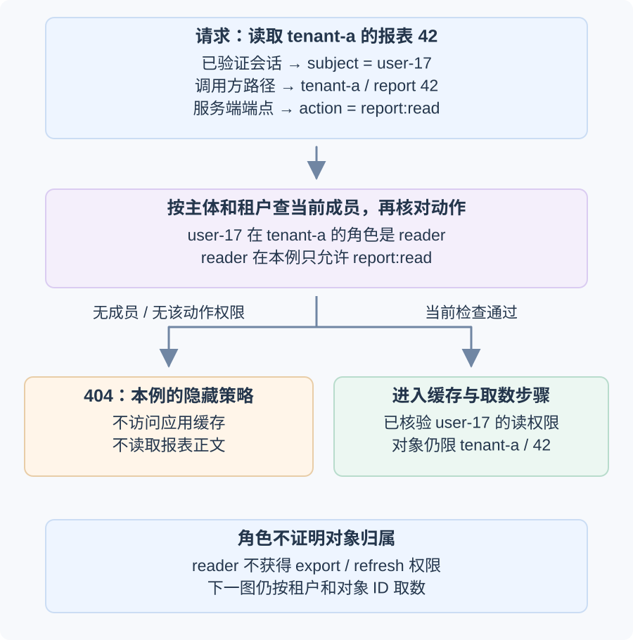
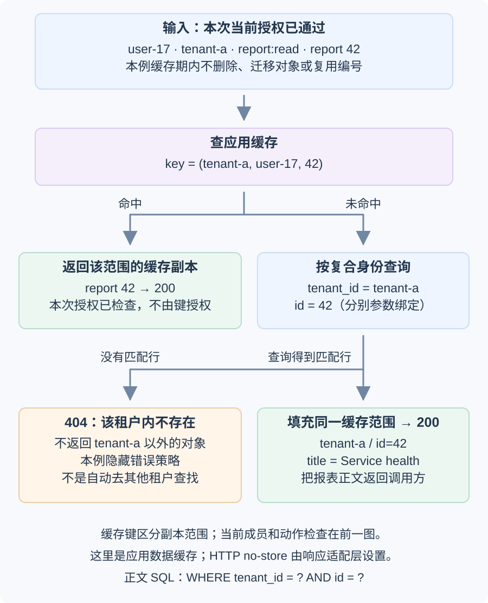
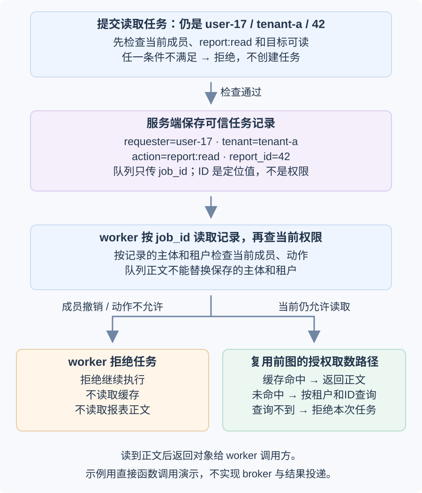

# 如何逐次授权租户内的报表资源？

Authentication (身份认证) 确认请求代表哪个主体；authorization (授权) 判断该主体此刻能否对指定资源执行指定动作。路径中的租户是调用方选择的上下文；请求正文、缓存键和队列消息里的用户 ID、租户 ID、角色名或报表编号也不能自行证明权限。

**合成案例：** 浏览器请求 `GET /api/tenants/tenant-a/reports/42`。上游会话检查已把请求映射到可信主体 `user-17`；路径里的 `tenant-a` 和 `42` 是调用方选择的范围与资源编号，服务端仍须查验。当前成员表显示该主体是 `tenant-a` 的 `reader`，报表 42 属于 `tenant-a`，标题为 `Service health`。`reader` 只有 `report:read`，不能由此推出刷新或导出权限。

> [!warning] 缓存命中的前提：对象身份不能悄悄变化
> 本例没有额外的单报表访问控制规则，报表归属不变；在缓存或任务有效期间不删除报表行，也不复用 `(tenant_id, id)`。若系统允许删除、迁移或复用编号，缓存命中前必须核验仍是同一对象及当前访问规则，或在变更时可靠失效相关副本，并定义待执行任务的行为；本例不实现这些机制。

本例把无成员、无动作权限和该租户内资源不存在统一隐藏为 `404`，这不是所有 API 必须采用的状态码策略。隐藏错误码、缓存键、任务记录字段和撤权时点也都是本案例的约定，实际系统要根据资源生命周期和任务副作用定义。

| 请求状态 | 当前数据条件 | 本例结果 |
| --- | --- | --- |
| `user-17` 请求 `tenant-a` 的 `report:read` / 42 | 当前成员是 `reader`，复合键 `(tenant-a, 42)` 存在 | `200`，返回 `Service health` |
| `user-29` 请求 `tenant-b` 的 `report:read` / 73 | 当前成员是 `reader`，复合键 `(tenant-b, 73)` 存在 | `200`，返回其租户的 `Usage summary` |
| `user-29` 请求 `tenant-b` 的 `report:read` / 42 | `user-29` 是 `tenant-b` 的 `reader`，但 `(tenant-b, 42)` 不存在 | `404`，不读取 `tenant-a` 的 42 |
| `user-29` 请求 `tenant-a` 的 `report:read` / 42 | 没有当前 `tenant-a` 成员关系 | `404`，按本例隐藏策略处理 |
| `user-17` 被移出 `tenant-a` 后重读或执行排队任务 | 成员关系已撤销，即使缓存已有旧正文 | API 按隐藏策略返回 `404`；本例 worker（从队列取任务并执行的服务端进程）拒绝继续执行 |

这些都是用户范围的响应；本例的 HTTP 适配层对报表正文和隐藏授权结果设置 `Cache-Control: private, no-store`，要求合规 HTTP 缓存不存储这些响应。下面的 Python `read_api` 只返回状态码和正文，不实现该 HTTP 响应头。RFC 9110 允许 `404` 启发式缓存，因此不能靠状态码本身阻止缓存或完成授权。下文的命中/未命中则是独立的服务端应用数据缓存。

## 从可信主体到报表 42 的读取，需要经过哪些检查？

1. 认证层先把 Cookie 会话或访问令牌映射为可信主体。不要把请求头或请求体里的 `user_id` 当作登录结果；凭据和联邦登录见[Cookie 会话与 OIDC 令牌怎样建立身份？](web-sessions-and-oidc.md)。
2. 将路径里的 `tenant-a` 当作用户选择的范围，查该主体此刻在该租户的成员关系。用户可在不同租户拥有不同角色；客户端报来的 `tenant_id` 和 `role` 都不能取代服务端当前状态。
3. 将动作和对象一起检查：`reader` 可执行 `report:read`，不因此获得 `report:refresh`、`report:export` 或管理权限。有效会话只说明主体是谁，不说明此动作获准。未明确授予的动作默认拒绝。
4. 数据读取按 `(tenant_id, report_id)` 过滤。不要先按全局编号装入私有对象，再依赖隐藏链接、难猜 ID 或 UI 隐藏完成授权。
5. 对缓存、附件和后台任务等旁路逐一确认同一授权条件确实生效。worker 的服务账号最小权限限制其调用能力，不替最终用户的资源授权。

### 角色能授予什么动作，资源检查还要做什么？

Role-Based Access Control (RBAC，基于角色的访问控制) 用 `reader`、`admin` 等角色归纳允许动作，适合表达租户成员的常见权限。本例的 `reader` 只对应 `report:read`。角色不能证明报表 42 属于当前租户，也不能阻止本应在每次请求重查的成员关系变旧。若采用单报表分享、部门属性或其他关系条件，策略还要把这些条件加入对象访问判断。

## 数据库与缓存怎样保持同一授权范围？

把租户和报表编号分别作为绑定值传入 SQL：

下面的 `?` 是本页 Python `sqlite3` 复现使用的占位符写法；实际语法按数据库驱动选择。无论占位符如何书写，都把值作为参数绑定，不要用字符串拼接组成条件。

~~~sql
SELECT id, title, body
FROM reports
WHERE tenant_id = ? AND id = ?;
~~~

参数绑定防止输入改写 SQL 语法；授权检查决定当前主体能否读取绑定后的对象。两者解决不同问题：绑定参数后读取 `report_id=73` 仍可能越权；完成授权但拼接 SQL 仍可能被注入。动态排序字段通常不能作为一般参数绑定，应从固定允许列表里选择。

本例的数据库用复合主键 `(tenant_id, id)` 标识租户内报表；这使每个租户的编号空间明确。查询仍须保留两个谓词，因为主键约束数据形状，并不判断当前用户是否有权读该行。队列里的任务引用也应按同一复合身份解析。

这里的缓存指服务端应用数据缓存，不是浏览器或共享 HTTP 缓存。API 先重查当前成员和 `report:read`，只有通过后才用 `(tenant_id, subject, report_id)` 查缓存；缓存键限制副本范围，但本身不是授权凭据。未命中时按复合键执行 SQL，只有读到属于该租户的行才填充同一范围的缓存。缓存命中还依赖开场约定的对象生命周期；缓存键不能证明对象没有被删除、迁移或复用。参见[如何控制数据库缓存的新鲜度？](../backend/caching-and-redis.md)。

## 后台任务如何继续执行相同的访问政策？

排队前先按任务的实际动作授权，再由服务端保存可信任务记录。队列消息只携带任务 ID；worker 按 ID 取出已经保存的请求人、租户、动作和报表编号，不把消息正文当成这些字段的权威来源。任务 ID 只是定位记录的值，不是权限凭据。

本例选择“执行时仍须有权限”：排队时 `user-17` 可读 `tenant-a` 的 42，worker 开始执行前重新查该用户的当前成员关系与动作权限；若成员已撤销，任务在读取缓存或报表正文前就被拒绝。这里的“当前”指 worker 检查时读到的成员状态；若生产环境的读副本或授权缓存会滞后，撤权生效期限须由系统明确，已经通过检查的执行是否中途停止也需按产品定义。若另一产品定义为“已受理任务继续”，它应持久化可审计的受理授权决定，并明确后续读取、导出等副作用仍受哪些控制；这不是本例的选择。

下面的复现只排队读取现有报表，因此 `enqueue_read_job` 要求 `report:read`。高成本导出或重算必须单独授权 `report:export` 或 `report:refresh`；不能从 `reader` 推出，也不能因执行者是 worker 而放宽。`run_job(job_id, cache)` 接收已保存的任务 ID，并把报表对象返回给 worker 调用方；示例用直接函数调用代替队列消息交付，不实现 broker 或结果投递。worker 的服务身份限制它能调用哪些存储或服务，任务仍以已记录的用户、租户和动作应用本例策略。

任务处理的持久受理、outbox 发布和队列确认见[怎样设计可持久查询的账户报表？](../architecture/system-design-fundamentals.md)；队列确认分别见[发布者确认和消费者确认分别证明什么？](../reliability/queue-delivery-and-acknowledgement.md)。

输入输出可以直接按上面的状态表理解：甲的成员读取甲的 42 返回 200；乙的成员读取乙命名空间中不存在的 42 返回 404；失去成员关系后，API 仍按隐藏策略返回 404，尚未开始的 worker 任务抛出拒绝异常。完整 SQLite 复现放在折叠示例中。

> [!example]- SQLite 授权、缓存与任务复现
> 示例使用标准库 SQLite 和合成数据；`principal_for` 的主体参数视为认证中间件已经验证，不实现 Cookie 或签名令牌。路径租户值仍是调用方输入，只有成员查询通过后才成为本例的有效范围。
>
> ~~~python
> import sqlite3
>
> db = sqlite3.connect(":memory:")
> db.executescript("""
> CREATE TABLE memberships (
>     tenant_id TEXT NOT NULL, subject TEXT NOT NULL, role TEXT NOT NULL,
>     PRIMARY KEY (tenant_id, subject)
> );
> CREATE TABLE reports (
>     tenant_id TEXT NOT NULL, id INTEGER NOT NULL,
>     title TEXT NOT NULL, body TEXT NOT NULL,
>     PRIMARY KEY (tenant_id, id)
> );
> CREATE TABLE jobs (
>     id INTEGER PRIMARY KEY, tenant_id TEXT NOT NULL,
>     requester TEXT NOT NULL, action TEXT NOT NULL, report_id INTEGER NOT NULL
> );
> INSERT INTO memberships VALUES ('tenant-a', 'user-17', 'reader');
> INSERT INTO memberships VALUES ('tenant-b', 'user-29', 'reader');
> INSERT INTO reports VALUES
>     ('tenant-a', 42, 'Service health', 'Synthetic private data A');
> INSERT INTO reports VALUES
>     ('tenant-b', 73, 'Usage summary', 'Synthetic private data B');
> """)
>
> # verified_subject comes from authentication middleware, never from request JSON.
> def principal_for(tenant_id, verified_subject):
>     row = db.execute(
>         "SELECT role FROM memberships WHERE tenant_id=? AND subject=?",
>         (tenant_id, verified_subject),
>     ).fetchone()
>     if row is None:
>         return None
>     return {"tenant_id": tenant_id, "subject": verified_subject, "role": row[0]}
>
> ROLE_ACTIONS = {
>     "reader": {"report:read"},
>     "admin": {"report:read"},
> }
>
> def permits(principal, action):
>     return principal is not None and action in ROLE_ACTIONS.get(principal["role"], set())
>
> def read_report(principal, report_id, cache):
>     if not permits(principal, "report:read"):
>         raise PermissionError("no current report:read permission")
>     key = (principal["tenant_id"], principal["subject"], report_id)
>     if key not in cache:
>         row = db.execute(
>             "SELECT title, body FROM reports WHERE tenant_id=? AND id=?",
>             (principal["tenant_id"], report_id),
>         ).fetchone()
>         if row is None:
>             return None
>         cache[key] = {"title": row[0], "body": row[1]}
>     return cache[key]
>
> def read_api(tenant_id, verified_subject, report_id, cache):
>     # 隐藏政策把无成员、无动作权限和资源不存在统一映射为 404。
>     principal = principal_for(tenant_id, verified_subject)
>     if not permits(principal, "report:read"):
>         return (404, None)
>     report = read_report(principal, report_id, cache)
>     return (404, None) if report is None else (200, report)
>
> def enqueue_read_job(tenant_id, verified_subject, report_id, cache):
>     principal = principal_for(tenant_id, verified_subject)
>     if not permits(principal, "report:read"):
>         raise PermissionError("cannot enqueue without current report:read")
>     if read_report(principal, report_id, cache) is None:
>         raise PermissionError("cannot enqueue an unreadable report")
>     cursor = db.execute(
>         "INSERT INTO jobs (tenant_id, requester, action, report_id) "
>         "VALUES (?, ?, ?, ?)",
>         (principal["tenant_id"], principal["subject"], "report:read", report_id),
>     )
>     db.commit()
>     return cursor.lastrowid
>
> def run_job(job_id, cache):
>     job = db.execute(
>         "SELECT tenant_id, requester, action, report_id FROM jobs WHERE id=?",
>         (job_id,),
>     ).fetchone()
>     if job is None:
>         raise PermissionError("unknown job")
>     tenant_id, requester, action, report_id = job
>     principal = principal_for(tenant_id, requester)  # 执行时重查成员
>     if not permits(principal, action):
>         raise PermissionError("requester no longer has the task permission")
>     body = read_report(principal, report_id, cache)
>     if body is None:
>         raise PermissionError("job target is missing from its recorded tenant")
>     return body
>
> cache = {}
> report_a = {"title": "Service health", "body": "Synthetic private data A"}
> report_b = {"title": "Usage summary", "body": "Synthetic private data B"}
> assert permits(principal_for("tenant-a", "user-17"), "report:read")
> assert not permits(principal_for("tenant-a", "user-17"), "report:export")
> assert read_api("tenant-a", "user-17", 42, cache) == (
>     200, report_a
> )
> assert read_api("tenant-b", "user-29", 73, cache) == (200, report_b)
> assert read_api("tenant-b", "user-29", 42, cache) == (404, None)
> assert read_api("tenant-a", "user-29", 42, cache) == (404, None)
> completed_job_id = enqueue_read_job("tenant-a", "user-17", 42, cache)
> assert run_job(completed_job_id, cache) == report_a
>
> # 另建尚未开始的任务；撤权测试使用这个新 ID，不重跑已完成的任务。
> pending_job_id = enqueue_read_job("tenant-a", "user-17", 42, cache)
> assert pending_job_id != completed_job_id
>
> # 服务端一致性夹具：tenant-b 的成员有读权限，但本租户没有 report 42。
> missing_target_job = db.execute(
>     "INSERT INTO jobs (tenant_id, requester, action, report_id) "
>     "VALUES (?, ?, ?, ?)",
>     ("tenant-b", "user-29", "report:read", 42),
> )
> db.commit()
> try:
>     run_job(missing_target_job.lastrowid, cache)
> except PermissionError:
>     pass
> else:
>     raise AssertionError("worker accepted a target missing from its tenant")
>
> # 尚未开始的任务在成员撤销后不得命中旧缓存。
> db.execute("DELETE FROM memberships WHERE tenant_id=? AND subject=?",
>            ("tenant-a", "user-17"))
> db.commit()
> assert read_api("tenant-a", "user-17", 42, cache) == (404, None)
> try:
>     run_job(pending_job_id, cache)
> except PermissionError:
>     pass
> else:
>     raise AssertionError("worker started a pending job after revocation")
> print("tenant-a user-17 report 42 -> 200 Service health before revocation, 404 after")
> print("tenant-b user-29 report 73 -> 200 Usage summary; report 42 -> 404")
> print("reader report:export, missing tenant target and revoked pending job denied")
> ~~~

**接下来：** 本章负责服务端把主体、动作和租户内资源联系起来；浏览器跨源读取、Cookie 自动发送和脚本执行见[浏览器安全控制分别保护什么信任边界？](web-browser-security-boundaries.md)。网络入口容量与攻击流量准入见[Web 服务如何限制拒绝服务的影响？](web-availability-and-ddos.md)。

> [!info]- 来源
> - 默认拒绝、最小权限、每次请求校验权限和对象级授权：[OWASP Authorization Cheat Sheet](https://cheatsheetseries.owasp.org/cheatsheets/Authorization_Cheat_Sheet.html)，Recommendations（Deny by Default、Validate the Permissions on Every Request、Prefer Attribute and Relationship Based Access Control over RBAC）与 Ensure Lookup IDs Are Not Accessible Even When Guessed or Cannot Be Tampered With，核对于 2026-11-12。
> - 多租户运行时隔离与租户上下文：[AWS Well-Architected SaaS Lens, Preventing cross-tenant access](https://docs.aws.amazon.com/wellarchitected/latest/saas-lens/preventing-cross-tenant-access.html)，核对于 2026-11-12。该文是云厂商架构指导，不是通用标准。
> - SQL 参数绑定与动态标识符允许列表：[OWASP SQL Injection Prevention Cheat Sheet](https://cheatsheetseries.owasp.org/cheatsheets/SQL_Injection_Prevention_Cheat_Sheet.html)，Primary Defenses，核对于 2026-11-12；Python 3.11 `sqlite3` 的 `?` 参数绑定：[Python 3.11 sqlite3 documentation](https://docs.python.org/3.11/library/sqlite3.html#how-to-use-placeholders-to-bind-values-in-sql-queries)，核对于 2026-11-12。
> - SQLite 支持由多个列组成的主键：[SQLite CREATE TABLE](https://www.sqlite.org/lang_createtable.html#the_primary_key)，§3.5，核对于 2026-11-12。
> - `404` 可以因隐藏禁止资源的存在而返回，且可启发式缓存：[IETF RFC 9110](https://www.rfc-editor.org/rfc/rfc9110.html)，§15.5.4–§15.5.5，2022-06；`private` 和 `no-store` 响应指令的缓存范围与隐私限制：[IETF RFC 9111](https://www.rfc-editor.org/rfc/rfc9111.html)，§5.2.2.5、§5.2.2.7、§6、§7.3，2022-06；均核对于 2026-11-12。
> - “排队后撤权就拒绝执行”是本合成案例选择的任务策略；队列协议不替应用决定任务以受理时权限还是执行时权限为准。任务记录与成员关系检查由文中 SQLite 示例具体展示。
