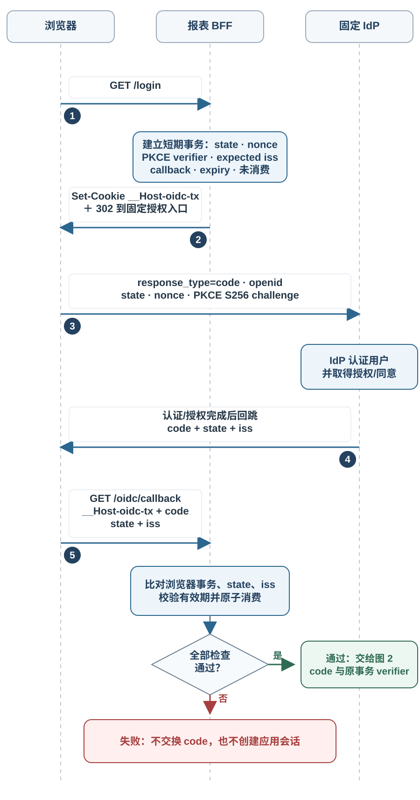
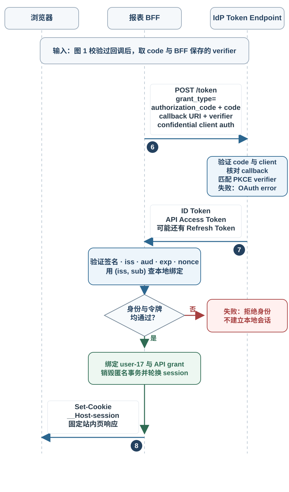
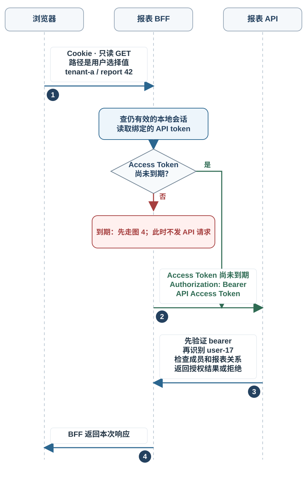
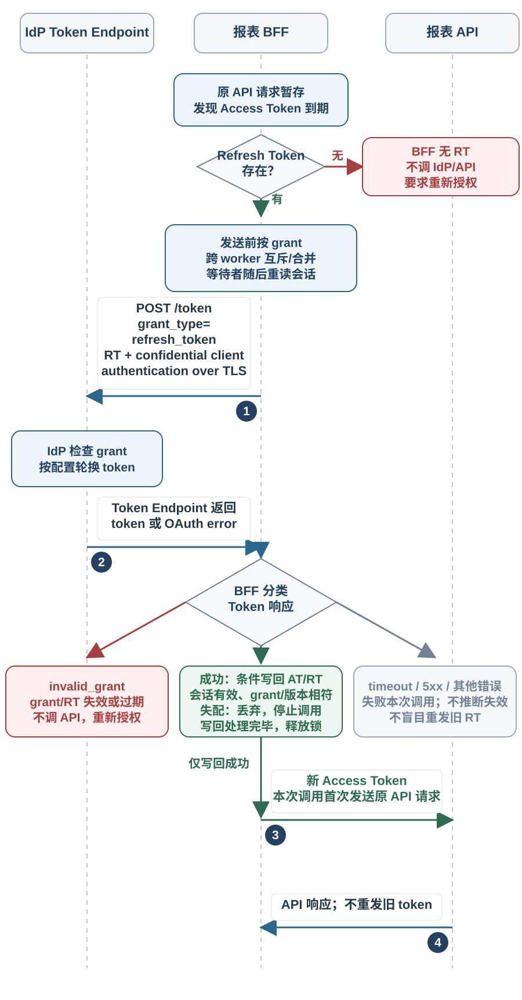
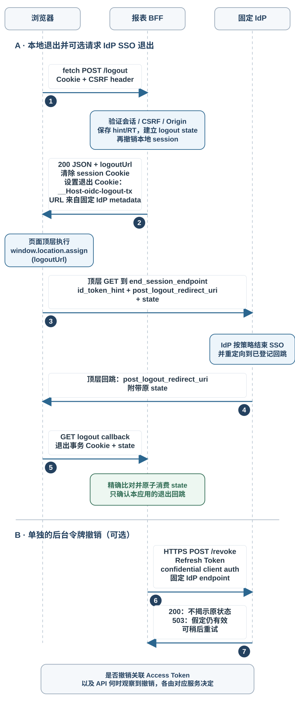

# Cookie 会话与 OIDC 令牌怎样建立身份？

**合成案例。** `user-17` 打开 `https://reports.example.test`，准备读取租户 `tenant-a` 的报表 `42`（`Service health`）。报表应用由 Backend for Frontend（服务于前端的后端，BFF）处理浏览器请求；资源 API 位于 `api.reports.example.test`，Identity Provider（身份提供方，IdP）的固定签发者是 `https://idp.identity.test`。本例的 BFF client ID 固定为 `reports-bff-client`，IdP metadata 声明支持 RFC 9207 的 authorization-response `iss` 参数。该 IdP 签发的 ID Token 中，`iss`（签发者）是 `https://idp.identity.test`，代表用户的 `sub`（主体）是 `idp-user-4821`；应用把 `(iss, sub)` 映射到本地账户 `user-17`。这些标识和主机名都是虚构的；能否读取报表 42 仍由 API 按当前成员关系和资源状态逐次授权，见[如何逐次授权租户内的报表资源？](web-security-and-authentication.md)。

这几种凭据回答不同的问题：浏览器 Cookie 让报表应用找到自己的本地会话；OAuth 授权码流程让应用向授权服务器请求 API 访问权限；OpenID Connect（OIDC）ID Token（身份令牌）把身份提供方的认证结果交给登录客户端。ID Token 不替 API 授权，浏览器会话也不是 API Access Token（访问令牌）；访问令牌必须由授权服务器按 API 资源配置签发。本例选用后端代理浏览器请求的 BFF：Access Token 和 Refresh Token 保存在服务端，浏览器日常请求只持有不透明会话 Cookie。若用户请求可选 IdP 退出，浏览器顶层导航会附带已验证的 ID Token hint；它不是 API 凭据。

## 登录后，Cookie 会话怎样识别请求？

登录完成后，BFF 生成新的随机会话 ID，在服务器端保存会话记录，再用 `Set-Cookie` 让浏览器以后带回这个 ID：

~~~http
Set-Cookie: __Host-session=<random-opaque-id>; Path=/; Secure; HttpOnly; SameSite=Lax
~~~

这里的 `__Host-` 前缀要求 `Secure`、`Path=/` 且不带 `Domain`。因此这个 Cookie 由 `reports.example.test` 设置并限定在该主机；它不会随发往 `api.reports.example.test` 的请求发送。`HttpOnly` 阻止脚本通过非 HTTP API 读取 Cookie，`SameSite=Lax` 允许合适的跨站顶层安全导航，但不允许它代替 CSRF 防护。RFC 10017 §6.1.3.2 推荐 host-only、HTTP-only 的会话 Cookie 配置；本例通过 `__Host-` 前缀和显式 `HttpOnly` 属性实现。确需在跨站嵌入请求中附带 Cookie 时，`SameSite=None` 必须与 `Secure` 同用；浏览器的第三方 Cookie 策略仍可能阻止它。本例的匿名事务 Cookie 也设为 `Lax`，这样 IdP 的跨站顶层 GET callback 才会带回浏览器绑定值。BFF 指南对会话 Cookie 建议 `SameSite=Strict`；本例为保留外部顶层导航使用 `Lax`，因此对所有改变状态的请求仍检查 CSRF token，并校验精确的 `Origin`。若部署能使用 `Strict`，应按实际登录回跳路径验证体验；同站的兄弟子域也可能发起跨源请求，不能只靠 SameSite。

请求到达 BFF 后，服务端查找对应的会话记录，并检查服务端保存的过期时间、撤销状态和账户状态。Cookie 只是 HTTP 字段，有 Cookie 本身不代表请求已认证；同一机制也可承载偏好等非身份数据。此例的 Cookie 只带随机标识，不包含 `user-17`、角色或租户权限；认证成功后，会话映射到本地账户。自建会话 ID 应由密码学安全随机数生成器生成，至少有 128 位熵；业务身份和会话状态保存在服务器端，而不是从 ID 中解码。

Cookie 是浏览器自动附带的凭据，因此 BFF 的业务变更请求（包括退出）都要先验证会话绑定的跨站请求伪造（CSRF）令牌，并把请求 `Origin` 与该 BFF 的精确来源比对；缺失或不匹配时，拒绝请求且不执行操作。一种直接做法是把每个已登录会话的防伪值放在页面启动数据中，浏览器在非安全方法的自定义请求头中回传，BFF 将它与服务器端会话值比较。这个防伪值保护应用操作，不能拿 OIDC 的 `state` 代替。业务 `GET` 只读，不应通过它更新数据。OIDC 登录入口虽然会创建短期事务记录，但这是独立的协议端点；回调仍须通过匿名 Cookie、`state`、PKCE 和 `nonce` 的事务校验。`SameSite=Lax` 只提供部分跨站请求防护；来自同站兄弟子域的请求仍需由服务端的防伪检查拦截。

会话 ID 本身是可重放凭据。登录成功、密码重置或权限等级变化时，应用应销毁旧 ID 并签发新的 ID，避免攻击者预先固定的匿名会话在登录后继续有效。密码重置策略和管理员撤销也应使受影响的服务器端会话失效。空闲超时和绝对超时由服务端执行；退出时也要先撤销服务器记录，再让浏览器删除 Cookie。浏览器删掉 Cookie 只会停止后续自动发送，不能让已经复制的旧 ID 失效。

本页 Cookie 只认证到报表 BFF。浏览器不会把它自动转给报表 API；BFF 从服务端会话中取出 API 访问令牌，再由 BFF 发起请求。Cookie 的主机、站点、源和自动发送条件见[浏览器安全控制分别保护什么信任边界？](web-browser-security-boundaries.md)。

## Cookie 会话和 Bearer 令牌各保留什么状态？

| 凭据 | 谁持有、发给谁 | 接收方验证什么 | 生命周期与边界 |
| --- | --- | --- | --- |
| 浏览器会话 Cookie | 浏览器发给 `reports.example.test` | BFF 用不透明 ID 查找仍有效的服务器端会话 | 退出时可撤销本地会话；Cookie 不证明 API 权限 |
| OIDC ID Token | Token Endpoint 返回给 BFF；可选登出时，已验证的 ID Token hint 随浏览器顶层请求发给固定 IdP | 客户端按 OIDC 验证签发者、客户端受众、时效和认证事务 nonce | 说明 IdP 认证结果；hint 不是报表 API 的 bearer credential |
| API Access Token | BFF 用 `Authorization: Bearer …` 发给报表 API | API 按令牌类型验签或查询状态，并确认签发方、API 受众、时效和允许的 scope/用途 | 取得 API 调用资格；不取代 API 对租户和报表的本地授权 |
| Refresh Token（刷新令牌） | 刷新时由 BFF 发给 IdP Token Endpoint；撤销时发给受信 revocation endpoint | IdP 检查 client、grant、有效期和轮换/绑定状态 | 换取新 Access Token；不得放进浏览器或发送给资源 API |

Bearer token（持有者令牌）是可重放凭据：拿到令牌的人能在它有效期间尝试使用。Access Token 可以是不透明字符串，也可以是 JSON Web Token（JWT，JSON Web 令牌）。API 对不透明令牌可调用 introspection（令牌状态查询），也可能缓存查询结果；缓存越久，撤销状态延迟可见的窗口越长。对自包含 JWT，API 按受信密钥、允许的算法、`iss`、`aud`、令牌用途、有效期和授权范围验证签名与声明，不必每次回 IdP 查状态，但离线验证通常会让已撤销令牌继续有效到过期，除非 API 另做撤销查询或拒绝列表。

JWT 是一种声明格式，不是“已验证身份”的同义词。签名 JWT 的载荷通常可被读取；签名能证明声明未被修改且由受信签发者签出，不提供保密性。只 Base64URL 解码，不是验签。ID Token 与 API Access Token 即使都采用 JWT 格式，也要检查各自不同的受众和用途。

本例选择 BFF 是为了让访问令牌和刷新令牌留在服务端。BFF 用 Cookie 会话代表浏览器查找该用户的令牌集合，再把 API Access Token 附加到固定的报表 API 请求中。服务端要限制可代理的主机、路径和方法，避免把用户令牌带到调用方任意指定的目标。`HttpOnly` 防止脚本直接读取 Cookie，但不能阻止页面中的恶意脚本借浏览器会话向 BFF 发请求；BFF 仍须防跨站脚本（XSS）和 CSRF。若应用改为浏览器内 OAuth 客户端，则它属于公开客户端（public client），不能把共享静态密钥当作保密客户端凭据；应使用授权码加 PKCE，并接受浏览器脚本执行环境对令牌的影响。把 Access Token 放进 `localStorage` 等脚本可读存储会让 XSS 能直接读取并外传；改用 HttpOnly Cookie 不会阻止被控脚本代发同源请求，也不能免除 CSRF。若授权服务器向公开客户端发 Refresh Token，则必须使用发送者约束或每次使用后轮换来检测重放。

## 授权码流程如何确认身份并建立应用会话？

OAuth 2.0 是授权框架；只有请求 OIDC 的 `openid` scope 并按 OIDC 验证 ID Token，客户端才按该协议获得身份断言。这个 BFF 是 OAuth 机密客户端（confidential client），API 是资源服务器，IdP 的授权服务器和 OpenID Provider（OP，OpenID 提供方）是本例固定信任方。流程先取得授权，再将受验证的身份绑定到本地账户和服务端会话：

1. **开始事务。** 浏览器打开 BFF 的登录入口。BFF 从受信配置选择 IdP 的 issuer、authorization endpoint、token endpoint、client ID `reports-bff-client` 和精确登记的 callback `https://reports.example.test/oidc/callback`；不能从任意请求参数拼出 IdP 或 API 目标。BFF 建立短期服务器端事务记录，包含随机一次性 `state`、OIDC `nonce`、随机 PKCE `code_verifier`、预期 `iss`、callback URI、创建时间和未使用状态。它用短期 `__Host-oidc-tx` Cookie 将匿名浏览器上下文与事务记录关联，属性为 `Path=/; Secure; HttpOnly; SameSite=Lax`，且不带 `Domain`。同一匿名上下文可索引多个未完成事务；只有 state 与该浏览器 Cookie 同时匹配的回调才继续。
2. **发起授权。** 对每次事务，BFF 用新的 32 个随机字节生成无填充 Base64URL `code_verifier`，再计算 `code_challenge = BASE64URL(SHA-256(ASCII(code_verifier)))`，并显式发送 `code_challenge_method=S256`。省略这个字段时，RFC 7636 的默认值是 `plain`，不会自动替客户端选择 SHA-256。这组参数使用 PKCE（Proof Key for Code Exchange，授权码交换证明密钥）：`code_verifier` 留在 BFF，`code_challenge` 发给 IdP。BFF 把浏览器重定向到固定 IdP，参数包括 `response_type=code`、`client_id`、精确 `redirect_uri`、`scope=openid reports.read`、`state`、`nonce`、`code_challenge` 和 `code_challenge_method=S256`。`reports.read` 是请求给 API 的权限范围；它不会自行证明 `user-17` 属于 `tenant-a`。若部署支持 RFC 8707，可用 `resource` 指明 API；否则客户端和 IdP 必须使用双方预先约定的 API 受众（audience）。
3. **认证并回调。** IdP 在自己的页面认证用户，并按策略要求其同意授权。随后它用一次性短期 code 导航回已登记的 callback，带上原 `state` 和 `iss`。本例的 IdP metadata 已配置 `authorization_response_iss_parameter_supported=true`，所以 BFF 要求响应（包括错误响应）必须带 `iss`，并与该事务的预期 issuer 精确比对；缺失或不匹配都拒绝。BFF 还要求请求中的 `__Host-oidc-tx`，用它找到属于当前浏览器的事务，然后以单次原子条件更新同时核对 state、过期/未消费状态并标为已消费，避免并发回调重复兑换 code。部署若使用不支持 RFC 9207 的 IdP，应采用不同 callback URI 或其他 mix-up 防护，不可把本例的 `iss` 检查静默降成可选。Cookie 缺失、state 不匹配、事务重放、issuer 错误或 IdP 返回授权错误时，本事务停止，不交换 code，也不创建登录会话。

前三步确认回调属于发起登录的浏览器，并在校验成功时消费该事务。图中红色分支表示事务校验失败就停止；此时还没有向 Token Endpoint 兑换 code。

通过回调校验后，BFF 才拿同一事务保存的 verifier 进入后端兑换；拿到令牌后还要验证身份，才建立应用会话。

4. **兑换 code。** callback 只处理固定参数并返回到固定的应用内路径，不把 `return_to` 等未验证值作为外部重定向地址。BFF 通过已验证的传输层安全（TLS）后端连接调用 Token Endpoint，发送 `grant_type=authorization_code`、code、相同的 `redirect_uri`、秘密 verifier 和 confidential client authentication。IdP 验证 code 尚未使用、绑定到该 client/redirect URI、PKCE challenge 匹配后，返回 ID Token、Access Token 以及可能的 Refresh Token。PKCE 把 code 兑换限制在持有 verifier 的本次事务；`state` 把浏览器回调绑回发起的事务；`nonce` 把 ID Token 绑回这次身份认证。三者目的不同，不能把任一响应值直接当作已验证输入。 RFC 9700 允许在确认授权服务器支持 PKCE 时依靠 PKCE 保护授权回调免受 CSRF；本例仍显式绑定并检查 Cookie、state 和 nonce。这个协议端点的保护不能代替报表业务变更请求的防伪检查。
5. **验证身份并绑定本地账户。** BFF 在使用 ID Token 中的身份前，按 OIDC 规则验证签名和受信算法（或适用时使用下方所述的 Token Endpoint TLS 例外）、精确 issuer、`aud`、有效期和本次事务的 `nonce`；若请求包含 `max_age`，也检查 `auth_time`。本例的唯一受信 audience 是 `reports-bff-client`，因此 `aud` 必须只含此 client；若另一部署允许额外 audience，必须逐个明确列入信任配置并拒绝其他值。`azp` 仅在启用产生该 claim 的扩展/profile 时按其规则验证。再用稳定键 `(iss, sub)` 查找本地身份绑定。本例只有查到 `(https://idp.identity.test, idp-user-4821) → user-17` 时才识别成本地用户；不要仅凭可能变化或未验证的 email 自动合并账户。若这是把 IdP 账户链接到一个已登录的本地账户，应另外要求该本地账户的有效近期认证和明确确认，再建立唯一的 `(iss, sub)` 绑定。
6. **建立新会话。** BFF 将身份、会话 ID、有效时间和 API grant 关联保存在服务器端，销毁匿名上下文及任何登录前 session ID，然后签发全新的 `__Host-session` Cookie。匿名 session ID 不得升级后继续复用。ID Token 用来验证面向 BFF 的身份；API Access Token 必须面向报表 API。若 IdP 没有为该 API 签发匹配 audience 和 scope 的令牌，BFF 不得把 ID Token 或其他 audience 的 Access Token 送给 API。

BFF 建成自己的会话后，用户才有了访问报表应用的登录态。这个结果仍不替代资源 API 的逐次授权。

授权响应中的 code 可能出现在浏览器历史、代理日志或 Referer 中。callback 应是无第三方脚本、图片和链接的最小端点，设置 `Referrer-Policy: no-referrer`，日志不得记录 code、state、token 或 Cookie；成功后立即转到不含敏感参数的固定页面。固定 callback、单次 code、PKCE 和事务过期缩短泄漏后的可用性，但不能把“浏览器绝不会留下 callback URL”当作保证。OAuth 安全最佳实践还禁止开放重定向；若要返回用户原路径，只接受服务端允许的站内路径。详细的 token 受众与 API 授权边界见[如何逐次授权租户内的报表资源？](web-security-and-authentication.md)。

> [!info] 单点登录不会替每个应用建立相同的本地会话
> IdP 的单点登录（Single Sign-On，SSO）会话可以让同一浏览器再次访问其他已注册应用时免于重新输入凭据，但 IdP 策略、同意要求或认证时效仍可能要求用户再次交互。每个应用仍须独立校验自己的回调、验证 ID Token、绑定本地身份并创建自己的 Cookie 会话。某个应用退出本地会话，不会自动结束 IdP 的 SSO 会话，也不会让其他应用的会话一并退出。

> [!info] Token Endpoint 的受限签名校验例外
> OIDC Core 对经已验证 TLS 连接直接从 Token Endpoint 收到的 Authorization Code Flow ID Token 规定一条窄例外：客户端可以用 Token Endpoint 的 TLS 服务器身份验证替代 ID Token 签名校验。它不适用于从浏览器、其他 API 或不可信来源取得的 ID Token；其他场景仍须按 OIDC 规则验证签名。

## 调用、刷新与退出分别撤销什么？

**调用报表 API。** 浏览器向 `reports.example.test` 发起只读 GET，请求自动携带 `__Host-session`；这个请求不带 CSRF token，因为安全方法不得改变业务状态。若浏览器请求改为改变状态的操作，BFF 才要求会话绑定的防伪 token 和精确 `Origin` 校验。BFF 查到有效会话后，用 Token Endpoint 返回的 `expires_in`（或经过验证的令牌到期声明）维护本地到期时间；未到期才把 bearer 发给 `api.reports.example.test`，到期则先进入下方刷新流程，本次 API 请求尚未发送。API 仍是最终验证者：它验证 Access Token，再把令牌标识的 API 主体映射为 `user-17`，依照当前租户成员关系、报表归属和动作授权。请求路径里的 `tenant-a`、`42` 是调用方选择的未可信资源标识，不是主体或授权证明。Cookie 建立 BFF 会话，Access Token 供 API 识别调用资格，授权结果由 API 作出。

**刷新令牌。** BFF 在第一次发送 API 请求前发现 Access Token 已到期，就按同一授权 grant 取得刷新锁或合并为一个 in-flight 刷新；其他 worker 的请求等待后重新读取会话，避免并发发送同一旧 Refresh Token。持锁的请求才通过可信 TLS 连接向固定 Token Endpoint 发送 Refresh Token，并用 confidential client authentication。成功后，BFF 仍须以“会话有效且 grant/版本仍与发起刷新时相符”为条件，在释放锁前原子保存新的 Access Token；若 IdP 返回轮换的 Refresh Token，也在同一次更新中替换旧值。条件不符就丢弃结果并停止本次调用，不能因迟到的刷新响应恢复已退出或已撤销的会话。只有条件写回成功，才用新 Access Token 首次发送原 API 请求。这个并发写入约束由 BFF 实现；本地退出不能追溯取消已提交给远端的请求。若没有 Refresh Token，或 IdP 明确返回 `invalid_grant` 表示 grant/token 已无效、过期或撤销，本例停止 API 调用并要求重新授权；因为此案例把 API grant 与 BFF 会话绑定，失效 grant 也会结束这条令牌会话。若产品分开保存本地身份会话和 API grant，可只停用 grant、保留有效 Cookie，但仍须拒绝本次 API 调用。网络超时、5xx、其他不表示 grant 失效的错误或结果不明时，只失败本次 API 调用；不能据此推断 grant 已失效，也不要盲目重发旧 Refresh Token，应按错误和 IdP 恢复/幂等策略处理。IdP 可能仍保有 SSO session，因此新的授权流程不一定要求重新输入密码。Refresh Token 永不发给浏览器或 API。

**退出与撤销。** 页面用 `fetch` 向 BFF 发受 CSRF 防护的 POST `/logout`，携带会话 Cookie、自定义防伪 header 和精确来源。若本次要请求 IdP SSO 退出，BFF 先从活动会话取出已验证的 ID Token，作为必需的 `id_token_hint`，并为一次性退出 `state` 建短期事务；若要撤销上游令牌，也先保存要提交的 Refresh Token。然后撤销服务器端本地会话；即使旧 Cookie 被复制，服务端也拒绝已失效的记录。若本次请求 IdP SSO 退出，BFF 在同一个 200 JSON 响应中清除 `__Host-session`、设置 host-only 的 `__Host-oidc-logout-tx`（`Secure; HttpOnly; Path=/; SameSite=Lax`），并返回用受信 IdP metadata 中 HTTPS `end_session_endpoint` 组装的固定允许 URL。URL 中包含 `id_token_hint`、精确登记的 `post_logout_redirect_uri` 与 `state`，浏览器能看到并把 hint 发送到该固定 IdP 退出端点；页面和 callback 使用 `Referrer-Policy: no-referrer`，hint 不会发给 API，也不是 API Access Token。否则，响应只清理本地 Cookie 并给出已退出状态。

若应用保存 Refresh Token，可独立地通过可信 HTTPS 连接向 IdP 撤销端点发 POST，并以机密客户端凭据认证。RFC 7009 的 200 不说明调用前 token 一定有效或刚刚才撤销；503 表示客户端应假定 token 仍有效，可按策略稍后重试。远端不可用不影响本地 session 已撤销和 Cookie 已清除，但不能宣称上游 token 已即时撤销。浏览器若要请求 IdP 退出，页面显式执行 `window.location.assign(logoutUrl)` 做顶层导航；`fetch` 自己跟随 302/303 只处理该 fetch 的重定向，不会把当前页面变成 IdP 页面。本例登记顶层 GET 的 `post_logout_redirect_uri`，使 Lax 事务 Cookie 能随 IdP 回跳送回 BFF；BFF 再用 Cookie 找 state、精确比对并原子消费。

撤销 Refresh Token 后，IdP 是否同时撤销同一 grant 的已有 Access Token，取决于 IdP 的撤销行为；这与资源 API 如何观察已撤销状态是两个条件。API 每次查询状态时可在 IdP 撤销生效后拒绝，introspection 缓存则会引入观察延迟；只离线验证未过期签名 JWT 的 API 通常会接受到 token 到期，除非另有撤销机制。API 对 `tenant-a`/`42` 的当前授权也仍由 API 根据自己的数据作出，不会因为浏览器清 Cookie 自动失效。

退出报表应用的本地 Cookie session、撤销 OAuth grant/token、结束 IdP 的 SSO session 是三项不同操作。本例顶层导航把浏览器送到受信的 HTTPS `end_session_endpoint`，附带已验证的 `id_token_hint`、精确登记的 `post_logout_redirect_uri` 和一次性 `state`。其他应用是否同时结束本地会话，取决于是否另外配置并联动 IdP 的前通道/后通道退出机制；单个应用退出不构成全局退出保证。某些 IdP 也可能要求额外交互。

## 本地密码验证后，应用还要做什么？

若应用本身验证密码，它仍须建立自己的服务端会话，不能把密码校验结果塞进可由客户端修改的字段。数据库存储带随机盐的专用密码哈希及其算法、成本参数，不保存明文或快速通用散列；在线登录入口还要限制尝试速率。数据库泄漏后，攻击者可以离线反复猜测密码；Argon2id 的内存与计算成本让每次猜测更昂贵，和入口的在线限速解决不同问题。OWASP 当前给出的 Argon2id 基线示例为 19 MiB 内存、2 次迭代、并行度 1；部署应基于自身硬件和并发调优，而不是把最低示例当作性能目标。Salt 不需要保密；可选 pepper 是数据库之外的服务器秘密，需要有密钥保护、轮换和恢复方案。

密码验证成功后，应用同样要销毁匿名 session ID、签发新的随机 ID、建立有服务端超时的本地会话。它只代表本地认证；不会凭空产生 OIDC ID Token、OAuth API grant 或 API Access Token。

> [!info]- 来源
> - Cookie 基本模型：[IETF RFC 6265, HTTP State Management Mechanism](https://www.rfc-editor.org/rfc/rfc6265.html)，§4–§5；属性、`__Host-` 前缀、SameSite 站点与发送条件：[IETF Internet-Draft draft-ietf-httpbis-rfc6265bis-22](https://datatracker.ietf.org/doc/html/draft-ietf-httpbis-rfc6265bis-22)，§4.1.2.5–§4.1.3.2、§5.6.7、§8.8；该版本是 2025-12 发布的 Internet-Draft，标示 2026-06 到期，不是正式 RFC。Datatracker 仍列其为当前 I-D，RFC Editor 的 [RFC-to-be 10025 final-review 页面](https://queue.rfc-editor.org/final-review/rfc10025/) 于 2026-11-13 仍显示 Final Approval Pending，因此不能称 10025 已发布或已取代 RFC 6265。
> - BFF 授权码架构、服务器端 token、会话 Cookie、刷新和 CSRF 要求：[IETF RFC 10017, OAuth 2.0 for Browser-Based Applications](https://www.rfc-editor.org/rfc/rfc10017.html)，BCP 212，§6.1.1–§6.1.3；2026-08。
> - Session-bound synchronizer token、请求 header 回传、精确 Origin/Referer 校验和 SameSite 的局限：[OWASP Cross-Site Request Forgery Prevention Cheat Sheet](https://cheatsheetseries.owasp.org/cheatsheets/Cross-Site_Request_Forgery_Prevention_Cheat_Sheet.html)，§Synchronizer Token Pattern、§Using Standard Headers to Verify Origin、§Limitations of SameSite；核对于 2026-11-12。
> - OAuth 授权码请求与兑换参数：[IETF RFC 6749](https://www.rfc-editor.org/rfc/rfc6749.html)，§4.1.1–§4.1.4；Bearer 请求头：[RFC 6750](https://www.rfc-editor.org/rfc/rfc6750.html)，§2.1；安全最佳实践，包括精确 callback、state/PKCE、mix-up、code/Referer 泄漏、开放重定向、受众限制和 Refresh Token 保护：[RFC 9700](https://www.rfc-editor.org/rfc/rfc9700.html)，§2.1–§2.3、§4.1–§4.5、§4.11、§4.14；2025-01。
> - PKCE verifier、challenge 和 S256：[IETF RFC 7636](https://www.rfc-editor.org/rfc/rfc7636.html)，§4.1–§4.3、Appendix B；issuer 参数防多授权服务器 mix-up：[RFC 9207](https://www.rfc-editor.org/rfc/rfc9207.html)，§2；资源指示参数：[RFC 8707](https://www.rfc-editor.org/rfc/rfc8707.html)，§2。
> - OIDC 身份请求、ID Token 验证与可依赖 claim：[OpenID Connect Core 1.0 incorporating errata set 2](https://openid.net/specs/openid-connect-core-1_0.html)，§3.1.2.1、§3.1.3.7、§5.7；2023-12-15。RP 发起退出：[OpenID Connect RP-Initiated Logout 1.0](https://openid.net/specs/openid-connect-rpinitiated-1_0-final.html)，§2–§3；Final 1.0。
> - 联邦身份绑定不可仅以 email 自动合并、添加/删除链接身份前要求当前本地认证：[OWASP Authentication Cheat Sheet](https://cheatsheetseries.owasp.org/cheatsheets/Authentication_Cheat_Sheet.html)，§Secure Federated Account Linking；核对于 2026-11-12。
> - Token 撤销及返回语义：[IETF RFC 7009](https://www.rfc-editor.org/rfc/rfc7009.html)，§2；不透明 token introspection 与 `active` 状态：[RFC 7662](https://www.rfc-editor.org/rfc/rfc7662.html)，§2.2；JWT 验证算法与用途隔离：[RFC 8725](https://www.rfc-editor.org/rfc/rfc8725.html)，§3。
> - 会话标识熵、登录后轮换、服务端失效和超时：[OWASP Session Management Cheat Sheet](https://cheatsheetseries.owasp.org/cheatsheets/Session_Management_Cheat_Sheet.html)，§Session ID Entropy、Renew the Session ID After Any Privilege Level Change、Session Expiration；核对于 2026-11-12。
> - Argon2id 参数、随机盐与 pepper：[OWASP Password Storage Cheat Sheet](https://cheatsheetseries.owasp.org/cheatsheets/Password_Storage_Cheat_Sheet.html)，§Argon2id、Peppering；核对于 2026-11-12。
