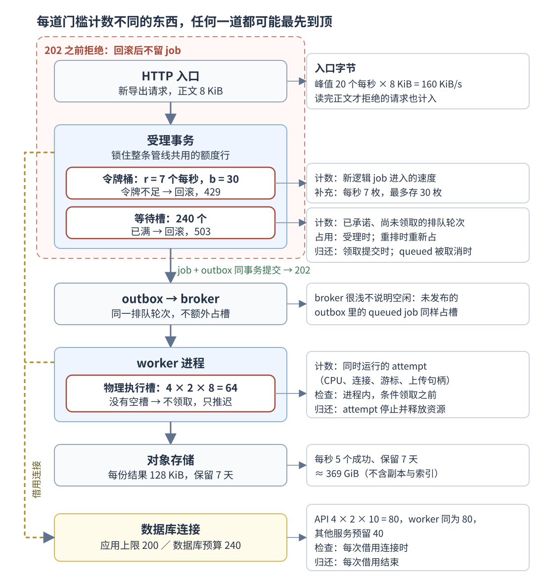
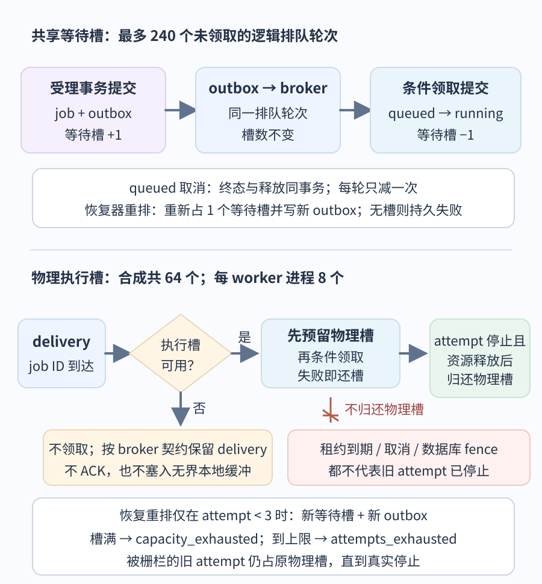

# 一条异步管线能接多少工作，超出时在哪里拒绝？

前几章让 `job-demo-731` 在受理、领取、重试和取消时都有确定的落点，但都默认资源够用。本章回答资源不够时怎么办：这条导出管线能同时承诺、执行多少工作；每一道上限由谁计数、在哪里检查；超出时为什么必须在返回 202 **之前**拒绝。主线四的合成负载只在本章算一次，其他章只引用结论。

## 容量是几道门槛，不是一个队列长度

“系统能接多少”不是一个数字。导出路径上有几道各管一件事的门槛，任何一道都可能最先到顶：

下图沿导出路径标出每道门槛的位置、本例取值、计数什么和何时归还；取值的推导在后文各节。图中的 attempt (执行尝试) 是 job 的一次实际运行，物理执行槽按它计数。

加长队列只能改变工作**在哪里**等，不能让下游处理得更快。下面先讲拒绝发生在哪里，再逐道算数。

本章使用的合成输入如下。它们是为演算设定的教学值，不是生产测量，也不是推荐值：

| 输入 | 取值 |
| --- | ---: |
| 新 job 的平均 / 十分钟峰值到达率 | 5 / 20 个每秒 |
| 请求正文 | 8 KiB |
| 每个 attempt 的平均耗时（含生成与上传） | 6 s |
| worker 部署 | 4 副本 × 2 进程 × 8 个执行槽 |
| 每份报表的顺序读取 | 12 次，每次借连接 20 ms |
| 受理事务借用连接 | 10 ms |
| 平均结果对象 / 每个 job 的元数据 | 128 KiB / 2 KiB |
| 结果保留 / 终态后 job 与幂等元数据保留 | 7 天 / 14 天 |
| 准入：速率 / 突发 / 等待槽 | 7 个每秒 / 30 / 240（下文推导） |

## 准入、背压与拒绝怎样对应到响应？

admission control (准入控制) 决定新的逻辑 job 能不能进入系统；backpressure (背压) 把“下游已满”的信号传回上游，让上游减速、延后或停止提交。进程内的流可以靠暂停读取把背压传回源头；而服务端没法让一个 HTTP 调用方“慢一点”。对调用方来说，背压只能表现为**拒绝**，而且必须在返回 202 之前明确拒绝。先承诺受理、之后再悄悄丢掉，正是这几章一直在避免的事。

本例的映射：

| 情况 | 响应 | 是否留下 job |
| --- | --- | --- |
| 速率令牌不足 | `429 Too Many Requests`，可带 `Retry-After` | 不留 |
| 等待槽已满 | `503 Service Unavailable`，可带 `Retry-After` | 不留 |
| 同键同指纹的重放 | 返回原 job 的当前状态 | 不新增；不耗令牌、不占槽 |

两种拒绝都发生在受理事务回滚之后，数据库里什么都不留。它们是**受理边界**上的拒绝，不能伪装成“已受理的 job 失败了”。只有已经受理的 job 在重排时拿不到槽，才落成可查询的 `failed / capacity_exhausted`（见[收尾一章](job-retries-cancellation-and-cleanup.md)）；worker 本地物理槽不足只会推迟领取，不会把 `queued` 的 job 判为容量失败。令牌和槽同时不足时先报 `429`；准入拒绝排在认证、可见性、正文校验和幂等裁决之后，完整顺序见[多个错误同时成立时先报哪个](api-contracts-errors-and-evolution.md#多个错误同时成立时先报哪个)。

调用方收到 `Retry-After` 后，应在自己的 deadline (截止时间) 内按提示等待，再用**同一个**幂等键重放，规则见[写请求超时后怎样安全重试](deadlines-retries-and-unknown-outcomes.md)。重放不耗令牌，但每次 HTTP 往返仍要消耗 API 的认证、网络和解析资源。

请求内流式响应不走这套规则：它能持续发送多久，由请求自己的 deadline、连接和流背压决定，不应把等待槽的算式套过去。

## 受理事务怎样在多个副本之间仲裁？

受理事务（见[持久受理一章](durable-job-acceptance-and-outbox.md)）分两步仲裁，分别挡住两种并发：

**第一步：这是不是一个新意图？** 插入带唯一约束的 job 身份。同键并发时，失败方回滚后读胜者：同指纹返回原 job，异指纹报冲突。这一步只解决“同一个键来了两次”。

**第二步：还有没有额度？** 只有第一步确认是新意图，才去竞争一条**整条管线共用**的额度行。“先查重、再扣额度”挡不住另一种并发：两个**不同**的键同时抢最后一个等待槽。它们各自读到“还剩 1 个”，都接受，槽就超了。所以额度必须是所有 API 副本、所有账户共享的一行，并在同一个事务里原子地检查和扣减：

~~~sql
-- 先锁行；拿到锁之后再取时间，避免用等锁之前的时间补令牌
SELECT tokens, refilled_at, waiting_count
FROM admission_budget
WHERE pipeline = 'report-export'
FOR UPDATE;

SELECT clock_timestamp() AS checked_at;
-- 应用计算：available = min(30, tokens + 7 × (checked_at − refilled_at))
-- available < 1 → 回滚，429；waiting_count >= 240 → 回滚，503

UPDATE admission_budget
SET tokens = :available - 1,
    refilled_at = :checked_at,
    waiting_count = waiting_count + 1
WHERE pipeline = 'report-export';
-- 随后在同一事务里补齐 job 参数、写 outbox，一起提交
~~~

两个不同的键争最后一个槽时，会在这一行的锁上排队：先提交者占槽，后者拿到锁后看到 `waiting_count = 240`，回滚自己的临时 job 身份，返回 503。令牌、计数、job 和 outbox 一起提交或一起回滚。

**为什么不能让每个进程各自限流？** 本地限流器的总放行量会按进程数放大。用一个独立的小例子说明（这里换成按账户计的读取额度，因为导出案例的数字太大，不便手算）：某账户的额度是突发 8 点、每秒补 4 点。如果三个 API 进程各自维护一份这样的本地桶，一秒内三份桶合计可以放行 `3 × (8 + 4 × 1) = 36` 点，而策略本意是一秒最多 `8 + 4 = 12` 点。20 个单点请求同一时刻按 7、7、6 分到三个进程，每份本地桶都放得下这一批，于是整个服务瞬间放行 20 个，而一份共享桶此刻只会放行 8 个。要守住全局上限，就需要共享计数，或者把总额度切成总和不超过上限的分片预算。共享计数会带来网络延迟和对计数服务可用性的依赖，选择前要说清可以接受多大误差。

两条补充：

- 每账户、每主体的限流可以叠加在全局额度之上，用来保证公平，但不能代替全局额度：后者保护的是数据库和 worker 的总容量。
- 如果额度放在数据库之外的限流服务里，数据库事务回滚时不会替它退回令牌。那就要另设可以幂等确认或补偿的预留协议，不能假设回滚会自动还额度。

## 等待槽什么时候占、什么时候还？

等待槽记的是“已受理、尚未被领取的逻辑排队轮次”，全管线共 240 个：

- **受理时占一个**，与 job 和 outbox 同一事务。
- **消息从 outbox (事务发件箱) 进入 broker (消息代理)，不变。** 同一轮排队不管此刻在 outbox 里还是在 broker 里，都只占一个槽；同一 job 的重复消息不额外占槽。
- **领取提交时归还**，与改成 `running` 同一事务。
- **`queued` 状态被取消时归还一次**，与写终态同一事务。
- **重试或恢复重排时重新占一个**；拿不到就 `failed / capacity_exhausted`。

所以 broker 队列很浅，不能说明系统空闲：outbox 里还没发布的 `queued` job 同样占着槽。

图中两种槽的量纲和所有者都不同。物理执行槽属于 worker 进程，先占槽、再条件领取、领取失败立即归还；它要等 attempt 真正停止才还，被栅栏的旧 attempt 仍占着它。两次 attempt 若因租约恢复而短暂重叠，就要分别占两个物理槽。物理槽的完整规则见[怎样保证一个任务同一时刻只由一个 worker 推进](job-claims-leases-and-fencing.md)。

## Little 定律能算什么、不能算什么？

Little 定律给出稳定系统的长期平均关系：

~~~text
L = λ × W
平均系统内工作数 = 平均有效到达率 × 平均在系统内停留时间
~~~

三个量必须属于**同一个边界、同一种工作**：

- 边界只包括 worker 的执行，`W` 就是平均 attempt 时长；边界包括排队，`W` 也要包括等待时间。
- `λ` 是这个边界**实际接纳**的平均速率，不是包含被拒请求的原始 HTTP 请求速率。
- 它是长期稳态下有限均值之间的关系。到达率持续超过服务能力、队列一直增长时，系统没有稳态，不能用它推出一个有限的等待量。

例如一个稳定的服务平均接纳 40 个请求每秒，每个请求平均停留 0.2 s，服务内平均有 `40 × 0.2 = 8` 个在途请求。

它**不能**预测突发峰值，不能给出等待时间的 p95、p99，也不能单独证明某个容量上限是安全的。到达的成批性、服务时间的长尾、重试、拒绝策略和下游瓶颈，都要另外分析。观察排队边界时，queue depth (队列深度) 说明有多少工作在等，queue age (队列年龄，即最老工作等了多久) 说明等了多久，两者揭示的是不同的故障。

## 要多少执行槽，准入速率该定多少？

用 Little 定律把到达率换成并发需求。先假设每个新 job 只运行一次 6 秒的 attempt，重试、租约重叠和下载另计：

- **平均负载：** `5 × 6 = 30` 个 attempt 同时在执行。
- **峰值负载：** 要稳定跟上 20 个每秒，需要 `20 × 6 = 120` 个并发 attempt。这是规划需求，不是当前系统做得到的量。
- **当前容量：** `4 × 2 × 8 = 64` 个物理执行槽。即使 64 个槽一刻不停，按 6 秒平均服务时间算，理想服务率也只有 `64 ÷ 6 ≈ 10.67` 个 attempt 每秒。这是忽略调度空隙和一切额外工作的上界，不是压测吞吐。所以这套部署撑不住持续 20 个每秒：要么等待无限增长，要么新 job 被拒绝。队列只能暂存超出能力的工作，不能消除持续过载。

**准入目标。** 规划时假设平均利用率不超过 70%：`64 × 0.70 ÷ 6 ≈ 7.47` 个 attempt 每秒，于是把新 job 的准入速率定为 **7 个每秒**。若每个 job 平均只跑一次 attempt，平均占 `7 × 6 = 42` 个槽，即 `42 ÷ 64 ≈ 65.6%`。反过来算重试预算：70% 的规划相当于每秒 `64 × 0.70 = 44.8` 槽秒，分给每秒 7 个新 job，每个 job 平均最多能用 `44.8 ÷ (7 × 6) ≈ 1.067` 次 6 秒的 attempt。也就是说，按这个准入速率，平均每 15 个 job 里大约只能容纳一次重试。70% 和 7 个每秒是等待负载测试验证的起点；重试、租约重叠、长尾耗时和运维任务都会改变实际服务率。

## 令牌桶允许多少，四种限额各管什么？

token bucket (令牌桶) 是常用的限速算法：桶里最多存 `b` 枚令牌（burst，突发），以速率 `r` 匀速补充；每个请求按成本取走令牌，不够就拒绝或等待。`b` 决定能吸收多大的瞬时突发，`r` 决定长期平均速率。桶满时，长度为 `T` 的任意窗口内最多供给：

~~~text
r × T + b
~~~

本例把它用作“每个新逻辑 job 一枚令牌”：`r = 7` 个每秒，`b = 30`。请求成本也可以不相等，例如一次长范围汇总扣 4 点、一次短读取扣 1 点，同样 8 点的突发只能放行 2 个长汇总。这个上界只限制**放行**多少，不保证下游能及时**完成**同样多的工作。

**峰值时会拒绝多少？** 设十分钟内所有账户合计以每秒 20 个新幂等键提交，共 `20 × 600 = 12,000` 个新意图。桶开始时满（30 枚），此后每秒补 7 枚，十分钟最多放行 `7 × 600 + 30 = 4,230` 个。即使等待槽从不先满，也至少有 `12,000 − 4,230 = 7,770` 个在受理前被拒。实际上，worker 故障或重排会让 240 个槽更早占满。

**240 个等待槽不等于最长等 30 秒。** 设开始时没有积压、桶是满的、worker 连续 30 秒没有领取任何 job、也没有重排：这 30 秒里桶最多放进 `30 + 7 × 30 = 240` 个新 job，恰好填满等待槽；之后即使还有令牌，也只能拒绝，直到有槽释放。可见等待槽数限制的是**承诺了多少尚未领取的工作**，不直接规定队列能等多久。已有积压或重排会让它更早占满。容量应该按业务能接受的排队时长目标和实测的服务、恢复速度来校准；queue age 持续上升时，要降低准入速率或直接拒绝。

几种控制看起来相似，管的却是不同的资源，不能互相代替：

| 控制 | 管住什么 | 管不住什么 |
| --- | --- | --- |
| rate limit (速率限制)：令牌补充速率 | 新工作的长期平均到达速度 | 下游能否及时完成 |
| 突发容量：桶深 | 短时成批提交 | 不提供无限的等待区 |
| quota (配额)，本例未设 | 较长周期（如每天、每月）的总量 | 某一时刻的并发 |
| concurrency limit (并发上限)：物理执行槽 | 同时运行的 attempt 与实时资源 | 排队和 outbox 积压 |
| 有界队列：等待槽 | 已受理、尚未开始的工作量 | 正在执行的 attempt 占用的资源 |

这些门槛同时生效。流量远超容量或遭到攻击时，每一层还能挡住什么，见支线[流量远超容量或遭到攻击时，每一层能挡住什么](overload-and-ddos.md)。

## 数据库连接预算够不够？

连接是另一份共享预算。连接池在进程内，每多一个进程就多一份上限，所以总预算是“副本数 × 进程数 × 每进程池上限”之和（公式和池耗尽的诊断见[ORM 会话怎样借用连接，连接池为什么会耗尽](../data/orm-sessions-and-connection-pools.md)）。本例 API 和 worker 各 4 副本 × 2 进程，每进程池上限 `8 + 2 = 10`：

| 连接使用者 | 计算 | 上限 |
| --- | ---: | ---: |
| API | `4 × 2 × 10` | 80 |
| worker | `4 × 2 × 10` | 80 |
| 其他共用这个库的服务（本例预留） | — | 40 |
| 应用配置上限合计 | `80 + 80 + 40` | 200 |
| 数据库连接预算（本例假设） | — | 240 |
| 余量 | `240 − 200` | 40 |

这是池**可以同时借出**的上限，不代表数据库此刻有 200 条活跃查询。relay (中继)、租约恢复器、迁移工具和运维连接若不在那 40 个预留里，要从剩下的 40 里单独列出。扩容 worker 副本会同时增加执行槽和连接上限；平台的自动扩缩容也不会替数据库增加连接容量。

平均借用量同样可以用 Little 定律估算，按各自边界的**实际**速率相加：

~~~text
平均借用连接数 = 0.24 × λ_attempt + 0.010 × λ_受理
                 （每个 attempt 读 12 次 × 20 ms = 0.24 连接秒；每次受理 0.010 连接秒）
~~~

- 稳定处理 5 个每秒、每个一次 attempt：`5 × 0.24 + 5 × 0.010 = 1.25` 条。
- 达到规划的 7 个每秒：`7 × 0.24 + 7 × 0.010 = 1.75` 条。
- 若扩容到能稳定处理 20 个每秒：读取约 `4.8` 条、受理约 `0.2` 条，共 5 条。当前 64 个槽达不到这个速率，所以这是扩容后的需求，不是现在的实际借用量。

这些估算都不含长事务、慢查询、池等待，以及上传期间误持连接这类问题。平均借用量很低，并不说明单个进程的池不会排队：并发尖峰时，每进程 10 条的上限仍可能先到顶。

## 请求字节和结果存储会涨到多少？

**入口正文。** 平均 `5 × 8 KiB = 40 KiB/s`；峰值 `20 × 8 KiB = 160 KiB/s`，十分钟累计 `20 × 600 × 8 KiB = 96,000 KiB = 93.75 MiB`。这是按**到达的 HTTP 请求**算的，不是按受理的 job：读完正文才拒绝的请求、重放和同键冲突都消耗网络和解析资源；如果在读正文之前就拒绝，实际流量会更低。这里没算 HTTP 头、TLS、重传和响应字节。

**结果对象。** 长期每秒 5 个 job 成功、每份 128 KiB、保留 7 天（604,800 s）：

~~~text
128 KiB × 5 个/s × 604,800 s ÷ 1,048,576 KiB/GiB = 369.140625 GiB ≈ 369 GiB
~~~

**job 与幂等元数据。** 按每秒 5 个 job 进入终态（成功、失败或取消都算）、每个 2 KiB、终态后保留 14 天（1,209,600 s）：

~~~text
2 KiB × 5 个/s × 1,209,600 s ÷ 1,048,576 KiB/GiB ≈ 11.54 GiB
~~~

2 KiB 已经包括每个 job 的一条记录（状态原地更新为终态）和它的幂等元数据，失败的 job 已在“每秒 5 个终态”里，不要再重复加一次。这两项都不含副本、索引、版本、压缩差异和删除延迟；若另存 attempt 历史或诊断事件，还要加上它们和清理滞后。

**写入速率。** 每秒 7 份都成功，结果写入约 `7 × 128 KiB = 896 KiB/s = 0.875 MiB/s`；30 个突发全部成功写入 `30 × 128 KiB = 3.75 MiB`；64 槽的理想完成率 10.67 个每秒对应约 `10.67 × 128 KiB ≈ 1.33 MiB/s`。这些是理想完成量，不是观测值。下载是另一份读取负载，要单独估算，不能和生成带宽混算。

## 怎样确认最先到顶的是哪一道？

估算只告诉你哪项预算可能先紧，最先到顶的瓶颈要靠分阶段加压找出来。用有代表性的请求大小、12 页读取和结果体量逐步加压，再分别跑这些场景：20 个每秒持续十分钟、30 个突发、240 槽占满、慢查询、对象上传变慢、重试、worker 丢失、租约重叠。每个场景按阶段记录受理、排队、执行、下载的时延 p50/p95/p99（6 秒只是假设的平均 attempt 时长，不是 p95 目标），并对照上文的门槛图和下表读信号：

| 门槛 | 到顶时最先看到的信号 | 常见误读 |
| --- | --- | --- |
| 准入速率 / 突发 | 429 增多；令牌放行率贴近 7 个每秒 | 把 429 当成服务故障，而它正是设计好的拒绝 |
| 等待槽 | 503 增多；槽占用贴近 240；最老 `queued` job 与最老 `pending` outbox 年龄上升 | broker 深度低就以为没有积压 |
| 物理执行槽 | 活跃槽贴近 64；被栅栏但仍存活的 attempt；领取延迟上升 | 调大 prefetch 能提高并行度 |
| 数据库连接 | 池 checkout 等待上升；SQL 时长上升 | 平均借用量低就以为池不会耗尽 |
| 数据库本身 | 处理器、I/O、锁等待上升 | 只看连接数 |
| 对象存储 | 上传时延与错误；对象体量增长 | 上传慢被当成 worker 慢 |
| 重试 | attempt 数 / 新 job 数明显大于 1.067 | 只看新 job 速率，忽略重试吃掉的槽秒 |

如果 broker 深度在下降，而数据库里最老 `queued` job 的年龄继续上升，工作只是换了一个地方堆积。最后按用户实际的服务目标决定调整准入速率、资源还是查询计划，而不是只把队列加长。

## 本章产出与下一步

导出管线现在有一套写明了口径的上限：准入 7 个每秒、突发 30、等待槽 240、执行槽 64、应用连接上限 200；超出时在 202 之前以 429 或 503 拒绝，不留 job；已受理 job 的重排拿不到槽才落成可查询的容量失败。流量远超这些上限、甚至是攻击时，各层还能做什么，见本章支线[流量远超容量或遭到攻击时，每一层能挡住什么](overload-and-ddos.md)。

主线四到此结束。它交给主线五的是：每个请求、job 和 attempt 都有稳定身份和可查的持久状态，信号各自只证明自己那一段交接。主线五从[怎样判断一个抽象值不值得引入？](../practice/design-for-change.md)开始，讲一次改动怎样从设计走到生产；到度量和放量时，这些身份就是 SLI 的计数单位（见[怎样用用户结果衡量一个服务](../practice/slis-slos-and-error-budgets.md)）。

> [!info]- 来源
> - Little 定律及其有限均值、稳态条件：[Little, “A Proof for the Queuing Formula: L = λW,” Operations Research 9(3), 1961](https://pubsonline.informs.org/doi/abs/10.1287/opre.9.3.383)，DOI `10.1287/opre.9.3.383`，核对于 2026-11-12。本章只把它用于单位一致的均值演算。
> - 令牌桶在窗口 `T` 内的供给上界 `rT + b`：[IETF RFC 2216 §2](https://datatracker.ietf.org/doc/html/rfc2216#section-2)；[IETF RFC 1363](https://www.rfc-editor.org/rfc/rfc1363.html)，Token Bucket Rate / Size，1992-09。RFC 描述的是数据流量上界，本章改作“每个新逻辑 job 一枚令牌”的准入模型。
> - `429 Too Many Requests` 与 `Retry-After`：[IETF RFC 6585 §4](https://datatracker.ietf.org/doc/html/rfc6585#section-4)；`503 Service Unavailable`：[IETF RFC 9110 §15.6.4](https://datatracker.ietf.org/doc/html/rfc9110#section-15.6.4)；`202 Accepted`：[RFC 9110 §15.3.3](https://datatracker.ietf.org/doc/html/rfc9110#section-15.3.3)。令牌不足映射为 429、等待槽满映射为 503 是本例 API 的状态映射。
> - 持续过载时队列会增加等待并占用资源：[Google SRE Book, Addressing Cascading Failures — Queue Management](https://sre.google/sre-book/addressing-cascading-failures/#queue-management)；按配额拒绝多余工作：[Handling Overload](https://sre.google/sre-book/handling-overload/)，2016，核对于 2026-11-12。240 这个数不来自这些来源。
> - 服务目标与用户可见可靠性：[Google SRE Workbook, Implementing SLOs](https://sre.google/workbook/implementing-slos/)，核对于 2026-11-12；70% 利用率与分阶段压测方案是本例的工程假设。
> - 共享额度行的并发语义：[PostgreSQL 18, Read Committed](https://www.postgresql.org/docs/18/transaction-iso.html#XACT-READ-COMMITTED)，并发更新等待已锁行后在新版本上重检；同键新意图的唯一裁决：[Index Uniqueness Checks](https://www.postgresql.org/docs/18/index-unique-checks.html)。不能提供等效唯一裁决与行锁的数据库不能照搬这个额度行设计。
> - `QueuePool` 每进程最多 `pool_size + max_overflow`：[SQLAlchemy 2.1, Connection Pooling](https://docs.sqlalchemy.org/en/21/core/pooling.html)，核对于 2026-11-12；公式的权威讲解在 data 主线。
> - 本地桶按进程数放大的 `3 × (8 + 4) = 36` 是合成小例；所有负载、预算、保留期与对象大小均为教学设定，百分比与容量运算已按这些假设复算。
