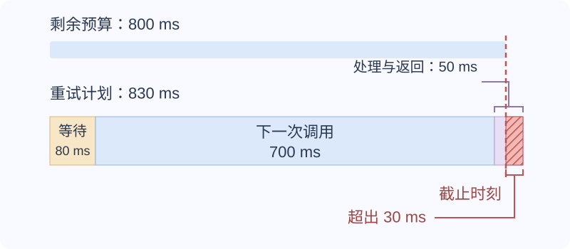

# 写请求超时后，怎样查清结果并安全重试？

前面几章讲的是一次同步请求怎样被识别、授权并按契约回应。从本章起，请求返回之后的工作才开始：响应可能丢失，工作可能还在别处进行。本章回答三件事：超时之后调用方到底知道什么；怎样用同一个操作身份取回原操作的当前状态；什么时候允许重试、等多久、由谁重试。手上的前提是：服务已经能认出可信主体并逐次授权（见[逐次授权](per-request-authorization.md)），HTTP 方法的安全与幂等语义已在[HTTP 语义与传输](http-semantics-and-transport.md)讲过。

## 案例：导出请求在响应途中丢失

沿用主线四的报表服务。`acct-17` 的成员 `user-17` 有 `report:export` 权限，要把报表 42 的 2026 年第二季度数据导出成 CSV。生成要几十秒，所以服务不在请求里生成，而是创建一个可查询的 job (任务)。本章新增三个标识符：

- `export-demo-415`：客户端为这次导出意图生成的 idempotency key (幂等键)，重试时保持不变；
- `job-demo-731`：服务受理后分配的 job ID；
- 状态地址 `/v1/jobs/job-demo-731`，取消用 `DELETE` 同一地址，下载用 `/v1/jobs/job-demo-731/result`。

幂等键、报表 ID 42 和 job ID 是三种身份，刻意不共用数字，不能互相替代。

~~~http
POST /v1/accounts/acct-17/reports HTTP/1.1
Host: api.reports.example.test
Idempotency-Key: export-demo-415
Content-Type: application/json

{"reportId":42,"period":"2026-Q2","format":"csv"}
~~~

服务把 job 写进数据库并提交，然后返回 `202 Accepted` 和 `Location: /v1/jobs/job-demo-731`。这个 202 在网络里丢了，浏览器只看到超时：

~~~mermaid
sequenceDiagram
    participant C as 浏览器
    participant A as API
    participant D as 数据库
    C->>A: POST 导出，键 export-demo-415
    A->>D: 写 job-demo-731 与幂等记录
    D-->>A: 同一事务提交
    A--xC: 202 在途中丢失
    Note over C,D: job 已存在；浏览器只知道“超时”
    C->>A: 重放原 POST，同键同正文
    A->>D: 重新授权后按作用域键读记录
    D-->>A: 已有 job-demo-731 及其当前状态
    A-->>C: 202 + Location: /v1/jobs/job-demo-731
    C->>A: GET /v1/jobs/job-demo-731
~~~

下面先说明超时让调用方处于什么状态，再看重放要满足的合同，最后讲重试的时间和次数。

## timeout 和 deadline 各限定什么？

timeout (超时) 限定一次等待或一次操作最多持续多久；deadline (截止时间) 是整条调用链最晚必须完成的时间点。两者的差别在串行调用里最明显：最外层只给整次操作 2 秒，如果每一层都重新给下游一份完整的 2 秒 timeout，三个串行调用最坏要等 6 秒：单是第一个调用就可能耗尽最外层的全部预算，后两个调用已经没有时间。

因此每一层都应该把**剩余时间**（或绝对截止时刻）传给下游，并从中扣出自己清理资源和回包所需的时间。连接建立、TLS 握手、读取响应正文是否都算在某个库的 timeout 里，各客户端 API 的定义不同，要逐个核对。

deadline 到了，调用方停止等待，但这只是**调用方**不再等。下游的工作可能还在运行，也可能已经提交。这就是下一节的问题。

## 超时之后，调用方处于什么状态？

一次写请求超时，调用方从自己的连接上分不清四种情况：请求没到服务器；服务器处理失败并回滚；事务还在进行；事务已提交但响应丢失。最后一种情况就是本例：`job-demo-731` 已经存在，浏览器却一无所知。这种状态叫 unknown outcome (未知结果)。

未知结果只能靠**原操作的身份**去消除，规则有四条：

1. **同键同参重放，取回同一操作的当前状态。** 浏览器用同一个 `export-demo-415` 和同样的正文重放原 POST。服务重新认证、重新授权，按作用域键找到已有记录，核对参数一致后返回 `job-demo-731`，不再创建第二个 job。返回的是该操作**现在**的状态：如果这期间 job 已经成功，就返回成功；如果已被合法取消，就返回 `cancelled`，不会把它重新激活。重放恢复的是同一个业务操作，不要求逐字节重现首次响应。
2. **查不到不等于失败。** 服务按键查不到记录，只说明这条查询没看到已提交的记录；原事务可能还没提交。重放必须继续经过数据库的唯一裁决，不能“先查一下，没有就当新请求放行”。
3. **只读查询保持只读。** 状态查询接口查不到记录时，不能顺手启动原操作。启动操作只能走带幂等键的原写请求。
4. **连接断开不等于取消。** 已经受理的 job 不会因为浏览器断线而停下；要取消，就向已知地址发 `DELETE`。

本例的服务没有“按幂等键查询”的 GET 接口，所以 202 丢失后的唯一入口是重放原 POST。拿到 `Location` 之后，客户端改用 `GET /v1/jobs/job-demo-731` 轮询。202 本身承诺了什么、服务在返回 202 之前必须持久化哪些东西，见下一章[耗时任务怎样被持久受理](durable-job-acceptance-and-outbox.md)。

这里的未知结果发生在 HTTP 响应的交付路径上。数据库自己也可能让 `COMMIT` 结果未知（提交请求发出后连接断开）；那时的处置同样是“保留原键回查，不换新键”，见[事务能保证什么](../data/transactions-and-isolation.md)。

## 方法幂等和幂等键有什么不同？

RFC 9110 定义的 idempotent method (幂等方法) 指：同一个请求重复多次，**预期的服务端效果**与执行一次相同；它不禁止每次请求都记一条日志。`PUT` 和 `DELETE` 是幂等方法，`POST` 不是（详见[HTTP 语义与传输](http-semantics-and-transport.md)）。

给 POST 加上幂等键，是另一回事：这是应用自己定义的去重与结果重放约定。它的效果靠服务端的数据和约束实现，HTTP 不替它保证。两者也不能互相代替：把 POST 改成 PUT 不会让“创建 job”自动去重；给 PUT 加幂等键也不会改变它的协议语义。

一个可用的幂等键合同要写清下面这些要素：

| 要素 | 本例的选择 | 为什么需要 |
| --- | --- | --- |
| 作用域 | `(account_id, principal_id, key)` | 防止另一个主体猜到键就读到别人的私有结果 |
| 请求指纹 | 规范化后的 `reportId`、`period`、`format` 的摘要 | 同键异参是客户端违约，返回明确冲突，不能把旧结果当成新意图的结果 |
| 裁决方式 | 数据库唯一约束 | 两个同键请求同时到达时只有一个能提交 |
| 重放规则 | 返回同一操作的当前状态 | 见上一节 |
| 保留期与窗口外语义 | job 与幂等映射在终态后保留 14 天 | 见下一节 |

前三项的数据库实现（唯一约束怎样裁决、冲突方为什么要整笔回滚再用新事务回查、为什么效果和幂等记录必须在同一事务提交）在[两个请求争夺最后一件库存时怎样只预留一次](../data/conditional-writes-and-idempotent-records.md)讲完整。本章只用它的结论：**作用域键加指纹由唯一约束裁决，败方回滚后新开事务读胜者，同指纹返回胜者的记录，异指纹报冲突。**

## 去重要覆盖多长时间？

幂等记录不能永远保留，但保留得太短会让重复“漏网”。判断标准只有一条：**去重保护必须覆盖这个操作的所有副本可能到达并提交的时间**，包括原请求本身、每一次重放、仍在服务器里执行的请求，以及还可能晚到的请求。

下面这个构造出来的时序说明“覆盖不到在途请求”会发生什么。假设某个服务不用数据库唯一约束，而是请求一到就在缓存里抢占键，并给它 60 秒有效期：

| 时刻 | 事件 |
| ---: | --- |
| 0 s | 原请求 A 到达，抢到键，开始执行 |
| 5 s | A 所在进程长时间停顿（例如等锁或 GC），客户端超时 |
| 60 s | 键过期被删除；A 仍在执行中 |
| 70 s | 客户端重放 B，查不到键，当作新请求执行 |
| 75 s | B 提交，产生第一份效果 |
| 90 s | A 恢复并提交，产生第二份效果 |

问题不在 60 秒太短，而在有效期没有和“A 最晚何时还能提交”绑定。两种修法：

- 让效果与幂等记录在**同一个数据库事务**里提交，并由唯一约束裁决。这样 A 和 B 谁后提交，谁就撞上唯一键，只能读回胜者。本例采用这种做法。
- 如果必须用有效期，就要先给在途请求设一个服务端强制的上限（例如数据库语句和事务超时），再让有效期至少覆盖“最后一次可能开始执行的时刻 + 这个上限 + 时钟偏差 + 余量”。webhook 支线的[去重墓碑保留期](webhook-delivery-and-verification.md)就是按这个思路推导的。

覆盖了在途请求，还要声明**重放窗口**：服务保证在多长时间内认得同一个键。窗口之后若把记录全部删掉，服务就无法仅凭一个键字符串分辨“这是旧操作的重放”还是“这是一个新意图”。本例的键不带可验证的有效期，因此：

- 窗口内，保留足以识别该键的记录（作用域键、指纹、指向的 job）；
- 窗口外若仍要拒绝旧键，就必须继续保留一条 tombstone (墓碑)：只留键与指纹，不留结果；
- 合同要写明窗口外的重放会得到什么，调用方不能把过期的旧操作当新请求重做。

本例的具体数字（结果 7 天、job 与幂等映射 14 天）和 `result_expired` 的处理见[状态、取消、结果与保留期契约](durable-job-acceptance-and-outbox.md#状态、取消、结果与保留期怎样约定？)。

## 远端副作用超时后，什么时候可以重发？

本地数据库事务只管本库。若操作还要调用外部系统，例如付款、发通知或写另一家的 API，远端效果不在事务里：本地回滚撤不回远端，超时也不会自动撤销远端已经发生的效果。

transactional outbox (事务发件箱，下文 outbox) 能做的是让“本地结果”和“将来必须发出的指令”一起提交，并让 relay (中继) 在崩溃后重发（见[下一章](durable-job-acceptance-and-outbox.md)）。它保证指令不丢，但会重复，不会替远端去重。避免重复付款，仍要靠远端按稳定的操作键去重；对账能发现重复，却不能阻止重复。

**远端操作键怎样构造。** 用权威且全局唯一的身份加上操作类型和版本，例如 `job-demo-731:report-ready:v1`。不要直接用客户端的 `export-demo-415`：它只在 `(acct-17, user-17)` 范围内唯一，另一个主体完全可能用同一个字符串。同一个操作的每次重发都必须带同一个键和同一份请求内容；远端要按“同键、同请求摘要”去重，并提供按键查询或明确的去重保留期。

远端调用超时或结果不明时，按下表决定下一步。这是全领域唯一一张这样的决策表，AI 的退款对账、webhook 接收方的后续处理都引用它：

| 查证结果 | 处理 |
| --- | --- |
| 按原操作键查询，远端确认已完成 | 在本地持久记录完成，停止重发 |
| 结果仍未知（包括查询接口暂时不可用），但远端对“同键、同请求摘要”的去重保证仍然有效 | 在保证有效期内用原键、原摘要重试，并继续对账 |
| 结果未知，且没有仍有效的去重保证，或摘要不一致，或已过远端保留期 | 保持“未知”，转人工对账；不换新键自动重发 |

两个系统的期限互不延长。本地的重试窗口再长，也不会让远端的去重保证多保留一天；远端保证先过期，本地即使还在自己的窗口内，也不能再盲目重发。

> [!info] 应用实例：AI 运行里的退款
> AI 工程把这张决策表落到一次退款上：退款请求超时后进入专门的未知状态，只读对账查清结果，满足同键前提才重放。状态名和支付提供方的实例见[退款请求超时后，怎样查清结果而不重复扣款](../../ai-engineering/runs/external-writes-and-reconciliation.md)。

## 重试要等多久、最多试几次？

有了幂等键，重放本身是安全的，但每次重试仍然消耗时间和下游容量。决定重试之前先问两件事：

1. **失败可能自己恢复吗？** 参数校验失败、同键异参冲突、无权访问，原样再发一百次也不会成功，应该修正请求或停止。超时、连接中断、`503`、`429` 才可能随时间恢复。
2. **这次重放安全吗？** 只有带原幂等键、原参数的写请求，或本身幂等的方法，才可以重放。

对可恢复的失败，使用有上限的 exponential backoff (指数退避)，并加 full jitter (全抖动) 把各客户端的重试时刻打散：

~~~text
cap(n)  = min(max_delay, base_delay × 2^n)      n 从 0 开始，第一次失败后 n = 0
wait(n) = 在 [0, cap(n)] 上均匀随机取值
~~~

设 `base_delay = 100 ms`、`max_delay = 800 ms`，前三次退避的区间依次是 0–100 ms、0–200 ms、0–400 ms，之后封顶在 0–800 ms。这些数是服务策略，不是通用常数。

次数和时间还要受两条约束：

- **剩余 deadline。** 只有剩余时间装得下“这次等待 + 下一次调用 + 处理和回包”，才发起重试；否则停下，把结果保留为未知。“最多 3 次尝试”包括首次调用，所以最多只有两次退避。
- **`Retry-After`。** 服务明确要求等待时（`503` 或 `429` 响应携带 `Retry-After`），按接口契约尊重这个等待，不能用自己算出的更短退避绕过它；等待若超出剩余 deadline，就直接停下。

> [!example] 2 秒截止时间下的重试复盘
> 客户端总截止时间 2 s，最多 3 次尝试。第一次调用用了 1.2 s 后超时，剩余 0.8 s。
>
> - 这是第一次失败，`n = 0`，等待上限 `min(800, 100 × 2⁰) = 100 ms`。
> - 本例为下一次调用预留至少 700 ms，处理与回包再留 50 ms，所以能用于等待的时间最多是 `800 − 700 − 50 = 50 ms`。
> - 全抖动抽到 80 ms（落在 0–100 ms 内，本身合法），总需求 `80 + 700 + 50 = 830 ms`，比剩余预算多 30 ms。
>
> 结论：不再重试，停下并把导出状态记为未知；之后用同一个 `export-demo-415` 重放或查询 job。700 ms 是本例选定的最小调用预算，真实调用没有可预知的固定耗时，应按时延目标和观测数据设定。

客户端停止等待之后，尚未查证的写入仍是未知结果，不能自动改记为“失败且未生效”。

## 为什么只能让一层重试？

重试会在调用链上逐层相乘。设一条串行调用链上有 5 层调用者，每层对下一层都“最多尝试 3 次，全部失败才向上报错”。最上层发出一次请求，它下面一层最多收到 3 次，再下一层最多 `3² = 9` 次，依此类推，5 层调用者之下最深的那个服务最多收到 `3⁵ = 243` 次。这是最深层单独承受的次数，不是整条链所有调用的总和。下游刚开始变慢时，这种放大正好把它彻底压垮。

所以通常只让一层负责重试：选**最了解端到端 deadline 和幂等性**的那一层（往往是最外层的客户端或网关），其余各层把失败明确地交上去，不再自行重试。

## 取消在这里意味着什么？

deadline 用完或用户放弃时，调用方会发出取消。cancellation (取消) 只是告诉仍在运行的工作“结果已经不需要了”：信号要传给下游，由下游在安全的检查点停止多余计算、释放资源。它**不证明**工作已经停下，也不证明已提交的副作用被撤回；副作用是否发生，仍要查权威记录。这条“取消只是请求”的原则在 OS 线程、Node.js、Python 里的具体表现，见[一份工作该交给进程、线程还是异步 I/O](../runtime/processes-threads-and-async-io.md)。

对已经受理的导出 job，浏览器断线只结束这一次连接。要停止 `job-demo-731`，客户端必须对已知地址发 `DELETE`，而服务端怎样处理“取消和 worker 领取同时发生”，见[任务失败、被取消或 worker 失联后怎样收尾](job-retries-cancellation-and-cleanup.md)。尚未受理的请求内工作（例如直接流式返回的小 CSV）则可以在断线后结束。

## 本章产出与下一步

到这里，调用方手上有一个稳定的操作身份 `export-demo-415`，并知道：超时是未知结果；同键同参重放取回 `job-demo-731` 的当前状态；远端副作用按决策表处理；重试只在一层、受 deadline 约束地进行。还没回答的是服务端那一侧：返回 202 之前，服务到底持久化了什么，才能保证这个 job 一定会被某个 worker 执行？这是[耗时任务怎样被持久受理，并保证一定会被唤醒](durable-job-acceptance-and-outbox.md)的问题。

> [!info]- 来源
> - 幂等方法的定义（重复请求的预期服务端效果与一次相同）、`202 Accepted` 的语义、`Retry-After`：[IETF RFC 9110](https://www.rfc-editor.org/rfc/rfc9110.html)，§9.2.2、§15.3.3、§10.2.3，2022-06，核对于 2026-11-11。幂等键的作用域、指纹、当前状态重放与保留期是本例的应用合同，不是 RFC 规定。
> - 副作用、超时、重试安全与客户端请求令牌：[AWS Builders’ Library, Making retries safe with idempotent APIs](https://aws.amazon.com/builders-library/making-retries-safe-with-idempotent-APIs/)，核对于 2026-11-11。
> - timeout、带上限的退避与多层重试的放大：[AWS Builder Center, Timeouts, retries, and backoff with jitter](https://builder.aws.com/content/3EumjoZascWd1oZiEgL8ORlv3qE/timeouts-retries-and-backoff-with-jitter)，原文 2019-12-05，核对于 2026-11-11；[Google SRE Book, Addressing Cascading Failures — Retries](https://sre.google/sre-book/addressing-cascading-failures/#retries)，2016。
> - full jitter 的均匀等待区间：[AWS Architecture Blog, Exponential Backoff and Jitter](https://aws.amazon.com/blogs/architecture/exponential-backoff-and-jitter/)，2015-03-04（2023 年补充 SDK 说明）；本章只采用其算法定义，不把文中的模拟收益当成通用性能保证。
> - deadline 向下游传播与协作式取消：[gRPC Deadlines](https://grpc.io/docs/guides/deadlines/)，核对于 2026-11-11；具体行为取决于各 API。
> - 远端副作用的操作键与“查询确认 / 同键重试 / 人工对账”决策：属于工程推论（outbox 不替远端去重，远端须按同键同摘要去重）；远端是否提供按键查询和去重期限，以各提供方的契约为准。
