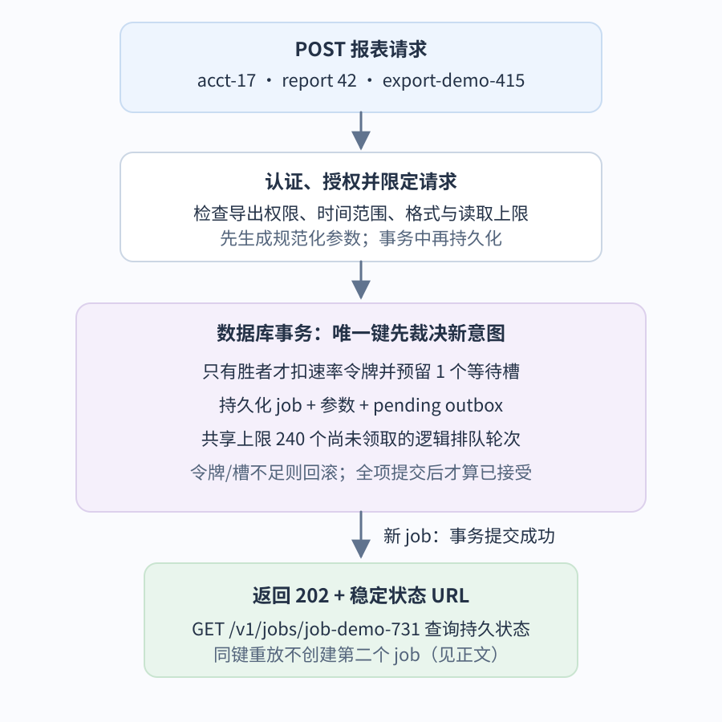

# 耗时任务怎样被持久受理，并保证一定会被唤醒？

上一章从调用方一侧看导出请求：202 丢了，用 `export-demo-415` 重放就能取回 `job-demo-731`。本章换到服务一侧，回答：什么工作值得做成后台 job；返回 `202 Accepted` 之前必须把哪些东西写进数据库；数据库提交之后，怎样保证一定有消息去唤醒 worker (工作进程)，而且不会唤醒一个不存在的 job。沿用主线四的导出案例，本章不新增标识符，只补 job 的状态机和保留期。

## 这份工作需要做成后台 job 吗？

先问同步能不能做完。如果一次有界读取能稳定地在调用方 deadline (截止时间) 和尾延迟目标内完成，同步接口只需校验、读取、返回 CSV，不需要状态表、队列、重试和结果清理。只有出现下面任一情况，持久 job 才值得它带来的复杂度：

- 工作可能超出单个请求的时间预算；
- 浏览器断线后工作仍须继续，之后还要能查进度、拿结果；
- 工作需要和 API 进程的执行资源隔离，不能占着处理 HTTP 请求的线程和连接。

还有一条中间路线：在请求里直接流式返回 CSV。它和持久 job 是两种生命周期：

| | 请求内流式响应 | 持久 job |
| --- | --- | --- |
| 资源占用 | 正文发完之前一直占着连接、游标和处理资源 | API 只占受理事务那一小段；执行资源归 worker |
| 断线之后 | 已做的读取作废，不留下可查询的结果 | job 继续，之后可查状态、下载结果 |
| 谁让上游慢下来 | 请求自己的 deadline 和流背压 | 受理前的准入检查（见[容量章](capacity-admission-and-backpressure.md)） |
| 适合 | 小而快、可以整份重来的结果 | 慢、大、必须可恢复的结果 |

流式响应的资源何时释放（例如 FastAPI 的 `yield` 依赖要覆盖整个正文发送），见[异步 FastAPI 接口为什么仍会阻塞](../runtime/python-asyncio-and-fastapi.md)；背压怎样逐段传回源头，见[流怎样把“慢下来”传回源头](../runtime/stream-backpressure-and-partial-output.md)。

还要记住一点：队列只保存“待唤醒”的工作，本身不增加处理能力。让用户在断线后仍能查到“服务接受了什么、进展如何、结果是什么”的，是数据库里的 job 记录，不是队列里的消息。

## 201 和 202 承诺的是不同的事

两个状态码都可能伴随 `status: "queued"`，但承诺不同：

- `201 Created` 表示**一个资源已经创建**。例如 `POST /api/reports` 新建一条名为 `Weekly overview` 的报表记录，返回 `201` 和 `Location: /api/reports/44`。记录已经存在，即使它的某个字段还写着 `queued`，也不表示成品已经生成。
- `202 Accepted` 表示**请求已被接受处理，但处理还没完成**，RFC 9110 也明说不承诺最终一定成功。响应应给出一个让调用方继续查询的地址。

导出属于后者：`POST /v1/accounts/acct-17/reports` 受理的是一项可能失败的作业，所以返回 202 和 job 的状态地址，而不是假装结果已经存在。

## 受理之前要检查什么？

进入受理事务之前，API 依次做完这些便宜的检查，任何一项不通过都直接拒绝，不留任何记录：

1. **认证与授权。** 确认当前主体，确认它对 `acct-17` 有 `report:export`；`report:read` 不包含导出权限。路径里的账户号和随机 job ID 都不是凭据。授权的完整骨架见[服务怎样逐次确认主体能做这个动作](per-request-authorization.md)。
2. **范围与上限。** 时间范围、格式、预计页数。本例每个 job 最多读 12 页；如果从参数就能判断会超过 12 页，在受理前拒绝。
3. **参数规范化。** 把影响执行的参数整理成规范形式（例如统一期间写法、去掉无关字段），再据此计算请求指纹。指纹只用于比较“是不是同一个意图”，worker 执行所需的参数另存在 job 行里。

执行期还有两条边界在这里一并约定：读到第 12 页仍未读完，worker 提交一个明确的失败，而不是无限分页；页数上限管不住单次 I/O 的无限等待，所以每页读取和对象上传各自要有强制执行的 deadline。

## 202 之前必须提交什么？

HTTP 的 202 只要求“已接受”。本服务把它定义得更强：**只有 job 行、一条待发布的 outbox (事务发件箱) 意图和一个等待槽在同一个数据库事务里提交之后，才返回 202。** 有了这条应用合同，202 才是一个可以查询、可以恢复的承诺，而不是“内存里排了一个后台任务”。

受理事务按顺序做四件事：

~~~text
BEGIN
  1. 插入 job 身份：(account_id, principal_id, idempotency_key) 唯一，附请求指纹
     → 唯一约束说这不是新意图：回滚，新事务读胜者（同指纹返回原 job，异指纹报冲突）
  2. 只有新意图才继续：锁定全管线共享的额度行，扣 1 枚速率令牌、占 1 个等待槽
     → 令牌或等待槽不足：回滚，在 202 之前拒绝（429 / 503）
  3. 补齐 job：规范化参数、status = 'queued'、available_at = 数据库当前时间
  4. 插入 outbox 意图：新的 intent_id、job_id、state = 'pending'
COMMIT  → 只有收到提交成功，才返回 202 + Location: /v1/jobs/job-demo-731
~~~

三处细节分别由别的章节负责：

- 第 1 步的唯一裁决和“败方整笔回滚、新事务回查”，是主线三的结论，见[两个请求争夺最后一件库存时怎样只预留一次](../data/conditional-writes-and-idempotent-records.md)。同键重放不创建第二个 job，也不再扣令牌、不再占槽。
- 第 2 步为什么必须是一条共享的额度行，以及 429 与 503 怎样区分，见[一条异步管线能接多少工作](capacity-admission-and-backpressure.md)。
- 如果 `COMMIT` 发出后没收到结果，API 不能假定成功，也不能宣称失败；客户端用原幂等键重放即可，唯一键会把重放和可能已提交的记录对应起来（见[上一章](deadlines-retries-and-unknown-outcomes.md)）。

图里只画了首次受理成功的路径。受理成功后的响应：

~~~http
HTTP/1.1 202 Accepted
Location: /v1/jobs/job-demo-731
Content-Type: application/json

{"jobId":"job-demo-731","status":"queued","cancelRequested":false,"statusUrl":"/v1/jobs/job-demo-731"}
~~~

## 数据库和消息代理之间的缺口怎样补上？

job 已经提交，接下来要通知 worker。通知走 message broker (消息代理，下文 broker)。问题在于：数据库和 broker 没有一个共同的原子事务，两步写总有一步可能在另一步之后失败。这叫 dual write (双写) 缺口：

| 顺序 | 中途崩溃的后果 |
| --- | --- |
| 先提交 job，再直接发消息 | 进程在两步之间崩溃，job 留在数据库里，永远没人唤醒 |
| 先发消息，再提交 job | 事务回滚后，消息指向一个不存在的 job |

outbox 的全称是 transactional outbox (事务发件箱)，做法是：把“将来必须发出这条消息”也写成一行数据，和 job 放在**同一个数据库事务**里提交（就是受理事务的第 4 步）。之后由独立的 relay (中继) 进程扫描未发布的意图，把消息发给 broker，再回写这条意图的状态。

outbox 消除了“提交了却没人发”，但换来了另一种情况：relay 可能在 broker 已接收、自己还没回写状态时崩溃，重启后把同一意图再发一次。所以：

- **消息会重复。** worker 必须依据数据库里的 job 状态做条件领取来去重，不能假设每条消息只投递一次（见[下一章](job-claims-leases-and-fencing.md)）。
- **发布成功不代表已处理。** relay 只有按所选 broker 的契约核实发布结果、路由和持久性之后，才把意图标为已发布；即使如此，这也只说明 broker 收下了消息，不说明 worker 收到、处理或完成。三种确认各证明什么，见[发布确认、消费者确认和业务完成各证明什么](queue-delivery-and-acknowledgement.md)。
- **消息只带稳定的 job ID。** 不把原始请求正文或敏感筛选条件塞进消息；worker 需要的规范化参数在 job 行里，worker 拿到 ID 后去数据库读。

outbox 只保证本地意图不丢。它不替远端系统去重：如果 worker 之后还要调用外部服务，重复与未知结果的处理见[远端副作用的决策表](deadlines-retries-and-unknown-outcomes.md#远端副作用超时后，什么时候可以重发？)。

## job 状态机与 outbox 各有自己的生命周期

job 有五个持久状态；`cancel_requested` 是一个独立的标志，不是状态：

| 状态 | 含义与下一步 |
| --- | --- |
| `queued` | 已受理、尚未被领取的一轮排队；持有一个等待槽；`available_at` 到了才能领取。消息此刻可能还在 outbox 里，也可能已进入 broker |
| `running` | 某个 worker 已通过条件更新领取；等待槽已归还；当前 attempt (执行尝试) 编号和 lease (租约) 到期时间已写入 |
| `succeeded` | 当前 attempt 的私有结果对象引用与成功状态一起提交；同一事务写了 `report.ready` outbox |
| `failed` | 不可重试的错误、attempt 用尽，或重排时拿不到等待槽；用有限的错误码表达，如 `authorization_revoked`、`attempts_exhausted`、`capacity_exhausted` |
| `cancelled` | 取消赢得状态竞争后的终态；不暴露结果对象 |

几条不变的规则：

- 终态（后三个）一旦提交，不再回到 `queued` 或 `running`。
- 每个 job 最多 3 次 attempt，包含首次领取，即最多两次重试。这个上限在受理时写进 job 行（`max_attempts = 3`），之后改部署配置不能悄悄改变已有 job 的上限。
- job 行至少保存：job ID、账户与原请求主体、`report_id`、规范化参数、请求指纹与幂等键、创建时间、`max_attempts`、当前 attempt、租约到期时间、`available_at`、是否持有等待槽、`cancel_requested`、终态与成功时间、结果到期时间、私有结果引用、有限错误码。
- 所有时间判断用数据库时钟。首次受理时 `available_at` 取数据库当前时间；延迟重试时保存退避到期的时刻。relay 和 worker 用同一个时间基准，不各自看本地时钟。

outbox 意图有自己的状态 `pending → published`，不能拿它代替 job 状态。每一轮排队（首次受理、每次重排）都插入一条**新的**意图，各有唯一的 `intent_id`。relay 回写时以 `intent_id` 为条件：

~~~sql
UPDATE report_outbox
SET state = 'published', published_at = clock_timestamp()
WHERE intent_id = :intent_id AND state = 'pending';
~~~

这样，上一轮意图迟到的发布回执只会改它自己那一行，不会把新一轮的意图误标为已发布。这种“按身份条件回写”是栅栏原理的一个实例，原理本身在[怎样保证一个任务同一时刻只由一个 worker 推进](job-claims-leases-and-fencing.md)讲。

清理也按各自的生命周期：已发布的意图在满足审计与排障保留期后按策略删除；未发布的意图必须保留，不能和结果对象用同一个删除条件。

## 状态、取消、结果与保留期怎样约定？

调用方之后通过三个端点和 job 打交道，每个端点都按当前调用者重新授权：

- `GET /v1/jobs/job-demo-731`：返回持久状态和有限错误码。
- `DELETE /v1/jobs/job-demo-731`：表达“请求停止”，不代表计算已经停止。运行中的 job 可以继续显示 `running`，同时带 `cancelRequested: true`。取消和领取、和成功提交怎样竞争，见[任务失败、被取消或 worker 失联后怎样收尾](job-retries-cancellation-and-cleanup.md)。
- `GET /v1/jobs/job-demo-731/result`：只有 `succeeded` 且结果仍在保留期内才允许下载。

保留期分两层，解决不同问题：

| 记录 | 本例保留期 | 计时起点 | 到期之后 |
| --- | --- | --- | --- |
| 结果对象 | 7 天 | 成功事务提交时写入 `succeeded_at`，同时写 `result_expires_at = succeeded_at + 7 天` | job 仍是 `succeeded`，下载端点返回 `result_expired`；同一幂等键仍指向原 job，不自动重新生成 |
| job 行与最小幂等映射 | 14 天 | 每种终态都写 `terminal_at`，从这里起算 | 不再提供重放保证；若仍要拒绝这个旧键，只能保留一条墓碑 |

14 天比 7 天长，是为了覆盖更长的客户端重试窗口：结果过期之后，客户端用同一个键重放，仍然得到“这是原来那个 job，结果已过期”，而不是一个新 job。墓碑与重放窗口的一般规则见[去重要覆盖多长时间](deadlines-retries-and-unknown-outcomes.md#去重要覆盖多长时间？)。

最后一条容易漏掉：job 的 `status` 和 `attempt` 只描述执行过程。如果产品要告诉用户“这份报表是截至哪个时点的数据”，就要另存数据水位或快照语义作为结果元数据；给查询加一个时间过滤，并不能保证 12 页分页读取都来自同一个快照（见[怎样无重复、无遗漏地分页读取一个还在变化的集合](../data/keyset-pagination-and-snapshots.md)）。

## 本章产出与下一步

受理事务提交之后，数据库里有：`queued` 的 `job-demo-731`、它占着的一个等待槽、一条 `pending` 的 outbox 意图。relay 会把只带 job ID 的消息发出去，可能不止一次。下一个问题是：消息到达多个 worker 时，怎样保证只有一个 worker 推进这个 job，并且一个停顿后又醒来的旧 worker 不会覆盖新结果？见[怎样保证一个任务同一时刻只由一个 worker 推进](job-claims-leases-and-fencing.md)。

如果这次 job 成功后还要用 HTTP 回调通知另一个服务，接收方怎样验证并受理这条回调，是支线[收到一条 webhook 回调时，怎样确认它真实、未被重放，并可靠地受理](webhook-delivery-and-verification.md)。

> [!info]- 来源
> - `202 Accepted` 表示已接受处理但未完成、不承诺最终成功；`201 Created` 表示资源已创建并可用 `Location` 指向它：[IETF RFC 9110](https://www.rfc-editor.org/rfc/rfc9110.html)，§15.3.3、§15.3.2，2022-06，核对于 2026-11-12。“job、outbox 与等待槽同事务提交后才回 202”是本例比 HTTP 通用语义更强的应用合同。
> - 数据库提交与消息发布的双写缺口、重复消息与消费者幂等：[AWS Prescriptive Guidance, Transactional outbox pattern](https://docs.aws.amazon.com/prescriptive-guidance/latest/cloud-design-patterns/transactional-outbox.html)，核对于 2026-11-12。
> - 唯一约束、并发插入与 `ON CONFLICT` 的行为：[PostgreSQL 18, Index Uniqueness Checks](https://www.postgresql.org/docs/18/index-unique-checks.html)、[INSERT](https://www.postgresql.org/docs/18/sql-insert.html)，核对于 2026-11-12；数据库侧的完整论证在主线三。
> - 请求内流式响应与持久 job 的生命周期对照，依据 FastAPI 对 `StreamingResponse` 与 request scope 依赖的实测（FastAPI 0.128.0、Starlette 0.47.2，2026-11-12）；细节在 runtime 主线。
