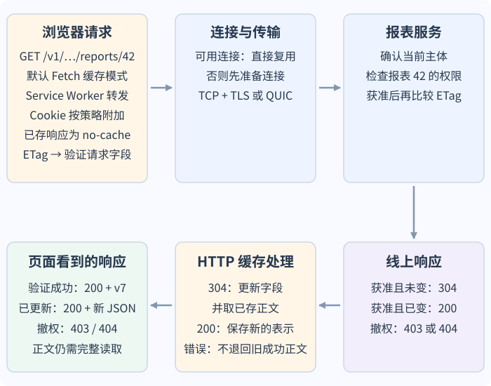

# 一份 HTTP 响应什么时候可以直接复用，什么时候必须回源确认？

上一章的读取拿到了报表 42 的 `200`。本章回答浏览器把它存下来以后的事：缓存凭哪三个条件决定直接复用，常见的 `Cache-Control` 指令各自允许什么，回源验证时服务端怎样先授权再比版本，以及页面最终看到的是什么。本章是全领域 HTTP 缓存语义的权威位置；应用层数据缓存（Redis 一类）另见[加了缓存之后，读到的数据最多会旧多久？](../data/caching-and-staleness.md)。

## 沿用的案例：浏览器私有缓存里存着 v7

沿用[主线四的报表读取案例](http-semantics-and-transport.md#案例：账户报表服务里的一次读取)。本章补上上一章省略的两个响应字段：API 给报表 42 当前的表示生成了强 ETag（entity tag，实体标签）`"report-42-v7"`，并声明了缓存策略：

~~~http
HTTP/1.1 200 OK
Content-Type: application/json
Content-Language: zh-CN
ETag: "report-42-v7"
Cache-Control: private, no-cache
Vary: Accept-Language

{"id":42,"title":"Service health","status":"ready","delivery":{"channel":"email","recipients":["reader@example.test"]},"note":"Draft"}
~~~

ETag 是服务端给资源某一版本的表示起的不透明标识，只比较相等，不按字符串推断新旧。浏览器把这份响应存进自己的私有 HTTP 缓存。之后页面再次请求报表 42 时，缓存要决定：直接交出这份 v7，还是先问服务器 v7 是否仍是当前版本。

## 缓存复用前要回答的三个问题

缓存（浏览器缓存、CDN 或代理）收到请求时，按三个问题判断能否用已存的响应代替网络：

1. **能不能存。** 响应带 `no-store` 就不存；共享缓存还要遵守 `private` 等限制。其余响应按状态码和指令判断。
2. **缓存键是否匹配。** 缓存通常按请求方法和目标 URI 区分响应；响应里的 `Vary` 再列出影响表示的请求字段。本例的 `Vary: Accept-Language` 意味着英文偏好的请求不能拿走中文表示。
3. **是否仍新鲜。** `max-age=60` 表示响应的 age（年龄，自源站生成以来经过的时间）小于 60 秒时新鲜；恰好 60 秒时已经不新鲜。

三个问题都答“是”，且没有指令要求先验证，缓存可以完全不联系服务器，直接交出存储的响应。响应不再新鲜，或指令要求每次验证时，缓存发 conditional request (条件请求)：把存储的 ETag 放进 `If-None-Match` 问服务器。“已过期”也不等于“绝不能交出”，有些指令或配置明确允许在特定情况下使用过期响应。

验证器和新鲜期管不同的事：ETag 只在需要验证时才用；仍新鲜的响应不会因为带了 ETag 就提前回源。缓存键和验证器必须覆盖 API 实际协商的所有维度，但它们都不是对象权限检查。

## 常用指令各允许什么

| 指令 | 含义 | 常见误解 |
| --- | --- | --- |
| `max-age=N` | age 小于 N 秒时新鲜，可不问源站直接复用 | 以为过期就绝不能用；有些指令或配置允许使用特定的过期响应 |
| `no-cache` | 可以存，但每次复用前都必须先向源站验证 | 以为是“不要缓存” |
| `no-store` | 不要存储这次请求和响应 | 以为能单独保证隐私；它只约束合规缓存的存储行为 |
| `private` | 只允许浏览器这类私有缓存存，共享缓存不得存 | 以为它做了用户间授权隔离或内容保密 |
| `public` | 允许共享缓存存储，即使响应按默认规则不可存，例如请求带了 `Authorization` | 以为“public”管的是谁能访问；它只放宽存储许可 |
| `immutable` | 新鲜期内表示不会变化，浏览器无需验证，用户普通刷新时也不必发条件请求 | 以为内容从此永不过期；它只在新鲜期内生效 |

`private` 对本例很关键。浏览器到 BFF 的请求靠 `Cookie` 认证，不带 `Authorization`；若 BFF 前面有 CDN 或共享代理，而响应没有声明 `private` 或 `no-store`，一个用户的可缓存响应就可能被共享缓存存下，再交给另一个用户。

本例选 `private, no-cache`：允许浏览器存，但每次复用前都回源，于是每次复用都会经过一次服务端授权。

## 回源验证：If-None-Match 与 304 的完整路径

页面用默认缓存模式再次 `fetch()` 报表 42。页面只发普通 `GET`，HTTP 缓存发现存储的响应要求验证，便在网络请求上自动加 `If-None-Match: "report-42-v7"`。

图上排是请求：Service Worker 原样转发，浏览器按 Cookie 规则附上会话凭据，缓存加上验证字段，连接层复用或新建连接。服务端按固定顺序处理：

1. **先确认主体和权限。** BFF 验证会话，API 确认 `user-17` 当前仍能读 `acct-17` 的报表 42。权限已撤销时，服务端按隐私策略回 `403` 或隐藏式 `404`（选择见[授权章](per-request-authorization.md#隐藏式%20404%20还是%20403)）。缓存不能用旧的成功正文绕过这一步。
2. **再比较版本。** 权限通过后，服务端看被选中的表示是否仍匹配 `"report-42-v7"`。`If-None-Match` 用弱比较，标签的弱标记不影响结果。
3. **按结果回复。**
   - 表示未变：回无正文的 `304 Not Modified`，并带上 `200` 时本会发送的 `ETag`、`Cache-Control`、`Vary` 等字段，供缓存更新存储的元数据。
   - 表示已变：回新的 `200`、新正文和新 ETag，例如报表被编辑后的 `"report-42-v8"`。

~~~http
HTTP/1.1 304 Not Modified
ETag: "report-42-v7"
Cache-Control: private, no-cache
Vary: Accept-Language
~~~

图下排是结果怎样交回页面。网络上是 `304` 时，缓存先用它更新存储的响应，再把存储的 `200` 和原正文交给页面，所以页面看到的是 `200` 加 v7 正文，而不是 `304`。网络上是 `200` 时，缓存保存新表示，页面得到新正文。被拒绝时，页面进入错误分支，不会拿旧正文冒充成功。

### 脚本手动加 If-None-Match 会改变缓存模式

页面脚本若在默认缓存模式的请求里自己写 `If-None-Match`，Fetch 会把这次请求的缓存模式改成 `no-store`，走的就不是上面的自动验证路径。此时网络上的 `304` 会原样成为页面看到的 `304`：`response.ok` 为 `false`，也没有旧正文自动拼回来。通常应让浏览器缓存管理验证；只有应用明确要自己保存表示、自己处理 `304` 时，才手动设置验证字段。

## 新鲜期内撤权，缓存仍可能交出旧正文

把策略换成 `private, max-age=60`，情况就变了：在这 60 秒内，浏览器可以不问服务器直接复用正文。若 `user-17` 在第 10 秒被移出 `acct-17`，他在接下来的 50 秒里仍可能看到 v7，因为这期间根本没有请求到达服务端，也就没有授权检查。

所以新鲜期就是“撤权最多晚多久生效”的上限。需要每次复用都重新确认访问权，就选每次验证（`no-cache`）；内容敏感到不该留在设备上，就选 `no-store`，代价是失去 `304` 省下的传输。不论哪种策略，API 的授权检查都是最终边界。

## 用户范围的响应怎样写缓存字段

按用户或账户变化的响应，要显式声明缓存策略，不能依赖默认行为：

- **成功表示。** 至少 `private`，挡住共享缓存。本例报表 42 的 `200` 用 `private, no-cache`。
- **隐藏式 `404` 和其他授权结果。** RFC 9110 允许缓存对 `404` 做启发式缓存，状态码本身挡不住存储。本例对隐藏式 `404`、`401`、`403` 这类按主体变化的结果设 `Cache-Control: private, no-store`，避免旧的拒绝结果在权限变化后继续被复用。
- **`Vary: Origin`。** API 若按请求来源动态选择 CORS 的 `Access-Control-Allow-Origin`，要加 `Vary: Origin`，让缓存区分不同来源的表示。它只区分来源，不区分同一来源下的不同用户，不保护私有数据（CORS 见[会话章的跨源读取一节](sessions-and-browser-boundaries.md#跨源读取：请求到达和响应可读是两件事)）。
- **ETag 与 `Vary` 一致。** ETag 应按被选中的那份表示生成；语言、媒体类型或内容编码不同的表示，要有可区分的标签，并与 `Vary` 和验证逻辑保持一致。强 ETag 的生成规则见[条件写章](conditional-updates-and-etags.md#强%20ETag%20怎样标记一个版本)。

公开的静态资源走另一种策略：把内容摘要放进文件名，同一 URL 永远对应同一内容，于是可以设很长的 `max-age` 并加 `immutable`；入口 HTML 则每次验证。这套发布做法见[发布新版本时，怎样让缓存和还开着的旧页面都不出错？](../../frontend/delivery/hashed-release-and-caching.md)。

## 下一步：服务端凭什么认定请求来自 user-17？

本章交出的是一条可验证的复用规则：缓存只在能存、键匹配、仍新鲜三者都成立时直接复用；否则带 ETag 回源，服务端先授权、再比版本，页面在自动验证时看到的是原 `200`。新鲜期决定了撤权最晚何时生效，用户范围的响应要用 `private` 或 `no-store` 挡住共享缓存。

整条路径的第一步“先确认主体”还是黑盒：浏览器带来的 Cookie 怎样变成可信的 `user-17`，浏览器又替服务守住了哪些边界，见下一章[请求怎样带上可信的身份，浏览器又替服务守住哪些边界？](sessions-and-browser-boundaries.md)。

> [!info]- 来源
> - 缓存三问、缓存键与 `Vary`、新鲜度与 age、验证、`max-age`、`no-cache`、`no-store`、`private`、`public`，以及带 `Authorization` 请求的共享缓存存储限制（“缓存复用前要回答的三个问题”“常用指令各允许什么”）：[IETF RFC 9111, HTTP Caching](https://www.rfc-editor.org/rfc/rfc9111.html)，2022-06，§2、§3（含 §3.5）、§4.2–§4.3、§5.2.2；`private` 与 `no-store` 的隐私限制见 §5.2.2.5、§5.2.2.7、§7.3；核对于 2026-11-12。
> - `immutable`：[IETF RFC 8246, HTTP Immutable Responses](https://www.rfc-editor.org/rfc/rfc8246.html)，2017-09，§2–§3。
> - ETag、`If-None-Match` 的弱比较、`304` 必须携带的字段、`404` 可启发式缓存（“回源验证”“用户范围的响应”）：[IETF RFC 9110, HTTP Semantics](https://www.rfc-editor.org/rfc/rfc9110.html)，2022-06，§8.8.3、§13.1.2、§15.1、§15.4.5、§15.5.5；核对于 2026-11-12。
> - 默认缓存模式下自动验证、`304` 经缓存更新后交出存储响应、请求带条件字段时缓存模式改为 `no-store`（“脚本手动加 If-None-Match”）：[WHATWG Fetch Standard](https://fetch.spec.whatwg.org/)，Living Standard，2026-10-19 版，HTTP-network-or-cache fetch；核对于 2026-11-12。
