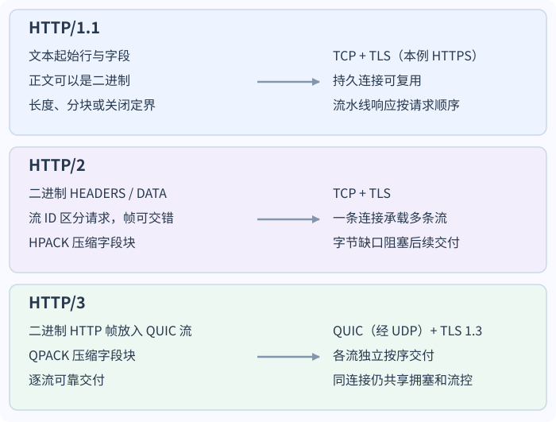
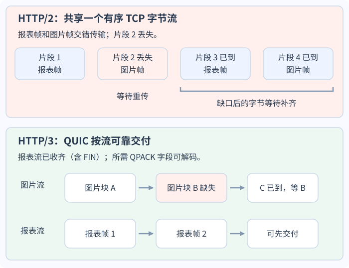

# 一次 HTTP 请求怎样从浏览器到达服务，又带回什么？

本章跟着一次报表读取，从页面发出 `GET` 走到页面拿到可用的结果。途中要分清几件事：HTTP 语义规定了什么，连接和 TLS 各证明什么，状态码和客户端 API 又怎样判定这次请求的结局。读者只需要 TCP/IP 分层的本科常识。本章同时建立主线四的贯穿案例，后面的缓存、会话、授权、API 契约和条件写都沿用它。

## 案例：账户报表服务里的一次读取

一家 SaaS 公司提供账户报表服务。账户 `acct-17`（本主线说的“账户”就是租户）里有 principal (主体) `user-17`，他是该账户的成员，持有 `report:read` 和 `report:export` 两项权限。报表 42 的标题是 `Service health`。本主线的主机、账户、权限和报文都是合成的教学数据，这一点只在这里说明一次。

| 主机 | 角色 |
| --- | --- |
| `https://reports.example.test` | 报表页面，以及服务于页面的后端 BFF（backend for frontend）。BFF 把同源的 `/v1/` 请求转发到 API 的同名路径 |
| `https://api.reports.example.test` | 报表 API，按账户保存报表并做最终授权 |

`user-17` 已经登录，打开报表页。页面脚本发出同源请求 `GET /v1/accounts/acct-17/reports/42`。浏览器自动附上会话 Cookie，BFF 查到会话后带着 API 访问令牌把请求转给 API。用户要的结果很简单：只要他此刻仍有权读这份报表，就看到它的当前内容。

后续各章在这次读取上加条件：[缓存章](http-caching-and-conditional-requests.md)让浏览器带着已存版本回源验证；[会话章](sessions-and-browser-boundaries.md)说明 Cookie 和令牌怎样变成可信主体；[授权章](per-request-authorization.md)引入另一个账户的主体，看服务端怎样拒绝；[条件写章](conditional-updates-and-etags.md)让两位编辑者同时修改报表 42。导出报表那条异步路线从[未知结果章](deadlines-retries-and-unknown-outcomes.md)开始。

## HTTP 的含义和线上格式是两层

HTTP 先是一套语义：方法表达调用方想对目标资源做什么，目标 URI 标识资源，字段携带元数据，状态码说明这次处理的结果类别，正文承载资源的一种表示。这些含义由 RFC 9110 统一规定。HTTP/1.1、HTTP/2、HTTP/3 是三种线上格式，各自决定字段和正文怎样编码、一条连接上怎样并发多个请求。

同一个 `GET → 200 + JSON` 可以由三个版本中的任何一个承载，应用看到的方法、状态码和表示都一样。所以讨论“这个请求能否重试”“这个响应能否缓存”时，看的是语义层；讨论“丢一个包谁要等”时，才看版本和传输层。本章先讲语义，再讲连接，最后回到页面怎样判定结果。

## 请求怎样说明“想要什么”

下面用 HTTP/1.1 的文本格式展示这次请求。HTTP/2 和 HTTP/3 传输同样的语义，只是线上没有这段逐行文本：

~~~http
GET /v1/accounts/acct-17/reports/42 HTTP/1.1
Host: reports.example.test
Accept: application/json
Accept-Language: zh-CN, en;q=0.8
Cookie: __Host-session=<opaque-session-id>
~~~

页面只写了方法、路径和偏好；`Cookie` 由浏览器按 Cookie 规则附上，网页脚本不能自己设置这个字段。响应节选如下（省略 `Date` 等与本节无关的字段，缓存相关字段下一章再讲）：

~~~http
HTTP/1.1 200 OK
Content-Type: application/json
Content-Language: zh-CN
Content-Length: 134
Vary: Accept-Language

{"id":42,"title":"Service health","status":"ready","delivery":{"channel":"email","recipients":["reader@example.test"]},"note":"Draft"}
~~~

服务端返回的是 representation (表示)：按本次请求选定的媒体类型、语言等形式，不必等于数据库里的一行。请求和响应的协商字段成对出现：

| 请求字段：调用方想要 | 响应字段：实际给了 | 说明 |
| --- | --- | --- |
| `Accept` | `Content-Type` | 媒体类型。请求若带正文，请求里的 `Content-Type` 描述的是请求正文 |
| `Accept-Encoding` | `Content-Encoding` | `gzip`、`br` 等内容编码；解码后仍是同一媒体类型 |
| `Accept-Language` | `Content-Language` | 自然语言；服务器不一定有首选语言的版本 |

`Vary: Accept-Language` 告诉缓存：这份表示随请求的 `Accept-Language` 而变，只有新请求的该字段与存储时匹配，才能复用它。`Content-Length: 134` 是上面 JSON 的 UTF-8 字节数；在持久连接上，接收方靠它知道正文在哪里结束。

## 方法的两个性质：安全与幂等

方法语义里最常被依赖的是两个性质，全领域都以这里的定义为准。

- **safe method (安全方法)**：调用方预期它只读取，不改变目标资源的状态。服务端仍可以记访问日志一类的附带效果，但调用方不为它们负责。
- **idempotent method (幂等方法)**：同一请求重复执行多次，预期的服务器效果与执行一次相同。它不要求每次响应相同：第一次 `DELETE` 回 `204`，第二次回 `404`，资源最终都不存在。

| 方法 | 安全 | 幂等 | 备注 |
| --- | --- | --- | --- |
| `GET`、`HEAD` | 是 | 是 | 可被缓存、预取 |
| `PUT` | 否 | 是 | 正文描述成功后目标资源应呈现的状态；未提交的字段是否清空由资源契约决定 |
| `DELETE` | 否 | 是 | 重复删除不改变最终结果 |
| `PATCH` | 否 | 由补丁格式和 API 契约决定 | 见[条件写章](conditional-updates-and-etags.md#412%20之后客户端怎么办) |
| `POST` | 否 | 默认不保证 | 要靠应用层的 idempotency key (幂等键) |

这两个性质决定了哪些请求可以被别人替你多发一次。浏览器和爬虫可以预取安全方法；连接在读到响应前断开时，客户端可以自动重试幂等请求，却不能自动重试 `POST`。性质只说明“重复执行是否安全”，不说明“上一次执行到底有没有提交”。一个写请求在连接中断前可能已经生效，要确认它，得靠稳定的操作标识回查，见[写请求超时后，怎样查清结果并安全重试？](deadlines-retries-and-unknown-outcomes.md)。

> [!info] HTTP 方法与 REST 不是一回事
> REST（Representational State Transfer）是 Fielding 提出的一组架构约束：客户端与服务端分离、无状态交互、可缓存、统一接口、分层系统，以及可选的按需代码。统一接口又要求用资源标识目标、通过表示操纵资源、消息自描述、以超媒体驱动状态转移。用了 HTTP 方法和 JSON 不等于满足这些约束；要称 REST 风格，得逐条检查。超媒体链接的契约前提见 [API 契约章](api-contracts-errors-and-evolution.md#返回的链接能替客户端做什么)。

## 字段只描述意图：认证、授权和 CORS 各管一段

请求字段说的是“想要什么”，“能不能拿”要另外判断，而且分三处判断：

- `Cookie` 或 `Authorization` 只携带认证信息。服务端据此确认请求代表谁，见[会话章](sessions-and-browser-boundaries.md)。
- 认出主体以后，API 还要按当前主体、账户和资源逐次检查这个动作是否允许，见[授权章](per-request-authorization.md)。路径里的 `acct-17` 和 `42` 是调用方选的值，不是权限证明。
- 页面脚本跨源读取响应时，浏览器还按 CORS 规则决定脚本能不能读到响应。CORS 允许读取，不等于这个用户有权读报表，见[会话章的跨源读取一节](sessions-and-browser-boundaries.md#跨源读取：请求到达和响应可读是两件事)。

本例的请求与页面同源，发往 BFF，所以不涉及 CORS；认证和授权两步一步都不能少。

## 发到网络之前：四层快路径

页面调用 `fetch()` 之后，请求不一定马上上网，它先穿过几层彼此独立的存储或快路径。命中其中一层，不代表其他几层也命中：

1. **Service Worker**：页面注册的脚本可以拦截请求，自己合成响应，或继续转发。它若自行合成响应，就要自己保证不会把已撤权用户的旧私有数据交出去。本例假设它原样转发。
2. **浏览器 HTTP 缓存**：决定能否直接复用已存响应、是否先回源验证，或者直接走网络。规则见[下一章](http-caching-and-conditional-requests.md)。
3. **连接池**：已有一条能服务该来源、仍可用的连接时，直接复用，省掉地址解析和握手。
4. **DNS 地址缓存**：需要新连接时，浏览器或系统解析器先查缓存，没有仍有效的记录才问递归解析器；递归解析器也可能从缓存回答，或者沿 DNS 委派逐级查询。记录的 TTL（time to live）限定缓存时长；“名称不存在”的结果也会被负缓存一段时间。

连接和地址记录的生命周期互不约束：连接关闭后地址可能仍在缓存里；DNS 记录过期也不要求关闭现有连接。

> [!info] 资源提示提前准备的是哪一层
> HTML 的资源提示让页面提前做上面某一层的工作。`preload` 尽早取得当前页面确定要用的关键资源；`prefetch` 以低优先级准备后续导航可能用到的资源；`preconnect` 提前解析域名并建立连接；`dns-prefetch` 只提前查域名。浏览器按自身策略处理提示，不保证照办；连接提示占用连接和网络资源，只适合很快就会访问的来源。
>
> ~~~html
> <link rel="preload" href="/fonts/main.woff2" as="font" crossorigin>
> <link rel="prefetch" href="/next-page.js">
> <link rel="preconnect" href="https://api.reports.example.test">
> <link rel="dns-prefetch" href="//api.reports.example.test">
> ~~~

## 建立连接：TCP、QUIC 与版本协商

没有可复用的连接时，浏览器要新建一条。HTTP/1.1 和 HTTP/2 跑在 TCP 上，HTTP/3 跑在 QUIC 上。

**TCP 给应用一条有序、可靠的字节流。** 建连时客户端发 SYN 同步初始序号，服务端回 SYN-ACK 确认并给出自己的初始序号，客户端再回 ACK。这条字节流不保留消息边界：一次 `write()` 不对应对端的一次 `read()`。所谓“粘包”，其实是把字节流误当成了消息队列；应用协议必须自己用长度、分隔符等规则划分消息。关闭时两个方向可以分别结束，一方关闭发送后另一方仍能继续发数据，所以常见的“四次挥手”图不代表每次都恰好有四个独立报文。

**QUIC 在 UDP 上实现自己的连接和多条可靠流，并把 TLS 1.3 的密钥协商并入建连**，不做 TCP 三次握手。

**版本靠协商确定。** HTTPS 上的 HTTP/2 通过 TLS 的 ALPN（Application-Layer Protocol Negotiation）选出 `h2`。HTTP/3 端点通常由 `Alt-Svc` 等方式告知，浏览器随后尝试 QUIC；若网络阻断 UDP，客户端应退回 TCP 上的版本。复用连接时，这些步骤都已在早先完成。

传输层只负责把字节可靠地送到对端。它不验证用户身份，不做授权，也不能确认一个超时的业务操作是否已经提交。

## TLS 证明什么

HTTPS 在 HTTP 之下用 TLS 保护连接。它的证明范围在全领域以这里为准：

- **证明了什么。** 浏览器验证服务器证书中的身份与访问的主机名相符，并且握手成功之后，TLS 保护这条连接上后续应用数据的机密性和完整性。证书身份匹配说明客户端连到了预期的服务端。
- **依赖什么。** 证书撤销状态取决于客户端采用的机制及其数据新鲜度，例如浏览器自己分发的撤销列表；不能假设浏览器在每个请求上都实时查询撤销状态。
- **不知道什么。** TLS 不知道这次请求代表 `user-17`，也不判断报表 42 属于哪个账户。HTTPS 完全正常时，BFF 仍须验证会话，API 仍须逐次授权。
- **失败长什么样。** 证书错误、主机名不匹配或握手失败时，根本没有 HTTP 响应：浏览器终止连接或显示证书错误，页面得到的是网络错误，不是 API 返回的 `500`。

本例有两段 TLS：浏览器到 BFF 一段，BFF 到 API 另一段。每段只证明自己那一跳连到了预期主机；API 知道请求代表谁，靠的是 BFF 附上的访问令牌，与 TLS 无关。

### 0-RTT 早期数据可以被重放

TLS 1.3 恢复连接时，客户端可以选择发送 0-RTT（zero round-trip time）early data (早期数据)，在握手完成前就把请求送出去。代价是早期数据可能被攻击者截获后重放。HTTP 的规则因此是：客户端没有额外信息时，只把安全方法放进早期数据，不发送不安全或安全性未知的方法。服务端对每个资源仍要判断能否提前处理，可以推迟处理、部署防重放措施，或者回 `425 Too Early` 让客户端在握手完成后重发。安全方法也可能有附带效果；有不可重复副作用的接口，仍须靠应用层去重。连接恢复机制不保证业务操作只执行一次。

## 三个 HTTP 版本怎样承载同一请求

连接就绪后，请求按协商出的版本编码发出。三个版本都能表达本例的 `GET`、目标 URI、协商字段和响应状态；区别在帧格式、一条连接上怎样并发，以及丢包时谁要等。

- **HTTP/1.1** 用文本起始行和字段，正文本身可以是二进制。消息有没有正文、正文在哪里结束，由方法、状态码、`Content-Length`、分块传输编码或关闭连接等规则确定。持久连接可以复用，但没有流多路复用：流水线可以连发多个请求，服务器仍须按请求顺序返回响应，前一个响应慢，后一个就得等。客户端也可以开多条连接并发。持久连接只复用请求—响应通道，不意味着服务端能在没有请求时主动推送响应。
- **HTTP/2** 把字段块和正文装进二进制 `HEADERS`、`DATA` 等帧，用流 ID 区分并发的请求—响应，用 HPACK 压缩字段块。不同流的帧在同一条 TCP 连接上交错，应用不必等前一个响应结束。它有逐流和整条连接两级流量控制，额度耗尽时相应的发送等待补额。但 TCP 要求按字节序交付：较早的段丢失时，后面已到的字节也要等重传补齐，这条连接上的多个 HTTP/2 流可能一起停住。
- **HTTP/3** 保持同一语义，把帧放到 QUIC 流上，用 QPACK 压缩字段块。QUIC 对每条流单独做可靠交付和流量控制，连接总量也有额度；拥塞控制则由整条连接共享。

图中 HTTP/2 一侧，报表帧和图片帧混在同一 TCP 字节流里；片段 2 丢失后，TCP 不会把它后面的字节先交给 HTTP/2。HTTP/3 一侧假设报表流的数据和流结束标志 FIN 都已到达、所需的 QPACK 表项也已到达，而图片流有缺口；这时报表可以先交付，不受图片流拖累。反过来，报表流自身有缺口或缺 QPACK 表项时，它照样不能完成。所以 HTTP/3 缓解了跨流的等待，但没有消除共享的网络瓶颈。

这里有两种不同层次的 head-of-line blocking (队头阻塞，HOL)：HTTP/1.1 流水线的等待来自应用协议要求按序响应；HTTP/2 的跨流等待来自共享 TCP 的按序交付。

## 消息在哪里结束：分帧、内容编码与应用消息

“一个响应在哪里结束”和“一条应用消息在哪里结束”是三层不同的问题，不要混用：

| 层次 | 例子 | 回答的问题 |
| --- | --- | --- |
| HTTP 消息分帧 | HTTP/1.1 的 `Content-Length` 或 `Transfer-Encoding: chunked`；HTTP/2 最后一个 `HEADERS` 或 `DATA` 帧上的 `END_STREAM`；HTTP/3 中 QUIC 流发送方向的 FIN | 这条 HTTP 消息到哪里结束 |
| 表示的内容编码 | `Content-Encoding: gzip`、`br` | 正文是否压缩过；解码前后媒体类型相同 |
| 应用消息边界 | SSE 的空行、WebSocket 的消息、自定义长度前缀 | 应用自己的一条事件或记录到哪里结束 |

HTTP/2 和 HTTP/3 不使用 HTTP/1.1 的 transfer-coding；它们的 `DATA` 帧也不一定代表响应结束。TCP 的字节流边界、QUIC 的流边界都不是 SSE 或 WebSocket 消息的边界，应用协议要自己解释帧、分隔符或事件。持续推送的消息怎样切分，见[实时通道支线](real-time-channels-and-resume.md)。

## 状态码只描述这一次请求

服务端（本例是 API，经 BFF 转回）完成认证和授权，读取资源，再选择状态码和表示。状态码只给出这次 HTTP 请求的结果类别，不描述整个业务生命周期，也不代表正文已经完整到达。

| 类别与常见含义 | 需要留意 |
| --- | --- |
| **`1xx`** 中间信息，如 `100 Continue` | 不是最终结果 |
| **`2xx`** `200` 返回当前表示；`201` 已创建资源；`202` 已受理、尚未完成 | `202` 不说明作业会成功，受理语义见[耗时任务怎样被持久受理？](durable-job-acceptance-and-outbox.md) |
| **`3xx`** 如 `304` 表示条件请求可复用已存表示 | `304` 没有正文，只用于条件 `GET`/`HEAD` |
| **`4xx`** `400` 请求无效；`401` 缺少或无效凭据；`403` 拒绝；`404` 不存在或按策略隐藏；`409` 冲突；`429` 请求过多 | `401` 必须带适用的 `WWW-Authenticate` 质询；`403` 与隐藏式 `404` 的选择见[授权章](per-request-authorization.md) |
| **`5xx`** `500` 未预期的服务端错误；`502` 上游响应无效；`503` 暂时不能处理；`504` 网关等上游超时 | 它们来自服务端或网关；客户端自己等到超时，没有任何状态码 |

本例中，`user-17` 仍有权限时，API 回 `200` 和上面的表示；请求没有带有效凭据时回 `401` 加 `WWW-Authenticate`。各错误怎样写成可判定的正文、多个错误同时成立时先报哪个，见 [API 契约章](api-contracts-errors-and-evolution.md)。

## 页面什么时候才算拿到结果

状态码到达，页面还不一定能用这个结果。`fetch()` 收到任何 HTTP 响应都会兑现，`404`、`500` 也一样，所以页面要检查 `response.ok` 或 `status`；响应头到达后，读取正文仍可能因断连、解码失败或 JSON 语法错误而失败。这些判定的完整规则见[fetch 履行不等于请求成功](../../frontend/javascript/promises-and-async-functions.md#fetch%20履行不等于请求成功)。其他客户端各有自己的边界：Axios 默认按 `validateStatus` 决定非 2xx 是否进入错误分支；XMLHttpRequest 的 `load` 只表示请求完成，不表示状态码是 2xx。浏览器 API、客户端库和协议的成败判定不能互相代替。

## 下一步：这份 200 能不能被缓存复用？

本章交出的是一次完整读取的分层视图：请求用方法和协商字段表达意图；方法的安全性和幂等性决定谁可以替你重发；连接与 TLS 只证明字节送到了预期主机；状态码只说明这一次请求；页面还要自己判定正文是否完整可用。下一章从这份 `200` 出发：浏览器把它存进私有缓存以后，什么时候可以直接用，什么时候必须带着版本标识回源确认，以及确认时服务端为什么要先授权再比版本。

> [!info]- 来源
> - HTTP 语义、表示与内容协商、方法的安全与幂等性及自动重试、状态码、`401` 质询（“HTTP 的含义和线上格式是两层”“请求怎样说明‘想要什么’”“方法的两个性质”“状态码只描述这一次请求”）：[IETF RFC 9110, HTTP Semantics](https://www.rfc-editor.org/rfc/rfc9110.html)，2022-06，§3、§6–§9（§9.2.1–§9.2.2）、§11.6.1、§12、§15；核对于 2026-11-12。
> - HTTP/1.1 消息语法、正文定界、持久连接与流水线：[IETF RFC 9112](https://www.rfc-editor.org/rfc/rfc9112.html)，2022-06，§2、§6、§9；HTTP/2 流、帧、流量控制与 TCP 队头阻塞：[IETF RFC 9113](https://www.rfc-editor.org/rfc/rfc9113.html)，2022-06，§1、§3–§6；HTTP/3 与 QUIC 流的映射：[IETF RFC 9114](https://www.rfc-editor.org/rfc/rfc9114.html)，2022-06，§1–§4。均核对于 2026-11-12。
> - HPACK：[IETF RFC 7541](https://www.rfc-editor.org/rfc/rfc7541.html)，2015-05，§1–§2；QPACK 与动态表阻塞：[IETF RFC 9204](https://www.rfc-editor.org/rfc/rfc9204.html)，2022-06，§1–§2.1.2。
> - TCP 建连、字节流与半关闭（“建立连接”）：[IETF RFC 9293](https://www.rfc-editor.org/rfc/rfc9293.html)，2022-08，§3、§3.5–§3.6.1；QUIC 流与流量控制：[IETF RFC 9000](https://www.rfc-editor.org/rfc/rfc9000.html)，2021-05，§2–§4；连接级拥塞控制：[IETF RFC 9002](https://www.rfc-editor.org/rfc/rfc9002.html)，2021-05，§7；QUIC 中的 TLS：[IETF RFC 9001](https://www.rfc-editor.org/rfc/rfc9001.html)，2021-05，§4–§5。均核对于 2026-11-12。
> - TLS 1.3 的握手认证、数据机密性与完整性、早期数据重放（“TLS 证明什么”“0-RTT”）：[IETF RFC 9846, TLS 1.3](https://www.rfc-editor.org/info/rfc9846/)，2026-07，§1.2、§2、§4.5、§5.2、§8；该版本已取代 RFC 8446。服务身份与访问名称匹配：[IETF RFC 9525](https://www.rfc-editor.org/rfc/rfc9525.html)，2023-11，§1.1、§6；证书撤销没有通用的完整高效检查方案：[IETF RFC 9325](https://www.rfc-editor.org/rfc/rfc9325.html)，2022-11，§7.5；浏览器端撤销数据的一个实例：[Chromium CRLSets](https://www.chromium.org/Home/chromium-security/crlsets/)。HTTP 早期数据与 `425 Too Early`：[IETF RFC 8470](https://www.rfc-editor.org/rfc/rfc8470.html)，2018-09，§2–§5。均核对于 2026-11-12。
> - DNS 委派与解析器缓存（“发到网络之前”）：[IETF RFC 1034](https://www.rfc-editor.org/rfc/rfc1034.html)，1987-11，§4–§5；DNS 负缓存：[IETF RFC 2308](https://www.rfc-editor.org/rfc/rfc2308.html)，1998-03，§3–§5。
> - Fetch 的 Service Worker、HTTP 缓存与连接获取分层，脚本不能设置 `Cookie`：[WHATWG Fetch Standard](https://fetch.spec.whatwg.org/)，Living Standard，2026-10-19 版，核对于 2026-11-12。XMLHttpRequest 事件：[WHATWG XMLHttpRequest Standard](https://xhr.spec.whatwg.org/)，Living Standard，2026-11-11 版；Axios 非 2xx 与 `validateStatus`：[Axios Handling Errors](https://axios-http.com/docs/handling_errors)，核对于 2026-11-12。
> - `429 Too Many Requests`：[IETF RFC 6585](https://www.rfc-editor.org/rfc/rfc6585.html)，2012-04，§4。资源提示：[WHATWG HTML Living Standard, Link types](https://html.spec.whatwg.org/multipage/links.html#linkTypes)，§4.6.8.5、§4.6.8.18–§4.6.8.20，核对于 2026-11-12。
> - REST 约束（callout）：[Roy T. Fielding, Architectural Styles and the Design of Network-based Software Architectures](https://www.ics.uci.edu/~fielding/pubs/dissertation/rest_arch_style.htm)，2000，第 5 章。
