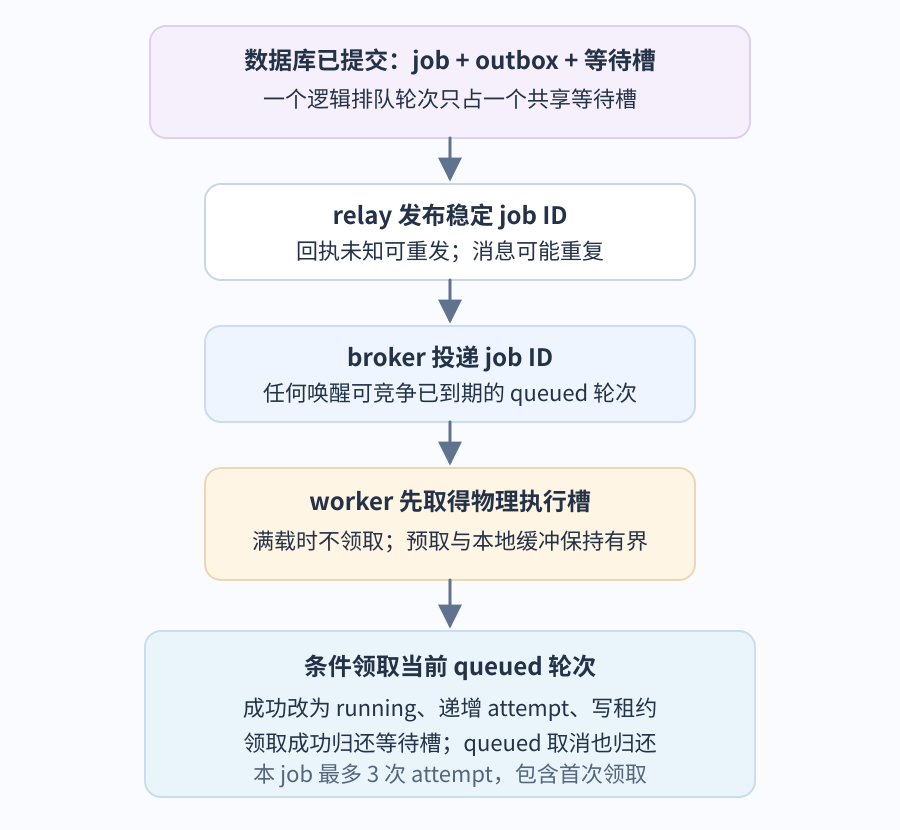
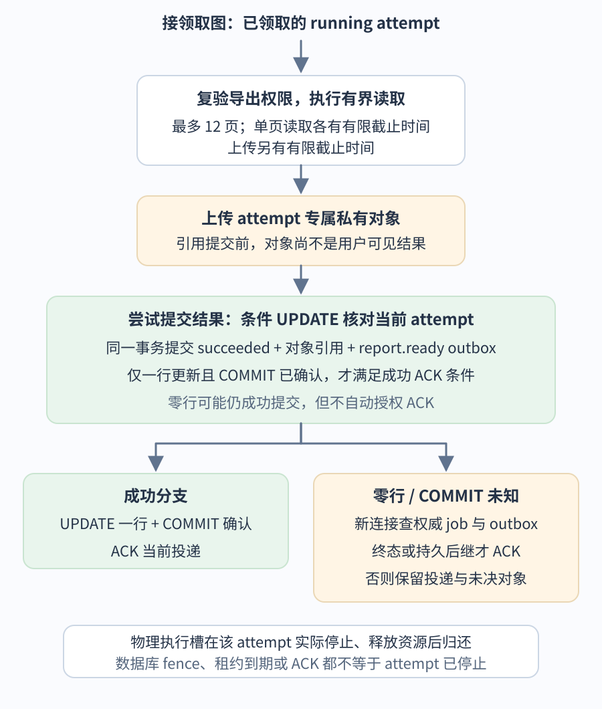

# 怎样保证一个任务同一时刻只由一个 worker 推进？

上一章结束时，数据库里有一个 `queued` 的 `job-demo-731`，relay (中继) 已经（可能不止一次）把只带 job ID 的消息发给 broker (消息代理)。本章回答：多个 worker 都收到唤醒时，谁能执行；一个停顿很久又醒来的旧 worker，怎样被挡在外面；结果怎样提交，才能让“任务已完成”只对应一份真实结果。本章讲的是被确认的那台状态机，并在结尾整理出“持久状态什么时候允许确认消息”的清单；ACK 报文本身和各故障时点留给[下一章](queue-delivery-and-acknowledgement.md)。

## 消息只是唤醒线索

消息载荷只有稳定的 job ID，不带 attempt (执行尝试) 编号。收到消息的 worker 得到的只是一个提示：“去数据库看看 `job-demo-731`”。消息本身不能创建一次执行，也不能证明谁有权执行。

这样设计是因为消息一定会重复：relay 会重发，broker 会重投。任何一条唤醒，包括上一轮迟到的旧消息，都只能去**竞争数据库里当前这一轮 `queued`**；谁有权推进，由数据库里的状态和 attempt 决定，而不是靠辨认消息的新旧。

## 条件领取：先占执行槽，再改状态

worker 要领取 job，按这个顺序：

1. **先在本进程取得一个物理执行槽。** execution slot (执行槽) 是进程真正能同时运行的 attempt 数，代表 CPU、数据库连接、游标、上传句柄这些实际资源。本例每个 worker 进程 8 个槽。取不到槽就不领取：不要先把 job 改成 `running` 再塞进一个无界的进程内队列，也不要确认掉唯一的唤醒消息。消费速度靠 broker 的预取上限和暂停消费来控制（见[下一章](queue-delivery-and-acknowledgement.md)）。
2. **再用一条条件更新领取。** 只有 job 仍是 `queued`、`available_at` 已经到了、没有取消请求时，才把它改成 `running`，attempt 加一，写入租约到期时间，并在同一事务里归还它占着的等待槽：

~~~sql
BEGIN;
WITH claimed AS (
  UPDATE report_jobs
  SET status = 'running',
      attempt = attempt + 1,
      lease_expires_at = clock_timestamp() + :lease_duration,
      holds_waiting_slot = false
  WHERE job_id = :job_id
    AND status = 'queued'
    AND available_at <= clock_timestamp()
    AND cancel_requested = false
  RETURNING attempt
), released AS (
  UPDATE admission_budget
  SET waiting_count = waiting_count - 1
  WHERE pipeline = 'report-export'
    AND EXISTS (SELECT 1 FROM claimed)
)
SELECT attempt FROM claimed;
COMMIT;
~~~

3. **看返回行数。** 返回一行，就是赢家，返回的 attempt（例如 1）就是它的代次。返回零行，说明别人已经领取、job 已取消或已终结、或者还没到 `available_at`；worker 立即归还刚占的物理槽，再读一次 job，决定怎样处理手上这条消息（见本章末的清单）。

两个 worker 同时执行这条 UPDATE 时，第二个要等第一个释放行锁；在 Read Committed 下，它拿到锁后会在新版本的行上重新检查 `status = 'queued'`，于是更新零行。“条件写在写语句上、返回行数就是业务判断”这条原理在[两个请求争夺最后一件库存时怎样只预留一次](../data/conditional-writes-and-idempotent-records.md)讲完整。

要分清两种槽。**等待槽**是数据库里的计数，记“已受理、还没被领取”的逻辑排队轮次，领取时归还；**物理执行槽**在 worker 进程里，记正在占用资源的 attempt，要等该 attempt 真正停止、释放资源后才归还。等待槽的数量规划在[容量章](capacity-admission-and-backpressure.md)。

领取成功后，worker 在读取任何报表数据之前，先确认原请求主体此刻仍有 `report:export`。若权限已被撤销，就不读数据，以当前 attempt 为条件提交 `failed` 和 `authorization_revoked`。为什么后台任务要在执行时重验权限，见[服务怎样逐次确认主体能做这个动作](per-request-authorization.md)。

## 栅栏：怎样挡住醒来的旧 worker？

worker 可能卡住：进程停顿、网络分区、机器失联。为了让 job 不永远卡在 `running`，领取时写了 lease (租约)：到期时间之后，独立的恢复器可以接管。但这里有一个最容易弄错的地方。

**租约到期不会让旧 worker 停下，也不会自动撤销它的写权。** 时钟走过 `lease_expires_at` 的那一刻，数据库里什么都没变：行仍然是 `running / attempt = 1`，旧 worker A 仍可能醒来并提交。到期只给了恢复器一个资格：它可以去**竞争**接管。

真正把 A 挡在外面的，是 fencing (栅栏)。它由两部分组成，缺一不可：

1. **单调递增的代次。** 每次领取都让 attempt 加一。代次只增不减，新执行者的编号一定大于旧的。
2. **在提交处检查。** 每一次写入（成功、失败、取消、续租）都把“我是第几代”写进条件里：`WHERE status = 'running' AND attempt = :my_attempt`。不匹配，就更新零行。

于是栅栏生效的时刻是**恢复器的接管事务提交的那一刻**，而不是时钟到达租约时刻。下图以 `job-demo-731` 为例，画出恢复器先提交时 A 怎样被挡住：

~~~mermaid
sequenceDiagram
    participant A as worker A
    participant DB as job-demo-731 行
    participant R as 恢复器
    participant B as worker B
    A->>DB: 条件领取
    DB-->>A: running / attempt = 1，写入租约
    Note over A: 停顿
    Note over DB: 租约到期：行仍是 running / attempt = 1 A 若此刻醒来提交成功，仍然有效
    R->>DB: 接管：锁行，仍是 running / attempt = 1 且租约已过期
    DB-->>R: 提交 queued + 等待槽 + 新 outbox 意图
    Note over DB: 栅栏从这一刻生效
    B->>DB: 条件领取新一轮
    DB-->>B: running / attempt = 2
    A->>DB: 醒来提交成功，条件 status = 'running' AND attempt = 1
    DB-->>A: 更新零行，A 的结果不生效
~~~

反过来，如果 A 的成功事务先于恢复器提交，job 就是 `succeeded`；恢复器随后看到终态，不会重排。两种顺序都只有一个赢家，赢家由行锁和提交顺序决定。恢复器在接管时怎样在取消、失败和重排之间选择，见[收尾一章的决策图](job-retries-cancellation-and-cleanup.md#重试与恢复按什么顺序决定？)。

栅栏挡住的是**写入**，不是**进程**。A 在被栅栏之后仍可能继续读数据、上传对象、占着它的物理执行槽，直到它自己停下。所以对象键要按 attempt 区分，物理槽要等 A 真正释放资源后才归还；这两件事在收尾一章展开。

同一个原理在全领域反复出现，各处只是换了“代次”的名字：

- 分片搬迁时，账户的 owner 与 epoch 以及目录上的比较并交换（见[把一个账户搬到新分片时怎样保证只有一个写入者](../data/shard-migration-and-ownership-transfer.md)）；
- Kafka 消费者组的 generation 只栅栏 offset 提交，写外部数据库还要一条所有权行（见[Kafka 分区与偏移](kafka-partitions-and-offsets.md)）；
- outbox 回写以 `intent_id` 为条件，旧一轮的回执改不了新一轮（见[上一章](durable-job-acceptance-and-outbox.md)）。

对象存储的条件写（例如“同名对象不存在才写入”）只能防止覆盖某个对象名，不知道谁是当前 attempt，替代不了数据库里的栅栏。

## 租约要用数据库的时钟判断

租约是否过期，必须用**同一个时钟**判断，这个时钟就是数据库的时钟。worker 不能看自己机器的时间觉得“我的租约应该还有效”，更不能凭本地时钟认定租约已过期、自己给 attempt 加一。

PostgreSQL 里还有一个细节：`now()`（以及 `CURRENT_TIMESTAMP`、`transaction_timestamp()`）返回的是**事务开始的时刻**，在整个事务里不变；`clock_timestamp()` 返回的才是**调用这一刻**的时间。一个事务如果先等了几秒行锁，再用 `lease_expires_at > now()` 判断，比较的是几秒前的时间，可能把已经过期的租约当成有效。所以租约判断和续租都用 `clock_timestamp()`。

续租也是一次带栅栏的写：在锁住 job 行之后，用 `clock_timestamp()` 检查状态、attempt 和租约仍然有效，再延长到期时间。否则一个已经过期的 worker 等到锁之后，可能又把自己的租约续活：

~~~sql
BEGIN;
SELECT 1 FROM report_jobs WHERE job_id = :job_id FOR UPDATE;
UPDATE report_jobs
SET lease_expires_at = clock_timestamp() + :lease_duration
WHERE job_id = :job_id
  AND status = 'running'
  AND attempt = :my_attempt
  AND lease_expires_at > clock_timestamp();
COMMIT;
~~~

## 成功提交：只有一行加一次确认的提交才算数

对象存储不在数据库事务里，所以成功提交分两步。

**第一步，写 attempt 私有的对象。** 结果先上传到只属于这次 attempt 的键，例如 `reports/job-demo-731/attempt-2.csv`。此时对象只是存在，用户还看不到它：没有任何已提交的 job 指向它。

**第二步，一个事务里条件提交三件事。** 以 job ID、`status = 'running'`、当前 attempt 和 `cancel_requested = false` 为条件，把 job 改成 `succeeded`，写入对象键、成功时间和结果到期时间；同一个事务里，只有这条更新真的命中时，才插入 `report.ready` outbox。用 CTE 把两者串起来：

~~~sql
BEGIN;
WITH completed AS (
  UPDATE report_jobs AS j
  SET status = 'succeeded',
      result_object_key = :attempt_object_key,
      lease_expires_at = NULL,
      succeeded_at = t.ts,
      terminal_at = t.ts,
      result_expires_at = t.ts + interval '7 days'
  FROM (SELECT clock_timestamp() AS ts) AS t
  WHERE j.job_id = :job_id
    AND j.status = 'running'
    AND j.attempt = :my_attempt
    AND j.cancel_requested = false
  RETURNING j.job_id, j.attempt
)
INSERT INTO report_outbox(operation_key, job_id, attempt, payload)
SELECT 'job-demo-731:report-ready:v1', job_id, attempt,
       '{"jobId":"job-demo-731","reportId":42,"type":"report.ready"}'
FROM completed
RETURNING operation_key, attempt;
COMMIT;
~~~

`report_outbox.operation_key` 上有唯一约束；`job-demo-731:report-ready:v1` 是由 job ID 加操作类型构成的稳定操作键（构造规则见[远端操作键](deadlines-retries-and-unknown-outcomes.md#远端副作用超时后，什么时候可以重发？)）。这样“已就绪”通知只可能对应真正成功的那一份结果：不会出现通知已发出、job 却还是 `running`，或后来被另一个 attempt 接管的假成功。

**只有 `INSERT ... RETURNING` 返回恰好一行，且应用收到 `COMMIT` 成功，才算“持久状态允许确认”。** 其余情况都不是成功：

- **返回零行。** `completed` 没有更新任何行，INSERT 也就没写 ready 意图，但整个事务照样能提交成功，所以 `COMMIT` 成功本身不是许可。零行说明当前 attempt 已经不是赢家：可能 job 已终结、已被恢复器重排、已被更高的 attempt 领取，或者有了取消请求。worker 要在新连接上重读 job 和 outbox，按本章末的清单决定后续。若零行是因为 `cancel_requested = true` 而 worker 仍持有同一个 `running` attempt，它转去提交取消（见收尾一章）。
- **`COMMIT` 结果未知。** 提交请求发出后连接断了，持久结果就是未知：可能已提交，也可能没有。既不能当成功确认，也不能宣称已回滚。在新连接上查 job 和 ready 意图；读到一次 `running` 也不能证明原事务回滚了，因为可能读得太早。在结局查清之前，这个 attempt 的对象不能当孤儿删掉。

图中的 ACK 是下一章的内容，这里只需记住它的前提：数据库已经给出了一个持久的结论。

## 什么时候允许确认手上的消息？

worker 每次处理完一条消息，都要回答“这条消息还需要保留吗”。判断依据只有数据库里已提交的状态。下面是交给下一章的清单：

| 重读到的持久状态 | 允许确认这条消息吗 |
| --- | --- |
| `succeeded`、`failed` 或 `cancelled`，且必要的清理或保留决定已提交 | 允许：这个 job 已经没有需要这条消息驱动的工作 |
| 被重排为 `queued`：新的 `available_at`、等待槽和新 outbox 意图都已提交 | 允许：新一轮有自己的唤醒 |
| 更大的 attempt 已经领取并提交，且有可靠的租约恢复路径 | 允许：后继执行者负责，失联也有人接管 |
| `running` 且租约有效，属于别的 worker | 只有确认存在独立、持久的租约恢复器时才允许；否则保留或延后 |
| `running` 但租约已过期，恢复器还没提交接管 | 不允许：过期不等于旧 attempt 失权，此刻没有任何持久的后续安排 |
| `queued` 但 `available_at` 未到（早到的重复消息） | 只有到期唤醒已持久安排好时才允许；否则延后或保留 |
| 自己的成功提交返回一行且 `COMMIT` 确认 | 允许 |
| 零行，或 `COMMIT` 结果未知 | 重读之后再按上面各行判断；未查清之前不允许 |

一句话：**确认消息之前，数据库里必须已经有一个终态，或者一条已提交、可恢复的后续路径。** 这条规则的 broker 侧细节，例如用哪个 delivery tag 确认、确认丢了会怎样，见[发布确认、消费者确认和业务完成各证明什么](queue-delivery-and-acknowledgement.md)。

## 变体：直接把 SQL 表当队列

既然业务状态本来就以数据库为准，也可以完全不用 broker，让 worker 轮询 job 表。PostgreSQL 的 `FOR UPDATE SKIP LOCKED` 让并发的领取者跳过已被别的事务锁住的候选行，避免同一行同时交给两个 worker。它有意给出不完整的视图，所以只适合这种竞争领取，不适合普通的一致性读取。

做法是：领取事务选中一行，提交 `running`、attempt 加一和新租约后立即释放行锁；耗时的工作在事务之外做，事务越短，锁等待越少。代价是轮询、候选扫描和行锁的压力都落在数据库上。要观察空轮询次数、领取延迟和锁等待，负载上来后再决定是否引入独立的 broker。

这个变体常和另一种租约约定一起出现，必须先说清楚。本主线的案例采用**宽松约定**：租约到期只给恢复器竞争资格，旧 worker 在接管提交之前仍可能先完成。另一种是**严格租期**：每次写入都额外要求 `lease_expires_at > clock_timestamp()`，租约一到期就拒绝旧 worker，即使恢复器还没接管。两种都成立，但**同一种 job 只能选一种**，不能有的写入检查租期、有的不检查。

下面用一个与 `job-demo-731` 无关的独立任务 `pg-job-demo-42` 展示严格租期变体（30 秒租约是演示值）。和上一张栅栏图对照，区别在于 A 在租约到期、B 还没接管时就已被拒绝：

~~~mermaid
sequenceDiagram
    participant A as worker A
    participant DB as pg-job-demo-42 行
    participant B as worker B
    A->>DB: SKIP LOCKED 领取
    DB-->>A: running / attempt = 1，租约 30 秒
    Note over DB: A 的租约到期，B 尚未接管
    A->>DB: 醒来尝试完成，条件含 lease_expires_at > clock_timestamp()
    DB-->>A: 更新零行（严格租期拒绝）
    B->>DB: SKIP LOCKED 接管过期行
    DB-->>B: running / attempt = 2，新租约
    B->>DB: 同一事务：succeeded、 reports/42/attempt-2、report.ready 意图
    DB-->>B: 1 行，提交
    A->>DB: 迟到完成 attempt = 1
    DB-->>A: 状态与 attempt 都不匹配，更新零行，不覆盖 B
~~~

这个例子还演示了另一种情况：在最终结果之前允许发出的“处理中”通知 `report.processing`。它同样只能由当前 attempt 登记，用单条语句同时完成“有没有写权”和“插入或比对已有意图”。结果有四列，含义如下：

| 情况 | `authorized, inserted, existing_intent, same_request` | 处理 |
| --- | --- | --- |
| B 首次登记 | `true, true, false, NULL` | 提交新意图，交给 relay 发布 |
| B 同键同摘要重放 | `true, false, true, true` | 原意图已存在，不再插入 |
| B 同键异摘要 | `true, false, true, false` | 报告冲突，不覆盖、不重发 |
| B 租约已过期，或已请求取消 | `false, false, false, NULL` | 无写权，结果里不透露摘要 |
| B 领取后，A 用 attempt 1 登记 | `false, false, false, NULL` | 无写权，看不到 B 的摘要 |

有写权、没插入、却又查不到已有行，说明唯一键或保留期的假设被破坏，应回滚并告警，不能把 `NULL` 当成功。另外，如果不用 `ON CONFLICT` 而直接插入、撞上唯一约束，PostgreSQL 的当前事务就已经失败，要先回滚，再在新事务里核查。

> [!example]- 完整 SQL：严格租期下的领取、意图去重与完成（PostgreSQL 14.25 单会话实跑）
> 在一个 `psql` 会话里从头运行即可：`psql` 默认每条语句自动提交，显式 `BEGIN/COMMIT` 标出事务边界，临时表只在本会话有效。默认 Read Committed 下每条语句取新快照，所以在已锁住 job 行的事务里，`record_processing` 按当时已提交的状态判断写权。所有能为同一 job 写意图的执行者都要先锁 job 行。若改用 Repeatable Read 或 Serializable，要处理序列化失败并重试整个事务。表结构只保留 attempt、租约和意图，没有建模账户授权、共享等待槽或 broker。
>
> ~~~sql
> CREATE TEMP TABLE report_jobs (
>   job_id text PRIMARY KEY,
>   status text NOT NULL,
>   attempt integer NOT NULL DEFAULT 0,
>   available_at timestamptz NOT NULL,
>   lease_expires_at timestamptz,
>   cancel_requested boolean NOT NULL DEFAULT false,
>   result_key text
> );
> INSERT INTO report_jobs(job_id, status, attempt, available_at)
> VALUES ('pg-job-demo-42', 'queued', 0, clock_timestamp() - interval '1 second');
>
> CREATE TEMP TABLE job_effect_outbox (
>   operation_key text PRIMARY KEY,
>   job_id text NOT NULL REFERENCES report_jobs(job_id),
>   attempt integer NOT NULL,
>   request_sha256 text NOT NULL,
>   payload text NOT NULL
> );
>
> -- Worker A：取得执行槽后领取并提交；返回 attempt=1 和新租约。
> WITH candidate AS (
>   SELECT job_id
>   FROM report_jobs
>   WHERE cancel_requested = false
>     AND ((status = 'queued' AND available_at <= clock_timestamp())
>       OR (status = 'running' AND lease_expires_at <= clock_timestamp()))
>   ORDER BY available_at, job_id
>   LIMIT 1
>   FOR UPDATE SKIP LOCKED
> )
> UPDATE report_jobs AS j
> SET status = 'running',
>     attempt = j.attempt + 1,
>     lease_expires_at = clock_timestamp() + interval '30 seconds'
> FROM candidate AS c
> WHERE j.job_id = c.job_id
>   AND j.cancel_requested = false
> RETURNING j.job_id, j.status, j.attempt, j.lease_expires_at;
>
> -- 为了不等 30 秒，把 A 的租约手动置为已过期。
> UPDATE report_jobs
> SET lease_expires_at = clock_timestamp() - interval '1 second'
> WHERE job_id = 'pg-job-demo-42' AND attempt = 1;
>
> -- A 到期后、B 接管前尝试完成：返回 0 行。
> BEGIN;
> SELECT job_id FROM report_jobs WHERE job_id = 'pg-job-demo-42' FOR UPDATE;
> UPDATE report_jobs
> SET status = 'succeeded', result_key = 'reports/42/attempt-1', lease_expires_at = NULL
> WHERE job_id = 'pg-job-demo-42'
>   AND status = 'running'
>   AND attempt = 1
>   AND cancel_requested = false
>   AND lease_expires_at > clock_timestamp()
> RETURNING job_id, status, attempt;
> COMMIT;
>
> -- B 接管过期任务，提交 attempt=2 与新租约。
> WITH candidate AS (
>   SELECT job_id
>   FROM report_jobs
>   WHERE cancel_requested = false
>     AND ((status = 'queued' AND available_at <= clock_timestamp())
>       OR (status = 'running' AND lease_expires_at <= clock_timestamp()))
>   ORDER BY available_at, job_id
>   LIMIT 1
>   FOR UPDATE SKIP LOCKED
> )
> UPDATE report_jobs AS j
> SET status = 'running',
>     attempt = j.attempt + 1,
>     lease_expires_at = clock_timestamp() + interval '30 seconds'
> FROM candidate AS c
> WHERE j.job_id = c.job_id
>   AND j.cancel_requested = false
> RETURNING j.job_id, j.status, j.attempt, j.lease_expires_at;
>
> -- 只有当前 attempt 有写权时才插入或比对意图；无写权时不返回摘要。
> PREPARE record_processing(text, integer, text, text, text) AS
> WITH eligible AS MATERIALIZED (
>   SELECT job_id, attempt
>   FROM report_jobs
>   WHERE job_id = $1
>     AND status = 'running'
>     AND attempt = $2
>     AND cancel_requested = false
>     AND lease_expires_at > clock_timestamp()
> ),
> inserted AS (
>   INSERT INTO job_effect_outbox(operation_key, job_id, attempt, request_sha256, payload)
>   SELECT $3, e.job_id, e.attempt, $4, $5
>   FROM eligible AS e
>   ON CONFLICT (operation_key) DO NOTHING
>   RETURNING operation_key, attempt
> ),
> existing AS MATERIALIZED (
>   SELECT o.request_sha256
>   FROM eligible AS e
>   JOIN job_effect_outbox AS o
>     ON o.job_id = e.job_id
>    AND o.operation_key = $3
>   WHERE NOT EXISTS (SELECT 1 FROM inserted)
> )
> SELECT EXISTS (SELECT 1 FROM eligible) AS authorized,
>        EXISTS (SELECT 1 FROM inserted) AS inserted,
>        EXISTS (SELECT 1 FROM existing) AS existing_intent,
>        (SELECT request_sha256 = $4 FROM existing) AS same_request;
>
> -- B 首次登记 report.processing；摘要是下面 JSON 字节的 SHA-256。
> BEGIN;
> SELECT job_id FROM report_jobs WHERE job_id = 'pg-job-demo-42' FOR UPDATE;
> EXECUTE record_processing(
>   'pg-job-demo-42', 2, 'pg-job-demo-42:report-progress:v1',
>   '55799e91985ab0123fa1b56b65fb4112ad1bd06e50945da075bfe1705f365817',
>   '{"jobId":"pg-job-demo-42","type":"report.processing"}'
> );
> COMMIT;
>
> -- B 同键同摘要重放：识别既有意图，不再插入。
> BEGIN;
> SELECT job_id FROM report_jobs WHERE job_id = 'pg-job-demo-42' FOR UPDATE;
> EXECUTE record_processing(
>   'pg-job-demo-42', 2, 'pg-job-demo-42:report-progress:v1',
>   '55799e91985ab0123fa1b56b65fb4112ad1bd06e50945da075bfe1705f365817',
>   '{"jobId":"pg-job-demo-42","type":"report.processing"}'
> );
> COMMIT;
>
> -- B 同键异正文：报告冲突，不覆盖。
> BEGIN;
> SELECT job_id FROM report_jobs WHERE job_id = 'pg-job-demo-42' FOR UPDATE;
> EXECUTE record_processing(
>   'pg-job-demo-42', 2, 'pg-job-demo-42:report-progress:v1',
>   '7d5a6ce6ab778ec8937d1dd76a25e4a3d1b5f9e4cb5c3d7fb43196f3ea8a77f3',
>   '{"jobId":"pg-job-demo-42","type":"report.processing","phase":"other"}'
> );
> COMMIT;
>
> -- B 租约过期：即使同键同摘要意图存在，也不返回摘要。
> UPDATE report_jobs
> SET lease_expires_at = clock_timestamp() - interval '1 second'
> WHERE job_id = 'pg-job-demo-42' AND attempt = 2;
> BEGIN;
> SELECT job_id FROM report_jobs WHERE job_id = 'pg-job-demo-42' FOR UPDATE;
> EXECUTE record_processing(
>   'pg-job-demo-42', 2, 'pg-job-demo-42:report-progress:v1',
>   '55799e91985ab0123fa1b56b65fb4112ad1bd06e50945da075bfe1705f365817',
>   '{"jobId":"pg-job-demo-42","type":"report.processing"}'
> );
> COMMIT;
>
> -- 恢复租期但请求取消：仍无写权。
> UPDATE report_jobs
> SET lease_expires_at = clock_timestamp() + interval '30 seconds',
>     cancel_requested = true
> WHERE job_id = 'pg-job-demo-42' AND attempt = 2;
> BEGIN;
> SELECT job_id FROM report_jobs WHERE job_id = 'pg-job-demo-42' FOR UPDATE;
> EXECUTE record_processing(
>   'pg-job-demo-42', 2, 'pg-job-demo-42:report-progress:v1',
>   '55799e91985ab0123fa1b56b65fb4112ad1bd06e50945da075bfe1705f365817',
>   '{"jobId":"pg-job-demo-42","type":"report.processing"}'
> );
> COMMIT;
>
> -- B 恢复正常；A 用 attempt=1 登记：无写权，看不到 B 的摘要。
> UPDATE report_jobs
> SET cancel_requested = false,
>     lease_expires_at = clock_timestamp() + interval '30 seconds'
> WHERE job_id = 'pg-job-demo-42' AND attempt = 2;
> BEGIN;
> SELECT job_id FROM report_jobs WHERE job_id = 'pg-job-demo-42' FOR UPDATE;
> EXECUTE record_processing(
>   'pg-job-demo-42', 1, 'pg-job-demo-42:report-progress:v1',
>   '55799e91985ab0123fa1b56b65fb4112ad1bd06e50945da075bfe1705f365817',
>   '{"jobId":"pg-job-demo-42","type":"report.processing"}'
> );
> COMMIT;
> DEALLOCATE record_processing;
>
> -- 只有当前 attempt=2 的成功更新命中时，才在同一事务创建 report.ready 意图。
> BEGIN;
> SELECT job_id FROM report_jobs WHERE job_id = 'pg-job-demo-42' FOR UPDATE;
> WITH completed AS (
>   UPDATE report_jobs
>   SET status = 'succeeded',
>       result_key = 'reports/42/attempt-2',
>       lease_expires_at = NULL
>   WHERE job_id = 'pg-job-demo-42'
>     AND status = 'running'
>     AND attempt = 2
>     AND cancel_requested = false
>     AND lease_expires_at > clock_timestamp()
>   RETURNING job_id, attempt
> )
> INSERT INTO job_effect_outbox(operation_key, job_id, attempt, request_sha256, payload)
> SELECT 'pg-job-demo-42:report-ready:v1',
>        job_id,
>        attempt,
>        'c4dd0f89af3442f1d58ade3561dc85ed51e5e458c7bc58873c2069d0fc97a27c',
>        '{"jobId":"pg-job-demo-42","reportId":42,"type":"report.ready"}'
> FROM completed
> RETURNING operation_key, attempt;
> COMMIT;
>
> -- A 在 B 成功后迟到完成：仍返回 0 行。
> BEGIN;
> SELECT job_id FROM report_jobs WHERE job_id = 'pg-job-demo-42' FOR UPDATE;
> UPDATE report_jobs
> SET status = 'succeeded', result_key = 'reports/42/attempt-1', lease_expires_at = NULL
> WHERE job_id = 'pg-job-demo-42'
>   AND status = 'running'
>   AND attempt = 1
>   AND cancel_requested = false
>   AND lease_expires_at > clock_timestamp()
> RETURNING job_id, status, attempt;
> COMMIT;
>
> -- 核实成功状态、对象引用与 ready 意图来自同一次提交。
> SELECT j.status, j.attempt, j.result_key, o.operation_key, o.attempt AS intent_attempt
> FROM report_jobs AS j
> JOIN job_effect_outbox AS o USING (job_id)
> WHERE j.job_id = 'pg-job-demo-42'
>   AND o.operation_key = 'pg-job-demo-42:report-ready:v1';
> ~~~

## 实例：BullMQ 的锁续期失效为什么会重复执行？

> [!info] BullMQ 6.7.5（2026-11-11 发布，核对于 2026-11-12）
> BullMQ 把 job 状态存在 Redis 里。worker 领取 job 时取得一把有时限的 Redis lock，处理期间要不断续期。进程异常退出、Redis 连接故障，或 CPU 密集工作把 Node.js 事件循环占满，都可能让续期没按时完成；随后 stalled checker 把 job 放回 waiting，让 worker 重新执行。停滞次数超过 `maxStalledCount`（该版本默认 1）后转入 failed。处理器抛出普通异常走 attempts/backoff 重试，锁丢失走 stalled 恢复，两者分开计数。
>
> 所以要监控 stalled 事件，并让 CPU 密集工作定期把控制权交还事件循环（见[Node.js 的工作实际在哪个线程上执行](../runtime/node-threads-processes-and-workers.md)）。调大 lock duration 只会推迟发现真正的崩溃，挡不住业务副作用重复。
>
> 如果业务状态仍以 PostgreSQL 的 job 行为准，Redis lock 就只影响 BullMQ 何时重投，既不授予也不撤销写权；写权仍由本章的状态与 attempt 栅栏决定。几个落地细节：每条 outbox 意图有稳定 UUID，加上 `outbox-` 前缀作为 BullMQ 自定义 job ID。官方文档要求自定义 ID 不能只由数字组成、不能含冒号；该版本源码会拒绝 `42` 和 `a:b`，但带前导零的 `0042` 能通过，不要依赖这种边缘行为。自定义 ID 只在所属 queue 内、且 job 仍被保留时去重；job 被移除后同一 ID 可以再次添加。Redis 的持久化要在部署时显式配置；若允许已确认的 job 丢失，就要能发现数据库里长期停在 `queued` 的 job 并重建唤醒。

## 本章产出与下一步

现在 `job-demo-731` 有一台以数据库为准的状态机：条件领取让每一轮只有一个赢家；单调的 attempt 加上提交处的检查，挡住醒来的旧 worker；成功只在“一行加一次确认的提交”时成立；每种持久状态都对应“能否确认手上的消息”。下一章把这张清单接到 broker 上：publisher confirm 和 consumer ACK 各证明什么，ACK 发出前后崩溃又会怎样？见[发布确认、消费者确认和业务完成各证明什么](queue-delivery-and-acknowledgement.md)。

> [!info]- 来源
> - `FOR UPDATE SKIP LOCKED` 跳过不能立即加锁的行、刻意提供不一致视图、适合类队列的多消费者领取：[PostgreSQL 18, SELECT — The Locking Clause](https://www.postgresql.org/docs/18/sql-select.html)，核对于 2026-11-12；行锁的持有到事务结束：[Explicit Locking](https://www.postgresql.org/docs/18/explicit-locking.html)。
> - `now()`/`transaction_timestamp()` 返回事务开始时间、`clock_timestamp()` 返回调用时刻：[PostgreSQL 18, Date/Time Functions §9.9.5 Current Date/Time](https://www.postgresql.org/docs/18/functions-datetime.html)，核对于 2026-11-12；另在 PostgreSQL 14.25 本地以“事务内 `pg_sleep(1)` 后比较两者”复核。
> - Read Committed 下并发 `UPDATE` 等锁后在新版本上重检条件；Repeatable Read 与 Serializable 需处理序列化失败：[PostgreSQL 18, Transaction Isolation §13.2](https://www.postgresql.org/docs/18/transaction-iso.html)。
> - 数据修改 CTE 把 `UPDATE ... RETURNING` 的实际行交给后续 `INSERT`；`ON CONFLICT` 与 `RETURNING` 只报告实际插入的行：[Data-Modifying Statements in WITH](https://www.postgresql.org/docs/18/queries-with.html)、[INSERT](https://www.postgresql.org/docs/18/sql-insert.html)。本章的领取 SQL、成功提交 SQL 与折叠块中的严格租期 SQL 均在 PostgreSQL 14.25 本地实跑。attempt、租约、栅栏与确认清单是应用合同，不由 PostgreSQL 定义。
> - BullMQ 6.7.5：[Important Notes](https://github.com/taskforcesh/bullmq/blob/v6.7.5/docs/gitbook/bull/important-notes.md)、[Stalled Jobs](https://github.com/taskforcesh/bullmq/blob/v6.7.5/docs/gitbook/guide/workers/stalled-jobs.md)（至少一次运行、锁续期、事件循环阻塞、达到上限后失败）；[WorkerOptions](https://github.com/taskforcesh/bullmq/blob/v6.7.5/src/interfaces/worker-options.ts)（`maxStalledCount` 默认 1）；[Retrying failing jobs](https://github.com/taskforcesh/bullmq/blob/v6.7.5/docs/gitbook/guide/retrying-failing-jobs.md)；[Job IDs](https://github.com/taskforcesh/bullmq/blob/v6.7.5/docs/gitbook/guide/jobs/job-ids.md) 与版本源码 [job.ts](https://github.com/taskforcesh/bullmq/blob/v6.7.5/src/classes/job.ts#L1278-L1289)（自定义 ID 的约束与去重范围）；[Going to production](https://docs.bullmq.io/guide/going-to-production)（Redis 持久化需显式配置）；[v6.7.5 release](https://github.com/taskforcesh/bullmq/releases/tag/v6.7.5)。核对于 2026-11-12。
> - Amazon S3 条件写（`If-None-Match: *` 防覆盖同名对象）：[Conditional writes](https://docs.aws.amazon.com/AmazonS3/latest/userguide/conditional-writes.html)，核对于 2026-11-12；本章的栅栏不依赖它。
