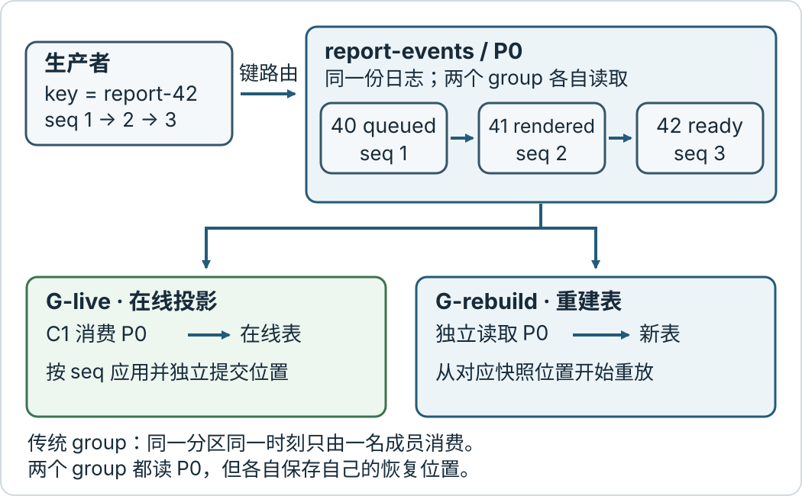
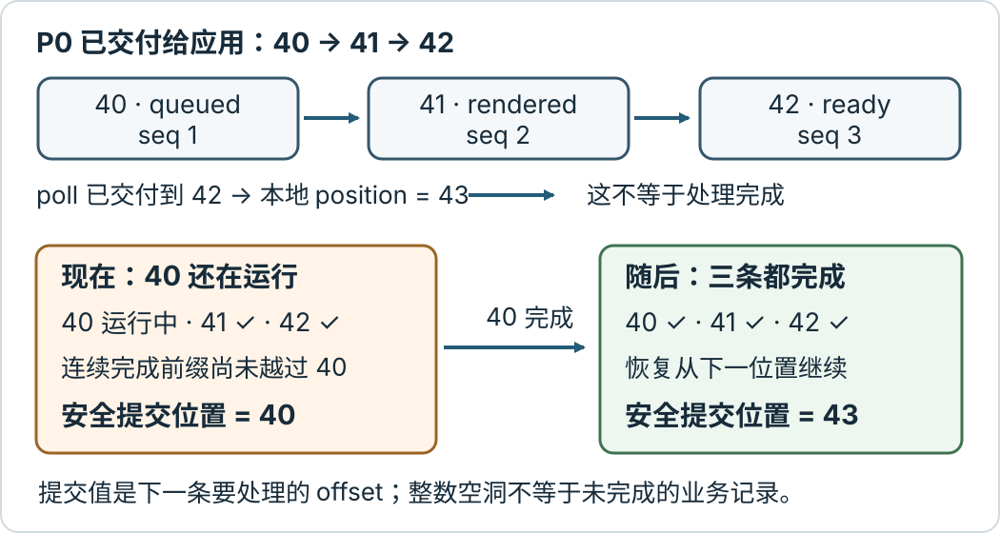

# 怎样用 Kafka 分区保序、推进偏移，并在再均衡后安全接手？

上一章的 broker (消息代理) 按“一条消息、一次投递、一次 ACK”工作，顺序和并行交给应用。Kafka 的模型不同：消息写进分区日志，消费者自己记住读到了哪里。本支线回答：Kafka 保证的是哪一种顺序；消费者怎样记录进度才不会跳过或漏掉记录；数据库写入和偏移提交之间崩溃会怎样；成员变化（再均衡）之后，旧消费者迟到的写入怎样被挡住；以及怎样用回放重建一份投影。机制部分对 Kafka 通用，版本相关的默认值集中在标注 Kafka 4.4 的说明里。

## 案例：报表 42 的状态事件流

这一章换一个更适合 Kafka 的例子，仍在报表服务里。服务为 `reportId = 42` 依次发布三条状态记录 `queued`、`rendered`、`ready`，每条带业务序号 `seq`（1、2、3）和稳定的 `event_id`。注意这三个词是投影里的展示状态，不是前几章的 job 状态机。

消费方有两个：

- 在线消费者把记录写进数据库里的 projection (投影)，也就是供查询的报表状态表；
- 值班时，另一个消费者把同一份投影重建到一张新表。

两者属于两个 consumer group (消费者组)：`G-live`（在线组）和 `G-rebuild`（重建组），各自维护自己的读取位置。文中的 offset (偏移量) 都是讲解用的位置，不是线上测量值。

先看端到端的边界：生产者用稳定的 key 把同一报表的记录送进同一个分区；分区只给出 broker 实际追加的顺序；每个消费者组独立读取并保存自己的位置；外部数据库写入是否完成，要由数据库自己的事务和业务序号判断，Kafka 的 offset 替不了数据库确认业务效果。



## 分区保证哪种顺序？

topic (主题) 由多个 partition (分区) 组成。每个分区是一条只追加的日志，由分区 leader (主副本) 决定追加顺序；offset 标识记录在**这个分区内**的位置。不同分区之间没有全局次序。

本例固定 3 个分区，一个生产者按业务序号串行发送：

| 分区与 offset | key | 业务序号 | 记录 |
| --- | --- | ---: | --- |
| `report-events / P0 / 40` | `report-42` | 1 | `queued` |
| `report-events / P0 / 41` | `report-42` | 2 | `rendered` |
| `report-events / P0 / 42` | `report-42` | 3 | `ready` |
| `report-events / P2 / 18` | `report-17` | 1 | `queued` |
| `report-events / P2 / 19` | `report-17` | 2 | `ready` |

表末的 `report-17` 只用来对照另一个 key 的路由。offset 40–42 只是位置，业务序号 1–3 才是报表状态的因果顺序。Kafka 按 P0 的日志次序交付记录，但不判断哪个事件**应该**先发生。如果多个生产者并发发布同一个 key，broker 仍会形成某个追加顺序，却不保证它符合业务序号。所以业务顺序要由上游定义序号，消费者检查缺口或拒绝旧序号。

## key 怎样决定分区，扩分区为什么会打乱顺序？

默认分区器按 key 序列化后的字节选分区：分区数、序列化方式和分区策略都不变时，同一个 key 总落进同一个分区。

> [!info] Kafka 4.4 Java 生产者的默认路由（核对于 2026-11-13）
> 默认的 `BuiltInPartitioner` 对 key 的字节计算 `toPositive(murmur2(keyBytes)) % partitionCount`。前提：key 按 UTF-8 序列化，没有覆盖 `partitioner.class`，发送时没有显式指定分区，`partitioner.ignore.keys=false`（默认）。按 Kafka 4.4.0 的 `Utils.murmur2` 复算：`report-42` 的正值 hash 为 `1051128390`，模 3 得 0，进 P0；`report-17` 为 `417961679`，模 3 得 2，进 P2。换用自定义分区器、改变字节编码或忽略 key，都可能改变映射。

**扩分区会改变映射。** 其他条件不变，把分区数从 3 改成 4：`report-42` 的同一个 hash 变成 `1051128390 % 4 = 2`，从 P0 移到 P2；`report-17` 变成 `417961679 % 4 = 3`，从 P2 移到 P3。新旧分区的 offset 互不可比，无法据此推出 `report-42` 跨分区的先后。

如果变更分区数时必须保序，就要安排一个可验证的迁移边界：先暂停这个 key 的新发送，等旧分区里已发布的记录处理到约定的序号，再切换路由；消费者仍校验 `seq`，发现缺口就等待或修复。换一个自定义分区器，并不能让两个分区的日志获得全局顺序。

## 消费者组怎样分工？

在同一个传统消费者组里，每个分区在任一时刻只分配给组内一位成员。所以 3 个分区最多带来 3 路分区级并行；组里再加第四个消费者，它只会闲着，不会多出第四个分区。

不同的组各自从自己的位置读同一份日志：`G-rebuild` 读到哪里，不会移动 `G-live` 的 offset。

> [!info] Kafka 4.4 的 share group
> Kafka 4.4 另有 share group (共享组)，按单条记录分发，允许多个成员同时处理同一个分区的记录。它不提供分区内的有序处理；本章只讨论需要分区内有序的传统消费者组，两种模型不要混用。

## 生产者的确认与重试各证明什么？

`acks` 决定生产者等到哪一级复制完成才把发送视为成功。它不证明消费者已经处理，更不证明数据库里有了报表结果。

| 配置 | 成功的含义 | 仍要考虑的情况 |
| --- | --- | --- |
| `acks=0` | 不等 broker 响应 | 连 broker 收没收到都不知道，也就无从判断要不要重试 |
| `acks=1` | 分区 leader 已写入自己的日志 | leader 在复制给 follower (从副本) 之前故障，记录可能丢失 |
| `acks=all` | 当前 in-sync replicas (同步副本集，ISR) 全部确认 | 只等当前 ISR，不等 `replication.factor` 规定的全部副本；若持有已确认数据的副本全部永久丢失，确认本身救不回数据 |

副本故障后谁能接任 leader，还取决于集群配置：`replication.factor`、`min.insync.replicas`、是否启用 eligible leader replicas (合格主副本，ELR)，以及持有已提交记录的副本是否存活。不能只凭 `acks=all` 推断副本丢失后的结果。

> [!info] Kafka 4.4 的 ELR（核对于 2026-11-13）
> 新集群默认启用 ELR。ISR 小于 `min.insync.replicas` 时，高水位（消费者可读的已提交位置）不再前进，leader 选举会把 ELR 纳入候选。

**生产者幂等只管协议层的重试。** 生产者超时时，它不知道请求是在追加之前还是之后失去响应。producer idempotence (生产者幂等) 用生产者 ID 和每个分区上的批次序号，去掉**同一次发送**在客户端重试时产生的重复。若关闭幂等、又启用重试并允许同一连接上有多个未确认请求，较早的批次重试时，后发的批次可能先写入，顺序就乱了。即使幂等工作正常，它也分辨不了应用两次调用 `send` 是不是同一个业务事件：应用拿到不确定的结果后重新发布，仍要靠业务 `event_id` 去重，或先查是否已发布。

> [!info] Kafka 4.4 的生产者幂等默认值
> 没有冲突配置时默认开启幂等，它要求 `acks=all`、启用重试，且 `max.in.flight.requests.per.connection <= 5`。

## 数据库写入和偏移提交之间崩溃，会怎样？

这是后面所有规则的动机。设 `G-live` 要处理 P0 offset 40 的 `queued`：效果写进 PostgreSQL，消费进度存在 Kafka。两个系统之间没有一次性的原子提交，崩溃落在哪一边决定了结果：

| 崩溃时点 | 数据库里的状态 | 恢复起点 | 结果 |
| --- | --- | --- | --- |
| 数据库事务已提交，Kafka offset 尚未提交 | 事件 40 的效果已持久 | 仍从 40 开始 | 40 被重放；数据库要在同一本地事务里按 `event_id` 去重（inbox 或唯一键），或让下文的快照条件更新成为空操作 |
| Kafka 已提交 41，数据库事务还没提交 | 事件 40 的效果不存在 | 从 41 开始 | 40 不会再被交付，投影漏掉这次更新 |

所以写外部数据库的消费者通常**先提交数据库事务，再提交 offset**，接受“至少一次”处理和可能的重放，并关闭自动提交（`enable.auto.commit=false`），否则后台自动提交可能抢在数据库事务之前。数据库提交成功但响应丢了，就重新查 inbox 或投影，再安全地重放；Kafka offset 提交成功，也证明不了数据库已提交。无论两步谁先谁后，中间的崩溃窗口都消除不了，做不到“两边恰好各成功一次”。

## 提交的 offset 为什么是“下一个要读的位置”？

消费者有两个容易混淆的位置：

- `position` (当前位置)：这个消费者下一次要取的位置，每次 `poll()` 交付记录后就前进；
- committed offset (已提交偏移)：持久保存的位置，进程重启或分区重新分配后从这里恢复。

`poll()` 把记录交给应用，不代表数据库处理已完成；本地 `position` 也不能直接当成可以安全提交的进度。提交的值是**下一条要处理的记录的 offset**：处理完 40，提交 41，表示下次从 41 继续。

假如 40、41、42 都已交付，`position` 可能已经是 43；但只要异步 worker 还没处理完 40，安全的持久进度就仍是 40，即最早未完成的那条。提交得更靠后，崩溃恢复时就会跳过它。



同一分区的记录若交给多个 worker 并行处理，就要按**交付顺序**维护“连续完成前缀”：从最早交付的记录数起，中间没有未完成记录的那一段。

- 41、42 已完成，40 仍在运行：可提交位置保持 40；等 40 完成，才推进到 43。
- 40、42 已完成，41 仍在运行：安全位置是 41。

worker 只把完成结果交回消费者线程。Java 的 `KafkaConsumer` 不是线程安全的，poll、分区分配、前缀状态和提交都应由同一个消费者线程负责。数据库事务提交成功、且消费者仍拥有 P0 时，只提交这一分区的安全位置：

```java
consumer.commitSync(Map.of(
    new TopicPartition("report-events", 0),
    new OffsetAndMetadata(41L)
));
```

不要用无参的 `commitSync()`：它提交的是最近一次 poll 之后的位置，可能是 43，而 40 还没写进数据库。分区一旦被收回，旧分配下迟到的完成通知也不能计入新分配的前缀。

## offset 有空洞时怎样推进？

offset 整数不一定连续：日志压缩会删掉同一 key 的旧记录；`read_committed` 隔离级别会隐藏已中止事务的记录；事务控制标记也占用 offset。假设应用实际只收到 40 和 42，41 不可见：完成 40 后，下一条要处理的可见记录就是 42，不必等不存在的 41；此时提交 41 只是给出一个稍早的扫描起点，读取时会自动越过空洞。

所以：看到 offset 有缺口，不能断定记录丢失；42 还没完成时，也不能把进度提交到它之后。

另外，`read_committed` 只读到 last stable offset (最后稳定偏移) 为止，也就是第一个尚未结束的事务之前，所以消费者可能暂时看不到日志末尾的记录。

## 并行写库时，顺序怎样守住？

连续完成前缀只约束**恢复位置**，不会让数据库写入自动按业务序号发生。并行 worker 若先写 `seq=2 rendered`、再写 `seq=1 queued`，投影就会倒退。按 `event_id` 去重只防同一事件重复生效，纠正不了不同事件之间的乱序。

如果投影保存的是**可以被更新的完整快照直接替换**的状态，可以用业务序号拒绝旧快照。本例先建好一行 `report_id = 42, last_seq = 0`（`last_seq` 不为空），每条记录都携带完整状态：

```sql
UPDATE report_projection
SET status = :status, last_seq = :seq
WHERE report_id = :report_id AND last_seq < :seq;
```

先应用 `seq=2 rendered`、再应用 `seq=3 ready` 之后，迟到的 `seq=1 queued` 只会更新零行，投影保持 `ready / 3`。这条旧快照已被更新的快照取代，所以这里的零行是一次**成功的空操作**；它完成后，offset 40 才算处理完，连续前缀才能前进。

这种写法**只适用于可以跳过中间状态的完整快照**。如果 `queued → rendered → ready` 每一步都有不可省略的副作用，就要按 `reportId` 顺序处理，或者要求 `seq = last_seq + 1`、把缺口留着等补齐，不能用 `last_seq < seq` 假装每步都执行过了。

## 再均衡怎样拒绝旧成员的提交？

成员加入、退出，或两次 poll 的间隔超过上限，都会触发 rebalance (再均衡)，重新分配分区。下面的时序使用 classic 组协议和整体撤销式（eager）分配器：消费者 C1 持有 P0，已提交位置是 40；C2 加入后，组的 generation (代次) 从 5 变为 6，P0 改分配给 C2。

| C1 的提交时机 | 提交结果 | C2 的起点 |
| --- | --- | --- |
| C1 停止派发，等 offset 40 的数据库事务确认成功，在代次 5 仍有效时提交 41 | 持久位置变为 41 | 从 41 开始 |
| 带旧代次 5 的提交请求在代次 6 生效后才到 | coordinator 拒绝：成员仍被识别时报 `ILLEGAL_GENERATION`，已被移出时先报 `UNKNOWN_MEMBER_ID`；持久位置仍是 40 | 从 40 重放 |

拒绝的依据是 C1 携带的成员 ID 或代次已过期，而不是“P0 已经归 C2”。所以应用仍应只提交**当前分配内**已完成的前缀。

**有序交接与异常交接。** 有序交接时会调用 `onPartitionsRevoked`：消费者线程停止派发，在有限时间内等待正在执行的数据库事务确认成功，再趁旧成员资格仍有效时提交已完成的连续前缀。异常情况下可能直接调用 `onPartitionsLost`：这时分区可能已归别人，C1 不再提交旧进度，只停止派发、丢弃旧分配的完成通知；C2 从最后一次成功保存的位置恢复，已写数据库但未提交 offset 的记录会被重放。交接时等待的时间也受成员存活和 poll 时限约束：等数据库等得太久，旧成员可能先失去分区，提交随之失败，留下需要重放的记录。

> [!info] Kafka 4.4 的组协议（核对于 2026-11-13）
> Java 消费者默认仍是 `group.protocol=classic`。classic coordinator 校验 group、member 和 generation 状态，不逐个检查提交的分区是否仍分配给该成员。新的消费者再均衡协议（KIP-848）从 Kafka 4.0 起正式可用，需设置 `group.protocol=consumer` 才启用；它按分区增量调整分配，用 member epoch 校验提交者，回调时机不能照搬 classic 的整组撤销时序。

## 组的栅栏为什么挡不住外部写入？

上面的代次校验是 Kafka 的 group fencing (组成员栅栏)，它是[栅栏原理](job-claims-leases-and-fencing.md#栅栏：怎样挡住醒来的旧%20worker？)的一个实例：单调递增的代次，在提交处检查。但它只在 **offset 提交**这一处检查。C1 已经交给后台线程的工作，在分区被撤销时不会自动停止；它已经提交的数据库事务也不会被撤回；捕获 `CommitFailedException` 只说明 offset 提交失败，撤不回已提交的 SQL。

所以应用要在撤销时停止派发，等待或取消未完成的工作；只要旧任务仍可能迟到，就要让**目标数据库自己**再执行一道持久的所有权栅栏。下面是一个简化的 PostgreSQL 约定：每个 topic/partition 有唯一一条 owner row (所有权行)，保存当前所有者的 token；C2 先以旧 token 为条件把它改成新 token 并提交，然后才开始业务写入；C1 的每个写入事务都先锁住同一行、核对 token，再写投影，锁一直持有到提交。

```sql
-- C2：新所有者 token=6 先落库；必须恰好更新一行，提交后才能开始业务写入
BEGIN;
UPDATE partition_owners
SET owner_token = 6
WHERE topic = 'report-events' AND partition_id = 0 AND owner_token = 5;
COMMIT;

-- C1：所有权检查和投影写入在同一事务；FOR UPDATE 的锁保持到 COMMIT
BEGIN;
SELECT owner_token
FROM partition_owners
WHERE topic = 'report-events' AND partition_id = 0
FOR UPDATE;
-- 只有读到 owner_token = 5 才继续；否则 ROLLBACK 并丢弃旧任务
UPDATE report_projection
SET status = :status, last_seq = :seq
WHERE report_id = 42 AND last_seq < :seq;
COMMIT;
```

互斥靠的是 token 切换和投影写入都经过同一行的行锁：C1 先拿到锁，C2 的切换就要等 C1 提交；C2 已提交 token 6，C1 之后锁行就读到 6 并放弃。如果只用普通 `SELECT` 读 token、稍后再 `UPDATE`，即使两句在同一个 Read Committed 事务里，也得不到这种互斥。业务 `seq` 能拒绝旧快照，却不能证明当前写入者有权写；这道数据库栅栏与报表 job 的 attempt 和租约是两套独立的约定。

这张 owner 表只服务 `G-live` 的在线投影。同时运行的 `G-rebuild` 要用独立的 owner 表，或者把 `projection_id` 加进唯一键和每个所有权条件，否则两个合法的消费者组会互相夺走所有权。

## 回放能把投影重建到哪里？

重建从一份数据库初始快照开始，并和它对应的**每分区位置向量** `S[p]` 一起保存（`p` 表示分区）：快照恰好包含每个分区里所有 offset `< S[p]` 的效果，不含任何 `>= S[p]` 的效果；重建组从 `S` 开始读。之后另选一个切换边界 `T[p]`，在线投影和重建投影在这里对齐。`S` 是恢复起点，`T` 是切换点，两者不是同一个位置。

以 P0 为例：快照已包含 offset `< 40` 的效果、不含 `>= 40` 的，所以 `S[P0] = 40`。在线表和新表都处理仍可见的 40、41、42；选定 `T[P0] = 43` 后，两边都暂停应用 `>= 43` 的事件，确认各自写进数据库的连续前缀和已提交的 offset 都停在 43。此时两张表都应恰好等于“快照 + `[40, 43)` 中可见记录的效果”。核对一致后切到新表，由 `G-rebuild` 从 43 继续。`[40, 43)` 是单个分区内的半开 offset 区间；多分区时每个分区各有自己的 `S[p]` 和 `T[p]`，不能合成一个全局时间。对齐只要求所有可见记录都已应用，不要求 offset 整数连续。

几个前提：

- 两张表若都用 inbox 去重，去重键至少要包含 `(projection_id, event_id)`，或者给每张投影单独建 inbox。只按 `event_id` 全局唯一的话，在线组处理过的事件会让重建组误以为新表也处理过，从而跳过它。
- 每个分区的 `[S[p], T[p])` 必须仍完整可读，切换期间还要保留 `>= T[p]` 的事件。
- retention (保留) 和 compaction (压缩) 会删掉记录。要读的 offset 若已早于当前最早可读位置，`auto.offset.reset=earliest` 只会从**现在仍保留的最早记录**开始，找不回已删的记录；日志压缩只保留每个 key 的较新值，不保证留下全部历史转换。所需记录已被删掉时，停止切换，改从与快照匹配的历史来源恢复。要能从空白重建完整历史，主题就得按重建耗时和最慢的消费速度留足未压缩的记录，或者提供带匹配 offset 向量的快照。

## Kafka 事务能覆盖到哪里？

前面的崩溃窗口来自“数据库”和“Kafka”是两个系统。如果输出也写回 Kafka，Kafka 的 transaction (事务) 就能把输入分区的消费位置和输出 topic 的记录一起提交。典型的 Kafka→Kafka 流程：

- 每个并发的生产者实例使用唯一、且重启后沿用的 `transactional.id`。新实例启动时调用 `initTransactions()`：旧实例遗留的进行中事务会被中止；若旧事务已开始提交或中止，就等它结束；新的 producer epoch 会拒绝旧实例继续写入。这又是一处“单调代次 + 在提交处检查”。
- 输入 topic 含事务记录、且只应处理已提交的记录时，消费者设置 `isolation.level=read_committed`，以免把已中止的记录当成输入。
- 关闭自动提交，改由生产者调用 `sendOffsetsToTransaction(offsets, consumer.groupMetadata())`，把下一读取位置和当前组元数据加进同一个事务，不再另行手动提交这些 offset。

配置正确时，输出记录和输入消费位置会一起提交或一起中止；但这不保证“一次 poll 的所有分区输出同时可见”。事务中止后，组的已提交位置仍是旧值，输入可以重新处理；消费者内存里的 `position` 却不会自动倒回，应用要回到已提交的位置，例如调用 `seek`、重启消费者，或等组内重新分配。

**Kafka 事务管不到 PostgreSQL 的 `UPDATE`、对象存储写入或 HTTP 调用。** 若 `ready` 已写进 PostgreSQL，随后 Kafka 事务中止，数据库里的变更不会跟着回滚。从 Kafka 写往外部系统，仍要外部系统配合，二选一：

- 在数据库的同一个事务里写业务结果、inbox 和**数据库自己保存的**消费位置，恢复时从这个位置 `seek`；
- 先提交数据库效果、再提交 Kafka offset，并让业务写入在重放时保持幂等。

数据库 outbox 负责把已提交的数据库变更可靠地发布出去（见[耗时任务怎样被持久受理](durable-job-acceptance-and-outbox.md)），但它不推进 Kafka 消费者的读取位置。远端 API 则必须按稳定的操作键对重复请求做到业务幂等（见[远端副作用的决策表](deadlines-retries-and-unknown-outcomes.md#远端副作用超时后，什么时候可以重发？)）。

## 本支线产出

用 Kafka 承接状态事件时，顺序只在分区内成立、由上游序号定义；进度按连续完成前缀提交，并且晚于数据库事务；空洞不等于丢失；完整快照可以用序号条件更新拒绝旧值；组代次只栅栏 offset 提交，外部写入要靠目标库的所有权行；重建靠快照与每分区位置向量对齐；Kafka 事务只覆盖 Kafka 自己。回到主线，不顺利的分支怎样收尾，见[任务失败、被取消或 worker 失联后怎样收尾](job-retries-cancellation-and-cleanup.md)。

> [!info]- 来源
> 核对日期 2026-11-13。Apache Kafka 官方 Downloads 将 4.4.0 列为受支持版本，发布公告日期为 2026-10-22。案例中的事件、offset、分区数、崩溃点和完成顺序均为合成推演。
>
> - [Apache Kafka Downloads](https://kafka.apache.org/downloads/) 与 [4.4.0 发布公告](https://kafka.apache.org/blog/2026/10/22/apache-kafka-4.4.0-release-announcement/)：受支持版本与发布日。
> - [Kafka 4.4 Design](https://kafka.apache.org/44/design/design/) 与 [Eligible Leader Replicas](https://kafka.apache.org/44/operations/eligible-leader-replicas/)：key 路由、分区内全序、传统消费者组的成员与位置、生产者可靠性、Kafka 事务与外部系统的边界、share group 与传统组的区别、复制与 ELR/min ISR。
> - [Producer Configs](https://kafka.apache.org/44/configuration/producer-configs/) 与 [KafkaProducer Javadoc](https://kafka.apache.org/44/javadoc/org/apache/kafka/clients/producer/KafkaProducer.html)：`acks`、默认幂等、重试与顺序、`transactional.id`、`sendOffsetsToTransaction`。
> - [KafkaConsumer Javadoc](https://kafka.apache.org/44/javadoc/org/apache/kafka/clients/consumer/KafkaConsumer.html)：position 与 committed position、offset 空洞、提交 next offset、失权时提交失败、非线程安全、撤销与丢失回调。
> - [Consumer Configs](https://kafka.apache.org/44/configuration/consumer-configs/) 与 [Consumer Rebalance Protocol](https://kafka.apache.org/44/operations/consumer-rebalance-protocol/)：`enable.auto.commit`、`read_committed`、`auto.offset.reset`、`max.poll.interval.ms`，`classic`/`consumer` 协议；4.4 Java 消费者默认 `classic`，新协议 4.0 起 GA、需显式选择。
> - [Kafka 4.4 Protocol](https://kafka.apache.org/44/design/protocol/) 与 [Topic Configs](https://kafka.apache.org/44/configuration/topic-configs/)：offset 提交的 generation/member epoch 字段，保留与压缩配置。扩分区引起的跨分区排序缺口是 key 哈希路由与多分区独立日志的推论；保序迁移步骤是应用侧合同。
> - [Kafka 4.4.0 BuiltInPartitioner](https://github.com/apache/kafka/blob/4.4.0/clients/src/main/java/org/apache/kafka/clients/producer/internals/BuiltInPartitioner.java)、[Utils.murmur2](https://github.com/apache/kafka/blob/4.4.0/clients/src/main/java/org/apache/kafka/common/utils/Utils.java)：hash 与分区计算；`report-42`、`report-17` 的 hash 与模 3、模 4 结果已按该算法重新复算。
> - [Kafka 4.4.0 ClassicGroup.validateOffsetCommit](https://github.com/apache/kafka/blob/4.4.0/group-coordinator/src/main/java/org/apache/kafka/coordinator/group/classic/ClassicGroup.java#L798-L874)：classic 提交只检查组状态、成员与代次。
> - [PostgreSQL 18, Read Committed](https://www.postgresql.org/docs/18/transaction-iso.html#XACT-READ-COMMITTED) 与 [Explicit Locking](https://www.postgresql.org/docs/18/explicit-locking.html)：语句级快照、行锁持有到事务结束、等锁后返回更新后的行。owner row 的互斥流程是应用合同。
