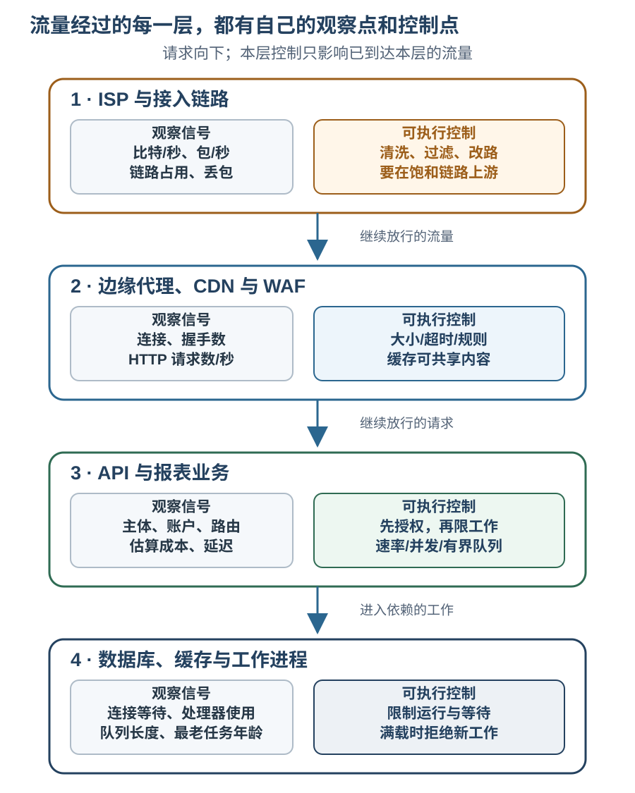

# 流量远超容量或遭到攻击时，每一层能挡住什么？

上一章的准入、限额和等待槽假设请求都能到达 API，而且调用方大体守规矩。本章看另一种情况：denial of service (DoS，拒绝服务) 用流量、连接或昂贵请求耗尽服务资源，让正常请求得不到响应；distributed denial-of-service (DDoS，分布式拒绝服务) 由许多来源同时施压。要回答的是：过载发生在哪一层，那一层能做什么；限额键和检查顺序怎样随请求经过的阶段变化；缓解措施何时可以撤掉。令牌桶、四种限额和 429/503 的权威讲解在[上一章](capacity-admission-and-backpressure.md)，本章只用它们的结论。

能否缓解，取决于两件事：哪项资源先到上限，以及攻击流量到达了哪一层。如果上游链路已经被塞满，应用里的限流代码根本收不到请求。

## 案例：报表读取接口遭到洪泛

沿用主线四的报表服务，这次看读取接口。`user-17` 可以读 `acct-17` 的报表 42。读取有两种成本（“工作点”是本例的相对成本单位，不等于处理器秒或查询数）：

- `GET /v1/accounts/acct-17/reports/42?days=7`：短范围读取，1 点；
- `GET /v1/accounts/acct-17/reports/42?days=365`：长范围汇总，4 点。

正常路径是：ISP (互联网服务提供商) → 接入链路 → 边缘代理（可组合 CDN 与 WAF，即 Web 应用防火墙）→ 报表 API → 数据库。上游 scrubbing (清洗，把攻击流量滤掉后再转发) 不是默认路径：只有应急时 ISP 才把流量改路到清洗服务。本例的合成取值如下，只供推演，没有对真实服务做过负载测试：

| 取值 | 数值 |
| --- | ---: |
| 接入链路容量 | 1 Gbit/s |
| API 全局工作预算：突发 / 持续 | 80 点 / 40 点每秒 |
| 长范围汇总：最多同时运行 / 最多等待 | 12 个 / 6 个 |

## 过载发生在哪一层，就在哪一层减压

先把链路利用率、边缘请求、API 工作量和数据库等待放在**同一条时间线**上，再选择那一层能执行的动作。只看到“流量升高”或“客户端失败”，判断不了请求是否已到达应用，也证明不了某个来源地址就是攻击者。

| 阶段与同时观察到的信号 | 解释与处理 |
| --- | --- |
| **平常。** 链路约 300 Mbit/s（30%）；边缘约 200 个请求每秒，其中进入报表 API 的短读取约 20 个每秒，即约 20 点每秒；API 与数据库等待平稳 | 这是本例的基线。200 个每秒是边缘总量，不是报表 API 的工作量；20 点每秒低于 40 点每秒的全局预算。按链路、边缘、路由和数据库资源分层保存时间序列 |
| **网络洪泛。** 清洗尚未启用，ISP 在其入口测到约 1.4 Gbit/s；接入接口遥测显示占用 100%、丢包上升；外部探针失败；API 请求数和数据库负载**没有**相应上升 | 1.4 Gbit/s 是清洗前在 ISP 侧观测的值，不是接入接口的实际吞吐，接口饱和要由接口遥测另行证实。按预案通知 ISP 或托管商启用清洗并改路；应用限额和扩容碰不到没到达应用的流量 |
| **应用洪泛。** 清洗与改路已生效；接入接口约 620 Mbit/s（62%），丢包回落，独立探针能到达边缘。工作预算和运行/等待上限启用前，边缘把每秒 250 个长范围汇总转给 API，它们来自多个已认证、且通过报表授权的主体；数据库连接等待上升 | 链路有了余量，过载转移到应用和依赖。每个 4 点，入站工作约 `250 × 4 = 1,000` 点每秒，是 40 点每秒全局预算的 25 倍。在昂贵查询之前执行工作预算，并分别限制运行数与等待数 |
| **降载之后。** 链路和 API 错误下降；数据库等待、并发占用和队列年龄逐步回落；合法探针恢复 | 不因为一次成功响应就撤掉规则，按本章最后一节的证据分步撤销 |

这些观测是合成输入，不是抓包、日志或压测结果。实际要和服务自身的基线、区域、路由和资源上限对照；合法突发也可能产生很高的请求数，攻击源还可能分散或伪装。把各层指标和**外部用户探针**一起看，才能区分三种情况：流量没到 API；请求到了但成本太高；依赖已经在排队。

## 各层的控制能力与盲区

每种防护只能作用于它**实际收到**的流量：

| 层 | 能看到、能做什么 | 做不到什么 |
| --- | --- | --- |
| ISP、托管商、上游网络 | 链路比特率、包率、丢包和路由状态；预先约定的清洗、按协议封禁、改路 | 上游没提供清洗或改路时，源站救不回已被塞满的接入链路；清洗也要避免把合法用户一起丢掉 |
| 边缘代理、CDN、WAF | 连接数、加密握手、请求大小、解析耗时、HTTP 路由；限制头部和正文大小与超时，挡已识别的模式，缓存适合共享的公开表示 | NAT 让许多合法用户共用一个地址，分布式来源能绕开单地址阈值；规则看不到业务授权和查询成本；请求若能直连源站，就绕过了边缘 |
| API 与业务逻辑 | 已认证主体、账户、路由、输入范围、估算成本、响应时延；按作用域限额，先授权再估成本，在昂贵查询前限制并发 | 只按请求数计费，会把一次廉价读取和一次长汇总算成同样的工作；范围选错或额度过低会误伤正常用户 |
| 数据库、缓存、worker、队列 | 活跃连接与池等待、处理器使用率、队列长度与最老任务年龄；限制查询、并发、等待队列、执行时长和返回量 | 无界地加长队列只会把过载推迟，最后耗尽内存、连接或存储，并拉长恢复时间；应用降级也撤不回已被占满的上游网络 |

关于边缘层，有三点要单独说明：

- WAF 适合在它能看到请求的地方挡掉已知的恶意模式或异常频率。它不是账户授权器，也未必认得出“格式合法、却会触发昂贵查询”的请求。各家边缘服务能检查的请求部分和超限时的行为不同，要明确配置超限时的规则，不能假设它检查了完整请求。
- CDN 能吸收部分请求，在边缘返回重复的**公开**内容。账户私有的报表不能作为未隔离的共享缓存对象返回（缓存规则见[一份 HTTP 响应什么时候可以直接复用](http-caching-and-conditional-requests.md)）。
- 如果架构依赖 CDN 作为唯一入口，源站就要只接受可信边缘转发的请求，否则攻击者可以绕过 CDN 直达源站。

> [!info] 实例：AWS WAF 的超限请求组件（核对于 2026-11-13）
> AWS WAF 可以按请求组件的大小匹配并阻止超限内容，但正文能检查多少字节取决于前置的 AWS 服务；批量检查全部头部另有字节数和头部数量的上限，单个头部的检查不受这组批量上限限制。允许超限内容通过时，WAF 未必检查了完整组件。这是 AWS 的配置行为，不是所有边缘服务的统一规则。

## 来源地址能信多少？

应用在代理后面看到的 `Forwarded` 或 `X-Forwarded-For` 字段，不能直接当成可信的客户端身份。转发链上的任何节点，包括客户端自己，都可能修改这些字段。只有确认直连来源是可信代理，并由代理重写或正确维护这些字段之后，才可以据此使用来源地址。

即便地址可信，它也不适合做唯一的限额键：NAT 让多个合法用户共用一个地址，僵尸网络又能把来源分散开。来源地址适合做早期信号，或作为限额的维度之一。

## 检查顺序和限额键随请求阶段变化

一个请求越往里走，服务知道的信息越多，能用的限额键也越精确；越靠后的检查也越贵。所以按这个顺序做：

1. **先做廉价检查：** 连接数、正文大小、语法。这时还不知道主体是谁，只能按连接、网段和廉价端点的策略限制。
2. **再认证和授权：** 确认主体和它对 `acct-17` 的权限。之后才能组合主体、账户、路由和估算成本作为限额键。
3. **再估算这个已验证请求的成本：** `days=365` 是 4 点。
4. **最后，在昂贵查询之前申请预算和执行位置。**

几条不能做的事：不要信任客户端自报的账户、权重或任意转发头；不要把登录失败锁定做成攻击者可以远程触发的封禁（攻击者故意输错密码就能锁住别人的账户）；也不要指望图形人机验证（CAPTCHA）：它能给某些易被滥用的功能增加一点摩擦，却挡不住塞满链路的流量，也代替不了大小、连接、速率和工作量上限。

**原子地申请预算和位置。** 长汇总的主队列只存已通过身份和资源授权、已扣过账户与全局工作预算、正在等运行位置的请求。受理时要原子地确认两级预算都够，并预留**一个运行位或一个等待位**：运行位有空就立即运行；12 个运行位已满但 6 个等待位还有空，就入队。只有预算不足，或运行位和等待位都没有空，才快速拒绝；不要求两种位置同时有空。

这样位置可能比令牌先成为约束。所有位置都空、各主体额度充足时，80 点的突发预算理论上能支付 `80 ÷ 4 = 20` 个长汇总，但 12 个运行位加 6 个等待位最多只收 18 个，共扣 `18 × 4 = 72` 点。持有 18 个也不代表它们都能及时完成。

**全局预算决定稳态上限。** 每主体的额度保证公平，全服务的工作预算保护数据库的总容量，两者叠加使用。回到应用洪泛阶段：即使 40 点每秒的全局补充全部分给长汇总，稳态下也最多接受 `40 ÷ 4 = 10` 个每秒，而到达的是 250 个每秒。其他业务还要分预算，实际上限更低；突发额度只能让拒绝晚一点发生。

## 拒绝时怎样回应，客户端怎样配合？

单个主体超出额度时，API 可以返回 `429 Too Many Requests` 并用 `Retry-After` 告诉它何时再试；服务整体暂时无法处理时返回 `503 Service Unavailable`，同样可以带 `Retry-After`。状态码只表示这一次响应的结果，不会清空排队的工作，也不保证之后一定可用。

攻击期间还有一个特殊之处：为每个请求都生成一个 429 响应，本身也消耗资源。服务不必对每个请求都这样回应，可以直接丢弃连接。

客户端要尊重等待提示和自己的 deadline (截止时间)，用有上限、带抖动的指数退避，避免许多客户端在同一秒重试形成第二波流量，并且只让一层重试（理由和公式见[写请求超时后怎样安全重试](deadlines-retries-and-unknown-outcomes.md)）。会启动异步导出的写请求，容量不足时在 202 之前拒绝，规则同上一章。

**负载削减。** load shedding (负载削减) 是停止接纳暂时无法处理的新工作，先保住仍能可靠提供的路径。本例可以暂停 365 天汇总，把容量留给短范围读取；产品允许的话，也可以从**按账户隔离、经过授权**的缓存提供带时效说明的旧快照。不能为了“快速响应”从共享 CDN 返回别的账户的报表：读缓存仍要走正确的身份和授权边界。单靠 WAF 规则、验证码或 CDN，无法保证 API 和数据库会恢复。

## 什么时候可以撤掉缓解措施？

以下证据**同时**改善后，才逐步撤掉临时规则：

1. **上游。** ISP 或托管商确认清洗路由已生效；清洗后的接入接口低于 1 Gbit/s，丢包回落，来自独立网络的探针能稳定到达边缘。仅凭清洗后的 620 Mbit/s 判断不了原始洪泛是否已结束：停用清洗或改回原路由之前，还要看 ISP 侧清洗前的流量和提供商对安全回切的判断，切换过程中继续观察丢包。
2. **边缘。** 边缘请求数和回源率回落；“源站拒绝非可信代理直连”的检查通过；公开静态资源的缓存命中上升时，没有把私有报表放进共享缓存。
3. **API 与依赖。** 长汇总并发不超过 12、等待不超过 6，且等待年龄在下降；数据库池等待和查询时延回到基线附近。缓解期间限额拒绝可能先上升，所以要同时看合法用户成功率、被拒工作和依赖负载，不能只看 API 错误数下降。
4. **授权与限额探针。** 用 `user-17` 读 `acct-17` 的短范围报表，核对内容正确；用与 `acct-17` 无成员关系的 `user-29` 重复探测，仍按 API 合同得到与不存在的报表相同的 404（见[服务怎样逐次确认主体能做这个动作](per-request-authorization.md)）；耗尽单个主体的令牌后，应得到限额响应，而不是继续启动重查询。
5. **长查询。** 若曾暂停 365 天汇总，先给 `user-17` 放开一次合法的长汇总，核验结果、查询耗时、数据库等待、并发和队列；稳定后再逐步恢复正常准入。短读取正常不能证明长查询已恢复。
6. **客户端。** 收到 `Retry-After` 的客户端确实等待了；临时限制分步放宽时，重复同一组短读、长汇总和无权探针，观察合法成功率、拒绝率、链路和数据库信号。任何一项回退，就恢复刚放宽的策略并重新定位瓶颈。常驻的工作预算和并发、等待上限按实测容量保留。

应急结束后，记录开始和结束时刻、受影响的路由、各层信号、提供商和边缘动作、拒绝与误伤情况、恢复探针的结果，再据此调整常驻额度和预案。事后复盘的通用流程见[发布后用户结果变坏，怎样定位并确认恢复](../practice/incident-diagnosis-and-recovery.md)。

## 本支线产出

面对远超容量的流量，先在同一条时间线上判断饱和发生在哪一层：链路满了找上游清洗，应用和依赖满了就在昂贵查询之前按主体、账户和成本限额，并分别限制运行数与等待数；来源地址和转发头只作信号；拒绝时 429、503 或直接丢连接；撤销缓解要多层证据同时改善。常驻的准入、等待槽和连接预算仍按[上一章](capacity-admission-and-backpressure.md)的口径保留；这些用户结果怎样进入 SLI 与发布门禁，见[怎样用用户结果衡量一个服务](../practice/slis-slos-and-error-budgets.md)。主线四到此结束，主线五从[怎样判断一个抽象值不值得引入？](../practice/design-for-change.md)开始。

> [!info]- 来源
> - DoS/DDoS 的多层攻击面、资源密集型输入、限速、ISP 与过滤服务的边界、CAPTCHA 不能防 DoS：[OWASP Denial of Service Cheat Sheet](https://cheatsheetseries.owasp.org/cheatsheets/Denial_of_Service_Cheat_Sheet.html)，Fundamentals、Analyzing DoS attack surfaces、Application attacks、Input validation、Rate limiting、ISP-Level remediations、Global-Level remediations，核对于 2026-11-13。
> - 流量基线、攻击指标、联系 ISP/托管商、上游过滤与 CDN、事后分析：[CISA、FBI、MS-ISAC, Understanding and Responding to Distributed Denial-of-Service Attacks](https://www.cisa.gov/sites/default/files/2024-03/understanding-and-responding-to-distributed-denial-of-service-attacks_508c.pdf)，2024-03，What Steps Before、How to Know、How to Respond、After an Attack，核对于 2026-11-13。
> - `429` 与攻击期间不必对每个请求都生成 `429`：[IETF RFC 6585](https://www.rfc-editor.org/rfc/rfc6585.html)，§4、§7.2，2012-04；`503` 与 `Retry-After`：[IETF RFC 9110](https://www.rfc-editor.org/rfc/rfc9110.html)，§10.2.3、§15.6.4，2022-06。
> - 过载时拒绝多余工作、按关键程度保护路径、连接负载：[Google SRE Book, Handling Overload](https://sre.google/sre-book/handling-overload/)，Customer Quotas and Throttling、Criticality、Load from Connections，O’Reilly 2016；随机指数退避与避免多层重试放大：[Addressing Cascading Failures — Retries](https://sre.google/sre-book/addressing-cascading-failures/#retries)。
> - CDN 只应是实际请求路径的入口，源站要防绕过：[AWS Best Practices for DDoS Resiliency, Protecting your origin (BP1, BP5)](https://docs.aws.amazon.com/whitepapers/latest/aws-best-practices-ddos-resiliency/protecting-your-origin-bp1-bp5.html)，核对于 2026-11-13；所列 CloudFront 与 VPC origin 配置是 AWS 的实现例。
> - 超限请求组件的检查范围：[AWS WAF, Oversize web request components](https://docs.aws.amazon.com/waf/latest/developerguide/waf-oversize-request-components.html)，核对于 2026-11-13。
> - 私有响应不得在共享缓存间复用：[IETF RFC 9111](https://www.rfc-editor.org/rfc/rfc9111.html)，§5.2.2.7，2022-06。
> - 转发地址字段可被链上节点或客户端修改：[IETF RFC 7239](https://www.rfc-editor.org/rfc/rfc7239.html)，§8.1，2014-06；可信代理配置示例：[nginx ngx_http_realip_module](https://nginx.org/en/docs/http/ngx_http_realip_module.html)，`set_real_ip_from` 与 `real_ip_header`，核对于 2026-11-13。
> - 令牌桶 `burst + rate × T` 的供给上界：[IETF RFC 1363](https://www.rfc-editor.org/rfc/rfc1363.html)，1992-09；权威讲解在容量章。
