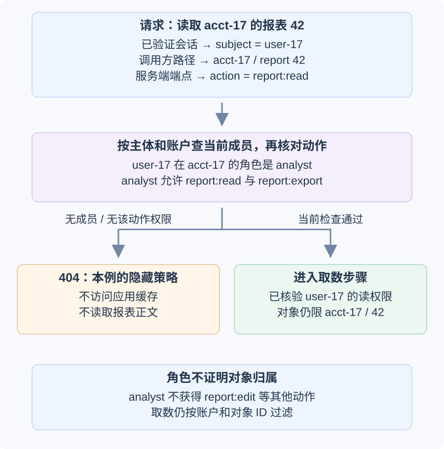
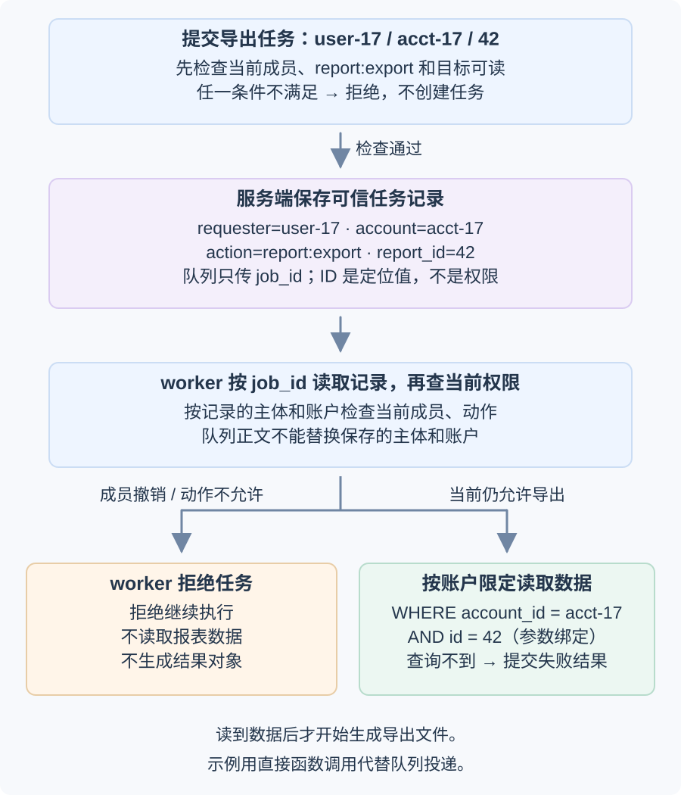

# 服务怎样逐次确认这个主体能对这份资源做这个动作？

上一章交出了可信主体：BFF 从会话认出 `user-17`，API 从 Access Token 认出同一主体。本章回答剩下的问题：这个主体此刻能不能对这份资源执行这个动作。authentication (认证) 确认请求代表谁，authorization (授权) 判断这个主体现在能否对指定资源做指定动作。本章是逐次授权的权威位置：一套五步骨架，以及它在数据库查询、应用缓存和后台任务上的落点。

## 案例：同一条路径，不同的主体

沿用[主线四的报表读取案例](http-semantics-and-transport.md#案例：账户报表服务里的一次读取)，本章引入另一个账户的主体 `user-29`：他属于账户 `acct-29`，已经正常登录，与 `acct-17` 没有任何成员关系；`acct-29` 有自己的报表 73（`Usage summary`）。账户 `acct-17` 里没有报表 43，它用来对照“不存在”。两个账户的角色如下：

| 角色 | 允许的动作 | 本例谁持有 |
| --- | --- | --- |
| `viewer` | `report:read` | `user-29` 在 `acct-29` |
| `analyst` | `report:read`、`report:export` | `user-17` 在 `acct-17` |

几次请求和本例的结果：

| 请求 | 当前数据 | 结果 |
| --- | --- | --- |
| `user-17` 读 `GET /v1/accounts/acct-17/reports/42` | 是 `acct-17` 的 `analyst`，报表 42 属于 `acct-17` | `200`，返回 `Service health` |
| `user-17` 读 `acct-17` 的报表 43 | 成员关系有效，但 `acct-17` 没有 43 | `404` |
| `user-29` 读 `acct-17` 的报表 42 | 没有 `acct-17` 的成员关系 | 与报表 43 完全相同的 `404` |
| `user-29` 读 `acct-29` 的报表 42 | 是 `acct-29` 的成员，但 42 不属于 `acct-29` | `404`，不会去读 `acct-17` 的 42 |
| 没有有效会话的请求 | — | `401` 加 `WWW-Authenticate` |
| `user-17` 被移出 `acct-17` 后重读，或他提交的导出任务开始执行 | 成员关系已撤销 | API 回 `404`；任务以 `authorization_revoked` 失败 |

## 认证之后，请求里的一切仍是输入

“已登录”只说明主体是谁，不说明他能读这份报表。路径、查询参数、正文、缓存键、队列消息里出现的用户 ID、账户 ID、角色名和报表编号，都是调用方或上游写进去的值，不能自己证明权限。`GET /v1/accounts/acct-17/reports/42` 里的 `acct-17` 是调用方选择的范围，`42` 是调用方选择的资源编号；服务端要用自己的当前数据核实二者。

## 逐次授权的五步

每个请求都按下面五步检查，全领域以这里的骨架为准，本章后续各节逐步展开：

1. **从凭据得到可信主体。** 认证层把会话或访问令牌映射为主体（见[上一章](sessions-and-browser-boundaries.md#会话与令牌：谁在请求)）。不要把请求头或正文里的 `user_id` 当作登录结果。
2. **查主体在所选账户里的当前成员关系。** 路径里的 `acct-17` 只是用户选的范围；一个人可以在不同账户有不同角色，客户端报来的账户和角色都不能代替服务端当前状态。
3. **把动作和对象一起检查，默认拒绝。** `analyst` 能 `report:read` 和 `report:export`，不因此获得 `report:edit` 或成员管理；没有明确授予的动作一律拒绝。
4. **按账户限定读取对象。** 数据按 `(account_id, report_id)` 过滤。不要先按全局编号把对象装进内存，再靠隐藏链接、难猜的 ID 或界面隐藏完成授权。
5. **旁路走同一条件。** 应用缓存、附件、导出结果、后台任务，每一条旁路都要确认同样的条件确实生效。worker 的服务账号按最小权限配置，只限制 worker 自己能调用什么服务，不能代替对最终用户的资源授权。

## 角色能给什么，资源检查还要补什么

RBAC（Role-Based Access Control，基于角色的访问控制）用 `viewer`、`analyst` 这样的角色归纳允许的动作，适合表达账户成员的常见权限，对应第 3 步的“动作”。它有两个盲区：角色不能证明报表 42 属于当前账户，那是第 4 步的事；角色也挡不住成员关系变旧，那要求第 2 步每次都查当前数据。产品若加入单份报表分享、部门属性或其他关系条件，就要把这些条件加进对象访问判断，这类做法通常称 ABAC（基于属性）或 ReBAC（基于关系）的访问控制。

## 隐藏式 404 还是 403

请求被拒时返回哪个状态码，是一项策略选择，全领域以这里的规则为准：

- **先认证。** 没有有效凭据就回 `401`，并带适用的 `WWW-Authenticate` 质询，例如 `Bearer realm="reports"`。认证先于一切，所以未认证的请求即使带了非数字的报表 ID，也回 `401`，而不是参数错误。
- **对象不可见时隐藏存在性。** 主体没有所选账户的成员关系、没有读权限，或者报表在该账户内不存在，统一回 `404`，状态码、Problem `type` 和中性的 `detail` 完全相同。本例 `user-29` 读 `acct-17` 的报表 42，与 `user-17` 读不存在的报表 43 得到同一个响应，`user-29` 无法据此猜出 42 存在。
- **存在性已无需隐藏时用 `403`。** 主体已经能看到这个对象，只是缺少某个动作的权限，例如 `viewer` 请求导出自己能读的报表 73，回 `403` 说明“已识别身份，但拒绝这个动作”。允许披露资源存在的端点也可以一律用 `403`。

~~~http
HTTP/1.1 404 Not Found
Content-Type: application/problem+json
Cache-Control: private, no-store

{"type":"https://api.reports.example.test/problems/not-found","title":"Report not found","status":404,"detail":"No report is visible under this identifier."}
~~~

隐藏式 `404` 是用户范围的结果，要显式禁止存储，理由见[缓存章](http-caching-and-conditional-requests.md#用户范围的响应怎样写缓存字段)。隐藏规则还决定了多个错误同时成立时的顺序：一个隐藏对象即使带着过时的版本标签，也先回 `404`，不能用 `412` 暗示它存在，完整的优先级见[API 契约章](api-contracts-errors-and-evolution.md#多个错误同时成立时先报哪个)。

## 按账户过滤读取：参数绑定和主键都不是授权

第 4 步的查询把账户和报表编号分别作为绑定参数传入（`?` 是 SQLite 的占位符，其他驱动写法不同）：

~~~sql
SELECT id, title, body
FROM reports
WHERE account_id = ? AND id = ?;
~~~

参数绑定和授权解决两个不同的问题。参数绑定防止输入改写 SQL 语法；授权决定当前主体能否读取绑定后的那一行。绑定了参数、却只按 `id = 42` 读，照样越权；做了授权、却拼接 SQL，照样会被注入。动态排序字段这类标识符通常不能作为普通参数绑定，要从固定的允许列表里选。

只按全局主键取对象是常见漏洞：ORM 的“按主键获取”一类接口只看 ID，不会替你加账户条件。主线五的调试章就以这样一次回归建案，见[怎样把一份缺陷报告变成可证伪的反例？](../practice/debugging-and-code-review.md)。若把主键改成复合键 `(account_id, id)`，让编号按账户分区，它也只约束数据形状，不判断当前用户能否读这一行；查询仍要保留两个谓词，队列里的任务引用也按同一组身份解析。

## 旁路一：应用缓存先授权，再查缓存

这里说的是服务端的应用数据缓存，不是浏览器或共享 HTTP 缓存。API 先重查当前成员关系和 `report:read`，只有通过后，才用包含账户和主体的键查缓存，例如 `(acct-17, user-17, 42)`；未命中时按账户和 ID 执行 SQL，只有读到属于该账户的行，才填充同一范围的缓存。缓存键限制了副本的范围，但它本身不是授权凭据：撤权后旧正文可能还在缓存里，API 照样在查缓存之前回 `404`。

缓存命中还依赖对象身份不变。系统若允许删除、迁移报表或复用编号，命中前必须核验仍是同一个对象及其当前访问规则，或在变更时可靠地让相关副本失效。缓存键要包含哪些维度、写后多久失效，见[加了缓存之后，读到的数据最多会旧多久？](../data/caching-and-staleness.md)。

## 旁路二：导出任务在受理和执行时各授权一次

导出是一项单独的动作，需要 `report:export`，不能从 `report:read` 推出。`user-17` 提交 `POST /v1/accounts/acct-17/reports` 请求导出报表 42 时：

1. **受理前授权。** 按五步检查 `user-17` 能否在 `acct-17` 导出报表 42，再检查时间范围、格式、页数等上限，把影响执行的参数规范化。从参数已能判定超限的，在受理前就拒绝。
2. **服务端保存可信任务记录。** 记录请求人、账户、动作和报表编号。队列消息只携带任务 ID；worker 按 ID 取回记录，不把消息正文当作这些字段的权威来源。任务 ID 只是定位值，不是权限凭据。
3. **执行时重查当前权限。** 本例选择“执行时仍须有权限”：worker 用自己的服务身份读数据之前，按记录的主体和账户重查当前成员关系与 `report:export`。权限已撤销时不读数据，直接提交一个明确的失败结果 `authorization_revoked`。

“当前”指 worker 检查时读到的成员状态。若生产环境的读副本或授权缓存会滞后，撤权最晚多久生效要明确写出；已通过检查的执行是否中途停止，也要按产品定义。另一种产品选择是“已受理的任务继续执行”，那就必须持久保存一份可审计的受理授权决定，并写明后续读取、导出这些副作用还受哪些控制。

任务受理之后还有几个端点，每个都单独授权：查询状态、请求取消、下载结果，都要检查调用者对这个任务和结果的当前访问权，路径里的账户号和任务 ID 不是凭据。下载若改用预签名 URL，它就成了持有者凭据：谁拿到链接，谁就能在有效期内下载，服务端不再逐次检查身份，见[服务该跑在哪种运行时上，平台怎样启动、探测和停止它？](../practice/production-runtime.md)。任务怎样被持久受理、唤醒和执行，从[未知结果章](deadlines-retries-and-unknown-outcomes.md)开始讲。

## 实例：用 SQLite 复现五步与撤权

下面的复现用 Python 3.11 标准库 `sqlite3` 和合成数据，把开头的结果表逐行变成断言。`verified_subject` 视为认证中间件已经验证的主体，复现不实现 Cookie 或签名令牌；路径里的账户值仍是调用方输入，只有成员查询通过后才成为有效范围。直接函数调用代替了队列投递。

> [!example]- SQLite 授权、隐藏式 404、403 与撤权复现
>
> ~~~python
> import sqlite3
>
> db = sqlite3.connect(":memory:")
> db.executescript("""
> CREATE TABLE memberships (
>     account_id TEXT NOT NULL, subject TEXT NOT NULL, role TEXT NOT NULL,
>     PRIMARY KEY (account_id, subject)
> );
> CREATE TABLE reports (
>     id INTEGER PRIMARY KEY, account_id TEXT NOT NULL,
>     title TEXT NOT NULL, body TEXT NOT NULL
> );
> CREATE TABLE jobs (
>     id INTEGER PRIMARY KEY, account_id TEXT NOT NULL, requester TEXT NOT NULL,
>     action TEXT NOT NULL, report_id INTEGER NOT NULL
> );
> INSERT INTO memberships VALUES ('acct-17', 'user-17', 'analyst');
> INSERT INTO memberships VALUES ('acct-29', 'user-29', 'viewer');
> INSERT INTO reports VALUES (42, 'acct-17', 'Service health', 'Synthetic data A');
> INSERT INTO reports VALUES (73, 'acct-29', 'Usage summary', 'Synthetic data B');
> """)
>
> ROLE_ACTIONS = {
>     "viewer": {"report:read"},
>     "analyst": {"report:read", "report:export"},
> }
>
> def principal_for(account_id, verified_subject):
>     # verified_subject 来自认证中间件，绝不来自请求正文；account_id 来自路径，仍是输入。
>     if verified_subject is None:
>         return None
>     row = db.execute(
>         "SELECT role FROM memberships WHERE account_id=? AND subject=?",
>         (account_id, verified_subject),
>     ).fetchone()
>     return None if row is None else {"account_id": account_id, "subject": verified_subject, "role": row[0]}
>
> def permits(principal, action):
>     return principal is not None and action in ROLE_ACTIONS.get(principal["role"], set())
>
> def load_report(principal, report_id):
>     row = db.execute(
>         "SELECT title, body FROM reports WHERE account_id=? AND id=?",
>         (principal["account_id"], report_id),
>     ).fetchone()
>     return None if row is None else {"title": row[0], "body": row[1]}
>
> def read_api(account_id, verified_subject, report_id):
>     if verified_subject is None:
>         return (401, None)
>     principal = principal_for(account_id, verified_subject)
>     if not permits(principal, "report:read"):
>         return (404, None)          # 隐藏式 404：与不存在的报表相同
>     report = load_report(principal, report_id)
>     return (404, None) if report is None else (200, report)
>
> def submit_export(account_id, verified_subject, report_id):
>     principal = principal_for(account_id, verified_subject)
>     if not permits(principal, "report:read") or load_report(principal, report_id) is None:
>         return (404, None)          # 看不到的报表：隐藏存在性
>     if not permits(principal, "report:export"):
>         return (403, None)          # 已能读到报表，存在性无需隐藏
>     cur = db.execute(
>         "INSERT INTO jobs (account_id, requester, action, report_id) VALUES (?, ?, ?, ?)",
>         (account_id, verified_subject, "report:export", report_id),
>     )
>     db.commit()
>     return (202, cur.lastrowid)     # 队列消息只带这个 job ID
>
> def run_export(job_id):
>     job = db.execute(
>         "SELECT account_id, requester, action, report_id FROM jobs WHERE id=?", (job_id,)
>     ).fetchone()
>     if job is None:
>         return "failed:unknown_job"
>     account_id, requester, action, report_id = job
>     principal = principal_for(account_id, requester)   # 执行时按记录重查当前权限
>     if not permits(principal, action):
>         return "failed:authorization_revoked"
>     report = load_report(principal, report_id)
>     return "failed:target_missing" if report is None else "succeeded"
>
> assert read_api("acct-17", "user-17", 42) == (200, {"title": "Service health", "body": "Synthetic data A"})
> assert read_api("acct-17", "user-17", 43) == (404, None)
> assert read_api("acct-17", "user-29", 42) == read_api("acct-17", "user-17", 43)
> assert read_api("acct-29", "user-29", 42) == (404, None)    # 不会去读 acct-17 的 42
> assert read_api("acct-29", "user-29", 73)[0] == 200
> assert read_api("acct-17", None, 42) == (401, None)
> assert submit_export("acct-29", "user-29", 73) == (403, None)  # viewer 能读不能导出
> assert submit_export("acct-17", "user-29", 42) == (404, None)  # 别的账户：隐藏
>
> status, done_job = submit_export("acct-17", "user-17", 42)
> assert status == 202 and run_export(done_job) == "succeeded"
> status, pending_job = submit_export("acct-17", "user-17", 42)
> assert status == 202
>
> db.execute("DELETE FROM memberships WHERE account_id='acct-17' AND subject='user-17'")
> db.commit()
> assert read_api("acct-17", "user-17", 42) == (404, None)
> assert run_export(pending_job) == "failed:authorization_revoked"
> print("acct-17/42: user-17 -> 200; 43 and user-29 -> same 404; no session -> 401")
> print("viewer export -> 403; cross-account export -> 404; pending export after revocation -> failed:authorization_revoked")
> ~~~
>
> 运行输出：
>
> ~~~text
> acct-17/42: user-17 -> 200; 43 and user-29 -> same 404; no session -> 401
> viewer export -> 403; cross-account export -> 404; pending export after revocation -> failed:authorization_revoked
> ~~~

## 下一步：把这些结果写成调用方能依赖的契约

本章交出的是一套每次请求都执行的判定：五步骨架把可信主体、当前成员关系、动作、账户内的对象和所有旁路连在一起；拒绝时，不可见的对象一律回相同的隐藏式 `404`，已可见对象缺少动作权限才回 `403`；后台任务在受理和执行时各授权一次。

调用方还需要知道这些结果长什么样：错误正文怎样让程序可靠判断，`401`、`404`、`415`、`422` 同时成立时先报哪个，API 改版时什么算兼容。见[怎样让调用方可靠地判断 API 的成功、失败和变化？](api-contracts-errors-and-evolution.md)

> [!info]- 来源
> - 默认拒绝、最小权限、每次请求校验、对象级授权、ABAC/ReBAC 相对 RBAC 的优势、ID 被猜中也不能访问（“逐次授权的五步”“角色能给什么”）：[OWASP Authorization Cheat Sheet](https://cheatsheetseries.owasp.org/cheatsheets/Authorization_Cheat_Sheet.html)，Deny by Default、Validate the Permissions on Every Request、Prefer Attribute and Relationship Based Access Control over RBAC、Ensure Lookup IDs Are Not Accessible Even When Guessed or Cannot Be Tampered With；核对于 2026-11-12。
> - 多租户隔离与租户上下文：[AWS Well-Architected SaaS Lens, Preventing cross-tenant access](https://docs.aws.amazon.com/wellarchitected/latest/saas-lens/preventing-cross-tenant-access.html)，核对于 2026-11-12；这是云厂商的架构指导，不是通用标准。
> - `401` 必须带 `WWW-Authenticate`、`403` 语义、可用 `404` 隐藏禁止访问的资源、`404` 可启发式缓存（“隐藏式 404 还是 403”）：[IETF RFC 9110](https://www.rfc-editor.org/rfc/rfc9110.html)，2022-06，§11.6.1、§15.5.2、§15.5.4–§15.5.5；`private` 与 `no-store`：[IETF RFC 9111](https://www.rfc-editor.org/rfc/rfc9111.html)，§5.2.2.5、§5.2.2.7；核对于 2026-11-12。
> - SQL 参数绑定与动态标识符允许列表（“按账户过滤读取”）：[OWASP SQL Injection Prevention Cheat Sheet](https://cheatsheetseries.owasp.org/cheatsheets/SQL_Injection_Prevention_Cheat_Sheet.html)，Primary Defenses；Python 3.11 `sqlite3` 的 `?` 占位符：[Python 3.11 sqlite3 documentation](https://docs.python.org/3.11/library/sqlite3.html#how-to-use-placeholders-to-bind-values-in-sql-queries)；SQLite 复合主键：[SQLite CREATE TABLE](https://www.sqlite.org/lang_createtable.html#the_primary_key)，§3.5；均核对于 2026-11-12。
> - 后台任务“执行时仍须有权限”、导出需单独授权、各端点分别授权，是本例选定的策略；队列协议不替应用决定以受理时还是执行时的权限为准。复现代码在本机 Python 3.11.13 运行通过。
