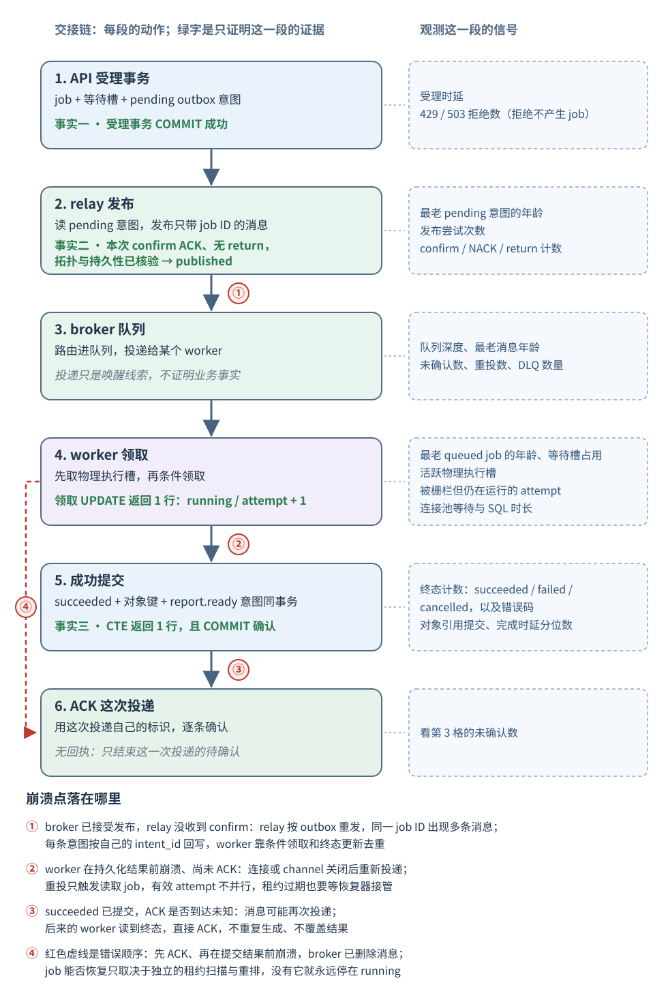
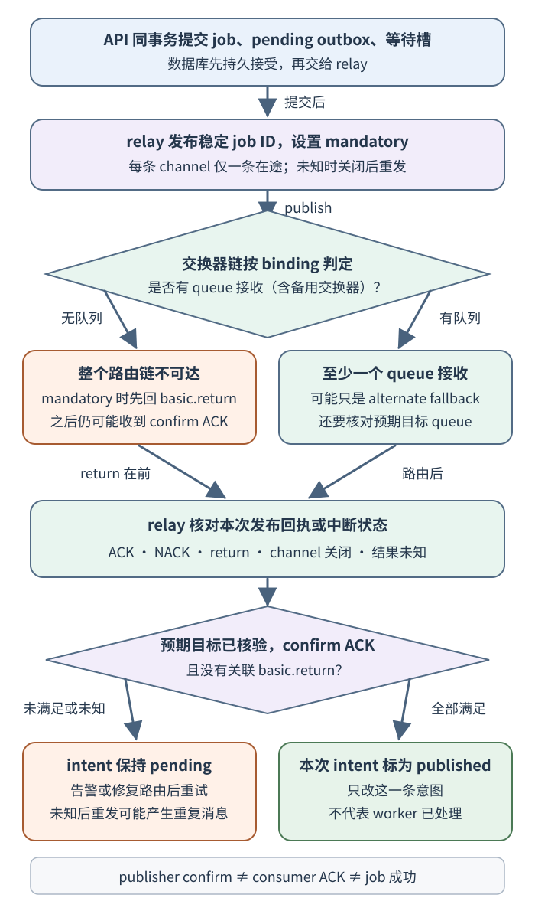
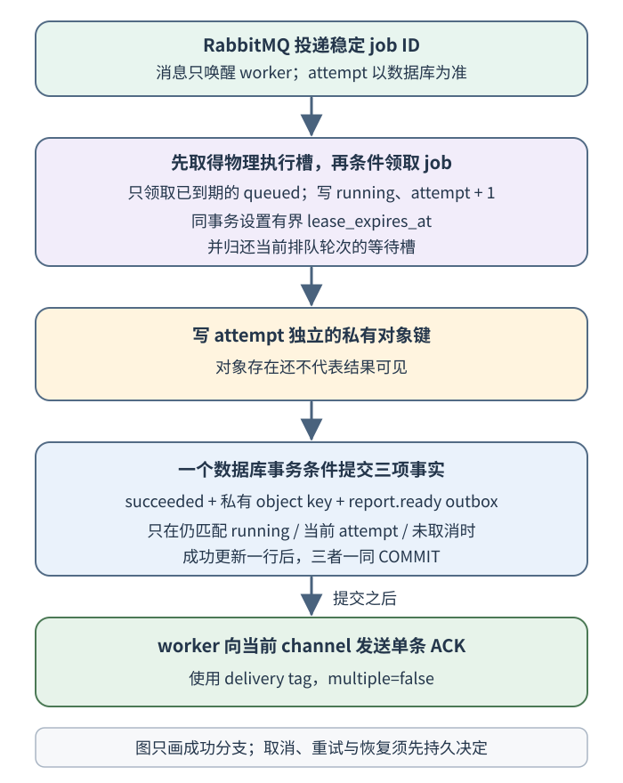

# 发布确认、消费者确认和业务完成各证明什么？

上一章把 `job-demo-731` 的状态机整理成了一张清单：数据库里出现什么持久状态时，worker 才可以确认手上的消息。本章把这张清单接到 broker (消息代理) 上，回答：relay (中继) 收到的 publisher confirm (发布确认) 证明了什么；worker 发出的 consumer ACK (消费者确认) 又证明了什么；这些确认在不同时刻丢失或崩溃时，系统会落在哪里；最后，怎样分段观测这条链路。机制先按一般的 broker 讲，RabbitMQ 4.4 的具体行为放在各节的实例里。

## 三个事实，由三个不同的组件观察

一次导出从 API 到 ACK 要经过六段交接。下图是整条链路的总览：每段只有自己的证据（绿字），其中三段各产生一个独立的事实——API 看到数据库持久受理了 job，relay 看到 broker 按约定接收了一次发布，worker 看到业务结果已完成；右栏是观测这一段的信号，红圈 ①–④ 是后文要分析的崩溃点。后文的发布确认图展开第 2 段，成功分支图展开第 4–6 段。

这三件事不能互相推导。publisher confirm 只说明 broker 收下了消息，不知道 worker 是否收到、处理或完成；consumer ACK 只是结束 broker 对**这一次投递**的待确认状态，它本身不说明报表成功了。按上一章的规则，worker 在 ACK 之前必须已经提交某个终态，或已经持久安排好重试或接管，所以 ACK 可能对应成功、失败、取消或“已交给下一轮”，任何一种都有可能。

数据库和 broker 之间也没有共享的原子事务。outbox (事务发件箱) 消除的只是“数据库已提交、进程却在发布前崩溃”这一个缺口（见[耗时任务怎样被持久受理](durable-job-acceptance-and-outbox.md)），relay 和 worker 仍然必须容忍重复。因此本领域不把“最终业务效果只发生一次”简称为 exactly-once (恰好一次)：它靠的是数据库里的状态条件、幂等键、远端的去重约定和恢复路径，而不是哪一层的某一次确认。

还要分清三种身份：幂等键 `export-demo-415` 识别客户端的一次意图，报表 ID 42 识别业务对象，job ID `job-demo-731` 识别一次持久受理的作业。消息里只带最后一个。

## publisher confirm 只回答“broker 收下了没有”

publisher confirm 覆盖的只是 relay 到 broker 这一段。它有两个固有的局限：

- **回执可能丢失。** broker 已经收下消息，confirm 却在网络里丢了，relay 分不清“没收到”和“收到了但回复丢了”。为了不丢消息只能重发，于是同一个 job 可能出现多条消息。
- **“收下”不等于“送到了该去的地方”。** broker 接收后要按路由规则把消息放进队列；消息可能进了零个队列，也可能进了一个兜底队列。confirm 是否涵盖路由结果，取决于 broker 和发布选项。

所以 relay 只有在本次 confirm 已核实、路由符合预期、持久性条件满足时，才把对应的 outbox 意图标为 `published`。`published` 只是 relay 自己的记录，不是 worker 开始执行的前提：broker 完全可能先把消息投递给 worker，relay 之后才收到 confirm 去回写 outbox。

> [!info] 实例：RabbitMQ 4.4 的发布确认（核对于 2026-11-12）
> - 要在发布用的 channel 上显式开启 confirm（AMQP 0-9-1 的 `confirm.select` 或客户端库的对应 API）。`mandatory` 标志不会开启 confirm，它只决定消息无法路由时是否退回。
> - exchange 按 binding 把消息路由到零个或多个 queue，confirm 本身不保证路由成功。带 `mandatory` 的不可路由消息会**先**收到 `basic.return`，**再**收到 confirm ACK，所以同一次发布的 return 和 confirm 必须合起来判断。
> - 收到 confirm ACK 且没有 return，也只说明消息至少进了一个 queue：alternate exchange (备用交换器) 可能把它送去了别处，所以要事先核验 exchange、binding 和目标 queue。
> - 持久性：classic durable queue 中的 persistent 消息在写入磁盘后才确认；quorum queue 在多数副本接受后才确认。放进 durable queue 的 transient 消息即使写过盘，节点重启时也会丢；要在重启后保留，队列和消息都必须是持久的。

## relay 怎样判定一次发布已完成？

relay 要把一个异步回执对应到唯一一次发布。本例的做法是：

1. relay 逐条读取 `pending` 的 outbox 意图，发布它指向的 job ID。用哪条 channel、confirm 序号是多少，只保存在内存里；数据库回写仍以 `intent_id` 为条件。
2. 每条 publisher channel 同一时刻只保留一次在途发布。confirm 的 ACK/NACK 带 channel 上的发布序号，还可能用 `multiple=true` 一次确认之前的多个序号；`basic.return` 则不带序号。只有一次在途时，return 只可能属于当前这次发送，relay 仍要核对 channel 和序号。
3. 只有本次 confirm ACK 已按 channel 和序号核实、没有本次的 `basic.return`、目标拓扑已核验、持久性条件满足，才把这条意图标为 `published`。
4. 遇到 NACK、return、channel 异常或关闭、confirm 迟迟不来，都保留这条意图为 `pending`。结果不明时，先关闭并弃用旧 channel，再用新 channel 重发。

这样仍消除不了“broker 已接受、数据库还没回写”造成的重复：broker 不会按业务 job ID 替应用去重。worker 一侧依靠上一章的条件领取处理重复。

## consumer ACK 的规则

broker 把消息投递给 worker 之后，这次 delivery (投递) 处于“待确认”状态。worker 用 ACK 告诉 broker“这次投递可以结束了”；broker 随后可以删除消息，不再重投。规则有三条：

1. **ACK 之前，数据库里必须已有终态或可恢复的后续路径。** 这就是上一章清单的总结。成功分支是：条件领取 → 写 attempt (执行尝试) 私有对象 → 条件提交 `succeeded`、对象键和 `report.ready` 意图 → 确认提交成功 → ACK。
2. **用这次投递自己的标识确认。** ACK 针对的是投递，不是业务对象，不能拿 job ID 代替。并行处理多条消息时，逐条确认，不要一次确认“这之前的全部”，否则会把还没完成的工作一并确认掉。
3. **ACK 可能丢。** 确认通常是 worker 发给 broker 的单向消息，broker 不逐条回执。发出后连接断开，ACK 是否到达就是未知的；消息若被重投，下一位 worker 照样按 job 状态判断。

可靠的任务处理要用手动确认。自动确认模式下，broker 在发出消息时就视为已交付；worker 若在持久化结果之前崩溃，broker 不会重投这条消息。

> [!info] 实例：RabbitMQ 4.4 的消费者确认（核对于 2026-11-12）
> - 用接收该消息的 channel 上的 delivery tag 确认；并行处理时 `multiple=false`。`multiple=true` 会连带确认该 channel 上更早的所有未确认投递。
> - `basic.ack` 是单向消息，broker 不回执。
> - 手动确认模式下，未确认的投递在 channel 或 connection 关闭后重新入队；这是 RabbitMQ 的行为，不能推广到所有 broker。

## 每种 job 状态下，这条投递怎样处理？

把上一章的状态清单和 broker 动作放进同一张表。收到一条投递（首次或重复）后，worker 先读权威 job，再按行处理：

| 读到的 job 状态 | worker 的动作 | 何时 ACK 这条投递 |
| --- | --- | --- |
| `queued` 且已到 `available_at` | 先取物理执行槽，再条件领取；只有一个事务能改成 `running` | 领取成功后继续处理，此时不 ACK；领取失败则重读状态 |
| `queued` 但未到 `available_at`（早到的重复） | 不能越过退避提前运行 | 到期唤醒已持久安排好时才 ACK；否则延后或保留未确认 |
| `running`、租约有效、属于别人 | 不另起并行 attempt | 确认有独立、持久的租约恢复器时才 ACK；否则保留或延后 |
| `running`、租约已过期、恢复器未提交接管 | 不自己给 attempt 加一 | 不 ACK；等恢复器提交取消、失败或重排 |
| 恢复器已提交重排（`queued`、等待槽、新 outbox） | 旧投递已无工作 | 可 ACK；新一轮由新意图唤醒 |
| 更大的 attempt 已领取并提交 | 旧投递已无工作 | 有可靠的租约恢复路径时可 ACK |
| `succeeded`、`failed`、`cancelled` | 不再计算，不覆盖结果 | 终态和必要的清理或保留决定已持久后 ACK |
| 自己的成功提交返回一行且 `COMMIT` 确认 | — | 立即 ACK |
| 自己的成功提交零行，或 `COMMIT` 结果未知 | 在新连接上重读 job 与 outbox | 按重读结果回到上面各行；查清之前不 ACK |
| 消息格式错误，或对应不到有效 job | 不能无限重排 | 隔离到 dead-letter queue (死信队列，DLQ) 或走会告警的拒绝路径 |

可重试的失败、取消和恢复器接管各自怎样把 job 推到上表的某一行，见[任务失败、被取消或 worker 失联后怎样收尾](job-retries-cancellation-and-cleanup.md)。

## 在不同时刻崩溃，系统会落在哪里？

故障发生的位置，决定消息、job 和对象之间是什么关系。四个崩溃点及其落点已画在本章开头的交接链图里：① 让同一 job ID 出现多条消息，② 和 ③ 让同一条消息被再次投递，三者都靠数据库里的条件领取、终态和恢复器收敛。

④ 不同：它是把 ACK 挪到成功提交之前的错误顺序，broker 不会再投递，恢复只剩独立的租约扫描。这说明了为什么“先 ACK 再处理”是错的：它把唯一的恢复信号交了出去。

## prefetch 限制的是什么？

prefetch (预取上限) 限制每个消费者手上**未确认**的投递数，也就决定了 broker 能提前把多少任务推进 worker 的缓冲区。它不等于业务并发度：真正能同时做多少，还取决于处理器并发、进程内队列、数据库和对象存储的容量，以及 worker 的物理执行槽（本例每进程 8 个）。

预取设得过大，只是把等待从 broker 挪进 worker 的内存；worker 停机时，还会有更多已投递、未确认的工作需要回收。

**已预取但尚未开始的投递，必须有归还的路径。** worker 没有空闲执行槽、或正在关停时，它手上可能压着几条还没开始的投递。这些投递要么在连接关闭时由 broker 自动重新入队，要么由 worker 显式退回。这里的“退回”只是把一条**还没开始处理**的投递还给 broker；它和“处理失败后靠重新入队来重试”是两回事，后者为什么不可取，见收尾一章。关停时的完整顺序见[服务进程收到停止信号后怎样排空工作](../runtime/graceful-shutdown.md)。

> [!info] 实例：RabbitMQ 4.4 的预取与归还（核对于 2026-11-12）
> - AMQP 0-9-1 的 `basic.qos(count)` 在 RabbitMQ 中按每个 consumer 分别生效：同一 channel 上三个 consumer 各设 4，就能各自持有 4 条未确认消息。`0` 表示不限；consumer 没有显式设置时，broker 可能套用管理员配置的默认值。按整个 channel 计算的 global QoS 从 4.3 起弃用并默认禁用。
> - `basic.cancel` 只阻止后续分发，不会丢弃或重排已经发出、尚未确认的投递。关闭 channel 会把其中未确认的投递自动重新入队；保留 channel 时，也可以用 `basic.reject` 或 `basic.nack` 并设 `requeue=true` 显式退回。

## 先进先出不等于先完成

FIFO (先进先出) 队列只描述消息的排队和投递次序。多个 consumer 并行处理时，较早投递的消息完全可能较晚完成。如果业务要求按账户、订单或报表的顺序生效，先定义顺序键和需要保证的**提交**顺序，再选一种办法：按键串行处理；用单一有序分区（见[Kafka 分区与偏移](kafka-partitions-and-offsets.md)）；或者用持久的序号做条件更新，拦住越序的提交。

## 怎样分段观测这条链路？

每个确认只证明一段交接，所以观测也必须分段：本章开头交接链图的右栏，就是每一段各自的信号。只看一个数字（例如 ACK 数）会把不同位置的积压混在一起；被栅栏但仍在运行的 attempt 和连接池等待，说明执行资源可能被旧 attempt 占着，而不是 worker 不够。

读这些信号的几条要点：

- 即使队列还在接收消息，**最老消息年龄**持续上升，就说明结果在变慢。
- broker 积压很低，不能说明系统空闲：outbox 里尚未发布的意图、数据库里的 `queued` job 都可能在堆积。
- broker 还在接收，不代表 worker 有处理能力。
- worker 发出 ACK，只说明应用到达了自己选定的处理边界，不等于用户后来下载到了报表。

用户结果怎样定义成 SLI、发布后的故障怎样从这些信号走到根因，见[怎样用用户结果衡量一个服务](../practice/slis-slos-and-error-budgets.md)和[发布后用户结果变坏，怎样定位并确认恢复](../practice/incident-diagnosis-and-recovery.md)。

## 本章产出与下一步

到这里，三个事实各有其证据：受理看数据库提交，发布看本次 confirm 加路由核验，完成看一行加一次确认的成功提交；ACK 只在持久状态允许时发出，不同时刻的崩溃都有明确的落点。还没讲的是那些“不顺利”的分支：attempt 遇到可重试的错误、用户请求取消、worker 失联之后，谁来把 job 推到终态或下一轮，又怎样清理留下的对象？见[任务失败、被取消或 worker 失联后怎样收尾](job-retries-cancellation-and-cleanup.md)。如果消息系统是 Kafka，分区顺序、偏移提交和再均衡的问题见支线[怎样用 Kafka 分区保序、推进偏移，并在再均衡后安全接手](kafka-partitions-and-offsets.md)。

> [!info]- 来源
> - RabbitMQ 4.4（官方 Release Information 标为 2026-10-20 发布，核对于 2026-11-12）：[Consumer Acknowledgements and Publisher Confirms](https://www.rabbitmq.com/docs/confirms)，confirm 与 ACK 的方向、delivery tag 的 channel 范围、发布序号与 `multiple`、持久消息与 quorum queue 的确认时机、不可路由消息先 `basic.return` 后 confirm ACK、手动与自动确认、关闭 channel/connection 后未确认消息重新入队，以及 [Negative Acknowledgement and Requeuing](https://www.rabbitmq.com/docs/confirms#consumer-nacks-requeue)；[AMQP 0-9-1 extended specification](https://github.com/rabbitmq/amqp-0.9.1-spec/blob/main/xml/amqp0-9-1.extended.xml)，`basic.return` 不含 confirm 序号；[Java client unroutable handling](https://www.rabbitmq.com/client-libraries/java-api-guide#unroutable)；[Reliability Guide](https://www.rabbitmq.com/docs/reliability)，故障中途状态与重发；[Consumer Prefetch](https://www.rabbitmq.com/docs/consumer-prefetch)，per-consumer QoS、`0` 不限、可配置默认值、4.3 起 global QoS 弃用并默认关闭；[Consumers: Cancelling a consumer](https://www.rabbitmq.com/docs/consumers#cancelling-a-consumer-unsubscribing)，`basic.cancel` 不重排已发出的未确认投递；[Release Information](https://www.rabbitmq.com/release-information)。队列副本、持久性、exchange/binding/alternate exchange 与客户端 API 仍须按实际部署核实。
> - 三个事实的划分、job 状态与 ACK 的对照表、分段观测清单是本主线的应用合同与工程推论；job 状态机的权威定义在[上一章](job-claims-leases-and-fencing.md)。
