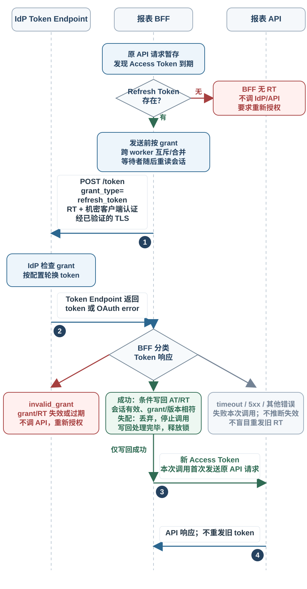
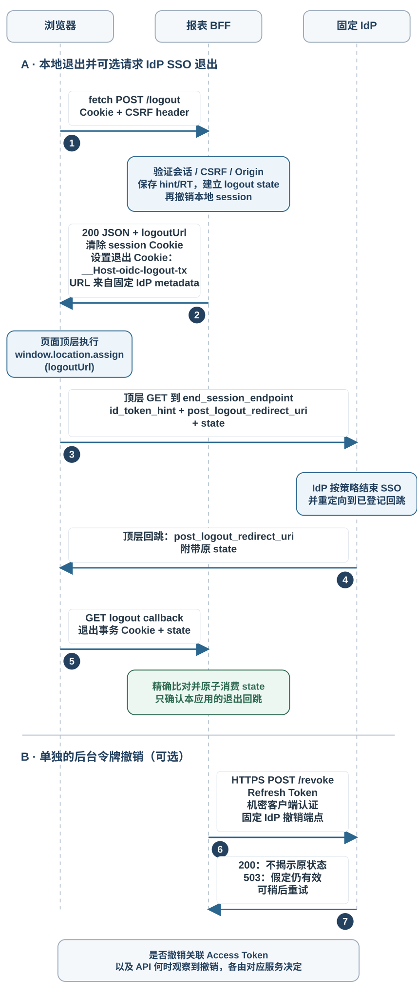
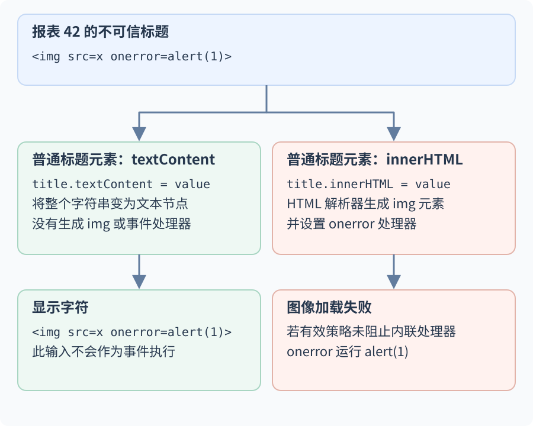
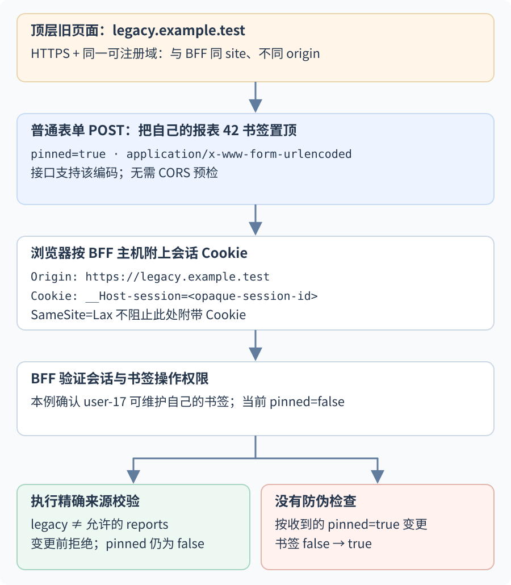
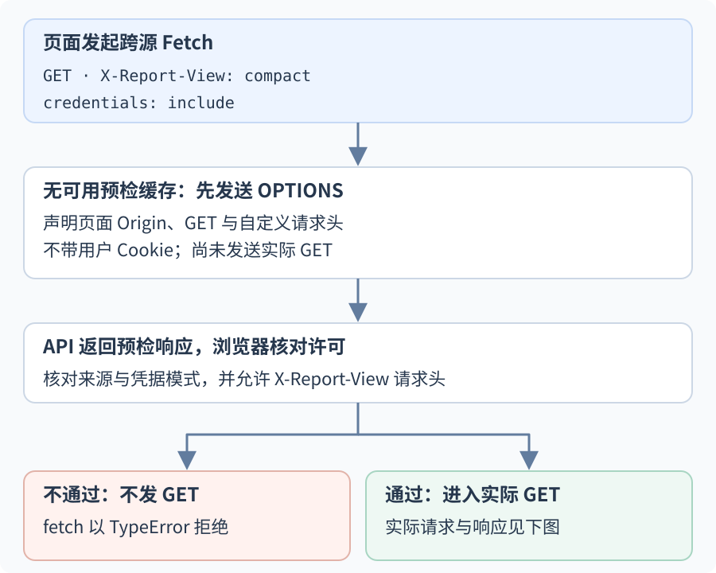
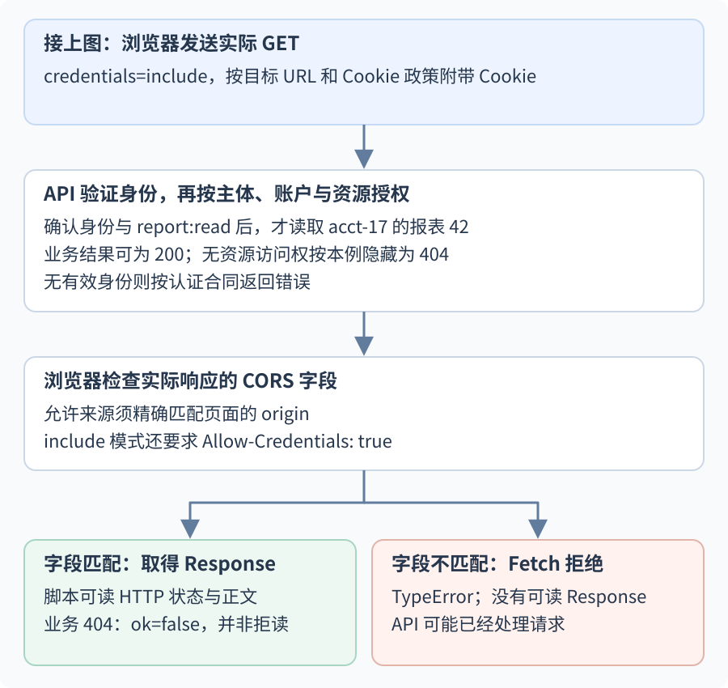

# 请求怎样带上可信的身份，浏览器又替服务守住哪些边界？

上一章的回源验证第一步是“先确认主体”。本章打开这一步：浏览器带来的 Cookie 怎样经过登录、会话和令牌变成可信的 `user-17`，以及浏览器的几种安全控制各守哪条边界。本章产出的是“可信主体”；它不回答这个主体能否读写报表 42，那是[下一章逐次授权](per-request-authorization.md)的事。浏览器的控制也一样：它们都不授予任何访问权。

沿用[主线四的报表读取案例](http-semantics-and-transport.md#案例：账户报表服务里的一次读取)，本章补充三个标识：

- IdP（Identity Provider，身份提供方）的固定签发者是 `https://idp.identity.test`，BFF 在它那里登记的 client ID 是 `reports-bff-client`。
- IdP 签发的 ID Token 里，`iss` 是 `https://idp.identity.test`，代表这个人的 `sub` 是 `idp-user-4821`；应用把 `(iss, sub)` 映射到本地账户 `user-17`。
- `https://legacy.example.test` 是同一可注册域下的旧子域，由不可信的一方控制，用来检验“同站”是否等于可信。

## 会话与令牌：谁在请求

### 登录涉及的四种凭据

一次 OIDC（OpenID Connect）登录会产生几种凭据，它们由不同的一方持有，发给不同的接收方，回答不同的问题：

| 凭据 | 谁持有、发给谁 | 接收方验证什么 | 证明什么，不证明什么 |
| --- | --- | --- | --- |
| 会话 Cookie | 浏览器发给 `reports.example.test` | BFF 用不透明 ID 查找仍有效的服务端会话 | 让 BFF 找到本地会话；不证明任何 API 权限 |
| ID Token (身份令牌) | IdP 的 Token Endpoint 发给 BFF；可选的 IdP 退出时，作为提示随浏览器顶层请求发回 IdP | 签发者、受众是本 client、时效、本次登录的 `nonce` | 把 IdP 的认证结果交给登录客户端；不替 API 授权 |
| Access Token (访问令牌) | BFF 用 `Authorization: Bearer …` 发给 API | 签名或状态、签发者、API 受众、时效、scope | 取得调用 API 的资格；不替代 API 对账户和报表的本地授权 |
| Refresh Token (刷新令牌) | BFF 只发给 IdP 的 Token Endpoint 和撤销端点 | client、grant、有效期、轮换或绑定状态 | 换取新的 Access Token；永不进入浏览器或 API |

本例选 BFF 架构：Access Token 和 Refresh Token 都留在服务端，浏览器日常只持有一个不透明的会话 Cookie。

### 服务端会话 Cookie 怎样设计

登录成功后，BFF 生成一个新的随机会话 ID，在服务端保存会话记录，再让浏览器以后带回这个 ID：

~~~http
Set-Cookie: __Host-session=<random-opaque-id>; Path=/; Secure; HttpOnly; SameSite=Lax
~~~

会话 Cookie 的设计规则在全领域以这里为准：

| 规则 | 做法 | 理由 |
| --- | --- | --- |
| ID 只是查找键 | 用密码学安全随机数生成器生成，至少 128 位熵；不含 `user-17`、角色或账户 | 身份和权限存在服务端，不能从 ID 解码或伪造 |
| `__Host-` 前缀 | 要求同时带 `Secure`、`Path=/`，且不带 `Domain` | Cookie 只属于设置它的主机，子域不能扩大或覆盖它的作用域 |
| `Secure` | 只经 HTTPS 发送 | 不在明文链路上暴露 |
| `HttpOnly` | 脚本不能通过 `document.cookie` 读取 | 挡住 XSS 直接读值；挡不住脚本借浏览器发请求 |
| `SameSite` | 本例用 `Lax` | 限制部分跨站请求携带 Cookie；不能代替 CSRF 防护（见[第二节](#Cookie%20自动发送时，怎样防止伪造变更？)） |
| 有 Cookie 不等于已认证 | 每次请求都查服务端记录的过期时间、撤销状态和账户状态 | Cookie 只是 HTTP 字段，也可以装偏好一类的非身份数据 |
| 权限变化时换 ID | 登录成功、密码重置、权限等级变化时销毁旧 ID、签发新 ID | 防会话固定：攻击者预先塞给浏览器的匿名 ID 不能在登录后继续有效 |
| 超时由服务端执行 | 空闲超时和绝对超时都记在服务端 | 浏览器端的过期时间可被篡改或复制 |
| 退出先撤服务端 | 先撤销服务端会话记录，再让浏览器删 Cookie | 删 Cookie 只停止以后的自动发送，已被复制的旧 ID 要靠服务端拒绝 |

这个 Cookie 由 `reports.example.test` 设置并只限该主机，浏览器不会把它发给 `api.reports.example.test`。它只认证到 BFF；BFF 从服务端会话取出 API 访问令牌，再由自己调用 API。

`SameSite` 的取舍：面向 BFF 的会话 Cookie，RFC 10017 建议用 `Strict`。本例为了让用户从外部链接点进来时仍处于登录态，选了 `Lax`，于是必须对所有改变状态的请求（包括退出）校验会话绑定的 CSRF token，并精确比对 `Origin`。部署若能用 `Strict`，要按实际登录回跳路径验证体验；无论哪种，同站的兄弟子域都能发起请求，不能只靠 SameSite。登录流程里的匿名事务 Cookie 必须用 `Lax`：IdP 回调是跨站的顶层 `GET`，`Strict` 的 Cookie 不会随它带回。确需在跨站嵌入请求中携带 Cookie 时，`SameSite=None` 必须与 `Secure` 同用，浏览器的第三方 Cookie 策略仍可能阻止它。

### Bearer 令牌：不透明令牌与 JWT

bearer token (持有者令牌) 是可重放的凭据：谁拿到，谁就能在有效期内使用。Access Token 有两种常见形态，撤销后多久被 API 察觉也不同：

- **不透明令牌**：API 调 introspection（令牌状态查询）询问 IdP。API 往往缓存查询结果；缓存越久，撤销后令牌仍被接受的窗口越长。
- **JWT（JSON Web Token）**：API 离线验证签名和声明，不必每次回 IdP。验证项包括受信密钥、允许的算法、`iss`、`aud`、令牌用途、有效期和 scope。代价是已撤销的 JWT 通常会一直被接受到过期，除非 API 另做撤销查询或拒绝列表。

JWT 是一种声明格式，不是“已验证身份”的同义词。签名只证明声明没被篡改、由受信签发者签出；载荷通常可被任何人读取，签名不提供保密性。只做 Base64URL 解码不是验签。ID Token 和 Access Token 即使都是 JWT，也要各自检查自己的受众和用途，不能互换使用。

### BFF 还是浏览器内客户端

BFF 让令牌留在服务端。它用会话 Cookie 找到该用户的令牌集合，再把 Access Token 附到固定的 API 请求上。BFF 必须限制可代理的主机、路径和方法，否则调用方可以让它把用户令牌带到任意目标。`HttpOnly` 让脚本读不到 Cookie，却挡不住页面里的恶意脚本借浏览器会话向 BFF 发请求，所以 BFF 仍须防 XSS 和 CSRF。

另一种做法是让浏览器里的脚本直接当 OAuth 客户端。它是 public client (公开客户端)：代码在用户设备上运行，藏不住静态密钥，必须用授权码加 PKCE。把 Access Token 放进 `localStorage` 这类脚本可读的存储，一次 XSS 就能把它读走并外传。授权服务器若给公开客户端发 Refresh Token，必须用发送者约束或每次使用后轮换，以便检测重放。

### 授权码登录：每一步防什么

OAuth 2.0 是授权框架；只有请求 `openid` scope 并按 OIDC 规则验证 ID Token，客户端才得到身份断言。本例的 BFF 是 confidential client (机密客户端)，API 是资源服务器，IdP 是固定的信任方。

| 步骤 | BFF 做什么 | 防的是什么 |
| --- | --- | --- |
| 1. 开始事务 | 从受信配置选定 issuer、各端点、client ID 和精确登记的回调 `https://reports.example.test/oidc/callback`。在服务端建短期事务记录：一次性随机 `state`、`nonce`、PKCE `code_verifier`、预期 `iss`、回调地址、创建时间、未使用标记。用 `__Host-oidc-tx` Cookie（`Path=/; Secure; HttpOnly; SameSite=Lax`）把匿名浏览器上下文与事务关联 | 不让请求参数决定 IdP 或回调地址；把回调绑定到发起登录的那个浏览器 |
| 2. 发起授权 | 用 32 个新随机字节生成无填充 Base64URL 的 `code_verifier`（43 个字符），计算 `code_challenge = BASE64URL(SHA-256(ASCII(code_verifier)))`，并显式发送 `code_challenge_method=S256`。浏览器被重定向到 IdP，参数含 `response_type=code`、`client_id`、精确 `redirect_uri`、`scope=openid reports.read`、`state`、`nonce` 和 challenge | 省略方法字段时 RFC 7636 的默认值是 `plain`，不会自动用 SHA-256。`reports.read` 只是向 API 请求的权限范围，不证明 `user-17` 属于 `acct-17` |
| 3. 回调校验 | IdP 认证用户后带 code、`state`、`iss` 回到回调地址。BFF 要求 `iss` 存在且与事务的预期值精确相等（本例 IdP 元数据声明支持 RFC 9207，错误响应也要带 `iss`）；要求 `__Host-oidc-tx` 存在，用它找到事务，再用一条原子条件更新同时核对 `state`、未过期、未消费，并标为已消费 | `iss` 防多授权服务器的 mix-up 攻击；原子消费防并发回调重复兑换。任一项失败就停止，不兑换 code，不建会话 |
| 4. 兑换 code | 经已验证的 TLS 连接调用 Token Endpoint，发送 `grant_type=authorization_code`、code、相同的 `redirect_uri`、`code_verifier` 和机密客户端认证。IdP 核对 code 未用过、绑定本 client 和回调、PKCE 匹配后，返回 ID Token、Access Token，可能还有 Refresh Token | 截获 code 的人没有 verifier，兑换不了 |
| 5. 验证身份并绑定账户 | 见下一小节 | ID Token 被替换或重放 |
| 6. 建立新会话 | 在服务端保存身份、会话 ID、有效期与 API grant 的关联；销毁匿名上下文和任何登录前的会话 ID，签发全新的 `__Host-session` | 会话固定 |

三个随机值各管一件事，不能互相代替：PKCE 把 code 的兑换绑定到这次事务；`state` 把浏览器回调绑回发起它的事务；`nonce` 把 ID Token 绑回这次认证。RFC 9700 允许在确认授权服务器支持 PKCE 时只靠 PKCE 防护回调的 CSRF；本例仍显式检查 Cookie、`state` 和 `nonce`。这些协议端点的保护，也不能代替报表业务变更请求的 CSRF 检查。

回调端点要尽量小。授权响应里的 code 可能留在浏览器历史、代理日志或 Referer 里，所以回调页不加载第三方脚本、图片和链接，设置 `Referrer-Policy: no-referrer`，日志不记录 code、`state`、令牌或 Cookie，成功后立即转到不含敏感参数的固定页面。若要回到用户原来的路径，只接受服务端允许的站内路径，不能形成开放重定向。固定回调、一次性 code、PKCE 和事务过期缩短了泄漏后的可用时间，但“浏览器绝不会留下回调 URL”不是可依赖的保证。

### 验证 ID Token 并绑定本地账户

第 5 步在使用 ID Token 中的身份之前，按 OIDC 规则逐项验证：

- 签名和受信算法；
- `iss` 精确等于 `https://idp.identity.test`；
- `aud` 只含 `reports-bff-client`（另一部署若允许额外受众，必须逐个列入信任配置，其他值一律拒绝）；
- 有效期，以及与事务记录相同的 `nonce`；
- 若请求带了 `max_age`，还要检查 `auth_time`。

通过后，用稳定键 `(iss, sub)` 查本地绑定：只有查到 `(https://idp.identity.test, idp-user-4821) → user-17`，才认定这是 `user-17`。不要凭可能变化或未经验证的 email 自动合并账户。把一个 IdP 账户链接到已登录的本地账户时，还要求该本地账户近期有效认证并明确确认，再建立唯一的 `(iss, sub)` 绑定。

ID Token 只用来让 BFF 确认身份。IdP 没有给报表 API 签发受众和 scope 都匹配的 Access Token 时，BFF 不得把 ID Token 或其他受众的令牌送给 API。

> [!info] 单点登录不会替每个应用建立本地会话
> IdP 的 SSO（Single Sign-On，单点登录）会话能让同一浏览器访问其他已登记应用时免于重新输入密码，但 IdP 的策略、同意要求或认证时效仍可能要求再次交互。每个应用都要独立校验自己的回调、验证 ID Token、绑定本地身份、创建自己的会话。一个应用退出本地会话，不会结束 IdP 的 SSO 会话，也不会让其他应用一并退出。

> [!info] Token Endpoint 的窄例外
> OIDC Core 允许一个例外：授权码流程中，客户端经已验证的 TLS 连接直接从 Token Endpoint 收到的 ID Token，可以用 TLS 的服务器认证代替签名校验。从浏览器、其他 API 或任何不可信渠道拿到的 ID Token 不适用这条例外。

### 调用、刷新与三种撤销

**调用 API。** 浏览器向 BFF 发只读 `GET`，自动带上 `__Host-session`；安全方法不改状态，所以不需要 CSRF token。BFF 查到有效会话后，按 Token Endpoint 返回的 `expires_in`（或经验证的令牌到期声明）维护本地到期时间；未到期才把 bearer 发给 API，已到期则先刷新，此时 API 请求还没发出。API 仍是最终验证者：它验证 Access Token，把令牌代表的主体映射为 `user-17`，再按当前成员关系、报表归属和动作授权。

**刷新令牌。** 刷新有两个竞争要处理：多个请求同时发现令牌到期，以及刷新进行中用户退出了。

1. BFF 以 grant 为单位取得刷新锁，或把并发请求合并到同一次进行中的刷新；其他进程上的请求等刷新结束后重读会话，避免同一个旧 Refresh Token 被并发提交。
2. 持锁者经可信 TLS 连接、以机密客户端认证向 Token Endpoint 发送 Refresh Token。
3. 成功时，在释放锁之前以“会话仍有效，且 grant 版本与发起刷新时相同”为条件，原子写回新的 Access Token；IdP 若轮换了 Refresh Token，也在同一次更新里替换。条件不成立就丢弃结果、停止本次调用，迟到的刷新响应不能复活已退出或已撤销的会话。
4. 只有条件写回成功后，才用新令牌第一次发送原来的 API 请求。

刷新失败要按原因处理。没有 Refresh Token，或 IdP 明确返回 `invalid_grant`（grant 已失效、过期或撤销），本例停止 API 调用并要求重新授权；本例的 grant 与会话绑定，失效 grant 也结束这条令牌会话。网络超时、`5xx` 或其他不表示 grant 失效的结果，只让本次调用失败：不能据此推断 grant 失效，也不要盲目重发旧 Refresh Token。

**三种撤销是三件事。** “退出”可能指三种不同的操作，撤销的对象和可见性各不相同：

| 操作 | 撤销什么 | 什么仍可能有效 |
| --- | --- | --- |
| 撤销本地会话 | BFF 的服务端会话记录；随后清除 Cookie | 已签发给 BFF 的令牌在 IdP 侧仍有效，除非另行撤销 |
| 撤销 Refresh Token | 向 IdP 撤销端点提交 RFC 7009 撤销请求 | 同一 grant 已签发的 Access Token：IdP 是否一并撤销由 IdP 决定；离线验证 JWT 的 API 通常接受到令牌过期 |
| 结束 IdP 的 SSO 会话 | 顶层导航到 IdP 的 `end_session_endpoint` | 其他应用的本地会话，除非另配前通道或后通道退出联动 |

RFC 7009 的撤销响应语义在全领域以这里为准：`200` 只表示请求被处理，不说明令牌在撤销前一定有效，也不说明它刚刚才失效；`503` 表示客户端应假定令牌仍然有效，可以稍后重试。撤销 Refresh Token 不等于撤销已经签发的 JWT Access Token。API 若每次查询令牌状态，可在 IdP 撤销生效后拒绝；introspection 结果被缓存时会有观察延迟。API 对 `acct-17` 报表的授权仍由 API 按自己的数据作出，不会因为浏览器删了 Cookie 而失效。

本例的退出流程：

1. 页面用 `fetch` 向 BFF 发 `POST /logout`，带会话 Cookie、自定义 CSRF 头和精确的 `Origin`；BFF 先完成这些校验。
2. 若本次要请求 IdP 退出，BFF 从活动会话取出已验证的 ID Token 作为 `id_token_hint`，为一次性退出 `state` 建短期事务；若要撤销上游令牌，先保存要提交的 Refresh Token。
3. 撤销服务端本地会话。此后即使旧 Cookie 被复制，服务端也拒绝它。
4. 响应 `200` JSON：清除 `__Host-session`，设置 host-only 的 `__Host-oidc-logout-tx`（`Secure; HttpOnly; Path=/; SameSite=Lax`），并返回用受信 IdP 元数据中 HTTPS `end_session_endpoint` 拼好的退出地址，含 `id_token_hint`、精确登记的 `post_logout_redirect_uri` 和 `state`。不请求 IdP 退出时，只清 Cookie 并返回已退出状态。
5. 页面执行 `window.location.assign(logoutUrl)` 做顶层导航。`fetch` 自己跟随 302/303 只处理那次 fetch 的重定向，不会把当前页面带到 IdP。
6. IdP 回跳到登记的地址（顶层 `GET`，`Lax` 的事务 Cookie 随之带回），BFF 用 Cookie 找到事务，精确比对并原子消费 `state`。
7. 独立地，BFF 可经 HTTPS 以机密客户端凭据向 IdP 撤销端点提交 Refresh Token。远端不可用不影响本地会话已撤销，但不能宣称上游令牌已即时撤销。

`id_token_hint` 只发给固定的 IdP 退出端点，不发给 API，也不是 API 凭据；页面和回调使用 `Referrer-Policy: no-referrer`。单个应用退出不构成全局退出。

### 本地密码：慢哈希与在线限速

应用自己验证密码时，数据库存的是带随机盐的专用密码哈希及其算法和成本参数，不存明文，也不用快速通用散列。两种防护针对不同攻击：数据库泄漏后，攻击者能离线反复猜，Argon2id 这类慢哈希用内存和计算成本让每次猜测更贵；在线登录入口则靠限速挡住在线猜测。OWASP 当前给出的 Argon2id 基线示例是 19 MiB 内存、2 次迭代、并行度 1，部署应按自己的硬件和并发调优，不要把最低示例当目标。salt 不需要保密；可选的 pepper 是数据库之外的服务端秘密，需要保护、轮换和恢复方案。

密码验证成功后，同样要销毁匿名会话 ID、签发新的随机 ID、建立有服务端超时的本地会话。它只代表本地认证，不会凭空产生 ID Token、OAuth grant 或 API Access Token。

## 浏览器边界：各守什么、都不授予什么

会话把请求连到了可信主体。浏览器另有几种安全控制，各自只守一条边界。下表是本节的总览，后面逐条展开：

| 边界 | 控制与成立条件 | 失败时会怎样 | 它不负责什么 |
| --- | --- | --- | --- |
| 网络链路 | HTTPS 证书身份匹配 + TLS 保护（见 [TLS 证明什么](http-semantics-and-transport.md#TLS%20证明什么)） | 连接终止或显示证书错误；退回明文则链路保护消失 | 识别应用用户，判断能否读报表 |
| 页面解释数据 | 按目标上下文使用安全的 DOM 接口或编码；富文本另行消毒 | 不可信标记被 HTML 解析，生成元素、事件处理器或脚本 | 限制已经在运行的同源脚本 |
| Cookie 自动发送 | 状态变更前，服务端校验 CSRF token 或精确来源 | Cookie 仍随请求到达；防护漏掉时伪造操作进入业务逻辑 | 认证本身、对象授权、脚本注入 |
| 跨源读取 | 预检允许本次方法与请求头；实际响应的来源与凭据字段匹配 | 预检失败则不发实际请求；实际响应检查失败则脚本读不到 | 拦住所有请求、管住非浏览器客户端、授权报表 |
| 页面嵌入 | 响应的 CSP `frame-ancestors` 允许每一层祖先来源 | 浏览器拒绝在该框架中呈现页面 | API、附件和后台任务的服务端权限 |

### 不可信报表标题怎样安全显示？

XSS（Cross-Site Scripting，跨站脚本）发生在不可信数据变成可执行内容的时候。假设报表 42 的标题被改成了 ``。`textContent` 把整串当普通字符放进标题元素；`innerHTML` 则把它交给 HTML 片段解析器，生成一个 `img` 元素和 `onerror` 处理器。图片加载失败、又没有有效策略拦住内联处理器时，`alert(1)` 就会运行。

安全显示的规则按入口分：

- **普通文本**：用框架默认的文本插值或普通元素的 `textContent`。
- **HTML 属性**：固定元素名和属性名，用该属性上下文对应的编码。属性编码不检查 URL 的语义，`javascript:` 这类地址要另行校验。
- **不要拼进去的地方**：脚本、事件处理器、CSS 规则、标签名、属性名。
- **富文本**：只有产品确实支持用户撰写富文本时，才用维护中的 HTML 消毒器过滤允许的元素和属性；清理之后再改写内容可能重新引入风险。
- **执行入口**：框架的 raw HTML 入口同样需要上述检查；不要把不可信字符串交给 `document.write`、`eval` 或 `new Function`，文本插值的安全性不会传递到这些入口。

CSP（Content Security Policy）的脚本指令可以限制内联脚本和脚本来源，降低某些注入的可利用性。它是纵深防御，不能让 `innerHTML` 变成安全的文本接口。恶意脚本一旦在 `reports.example.test` 上运行，就能以页面的身份调用 BFF；`HttpOnly` 只让它读不到 Cookie 值，挡不住它调用 `fetch` 让浏览器代发 Cookie。所以注入点必须修复，服务端也必须逐次授权。

### origin 与 site：同站子域不可信

origin (源) 由协议、主机和端口组成。site (站点) 按 schemeful site 判定：比较协议和可注册域，不比较端口，同一可注册域下的 HTTPS 子域属于同站。于是 `https://legacy.example.test` 和 `https://reports.example.test` 是不同 origin，却是同 site；`api.reports.example.test` 也和它们同站。

子域可以由不同团队、其他客户或旧系统控制，“同站”不能当作同源或可信身份。`__Host-` 前缀保证旧子域不能把会话 Cookie 的作用域扩大或覆盖到 `reports.example.test`；但用户登录后，浏览器只要主机、路径、`Secure` 和 SameSite 等条件匹配，就会把 Cookie 自动附到发往 `reports.example.test` 的请求上。控制旧子域的人不必读到 Cookie，就可能借用户的现有会话发请求。

### Cookie 自动发送时，怎样防止伪造变更？

CSRF（Cross-Site Request Forgery，跨站请求伪造）利用浏览器自动携带的登录凭据，让别的页面发起用户并不想要的变更。为展示状态变化，设 BFF 有一个书签端点：`user-17` 可以把报表 42 置顶到自己的书签，初始 `pinned=false`，端点接受表单编码 `pinned=true`。用户直接打开了旧子域的页面，它提交了一个普通表单：

~~~html
<form action="https://reports.example.test/v1/accounts/acct-17/reports/42/bookmark" method="post">
  <input name="pinned" value="true">
</form>

~~~

两个页面都是 HTTPS 且同站，所以即使会话 Cookie 是 `SameSite=Lax`，这个同站表单 POST 照样带着 Cookie。表单编码属于浏览器可以直接提交的格式，不需要 CORS 预检。攻击页面不需要读回响应，副作用就可能已经发生。

BFF 的处理顺序是：先从会话 Cookie 得到 `user-17`，再检查这个主体能否执行书签操作，然后在变更之前做防伪校验。应用要选定一种策略，并在所有变更接口上贯彻：

- **会话绑定的 CSRF token**：服务端为每个已登录会话生成随机值，放在页面启动数据里；页面在非安全方法的自定义请求头中回传，BFF 与服务端会话里的值比较。攻击页面跨源读不到这个值。传统表单若用 token 作主要校验，必须把有效 token 放进表单。
- **精确来源校验**：只接受精确的 `https://reports.example.test`，拒绝缺失、`null` 或不匹配的 `Origin`。

本例因为会话 Cookie 选了 `Lax`，两者都做：所有状态变更（含退出）既校验 token，也精确比对 `Origin`。图中旧子域的 `Origin` 不匹配，请求在变更前被拒，书签保持 `pinned=false`；漏掉检查的实现则会把它改成 `true`。通过校验只说明请求过了这道防伪检查，不证明用户确实想做这件事。OIDC 的 `state` 只保护登录回调，不能拿来代替应用的 CSRF token。

SameSite 的局限要记清：

- `Lax` 通常会限制真正跨站的不安全方法请求，但允许符合规则的跨站顶层安全方法导航带 Cookie。所以 `GET` 等安全方法绝不能改状态。
- `Lax` 和 `Strict` 都不拦同站子域发起的请求，上面的表单就是例子。
- `SameSite=None` 必须配 `Secure`，而且应用仍须单独防 CSRF。
- 同源 XSS 已经执行时，恶意脚本能读出页面里的 token、调用正常接口。CSRF token 不是 XSS 的修复。

### 跨源读取：请求到达和响应可读是两件事

same-origin policy (同源策略，SOP) 默认限制的是页面脚本**读取**另一个 origin 的响应，而不是阻止请求**发出**。上一节的表单 POST 就是证据：它跨源到达了服务器，只是攻击页面读不到响应。CORS（Cross-Origin Resource Sharing）是对“读取”这一限制的受控放行。理解 CORS 先记住这条区分：一个请求可能已经到达并执行，而脚本仍然读不到结果。

本例的页面经同源 BFF 访问 API，不需要 CORS。为说明 CORS，看一个变体部署：页面脚本从 `https://reports.example.test` 直接跨源调用 `https://api.reports.example.test`，API 自己设置了一个 host-only 会话 Cookie `__Host-api-session`。

~~~javascript
const response = await fetch('https://api.reports.example.test/v1/accounts/acct-17/reports/42', {
  credentials: 'include',
  headers: { 'X-Report-View': 'compact' },
});
~~~

跨源 Fetch 默认不带目标源的 Cookie，这里显式用了 `credentials: "include"`。`X-Report-View` 不在 CORS 的安全请求头列表里，于是这次请求要过两道检查。

**第一道：预检。** 没有可用的预检缓存时，浏览器先发一个不带用户 Cookie 的 `OPTIONS`，问 API 是否允许这个来源、方法、请求头和凭据模式：

~~~http
OPTIONS /v1/accounts/acct-17/reports/42 HTTP/1.1
Origin: https://reports.example.test
Access-Control-Request-Method: GET
Access-Control-Request-Headers: x-report-view

HTTP/1.1 204 No Content
Access-Control-Allow-Origin: https://reports.example.test
Access-Control-Allow-Methods: GET
Access-Control-Allow-Headers: X-Report-View
Access-Control-Allow-Credentials: true
Vary: Origin
~~~

预检不通过，浏览器就不发这个带自定义头的实际请求，`fetch` 以 `TypeError` 拒绝。

**第二道：实际响应。** 预检通过后，浏览器发实际 `GET`。两个 HTTPS 子域同站，Cookie 其余条件也满足，所以请求带上 `__Host-api-session`。API 照常认证 Cookie，确认 `user-17` 当前属于 `acct-17` 且有 `report:read`，再按账户和 ID 读报表 42。只有在允许分享结果时，实际响应才带上匹配的 CORS 字段：

~~~http
HTTP/1.1 200 OK
Content-Type: application/json
Access-Control-Allow-Origin: https://reports.example.test
Access-Control-Allow-Credentials: true
Vary: Origin
~~~

带凭据的请求，响应必须给出精确的允许来源和小写字面值 `true`，不能用 `Access-Control-Allow-Origin: *`。实际响应缺少或不匹配这两个字段时，即使服务器已经返回 `200`、请求也已完成读取，`fetch` 仍以 `TypeError` 拒绝，脚本看不到状态和正文。反过来，隐藏式 `404` 若要让页面识别，也得带上可读的 CORS 字段；这时 `fetch` 正常返回 `Response`，`status === 404`、`ok === false`，不是 CORS 造成的网络错误。

两道检查的失败都不能代替 API 的认证和授权：预检失败的请求没发出，但没有预检的简单请求（如上一节的表单）会先到服务器。CORS 是浏览器把跨源响应分享给脚本的协议，不是网络防火墙，管不住 `curl` 这类客户端，也不替服务端授权。`Vary: Origin` 与私有数据的缓存字段见[缓存章](http-caching-and-conditional-requests.md#用户范围的响应怎样写缓存字段)。像本例主线那样把 API 反向代理到页面同源的路径下，可以省去这次协商；会话必须建立在页面主机上，因为 API 主机的 host-only Cookie 不会发给页面主机。

> [!info] Fetch 对 Cookie 字段的边界
> `Cookie` 请求字段由浏览器按目标 URL 和 Cookie 规则管理，网页脚本不能用 Fetch 或 XHR 手动设置。`Set-Cookie` 是禁止暴露给脚本的响应字段，加 `Access-Control-Expose-Headers` 也读不到，与 Cookie 是否 `HttpOnly` 无关。

### 页面能被谁嵌入？

clickjacking (点击劫持) 把真实页面放进攻击者控制的框架里，诱导用户点错位置。报表页用响应头限制哪些祖先来源可以嵌入它：

~~~http
Content-Security-Policy: frame-ancestors 'self'
~~~

这里只允许同源祖先；任何一层祖先来源不匹配，浏览器就拒绝在该框架里呈现报表。`frame-ancestors` 必须用响应头发送，写在 `meta` 元素里不生效。需要兼容旧客户端时，可另行评估 `X-Frame-Options`，并在目标浏览器上验证。嵌入控制只防报表界面被伪装成按钮，不阻止攻击者直接请求 API，也不替 API 检查报表 42 的权限。WebSocket 握手的来源校验见[实时通道支线](real-time-channels-and-resume.md#WebSocket%20怎样建立连接并持续授权)。

### 同一页面加载的远程脚本共享宿主权限

前端按团队拆成独立部署的部分（例如微前端）时，信任边界取决于运行位置，而不是脚本从哪里下载。在同一页面加载的远程脚本，与宿主共享同一文档的全部权限；从另一个 origin 下载脚本不构成隔离。只有跨源 iframe 或另一 origin 的独立文档才建立 origin 边界，那时要单独设计跨源消息、身份和 API 访问。同页的子应用之间，只传资源 ID、非敏感显示数据和受限的数据访问接口，不把会话凭据放进路由、DOM 或共享状态广播。客户端“能显示某个路由”不代替服务端授权；服务端的拒绝要按拒绝呈现，不要误判成代码加载失败、再静默切到另一个版本。

## 下一步：可信主体交给逐次授权

本章交出两样东西。第一，一个可信主体：BFF 通过会话 Cookie 找到服务端会话，会话里是经 OIDC 验证并按 `(iss, sub)` 绑定的 `user-17`，以及只在服务端使用的 API 令牌；API 再从 Access Token 认出同一主体。第二，一张边界清单：TLS、安全呈现、CSRF 防护、CORS 和 `frame-ancestors` 各守一条边界，没有一项授予访问权。

接下来的问题是：这个主体能不能对 `acct-17` 的报表 42 做这个动作？路径里的账户号和报表号仍是未可信输入。见[服务怎样逐次确认这个主体能对这份资源做这个动作？](per-request-authorization.md)

> [!info]- 来源
> - 会话 Cookie 属性、`__Host-` 前缀与 SameSite 发送条件（“服务端会话 Cookie 怎样设计”“origin 与 site”“CSRF”）：[IETF RFC 6265](https://www.rfc-editor.org/rfc/rfc6265.html)，§4–§5；[draft-ietf-httpbis-rfc6265bis-22](https://datatracker.ietf.org/doc/html/draft-ietf-httpbis-rfc6265bis-22)，2025-12，§4.1.2.5–§4.1.3.2、§5.6.7、§8.8。核对于 2026-11-13：后者仍是 Internet-Draft，尚未作为 RFC 发布。
> - BFF 架构、服务端令牌、会话 Cookie 建议（含 `Strict`）、刷新与 CSRF 要求（“BFF 还是浏览器内客户端”“SameSite 的取舍”）：[IETF RFC 10017, OAuth 2.0 for Browser-Based Applications](https://www.rfc-editor.org/rfc/rfc10017.html)，BCP 212，2026-08，§6.1.1–§6.1.3。
> - 会话 ID 熵、权限变化后轮换、服务端失效与超时：[OWASP Session Management Cheat Sheet](https://cheatsheetseries.owasp.org/cheatsheets/Session_Management_Cheat_Sheet.html)，Session ID Entropy、Renew the Session ID After Any Privilege Level Change、Session Expiration；核对于 2026-11-12。
> - 不透明令牌 introspection：[IETF RFC 7662](https://www.rfc-editor.org/rfc/rfc7662.html)，§2.2；JWT 验证算法与用途隔离：[IETF RFC 8725](https://www.rfc-editor.org/rfc/rfc8725.html)，§3；Bearer 请求头：[IETF RFC 6750](https://www.rfc-editor.org/rfc/rfc6750.html)，§2.1。
> - 授权码请求与兑换（“授权码登录”）：[IETF RFC 6749](https://www.rfc-editor.org/rfc/rfc6749.html)，§4.1.1–§4.1.4；PKCE 与 `S256`、默认 `plain`、verifier 长度：[IETF RFC 7636](https://www.rfc-editor.org/rfc/rfc7636.html)，§4.1–§4.3、Appendix B；`iss` 参数防 mix-up：[IETF RFC 9207](https://www.rfc-editor.org/rfc/rfc9207.html)，§2；资源指示：[IETF RFC 8707](https://www.rfc-editor.org/rfc/rfc8707.html)，§2；精确回调、state/PKCE、code 与 Referer 泄漏、开放重定向、受众限制、公开客户端的 Refresh Token 保护：[IETF RFC 9700](https://www.rfc-editor.org/rfc/rfc9700.html)，2025-01，§2.1–§2.3、§4.1–§4.5、§4.11、§4.14。
> - ID Token 验证、可依赖的 claim、Token Endpoint 的 TLS 例外（“验证 ID Token 并绑定本地账户”）：[OpenID Connect Core 1.0 incorporating errata set 2](https://openid.net/specs/openid-connect-core-1_0.html)，2023-12-15，§3.1.2.1、§3.1.3.7、§5.7；联邦账户不按 email 自动合并、链接前要求本地认证：[OWASP Authentication Cheat Sheet](https://cheatsheetseries.owasp.org/cheatsheets/Authentication_Cheat_Sheet.html)，Secure Federated Account Linking；核对于 2026-11-12。
> - RP 发起的退出、`id_token_hint` 与 `post_logout_redirect_uri`（“三种撤销”）：[OpenID Connect RP-Initiated Logout 1.0](https://openid.net/specs/openid-connect-rpinitiated-1_0-final.html)，§2–§3；令牌撤销与 `200`/`503` 语义：[IETF RFC 7009](https://www.rfc-editor.org/rfc/rfc7009.html)，§2。
> - Argon2id 参数、盐与 pepper（“本地密码”）：[OWASP Password Storage Cheat Sheet](https://cheatsheetseries.owasp.org/cheatsheets/Password_Storage_Cheat_Sheet.html)，Argon2id、Peppering；核对于 2026-11-12。
> - origin 与 schemeful site（“origin 与 site”）：[WHATWG HTML Standard, Origins](https://html.spec.whatwg.org/multipage/browsers.html#origins)，Living Standard，§7.1.1，核对于 2026-11-12。
> - 安全 DOM 接口、上下文编码、危险上下文、富文本消毒、CSP 纵深防御（“不可信报表标题怎样安全显示？”）：[OWASP Cross Site Scripting Prevention Cheat Sheet](https://cheatsheetseries.owasp.org/cheatsheets/Cross_Site_Scripting_Prevention_Cheat_Sheet.html)，Safe Sinks、Output Encoding、Dangerous Contexts、HTML Sanitization、Other Controls；核对于 2026-11-12。
> - Synchronizer token、请求头回传、精确 Origin 校验与 SameSite 的局限（“CSRF”）：[OWASP Cross-Site Request Forgery Prevention Cheat Sheet](https://cheatsheetseries.owasp.org/cheatsheets/Cross-Site_Request_Forgery_Prevention_Cheat_Sheet.html)，Synchronizer Token Pattern、Using Standard Headers to Verify Origin、Limitations of SameSite；核对于 2026-11-12。
> - 预检、CORS 凭据与实际响应检查、`Cookie`/`Set-Cookie` 字段限制（“跨源读取”）：[WHATWG Fetch Standard](https://fetch.spec.whatwg.org/#cors-protocol)，Living Standard，2026-10-19 版，§2.2.2、§3.1、§3.3.1–§3.3.5、§4.8–§4.10。
> - `frame-ancestors` 的祖先匹配与 `meta` 不生效（“页面能被谁嵌入？”）：[W3C Content Security Policy Level 3](https://www.w3.org/TR/CSP3/#directive-frame-ancestors)，Working Draft，2026-10-27，§6.4.2。
> - 远程脚本共享宿主权限、跨源 iframe 才建立 origin 边界、服务端逐次授权（“同一页面加载的远程脚本”）：[OWASP Micro Frontend Security Cheat Sheet](https://cheatsheetseries.owasp.org/cheatsheets/Micro_Frontend_Security_Cheat_Sheet.html)，Choose and Enforce Runtime Boundaries、Authorize Every Request on the Server；核对于 2026-11-12。
