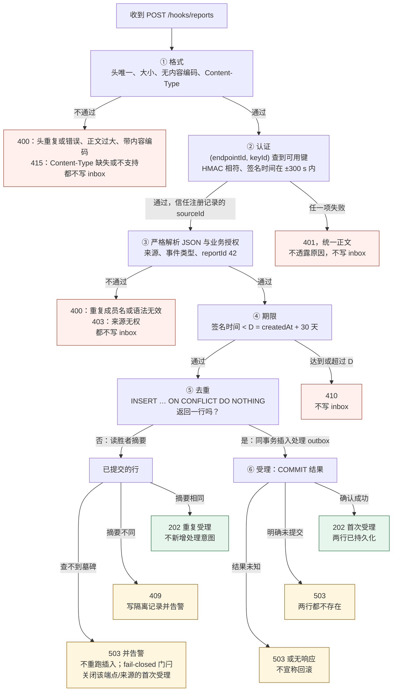
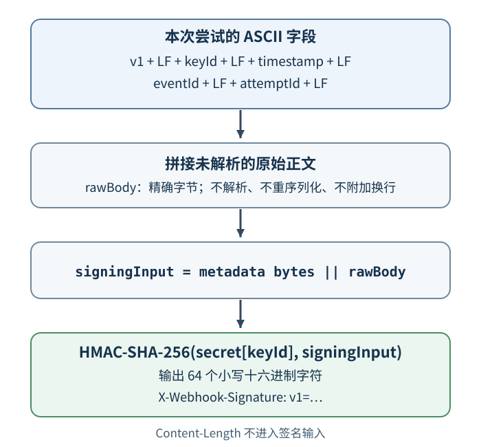
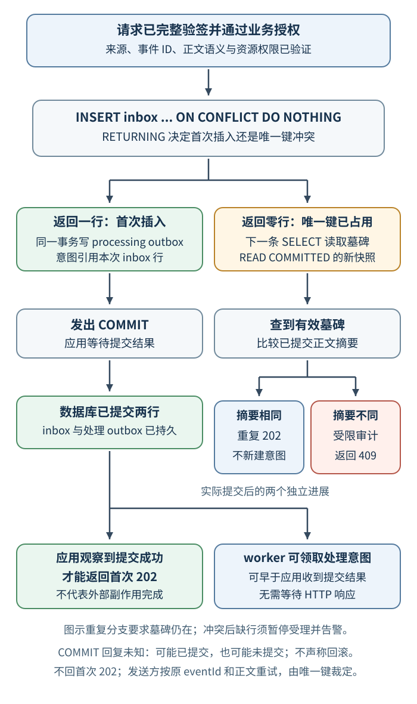
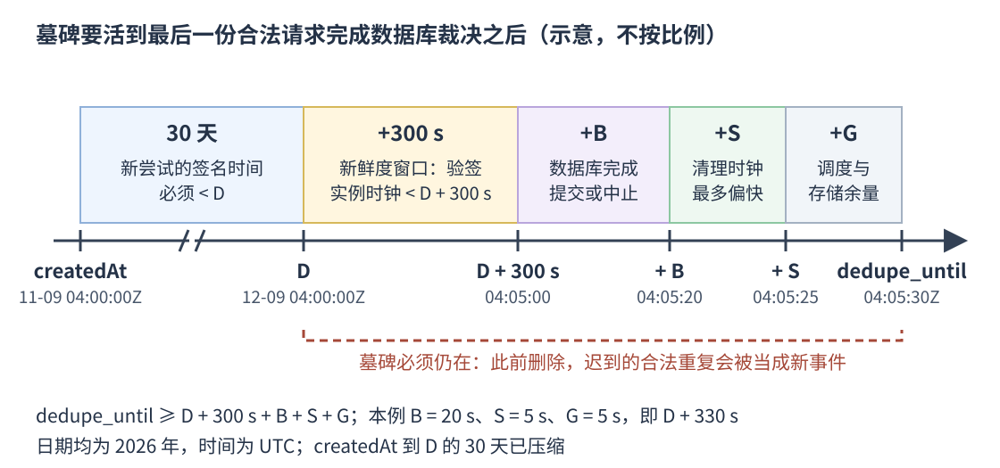

# 收到一条 webhook 回调时，怎样确认它真实、未被重放，并可靠地受理？

上一章的状态机约定：`job-demo-731` 成功时，同一事务还会写一条 `report.ready` outbox (事务发件箱) 意图（这笔成功提交怎样写，见[领取与栅栏一章](job-claims-leases-and-fencing.md)）。本支线跟着这条意图走出服务：发送服务用一个 HTTP 回调（webhook）把“报表 42 已完成”通知给另一个服务，即接收方。接收方可能暂时不可用，也可能已经把事件写进数据库，返回的响应却在网络中丢失，所以发送方无法只凭一次 HTTP 往返判断对方是否收下。本章站在接收方回答：怎样确认请求真实、没有被重放、在有效期内，并在什么条件下回应“已受理”；也说明发送方怎样重试、怎样轮换共享密钥。

接收方处理每个请求，都按同一个顺序检查，前一步不通过就不做后一步。下图是整条判定路径，编号就是检查顺序：格式、认证、授权、期限、去重、受理；最后一步持久写入收件记录（`inbox`）和处理意图，提交成功后才回应 202。图里的截止点 D、去重用的墓碑等在后文逐节定义，初读先看主干的顺序和各出口的状态码。

> [!info] 本例约定与通用原则
> 本章定义一个只供教学的合成 HMAC 协议，不兼容 Stripe、GitHub 或任何 webhook 提供方。下面这些都是**本例约定**：请求头名称与签名输入格式、±300 秒的签名新鲜度窗口、`createdAt + 30 天`的投递期限、各验证结果对应的状态码、发送方最多 12 次自动发送和 15 分钟退避上限。所有域名、密钥和业务数据都是合成的。通用的原则是：验签与去重分开、先认证再查收件记录、持久提交后才确认受理、去重记录要比最后一份合法请求活得久、密钥轮换先兼容后切换。

## 验签和去重回答的是不同问题

- **签名验证**回答：请求是否来自持有共享密钥的一方，签名覆盖的字节有没有被改过。
- **持久去重**回答：这个逻辑事件是否已经受理过。

两者不能互相代替：一份有效的请求被原样重放，签名照样通过；事件 ID 谁都能写，单独证明不了发送方的身份。

整条路径分三段，每段都需要稳定的标识、持久状态和处理重复的规则：

- **发送**：发送方在业务事务里写一条待投递事件（发送端 outbox），由 relay (中继) 发出请求；
- **受理**：接收方完整验证后，在同一个数据库事务里写入 `inbox` (收件箱) 行和处理用的 outbox 行，确认提交成功才返回 202；
- **处理**：已提交的处理意图由接收方的 worker 领取，不必等 HTTP 响应发出。它怎样被领取和确认，与前面几章相同（见[发布确认、消费者确认和业务完成各证明什么](queue-delivery-and-acknowledgement.md)）。

## 一次通知怎样从发送端出发？

报表成功的事务写了一条发送端 outbox 行，里面有稳定的 `eventId`、事件类型、不可变的 UTF-8 正文字节和待投递状态；只有业务事务提交后，relay 才能发送它。

两种 ID 的分工：

- `eventId` 表示一次**逻辑事件**，所有重试保持不变；
- 每次新的**应用层**投递生成新的 `attemptId`、新的签名时间和新的签名；网络层重传同一个 HTTP 请求时，这组请求头原样保留。

正文是一行 JSON（代码块围栏不属于正文，结尾没有换行），恰好 108 个字节：

~~~json
{"eventId":"evt-report-42-ready-001","type":"report.ready","reportId":42,"createdAt":"2026-11-09T04:00:00Z"}
~~~

第一次应用层发送（签名时间 1794196800 即 `2026-11-09T04:00:00Z`）：

~~~http
POST /hooks/reports HTTP/1.1
Host: receiver.example.test
Content-Type: application/json
X-Webhook-Key-Id: demo-k2026-02
X-Webhook-Timestamp: 1794196800
X-Webhook-Event-Id: evt-report-42-ready-001
X-Webhook-Attempt-Id: att-001
X-Webhook-Signature: v1=00ddffad798719283b3f470bfdae27dafb1e4a9b3710cdc118e75a1657c29b6f
Content-Length: 108

{"eventId":"evt-report-42-ready-001","type":"report.ready","reportId":42,"createdAt":"2026-11-09T04:00:00Z"}
~~~

假设接收方已经提交了 `inbox` 和处理 outbox，但 202 响应丢了。发送方 10 分 1 秒后重新投递。`eventId` 和 108 个正文字节完全不变；这是一次新的应用层尝试，所以签名时间、`attemptId` 和签名都变了：

~~~http
POST /hooks/reports HTTP/1.1
Host: receiver.example.test
Content-Type: application/json
X-Webhook-Key-Id: demo-k2026-02
X-Webhook-Timestamp: 1794197401
X-Webhook-Event-Id: evt-report-42-ready-001
X-Webhook-Attempt-Id: att-002
X-Webhook-Signature: v1=f03542e0a28e53585db5107e10147457ae5cd8a71596dffd5dda16d06ccc650c
Content-Length: 108

{"eventId":"evt-report-42-ready-001","type":"report.ready","reportId":42,"createdAt":"2026-11-09T04:00:00Z"}
~~~

为什么不直接重发第一次的请求？接收方只接受签名时间与自己时钟相差 ±300 秒以内的请求。在 `2026-11-09T04:10:01Z` 重发 `att-001`，它的签名时间已过去 601 秒，会被以 401 拒绝。`att-002` 用当前时间重新签名，时间差为 0。正文里的 `createdAt` 也早了 601 秒，但它不参与新鲜度检查。如果第一次已经提交，`att-002` 会命中“同一事件、同一正文摘要”的重复受理；如果第一次没提交，`att-002` 就成为首次受理。

## 签名覆盖哪些字节，密钥管到哪里？

本例把要认证的字段和字节定义为：

~~~text
signingInput = UTF8("v1" + LF + keyId + LF + decimalTimestamp + LF + eventId + LF + attemptId + LF) || rawBody
signature    = lowercase_hex(HMAC-SHA-256(secret[keyId], signingInput))
~~~

所有文本字段都是 ASCII，字段之间是单个 LF 字节（0x0A），末尾一个 LF 后直接接原始正文。ID 只接受 1–128 个 `[A-Za-z0-9._-]` 字符；时间戳只接受没有前导零的十进制 Unix 秒。上面两个示例签名用演示密钥 `synthetic-demo-secret-never-use-outside-example` 算出，它不能用作真实凭据。

HMAC (基于哈希的消息认证码) 用共享密钥证明完整性和“持钥者”身份。它不加密正文，也不提供不可否认性：任何一方持有密钥，都能算出有效签名。

**密钥的作用域。** 签名输入不含 HTTP 方法、Host 或路径，所以本例的密钥只能用于固定的 `POST /hooks/reports` 端点。下文用 `endpointId` 表示接收方由路由确定的端点，用 `sourceId` 表示注册表中登记的发送来源。一把密钥的授权作用域是 `(endpointId, sourceId)`：不同端点、不同来源或不同账户授权域，必须使用不同的密钥值。也可以在版本化的签名输入里加入受保护的目标字段，把签名额外绑定到请求目标，但这代替不了按来源和账户隔离密钥与业务权限。HTTPS 保护的是传输通道，同样代替不了事件级的验签、去重和业务授权。

## 先保留原始字节，确定请求格式

接收边界在做任何 JSON 解析之前，先保留应用实际收到的正文字节，并设好请求头与正文的大小上限。签名覆盖的是 HTTP 定界之后的正文内容，不是网络包，也不是 `Content-Length` 的文本。由此有几条格式规则：

- **拒绝任何 `Content-Encoding`，而且要在代理或框架自动解压之前拒绝。** 不能改成“在压缩后的字节上验签”来接受编码请求。
- **网关和应用都不得规范化或重新序列化正文。**
- 本端点要求 `Content-Type: application/json`。
- **每个 `X-Webhook-*` 头在入口只能出现一次。** HTTP 允许接收方把同名字段行用逗号合并成一个值，所以应用看到“一个值”并不能证明原请求只有一行。入口要在合并之前拒绝重复，或可靠地拒绝合并后的值；重复、空值、语法错误或不支持的签名版本一律 400，避免不同代理和应用对同一请求解析出不同结果。
- 签名值必须是 64 个小写十六进制字符，解码成 32 字节后，用 constant-time comparison (常数时间比较) 与计算结果比较，避免比较耗时泄露前缀信息。

## 先认证来源，再查收件记录

接收方先由固定路由确定 `endpointId`。这时来源还没有经过验证，所以密钥注册表必须**只凭 `(endpointId, keyId)` 就唯一查到一条记录**（例如唯一约束 `UNIQUE(endpoint_id, key_id)`），不能指望验签之后再用来源去区分。请求里的 `keyId` 尚不可信，只用作查找键。

只有当前可用的密钥才参与计算；未知、未生效、已撤销的键统一返回 401。接收方用收到的受保护字段和原始正文重算 HMAC，常数时间比较，并检查签名时间落在自己时钟的 ±300 秒内。**这些全部通过之后**，才信任所选注册记录里的 `sourceId`；不能从未经验证的请求头或正文里直接取来源。轮换时新旧 `keyId` 都映射到同一个稳定的 `sourceId`。撤销以接收方当前生效的注册表为准：签名时间即使早于撤销时间，撤销之后也不再接受。

认证失败必须在查询 `inbox` **之前**就拒绝。否则攻击者可以拿猜来的 `eventId` 探测某个事件是否存在。

## 再做业务授权，检查载荷与投递期限

认证通过后才解析 JSON 并做业务授权。本例只接受指定 `sourceId` 发来的 `report.ready`，且只允许通知 `reportId` 42；请求头和正文里的 `eventId` 必须相同；字段类型、必需字段、UTC 格式的 `createdAt` 都要通过。来源身份有效、但类型或资源未获授权的事件返回 403，不写 `inbox`。

**严格 JSON。** 解析器要拒绝重复的成员名并返回 400。HMAC 保证收到的字节没被改动，却不保证不同的 JSON 解析器对两个 `reportId` 取同一个值。接收端和之后的处理 worker 必须共享同一条严格解析规则，worker 不能用更宽松的解析器从原始正文得出不同的授权对象。签名格式版本 `v1` 也不是载荷的结构版本。

**固定投递期限。** ±300 秒只限制单次尝试的新鲜度，挡不住发送方无限期地用新签名重试同一个事件。所以本例再给每个事件一个固定期限：`createdAt` 在发送端 outbox 首次提交时写定，此后整份正文不变；任何新尝试的签名时间都必须**严格早于** `createdAt + 30 天`。示例的 `createdAt` 是 `2026-11-09T04:00:00Z`，记固定截止点为 D = `2026-12-09T04:00:00Z`，签名时间恰好等于 D 也算过期。认证、新鲜度、载荷和业务授权都通过后，若签名时间达到或超过 D，返回 410，不写 `inbox`。截止前一秒签发的请求，同样要在 ±300 秒内到达。

## 每种验证结果怎样回应？

开头的判定图给出了每个结果的状态码。它们留下的持久状态不同：

- **拒绝出口**（400、415、401、403、410）都不写 `inbox`。安全日志只记失败类别；401 不透露具体原因。
- **两种 202** 都以已提交的行为准：重复受理只对照已有行，不新增处理意图；首次受理时 `inbox` 与处理意图都已持久化，worker 可能早于响应就开始。
- **409** 写受限的冲突审计或隔离记录，并告警。
- **三种 503** 含义不同。冲突后查不到墓碑：不重跑首次插入，关闭该端点/来源的首次受理，直到恢复或对账。数据库明确确认未提交：两行都不存在，发送方按原事件重试。`COMMIT` 结果未知：可能已提交，也可能没有，不宣称回滚。

401 要带适用于目标资源的 `WWW-Authenticate` challenge。这里的 `Webhook-HMAC` 是本例私有的认证方案：HTTP 只提供 challenge/response 的框架，并没有定义它；凭据放在自定义的 `X-Webhook-*` 头里，challenge 也不会让它们变成标准的 HTTP 认证凭据。公开互操作的实现要发布完整的方案规范，并按 RFC 9110 的认证方案注册程序处理。因为 HTTP 的缓存规则认不出这些自定义凭据头，本端点对所有响应都设 `Cache-Control: no-store`。认证失败的正文统一，不透露 `keyId` 是否存在或比较细节：

~~~http
HTTP/1.1 401 Unauthorized
WWW-Authenticate: Webhook-HMAC realm="report-webhooks"
Cache-Control: no-store
Content-Type: application/problem+json

{"type":"https://receiver.example.test/problems/invalid-webhook-authentication","title":"Webhook authentication failed","status":401}
~~~

错误正文使用 Problem Details 格式（`application/problem+json`）：`type` 用稳定、不含敏感数据的 URI，堆栈、密钥查找细节、用户数据和可被枚举的攻击线索都不进入响应。这种机器可判定的错误契约的完整讲解见[怎样让调用方可靠地判断 API 的成功、失败和变化](api-contracts-errors-and-evolution.md)。

## 为什么验签之后，还要持久去重再应答？

验签只证明请求可信、字节匹配，不证明这个逻辑事件之前没被受理过。本例的表结构：

- `inbox` 以 `(sourceId, eventId)` 为唯一键，保存正文 SHA-256、原始正文、接收时间和处理状态；
- 处理用的 outbox 行通过外键引用 `inbox` 行，并用同一个 `(sourceId, eventId)` 唯一约束限制每个事件最多一条处理意图。

首次受理必须在**同一个数据库事务**里插入这两行；只有应用收到提交成功的结果，才返回首次受理的 202。提交后的处理意图可以独立于 HTTP 响应被 worker 领取。这里的 202 只表示接收方接受了待处理的工作，不表示 worker 已运行或远端副作用已完成，和[持久受理一章](durable-job-acceptance-and-outbox.md)的 202 是同一种承诺。

正文若不直接存在数据库里，而是存不可变对象存储的引用，就必须先确认对象已完整写成、可以读到，再提交引用；否则 worker 无法恢复输入，不能返回 202。对象先写、数据库后提交可能留下孤儿对象，按不再被引用且过了宽限期再清理（规则同[孤儿对象的清理条件](job-retries-cancellation-and-cleanup.md)）。数据库不可写或对象不可读时返回 503。

处理结束后，可以按数据保留政策删掉正文，但去重墓碑及其 `dedupe_until` 必须保留到下一节算出的时刻。正文可能含个人或业务数据，要限制访问和保留期，日志不写正文。

## 去重墓碑要比最后一份合法请求活多久？

墓碑保存的是“这个事件已经受理过”的证据。它必须活到**最后一份仍可能通过验签的请求完成数据库裁决之后**；否则一份迟到的重复请求会因为旧行已删而被当成新事件。这是[去重要覆盖所有在途和晚到请求](deadlines-retries-and-unknown-outcomes.md#去重要覆盖多长时间？)这条原则在 webhook 上的具体推导。

下图沿时间轴推导这个时刻。能进入数据库受理的请求，签名时间早于固定截止点 D（`createdAt + 30 天`），所以验签时实例的时钟早于 D + 300 秒。之后还要依次加上三个上界：

- **B**：从最后一次通过 ±300 秒检查，到数据库完成提交或确认中止的最长耗时，包括解析、授权、排队、连接池、锁等待和全部事务语句；
- **S**：清理所用的数据库时钟最多比验签实例快多少，由本合同固定；
- **G**：清理调度与存储的安全余量。

所以把

~~~text
dedupe_until ≥ D + 300 s + B + S + G
~~~

随墓碑一起持久保存。清理进程使用数据库时钟，只清理已到期、且处理 outbox 已经终结的记录。图中的 B、S、G 取值只演示推导，部署前要证明自己的实际上界。

几条让这个公式成立的前提：

- **B 不是 HTTP 响应超时。** 应用返回或断开之后，已发出的数据库命令仍可能执行并提交。要用一个从新鲜度检查开始计时的预算覆盖所有在途阶段，并让数据库端也能强制结束超时的事务。
- **上调 B 之前，先延长所有尚未清理的墓碑。**
- **S 不能在旧墓碑删除之后放宽。** 一个更落后的验签实例可能重新接受已被其他实例判为过期的旧签名。持续监控各实例相对数据库时钟的偏差与时间回退；偏差超出 S，或回退可能重新打开已过期的窗口时，暂停该实例的受理，直到时钟回到界内并稳定。无法监测并强制 S 或 B，就不能按这个期限删除墓碑。
- **发送方必须遵守事件不可变的约定。** 重试和人工重放保持原正文与 `eventId`，不能靠改写 `createdAt` 重置期限。墓碑一旦删除，接收方无法单凭 HMAC 复原旧正文。
- 较旧但仍合法的签名也可能**首次**到达。是否重复，只看有效保留期内的已提交唯一行，不能凭时间戳或尝试日志就返回 202。

> [!info] 实例：PostgreSQL 的服务端超时（核对于 2026-11-12）
> `statement_timeout` 限制单条语句，`lock_timeout` 对每次锁等待分别计时；`transaction_timeout` 从 PostgreSQL 17 起提供，限制普通事务的时长（不覆盖 prepared transaction）。16 及更早的版本没有这个参数，要另配等效的服务端事务上限，才能强制 B。

## 两个首次投递同时到达，怎样裁决？

并发首次投递的裁决靠数据库唯一约束。首次插入时同时写入算好的 `dedupe_until`。在 Read Committed 事务里，先做一条不会抛异常的插入：

~~~sql
BEGIN ISOLATION LEVEL READ COMMITTED;

INSERT INTO webhook_inbox
  (source_id, event_id, body_sha256, raw_body, status, received_at, dedupe_until)
VALUES
  (:source_id, :event_id, :body_sha256, :raw_body, 'accepted', clock_timestamp(), :dedupe_until)
ON CONFLICT (source_id, event_id) DO NOTHING
RETURNING source_id, event_id;
~~~

按 `RETURNING` 是否返回一行分支：

- **返回一行**：本事务插入了 `inbox`。同一事务再插入处理 outbox，然后提交；只有 `COMMIT` 成功才回 202。outbox 插入失败就回滚整笔受理，返回 503，让发送方用同一 `eventId` 和同一正文重试。
- **没有返回行**：唯一键已被另一个事务占用。用**下一条语句**读胜者并核对摘要：

~~~sql
SELECT body_sha256
FROM webhook_inbox
WHERE source_id = :source_id
  AND event_id = :event_id;
~~~

Read Committed 下每条语句取新快照；如果先前的插入等过并发事务，这条 SELECT 能看到已提交的胜者。摘要相同，返回重复受理的 202，不创建第二条处理意图；摘要不同，把冲突写进受限的隔离记录、提交审计后返回 409。

不要用普通 `INSERT` 撞唯一约束、捕获异常后在同一事务里继续 SELECT：PostgreSQL 报错后当前事务已失败，后续查询要等回滚（数据库侧的规则见[两个请求争夺最后一件库存时怎样只预留一次](../data/conditional-writes-and-idempotent-records.md)）。

**冲突后却查不到墓碑。** 在有效期内发生唯一冲突，下一条 SELECT 必然能找到墓碑，因为保留合同保证清理不会在窗口内删掉它。如果仍然无行，说明保留、时钟或清理的不变量被破坏了，这不是可以正常重试的冲突：回滚，返回 503 并告警，不能重跑 INSERT，否则已受理的 ID 可能被当成新事件。立即把这个端点/来源的首次受理切到所有接收实例共享的 fail-closed 门闩，恢复墓碑或完成核对后才解除；不能确认门闩已覆盖所有实例时，暂停整个端点的受理。

在 Repeatable Read 或 Serializable 下遇到明确的序列化失败，是另一条分支：回滚并重试整个事务，不要和“冲突后读不到墓碑”混为一谈。

这个模式让并发的首次请求只有一个事务能创建处理意图：先行者提交，后行者读到摘要；先行者回滚，等待中的请求就可以成为首次写入者。时间窗口本身不是去重，签名也说明不了 `inbox` 是否已提交。

## 提交结果未知时怎样回应？

只有收到数据库“提交成功”的结果，才能返回首次受理的 202。两种 503 要分清：

- 数据库**明确**确认受理事务没提交（例如正文存储失败后回滚、`COMMIT` 前就失败）：503 表示两行都不存在。
- `COMMIT` 已经发出，但连接断了或提交回复没到：持久状态**未知**，不能写成“一定没提交”。不发 202；连接还能应答时可回 503 表示结果未知，否则发送方看到的也是未知。数据库可能已提交两行、worker 可能已开始，也可能两行都不存在。发送方保留同一个 `eventId` 和原始正文重试，由唯一键判定状态，而不是生成新事件。

数据库客户端把“命令已发送”和“取回命令结果”分成两步，客户端没读到结果，不能证明服务端没执行提交。事务层面的处置规则见[事务能保证什么](../data/transactions-and-isolation.md)。

| 崩溃或不确定的时点 | 持久事实 | 接收方之后的行为 |
| --- | --- | --- |
| 受理事务提交之前 | 两行都不存在，不能回 202 | 合法重试重新走验签、授权和首次受理 |
| 提交之后、202 送达之前 | 正文、摘要和处理意图都已提交；worker 可以独立开始 | 重试仍先完整验证；同事件同摘要只回 202，不再排队 |
| 已发 `COMMIT`，但没看到结果 | 两行可能都在，也可能都不在 | 不宣称回滚、不回首次 202；发送方按原 `eventId` 与正文重试，由唯一键查明 |
| 202 已送达，worker 还没完成 | 收件内容和处理意图都可恢复 | worker 从持久输入继续；发送方不必等业务终态才停止重试 |
| 外部效果可能已完成，本地完成记录未提交 | 结果未知 | 按原操作键查询或对账，不换新键猜测重试（见下一节） |

## 顺序与外部副作用

**本协议不保证事件顺序。** 如果业务要求按账户或资源有序，载荷还要定义受保护的资源序号；接收方按序号做条件更新或串行处理，不能把 HTTP 到达的先后当成业务顺序。

**worker 调用外部系统时，`inbox` 去重管不到下游。** 请求超时后，远端可能已经完成，本地却没收到确认。先按稳定的操作键查询，再按[远端副作用的决策表](deadlines-retries-and-unknown-outcomes.md#远端副作用超时后，什么时候可以重发？)决定：确认完成就记录并停止；远端对同键同摘要的去重保证仍有效，才用原键重试；否则保持未知、人工对账。

这里有两个互相独立的期限：webhook 的 30 天投递期限不会延长远端操作键的去重期；远端的保证先过期，即使 webhook 仍在 30 天内，也不能再盲目重试副作用。反过来，接收方的 `inbox` 墓碑也不能保证远端的业务效果不重复。

## 发送端怎样重试、停止和人工重放？

发送方必须把业务变更和待发送事件放在同一个事务里，否则业务已提交、进程却在写 outbox 前崩溃时，通知就永久丢了。relay 只读已提交的 outbox 再发请求；收到 2xx 才把逻辑事件标为已受理。连接超时、断开、响应丢失都是结果未知，不代表接收方没提交：继续用原 `eventId` 和原正文重试，由接收方的唯一键区分首次与重复。

每次新的应用层尝试，先持久记下 `attemptId`、`keyId`、签名时间、事件 ID 和待发状态，再发请求。进程在发送前后崩溃时，恢复只把已持久确认的 2xx 视为已受理；不能证明请求没发出的，就视为未知，用同一逻辑事件安全重试或对账。保存 `keyId` 和尝试记录，也让撤销某把密钥之后能找到受影响的未确认事件。

本例的发送策略（合成，不是 HTTP 或 webhook 的统一标准）：

| 响应或结果 | 策略 |
| --- | --- |
| 任意 2xx | 视为已受理，结束这个逻辑事件的发送；本例接收方返回 202 |
| 408、429、5xx，或连接结果未知 | 在期限前有限重试；429/503 若带 `Retry-After`，按提示等待，但仍检查期限 |
| 其他 4xx | 停止自动重试，保留原因，进入待处理状态 |
| 3xx 或未定义的响应 | 不自动跟随、不猜含义；进入待处理状态，先修复目标或契约 |

退避从约 1 秒开始指数增长，封顶 15 分钟，加随机抖动（公式与道理见[重试要等多久、最多试几次](deadlines-retries-and-unknown-outcomes.md#重试要等多久、最多试几次？)）。最多**自动发送** 12 次，含首次，不是 12 次额外重试。每次发送前检查当前时间：新签名时间必须严格早于 `createdAt + 30 天`；到期或达到次数上限就停下告警。`Retry-After` 指向的时刻若在截止点或之后，不能越过期限继续投递。

达到上限后，持久保存原事件、每次尝试和最终原因，等待人工处理。操作员只能在**同一个绝对期限前**重放：正文和 `eventId` 不变，`attemptId` 变，用当前有效的密钥重新签名。若旧尝试其实已受理而响应丢了，接收方返回重复 202，不会新建处理意图；若从未提交过 `inbox`，这次可以成为首次受理。新的业务动作要生成新的 `eventId`，并用 `causationId` (因果事件 ID) 关联原事件，而不是改写旧 ID 绕过去重。

## 密钥怎样轮换，泄漏时怎样撤销？

注册表里每条密钥记录包含：稳定的 `sourceId`、密钥值、可用状态、生效和撤销时间。`keyId` 在同一端点内是唯一的查找键（因为查找发生在来源被验证之前），它本身也被签名覆盖。轮换时，新旧 `keyId` 映射到同一个 `(endpointId, sourceId)`，这样 `(sourceId, eventId)` 的去重在密钥换代之后仍然连续。密钥值只放在受控的 secrets manager 或等价的安全存储里，不进代码仓库、明文配置或日志。

### 正常轮换：接收方先兼容，发送方再切换，接收方最后移除

1. **接收方先兼容。** 生成新的 `keyId` 和密钥，把接收方的验证映射更新为同时含旧、新两项，部署到**所有**可能接收请求的实例。若密钥是在进程启动时注入的，改密钥库不会改变正在运行的进程，必须替换接收方进程，并确认旧进程已退出（平台侧的做法见[服务该跑在哪种运行时上](../practice/production-runtime.md)）。
2. **发送方切换。** 所有发送实例改用新键，同样替换进程；新的尝试用新密钥对相同 `eventId` 和原始正文重新签名。等所有旧发送进程都退出之后，从持久的尝试记录里取出所有旧键签名时间的最大值 `Tmax`。
3. **等旧签名在每个接收实例上都过期。** 判定用接收实例**自己的时钟**：只有每个仍可能接收请求的实例，其时钟都已严格晚于 `Tmax + 300 秒`，并且所有已通过新鲜度检查的在途验证都已结束，旧键才不会再被接受。用接收方自己的时钟判断时，不要再额外加一次时钟偏差。若改由一个可信的协调器时钟统一判断，就要在 `Tmax + 300 秒`上再加已测得的最大接收方时钟落后量，并同样等在途验证结束。不能只从部署新发送方的时刻起等 300 秒，因为旧实例之后可能仍发出过旧签名。
4. **接收方移除旧键。** 把映射改为只含新键，替换接收方进程；确认旧进程全部退出后，旧密钥才不再驻留在内存里。旧密钥的存档版本按保留策略清理。

本例的发送端 outbox 保存的是**未签名**的正文，每次尝试才签名，所以积压的事件可以直接用新键签名，不需要为了它们延长旧键。如果实现里预先排队的是**已签名**的请求，就要在旧签名失效前重新签名，或者等这些旧签名全部失效、在途排空之后再移除旧键。

### 紧急撤销：怀疑密钥泄漏

不保留新旧双接受的窗口，也不等正常排空：

1. 预先生成新键；暂停这个来源的事件投递，并阻断旧接收进程的入口或直接停掉它们。
2. 部署只含新键的接收方；再原子地把发送方切到新键（`keyId` 和密钥必须同时更新），替换旧发送进程，确认旧进程已退出，再恢复投递。撤销真正生效的边界是**所有**可能接收请求的实例都已拒绝旧 `keyId`；在此之前仍可能有实例接受它。
3. 还没有可用的新键时，先撤销旧键并保持暂停；不能为了可用性继续信任泄漏的密钥。
4. 按被撤销的 `keyId` 找出所有未确认的事件，只在原 `createdAt + 30 天`之前，用原 `eventId`、原正文和新的 `attemptId` 重新签名投递。换键不重置绝对期限。此前若已受理、只是响应丢了，持久的 `inbox` 会识别为重复；已确认 2xx 的事件不需重放。

撤销不会删除 `inbox` 或 outbox，不延长期限，也撤不回已经发生的外部副作用。删除密钥库里的值，也清除不了进程里已经注入的副本，仍然必须替换进程。

> [!info] 实例：ECS 注入 Secrets Manager 密钥时的两个细节（核对于 2026-11-12）
> ECS 在 task 启动时把 Secret 注入环境变量；移动 `AWSCURRENT` 标签不会更新正在运行的 task，必须强制新部署；若 task definition 固定了 VersionId，先发布引用新版本的 revision 再替换 task。`keyId` 和密钥应放在**同一个** JSON Secret 值里（例如发送端的 `{"keyId":"…","key":"…"}`，接收端的整张 keyId→密钥映射），由应用从同一份值解析：若分成两个值分别注入，两次读取之间 `AWSCURRENT` 可能恰好移动，得到新密钥配旧 `keyId`。task execution role、task role 与注入审计的分工见[服务该跑在哪种运行时上](../practice/production-runtime.md)。

## 怎样观察交接有没有卡住？

**记录什么。** 发送端把 `eventId` 与每个 `attemptId`、`keyId`、端点、发送时间、状态码或传输结果、下次尝试时间和事件年龄关联起来。接收端记录 `eventId`、`attemptId`、`keyId`、签名时间偏移、验签失败类别、业务授权类别、首次受理还是重复命中、正文摘要冲突，以及从 `inbox` 到业务终态的时延。

**不记录什么。** 日志不写密钥、完整签名头、`Authorization` 或其他凭据头、原始正文。正文摘要也可能成为敏感数据的稳定指纹，要同样控制访问，不能拿它代替公开日志里的事件 ID。

**按边界读信号：**

- 认证失败或签名时间偏移升高：请求还没进入受理。
- 认证通过后的 503：区分“数据库明确未提交”的持久化或对象故障，和“`COMMIT` 结果未知”；后者不能据此判断数据没写入。
- 冲突后找不到墓碑：保留完整性告警，暂停自动首次受理。
- 已受理 `inbox` 的数量或最老年龄持续增长：异步处理积压。
- 外部结果长期停在未知：需要业务对账。
- 发送端的事件年龄、自动尝试次数、待处理量和即将到期量：帮助在 30 天期限前处理积压。

一个事件应能从稳定的 `eventId` 追到每次尝试、接收方受理和最终业务状态。不要把“发出过请求”“收到 202”“副作用已完成”合成一个成功指标。

## 本支线产出

接收方现在有一条完整的受理边界：按格式、认证、授权、期限、去重、受理的顺序检查；首次受理与处理意图同事务提交才回 202；墓碑保留到 `D + 300 s + B + S + G` 之后；`COMMIT` 结果未知不宣称回滚；密钥按“先兼容、再切换、后移除”轮换，泄漏时暂停并立即撤销。处理意图提交之后，接收方 worker 的领取、确认与重试回到主线：[怎样保证一个任务同一时刻只由一个 worker 推进](job-claims-leases-and-fencing.md)。

> [!info]- 来源
> - HMAC 的定义、共享密钥模型与安全说明：[IETF RFC 2104](https://www.rfc-editor.org/rfc/rfc2104.html)，§1–§3，1997-02；`HMAC-SHA-256` 与测试向量：[IETF RFC 4231](https://www.rfc-editor.org/rfc/rfc4231.html)，§2–§4，2005-12。两个示例签名已按文中字节定义用 Python 标准库 `hmac`/`hashlib` 复算，正文长度复核为 108 字节。
> - JSON 对象成员名应唯一：[IETF RFC 8259](https://www.rfc-editor.org/rfc/rfc8259.html)，§4，2017-12；“拒绝重复成员名”是本例合同的进一步选择。
> - HTTP 字段重复与合并、内容编码、401 challenge、状态码、`Retry-After` 与认证方案注册：[IETF RFC 9110](https://www.rfc-editor.org/rfc/rfc9110.html)，§5.2–§5.3、§8.4、§11.1–§11.6、§15.3.3、§15.5、§15.6.4、§16.4.1，2022-06。私有 HMAC 协议不由 RFC 定义。
> - `no-store`：[IETF RFC 9111](https://www.rfc-editor.org/rfc/rfc9111.html#section-5.2.2.5)，§5.2.2.5；429 与 `Retry-After`：[IETF RFC 6585](https://www.rfc-editor.org/rfc/rfc6585.html)，§4；问题详情类型与错误信息的安全边界：[IETF RFC 9457](https://www.rfc-editor.org/rfc/rfc9457.html)，§3、§5，2023-07。
> - 并发 `inbox` 冲突与新快照查询：[PostgreSQL 18, INSERT](https://www.postgresql.org/docs/18/sql-insert.html)（`ON CONFLICT ... DO NOTHING ... RETURNING`）、[Transaction Isolation §13.2.1](https://www.postgresql.org/docs/18/transaction-iso.html)；服务端超时参数：[PostgreSQL 18 Client Connection Defaults](https://www.postgresql.org/docs/18/runtime-config-client.html)，并对照 [17](https://www.postgresql.org/docs/17/runtime-config-client.html) 已有、[16](https://www.postgresql.org/docs/16/runtime-config-client.html) 尚无 `transaction_timeout`；核对于 2026-11-12，冲突模式另在 PostgreSQL 14 本地复放。
> - 命令发送与取回结果是两个客户端步骤：[PostgreSQL 18, libpq Asynchronous Command Processing §32.4](https://www.postgresql.org/docs/18/libpq-async.html)。
> - ECS 的 Secret 注入、版本引用与强制新部署：[Secrets Manager environment injection](https://docs.aws.amazon.com/AmazonECS/latest/developerguide/secrets-envvar-secrets-manager.html)、[task execution role](https://docs.aws.amazon.com/AmazonECS/latest/developerguide/task_execution_IAM_role.html)，核对于 2026-11-12。
> - 轮换的等待条件（以每个接收方自己的时钟判断 `Tmax + 300 s`，或协调器时钟另加最大落后量）、墓碑保留推导、发送策略中的 12 次与 15 分钟、30 天期限，都是本合成协议的合同与推导，不是任何提供方的默认值。
