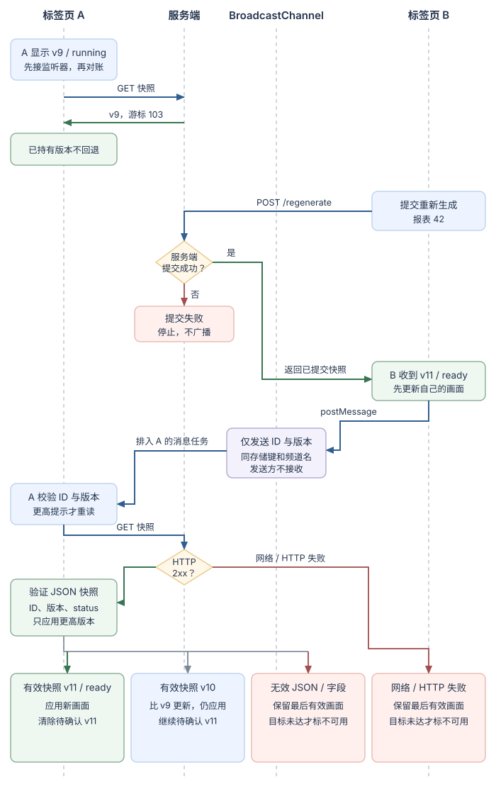

# 同一报表在多个标签页中怎样交换变化？

案例背景：标签页 A 正在显示报表 42 的服务端快照 `{ id: 42, version: 9, status: "running", event_cursor: "103" }`。上一章说明 URL、本地偏好、会话存储与服务端数据各自保存什么；这里继续追问：标签页 B 提交一次重新生成后，怎样让 A 知道旧画面可能过时，又怎样避免把通知误当成最新数据？本例假定服务端提交成功并返回版本 11、状态 `ready`；版本在同一报表 ID 下单调递增。前两节处理同一浏览器内的页面；若通信对象变成跨来源窗口或服务端，后两节给出对应选择。

| 要联系的对象 | 机制 | 解决什么问题 | 主要边界 |
|---|---|---|---|
| 符合相同 storage key (存储键) 和频道名的活动 browsing context (浏览上下文) | `BroadcastChannel` | 同一浏览器里的临时广播 | 不保存历史；发送方不收到自己发送的消息 |
| 共享同一存储区的其他文档 | `localStorage` + `storage` 事件 (存储事件) | 写入字符串并通知变化 | 不是跨标签页锁或事务；详见[浏览器页面里的状态应该放在哪里？](./browser-storage-and-communication.md) |
| 需要集中管理端口或一条连接的页面 | `SharedWorker` (共享工作线程) | 让 worker (工作线程) 内存中的协调者向多个页面转发 | 连接和内存不是持久状态；页面离开时应显式注销，恢复后重连 |
| 跨来源窗口或 iframe | `postMessage()` | 在不同来源的两个窗口间定向发消息 | 必须限制目标来源，并检查发送窗口和数据 |
| 浏览器页面与服务端 | Server-Sent Events (服务器推送事件，SSE)、Fetch 流、WebSocket | 接收服务端事件或进行双向通信 | 认证、补发、去重和恢复需要服务端及应用协议 |

## 1. 先通知，再向服务端核实

`BroadcastChannel` 按频道名和存储键寻找可接收消息的活动上下文；发送者会从接收列表中排除。存储键可能把同一 origin (来源) 但处于不同顶层站点的页面隔开，所以 same-origin (同源) 本身并不保证互通。对象消息按 structured clone (结构化克隆) 序列化，接收方得到自己的副本。频道不会给刚打开、已关闭或当时不符合接收条件的页面补发历史。

下图把报表案例中的写入顺序拆开：A 先接好频道并向服务端对账；B 只有在服务端确认提交成功后才发送轻量提示；A 在自己的后续任务中校验提示，再取回权威快照。通知只说“可能有新版本”，不会证明业务更新已完成。

本例开始时 A、B 都展示版本 9。A 先安装监听器再主动读取快照，避免在“读快照”和“开始监听”之间错过一次更新。B 提交成功后，从响应中取得版本 11、状态 `ready`，先更新自己的画面，再广播报表 ID 与版本。广播方法把消息序列化并为接收方排入 message task (消息任务) 后返回；接收方的处理器在自己的 event loop (事件循环) 中运行，发送方不会等待它完成。若消息不能结构化序列化，发送方的调用会抛出 `DataCloneError`；接收方无法反序列化时会收到 `messageerror`。本例在该事件后提示协议异常并触发一次快照重读。

接收提示时，A 校验类型、报表 ID 和非负安全整数版本；比当前版本旧或相同的提示直接忽略。较新提示只提高待确认的版本门槛，然后调用与初次读取相同的快照函数。这里有两个不同阈值：A 当前显示 v9，收到 v11 提示后待确认 v11；如果 GET 返回有效 v10，A 仍会把画面推进到 v10，同时继续等待 v11。有效 v11 或更高版本才清除待确认状态。快照必须含本例渲染所需的 `status` 字符串；网络错误、非成功 HTTP 状态或缺少必需字段的响应保留最后有效画面。失败后不无限重试，后续新提示、BFCache 恢复、重载或用户主动重试再触发对账。普通标签页重新聚焦不会触发此处的恢复流程。

> [!example]- 可选实现：提示触发可恢复的重读
> 下面片段用于已经展示版本 9 的 A 和 B。界面函数（如 `renderReport`、`showRefreshUnavailable`）由页面提供。两页运行同一段频道与快照代码；只有 B 在服务端的重新生成请求成功后调用 `announceCommittedSnapshot`。本合成 API 约定非成功 HTTP 状态表示未提交。若 POST 断线或成功响应体无法解析，提交结果未知：显示“结果待确认”并 GET 对账，不据此报告失败，也不盲目重试。`showRefreshUnavailable(version)` 表示版本目标尚未核实；不带版本则表示初次或恢复读取失败，当前仍无可确认的新目标。测试若省略页面 UI，可用记录调用的替身函数代替它们。
>
> ~~~javascript
> const reportId = 42;
> let currentVersion = 9;
> let pendingVersion = currentVersion;
> let channel = null;
> let refreshRequestId = 0;
>
> function isReportSnapshot(value, id) {
>   return value !== null &&
>     typeof value === "object" &&
>     value.id === id &&
>     Number.isSafeInteger(value.version) &&
>     value.version >= 0 &&
>     typeof value.status === "string";
> }
>
> function receiveReportHint(message) {
>   if (!message ||
>       message.type !== "report:changed" ||
>       message.reportId !== reportId ||
>       !Number.isSafeInteger(message.version) ||
>       message.version < 0) return;
>   if (message.version <= currentVersion) return;
>
>   pendingVersion = Math.max(pendingVersion, message.version);
>   void reloadReportFromServer(reportId, pendingVersion);
> }
>
> async function reloadReportFromServer(
>   id,
>   minimumVersion = currentVersion,
>   { requireFreshRead = false } = {}
> ) {
>   const requestId = ++refreshRequestId;
>   const versionAtStart = currentVersion;
>   pendingVersion = Math.max(pendingVersion, minimumVersion);
>   try {
>     const response = await fetch("/api/reports/" + id, { cache: "no-store" });
>     if (!response.ok) throw new Error("Snapshot request failed");
>     const snapshot = await response.json();
>     if (!isReportSnapshot(snapshot, id)) throw new Error("Invalid snapshot");
>
>     if (snapshot.version > currentVersion) {
>       currentVersion = snapshot.version;
>       renderReport(snapshot);
>     }
>     if (currentVersion >= pendingVersion) {
>       pendingVersion = currentVersion;
>       clearRefreshMessage();
>     } else if (requestId === refreshRequestId) {
>       showRefreshPending(pendingVersion);
>     }
>   } catch {
>     if (requestId !== refreshRequestId) return;
>     if (currentVersion >= pendingVersion) {
>       pendingVersion = currentVersion;
>       clearRefreshMessage();
>       if (requireFreshRead && currentVersion === versionAtStart) {
>         showRefreshUnavailable();
>       }
>     } else {
>       showRefreshUnavailable(pendingVersion);
>     }
>   }
> }
>
> function connectReportChannel() {
>   channel?.close();
>   try {
>     channel = new BroadcastChannel("reports");
>     channel.addEventListener("message", event => receiveReportHint(event.data));
>     channel.addEventListener("messageerror", () => {
>       showMessageDecodeError();
>       void reloadReportFromServer(reportId, currentVersion, { requireFreshRead: true });
>     });
>   } catch {
>     channel = null;
>     showCrossTabSyncUnavailable();
>   }
>   void reloadReportFromServer(reportId, currentVersion, { requireFreshRead: true });
> }
>
> function closeReportChannel() {
>   channel?.close();
>   channel = null;
> }
>
> function announceCommittedSnapshot(committed) {
>   if (!isReportSnapshot(committed, reportId)) {
>     showRegenerationOutcomeUnknown();
>     void reloadReportFromServer(reportId, currentVersion, { requireFreshRead: true });
>     return;
>   }
>   if (committed.version > currentVersion) {
>     currentVersion = committed.version;
>     renderReport(committed);
>   }
>   pendingVersion = Math.max(pendingVersion, currentVersion);
>   if (currentVersion >= pendingVersion) {
>     pendingVersion = currentVersion;
>     clearRefreshMessage();
>   }
>   try {
>     if (!channel) throw new Error("Channel is unavailable");
>     channel.postMessage({
>       type: "report:changed",
>       reportId,
>       version: committed.version
>     });
>   } catch {
>     showOtherTabsMayBeStale();
>   }
> }
>
> async function regenerateReport() {
>   let response;
>   try {
>     response = await fetch("/api/reports/42/regenerate", { method: "POST" });
>   } catch {
>     showRegenerationOutcomeUnknown();
>     void reloadReportFromServer(reportId, currentVersion, { requireFreshRead: true });
>     return;
>   }
>   if (!response.ok) {
>     showRegenerationError();
>     return;
>   }
>   try {
>     announceCommittedSnapshot(await response.json());
>   } catch {
>     showRegenerationOutcomeUnknown();
>     void reloadReportFromServer(reportId, currentVersion, { requireFreshRead: true });
>   }
> }
>
> connectReportChannel();
> window.addEventListener("pagehide", closeReportChannel);
> window.addEventListener("pageshow", event => {
>   if (event.persisted) connectReportChannel();
> });
> ~~~
>
即使 B 的广播失败，服务端已经提交的报表仍然有效；A 需要在恢复或下一次对账时取回它。本例约定重新生成的非成功 HTTP 状态表示未提交，此时 B 不调用 `announceCommittedSnapshot`，也不广播更新。若请求断线或响应体无法解析，提交结果可能未知，代码显示不确定并主动重读；生产接口可用幂等键或操作状态查询解决重试时是否重复提交的问题。

多个页面同时收到提示时，快照请求可能并发结束。每个有效响应都只能把版本向前推进；`refreshRequestId` 只让最近启动的请求设置提示。更关键的是，失败分支会重新比较实时的 `currentVersion` 与 `pendingVersion`：若另一个 GET 已应用 v11，较晚失败的重复请求会清除旧提示，不会再把已确认的 v11 标成不可用；若当前仍是 v9 而待确认 v11，最新 GET 失败才显示 v11 暂不可用。初次连接、BFCache 恢复和结果未知后的强制对账即使没有更高目标，读取失败也显示通用不可用提示。

这里的 `pagehide` 只是协作式清理时机，不是可靠的“页面已退出”确认。进入 back-forward cache (前进/后退缓存，BFCache) 时 `pagehide` 的 `persisted` 可为真，返回该历史页面后 `pageshow` 的 `persisted` 也为真；因此页面关闭旧频道并在 BFCache 恢复时重建，再次请求快照。重载会重新执行初始化路径。页面若被浏览器直接丢弃，脚本可能没有机会运行清理代码；重新加载后仍会从初次连接路径主动读取。浏览器生命周期的具体冻结与丢弃行为由用户代理决定。

> [!warning] 通知不等于共享状态或确认
> `BroadcastChannel` 不保存最后一条消息，也不保证接收页面在你发送时正在运行。两个页面各自持有自己的 JS 对象；通知带来的版本只是“应该重读”的提示。服务端才是此报表的状态权威，A 必须通过快照接口校验并单调推进版本。

## 2. 多个页面需要一个协调者时使用 SharedWorker

若通知的值还要跨刷新保留，可以写入 `localStorage` 并监听 `storage` 事件：共享存储区的其他文档收到变化通知，写入文档不收到；写入相同字符串也不产生新事件。这个读写过程没有跨标签页事务或锁。更复杂的协调才需要下面的共享工作线程。

如果页面不只要广播，还要共享一个内存中的协调者或服务端连接，可以让它们连接到 `SharedWorker`。当前标准在 worker 是否复用时会比较调用者的存储键、脚本 URL、名字和相关选项；只写“同源页面共用 worker”会漏掉存储分区与构造参数条件。worker (工作线程) 通过每个页面对应的 `MessagePort` (消息端口) 收发消息。它可以维护连接端口集合并转发上面定义的 `report:changed` 提示，但不会因此成为报表数据的持久权威。`connect` 是排入 worker 的任务：页面仅取得并启动自己的端口后，worker 可能还没有把它加入转发集合。下面用 `worker:ready` 握手封住这个启动窗口：worker 先登记端口、安装监听并启动端口，再告知页面；页面收到 ready 后才发初始 GET。若 SharedWorker API 不可用、构造器抛错，或 worker/端口明确发出 error 或 messageerror，页面会用普通快照 GET 并提示其他页面可能暂时收不到通知。若 worker 静默且始终不发 ready，本例没有超时，也不会自动退回 GET。

下面展示 worker 收到页面连接、转发有效版本提示并移除显式断开的端口。页面侧复用上一节的 `receiveReportHint` 与 `reloadReportFromServer`，但必须等 ready 握手后才做初始对账；提交发生在握手前时，页面暂存该报表最新的一条版本提示，连接就绪后再转发。

> [!example]- 可选实现：SharedWorker 内存中继
> worker 独立运行，所以在 worker 内重复校验报表 ID 和版本字段；生产代码还应按报表权限过滤端口可以接收的记录。
>
> ~~~javascript
> const ports = new Set();
>
> function validReportHint(data) {
>   return data !== null &&
>     typeof data === "object" &&
>     data.type === "report:changed" &&
>     data.reportId === 42 &&
>     Number.isSafeInteger(data.version) &&
>     data.version >= 0;
> }
>
> function dropPort(port) {
>   ports.delete(port);
>   port.close();
> }
>
> self.addEventListener("connect", event => {
>   const port = event.ports[0];
>   ports.add(port);
>   port.addEventListener("message", ({ data }) => {
>     if (data?.type === "report:disconnect" && data.reportId === 42) {
>       dropPort(port);
>       return;
>     }
>     if (!validReportHint(data)) return;
>     for (const peer of ports) {
>       if (peer !== port) peer.postMessage(data);
>     }
>   });
>   port.addEventListener("messageerror", () => dropPort(port));
>   port.start();
>   port.postMessage({ type: "worker:ready" });
> });
> ~~~
>
> ~~~javascript
> let reportPort = null;
> let reportWorkerReady = false;
> let queuedWorkerHint = null;
>
> function connectReportWorker() {
>   if (typeof SharedWorker === "undefined") {
>     showWorkerUnavailable();
>     void reloadReportFromServer(reportId, currentVersion, { requireFreshRead: true });
>     return;
>   }
>   let worker;
>   try {
>     worker = new SharedWorker("/report-worker.js", { name: "reports" });
>   } catch {
>     showWorkerUnavailable();
>     void reloadReportFromServer(reportId, currentVersion, { requireFreshRead: true });
>     return;
>   }
>   reportWorkerReady = false;
>   worker.onerror = () => {
>     showWorkerUnavailable();
>     void reloadReportFromServer(reportId, currentVersion, { requireFreshRead: true });
>   };
>   const port = worker.port;
>   reportPort = port;
>   port.addEventListener("message", event => {
>     if (reportPort !== port) return;
>     const message = event.data;
>     if (message?.type === "worker:ready") {
>       reportWorkerReady = true;
>       if (queuedWorkerHint) {
>         try {
>           port.postMessage(queuedWorkerHint);
>           queuedWorkerHint = null;
>         } catch {
>           showOtherTabsMayBeStale();
>         }
>       }
>       void reloadReportFromServer(reportId, currentVersion, { requireFreshRead: true });
>       return;
>     }
>     if (reportWorkerReady) receiveReportHint(message);
>   });
>   port.addEventListener("messageerror", () => {
>     showMessageDecodeError();
>     void reloadReportFromServer(reportId, currentVersion, { requireFreshRead: true });
>   });
>   port.start();
> }
>
> function disconnectReportWorker() {
>   const port = reportPort;
>   reportPort = null;
>   reportWorkerReady = false;
>   if (!port) return;
>   port.postMessage({ type: "report:disconnect", reportId: 42 });
>   port.close();
> }
>
> function announceThroughWorker(snapshot) {
>   if (!isReportSnapshot(snapshot, reportId)) return;
>   if (snapshot.version > currentVersion) {
>     currentVersion = snapshot.version;
>     renderReport(snapshot);
>   }
>   pendingVersion = Math.max(pendingVersion, currentVersion);
>   if (currentVersion >= pendingVersion) {
>     pendingVersion = currentVersion;
>     clearRefreshMessage();
>   }
>   const hint = {
>     type: "report:changed",
>     reportId,
>     version: snapshot.version
>   };
>   if (!reportPort) {
>     showOtherTabsMayBeStale();
>     return;
>   }
>   if (!reportWorkerReady) {
>     if (!queuedWorkerHint || hint.version > queuedWorkerHint.version) {
>       queuedWorkerHint = hint;
>     }
>     return;
>   }
>   try {
>     reportPort.postMessage(hint);
>   } catch {
>     showOtherTabsMayBeStale();
>   }
> }
>
> connectReportWorker();
> window.addEventListener("pagehide", disconnectReportWorker);
> window.addEventListener("pageshow", event => {
>   if (event.persisted) connectReportWorker();
> });
> ~~~
>
选择 worker 方案时，POST 仍保留上一节的 HTTP 失败、断线和解析错误处理。B 收到成功响应体后，先用 `isReportSnapshot` 验证，只有有效快照才交给 `announceThroughWorker`；字段无效则显示结果待确认并 GET 对账。它和上一节的 `channel.postMessage` 是两种替代传输；选择 worker 示例时保留共享的快照函数，改用 worker 的初始化和生命周期监听，不同时连接两个通道。worker 的 `Set` 和页面端口都只存在于当前 worker 及页面生命周期内。正常 `pagehide` 可发送注销并关闭端口；崩溃或资源回收可能跳过清理。HTML 的端口接口定义了 `message` 和 `messageerror`，没有通用的对端关闭事件；若必须及时清除意外失联的端口，worker 可以按业务需要加心跳或租约。只有 BFCache 恢复（`pageshow.persisted === true`）会走本文演示的关闭后重连；重载自然重新执行初始化连接。重连收到 ready 后再用已复用的服务端快照函数补齐遗漏，普通标签页重新聚焦不会触发这条路径。

## 3. 跨来源窗口使用 postMessage

same-origin (同源) 限制阻止一个来源直接读取另一个来源的页面对象；合作的父页和跨来源 iframe 可以用 `postMessage(data, targetOrigin)` 交换有限消息。目标来源要写成精确的协议、主机名与端口，不包含路径；接收端再检查 `event.origin`、`event.source` 和数据字段。若目标窗口已导航到不匹配的来源，浏览器会丢弃定向消息。

父页先创建 iframe 并安装监听器，再设置 `src`。子页先安装 `message` 监听器，再发 `ready`；父页收到来自该 iframe 的 `ready` 后才发刷新命令。这避免父页消息早于子页监听器到达。跨来源不意味着要发送敏感数据，本例只交换报表 ID 和动作名，子页仍须通过服务端会话重新请求其有权访问的数据。

> [!example] 父页与报表 iframe 握手
> `https://app.example` 与 `https://reports.example` 是公开合成来源；部署时必须换成实际允许的精确来源。父页的容器 `#report-slot` 已存在。
>
> ~~~javascript
> // 父页：https://app.example
> const childOrigin = "https://reports.example";
> const frame = document.createElement("iframe");
>
> window.addEventListener("message", event => {
>   if (event.origin !== childOrigin || event.source !== frame.contentWindow) return;
>   if (!event.data ||
>       event.data.type !== "ready" ||
>       event.data.reportId !== 42) return;
>   frame.contentWindow.postMessage(
>     { type: "refresh", reportId: 42 },
>     childOrigin
>   );
> });
>
> frame.src = childOrigin + "/embed/reports/42";
> document.querySelector("#report-slot").append(frame);
> ~~~
>
> ~~~javascript
> // 子页：https://reports.example
> const parentOrigin = "https://app.example";
>
> window.addEventListener("message", event => {
>   if (event.origin !== parentOrigin || event.source !== window.parent) return;
>   if (!event.data ||
>       event.data.type !== "refresh" ||
>       event.data.reportId !== 42) return;
>   refreshEmbeddedReport();
> });
>
> window.parent.postMessage(
>   { type: "ready", reportId: 42 },
>   parentOrigin
> );
> ~~~
>
> 若发往非目标来源，消息会被丢弃；若发送的数据不能结构化克隆，发送方会得到 `DataCloneError`。来源检查仍不替代数据校验：可信页面也可能有 cross-site scripting (跨站脚本攻击，XSS)，因此只让允许的消息类型触发有限动作，不要把消息当成授权凭证。

## 4. 持续更新需要服务端时选择流协议

前面的频道和 worker 都只在当前浏览器上下文之间转发通知。若更新来自服务端或还要同步到其他设备，就必须通过服务端通信，再由各页面按自己的业务权限核实状态。

| 机制 | 方向与数据形式 | 断线后的恢复由谁负责 |
|---|---|---|
| SSE | 服务端到页面的文本事件流 | `EventSource` 通常会重连；提供过 `id:` 的事件可让浏览器在重连请求中发送 `Last-Event-ID`，是否重放取决于服务端保留的历史，HTTP 204 会停止重连 |
| Fetch response stream | Fetch 响应体的 `ReadableStream`，可使用自定义请求与响应处理 | 应用要读字节、按自己的格式解析事件，控制取消、重试和续读位置 |
| WebSocket | 建立连接后双向发送消息 | 应用协议要定义重连、事件 ID、确认、去重和补发 |

本案例入口的服务端快照带有 `event_cursor: "103"`。如果要进入[流式报表断线重连后，界面怎样保留正确状态？](./streaming-ux.md)，该恢复章节用这份版本 9、状态 `running` 的快照，从 `after=103` 请求后续事件，首条新事件为 104。上面 B 提交得到版本 11 的频道提示是另一条并发状态更新示例；广播中只带版本，不替代流协议自己的事件游标。重连是否能补齐事件，仍取决于服务端是否保留了游标之后的事件。

WebSocket 适合与服务端双向通信，但不是同一浏览器里两个标签页互相提醒的默认方案。浏览器 WebSocket 握手与 Fetch 流程集成，并使用 WebSocket 专有的握手模式；它不是普通 Fetch 的 Cross-Origin Resource Sharing (跨来源资源共享，CORS) 响应授权。服务端可用握手 `Origin` 限制浏览器来源，但非浏览器客户端可以伪造这个头，所以它不是身份认证。仍须验证用户身份、逐条检查操作权限，并规定丢线重放、确认与去重方式。

本章先解决“怎样通知同一报表的其他页面并在恢复后读回权威状态”。[浏览器页面里的状态应该放在哪里？](./browser-storage-and-communication.md) 负责 URL、Web Storage 和事务选择；[流式报表断线重连后，界面怎样保留正确状态？](./streaming-ux.md) 从快照与游标继续处理实际服务端事件。

> [!info]- 来源
> - 跨窗口 `postMessage` 的目标来源、消息任务与安全校验；`BroadcastChannel` 的活动接收对象、存储键、频道名、排队任务、发送方排除及序列化错误；`MessagePort` 的消息事件与关闭方式：[WHATWG HTML Standard，Web Messaging §§9.3、9.4.4、9.5](https://html.spec.whatwg.org/multipage/web-messaging.html)，Living Standard 更新于 2026-11-12；2026-11-12 核对。
> - worker 消息、SharedWorker 连接、构造条件和 worker 生命周期：[WHATWG HTML Standard，Web Workers §§10.1.3.3、10.2.3、10.2.6.4](https://html.spec.whatwg.org/multipage/workers.html)，Living Standard 更新于 2026-11-12；2026-11-12 核对。
> - `pageshow` / `pagehide` 的 `persisted` 语义与历史缓存复用：[WHATWG HTML Standard §7.2.7.6](https://html.spec.whatwg.org/multipage/nav-history-apis.html#the-pagetransitionevent-interface)，Living Standard 更新于 2026-11-12；2026-11-12 核对。浏览器可能冻结或丢弃后台页面，丢弃时不会运行脚本：[Chrome Page Lifecycle API](https://developer.chrome.com/docs/web-platform/page-lifecycle-api)，最后更新于 2026-10-16；2026-11-12 核对。
> - 序列化对象副本及结构化克隆限制：[WHATWG HTML Standard，Structured data §2.7](https://html.spec.whatwg.org/multipage/structured-data.html)，Living Standard 更新于 2026-11-12；2026-11-12 核对。
> - 同源页面的 `storage` 事件只提供存储变化通知，不提供锁：[WHATWG HTML Standard，Web Storage §12.2.4](https://html.spec.whatwg.org/multipage/webstorage.html)，Living Standard 更新于 2026-11-12；2026-11-12 核对。
> - `fetch()` 的请求与响应、响应体流接口及 `websocket` 请求模式：[WHATWG Fetch Standard §§2.2.5、5.3、5.6](https://fetch.spec.whatwg.org/)，Living Standard 更新于 2026-10-19；2026-11-12 核对。
> - SSE 重连与 `Last-Event-ID` 请求头：[WHATWG HTML Standard §§9.2.2–9.2.5](https://html.spec.whatwg.org/multipage/server-sent-events.html)，Living Standard 更新于 2026-11-12；2026-11-12 核对。服务器保留事件历史并按 ID 重放是应用协议的条件。
> - WebSocket 握手与 Fetch 集成：[WHATWG WebSockets Standard §§2.1–2.2](https://websockets.spec.whatwg.org/)，Living Standard 更新于 2026-10-19；2026-11-12 核对。
> - 浏览器来源检查与非浏览器客户端可伪造 `Origin`：[RFC 6455 §§4.2.1、10.1–10.2](https://www.rfc-editor.org/rfc/rfc6455.html)，2011-12；2026-11-12 核对。
