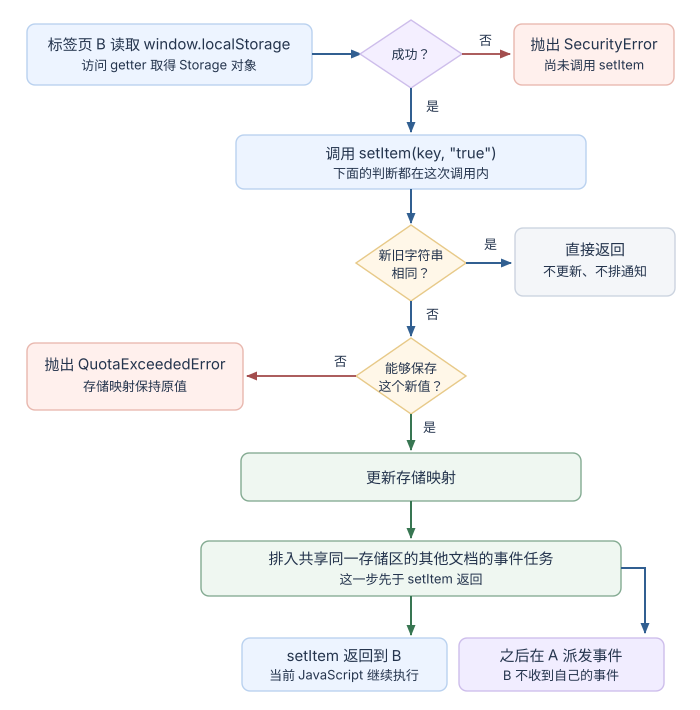

# 报表页面里的状态应该放在哪里？

案例背景：用户打开 `https://reports.example/reports/42?sort=recent#summary`，希望刷新后回到同一报表、复制链接分享当前排序，并在另一标签页改变列密度偏好后看到更新。报表 42 沿用[流式报表恢复案例](./streaming-ux.md)的公开合成快照 `{ id: 42, version: 9, status: "running", event_cursor: "103" }`。这里 `sort=recent` 是 URL 状态，列密度是独立的本地偏好；报表快照本身仍由服务端维护。

重载时，浏览器先请求页面 URL `GET /reports/42?sort=recent`；片段 `#summary` 留在浏览器端，用于定位摘要，不会随 HTTP 请求发送。页面代码再从路径识别报表 42、从查询参数恢复排序，并请求数据接口 `GET /api/reports/42`。服务端返回上述版本 9 快照，页面以游标 `103` 接上快照之后的更新流。若断线后要让快照与流保持一致，见[流式报表恢复案例](./streaming-ux.md)。

| 这份状态 | 放在哪里 | 刷新、分享和多标签页的结果 |
|---|---|---|
| 报表 42 的权限、进度、结果与版本 | 服务端 API | 跨设备共享且由服务端授权；浏览器缓存不能取代它 |
| `sort=recent` 与 `#summary` | URL | 查询参数随链接和历史记录恢复；片段在本地定位页面 |
| 列密度、隐藏提示等小型偏好 | `localStorage` | same-origin (同源) 且共享存储区的页面可读写；通常跨标签页与浏览器重载保留，但用户代理可能清除或限制访问 |
| 未提交的本标签页筛选草稿 | `sessionStorage` | 按来源和顶层浏览上下文隔离；同一来源的页面可跨导航和重载恢复，另一标签页或来源有自己的值 |
| 登录会话标识 | 服务端管理的 Cookie | 浏览器按请求主机名与 host-only/`Domain`、`Path`、`Secure`、`SameSite` 和凭证规则发送；端口不隔离 Cookie，`HttpOnly` 不向脚本开放 |

可以把关键边界记成一句话：链接描述用户想看的视图，客户端存储记住本地意图，服务端保存业务事实。下图把一次有效的 `localStorage` 写入和它可能触发的跨文档通知拆开。

Web Storage (网页存储) 的 `localStorage` 和 `sessionStorage` 都是同步的字符串键值 API。读取和写入会占用当前 JavaScript 执行时间；它们没有条目级过期时间，也没有多键事务。小型偏好适合用它们，结构化大记录和多个键必须一起提交时可考虑 IndexedDB (索引数据库)：它用异步请求访问记录，并让同一 `readwrite` 事务范围内的改动原子提交。

`localStorage` 不按 URL 路径区分同一来源的页面；通常这些页面访问同一存储区，但浏览器可能限制第三方访问或按顶层站点分区，不能只凭来源相同就假定它们可共享存储。规范目前把 `localStorage` 和 `sessionStorage` 各自的建议配额设为每个存储端点 5 MiB；这是规范建议，实际浏览器策略仍可导致读取不可用或写入失败。`navigator.storage.estimate()` 返回当前 local storage shelf（本地存储架）的近似使用量和配额，不是 `localStorage` 这个端点还剩多少空间的精确读数。

`sessionStorage` 按来源和顶层浏览上下文隔离。同一标签页内切换到另一来源时，新来源读取自己的存储区；返回原来源或重载后，原来源仍可读到原值。另一个标签页有自己的值。标签页关闭通常结束这个页面会话；浏览器恢复已关闭标签页时是否恢复会话值，取决于用户代理的恢复策略，不能用它保存需要跨会话保留的数据。若带 `opener` 打开新的同源辅助浏览上下文，新上下文最初可能拿到一份 `sessionStorage` 副本；之后两边各自修改。这个初始复制不是持续共享。同一来源的页面若处于不同顶层站点的嵌入上下文，浏览器也可能限制或分区其存储；单看来源相同不足以证明两个上下文共用一份存储区。

> [!warning] 本地存储操作有真实失败分支
> 取得 `localStorage` 或 `sessionStorage` 对象时，策略限制或不透明来源可能抛出 `SecurityError`；`setItem()` 不能保存新值时会抛出 `QuotaExceededError`。失败时应用不能继续把“已写入”当成事实，应保留当前页内存中的选择并告诉用户该偏好没有保存。若应用需要多个本地记录原子更新，IndexedDB 的 `readwrite` 事务可以把同一事务范围内的改动一起提交，失败时回滚。

一次 `setItem()` 不是跨标签页的锁。假设标签页 A、B 都读取计数 `4`，各自算出 `5`，再依次写入 `5`，最终存储值仍是 `5`，尽管应用执行了两次增加。`storage` 事件只是变化通知，不能把这段读—改—写变成原子操作；需要协调更新时，必须把读取、计算和写入都放在覆盖这些记录的同一个 `readwrite` 事务内，或使用明确的跨上下文协议。

值发生变化且写入成功时，浏览器在这次 `setItem()` 调用中先更新存储区，再为共享同一存储区的其他文档排入 `storage` 事件任务，然后才从 `setItem()` 返回。其他文档的事件处理器在后续任务中运行，写入者不会收到自己的事件；新字符串与旧值相同时，`setItem()` 直接返回，不更新也不排通知任务。`removeItem()` 与 `clear()` 只在实际移除数据时排入通知，`clear()` 的事件 `key` 为 `null`。事件中的 `storageArea` 是接收文档自己的 `Storage` 对象，指向刚才变化的存储区；标签页 A 应与自己的 `window.localStorage` 比较，而不是把 A、B 当成共享同一个 JavaScript 对象。因此，收到事件表示“存储发生过变化”，不表示某个业务步骤已经被别的标签页处理或确认。

A 和 B 页面初始化时都从同一键读到字符串 `"false"`。A 先注册监听器，再读取当前值初始化画面；B 也先读取当前值，用户选择紧凑列时再调用 `chooseCompactColumns(true)`，把值改为 `"true"`。若 A 是重载或较晚打开的页面，它先读当前值即可；`storage` 事件没有历史重放。事件的 `newValue` 描述触发通知的那次写入，但若同一键之后又变过，处理器重读能得到读取时的当前偏好。

> [!example] 两个标签页怎样保存并同步偏好
> 示例假定两个标签页都能访问同一 `localStorage` 存储区；`applyCompactColumns` 与提示函数代表页面已有的界面更新。A 或 B 初始化读取失败时显示存储不可用；B 在用户选择后遇到读取或写入错误时仍在当前页面应用选择，但显示“未保存”。
>
> 标签页 A：
>
> ~~~javascript
> const compactKey = "reports:compact-columns";
>
> window.addEventListener("storage", event => {
>   try {
>     if (event.storageArea !== window.localStorage) return;
>     if (event.key !== compactKey && event.key !== null) return;
>     applyCompactColumns(window.localStorage.getItem(compactKey) === "true");
>   } catch {
>     showPreferenceStorageUnavailable();
>   }
> });
>
> try {
>   applyCompactColumns(window.localStorage.getItem(compactKey) === "true");
> } catch {
>   showPreferenceStorageUnavailable();
> }
> ~~~
>
> 标签页 B：
>
> ~~~javascript
> const compactKey = "reports:compact-columns";
>
> try {
>   applyCompactColumns(localStorage.getItem(compactKey) === "true");
> } catch {
>   showPreferenceStorageUnavailable();
> }
>
> function chooseCompactColumns(enabled) {
>   applyCompactColumns(enabled);
>   try {
>     localStorage.setItem(compactKey, String(enabled));
>     showPreferenceSaved();
>   } catch {
>     showPreferenceNotSaved();
>   }
> }
>
> chooseCompactColumns(true);
> ~~~

Web Storage 可被当前页面的脚本读取；若 `cross-site scripting` (跨站脚本攻击，XSS) 进入页面，其中的 `bearer token` (持有者令牌) 也可能被读走。`HttpOnly` Cookie 不向普通页面脚本开放，浏览器仍会按 Cookie 规则自动附带它，因此服务端仍须防护 `Cross-Site Request Forgery` (跨站请求伪造，CSRF)。若跨站请求需要选择 `SameSite=None`，当前 IETF Cookie 文稿要求同时设置 `Secure`。换用某种存储位置本身不会完成认证或授权；Cookie、XSS、CSRF 的服务端防护细节见[Web 安全与认证](../../engineering-foundations/security/web-security-and-authentication.md)。

列密度偏好这个例子只需要读写当前存储值。若多个标签页需要跟上服务端的报表版本，就需要明确何时通知其他页、接收方怎样读取服务端权威快照，以及怎样恢复遗漏；[同一报表在多个标签页中怎样交换变化？](./browser-context-communication.md) 会沿用报表 42 说明这些协议。

> [!info]- 来源
> - URL 序列化器在排除片段时仍保留查询参数；导航请求中片段不随请求发送：[WHATWG URL Standard §4.5 URL serializing](https://url.spec.whatwg.org/#url-serializing)，Living Standard；2026-11-12 核对。
> - `localStorage`、`sessionStorage` 的接口、来源与顶层浏览上下文作用域、同值写入无事件、失败异常、事件任务以及读改写不保证锁定：[WHATWG HTML Standard，Web Storage §§12.1–12.2.4](https://html.spec.whatwg.org/multipage/webstorage.html)，Living Standard 更新于 2026-11-11；2026-11-12 核对。
> - 两种 Web Storage 端点各自建议 5 MiB；存储键当前按来源定义、第三方存储分区模型仍预期演进：[WHATWG Storage Standard §§4.1–4.2](https://storage.spec.whatwg.org/)，Living Standard 更新于 2026-10-19；2026-11-12 核对。
> - `navigator.storage.estimate()` 返回当前 local storage shelf 的近似用量与配额，而不是 `localStorage` 这个端点的剩余空间：[WHATWG Storage Standard §§6、8](https://storage.spec.whatwg.org/)，Living Standard 更新于 2026-10-19；2026-11-12 核对。
> - IndexedDB `readwrite` 事务的作用域、生命周期、原子提交与失败回滚：[Indexed Database API 3.0 §2.7.1](https://www.w3.org/TR/2026/WD-IndexedDB-3-20261030/)，W3C Working Draft，2026-10-30；2026-11-12 核对。
> - Cookie 的 `Domain`/host-only 和 `Path` 匹配范围、`Secure`、`HttpOnly` 与请求发送规则：[RFC 6265 §§4.1.2.3–4.1.2.6、§§5.1.3–5.1.4、§§5.3–5.4、§8.5](https://www.rfc-editor.org/rfc/rfc6265.html)，2011-04；§8.5 明确 Cookie 不按端口隔离。
> - `SameSite=None` 与 `Secure` 的组合要求：[IETF draft-ietf-httpbis-rfc6265bis-22 §§4.1.2.7、5.7](https://datatracker.ietf.org/doc/html/draft-ietf-httpbis-rfc6265bis-22)，2026-11-12 核对；Datatracker 当日仍标记 RFC Editor “Final Approval Pending”，因此按文稿规则表述。
> - 用户代理可限制第三方文档访问 `localStorage`；Chrome 对第三方存储按顶层站点分区（Chrome 115+），WebKit 对第三方 `localStorage` 与 IndexedDB 按第一方网站分区：[WHATWG HTML Standard §12.3.1](https://html.spec.whatwg.org/multipage/webstorage.html#user-tracking)，[Chrome Storage Partitioning](https://privacysandbox.google.com/cookies/storage-partitioning)，[WebKit Tracking Prevention](https://webkit.org/tracking-prevention/#partitioned-third-party-storage)，2026-11-12 核对。
