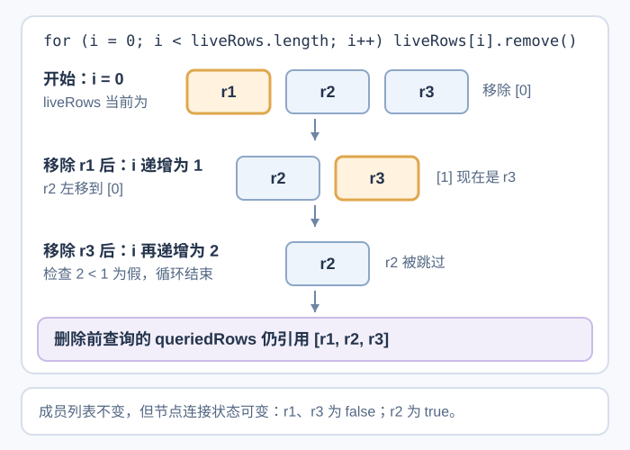

# 修改 DOM 时，HTMLCollection 和 NodeList 会怎样变化？

案例背景：报表列表准备显示新结果，先要清空现有行。Document Object Model（文档对象模型，DOM）查询能返回 `HTMLCollection`（元素集合）或 `NodeList`（节点列表）；成员是否随树变化，由具体 API 决定。若代码遍历实时集合时同时删除成员，后续索引会移动，递增索引可能跳过一行，旧行便会留在下一份结果中。

## 先查询到要操作的节点

`document.documentElement` 是 `<html>` 根元素，`document.body` 指向 `<body>`；如果脚本在 HTML parser（HTML 解析器）处理到相应标签前运行，`body` 可能还是 `null`。`getElementById()` 与 `querySelector()` 都返回一个元素或 `null`；后者的参数是 CSS 选择器。拿到容器后，在容器内查询可以避免把页面上另一个同类控件误当成报表控件：

~~~javascript
const reports = document.querySelector("#reports");
const controls = document.querySelector("#sort-controls");
const oldestButton = controls?.querySelector('button[data-sort="oldest"]') ?? null;
const directRows = reports?.querySelectorAll(":scope > li.report") ?? [];
~~~

`querySelectorAll()` 在没有匹配项时仍返回长度为 `0` 的 `NodeList`；`querySelector()` 则返回 `null`。选择器字符串若不是有效 CSS 语法，查询会抛出 `SyntaxError`，不会返回空结果。完整页面中 `body`、根元素和控件的关系见[浏览器如何把 URL 变成第一帧？](../browser/browser-basics.md)。

这里的可选链还处理了容器不存在的情况：找不到 `#reports` 时，`directRows` 是普通空数组；容器存在但没有匹配行时，它是空 `NodeList`。`:scope >` 把查询范围限定为容器本身的直接子元素。下面的教学列表只有报表行，因此 `children` 与 `.report` 查询开头都得到 `[r1, r2, r3]`；若以后加入状态提示行，`children` 也会包含它，而 `.report` 查询不会。

| 来源 | 返回类型 | 包含什么 | 查询后 DOM 改变时，集合成员怎样变化 |
|---|---|---|---|
| `element.children` | `HTMLCollection` | 直接子元素 | 实时反映当前树 |
| `getElementsByClassName()`、`getElementsByTagName()` | `HTMLCollection` | 匹配的后代元素，包含更深层级 | 实时反映当前树 |
| `element.querySelectorAll()` | `NodeList` | 匹配元素 | 保持查询时的成员列表 |
| `element.childNodes` | `NodeList` | 元素、文本、注释等直接子节点 | 实时反映当前树 |

因此，不能只看 `NodeList` 这个类型来判断它是否实时：`childNodes` 是实时集合，而 `querySelectorAll()` 返回静态列表。`childNodes` 中的缩进空白也会成为文本节点；通用节点应使用 `nodeName`，因为 `tagName` 只属于元素。两种集合都不是普通数组，不能直接调用 `map()`；`Array.from()` 可把当前成员引用复制进数组。

## 删除实时集合时，索引为什么会跳过一行？

> [!example] 正向删除实时集合会留下 r2
> 报表行的教学 ID 是 `r1`、`r2`、`r3`，它们只是合成标识，与真实报表 ID、业务版本或事件游标无关。开始时，循环变量 `i = 0`，实时集合和 `querySelectorAll(":scope > .report")` 的静态结果都按树顺序包含 `[r1, r2, r3]`。这份列表的直接子元素全是报表行，所以 `children` 与按 `.report` 选择的范围相同。
>
> ~~~html
> <ul id="reports">
>   <li class="report" id="r1">报告 1</li>
>   <li class="report" id="r2">报告 2</li>
>   <li class="report" id="r3">报告 3</li>
> </ul>
> ~~~
>
> ~~~javascript
> const list = document.querySelector("#reports");
> const liveRows = list.children;
> const queriedRows = list.querySelectorAll(":scope > .report");
>
> for (let i = 0; i < liveRows.length; i += 1) {
>   liveRows[i].remove();
> }
> // 最后 r2 仍在列表中。
> // queriedRows 仍有 3 个成员；queriedRows[0].isConnected 为 false。
> ~~~
>
> 第一次执行 `i = 0` 时，循环移除 `liveRows[0]`，也就是 `r1`。实时集合立即变成 `[r2, r3]`，`r2` 从索引 `1` 移到索引 `0`。循环递增 `i` 到 `1` 后，`liveRows[1]` 现在是 `r3`，于是第二次移除 `r3`。集合此时只剩 `[r2]`。第二轮循环体结束后，`for` 语句先把 `i` 再递增到 `2`，然后才检查条件；此时 `2 < liveRows.length`（即 `2 < 1`）为假，循环结束。
>
> 清理步骤结束后 `r2` 还在列表里；如果接下来把新结果插入这份列表，旧行就会和新结果同时显示。
>
> 
>
> 静态结果 `queriedRows` 仍含三个节点引用，但已移除的 `r1`、`r3` 的 `isConnected` 会变成 `false`。静态只固定成员列表，不冻结节点对象。可以在改树之前先复制实时成员，或从末尾向前删除：
>
> ~~~javascript
> // 与上面的错误循环二选一，并从同一份初始列表开始。
> for (const row of Array.from(liveRows)) row.remove();
> // 也可以倒序删除：
> for (let i = liveRows.length - 1; i >= 0; i -= 1) {
>   liveRows[i].remove();
> }
> ~~~

实时集合适合读取 DOM 当前有哪些成员；若遍历期间修改它，递增索引就可能不再指向预期节点。静态查询结果适合按查询时确定的成员执行任务。查询列表是否变化、列表里的节点是否仍连接到文档，是两个不同问题。这里的“实时”描述读取时可见的成员结果，不规定浏览器内部怎样或多久计算一次。

**延伸阅读：** [JavaScript 事件总线在监听器中重入时怎样保持顺序？](./event-bus-and-observer-patterns.md) 说明状态更新如何触发本地模块；[用户离开报表页时，分析事件怎样尽力发送？](../performance/analytics-event-delivery-on-navigation.md) 说明导航期间的遥测边界；[浏览器如何从输入到绘制界面？](../browser/browser-basics.md) 讨论 DOM 与后续渲染。

> [!info]- 来源
> - `Document.body` 可能为空；HTML Standard 将它定义为可返回 `null` 的元素属性：[WHATWG HTML §3.1.1、§3.1.7，Document tree accessors](https://html.spec.whatwg.org/multipage/dom.html#dom-document-body)，Living Standard，核对于 2026-11-12。
> - `NodeList` 与 `HTMLCollection` 的集合规则：默认集合为实时集合；`HTMLCollection` 只包含元素，`NodeList` 可包含节点。[WHATWG DOM Standard §4.2.10，NodeList 与 HTMLCollection](https://dom.spec.whatwg.org/#old-style-collections-node-list-and-htmlcollection)，Living Standard，核对于 2026-11-12。
> - `querySelector()` 返回首个匹配项或 `null`；无匹配的 `querySelectorAll()` 返回空列表，且其算法返回静态结果：[WHATWG DOM Standard §4.2.6，ParentNode](https://dom.spec.whatwg.org/#interface-parentnode)，Living Standard，核对于 2026-11-12。
> - `children`、`childNodes`、`getElementsBy*()` 的成员筛选与实时性按具体接口算法定义；`nodeName`、`tagName` 属于通用节点和元素接口各自的字段：[WHATWG DOM Standard §4.2.6 ParentNode](https://dom.spec.whatwg.org/#interface-parentnode)、[§4.4 Node](https://dom.spec.whatwg.org/#interface-node)、[§4.5 Document](https://dom.spec.whatwg.org/#interface-document) 与 [§4.9 Element](https://dom.spec.whatwg.org/#interface-element)，Living Standard，核对于 2026-11-12。
