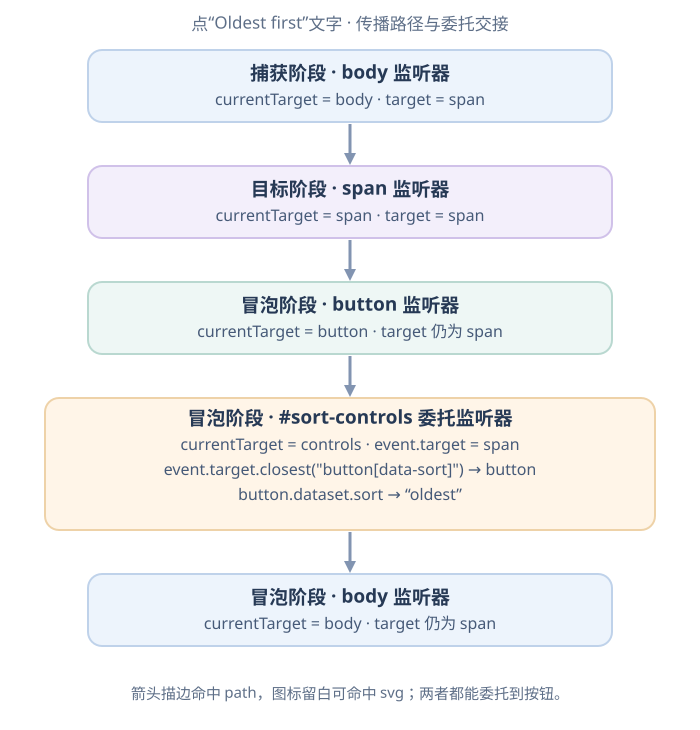

# 浏览器怎样查询、更新 DOM 并响应用户输入？

案例背景：报表页从 `https://example.test/reports?sort=recent#summary` 打开，列表先显示 May、April 两行。用户点“最早优先”按钮里的文字或图标后，原生示例要找到所属按钮，从 `data-sort` 读出 `oldest`，再把现有行节点排成 April、May，并更新按钮状态。这里把 History API 处理 URL、React 管理状态作为相邻交接；本页先走通普通文档树中的查询、内容更新和事件处理。Document Object Model (文档对象模型，DOM) 把 HTML 文档表示为节点树，JavaScript 可以查询这些节点、改写其状态，并响应输入事件。

本章各示例在独立页面或作用域中运行，避免把不同示例的顶层代码拼成同一脚本（重复声明 `const controls` 会报错）。同一示例中的 HTML、交互和清理代码要一起使用。建表和拖动示例使用各自的 HTML；查询、事件、克隆、排序与尺寸观察示例使用后文委托节提供的 `#sort-controls` / `#reports` 初始 HTML。

## DOM 树里有哪些节点？

文档节点包含元素节点、文本节点和注释等；元素的 attribute（属性）描述元素状态，但 attribute 不是元素的子节点。常用的 `nodeType` 值如下：

| `nodeType` | 节点 | 报表页中的例子 |
|---:|---|---|
| 1 | Element（元素） | `<ol>`、`<li>`、`<button>` |
| 2 | Attr（属性） | `id="reports"`（有 `Attr` 对象，但不是树的子节点） |
| 3 | Text（文本） | `May report` |

向上找父级时，`parentNode` 可返回任意节点父级：`<html>` 的 `parentNode` 是 Document，而 `parentElement` 只返回元素父级，所以 `<html>.parentElement` 为 `null`。`nodeName` 命名任意节点，`tagName` 只属于元素；`nodeValue` 读取单个 Text 节点的值，在 Element 上则为 `null`，读取元素后代文字应使用 `textContent`。若要查某行的下一个元素，使用 `nextElementSibling`；`nextSibling` 可能先遇到 HTML 换行空白对应的文本节点。同理，`firstChild` 与 `firstElementChild` 可能不是同一项。`childNodes` 包含文本、注释等节点，`children` 只包含元素；它们的集合更新规则见[修改 DOM 时，HTMLCollection 和 NodeList 会怎样变化？](./dom-collections.md)。

查询 DOM 使用 CSS 选择器。`querySelector()` 返回第一个匹配元素；没有匹配项时返回 `null`，所以后续读取前要先处理找不到的情况。`querySelectorAll()` 返回匹配项组成的静态 `NodeList`，创建后不会因之后插入的新按钮而自动增加成员。

下面的查询、事件日志和委托代码使用后面“什么时候用父级监听器处理子控件？”一节中的报表初始 HTML；先载入该 HTML，再在独立运行上下文中执行所需的代码块。

~~~javascript
const controls = document.querySelector("#sort-controls");
if (controls) {
  const oldest = controls.querySelector('button[data-sort="oldest"]');
  const buttons = controls.querySelectorAll("button[data-sort]");
  // oldest 是第一个匹配项或 null；buttons 是当前匹配项的静态列表。
}
~~~

`#sort-controls` 按 ID 找工具栏；`button[data-sort="oldest"]` 同时匹配元素名和 attribute 值。选到控件后，再决定修改文字、HTML 内容属性、DOM 对象属性还是节点顺序。

## 修改内容、HTML 属性和 DOM 对象属性有何区别？

文本和标记要用不同接口。`textContent` 读取后代文本，赋值会用一个文本内容替换子树；`innerText` 读写渲染文本：读取时元素若未渲染，会退回到后代文本；若已渲染，结果会受显示状态影响；赋值中的换行会成为可见换行。`innerHTML` 读取或解析 HTML 字符串。把纯文字放入 DOM 时使用 `textContent`；只有受信任或已净化的标记才作为 HTML 解析。

| 写法 | 控制什么 | 报表页上的用途 |
|---|---|---|
| `row.textContent = label` | 文字，不解析 HTML | 写入报表名称 |
| `row.innerText` | 渲染后的文字语义；未渲染时退回后代文本 | 读取或写入可见文本 |
| `row.innerHTML = markup` | 子树的 HTML 标记 | 只有模板可信或已净化时才插入标记 |
| `element.setAttribute(name, value)` | HTML content attribute（HTML 内容属性） | 设置 `data-id`、`alt`、`title` 等声明 |
| `element.classList`、`element.style` | class 集合与内联样式 | 切换状态 class，或写入必要的单次样式 |

HTML 内容属性是元素当前的标记属性；许多 DOM property（DOM 对象属性）会反射对应 attribute。文本输入框的 `value` 属性提供了一个重要区别：`value` 内容属性给出默认值，`input.value` 则表示当前值。当前值一旦变成 dirty（已修改），再改 attribute 只更新默认值，直到表单重置。

~~~html
<form id="sort-form">
  <label>排序关键词 <input id="sort-query" value="recent"></label>
</form>
~~~

~~~javascript
const query = document.querySelector("#sort-query");
query.setAttribute("value", "april"); // 尚未修改：当前值也变为 april
const beforeEdit = [query.value, query.defaultValue];

query.value = "oldest"; // 改当前值，并标记为 dirty
query.setAttribute("value", "recent"); // dirty 后只改默认值
const afterEdit = [query.value, query.defaultValue];
query.form.reset(); // 当前值回到默认值，并清除 dirty 标记
const afterReset = [query.value, query.defaultValue];
console.log(JSON.stringify({ beforeEdit, afterEdit, afterReset }));
~~~

HTML 的 dirty value flag（值已修改标记）区分当前输入值和可变默认值；`reset()` 会恢复默认值。对 boolean attribute（布尔属性），例如 `disabled`，只看元素自己的 attribute 是否存在：`setAttribute("disabled", "false")` 仍会设置它。`button.disabled = false` 会移除按钮自己的禁用属性，但不一定让它脱离 HTML 禁用状态：若它位于禁用的 `fieldset` 中，仍会匹配 `:disabled`；该 fieldset 的第一个 `legend` 元素子节点内的后代控件有例外。

~~~html
<fieldset disabled>
  <legend>
    <button id="legend-button" type="button">例外位置</button>
  </legend>
  <button id="inherited-button" type="button">受 fieldset 禁用</button>
</fieldset>
<button id="own-button" type="button">自己的 disabled 属性</button>
~~~

~~~javascript
const inherited = document.querySelector("#inherited-button");
inherited.disabled = false;
const own = document.querySelector("#own-button");
own.setAttribute("disabled", "false");
const setToFalse = [own.disabled, own.matches(":disabled")];
own.disabled = false;
const afterClearingOwn = [own.disabled, own.matches(":disabled")];

const states = {
  ownAttribute: setToFalse,
  afterClearingOwn,
  inherited: [inherited.disabled, inherited.matches(":disabled")],
  firstLegend: [
    document.querySelector("#legend-button").disabled,
    document.querySelector("#legend-button").matches(":disabled"),
  ],
};
console.log(JSON.stringify(states));
// ownAttribute: [true, true]; afterClearingOwn: [false, false]
// inherited: [false, true]; firstLegend: [false, false]
~~~

| 控件状态 | `button.disabled` | `matches(":disabled")` | 原因 |
| --- | --- | --- | --- |
| 给自身 `setAttribute("disabled", "false")` 后 | `true` | `true` | 布尔属性只看是否存在。 |
| 再设自身 `disabled = false` 后 | `false` | `false` | 移除了自身的禁用属性。 |
| 禁用 fieldset 的普通后代 | `false` | `true` | 控件自身未禁用，但祖先 fieldset 生效。 |
| fieldset 的第一个 `legend` 元素子节点内的后代 | `false` | `false` | 该位置不继承 fieldset 的禁用。 |

若要检查 HTML 表单禁用状态（包含 `fieldset` 继承），用 `button.matches(":disabled")`；若只想读写元素自己的禁用属性，用 `button.disabled`。

要更新筛选行的外观，`className = "selected"` 会整体替换 class 字符串；`classList.add()`、`remove()` 和 `toggle()` 改单个类。`element.style.backgroundColor` 只读写行内的声明；样式表计算出的生效值要用 `getComputedStyle(element)` 读取。CSS property 在 JavaScript 里通常使用 camelCase（小驼峰）。`data-id="may"` 可通过 `row.dataset.id` 读取与设置，`dataset` 中已存在的值是字符串，缺少的 data 属性读到 `undefined`。多段名称会转为小驼峰，例如 `data-report-id` 对应 `dataset.reportId`。图片的 `src` 选择资源，`alt` 提供替代文本（装饰图可用空值），`title` 是补充信息，不能替代 `alt`。

~~~javascript
const textDemo = document.createElement("div");
document.body.append(textDemo); // 附加到页面后，innerText 按渲染文本处理
textDemo.textContent = "<b>May</b>";
const literal = [textDemo.textContent, textDemo.children.length];
textDemo.innerText = "May\nReport";
const visibleLines = [textDemo.innerHTML, textDemo.innerText];
console.log(JSON.stringify({ literal, visibleLines }));
// literal: ["<b>May</b>", 0]
// visibleLines: ["May Report", "May\nReport"]
~~~

## 怎样生成、移动或克隆一组节点？

为单独演示如何从结构化数据建表，设一张学校成绩表固定按 Name、Subject、Grade 排列。对象字段顺序不是表格的列定义；三条记录应分别显示 Ron—Math—100、Jack—Calculus—70、Mar—Business—90：

~~~html
<table>
  <thead><tr><th>Name</th><th>Subject</th><th>Grade</th></tr></thead>
  <tbody id="students"></tbody>
</table>
~~~

~~~javascript
const students = [
  { name: "Ron", subject: "Math", grade: "100" },
  { name: "Jack", subject: "Calculus", grade: "70" },
  { name: "Mar", subject: "Business", grade: "90" },
];
const columns = ["name", "subject", "grade"];
const body = document.querySelector("#students");

for (const student of students) {
  const row = document.createElement("tr");
  for (const column of columns) {
    const cell = document.createElement("td");
    cell.textContent = student[column];
    row.append(cell);
  }
  body.append(row);
}
~~~

每个记录依照同一份 `columns` 产生三格，输入值只进入文本节点。`append()` 会把新节点追加到末尾；若传入已经在文档中的节点，它会将该节点移动到新位置。`insertBefore(node, reference)` 把节点放到参考节点前，`remove()` 将节点从树上移除。

`cloneNode(true)` 会复制节点、后代结构和 HTML attribute。写在 `onclick="..."` 中的内容属性会随节点复制；通过 `element.onclick = handler` 设置的 DOM 对象属性和 `addEventListener()` 注册的监听器不会复制。若副本及其后代有 `id`，插入同一文档前应改成不冲突的 ID，并同步更新指向它们的引用。需要复制行为时，在新节点上重新注册监听器：

本例从后文委托节的两行初始列表单独运行：May 源行带 `data-id="may"` 和 `data-date="2026-05-01"`，自身没有 DOM `id` attribute，后代也没有带 ID 的节点。深克隆会保留这两个 data 属性；代码给副本新增一个文档内唯一的 DOM `id`。运行后列表会多一行 May 副本，因此不要把它与后面的两行排序表串成同一轮状态。

~~~javascript
function handleReportClick(event) {
  console.log(event.currentTarget.dataset.id);
}

const source = document.querySelector('#reports [data-id="may"]');
const copy = source.cloneNode(true);
copy.id = "may-row-copy"; // 新增 DOM id；data-id 仍标识 May 报表
copy.addEventListener("click", handleReportClick);
document.querySelector("#reports").append(copy);
~~~

对同一元素给 `onclick` 属性赋新函数会替换先前的函数；多处代码都需监听时，用 `addEventListener()` 可以各自注册和移除 listener（监听器）。只需响应一次时可设 `{ once: true }`；若要提前移除，保留原函数引用，并使用相同 capture（捕获阶段）选项调用 `removeEventListener()`。也可把同一 `AbortSignal`（中止信号）交给多个监听器，结束该页面区域时调用 `abort()` 一并清理。

## 一次点击沿哪些节点传播？

浏览器为事件确定传播路径（event path）后，监听器可在 capture phase（捕获阶段）、target phase（目标阶段）和 bubble phase（冒泡阶段）运行。下面限定在普通 DOM 树中的 click：点标签文字时 `target` 是 `span`；点 SVG 箭头的可见描边时 `target` 是 `<path>`，点图标留白时则可能是 `svg`。这段代码只记录事件顺序；图展示标签文字分支经过的节点，并在工具栏层带出下一节的委托处理器。

~~~javascript
const controls = document.querySelector("#sort-controls");
const button = controls.querySelector('button[data-sort="oldest"]');
const label = button.querySelector(".sort-label");

document.body.addEventListener("click", () => console.log("body capture"), {
  capture: true,
});
label.addEventListener("click", () => console.log("span target"));
button.addEventListener("click", () => console.log("button bubble"));
controls.addEventListener("click", () => console.log("controls bubble"));
document.body.addEventListener("click", () => console.log("body bubble"));
~~~

点标签文字时，上面日志按 body 捕获、span 目标、button 冒泡、controls 冒泡、body 冒泡的顺序运行：

图对应上面的点文字日志；工具栏框展示同一传播路径到达 `#sort-controls` 后，由下一节注册的委托监听器继续处理，这不是上面只打印日志的 `controls bubble` 回调。点箭头描边时，路径为 `path → svg → button → #sort-controls → body`；点图标留白时从 `svg` 开始，随后经过同样的祖先。委托器从实际命中的 `event.target` 向上找到按钮，两条路径都不经过 `.sort-label` span。

`event.target` 在一次普通 DOM 派发中保持为最初命中的节点；`event.currentTarget` 则是当前监听器绑定的节点。图中的文字分支依次以 `body`、`span`、按钮、工具栏和 `body` 为 `currentTarget`；点箭头描边或图标留白时，target 分别为 `path` 或 `svg`，两条路径都不含 span。普通函数监听器中的 `this` 也指向 `currentTarget`，箭头函数的 `this` 则保留词法绑定。图不覆盖 Shadow DOM（影子 DOM）：跨影子边界时 `target` 可能被重定向；`bubbles` 决定是否向普通祖先冒泡，`composed` 决定能否穿过影子边界，二者不是同一开关。输入框获得和失去焦点时分别派发 `focus` 与 `blur`，这两个原生事件不冒泡；父级要委托焦点变化时可监听会冒泡的 `focusin` 与 `focusout`。

## 什么时候用父级监听器处理子控件？

event delegation（事件委托）让一个父级监听器处理多个后代控件，包括稍后插入的控件，因此不用逐一注册监听器。它适合事件会冒泡、父级确实拥有这些控件、目标匹配规则清楚的场景；它不会消除每次事件分发或处理器本身的计算。

~~~html
<h1 id="summary">Recent reports</h1>

  <button type="button" data-sort="recent" aria-pressed="true">
    Most recent
  </button>
  <button type="button" data-sort="oldest" aria-pressed="false">
    <svg class="sort-icon" width="16" height="16" viewBox="0 0 16 16"
         aria-hidden="true">
      <path d="M8 13V3m-4 4 4-4 4 4" fill="none" stroke="currentColor"
            stroke-width="1.5" stroke-linecap="round" stroke-linejoin="round" />
    </svg>
    Oldest first
  </button>

<ol id="reports">
  <li data-id="may" data-date="2026-05-01">May report</li>
  <li data-id="april" data-date="2026-04-01">April report</li>
</ol>
~~~

图标 SVG 设为 `16 × 16`，内部 `path` 画出箭头，因此页面中有实际可见的命中区域；旁边的文字已经说明按钮用途，图标用 `aria-hidden="true"` 隐藏其重复信息。

~~~css
#sort-controls .sort-icon {
  vertical-align: -0.15em;
}
~~~

~~~javascript
const controls = document.querySelector("#sort-controls");
const reports = document.querySelector("#reports");

function applySort(intent, activeButton) {
  if (intent !== "recent" && intent !== "oldest") return;

  const rows = Array.from(
    reports.querySelectorAll(":scope > li[data-date]")
  );
  const direction = intent === "oldest" ? 1 : -1;
  rows.sort((a, b) =>
    direction * a.dataset.date.localeCompare(b.dataset.date)
  );
  for (const row of rows) reports.append(row);

  for (const button of controls.querySelectorAll("button[data-sort]")) {
    button.setAttribute("aria-pressed", String(button === activeButton));
  }
}

controls.addEventListener("click", (event) => {
  const target = event.target instanceof Element ? event.target : null;
  const button = target?.closest("button[data-sort]");
  if (!button || !controls.contains(button)) return;

  const intent = button.dataset.sort;
  console.log("Sort requested:", intent); // 点击“最早优先”时得到 "oldest"
  applySort(intent, button);
});
~~~

点击标签文字或图标时，`closest()` 从命中的后代向上找到带 `data-sort` 的按钮；`controls.contains(button)` 确认它属于这个工具栏。处理器读到 `oldest` 后，`applySort()` 先拒绝未知意图，再用固定的 ISO 日期值比较两行。`querySelectorAll()` 给出当前行的静态集合，`Array.from()` 把它变为可排序数组；对现有行调用 `append()` 会移动节点，而不是重新创建行。事件处理器同步完成后，本例得到：

| 时点 / 意图 | 行顺序（`data-id`） | `recent` | `oldest` |
| --- | --- | --- | --- |
| 初始 HTML / `recent` | `may` → `april` | `aria-pressed="true"` | `aria-pressed="false"` |
| 点击处理完成 / `oldest` | `april` → `may` | `aria-pressed="false"` | `aria-pressed="true"` |

本节的 `applySort()` 只负责把同一排序意图写成 DOM 顺序和按钮状态；完整页面还要让 URL、前进后退与这份状态同步，见[每次 URL 变化都会加载新文档吗？](../browser/browser-navigation-and-history.md)。若操作会删除匹配节点并继续遍历，应先取静态快照，避免移除节点改变实时集合；集合差异见[修改 DOM 时，HTMLCollection 和 NodeList 会怎样变化？](./dom-collections.md)。

## 默认动作与传播控制是两回事

按钮若位于表单中，点击可能触发表单提交；这是与事件传播分开的默认动作。`preventDefault()` 只在事件可取消且监听器不是 passive listener（被动监听器）时取消默认动作，它不会停止冒泡。`stopPropagation()` 不取消正在运行的回调，也不会跳过当前 `EventTarget` 本次捕获或非捕获调用中剩余的匹配监听器；它会阻止随后沿路径进行的监听器调用。目标上的捕获调用结束后，若它设置了停止传播标志，目标上的非捕获调用会被跳过（两次调用中的 `eventPhase` 都是 `AT_TARGET`）。`stopImmediatePropagation()` 还会停止当前 `EventTarget` 本次调用中的后续监听器。

如果滚动或触控监听器不需要取消浏览器默认滚动，设置 `{ passive: true }` 能表明这一点；被动监听器调用 `preventDefault()` 无法取消默认动作。DOM 标准规定，未显式设置 `passive` 的 `touchstart`、`touchmove`、`wheel` 和 `mousewheel` 监听器，在 `Window`、`Document`、`documentElement` 或 `body` 上默认 passive 为 true；确实需要拦截时，应先按事件的 `cancelable` 状态判断，再显式设置 `{ passive: false }`。

## 移动端点击与手势策略

历史上的移动端 click 延迟有特定条件：部分浏览器曾等待判断一次触摸是否还会成为双击缩放手势。它不是今天所有浏览器、所有 viewport（视口）或所有输入模式下的固定延迟。先设置符合设备宽度的 viewport；不要为了绕开历史延迟而禁止用户缩放。

~~~html
<meta name="viewport" content="width=device-width, initial-scale=1">
~~~

若某个控件不需要双击缩放，但仍应允许平移和双指缩放，可以对该控件使用 Pointer Events（指针事件）的 `touch-action: manipulation`：

~~~css
#sort-controls button[data-sort] {
  touch-action: manipulation;
}
~~~

它让浏览器保留平移和连续缩放，同时不把双击缩放作为该元素上的手势。把规则限制在确实需要的控件，不要用 `touch-action: none` 全局封锁操作。原生 `<button>` 自带键盘激活；自制的 `role="button"` 还必须补足键盘行为。Chrome 的 viewport 诊断指出一个特定条件：初始视口未针对移动设备优化时，点击可能延后至多 300 毫秒；其他浏览器和输入设置会不同，不能把这个值当成所有移动端点击的固定时延。除非目标设备实测仍有兼容问题，不要同时在 `touchend` 和 `click` 上触发同一动作，以免合成 click 与原生 click 重复执行。

## 键盘事件怎样区分按键含义、位置与重复？

`keydown` 表示按下，`keyup` 表示释放；开启按键自动重复时，持续按住通常还会产生后续 `keydown`。`key` 表示当前布局和修饰键下的按键含义，`code` 则识别物理按键位置。下表是美式键盘上三个独立情形，不是一段连续输入记录：

| 收到的 `keydown` | `key` | `code` | `repeat` |
| --- | --- | --- | --- |
| 初次按下数字 2 | `"2"` | `"Digit2"` | `false` |
| 按住 Shift 后初次按下同一键 | `"@"` | `"Digit2"` | `false` |
| 不按 Shift，长按 2 产生后续自动重复 | `"2"` | `"Digit2"` | `true` |

判断“向左移动”这类按键语义时，读 `key === "ArrowLeft"`；确实要固定物理位置的游戏控制等场景，才考虑 `code`，同时处理不同键盘和输入设备的差异。下一节的卡片移动使用 `key`，每次方向键 `keydown` 都移动一步，因此自动重复会连续移动。若某个动作要求每次按下只执行一次，可忽略 `event.repeat` 为 `true` 的重复事件；这不等于限流或服务端去重。

旧 `keypress` 以及数字式 `keyCode` / `which` 属于兼容接口，新代码不应据此判断字符。键盘事件也不等于文本变化：粘贴、语音输入和 Input Method Editor（输入法编辑器，IME）都可能改变文本。观察编辑结果用 `input`；确需处理编辑意图时再结合 `beforeinput` 与 composition（组合输入）过程，不要假定每次 `keydown` 都输入一个字符。`addEventListener` 接受 `"keydown"` 这样的事件名，不加 DOM 属性 `onkeydown` 中的 `on` 前缀。

## 拖动时怎样跟踪坐标并处理取消？

Pointer Events（指针事件）把鼠标、触摸和笔输入统一到 pointer 事件，但一次拖动不是只有 `pointermove`：它从 `pointerdown` 开始，可通过 `setPointerCapture(pointerId)` 把后续该 pointer 的事件留给手柄；正常释放由 `pointerup` 结束，系统接管手势时可能收到 `pointercancel`，捕获释放后会有 `lostpointercapture`。清理时按 `pointerId` 匹配当前拖动，避免另一根手指或旧事件结束错误手势。

坐标属性对应不同参照系：

| 属性 | 参照系 | 适合回答的问题 |
|---|---|---|
| `clientX / clientY` | viewport（视口） | 指针现在相对当前可视区域在哪里 |
| `pageX / pageY` | 文档 | 指针在页面内容坐标中在哪里 |
| `screenX / screenY` | 屏幕 | 指针相对设备显示区域的位置 |

下面把一个报表卡片放进定位容器。移动用 client 坐标的差值；初始卡片位置来自同一个定位容器的 `offsetLeft` / `offsetTop`。本例假设容器没有 CSS 缩放或旋转，拖动时页面与容器也不滚动；在此条件下，视口坐标的位移对应卡片的 CSS 像素位移。若变换或滚动改变坐标参照系，就需先转换到同一坐标空间。

~~~html

  <button id="movable-report" type="button" aria-describedby="move-report-help">
    May report
  </button>

鼠标或触摸拖动卡片；聚焦后也可用方向键移动。

~~~

~~~css
#report-canvas {
  position: relative;
  width: 24rem;
  height: 12rem;
  border: 1px solid;
}

#movable-report {
  position: absolute;
  left: 0;
  top: 0;
  touch-action: none;
}
~~~

~~~javascript
const card = document.querySelector("#movable-report");
let drag = null;

card.addEventListener("pointerdown", (event) => {
  const nonPrimary = !event.isPrimary;
  const secondaryMouse = event.pointerType === "mouse" && event.button !== 0;
  if (drag || nonPrimary || secondaryMouse) return;
  drag = {
    pointerId: event.pointerId,
    x: event.clientX,
    y: event.clientY,
    left: card.offsetLeft,
    top: card.offsetTop,
  };
  card.setPointerCapture(event.pointerId);
});

card.addEventListener("pointermove", (event) => {
  if (!drag || drag.pointerId !== event.pointerId) return;
  const left = drag.left + event.clientX - drag.x;
  const top = drag.top + event.clientY - drag.y;
  card.style.left = `${left}px`;
  card.style.top = `${top}px`;
});

function finishDrag(event, canceled = false) {
  if (!drag || drag.pointerId !== event.pointerId) {
    return;
  }
  const start = drag;
  drag = null;
  if (canceled) {
    card.style.left = start.left + "px";
    card.style.top = start.top + "px";
  }
}

card.addEventListener("pointerup", finishDrag);
card.addEventListener(
  "pointercancel",
  (event) => finishDrag(event, true),
);
card.addEventListener(
  "lostpointercapture",
  (event) => finishDrag(event, true),
);

card.addEventListener("keydown", (event) => {
  const step = event.shiftKey ? 24 : 8;
  let dx = 0;
  let dy = 0;
  if (event.key === "ArrowLeft") dx = -step;
  else if (event.key === "ArrowRight") dx = step;
  else if (event.key === "ArrowUp") dy = -step;
  else if (event.key === "ArrowDown") dy = step;
  else return;

  event.preventDefault();
  card.style.left = `${card.offsetLeft + dx}px`;
  card.style.top = `${card.offsetTop + dy}px`;
});
~~~

卡片仍连接文档时，捕获让它在指针移出按钮后仍收到同一指针的移动与结束事件；正常抬起保留新位置，取消或捕获丢失则回到拖动起点。捕获目标脱离文档后，规范建议（SHOULD）把捕获目标改为 `document`，因此卸载时不能依赖卡片监听器收到 `lostpointercapture`。卸载区域时，应先清空拖动状态、释放捕获，再移除节点；下面的清理函数与前面的拖动代码共用同一作用域中的 `card` 和 `drag`：

~~~javascript
function disposeCard() {
  const activeDrag = drag;
  drag = null;
  if (activeDrag && card.hasPointerCapture(activeDrag.pointerId)) {
    card.releasePointerCapture(activeDrag.pointerId);
  }
  card.remove();
}
~~~

`touch-action: none` 会禁止从卡片上开始的视口平移与缩放，所以只应放在确实需要拖动的小控件上；页面其余区域仍可正常滚动。另有 `contextmenu` 和 `selectstart` 的默认动作可在特定自定义交互上取消，但全页禁用菜单或选中文字会移除浏览器本身提供的操作，也不是安全机制。

## 窗口 resize、元素尺寸与 scroll 应监听在哪里？

`resize` 事件用于窗口/视口尺寸变化；若要响应某个报表容器自身的尺寸变化，使用 `ResizeObserver`（尺寸变化观察器）。`scroll` 应监听页面或实际发生滚动的容器；元素滚动时，把 listener 绑在该元素上，而不是假设它会冒泡到任意父级。两种事件都可能频繁触发，应让处理器只做该界面所需的更新。

Navigator 对象（浏览器环境信息接口）提供环境线索：`navigator.language` 是浏览器报告的首选语言，`navigator.platform` 是平台字符串，`navigator.userAgent` 是 user-agent 字符串（用户代理字符串）。语言不是国籍，平台或 user-agent 字符串也不能证明某个 API 可用；相关识别信息还会增加隐私暴露。页面需要容器尺寸能力时，直接检测 `ResizeObserver`，不按浏览器品牌猜测。

~~~javascript
const reportList = document.querySelector("#reports");
const lifetime = new AbortController();
let sizeObserver = null;

function recordViewportWidth() {
  if (reportList) {
    reportList.dataset.viewportWidth = String(window.innerWidth);
  }
}

if (reportList && typeof ResizeObserver === "function") {
  sizeObserver = new ResizeObserver(([entry]) => {
    if (!entry) return;
    reportList.dataset.containerWidth = String(
      Math.round(entry.contentRect.width)
    );
  });
  sizeObserver.observe(reportList);
} else if (reportList) {
  window.addEventListener("resize", recordViewportWidth, {
    signal: lifetime.signal,
  });
  recordViewportWidth();
}

function stopObservingReport() {
  lifetime.abort();
  sizeObserver?.disconnect();
}
~~~

检测到 `ResizeObserver` 时，更新来自实际报表容器；退回 `window.resize` 时只知道视口变化，父容器单独改变大小不会触发该回退。示例中的 `stopObservingReport()` 应由移除该页面区域的一方调用。

页面区域被移除时，用 `AbortController`（中止控制器）的 `signal` 一次清除绑定到该 signal 的事件监听器；`ResizeObserver` 则调用 `disconnect()` 停止观察。文档就绪和页面加载完成时，`DOMContentLoaded` / `load` 的触发条件见[脚本如何影响 HTML 解析与文档就绪？](../html-css/browser-html-and-css.md)。

## 把浏览器事件交给 React 时，交接什么？

若同一报表页由 React 管理，浏览器仍然派发 click；React 的 `onClick` 处理函数收到筛选意图 `oldest` 后，把它交给 state（状态）更新。浏览器这一侧的输入仍是点击事件和当前 DOM；交给应用的意图是“筛选变为 `oldest`”。React 章节从这个输入继续，讲状态快照、组件重算和 commit（提交）后需要的 DOM 变化。见[React 如何把用户操作变成更新后的界面？](../frameworks/react-basics.md)。React 管理的节点应由 React 状态描述；若另用 DOM API 直接改它们，下一次 React 提交可能覆盖这些修改。

React 的 JSX 事件使用 SyntheticEvent（合成事件），保留常用的 DOM 事件概念；`onClick` 默认冒泡，`onClickCapture` 对应捕获。`currentTarget` 在当前处理函数执行时指向该 JSX 监听器所在元素。React DOM 17 起不再池化事件；当前监听函数返回后，React 仍会把 `event.currentTarget` 清为 `null`。因此跨越 `await` 或延后回调前，先把 `event.currentTarget.dataset.sort` 读成普通字符串。这里的 `handleSort` 直接绑定到带筛选意图的按钮，例如 `<button data-sort="oldest" onClick={handleSort}>Oldest first</button>`；若把处理器绑定到工具栏，`currentTarget` 就是工具栏，而不是带 `data-sort` 的按钮：

~~~jsx
async function handleSort(event) {
  const intent = event.currentTarget.dataset.sort;
  await savePreference(intent);
  setSort(intent); // 使用已保存的字符串，不再读取 event.currentTarget
}
~~~

React DOM 的 `persist()` 不用于延长 `currentTarget` 的有效期；这里要保存的是 `intent`。React 17 也把委托根从 `document` 移到 React root container，但 React 事件对象中的 `currentTarget` 仍表示 JSX 监听元素。与原生 `focus`、`blur` 不冒泡不同，React 的 `onFocus`、`onBlur` 会沿 React 树传播。React Native 的事件行为有自己的边界。

**延伸：**[浏览器如何把 URL 变成第一帧？](../browser/browser-basics.md)交代该页面的首帧和筛选入口；[每次 URL 变化都会加载新文档吗？](../browser/browser-navigation-and-history.md)展示同一点击如何更新历史地址和列表；[浏览器 JavaScript 何时运行，画面何时更新？](../runtime/event-loop.md)说明 click 处理器如何等待主线程并交接到渲染机会；[跨浏览上下文如何通信？](./browser-context-communication.md)讲跨文档消息；[JavaScript 事件总线怎样处理重入？](./event-bus-and-observer-patterns.md)讨论应用层发布/订阅。

> [!info]- 来源
> - 查询、树节点与事件机制：[WHATWG DOM，Living Standard（2026-11-11 更新）](https://dom.spec.whatwg.org/) 的 [`querySelector()`](https://dom.spec.whatwg.org/#dom-parentnode-queryselector)、[`querySelectorAll()`](https://dom.spec.whatwg.org/#dom-parentnode-queryselectorall)、[节点复制算法](https://dom.spec.whatwg.org/#concept-node-clone)、[事件分发、invoke 与 inner invoke](https://dom.spec.whatwg.org/#concept-event-dispatch)。涵盖首个匹配、静态结果、cloneNode 复制范围、事件阶段、`target` / `currentTarget`、传播和取消。核对日期：2026-11-12。
> - 输入框默认值、dirty value flag 与表单 reset：[WHATWG HTML，input element](https://html.spec.whatwg.org/multipage/input.html#the-input-element)；表单控件及 fieldset 的禁用规则：[form control infrastructure](https://html.spec.whatwg.org/multipage/form-control-infrastructure.html#enabling-and-disabling-form-controls:-the-disabled-attribute) 与 [fieldset element](https://html.spec.whatwg.org/multipage/form-elements.html#the-fieldset-element)。包含 first-legend 例外。持续更新规范，核对日期：2026-11-12。
> - `innerText` 的读取和写入、`data-*` 与 `dataset`、HTML 属性：[WHATWG HTML，DOM](https://html.spec.whatwg.org/multipage/dom.html#the-innertext-and-outertext-properties)，§3.2.4、§3.2.6.6、§3.2.7；图片 `src` 与 `alt`：[The `img` element](https://html.spec.whatwg.org/multipage/embedded-content.html#the-img-element)。持续更新规范，核对日期：2026-11-12。
> - `element.style` 读取行内声明、`getComputedStyle()` 读取解析后的样式：[CSS Object Model (CSSOM) Level 1](https://drafts.csswg.org/cssom/)，§7。CSS Working Group Editor’s Draft，核对日期：2026-11-12。
> - passive 默认值与 `preventDefault()` 的条件：[WHATWG DOM，addEventListener](https://dom.spec.whatwg.org/#dom-eventtarget-addeventlistener)。窗口尺寸、页面与元素滚动的目标：[CSSOM View](https://drafts.csswg.org/cssom-view/)，CSS Working Group Editor’s Draft，核对日期：2026-11-12。
> - pointer capture、取消和 `touch-action`：[Pointer Events Level 3](https://www.w3.org/TR/pointerevents3/)，W3C Recommendation，2026-06-30，§§4.1、5.1、7；元素尺寸观察与 `disconnect()`：[Resize Observer](https://drafts.csswg.org/resize-observer/)，CSS Working Group Editor’s Draft。均核对日期：2026-11-12。
> - `key`、`code`、修饰键与自动重复，以及旧 `keypress` 和文本编辑事件的边界：[UI Events](https://www.w3.org/TR/uievents/)，KeyboardEvent 与 Legacy KeyboardEvent；物理键名：[UI Events code Values](https://www.w3.org/TR/uievents-code/)。核对日期：2026-11-13。键盘表按规范中的美式布局条件说明，不表示所有设备都提供相同按键布局或自动重复设置。
> - SVG 可点击区域按可见 fill/stroke 和 `pointer-events` 规则命中：[SVG 2，Pointer Events property](https://www.w3.org/TR/SVG2/interact.html#PointerEventsProperty)，W3C Candidate Recommendation Snapshot（2026-10-06），核对日期：2026-11-12。
> - 初始 viewport 未适配移动设备时，点击可能延迟至多 300 毫秒：[Chrome Performance Insights：Optimize viewport for mobile](https://developer.chrome.com/docs/performance/insights/viewport)，适用条件见文档，发布于 2025-10-08，核对日期：2026-11-12。
> - React DOM 事件对象、`currentTarget` 与 React DOM 不使用 `persist()`：[React event object](https://react.dev/reference/react-dom/components/common#react-event-object)；React 17 移除事件池并把委托根移入 root container：[React 17 release notes](https://legacy.reactjs.org/blog/2020/10/20/react-v17.html)。本文关于监听器返回后清空 `currentTarget` 的版本结论以 [React DOM v19.2.0 分发源码](https://github.com/facebook/react/blob/v19.2.0/packages/react-dom-bindings/src/events/DOMPluginEventSystem.js#L240-L252) 为准；React `onFocus`、`onBlur` 的传播说明见同一发布说明。核对日期：2026-11-12。
> - Navigator 的语言、平台和 userAgent 接口及隐私要求：[WHATWG HTML，Navigator object](https://html.spec.whatwg.org/multipage/system-state.html#the-navigator-object)。持续更新规范，核对日期：2026-11-12。
