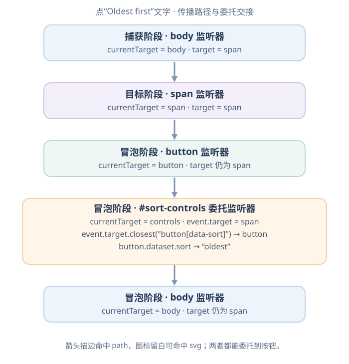

# 浏览器怎样查询、更新 DOM 并响应用户输入？

案例背景：报表页从 `https://example.test/reports?sort=recent#summary` 打开，列表先显示 May、April 两行。用户点击“最早优先”按钮里的文字或图标后，原生 JavaScript 要找到被点的按钮，从它的 `data-sort` 读出 `oldest`，把现有的两行重排成 April、May，并更新按钮状态。Document Object Model（文档对象模型，DOM）把 HTML 文档表示为一棵节点树，JavaScript 通过它查询节点、修改节点状态并响应输入事件。本页只走通普通文档树中的查询、修改和事件处理；用 History API 同步 URL、改由 React 管理状态，分别在相邻章节继续。

本章每个示例都应放在独立页面或独立作用域中运行；把不同示例的顶层代码拼进同一脚本会出错，例如重复声明 `const controls`。同一示例中的 HTML、交互代码和清理代码要一起使用。建表和拖动示例自带 HTML；查询、事件、克隆、排序和尺寸观察示例共用“什么时候用父级监听器处理子控件？”一节给出的 `#sort-controls` / `#reports` 初始 HTML。

## DOM 树里有哪些节点？

DOM 树中的节点有元素节点、文本节点、注释节点等；元素的 attribute（属性）描述元素状态，但 attribute 不是元素的子节点。常用的 `nodeType` 值如下：

| `nodeType` | 节点 | 报表页中的例子 |
|---:|---|---|
| 1 | Element（元素） | `<ol>`、`<li>`、`<button>` |
| 2 | Attr（属性） | `id="reports"`（有 `Attr` 对象，但不是树的子节点） |
| 3 | Text（文本） | `May report` |
| 8 | Comment（注释） | `<!-- 排序控件 -->` |
| 9 | Document（文档） | `document` 本身 |

向上找父级时，`parentNode` 可以返回任何类型的父节点：`<html>` 的 `parentNode` 是 Document，而 `parentElement` 只返回元素父级，所以 `<html>.parentElement` 为 `null`。`nodeName` 命名任意节点，`tagName` 只属于元素；`nodeValue` 读取单个 Text 节点的值，在 Element 上则为 `null`，读取元素后代文字应使用 `textContent`。若要查某行的下一个元素，使用 `nextElementSibling`；`nextSibling` 可能先遇到 HTML 换行空白对应的文本节点。同理，`firstChild` 与 `firstElementChild` 可能不是同一项。`childNodes` 包含文本、注释等节点，`children` 只包含元素；它们的集合更新规则见[修改 DOM 时，HTMLCollection 和 NodeList 会怎样变化？](./dom-collections.md)。

要找到节点，最常用的是 CSS 选择器查询。`querySelector()` 返回第一个匹配元素，没有匹配项时返回 `null`，所以读取结果前要先处理找不到的情况。`querySelectorAll()` 返回由匹配项组成的静态 `NodeList`，之后再插入新按钮，它也不会自动多出成员。

下面的代码使用本章共用的报表初始 HTML（在后文委托一节给出，需先载入）：

~~~javascript
const controls = document.querySelector("#sort-controls");
if (controls) {
  const oldest = controls.querySelector('button[data-sort="oldest"]');
  const buttons = controls.querySelectorAll("button[data-sort]");
  // oldest 是第一个匹配项或 null；buttons 是当前匹配项的静态列表。
}
~~~

`#sort-controls` 按 ID 找到工具栏；`button[data-sort="oldest"]` 同时要求元素名是 `button`、`data-sort` 的值是 `oldest`。选到控件之后，下一步是修改它：可以改文字、改 HTML 属性、改 DOM 对象属性，或调整节点顺序，下一节先区分前三者。

## 修改内容、HTML 属性和 DOM 对象属性有何区别？

写纯文字和写 HTML 标记要用不同接口。`textContent` 读取所有后代文本，赋值时用一个文本节点替换整个子树。`innerText` 读写的是渲染后的文本：元素未渲染时，读取结果退回为后代文本；已渲染时，结果受 CSS 显示状态影响（例如隐藏内容不计入）；赋值时字符串里的换行会变成可见换行。`innerHTML` 读取子树的 HTML 字符串，赋值时把字符串当作 HTML 解析。放入纯文字时用 `textContent`；只有可信或已净化的标记才交给 HTML 解析。

| 写法 | 控制什么 | 报表页上的用途 |
|---|---|---|
| `row.textContent = label` | 文字，不解析 HTML | 写入报表名称 |
| `row.innerText` | 渲染后的文字语义；未渲染时退回后代文本 | 读取或写入可见文本 |
| `row.innerHTML = markup` | 子树的 HTML 标记 | 只有模板可信或已净化时才插入标记 |
| `element.setAttribute(name, value)` | HTML content attribute（HTML 内容属性） | 设置 `data-id`、`alt`、`title` 等声明 |
| `element.classList`、`element.style` | class 集合与内联样式 | 切换状态 class，或写入必要的单次样式 |

HTML 内容属性就是写在标记上的属性；许多 DOM property（DOM 对象属性）会反射（reflect）对应的 attribute，即读写其中一个会同步另一个。但两者不总是等价，文本输入框的 `value` 就是典型例子：`value` 内容属性给出默认值，`input.value` 表示当前值。当前值一旦被修改（变成 dirty），再改 attribute 只会更新默认值，当前值保持不变，直到表单重置。

~~~html
<form id="sort-form">
  <label>排序关键词 <input id="sort-query" value="recent"></label>
</form>
~~~

~~~javascript
const query = document.querySelector("#sort-query");
query.setAttribute("value", "april"); // 尚未修改：当前值也变为 april
const beforeEdit = [query.value, query.defaultValue];

query.value = "oldest"; // 改当前值，并标记为 dirty
query.setAttribute("value", "recent"); // dirty 后只改默认值
const afterEdit = [query.value, query.defaultValue];
query.form.reset(); // 当前值回到默认值，并清除 dirty 标记
const afterReset = [query.value, query.defaultValue];
console.log(JSON.stringify({ beforeEdit, afterEdit, afterReset }));
~~~

上面靠的是 HTML 的 dirty value flag（值已修改标记），它区分当前输入值和默认值；`reset()` 把当前值恢复为默认值并清除标记。另一类容易出错的是 boolean attribute（布尔属性），例如 `disabled`：它只看属性是否存在，不看值，所以 `setAttribute("disabled", "false")` 照样会禁用元素。`button.disabled = false` 只移除按钮自己的禁用属性，不一定让它变为可用：如果按钮位于禁用的 `fieldset` 中，它仍然匹配 `:disabled`。例外是该 fieldset 的第一个 `legend` 子元素内的控件，它们不受 fieldset 禁用影响。

~~~html
<fieldset disabled>
  <legend>
    <button id="legend-button" type="button">例外位置</button>
  </legend>
  <button id="inherited-button" type="button">受 fieldset 禁用</button>
</fieldset>
<button id="own-button" type="button">自己的 disabled 属性</button>
~~~

~~~javascript
const inherited = document.querySelector("#inherited-button");
inherited.disabled = false;
const own = document.querySelector("#own-button");
own.setAttribute("disabled", "false");
const setToFalse = [own.disabled, own.matches(":disabled")];
own.disabled = false;
const afterClearingOwn = [own.disabled, own.matches(":disabled")];

const states = {
  ownAttribute: setToFalse,
  afterClearingOwn,
  inherited: [inherited.disabled, inherited.matches(":disabled")],
  firstLegend: [
    document.querySelector("#legend-button").disabled,
    document.querySelector("#legend-button").matches(":disabled"),
  ],
};
console.log(JSON.stringify(states));
// ownAttribute: [true, true]; afterClearingOwn: [false, false]
// inherited: [false, true]; firstLegend: [false, false]
~~~

| 控件状态 | `button.disabled` | `matches(":disabled")` | 原因 |
| --- | --- | --- | --- |
| 给自身 `setAttribute("disabled", "false")` 后 | `true` | `true` | 布尔属性只看是否存在。 |
| 再设自身 `disabled = false` 后 | `false` | `false` | 移除了自身的禁用属性。 |
| 禁用 fieldset 的普通后代 | `false` | `true` | 控件自身未禁用，但祖先 fieldset 生效。 |
| fieldset 的第一个 `legend` 元素子节点内的后代 | `false` | `false` | 该位置不继承 fieldset 的禁用。 |

若要检查 HTML 表单禁用状态（包含 `fieldset` 继承），用 `button.matches(":disabled")`；若只想读写元素自己的禁用属性，用 `button.disabled`。

改元素外观时，`className = "selected"` 会整体替换 class 字符串；`classList.add()`、`remove()` 和 `toggle()` 改单个类。`element.style.backgroundColor` 只读写行内的声明；样式表计算出的生效值要用 `getComputedStyle(element)` 读取。CSS property 在 JavaScript 里通常使用 camelCase（小驼峰）。`data-id="may"` 可通过 `row.dataset.id` 读取与设置，`dataset` 中已存在的值是字符串，缺少的 data 属性读到 `undefined`。多段名称会转为小驼峰，例如 `data-report-id` 对应 `dataset.reportId`。图片的 `src` 选择资源，`alt` 提供替代文本（装饰图可用空值），`title` 是补充信息，不能替代 `alt`。

~~~javascript
const textDemo = document.createElement("div");
document.body.append(textDemo); // 附加到页面后，innerText 按渲染文本处理
textDemo.textContent = "<b>May</b>";
const literal = [textDemo.textContent, textDemo.children.length];
textDemo.innerText = "May\nReport";
const visibleLines = [textDemo.innerHTML, textDemo.innerText];
console.log(JSON.stringify({ literal, visibleLines }));
// literal: ["<b>May</b>", 0]
// visibleLines: ["May Report", "May\nReport"]
~~~

## 怎样生成、移动或克隆一组节点？

前面修改的都是已有节点；页面还常常需要从数据生成新节点。这里暂时离开报表，用一张独立的学校成绩表演示：表格固定按 Name、Subject、Grade 三列排列，三条记录应分别显示 Ron—Math—100、Jack—Calculus—70、Mar—Business—90。列顺序由代码中的 `columns` 数组定义，而不是依赖对象字段的书写顺序：

~~~html
<table>
  <thead><tr><th>Name</th><th>Subject</th><th>Grade</th></tr></thead>
  <tbody id="students"></tbody>
</table>
~~~

~~~javascript
const students = [
  { name: "Ron", subject: "Math", grade: "100" },
  { name: "Jack", subject: "Calculus", grade: "70" },
  { name: "Mar", subject: "Business", grade: "90" },
];
const columns = ["name", "subject", "grade"];
const body = document.querySelector("#students");

for (const student of students) {
  const row = document.createElement("tr");
  for (const column of columns) {
    const cell = document.createElement("td");
    cell.textContent = student[column];
    row.append(cell);
  }
  body.append(row);
}
~~~

每条记录都按同一份 `columns` 生成三格，数据值只写入文本节点，不会被当作 HTML 解析。`append()` 会把新节点追加到末尾；若传入已经在文档中的节点，它会将该节点移动到新位置。`insertBefore(node, reference)` 把节点放到参考节点前，`remove()` 将节点从树上移除。

`cloneNode(true)` 会复制节点、全部后代和 HTML attribute。写在标记里的 `onclick="..."` 是内容属性，会随节点复制；通过 `element.onclick = handler` 赋值的处理函数和 `addEventListener()` 注册的监听器都不会复制。如果副本或其后代带有 `id`，插入同一文档前要改成不冲突的 ID，并同步更新指向它们的引用。需要副本也有行为时，在新节点上重新注册监听器。

下面的例子回到报表列表，单独从委托一节的两行初始 HTML 运行：May 行带 `data-id="may"` 和 `data-date="2026-05-01"`，自身和后代都没有 `id`。深克隆会保留这两个 data 属性，代码再给副本加一个文档内唯一的 `id`。运行后列表会多出一行 May 副本，所以它与后面两行排序的例子不是同一轮状态。

~~~javascript
function handleReportClick(event) {
  console.log(event.currentTarget.dataset.id);
}

const source = document.querySelector('#reports [data-id="may"]');
const copy = source.cloneNode(true);
copy.id = "may-row-copy"; // 新增 DOM id；data-id 仍标识 May 报表
copy.addEventListener("click", handleReportClick);
document.querySelector("#reports").append(copy);
~~~

上例用 `addEventListener()` 而不是 `onclick` 属性，是因为给同一元素的 `onclick` 赋新函数会替换掉先前的函数；多处代码都要监听时，`addEventListener()` 让每段代码各自注册和移除 listener（监听器）。只需响应一次时可传 `{ once: true }`。要提前移除，需保留原函数引用，并用相同的 `capture` 选项（是否在下一节所说的捕获阶段监听）调用 `removeEventListener()`。也可以把同一个 `AbortSignal`（中止信号）传给多个监听器，页面区域销毁时调用 `abort()` 一并清理。

## 一次点击沿哪些节点传播？

监听器注册好后，一次点击会触发哪些监听器、按什么顺序？浏览器先为事件确定 event path（传播路径），即从 `Window` 到被点节点的祖先链；监听器随后可在三个阶段运行：capture phase（捕获阶段，从外向内）、target phase（目标阶段）和 bubble phase（冒泡阶段，从内向外）。下面只讨论普通 DOM 树中的 click：点按钮上的标签文字时 `target` 是 `span`；点 SVG 箭头的可见描边时 `target` 是 `<path>`；点图标的留白处则可能是 `svg`。这段代码只打印事件顺序：

~~~javascript
const controls = document.querySelector("#sort-controls");
const button = controls.querySelector('button[data-sort="oldest"]');
const label = button.querySelector(".sort-label");

document.body.addEventListener("click", () => console.log("body capture"), {
  capture: true,
});
label.addEventListener("click", () => console.log("span target"));
button.addEventListener("click", () => console.log("button bubble"));
controls.addEventListener("click", () => console.log("controls bubble"));
document.body.addEventListener("click", () => console.log("body bubble"));
~~~

点标签文字时，上面日志按 body 捕获、span 目标、button 冒泡、controls 冒泡、body 冒泡的顺序运行：

图对应点击文字时的日志。图中工具栏一层还画出了下一节注册的委托监听器，表示事件冒泡到 `#sort-controls` 后由它接手；它不是上面只打印日志的 `controls bubble` 回调。点箭头描边时，路径为 `path → svg → button → #sort-controls → body`；点图标留白时从 `svg` 开始，随后经过同样的祖先。委托器从实际命中的 `event.target` 向上找到按钮，两条路径都不经过 `.sort-label` span。

在一次普通 DOM 派发中，`event.target` 始终是最初命中的节点；`event.currentTarget` 则是当前正在运行的监听器所绑定的节点。点文字时，`currentTarget` 依次是 `body`、`span`、按钮、工具栏和 `body`。用普通函数注册的监听器中，`this` 也指向 `currentTarget`；箭头函数的 `this` 则沿用定义处的词法绑定。图不覆盖 Shadow DOM（影子 DOM）：跨影子边界时 `target` 可能被重定向；`bubbles` 决定是否向普通祖先冒泡，`composed` 决定能否穿过影子边界，二者不是同一开关。输入框获得和失去焦点时分别派发 `focus` 与 `blur`，这两个原生事件不冒泡；父级要委托焦点变化时可监听会冒泡的 `focusin` 与 `focusout`。

## 什么时候用父级监听器处理子控件？

冒泡意味着祖先节点能收到后代上发生的事件，event delegation（事件委托）正是利用这一点：在父级注册一个监听器，处理多个后代控件，包括之后才插入的控件，不必逐个注册。它适用于事件会冒泡、父级确实拥有这些控件、并且能清楚判断目标属于哪个控件的场景；它减少的是注册次数，每次事件分发和处理器本身的计算并不会少。下面是本章共用的报表初始 HTML：

~~~html
<h1 id="summary">Recent reports</h1>

  <button type="button" data-sort="recent" aria-pressed="true">
    Most recent
  </button>
  <button type="button" data-sort="oldest" aria-pressed="false">
    <svg class="sort-icon" width="16" height="16" viewBox="0 0 16 16"
         aria-hidden="true">
      <path d="M8 13V3m-4 4 4-4 4 4" fill="none" stroke="currentColor"
            stroke-width="1.5" stroke-linecap="round" stroke-linejoin="round" />
    </svg>
    Oldest first
  </button>

<ol id="reports">
  <li data-id="may" data-date="2026-05-01">May report</li>
  <li data-id="april" data-date="2026-04-01">April report</li>
</ol>
~~~

图标 SVG 设为 `16 × 16`，内部 `path` 画出箭头，因此页面中有实际可见的命中区域；旁边的文字已经说明按钮用途，图标用 `aria-hidden="true"` 隐藏其重复信息。

~~~css
#sort-controls .sort-icon {
  vertical-align: -0.15em;
}
~~~

~~~javascript
const controls = document.querySelector("#sort-controls");
const reports = document.querySelector("#reports");

function applySort(intent, activeButton) {
  if (intent !== "recent" && intent !== "oldest") return;

  const rows = Array.from(
    reports.querySelectorAll(":scope > li[data-date]")
  );
  const direction = intent === "oldest" ? 1 : -1;
  rows.sort((a, b) =>
    direction * a.dataset.date.localeCompare(b.dataset.date)
  );
  for (const row of rows) reports.append(row);

  for (const button of controls.querySelectorAll("button[data-sort]")) {
    button.setAttribute("aria-pressed", String(button === activeButton));
  }
}

controls.addEventListener("click", (event) => {
  const target = event.target instanceof Element ? event.target : null;
  const button = target?.closest("button[data-sort]");
  if (!button || !controls.contains(button)) return;

  const intent = button.dataset.sort;
  console.log("Sort requested:", intent); // 点击“最早优先”时得到 "oldest"
  applySort(intent, button);
});
~~~

点击标签文字或图标时，`closest()` 从命中的后代向上找到带 `data-sort` 的按钮；`controls.contains(button)` 确认该按钮属于这个工具栏，而不是工具栏外层恰好也匹配的元素。处理器读到 `oldest` 后，`applySort()` 先拒绝未知的排序值，再比较两行 `data-date` 中的 ISO 日期字符串（`YYYY-MM-DD` 格式按字典序比较即按时间先后）。`querySelectorAll()` 给出当前行的静态集合，`Array.from()` 把它变为可排序数组；对现有行调用 `append()` 会移动节点，而不是重新创建行。事件处理器同步完成后，本例得到：

| 时点 / 意图 | 行顺序（`data-id`） | `recent` | `oldest` |
| --- | --- | --- | --- |
| 初始 HTML / `recent` | `may` → `april` | `aria-pressed="true"` | `aria-pressed="false"` |
| 点击处理完成 / `oldest` | `april` → `may` | `aria-pressed="false"` | `aria-pressed="true"` |

本节的 `applySort()` 只负责把排序意图落实为 DOM 顺序和按钮状态；完整页面还要让 URL 和前进/后退与这份状态同步，见[每次 URL 变化都会加载新文档吗？](../browser/browser-navigation-and-history.md)。若操作会删除匹配节点并继续遍历，应先取静态快照，避免移除节点改变实时集合；集合差异见[修改 DOM 时，HTMLCollection 和 NodeList 会怎样变化？](./dom-collections.md)。

## 默认动作与传播控制是两回事

委托示例中的按钮写了 `type="button"`，原因在于：位于表单中的按钮默认是提交按钮，点击会触发表单提交。这种浏览器自带的 default action（默认动作）与事件传播是两回事，控制它们的方法也不同：

- `preventDefault()` 取消默认动作，但前提是事件可取消（`cancelable` 为 true）且监听器不是 passive listener（被动监听器）；它不会停止冒泡。
- `stopPropagation()` 阻止事件继续传到路径上的下一个节点，但当前节点上同一轮（同为捕获或同为非捕获）剩余的监听器仍会执行。目标节点是个特例：浏览器先调用目标上的捕获监听器、再调用非捕获监听器（两轮中 `eventPhase` 都是 `AT_TARGET`），若捕获监听器调用了 `stopPropagation()`，目标上的非捕获监听器也会被跳过。
- `stopImmediatePropagation()` 在 `stopPropagation()` 的基础上，还会跳过当前节点本轮剩余的监听器。

两者都不会取消默认动作。

滚轮或触摸监听器如果不需要阻止浏览器默认滚动，可以设置 `{ passive: true }` 声明这一点，浏览器就不必等监听器执行完再滚动；被动监听器里调用 `preventDefault()` 不起作用。DOM 标准还规定，注册在 `Window`、`Document`、`documentElement` 或 `body` 上的 `touchstart`、`touchmove`、`wheel` 和 `mousewheel` 监听器，若未显式设置 `passive`，默认就是 passive。确实需要拦截滚动时，要显式设置 `{ passive: false }`，并在调用 `preventDefault()` 前检查事件的 `cancelable`。

## 移动端点击与手势策略

默认动作不只来自表单，触摸手势也是。移动端曾有 click 延迟：部分浏览器在一次轻触后要等一会儿，判断它是否会成为双击缩放。这只在特定条件下发生，不是今天所有浏览器、所有 viewport（视口）或所有输入方式下都有的固定延迟。Chrome 的 viewport 诊断说明，初始视口未针对移动设备优化时，点击可能延后最多 300 毫秒；其他浏览器和设置会有不同。首先应设置与设备宽度一致的 viewport，不要为了绕开这种延迟而禁止用户缩放：

~~~html
<meta name="viewport" content="width=device-width, initial-scale=1">
~~~

若某个控件不需要双击缩放，但仍应允许平移和双指缩放，可以对该控件使用 Pointer Events（指针事件）的 `touch-action: manipulation`：

~~~css
#sort-controls button[data-sort] {
  touch-action: manipulation;
}
~~~

它让浏览器在该元素上保留平移和双指缩放，但不再把双击识别为缩放手势。只对确实需要的控件使用这条规则，不要用 `touch-action: none` 全局禁止触摸操作。除非在目标设备上实测仍有问题，不要同时在 `touchend` 和 `click` 上触发同一动作，否则触摸后浏览器派发的 click 会让动作执行两次。另外，原生 `<button>` 自带键盘激活（Enter、空格）；用 `role="button"` 自制的按钮必须自己补上键盘行为，这正是下一节的主题。

## 键盘事件怎样区分按键含义、位置与重复？

`keydown` 表示按下，`keyup` 表示释放；系统开启按键自动重复时，按住不放通常还会持续产生 `keydown`。`key` 表示当前布局和修饰键下的按键含义，`code` 则识别物理按键位置。下表是美式键盘上三个独立情形，不是一段连续输入记录：

| 收到的 `keydown` | `key` | `code` | `repeat` |
| --- | --- | --- | --- |
| 初次按下数字 2 | `"2"` | `"Digit2"` | `false` |
| 按住 Shift 后初次按下同一键 | `"@"` | `"Digit2"` | `false` |
| 不按 Shift，长按 2 产生后续自动重复 | `"2"` | `"Digit2"` | `true` |

判断“向左移动”这类按键语义时，读 `key === "ArrowLeft"`；确实要固定物理位置的游戏控制等场景，才考虑 `code`，同时处理不同键盘和输入设备的差异。下一节的卡片移动使用 `key`，每个方向键 `keydown` 移动一步，所以按住方向键会连续移动。如果某个动作要求每次按下只执行一次，可以忽略 `event.repeat` 为 `true` 的事件；但这不能代替限流或服务端去重。

旧 `keypress` 以及数字式 `keyCode` / `which` 属于兼容接口，新代码不应据此判断字符。键盘事件也不等于文本变化：粘贴、语音输入和 Input Method Editor（输入法编辑器，IME）都可能改变文本。观察编辑结果用 `input`；确需处理编辑意图时再结合 `beforeinput` 与 composition（组合输入）过程，不要假定每次 `keydown` 都输入一个字符。`addEventListener` 接受 `"keydown"` 这样的事件名，不加 DOM 属性 `onkeydown` 中的 `on` 前缀。

## 拖动时怎样跟踪坐标并处理取消？

Pointer Events（指针事件）把鼠标、触摸和笔的输入统一成 pointer 事件。一次拖动不只有 `pointermove`：它从 `pointerdown` 开始，可以调用 `setPointerCapture(pointerId)` 让这个指针的后续事件都发给被拖动的元素；正常松开时收到 `pointerup`，系统接管手势（例如转为页面滚动）时收到 `pointercancel`；指针捕获被释放时（包括 `pointerup` 或 `pointercancel` 之后的自动释放）还会收到 `lostpointercapture`。处理结束事件时要按 `pointerId` 匹配当前拖动，避免另一根手指或过期事件错误地结束这次拖动。

坐标属性对应不同参照系：

| 属性 | 参照系 | 适合回答的问题 |
|---|---|---|
| `clientX / clientY` | viewport（视口） | 指针现在相对当前可视区域在哪里 |
| `pageX / pageY` | 文档 | 指针在页面内容坐标中在哪里 |
| `screenX / screenY` | 屏幕 | 指针相对设备显示区域的位置 |

下面把一张报表卡片放进定位容器。卡片的位移等于指针 client 坐标的变化量，起点是卡片相对该容器的 `offsetLeft` / `offsetTop`。本例假设容器没有 CSS 缩放或旋转，拖动期间页面和容器也不滚动；在此条件下，指针在视口中移动多少 CSS 像素，卡片就移动多少。如果有变换或滚动，需要先把坐标换算到同一个参照系。

~~~html

  <button id="movable-report" type="button" aria-describedby="move-report-help">
    May report
  </button>

鼠标或触摸拖动卡片；聚焦后也可用方向键移动。

~~~

~~~css
#report-canvas {
  position: relative;
  width: 24rem;
  height: 12rem;
  border: 1px solid;
}

#movable-report {
  position: absolute;
  left: 0;
  top: 0;
  touch-action: none;
}
~~~

~~~javascript
const card = document.querySelector("#movable-report");
let drag = null;

card.addEventListener("pointerdown", (event) => {
  const nonPrimary = !event.isPrimary;
  const secondaryMouse = event.pointerType === "mouse" && event.button !== 0;
  if (drag || nonPrimary || secondaryMouse) return;
  drag = {
    pointerId: event.pointerId,
    x: event.clientX,
    y: event.clientY,
    left: card.offsetLeft,
    top: card.offsetTop,
  };
  card.setPointerCapture(event.pointerId);
});

card.addEventListener("pointermove", (event) => {
  if (!drag || drag.pointerId !== event.pointerId) return;
  const left = drag.left + event.clientX - drag.x;
  const top = drag.top + event.clientY - drag.y;
  card.style.left = `${left}px`;
  card.style.top = `${top}px`;
});

function finishDrag(event, canceled = false) {
  if (!drag || drag.pointerId !== event.pointerId) {
    return;
  }
  const start = drag;
  drag = null;
  if (canceled) {
    card.style.left = start.left + "px";
    card.style.top = start.top + "px";
  }
}

card.addEventListener("pointerup", finishDrag);
card.addEventListener(
  "pointercancel",
  (event) => finishDrag(event, true),
);
card.addEventListener(
  "lostpointercapture",
  (event) => finishDrag(event, true),
);

card.addEventListener("keydown", (event) => {
  const step = event.shiftKey ? 24 : 8;
  let dx = 0;
  let dy = 0;
  if (event.key === "ArrowLeft") dx = -step;
  else if (event.key === "ArrowRight") dx = step;
  else if (event.key === "ArrowUp") dy = -step;
  else if (event.key === "ArrowDown") dy = step;
  else return;

  event.preventDefault();
  card.style.left = `${card.offsetLeft + dx}px`;
  card.style.top = `${card.offsetTop + dy}px`;
});
~~~

卡片仍在文档中时，指针捕获让它在指针移出卡片后仍能收到同一指针的移动和结束事件。正常松开时，`pointerup` 先到达并把 `drag` 清空，保留新位置；随后自动释放捕获产生的 `lostpointercapture` 因 `drag` 已为空而被忽略。只有 `pointercancel` 或意外丢失捕获时，卡片才回到拖动起点。

如果捕获中的卡片被移出文档，规范建议（SHOULD）把 `lostpointercapture` 改发给 `document`，因此卸载时不能指望卡片自己的监听器收到它。卸载这块区域时，应先清空拖动状态、释放捕获，再移除节点；下面的清理函数与前面的拖动代码共用同一作用域中的 `card` 和 `drag`：

~~~javascript
function disposeCard() {
  const activeDrag = drag;
  drag = null;
  if (activeDrag && card.hasPointerCapture(activeDrag.pointerId)) {
    card.releasePointerCapture(activeDrag.pointerId);
  }
  card.remove();
}
~~~

CSS 中的 `touch-action: none` 禁止从卡片上开始的视口平移和缩放，否则触摸拖动会被浏览器当作滚动并触发 `pointercancel`；它只应放在确实需要拖动的小控件上，页面其余区域仍可正常滚动。类似地，`contextmenu` 和 `selectstart` 的默认动作可以在特定的自定义交互上取消，但在全页禁用右键菜单或文字选择会拿走浏览器本身提供的操作，而且起不到任何安全作用。

## 窗口 resize、元素尺寸与 scroll 应监听在哪里？

拖动跟踪的是指针位置；页面布局本身也会变化，需要另外的事件。`resize` 事件只反映窗口（视口）尺寸变化；要响应某个报表容器自身的尺寸变化，使用 `ResizeObserver`（尺寸变化观察器）。`scroll` 事件要监听在页面或实际发生滚动的那个容器上：元素滚动时派发的 `scroll` 不冒泡，不能指望在任意父级收到。这两种事件都可能高频触发，处理器只应做界面确实需要的更新。

有人会按浏览器类型决定用哪种方式，这并不可靠。Navigator 对象提供一些环境线索：`navigator.language` 是浏览器报告的首选语言，`navigator.platform` 是平台字符串，`navigator.userAgent` 是 user-agent 字符串（用户代理字符串）。语言不是国籍，平台或 user-agent 字符串也不能证明某个 API 可用；相关识别信息还会增加隐私暴露。页面需要容器尺寸能力时，直接检测 `ResizeObserver`，不按浏览器品牌猜测。

~~~javascript
const reportList = document.querySelector("#reports");
const lifetime = new AbortController();
let sizeObserver = null;

function recordViewportWidth() {
  if (reportList) {
    reportList.dataset.viewportWidth = String(window.innerWidth);
  }
}

if (reportList && typeof ResizeObserver === "function") {
  sizeObserver = new ResizeObserver(([entry]) => {
    if (!entry) return;
    reportList.dataset.containerWidth = String(
      Math.round(entry.contentRect.width)
    );
  });
  sizeObserver.observe(reportList);
} else if (reportList) {
  window.addEventListener("resize", recordViewportWidth, {
    signal: lifetime.signal,
  });
  recordViewportWidth();
}

function stopObservingReport() {
  lifetime.abort();
  sizeObserver?.disconnect();
}
~~~

支持 `ResizeObserver` 时，记录的是报表容器的实际宽度；退回 `window` 的 `resize` 时只能知道视口变化，父容器单独改变大小不会触发它。移除这块页面区域的代码负责调用 `stopObservingReport()`：`AbortController`（中止控制器）的 `abort()` 一次移除所有用它的 `signal` 注册的监听器，`ResizeObserver` 则调用 `disconnect()` 停止观察。文档就绪和页面加载完成时，`DOMContentLoaded` / `load` 的触发条件见[脚本如何影响 HTML 解析与文档就绪？](../html-css/browser-html-and-css.md)。

## 把浏览器事件交给 React 时，交接什么？

如果同一报表页改由 React 管理，浏览器仍然照常派发 click；React 的 `onClick` 处理函数读出排序意图 `oldest`，把它交给 state（状态）更新，而不是像前面那样直接移动 DOM 节点。浏览器这一侧交出的是点击事件和当前 DOM，应用拿到的是“排序变为 `oldest`”这个意图。React 章节从这里继续，讲状态快照、组件重新计算和 commit（提交）阶段需要的 DOM 变化。见[React 如何把一次用户操作变成界面更新？](../frameworks/react-basics.md)。React 管理的节点应由 React 状态描述；若另用 DOM API 直接改它们，下一次 React 提交可能覆盖这些修改。

React 的 JSX 事件处理函数收到的是 SyntheticEvent（合成事件），它保留了常用的 DOM 事件概念：`onClick` 在冒泡阶段运行，`onClickCapture` 对应捕获阶段。处理函数执行期间，`currentTarget` 指向写了该 JSX 事件属性的元素。React 17 起不再复用（池化）事件对象，但每个处理函数返回后，React 仍会把 `event.currentTarget` 重置为 `null`。所以在 `await` 或延迟回调之前，要先把 `event.currentTarget.dataset.sort` 读成普通字符串。这里的 `handleSort` 直接绑定到带筛选意图的按钮，例如 `<button data-sort="oldest" onClick={handleSort}>Oldest first</button>`；若把处理器绑定到工具栏，`currentTarget` 就是工具栏，而不是带 `data-sort` 的按钮：

~~~jsx
async function handleSort(event) {
  const intent = event.currentTarget.dataset.sort;
  await savePreference(intent);
  setSort(intent); // 使用已保存的字符串，不再读取 event.currentTarget
}
~~~

`persist()` 在 React DOM 中已无作用，不能用它延长 `currentTarget` 的有效期；这里应保存的是 `intent` 字符串。React 17 还把内部委托监听器从 `document` 移到了 React 根容器（root container），但这不改变 React 事件对象中 `currentTarget` 的含义。另一个差异是：原生 `focus`、`blur` 不冒泡，React 的 `onFocus`、`onBlur` 却会沿 React 树冒泡。React Native 的事件系统另有规则，不适用本节结论。

**延伸：**[浏览器如何把 URL 变成第一帧？](../browser/browser-basics.md)交代该页面的首帧和筛选入口；[每次 URL 变化都会加载新文档吗？](../browser/browser-navigation-and-history.md)展示同一点击如何更新历史地址和列表；[浏览器 JavaScript 何时运行，画面何时更新？](../runtime/event-loop.md)说明 click 处理器如何等待主线程并交接到渲染机会；[同一报表在多个标签页中怎样交换变化？](./browser-context-communication.md)讲跨文档消息；[JavaScript 事件总线在监听器中重入时怎样保持顺序？](./event-bus-and-observer-patterns.md)讨论应用层发布/订阅。

> [!info]- 来源
> - 查询、树节点与事件机制：[WHATWG DOM，Living Standard（2026-11-11 更新）](https://dom.spec.whatwg.org/) 的 [`querySelector()`](https://dom.spec.whatwg.org/#dom-parentnode-queryselector)、[`querySelectorAll()`](https://dom.spec.whatwg.org/#dom-parentnode-queryselectorall)、[节点复制算法](https://dom.spec.whatwg.org/#concept-node-clone)、[事件分发、invoke 与 inner invoke](https://dom.spec.whatwg.org/#concept-event-dispatch)。涵盖首个匹配、静态结果、cloneNode 复制范围、事件阶段、`target` / `currentTarget`、传播和取消。核对日期：2026-11-12。
> - 输入框默认值、dirty value flag 与表单 reset：[WHATWG HTML，input element](https://html.spec.whatwg.org/multipage/input.html#the-input-element)；表单控件及 fieldset 的禁用规则：[form control infrastructure](https://html.spec.whatwg.org/multipage/form-control-infrastructure.html#enabling-and-disabling-form-controls:-the-disabled-attribute) 与 [fieldset element](https://html.spec.whatwg.org/multipage/form-elements.html#the-fieldset-element)。包含 first-legend 例外。持续更新规范，核对日期：2026-11-12。
> - `innerText` 的读取和写入、`data-*` 与 `dataset`、HTML 属性：[WHATWG HTML，DOM](https://html.spec.whatwg.org/multipage/dom.html#the-innertext-and-outertext-properties)，§3.2.4、§3.2.6.6、§3.2.7；图片 `src` 与 `alt`：[The `img` element](https://html.spec.whatwg.org/multipage/embedded-content.html#the-img-element)。持续更新规范，核对日期：2026-11-12。
> - `element.style` 读取行内声明、`getComputedStyle()` 读取解析后的样式：[CSS Object Model (CSSOM) Level 1](https://drafts.csswg.org/cssom/)，§7。CSS Working Group Editor’s Draft，核对日期：2026-11-12。
> - passive 默认值与 `preventDefault()` 的条件：[WHATWG DOM，addEventListener](https://dom.spec.whatwg.org/#dom-eventtarget-addeventlistener)。窗口尺寸、页面与元素滚动的目标：[CSSOM View](https://drafts.csswg.org/cssom-view/)，CSS Working Group Editor’s Draft，核对日期：2026-11-12。
> - pointer capture、取消和 `touch-action`：[Pointer Events Level 3](https://www.w3.org/TR/pointerevents3/)，W3C Recommendation，2026-06-30，§§4.1、5.1、7；元素尺寸观察与 `disconnect()`：[Resize Observer](https://drafts.csswg.org/resize-observer/)，CSS Working Group Editor’s Draft。均核对日期：2026-11-12。
> - `key`、`code`、修饰键与自动重复，以及旧 `keypress` 和文本编辑事件的边界：[UI Events](https://www.w3.org/TR/uievents/)，KeyboardEvent 与 Legacy KeyboardEvent；物理键名：[UI Events code Values](https://www.w3.org/TR/uievents-code/)。核对日期：2026-11-13。键盘表按规范中的美式布局条件说明，不表示所有设备都提供相同按键布局或自动重复设置。
> - SVG 可点击区域按可见 fill/stroke 和 `pointer-events` 规则命中：[SVG 2，Pointer Events property](https://www.w3.org/TR/SVG2/interact.html#PointerEventsProperty)，W3C Candidate Recommendation Snapshot（2026-10-06），核对日期：2026-11-12。
> - 初始 viewport 未适配移动设备时，点击可能延迟至多 300 毫秒：[Chrome Performance Insights：Optimize viewport for mobile](https://developer.chrome.com/docs/performance/insights/viewport)，适用条件见文档，发布于 2025-10-08，核对日期：2026-11-12。
> - React DOM 事件对象、`currentTarget` 与 React DOM 不使用 `persist()`：[React event object](https://react.dev/reference/react-dom/components/common#react-event-object)；React 17 移除事件池并把委托根移入 root container：[React 17 release notes](https://legacy.reactjs.org/blog/2020/10/20/react-v17.html)。本文关于监听器返回后清空 `currentTarget` 的版本结论以 [React DOM v19.2.0 分发源码](https://github.com/facebook/react/blob/v19.2.0/packages/react-dom-bindings/src/events/DOMPluginEventSystem.js#L240-L252) 为准；React `onFocus`、`onBlur` 的传播说明见同一发布说明。核对日期：2026-11-12。
> - Navigator 的语言、平台和 userAgent 接口及隐私要求：[WHATWG HTML，Navigator object](https://html.spec.whatwg.org/multipage/system-state.html#the-navigator-object)。持续更新规范，核对日期：2026-11-12。
