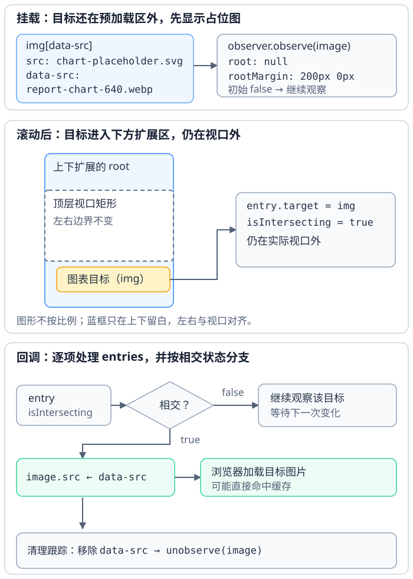

# 图片与媒体资源怎样加载并保持页面稳定？

案例背景：一份公开的合成报表要展示四月至六月的趋势图。这张图要有合适的替代文本，要按屏幕尺寸选择合适的文件；如果它在首屏之外，可以晚些再请求，但图片到达前后页面布局不应跳动。本文按这个顺序展开：先确定元素语义和资源地址，再选择候选文件和请求时机，最后检查资源到达前后页面几何是否变化。

> [!info] 替代文本由用途决定
> alternative text（替代文本）通过 `alt` 属性提供。纯装饰图写 `alt=""`；传达信息的图用简洁文字说出页面需要的信息；图片是链接或按钮的唯一内容时，写出该控件的用途。复杂图表先用简短的 alt 说明内容和主要结论，再由旁边的正文或数据表给出完整信息。`title` 不能代替图像的 `alt`；同理，表单控件应优先用关联的 `<label>` 提供名称，`title` 作为备选并不可靠。

## 先按内容选择图像与媒体元素

图像内容用 ``，导航目标用 `<a href>`，可播放的音频和视频分别用 `<audio>`、`<video>`。本例的趋势图用 `alt` 简述四月至六月的变化和六月的最高点；只有当旁边的数据表已经提供全部信息、图像不再增加内容时，才把它当作装饰图写 `alt=""`。语义和替代文本确定后，再配置文件地址和加载策略。

## 资源地址相对哪个基准？

| 写法 | 示例 | 解析位置 |
| --- | --- | --- |
| 绝对 URL（带 scheme，即 `https:` 这类方案前缀） | `https://example.com/a.png` | 直接使用 URL 自身的方案和地址；`mailto:team@example.com` 也是绝对 URL，但没有主机 |
| 根相对路径 | `/assets/chart.png` | 从文档基准 URL 的 origin（源）根目录解析；`<base>` 可能改变 origin |
| 文档相对路径 | `../assets/chart.png` | 默认相对当前文档 URL；`<base>` 可改变文档基准 URL |

`` 的 `src` 指向要载入的图片资源，`<a>` 的 `href` 指向导航目标，两者都按上表解析。根相对 URL 并不总是相对页面所在的站点：若 `<base href="https://cdn.example.net/reports/q4/">` 改变文档基准，`/assets/chart.png` 会解析为 `https://cdn.example.net/assets/chart.png`，`../assets/chart.png` 则解析为 `https://cdn.example.net/reports/assets/chart.png`。把本机文件路径 `/project/site/image.png` 写进通过 HTTP 访问的页面，浏览器不会去读本机文件，而是把它当作根相对路径，按文档基准 URL 向服务器请求；服务器必须真的在这个路径上提供资源。

顺带区分链接和按钮：用 `<a>` 导航，用 `<button>` 执行动作；`href="#"` 会改变片段位置，还可能产生历史记录，不是“什么都不做”的占位写法。链接文字要能说明去向。确需在新页面打开时，`target="_blank"` 请求新的浏览上下文；按当前 HTML 标准，只要没写 `rel="opener"`，它默认具有 `noopener` 效果，新页面拿不到指向原页面的 `opener` 引用。显式写上 `rel="noopener"` 可以把意图标在标记上，也照顾较旧的浏览器。

## 原生延迟加载适合什么图片？

地址确定后，下一个问题是何时请求。首屏之外的普通内容图片可以使用 HTML 的 `loading="lazy"`，由浏览器推迟请求，直到图片接近视口。具体在距离视口多远时开始请求由浏览器决定，不是可依赖的固定值。元素仍要写真实的 `src` 或 `srcset`；只写 `data-src` 浏览器根本不会发起请求。

~~~html

~~~

`width` 和 `height` 让浏览器在图片到达前就知道宽高比，从而预留空间。上例按 `640 ÷ 360 = 16:9` 预留空间；如果 CSS 让图片宽 `320px` 并写 `height: auto`，匹配的 `16:9` 文件到达前，预留高度为 `320 × 9 ÷ 16 = 180px`。这些属性应对应实际资源比例；若文件实际是 `800 × 600` 的 `4:3`，浏览器拿到自然尺寸后可能把高度改为 `320 × 3 ÷ 4 = 240px`，布局因此再增高 `60px`。不同裁切的图片尤其要检查宽高比，或用容器的 `aspect-ratio` 与合适的 `object-fit` 控制展示盒。在 DevTools 模拟慢网，分别于图片自然尺寸可用前后读取 `getBoundingClientRect().height`，可以检查预留高度是否稳定。

反过来，首屏的主图不该延迟。已确认是 Largest Contentful Paint（最大内容绘制，LCP）元素的图片不应设置 `loading="lazy"`；首屏可见且很可能成为 LCP 的主图，也应写在初始 HTML 中让浏览器尽早发现并请求，因为发现或请求得越晚，LCP 就越晚。如果测量显示它的请求优先级不够，且目标浏览器支持，再考虑加 `fetchpriority="high"`。这只是优先级提示，不保证生效，也不应给大量资源都标高。

脚本被禁用时，HTML 标准规定 `loading="lazy"` 不再延迟请求：否则网站可以在不运行脚本的情况下，借图片请求时间推测用户滚动到了哪里。由于原生 `loading` 把真实地址留在 HTML 中，脚本被禁用时图片照样加载；这一点与下文用 JavaScript 改写 `src` 的自定义做法不同。

## 响应式候选文件怎样被选中？

请求时机解决了“何时下载”，还要决定“下载哪个文件”。`srcset` 列出候选文件，其中的 `640w`、`1280w` 是各文件本身的像素宽度；`sizes` 告诉浏览器布局会给图像留出多宽（CSS 像素）。下面的样式让图像在视口不宽于 `640px` 时占满视口宽度、在更宽的屏幕上固定为 `640px`，与 `sizes` 的写法一致。首屏外的图片可以在同一个 `` 上同时使用 `loading="lazy"`、`srcset`、`sizes` 和尺寸属性：

~~~html

~~~

~~~css
.report-responsive {
  display: block;
  width: min(100vw, 640px);
  height: auto;
}
~~~

展示宽度为 `320px`、device pixel ratio（设备像素比，DPR）为 `2` 时，理想文件宽度是 `320 × 2 = 640` 像素，通常选 `640w` 文件；展示宽度 `640px`、DPR 为 `2` 时，目标是 `1280`。浏览器会综合可用候选、DPR、缩放和自身策略来选文件，这个乘法只帮助理解目标，不保证一定选中某个候选。`srcset` 使用宽度描述符时必须同时写 `sizes`；若省略，浏览器按 `100vw` 估算，可能与图片实际展示宽度不符。对 `loading="lazy"` 的图片，HTML 标准还允许写 `sizes="auto, (max-width: 640px) 100vw, 640px"`：支持的浏览器在布局后用图片的实际宽度选文件，不支持的浏览器忽略 `auto`、使用后面的列表；各浏览器支持情况需按目标环境核验。

`srcset` 只在同一画面的不同分辨率之间选择。如果窄屏需要不同的裁切，使用 `<picture>` 中带 `media` 条件的 `<source>` 切换图像；没有 `<source>` 匹配时，浏览器使用 `` 自己的候选。下例中窄屏图为 `800 × 600`（4:3），宽屏的 `` 为 `640 × 360`（16:9）；`<source>` 上的宽高属性让浏览器在加载前就能按所选裁切的比例预留空间。

~~~html
<picture>
  <source media="(max-width: 640px)"
          srcset="/assets/report-narrow-crop.webp"
          width="800" height="600">
  
</picture>
~~~

## 何时用 IntersectionObserver（相交观察器）？

`loading="lazy"` 把触发时机交给浏览器。如果需要自己控制，例如指定滚动容器作为观察范围、设置预加载边距或可见比例阈值，或者目标进入范围时除了加载图片还要做别的事，就用 `IntersectionObserver`（相交观察器）。如果唯一需求是“首屏外图片晚点加载”，优先用原生 `loading="lazy"`。

下面的例子在一个独立页面中运行，由一个组件管理一批图片：查询限定在组件容器内，观察器也只管这批图片。图片初始的 `src` 是本地占位图，`data-src` 只是应用暂存的真实地址。图片接近视口后，回调把真实地址赋给标准的 `src`，浏览器才开始加载；之后移除 `data-src`、调用 `unobserve` 只是清理属性和观察关系，不会触发加载。如果不运行脚本的用户也需要看到图表，要另外提供非脚本后备内容（例如 `<noscript>` 中的 ``），不能只把唯一的图片地址放在 `data-src` 里。

~~~html

  

~~~

~~~javascript
const observer = new IntersectionObserver((entries) => {
  for (const entry of entries) {
    if (!entry.isIntersecting) continue;

    const image = entry.target;
    image.src = image.dataset.src;
    image.removeAttribute("data-src");
    observer.unobserve(image);
  }
}, { root: null, rootMargin: "200px 0px", threshold: 0 });

const imageBatch = document.querySelector("#report-images");
for (const image of imageBatch.querySelectorAll("img[data-src]")) {
  observer.observe(image);
}
// 组件卸载且拥有该观察器时，调用 observer.disconnect()。
~~~

配置项的含义如下（本例假设图片位于顶层页面，且没有中间容器裁剪它）：

- `root: null` 表示使用隐式根，即顶层浏览上下文的文档，相交边界是顶层视口；若页面嵌在 iframe 中，这不是 iframe 自己的视口。若把某个元素设为 `root`，目标必须是它的后代（位于它的包含块链中）。
- `rootMargin: "200px 0px"` 把根矩形的上、下边各向外扩展 `200px`，左右不变，于是图片在进入视口前 200px 就会触发。它只扩展根自身的矩形，不改变其他祖先容器的裁剪。
- `threshold: 0` 表示只要开始相交就通知。开始观察后，浏览器还会先发一次初始状态通知。

回调里，`isIntersecting` 为 false 的条目被跳过，继续观察；为 true 时，赋值 `src` 启动加载，再移除 `data-src` 并 `unobserve`。一次回调可能带来多个条目，所以要逐个处理。

**图：目标进入上下预加载区后，`src` 赋值触发加载；随后清理属性并停止观察**

注意 `isIntersecting` 只表示目标与（扩展后的）根矩形相交：边缘刚好接触时它也可能为 true，此时交集面积为零。所以它不等于“至少有一像素可见”，也不能证明图片没被其他元素遮挡。IntersectionObserver 异步发送通知，但回调仍在页面的事件循环中运行，回调里做重活依然会占用主线程。图片加载失败时，应用要另外监听 `load` / `error` 并做有次数上限的重试。

加载成功后，`width` 和 `height` 仍在帮助保持布局稳定；组件卸载时，由拥有观察器的组件调用 `disconnect()` 停止观察全部目标。只有必须兼容不支持 IntersectionObserver 的浏览器时，才考虑用 scroll/resize 事件加几何检查作为回退：挂载时先检查一次，之后的检查要合并或节流；卸载时移除监听器并取消尚未执行的定时检查，避免回调继续引用 DOM 节点。矩形测量的接口和边界见[哪些网页几何接口能测量哪一种盒子？](../html-css/dom-properties.md)。实际效果要用真实页面和设备数据验证，方法见[如何测量并诊断网页性能问题？](../performance/performance-metrics-and-analysis.md)；页面从请求到首帧的过程见[浏览器如何把 URL 变成第一帧？](../browser/browser-basics.md)。

## 音频和视频还要保留什么语义？

图片之外，音频和视频也有语义与加载时机两方面的问题。`<audio>` 与 `<video>` 用于可播放媒体；加上 `controls`，用户才能用浏览器自带的控件开始、暂停和调整播放。各浏览器和平台支持的媒体格式与编解码器不同，可以按目标环境提供多个 `<source>`。在支持媒体懒加载的浏览器中，首屏外的播放器可以设置 `loading="lazy"`：它会推迟媒体数据的请求，视频的 `poster` 封面图也一起推迟，并且优先于 `preload` 生效。单写 `preload="none"` 并不保证 poster 不被请求。Chrome 148（2026 年 5 月）起支持媒体元素的 `loading`，其他浏览器需按目标环境核验。首屏的主要媒体不应延迟加载。`preload` 只表达对媒体数据的加载偏好；`autoplay` 是自动播放请求，可能被浏览器的自动播放策略拒绝。

~~~html
<audio controls loading="lazy" preload="metadata">
  <source src="/media/summary.ogg" type="audio/ogg">
  <source src="/media/summary.mp3" type="audio/mpeg">
</audio>

<video controls loading="lazy" preload="metadata"
       width="640" height="360" poster="/media/preview.jpg">
  <source src="/media/demo.webm" type="video/webm">
  <source src="/media/demo.mp4" type="video/mp4">
  <track kind="captions" src="/media/demo.zh.vtt" srclang="zh" label="中文字幕">
</video>
~~~

给视频标出宽高或比例，降低播放器加入布局时的跳动；字幕通过 `<track>` 提供。音频与视频用 `controls` 表达播放交互，不要把视觉样式当成媒体控件语义。

> [!info]- 来源
> - 文档基准 URL、相对 URL 解析与链接：WHATWG HTML Living Standard，[Document base URLs](https://html.spec.whatwg.org/multipage/urls-and-fetching.html#document-base-urls) 与 [Links / `noopener`](https://html.spec.whatwg.org/multipage/links.html#link-type-noopener)，版本最后更新于 2026-11-11；URL Standard 的 [Basic URL parser](https://url.spec.whatwg.org/#concept-basic-url-parser)，该标准最后更新于 2026-10-19，核验于 2026-11-12。
> - `picture`、`source`、`img`、宽高、`srcset`、`sizes`（含仅用于懒加载图片的 `sizes="auto"`）与媒体元素：[WHATWG HTML Living Standard，Embedded content](https://html.spec.whatwg.org/multipage/embedded-content.html)（最后更新于 2026-11-12）、[Images / source size](https://html.spec.whatwg.org/multipage/images.html#parsing-a-sizes-attribute)（最后更新于 2026-11-12）和 [Media elements](https://html.spec.whatwg.org/multipage/media.html)（最后更新于 2026-11-12），核验于 2026-11-12。
> - 图片和媒体 `loading` 延迟条件、`preload` 优先级与 poster 延迟：[WHATWG HTML Living Standard，Lazy loading attributes](https://html.spec.whatwg.org/multipage/urls-and-fetching.html#lazy-loading-attributes) 与 [Media elements](https://html.spec.whatwg.org/multipage/media.html#attr-media-loading)，分别最后更新于 2026-11-11 和 2026-11-12；`fetchpriority`：[Fetch priority attributes](https://html.spec.whatwg.org/multipage/urls-and-fetching.html#fetch-priority-attributes)，最后更新于 2026-11-11，核验于 2026-11-12。
> - 图片信息、装饰图片和功能图片的 `alt`：W3C WAI [Images Tutorial](https://www.w3.org/WAI/tutorials/images/)；表单控件标签优先级：[Labeling Controls](https://www.w3.org/WAI/tutorials/forms/labels/)，核验于 2026-11-12。
> - LCP 图片不宜延迟加载；高优先级提示应只用于确实重要的少数资源：[web.dev “Optimize Largest Contentful Paint”](https://web.dev/articles/optimize-lcp)，最后更新于 2025-03-31，访问于 2026-11-12。Chrome 对媒体懒加载的版本说明与使用条件：[New in Chrome 148](https://developer.chrome.com/blog/new-in-chrome-148#lazy_loading_for_video_and_audio_elements)（发布于 2026-05-05）与[媒体懒加载指南](https://developer.chrome.com/docs/modern-web-guidance/guides/performance/lazy-load-video-and-audio)，访问于 2026-11-12。
> - `root`、`rootMargin`、异步通知、阈值与边缘相接的 `isIntersecting`：W3C [Intersection Observer](https://www.w3.org/TR/intersection-observer/)，Working Draft，2023-10-18 §2.2–2.4、§3.2.2–5、§3.2.7–8；W3C 页面列为当前最新发布稿，核验于 2026-11-12。
> - `aspect-ratio` 与 `object-fit`：[CSS Box Sizing Module Level 4](https://www.w3.org/TR/css-sizing-4/#aspect-ratio)，Working Draft，2026-09-04；[CSS Images Module Level 3](https://www.w3.org/TR/css-images-3/#the-object-fit)，Candidate Recommendation Draft，2023-12-18。视口矩形 API：[CSSOM View Module](https://www.w3.org/TR/cssom-view-1/)，Working Draft，2025-09-16。
