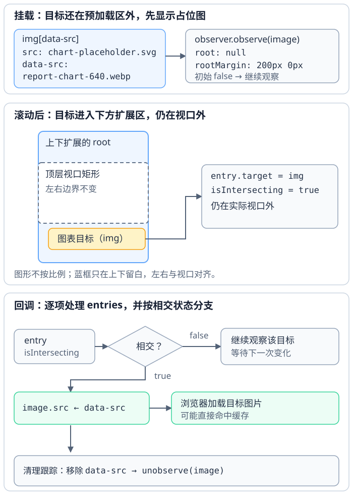

# 图片与媒体资源怎样加载并保持页面稳定？

同一份公开的合成报表要展示四月至六月趋势图：图表既要有合适的替代文本，也要按屏幕选择文件；首屏外的图可以晚些请求，但占位区域仍应尽量稳定。先确定内容语义与地址，再选择文件和请求时机，最后检查资源到达前后页面几何是否变化。

> [!info] 替代文本由用途决定
> alternative text（替代文本）通过 `alt` 提供。纯装饰图使用 `alt=""`；信息图用简洁文字传达页面所需信息；图片是链接或按钮唯一内容时，写出该控件的目的。复杂图表用简短 alt 指出内容与主要结论，再由邻近正文或数据表给出完整信息；`title` 不能代替图像的 `alt`。表单控件应优先使用与控件关联的 `<label>`，因为 `title` 作为标签备选较不可靠。

## 先按内容选择图像与媒体元素

图像内容用 ``；导航目标用 `<a href>`；播放音频和视频分别用 `<audio>`、`<video>`。本例的趋势图用 `alt` 简述四月至六月的变化和六月最高点；只有图像不再提供表格以外的信息时，才把它当装饰图写 `alt=""`。先决定语义与替代文本，再配置文件地址和加载策略。

## 资源地址相对哪个基准？

| 写法 | 示例 | 解析位置 |
| --- | --- | --- |
| 带 scheme（方案）的 URL（统一资源定位符） | `https://example.com/a.png` | 使用 URL 自身的方案和地址；`mailto:team@example.com` 有 scheme，但没有主机 |
| 根相对路径 | `/assets/chart.png` | 从文档基准 URL 的 origin（源）根目录解析；`<base>` 可能改变 origin |
| 文档相对路径 | `../assets/chart.png` | 默认相对当前文档 URL；`<base>` 可改变文档基准 URL |

`src` 指向要载入的图片资源；`href` 为链接提供导航目标。根相对 URL 不是永远相对页面原站：若 `<base href="https://cdn.example.net/reports/q4/">` 改变文档基准，`/assets/chart.png` 会解析为 `https://cdn.example.net/assets/chart.png`，`../assets/chart.png` 则解析为 `https://cdn.example.net/reports/assets/chart.png`。把本机路径 `/project/site/image.png` 写进 HTTP 页面时，浏览器仍会按文档基准 URL 解析它；服务器需先提供该路径对应的资源。

用 `<a>` 导航，用 `<button>` 执行动作；`href="#"` 会改变片段位置并可能影响历史记录，不是无操作占位符。清楚写出链接文字。确需另开页面时，`target="_blank"` 用于请求新的浏览上下文。当前 HTML 标准中，它在未指定 `rel="opener"` 时默认具有 `noopener` 效果，不向新页面提供指向原页面的 `opener` 引用；显式写 `rel="noopener"` 也可把意图写在标记上。

## 原生延迟加载适合什么图片？

普通首屏外的内容图片可以使用 HTML `loading="lazy"`。浏览器自行决定延迟到何时开始请求，距离阈值不是可依赖的固定数值；元素仍要有真实的 `src` 或 `srcset`，只写 `data-src` 不会启动浏览器图片请求。

~~~html

~~~

`width` 和 `height` 给浏览器一个加载前的首选宽高比。上例按 `640 ÷ 360 = 16:9` 预留空间；如果 CSS 让图片宽 `320px` 并写 `height: auto`，匹配的 `16:9` 文件到达前，预留高度为 `320 × 9 ÷ 16 = 180px`。这些属性应对应实际资源比例；若文件实际是 `800 × 600` 的 `4:3`，浏览器拿到自然尺寸后可能把高度改为 `320 × 3 ÷ 4 = 240px`，布局因此再增高 `60px`。不同裁切的图片尤其要检查宽高比，或用容器的 `aspect-ratio` 与合适的 `object-fit` 控制展示盒。在 DevTools 模拟慢网，分别于图片自然尺寸可用前后读取 `getBoundingClientRect().height`，可以检查预留高度是否稳定。

已确认的 Largest Contentful Paint（最大内容绘制，LCP）图片不应设置 `loading="lazy"`；对首屏可见且很可能成为 LCP 的主图，也应让资源从初始 HTML 可发现并尽早请求，因为延后发现或请求会增加资源加载时延。若测量显示优先级不足，且目标浏览器支持，再考虑 `fetchpriority="high"`。它是优先级提示，不是保证，且不应批量标高。

脚本被禁用时，HTML 标准不让 `loading="lazy"` 延迟资源请求；这是为避免网站借请求时间推测用户滚动位置的反跟踪措施。原生 `loading` 仍在 HTML 中保留真实资源地址；这与下文依赖 JavaScript 改写 `src` 的自定义模式不同。

## 响应式候选文件怎样被选中？

`srcset` 中的 `640w`、`1280w` 描述候选文件的固有像素宽度；`sizes` 描述布局给图像留下的 CSS 像素宽度。下面的样式让图像在视口不宽于 `640px` 时占满视口，宽屏上限为 `640px`；所以 `sizes` 与实际展示宽度相符。若该图片在首屏外，可在同一个 `` 上同时使用 `loading="lazy"`、`srcset`、`sizes` 和尺寸属性：

~~~html

~~~

~~~css
.report-responsive {
  display: block;
  width: min(100vw, 640px);
  height: auto;
}
~~~

展示宽 `320px` 时，设备像素比（DPR）为 `2` 给出 `320 × 2 = 640` 的候选密度目标，通常由 `640w` 文件满足；展示宽 `640px`、DPR 为 `2` 时，目标是 `1280`。浏览器结合可用候选、设备像素比、缩放与用户代理策略选文件；这个乘法帮助理解目标，不保证某个候选一定被选中。此处 `` 的 `srcset` 使用宽度描述符时，作者必须提供 `sizes`；若省略，浏览器会把 `100vw` 当作源尺寸，可能与图片实际的 CSS 展示宽度不同。

若窄屏需要不同裁切而不是同一画面的高低分辨率版本，使用 `<picture>` 的 `<source media>` 切换图像；当没有匹配的 `<source>` 时，浏览器采用 `` 的候选。下面窄屏源图为 `800 × 600`（4:3），宽屏 `` 为 `640 × 360`（16:9）；`<source>` 的宽高属性让所选裁切比例也能在加载前参与展示尺寸计算。

~~~html
<picture>
  <source media="(max-width: 640px)"
          srcset="/assets/report-narrow-crop.webp"
          width="800" height="600">
  
</picture>
~~~

## 何时用 IntersectionObserver（相交观察器）？

IntersectionObserver（相交观察器）适合自定义滚动根、预加载边距、阈值，或目标进入范围时除了加载图片还要执行其他工作。只要“加载首屏外图片”是唯一需求，先考虑浏览器的 `loading="lazy"`；只有需要自选触发范围或额外回调时才接入自定义观察器。

下面是一个独立页面中、归同一组件拥有的单批图片示例；组件容器限定查询范围，观察器也只管理这批图片。初始 `src` 是本地占位图，`data-src` 只是应用保存的目标 URL。目标接近视口后，回调把目标地址赋给标准的 `src`，由浏览器开始加载真实图片；后续移除 `data-src` 并 `unobserve` 只清理属性和观察关系，不会触发加载。若用户不运行脚本仍需看到图表，应提供合适的非脚本后备内容；不能只把唯一图片地址放在 `data-src`。

~~~html

  

~~~

~~~javascript
const observer = new IntersectionObserver((entries) => {
  for (const entry of entries) {
    if (!entry.isIntersecting) continue;

    const image = entry.target;
    image.src = image.dataset.src;
    image.removeAttribute("data-src");
    observer.unobserve(image);
  }
}, { root: null, rootMargin: "200px 0px", threshold: 0 });

const imageBatch = document.querySelector("#report-images");
for (const image of imageBatch.querySelectorAll("img[data-src]")) {
  observer.observe(image);
}
// 组件卸载且拥有该观察器时，调用 observer.disconnect()。
~~~

本例假设图片位于顶层页面，且没有中间容器裁剪目标。`root: null` 使用顶层浏览上下文的 `document` 作为隐式 root，其视口矩形是相交边界；这不是泛指任意嵌入文档自己的视口。设置元素 `root` 时，目标必须是该根的后代（位于它的包含块链中）。`rootMargin` 只扩展 root 自身矩形，不会改变其他祖先的裁剪。正的 `rootMargin: "200px 0px"` 只把本例根的上、下边各向外扩展 `200px`，左右边保持原位。首次观察后会有初始状态通知；本例设置 `threshold: 0`，并按 `isIntersecting` 判断。目标与边界刚好接触时，`isIntersecting` 可为 true，交集面积仍为零。false 条目使上面的循环跳过目标并继续观察；目标进入上下预加载区后，true 条目让赋值 `src` 启动图片加载，随后移除 `data-src` 并 `unobserve` 结束对该目标的跟踪。一个回调可以收到多个 entry，所以要逐项处理。

**图：目标进入上下预加载区后，`src` 赋值触发加载；随后清理属性并停止观察**

这里的 `isIntersecting` 表示目标与相交 root 矩形相交；边缘刚好接触也可能为 true，交集面积可以为零。因此它不表示“至少一像素可见”，也不能证明图片未被其他元素遮挡。IntersectionObserver 会异步交付状态通知，但回调中的 JavaScript 仍在文档事件循环中运行；重工作仍可能占用页面线程。若图片失败，应用代码应另处理 `load` / `error` 结果和有界重试。

加载成功后，`width` 和 `height` 继续帮助保持几何稳定；组件卸载时由组件所有者调用 `disconnect()` 停止观察所有目标。只有需要兼容未提供 IntersectionObserver 的浏览器时，才考虑 scroll/resize 几何检查作为回退：挂载时先检查一次，后续检查要合并或节流；卸载时移除监听器并取消尚未执行的定时检查，避免回调继续保留 DOM 节点。矩形判断复用[DOM 几何 API](../html-css/dom-properties.md)中的测量边界；真实效果应在[浏览器性能测量](../performance/performance-metrics-and-analysis.md)与[浏览器如何把 URL 绘制成像素](../browser/browser-basics.md)所述的路由和设备数据中验证。

## 音频和视频还要保留什么语义？

`<audio>` 与 `<video>` 用于可播放媒体；提供 `controls`，让用户能启动、暂停和调整播放。媒体格式和编解码器支持因浏览器与平台而异，可按目标环境提供多个 `<source>`。在支持媒体懒加载的浏览器中，首屏外的播放器可设置 `loading="lazy"`；它会延后媒体数据请求，视频的 `poster` 图片也会一起延后，并优先于 `preload` 生效。仅写 `preload="none"` 并不保证视频 poster 不请求。Chrome 148 起支持媒体 `loading`；其他目标浏览器和版本需按实际支持情况核验。首屏主媒体不应延迟加载。`preload` 表达媒体数据的加载偏好，`autoplay` 是播放请求，也可能受自动播放策略限制。

~~~html
<audio controls loading="lazy" preload="metadata">
  <source src="/media/summary.ogg" type="audio/ogg">
  <source src="/media/summary.mp3" type="audio/mpeg">
</audio>

<video controls loading="lazy" preload="metadata"
       width="640" height="360" poster="/media/preview.jpg">
  <source src="/media/demo.webm" type="video/webm">
  <source src="/media/demo.mp4" type="video/mp4">
  <track kind="captions" src="/media/demo.zh.vtt" srclang="zh" label="中文字幕">
</video>
~~~

给视频标出宽高或比例，降低播放器加入布局时的跳动；字幕通过 `<track>` 提供。音频与视频用 `controls` 表达播放交互，不要把视觉样式当成媒体控件语义。

> [!info]- 来源
> - 文档基准 URL、相对 URL 解析与链接：WHATWG HTML Living Standard，[Document base URLs](https://html.spec.whatwg.org/multipage/urls-and-fetching.html#document-base-urls) 与 [Links / `noopener`](https://html.spec.whatwg.org/multipage/links.html#link-type-noopener)，版本最后更新于 2026-11-11；URL Standard 的 [Basic URL parser](https://url.spec.whatwg.org/#concept-basic-url-parser)，该标准最后更新于 2026-10-19，核验于 2026-11-12。
> - `picture`、`source`、`img`、宽高、`srcset`、`sizes` 与媒体元素：[WHATWG HTML Living Standard，Embedded content](https://html.spec.whatwg.org/multipage/embedded-content.html)（最后更新于 2026-11-12）、[Images / source size](https://html.spec.whatwg.org/multipage/images.html#parsing-a-sizes-attribute)（最后更新于 2026-11-12）和 [Media elements](https://html.spec.whatwg.org/multipage/media.html)（最后更新于 2026-11-12），核验于 2026-11-12。
> - 图片和媒体 `loading` 延迟条件、`preload` 优先级与 poster 延迟：[WHATWG HTML Living Standard，Lazy loading attributes](https://html.spec.whatwg.org/multipage/urls-and-fetching.html#lazy-loading-attributes) 与 [Media elements](https://html.spec.whatwg.org/multipage/media.html#attr-media-loading)，分别最后更新于 2026-11-11 和 2026-11-12；`fetchpriority`：[Fetch priority attributes](https://html.spec.whatwg.org/multipage/urls-and-fetching.html#fetch-priority-attributes)，最后更新于 2026-11-11，核验于 2026-11-12。
> - 图片信息、装饰图片和功能图片的 `alt`：W3C WAI [Images Tutorial](https://www.w3.org/WAI/tutorials/images/)；表单控件标签优先级：[Labeling Controls](https://www.w3.org/WAI/tutorials/forms/labels/)，核验于 2026-11-12。
> - LCP 图片不宜延迟加载；高优先级提示应只用于确实重要的少数资源：[web.dev “Optimize Largest Contentful Paint”](https://web.dev/articles/optimize-lcp)，最后更新于 2025-03-31，访问于 2026-11-12。Chrome 对媒体懒加载的版本说明与使用条件：[New in Chrome 148](https://developer.chrome.com/blog/new-in-chrome-148#lazy_loading_for_video_and_audio_elements)（发布于 2026-05-05）与[媒体懒加载指南](https://developer.chrome.com/docs/modern-web-guidance/guides/performance/lazy-load-video-and-audio)，访问于 2026-11-12。
> - `root`、`rootMargin`、异步通知、阈值与边缘相接的 `isIntersecting`：W3C [Intersection Observer](https://www.w3.org/TR/intersection-observer/)，Working Draft，2023-10-18 §2.2–2.4、§3.2.2–5、§3.2.7–8；W3C 页面列为当前最新发布稿，核验于 2026-11-12。
> - `aspect-ratio` 与 `object-fit`：[CSS Box Sizing Module Level 4](https://www.w3.org/TR/css-sizing-4/#aspect-ratio)，Working Draft，2026-09-04；[CSS Images Module Level 3](https://www.w3.org/TR/css-images-3/#the-object-fit)，Candidate Recommendation Draft，2023-12-18。视口矩形 API：[CSSOM View Module](https://www.w3.org/TR/cssom-view-1/)，Working Draft，2025-09-16。
