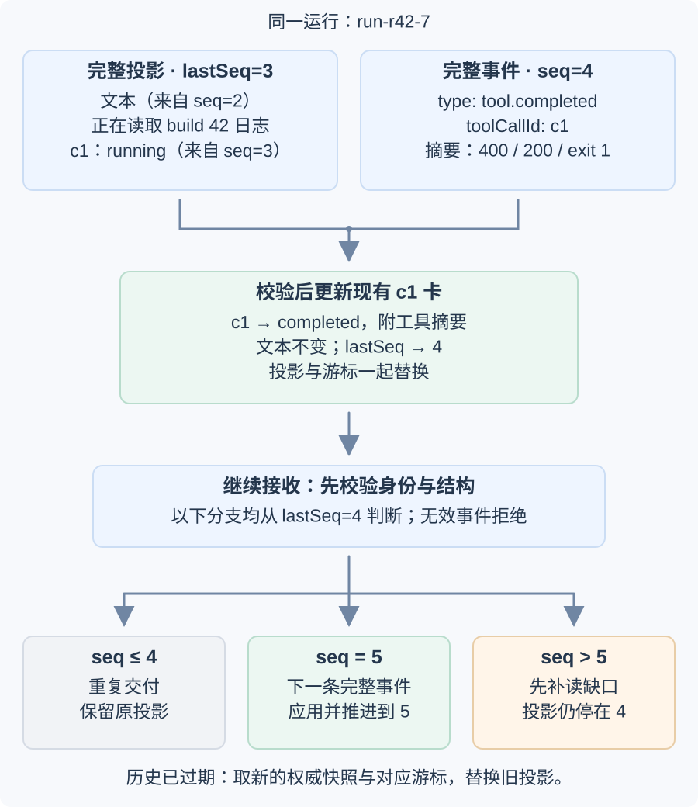
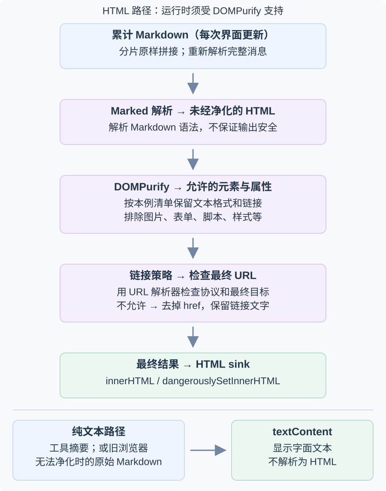
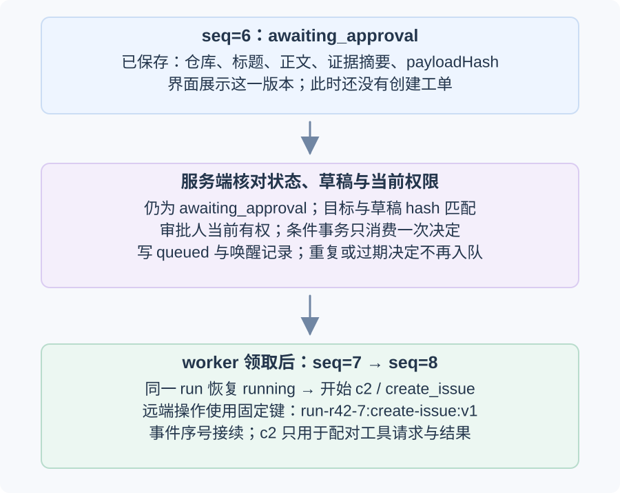
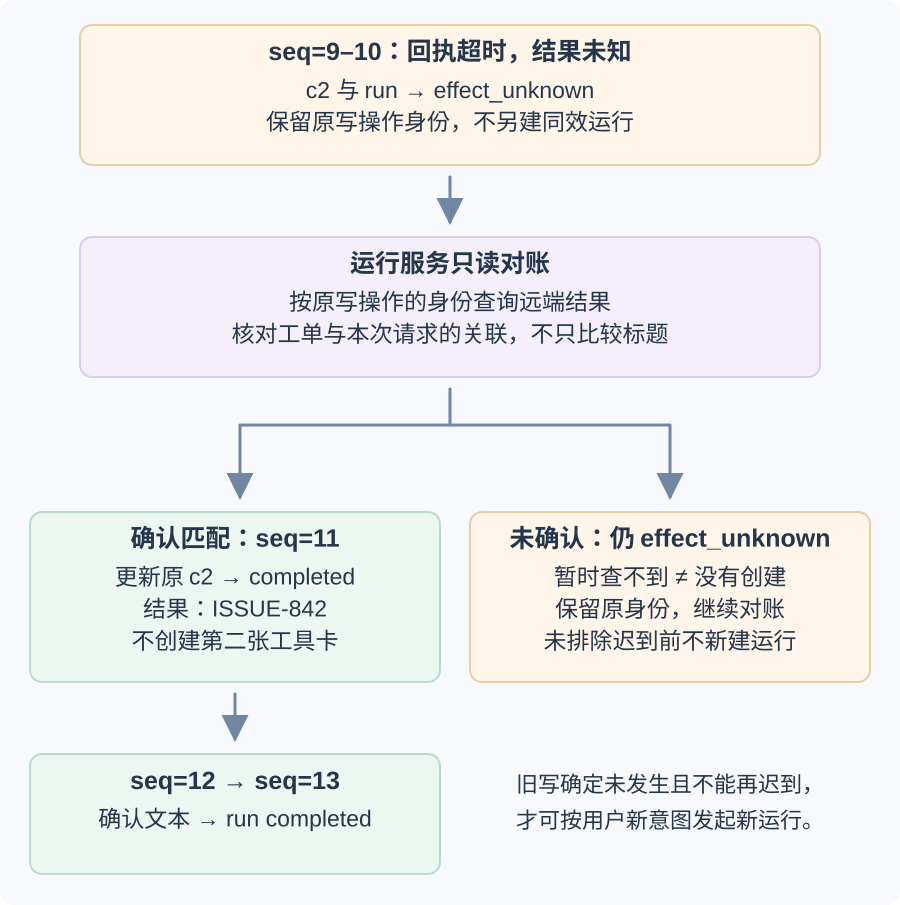

# 一轮 AI 聊天怎样安全地展示增量回答、工具状态与恢复操作？

**案例背景。** 开发者要求：“解释 build 42 的失败并准备缺陷单；提交前让我审核。”运行服务已鉴权并创建合成运行 `run-r42-7`。只读工具 `read_build_log` 的模型调用标识为 `c1`；它查到 `unit-tests` 中 `reject_empty_name` 预期 HTTP（超文本传输协议）`400`、实际 `200`、进程退出状态 `1`。证据到达前，界面只能显示正在检查，不能先把根因写成结论。运行随后生成解释和持久化的待审核草稿，进入 `awaiting_approval`；审核人批准这份未变化的草稿后，同一运行才会调用创建工单动作。这里的运行 ID、日志序号和工具调用 ID 均为公开教学用合成值。

本篇接在[流式传输已经交付哪些完整事件](streaming-ux.md)之后：客户端已收到一条完整应用事件，要验证它属于哪次运行、按顺序只投影一次，再把分片累积成的 Markdown 和工具结果安全呈现。聊天组件展示服务端的运行投影；审批、取消和未知副作用的权威状态仍由[运行服务怎样断线恢复并避免副作用重复](../../ai-engineering/systems/ai-application-architecture.md)保存。断开连接、文本片段结束或浏览器关闭都不能替代运行记录。

| 序号与事件 | 客户端投影 | 此时不能误报什么 |
|---|---|---|
| `seq=1`：`run.status` → `running` | 为同一轮显示“正在检查” | 不能称为已完成 |
| `seq=2`：`assistant.delta` | 助手气泡出现“正在读取 build 42 日志” | 还没有失败证据，不能先写根因 |
| `seq=3`：`tool.started(c1)` | 建立“读取构建日志”卡片，状态为等待 | 重放不能再建第二张卡 |
| `seq=4`：`tool.completed(c1)` | 同一张卡显示 `reject_empty_name` 预期 HTTP 400、实际 HTTP 200、退出码 1 | 工具摘要是数据，不是可执行指令 |
| `seq=5`：`assistant.delta` | 同一气泡解释观测结果，并说明正在准备缺陷单草稿 | 草稿仍在生成 |
| `seq=6`：`run.status` → `awaiting_approval` | 显示已保存的仓库、标题、正文、证据摘要及审核入口 | 工单尚未创建 |
| `seq=7`：`run.status` → `running` | 审核人批准未变草稿后，同一轮恢复 | `runId` 不变，事件序号接续 |
| `seq=8`：`tool.started(c2)` | 建立“创建缺陷单”卡片 | `c2` 不是远端去重键 |
| `seq=9–10`：`tool.effect_unknown(c2)`、`run.status` → `effect_unknown` | 卡片与运行均显示“提交结果待对账” | 超时不等于失败或未创建 |
| `seq=11`：`tool.completed(c2)` | 同一张 `c2` 卡显示经对账确认的 `ISSUE-842` | 不新建运行或第二张卡 |
| `seq=12–13`：`assistant.delta`、`run.status` → `completed` | 同一气泡告知工单已存在，权威状态结束本轮 | 只有运行服务确认结果后才显示完成 |

这些字段属于本例的应用事件合同，不是 SSE、Fetch 或 Model Context Protocol（模型上下文协议，MCP）自动提供的通用格式。`runId` 标识持久运行，`seq` 是该运行对客户端可见的应用日志顺序，`toolCallId`（本例 `c1`、`c2`）把模型工具请求和结果配对；远端写操作另用稳定键 `run-r42-7:create-issue:v1`。连接 ID、MCP 的 JSON-RPC（基于 JSON 的远程过程调用）ID 和这些标识不能互相替代。

## 怎样应用重放事件而不重复消息或工具卡？

重开对话时，先取同一一致点上的完整可见投影快照和 `lastSeq`，再从该序号之后续读。快照游标与它所声称的文本、工具卡和运行状态必须来自同一版本。本例的 `lastSeq=3` 快照已含 `seq=2` 的“正在读取 build 42 日志”文本和 `seq=3` 建立的 `c1` 等待读取卡；所以 `seq=4` 的完成事件可以更新同一张卡。若快照跳到了 `lastSeq=3` 却漏了 `c1`，下一条完成事件就无处配对，客户端应拒绝这个不一致快照并重新取权威投影，不能只把游标改到最新值。若服务只能返回运行状态与最新游标，客户端要从已有本地投影及其对应游标续读，或从能够重建完整投影的保留历史起点重放；空白气泡不能直接配上服务端最新序号。历史已经清理、服务又不提供完整快照时，不能宣称可恢复全部内容。



上图把三个接收结果分开：下一序号推进投影；不大于当前游标的重放被忽略；跳号先向同一个 `runId` 补读，或在服务已不保留历史时重新获取一份快照与游标一致的权威投影。在缺口补齐前，旧文本和卡片保持不变。图中快照 `lastSeq=3` 的可见文本来自 `seq=2`，`c1` 卡来自 `seq=3`；收到 `seq=4` 后更新卡片，不创建新卡。

下面的投影函数只处理应用事件层。快照响应也应按 schema（数据结构约束）校验运行 ID、非负游标和完整可见投影；本段代码展示事件边界。先将网络 JSON 当作 `unknown`，检查对象、身份、序号、事件类型与该事件必需的字段；TypeScript 声明本身不会校验网络内容。代码明确拒绝未知事件类型，并让重复和缺口分支返回原投影。生产 schema 还要限制正文大小、工具名称以及服务器允许的运行状态转换。

> [!example]- 代码：校验事件并按运行游标投影
> ~~~javascript
> const RUN_STATUSES = new Set([
>   "running", "awaiting_approval", "effect_unknown", "completed",
>   "failed", "rejected", "cancel_requested", "canceled"
> ]);
> const TOOL_NAMES = new Set(["read_build_log", "create_issue"]);
>
> function isRecord(value) {
>   return value !== null && typeof value === "object" && !Array.isArray(value);
> }
>
> function validateRunEvent(raw) {
>   if (!isRecord(raw) || typeof raw.runId !== "string" ||
>       !Number.isSafeInteger(raw.seq) || raw.seq < 1) {
>     throw new Error("Invalid event identity");
>   }
>   switch (raw.type) {
>     case "assistant.delta":
>       if (typeof raw.text !== "string") throw new Error("Invalid text delta");
>       break;
>     case "tool.started":
>       if (typeof raw.toolCallId !== "string" || !raw.toolCallId ||
>           !TOOL_NAMES.has(raw.toolName)) throw new Error("Invalid tool start");
>       break;
>     case "tool.effect_unknown":
>       if (typeof raw.toolCallId !== "string" || !raw.toolCallId) {
>         throw new Error("Invalid unknown effect");
>       }
>       break;
>     case "tool.completed":
>       if (typeof raw.toolCallId !== "string" || !raw.toolCallId ||
>           typeof raw.summary !== "string") throw new Error("Invalid tool result");
>       break;
>     case "run.status":
>       if (!RUN_STATUSES.has(raw.status)) throw new Error("Invalid run status");
>       if (raw.status === "awaiting_approval" &&
>           (!isRecord(raw.approvalDraft) ||
>            typeof raw.approvalDraft.repositoryId !== "string" ||
>            typeof raw.approvalDraft.title !== "string" ||
>            typeof raw.approvalDraft.body !== "string" ||
>            typeof raw.approvalDraft.evidenceSummary !== "string" ||
>            typeof raw.approvalDraft.payloadHash !== "string")) {
>         throw new Error("Missing persisted approval draft");
>       }
>       break;
>     default:
>       throw new Error("Unknown event type");
>   }
>   return raw;
> }
>
> function applyRunEvent(view, raw) {
>   const event = validateRunEvent(raw);
>   if (event.runId !== view.runId) throw new Error("Wrong run");
>   if (event.seq <= view.lastSeq) return { kind: "ignore", view };
>   if (event.seq !== view.lastSeq + 1) return { kind: "catch-up", view };
>
>   const next = { ...view, lastSeq: event.seq, tools: new Map(view.tools) };
>   switch (event.type) {
>     case "assistant.delta":
>       next.assistantText += event.text;
>       break;
>     case "tool.started": {
>       const prior = next.tools.get(event.toolCallId);
>       if (prior && prior.name !== event.toolName) throw new Error("Tool ID reused");
>       if (!prior) next.tools.set(event.toolCallId, {
>         name: event.toolName, status: "running"
>       });
>       break;
>     }
>     case "tool.effect_unknown": {
>       const prior = next.tools.get(event.toolCallId);
>       if (!prior || prior.status === "completed") throw new Error("Unknown tool card");
>       next.tools.set(event.toolCallId, { ...prior, status: "effect_unknown" });
>       break;
>     }
>     case "tool.completed": {
>       const prior = next.tools.get(event.toolCallId);
>       if (!prior || prior.status === "completed") throw new Error("No pending tool card");
>       next.tools.set(event.toolCallId, {
>         ...prior, status: "completed", summary: event.summary
>       });
>       break;
>     }
>     case "run.status":
>       next.runStatus = event.status;
>       if (event.status === "awaiting_approval") {
>         next.approvalDraft = event.approvalDraft;
>       }
>       break;
>   }
>   return { kind: "applied", view: next };
> }
>
> const snapshotAt3 = {
>   runId: "run-r42-7",
>   lastSeq: 3,
>   assistantText: "正在读取 build 42 日志",
>   tools: new Map([["c1", { name: "read_build_log", status: "running" }]]),
>   runStatus: "running"
> };
> const seq4 = {
>   runId: "run-r42-7", seq: 4, type: "tool.completed", toolCallId: "c1",
>   summary: "reject_empty_name: expected HTTP 400, actual HTTP 200, exit 1"
> };
> const after4 = applyRunEvent(snapshotAt3, seq4);
> const duplicate4 = applyRunEvent(after4.view, seq4);
> const seq5 = {
>   runId: "run-r42-7", seq: 5, type: "assistant.delta",
>   text: "；reject_empty_name 预期 HTTP 400，实际返回 HTTP 200，导致 unit-tests 失败（退出码 1）。正在准备缺陷单草稿。"
> };
> const seq6 = {
>   runId: "run-r42-7", seq: 6, type: "run.status",
>   status: "awaiting_approval",
>   approvalDraft: {
>     repositoryId: "build-service",
>     title: "Build 42: reject_empty_name returned HTTP 200",
>     body: "The unit-tests check for reject_empty_name expected HTTP 400 but returned HTTP 200 (process exit 1).",
>     evidenceSummary: "Build 42 / unit-tests / reject_empty_name: expected HTTP 400; actual HTTP 200; exit 1.",
>     payloadHash: "synthetic-build-42-draft-v1"
>   }
> };
> const gap6 = applyRunEvent(after4.view, seq6);
> const after5 = applyRunEvent(gap6.view, seq5);
> const after6 = applyRunEvent(after5.view, seq6);
> const seq7 = { runId: "run-r42-7", seq: 7, type: "run.status", status: "running" };
> const after7 = applyRunEvent(after6.view, seq7);
> globalThis.projectionDemo = { snapshotAt3, after4, duplicate4, seq5, seq6, seq7, gap6, after5, after6, after7 };
> ~~~

`after4` 更新由 `(runId, toolCallId)` 稳定标识的现有 `c1` 卡；相同 `seq=4` 第二次抵达时不会重复追加或推进游标。`gap6` 使用本例真实的 `seq=6, run.status=awaiting_approval` 事件和完整的持久 `approvalDraft`，包括仓库、标题、正文、证据摘要与合成 `payloadHash`。从 `lastSeq=4` 收到它会先返回补读并保留原投影；补上真实 `seq=5` 后，代码再应用原 `seq=6`，将文本推进到 5，再把完整待审草稿和 `awaiting_approval` 投影到 6。随后 `seq=7` 恢复运行态，历史草稿仍在投影里，但审批入口按 `runStatus` 隐藏。客户端每个 run 只有一个助手气泡时可用 `runId` 作气泡键；如果一个 run 可产生多条消息，事件和快照还需稳定的 `messageId`，气泡键改为 `(runId, messageId)`。工具卡键始终用 `(runId, toolCallId)`，不要用数组下标或随机值。

同一 `lastSeq` 必须代表同一个已应用前缀：若当前投影有 `seq=11`，重连得到旧的 `seq=8` 至 `seq=11` 只会命中重复分支；`seq=12` 才能继续追加。若服务返回 `reset` 或事件保留期已过，先以新的快照与游标替换旧投影，再继续订阅，不能把新快照附加到旧消息末尾。`seq` 是本应用客户端日志游标，不是模型工具 ID、MCP 请求 ID 或传输层的帧号。

## 不完整 Markdown 和工具结果怎样安全显示？

一条回答可能跨多个事件。以下分片之间不插入空格或换行；第二段结束于 `java`，第三段开头为 `script:`，所以拼接后的链接目标确实是 `javascript:alert(1)`。每个界面更新都应从同一条助手消息的完整累计 Markdown 重新解析，然后在交给 HTML（超文本标记语言）sink（写入浏览器文档的入口）之前消毒，而不是把事件片段直接拼成 HTML。

~~~javascript
const chunks = [
  "日志显示为：\n\n```text\n<not executed>\n",
  "```\n\n[打开链接](java",
  "script:alert(1))"
];
let accumulated = "";
const frames = [];
for (const chunk of chunks) {
  accumulated += chunk;
  frames.push(accumulated);
}
~~~



图中每一帧都重复相同路径：拼接完整消息、Markdown 转 HTML、DOMPurify 按允许元素和属性消毒、再检查链接最终解析到的 URL。工具摘要走文本节点路径，不经过 HTML。这里是一个聊天显示策略：允许常见段落、标题、强调、列表、引用和代码块，允许普通链接；不允许图片、表单控件、样式、脚本或新窗口属性。该 HTML 路径假设浏览器运行时受 DOMPurify 3.4.17 支持；其 README 明确不支持的旧浏览器上库会不做净化、原样返回输入。此类运行时必须把原始 Markdown 作为文本显示，不能把返回字符串交给 HTML sink。若产品不需要富文本，将助手内容作为普通文本子节点显示更简单。

> [!example]- 代码：Marked 18.2.0 与 DOMPurify 3.4.17 的最小显示策略
> ~~~javascript
> const chatPolicy = {
>   ALLOWED_TAGS: [
>     "a", "p", "br", "em", "strong", "del", "code", "pre",
>     "blockquote", "ul", "ol", "li", "h1", "h2", "h3", "h4",
>     "h5", "h6", "hr"
>   ],
>   ALLOWED_ATTR: ["href"],
>   ALLOW_DATA_ATTR: false,
>   ALLOW_ARIA_ATTR: false
> };
>
> function allowedHref(raw) {
>   if (typeof raw !== "string" || raw.trim() !== raw || raw === "") return null;
>   try {
>     const resolved = new URL(raw, window.location.href);
>     if (resolved.username || resolved.password) return null;
>     if (raw.startsWith("/") && !raw.startsWith("//") &&
>         resolved.origin === window.location.origin) return resolved.href;
>     if (raw.startsWith("#") && resolved.origin === window.location.origin &&
>         resolved.pathname === window.location.pathname &&
>         resolved.search === window.location.search) return resolved.href;
>     if (/^https?:\/\//i.test(raw) &&
>         (resolved.protocol === "http:" || resolved.protocol === "https:")) return resolved.href;
>   } catch {
>     return null;
>   }
>   return null;
> }
>
> function safeMarkdown(source) {
>   const generated = marked.parse(source, { async: false });
>   if (typeof generated !== "string") throw new Error("Expected synchronous HTML");
>   const sanitized = DOMPurify.sanitize(generated, chatPolicy);
>   const template = document.createElement("template");
>   template.innerHTML = sanitized;
>   template.content.querySelectorAll("a[href]").forEach((link) => {
>     const href = allowedHref(link.getAttribute("href"));
>     if (href) link.setAttribute("href", href);
>     else link.removeAttribute("href");
>   });
>   return template.innerHTML;
> }
> window.safeMarkdown = safeMarkdown;
> ~~~

`ALLOWED_TAGS` 与 `ALLOWED_ATTR` 是应用给出的明确许可范围；这里不使用 DOMPurify 的宽泛 HTML profile。链接只在消毒后的 DOM（文档对象模型）中读取，再用浏览器 `URL` 解析器检查最终目标，先统一拒绝包含用户名或密码的 URL，再按链接形式检查目标：`/docs/guide` 这样的站内根路径必须解析回当前 origin，`//other.example/path` 不在允许格式内，片段只能指向当前文档，绝对链接只允许无用户名密码的 HTTP(S)。这比用字符串前缀判断“看起来像站内路径”更直接。不允许的 URL 只移除锚点的 `href`，保留用户看到的链接文字；例如“打开链接”仍可读，但不再可点击。该策略是此合成组件的选择，不代表所有产品都应开放相同标签或协议。

React 的 `dangerouslySetInnerHTML` 会把提供的字符串交给 DOM 的 `innerHTML` 呈现；因此组件先检查 `DOMPurify.isSupported`：为真时才调用 `safeMarkdown`，把最终结果交给受限 HTML 路径；为假时用 `textContent` 或 React 普通文本子节点显示原始 Markdown。不能先调用净化函数，再把不支持环境返回的原文当成安全 HTML。HTML 经消毒之后若再交给语法高亮器、插件或其他会改写 DOM 的库，必须把最终结果重新通过同一受限策略。Marked 负责解析 Markdown，不负责净化 HTML；DOMPurify 支持可替换的标签/属性 allowlist。测试还覆盖外链、普通站内路径、代码围栏，以及 Markdown 图片和原始 HTML 图片/图片按钮：本例不让这些资源元素进入文档，因此也不会发出远程图片请求。

工具响应同样是不可信数据。对 `c1` 只读摘要，将已经校验的 `step`、`failed_test`、`expected`、`actual`、`exit_status` 映射为文本节点，例如 `summary.textContent = tool.summary`。卡片状态来自运行事件，而不是工具返回正文里的 HTML 或“success”字符串。渲染不执行模型工具请求；[应用如何校验并执行工具调用](../../ai-engineering/agents/tool-design-and-function-calling.md)是运行服务的责任。显示成功图标也不等同于服务端已确认操作。

## 停止、继续和重试分别改变什么？

客户端须把连接状态、运行状态和审批/副作用状态分开展示。EventSource 的连接是否打开不等于后台 run 是否运行；传输层重试只恢复事件交付。若要停止运行，客户端必须向运行服务发送已鉴权的控制请求，再查询权威运行记录。



事件 `seq=6` 携带服务端已保存的完整待审草稿投影：仓库、标题、正文、证据摘要和 `payloadHash`。投影可以在 `seq=7` 的 `running` 状态后继续保留这份历史草稿，但界面只在最新收到的投影仍为 `awaiting_approval`、草稿仍是该投影的当前版本且用户有审批权限时，显示可操作入口；草稿字段存在本身不代表可批准。用户批准的是这个精确版本；客户端提交 `runId` 与 hash，服务端在处理时核对运行仍为 `awaiting_approval`、目标与当前草稿版本匹配、审批人当前有权批准，并以条件事务只消费一次决定；重复、过期或针对旧版本的决定不能再次入队。批准事务写入决定、`queued` 与同一 `runId` 的唤醒记录，worker 领取后才发出 `seq=7` 的 `running` 进度。这里的事件表只列客户端可见进度，不逐条复制后台排队和领取状态。客户端不在点击时重新拼装一个可能变化的写入载荷，`payloadHash` 也不是身份或授权凭据。恢复的仍是 `run-r42-7`；`c2` 发起的远端操作使用稳定键 `run-r42-7:create-issue:v1`。真正发出写请求前，运行服务还须在条件事务中复核当前批准版本、有效执行租约、当前写权限与未取消状态，并持久登记发送意图；批准过一次并不意味着以后都可直接发送。

若创建请求超时，远端可能已经建单，客户端看见的只是回执未知。保持原 `c2` 卡片和原运行的 `effect_unknown` 状态，等待只读对账：查到 `ISSUE-842` 后，用 `seq=11` 更新原卡，再显示 `seq=12–13` 的最终结果。暂时查不到记录不证明旧请求以后不会到达；未知仍未知时不盲目重发，也不另建一个同效 run。只有权威契约确认旧写未发生、任何已发请求都不可能再迟到，且用户仍要尝试时，才让新意图使用新的 `runId`。



| 用户操作 | 客户端做什么 | 运行身份与显示 |
|---|---|---|
| 重连 | 用最后已应用 `seq` 续读；遇重放忽略，遇缺口补齐或重新取一致快照 | 仍是 `run-r42-7`；保留已有文本和卡片 |
| 停止 | 调用运行服务的取消操作并查询其权威状态 | 仍是 `run-r42-7`；取消确认前显示请求处理中；已有发送意图时仍要对账 |
| 继续 | 审批仍未变化的持久草稿，恢复已暂停的运行 | `runId` 与序号延续；变化的草稿必须重新审核 |
| 重试 | 仅在旧操作确定未发生且不能迟到后，按用户意图创建新运行 | 新请求用新 `runId`；旧运行与旧卡片留作审计 |

`AbortController.abort()` 会按 Fetch 的 abort 算法结束该 fetch 调用或响应体；关闭 SSE/Fetch reader 结束的是当前事件交付通道。这些客户端传输操作不会替应用写入持久取消状态，也不能证明服务端任务停止或工具副作用回滚。取消请求之后仍可能收到事件；界面保留已应用内容，继续依据服务端状态更新。如果用户要求停止时已有发送意图，未确认的外部结果不能显示为“取消成功”。普通问答也采用同样的快照、序号与连接恢复规则，只是没有审批和外部写操作分支。

> [!info]- 来源
> - **同一快照与事件游标、重连后恢复完整事件：** [流式传输怎样交付可恢复的完整事件](streaming-ux.md)；本文消费其完整应用事件，不把传输 ID 当业务身份。
> - **MCP 请求 ID 与应用事件序号的区别：** [MCP 2026-07-28 规范](https://modelcontextprotocol.io/specification/2026-07-28) 的 Overview/Base Protocol 说明 MCP 使用 JSON-RPC 2.0；[JSON-RPC 2.0 Request Object 第 4 节](https://www.jsonrpc.org/specification#request_object) 说明请求 ID 与响应 ID 用于关联请求和响应。它们不定义本文应用层的 run 序号。
> - **客户端所见的持久 run、审批、取消和效果未知状态：** [AI 运行怎样在断线或工作进程崩溃后恢复，并避免副作用重复](../../ai-engineering/systems/ai-application-architecture.md)；本文沿用 `run-r42-7`、`c1/c2`、`run-r42-7:create-issue:v1` 与 `ISSUE-842` 的合成案例。
> - **Marked 解析结果未净化：** [Marked 18.2.0 npm README](https://www.npmjs.com/package/marked/v/18.2.0) 的 README “Warning” 与 Browser/Node 使用段；版本页显示本次核对时的发布版本。核对日 2026-11-12。
> - **DOMPurify 的 sanitize、可配置标签/属性 allowlist 和旧浏览器不支持时不执行净化：** [DOMPurify 3.4.17 README](https://github.com/cure53/DOMPurify/blob/3.4.17/README.md) 的 Basic Usage、HTML-only profile、configuration 和 legacy browser sections；版本 [3.4.17 release](https://github.com/cure53/DOMPurify/releases/tag/3.4.17)，核对日 2026-11-12。
> - **动态 HTML 呈现边界：** [React DOM 常见组件文档](https://react.dev/reference/react-dom/components/common#dangerously-setting-the-inner-html) 的 “Dangerously setting the inner HTML”；不可信数据直接进入 raw HTML sink 会带来 XSS 风险。核对日 2026-11-12。
> - **传输取消与应用运行取消：** [DOM Standard 第 3 节 Aborting ongoing activities](https://dom.spec.whatwg.org/#aborting-ongoing-activities) 说明 signal 由接受它的 API 定义取消语义；[Fetch Standard 的 abort fetch call 算法](https://fetch.spec.whatwg.org/#abort-fetch) 处理 fetch 调用和可读请求/响应体。持久 run 与外部效果的取消、对账仍是上层应用协议，见本篇链接的 AI 运行章节。核对日 2026-11-12。
> - **工具摘要的纯文本呈现：** [WHATWG DOM `textContent`](https://dom.spec.whatwg.org/#dom-node-textcontent)；验证和赋值逻辑是本文客户端示例。
> - **实测：** Node.js 26.13.0、Marked 18.2.0、DOMPurify 3.4.17 与 Chromium 131.0.6778.33；运行完整事件投影序列、重复/缺口分支和浏览器渲染请求拦截。投影输入与校验代码、跨片段 Markdown 样例均在正文中；测试使用模拟运行事件，不代表生产服务或跨浏览器保证。
