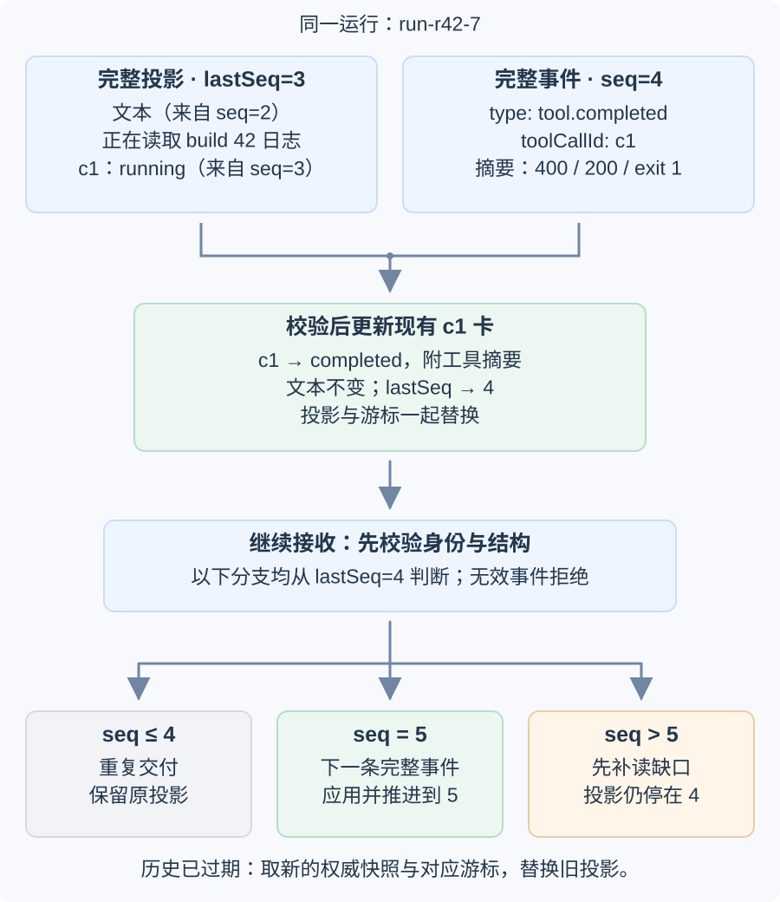
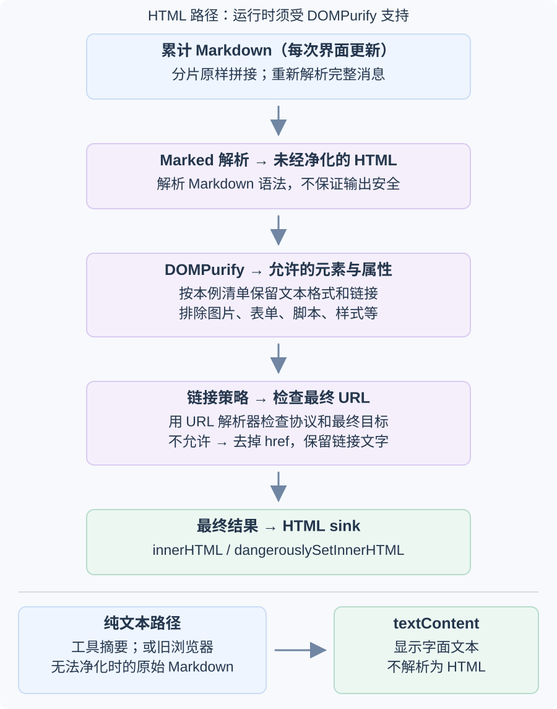
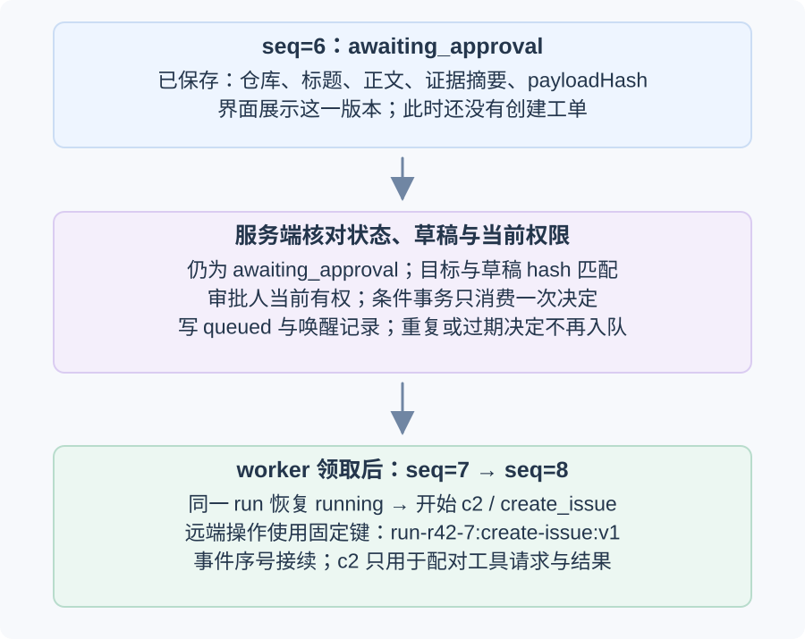
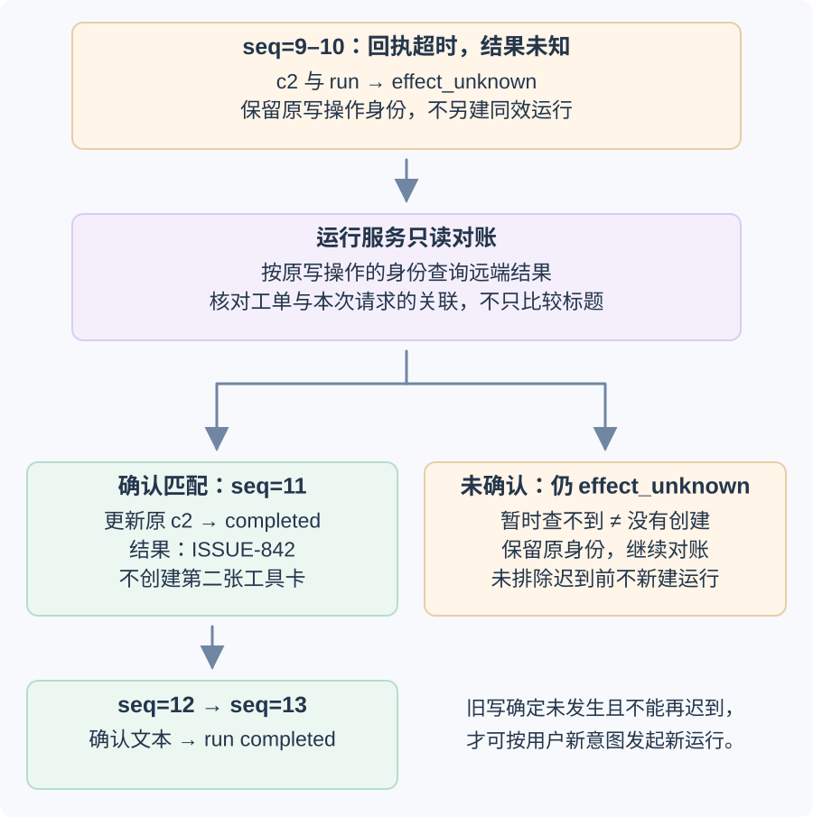

# 一轮 AI 聊天怎样安全地展示增量回答、工具状态与恢复操作？

**案例背景。** 开发者在 AI 聊天界面里提出：“解释 build 42 的失败并准备缺陷单；提交前让我审核。”后端的运行服务完成鉴权后，为这次请求创建一个持久运行 `run-r42-7`。模型先调用只读工具 `read_build_log`，这次工具调用的标识是 `c1`；工具查到 `unit-tests` 中的测试 `reject_empty_name` 预期返回 HTTP `400`，实际返回 `200`，测试进程以退出码 `1` 结束。证据到达之前，界面只能显示“正在检查”，不能先把根因写成结论。随后运行生成解释和一份保存在服务端的缺陷单草稿，状态变为 `awaiting_approval`（等待审核）；审核人批准这份未改动的草稿后，同一运行才会调用创建工单的工具。文中的运行 ID、事件序号和工具调用 ID 都是教学用的合成值。

本篇接在[流式报表断线重连后，界面怎样保留正确状态？](streaming-ux.md)之后：那一章解决了怎样从连接中可靠地取出一条条完整的应用事件；本篇从“客户端已收到一条完整事件”开始，回答三件事：怎样确认它属于哪次运行、按顺序只应用一次；怎样把逐段到达的 Markdown 和工具结果安全地显示出来；停止、继续和重试各自改变什么。这里的 projection（投影）指客户端根据事件拼出的界面状态，它只是服务端运行记录的一份视图；审批、取消和副作用是否发生，以运行服务保存的记录为准，见[AI 运行怎样在断线或工作进程崩溃后恢复，并避免副作用重复？](../../ai-engineering/systems/ai-application-architecture.md)。连接断开、文本流结束或浏览器关闭，都不能代替这份运行记录。

下表是本例客户端依次收到的事件，后文各节都引用这些序号：

| 序号与事件 | 客户端投影 | 此时不能误报什么 |
|---|---|---|
| `seq=1`：`run.status` → `running` | 为同一轮显示“正在检查” | 不能称为已完成 |
| `seq=2`：`assistant.delta` | 助手气泡出现“正在读取 build 42 日志” | 还没有失败证据，不能先写根因 |
| `seq=3`：`tool.started(c1)` | 建立“读取构建日志”卡片，状态为等待 | 重放不能再建第二张卡 |
| `seq=4`：`tool.completed(c1)` | 同一张卡显示 `reject_empty_name` 预期 HTTP 400、实际 HTTP 200、退出码 1 | 工具摘要是数据，不是可执行指令 |
| `seq=5`：`assistant.delta` | 同一气泡解释观测结果，并说明正在准备缺陷单草稿 | 草稿仍在生成 |
| `seq=6`：`run.status` → `awaiting_approval` | 显示已保存的仓库、标题、正文、证据摘要及审核入口 | 工单尚未创建 |
| `seq=7`：`run.status` → `running` | 审核人批准未变草稿后，同一轮恢复 | `runId` 不变，事件序号接续 |
| `seq=8`：`tool.started(c2)` | 建立“创建缺陷单”卡片 | `c2` 不是远端去重键 |
| `seq=9–10`：`tool.effect_unknown(c2)`、`run.status` → `effect_unknown` | 卡片与运行均显示“提交结果待对账” | 超时不等于失败或未创建 |
| `seq=11`：`tool.completed(c2)` | 同一张 `c2` 卡显示经对账确认的 `ISSUE-842` | 不新建运行或第二张卡 |
| `seq=12–13`：`assistant.delta`、`run.status` → `completed` | 同一气泡告知工单已存在，权威状态结束本轮 | 只有运行服务确认结果后才显示完成 |

这些字段是本例应用自己约定的事件格式，不是 Server-Sent Events（服务器发送事件，SSE）、Fetch 或 Model Context Protocol（模型上下文协议，MCP）自带的通用格式。`runId` 标识持久运行；`seq` 是该运行中客户端可见事件的顺序号；`toolCallId`（本例的 `c1`、`c2`）把模型发出的工具请求和对应结果配对；远端写操作另用一个稳定的幂等键 `run-r42-7:create-issue:v1`，供远端去重。连接 ID、MCP 底层 JSON-RPC（基于 JSON 的远程过程调用）消息的 ID 与这些标识用途不同，不能互相替代。

## 怎样应用重放事件而不重复消息或工具卡？

用户重新打开对话时，客户端先向服务端取一份快照：它包含当前可见的全部内容（文本、工具卡、运行状态）以及对应的 `lastSeq`，即这份内容已经包含到第几号事件；然后从 `lastSeq` 之后继续读事件。快照内容和 `lastSeq` 必须来自服务端同一时刻的读取。

本例中，`lastSeq=3` 的快照已经包含 `seq=2` 写入的文本“正在读取 build 42 日志”，以及 `seq=3` 建立的、仍在等待的 `c1` 卡片；所以接下来的 `seq=4` 完成事件能找到这张卡并更新它。如果快照声称 `lastSeq=3` 却缺了 `c1` 卡，后面的完成事件就无处配对；客户端应拒绝这份不一致的快照、重新获取，而不是只把游标改成最新值。

如果服务端只能返回运行状态和最新游标、给不出完整内容，客户端只有两条路：从本地已有的投影及其对应游标继续读，或者从仍保留的历史起点重放、重建完整投影。不能拿一个空白气泡配上服务端的最新序号。历史已被清理、服务端又不提供完整快照时，就不能声称能恢复全部内容。



上图区分了收到事件后的三种结果：序号正好是下一个时，推进投影；序号不大于当前游标的重放事件被忽略；序号跳号时，先向同一个 `runId` 补读缺失事件，服务端已不保留这段历史时，则重新获取一份内容与游标一致的快照。缺口补齐之前，已有的文本和卡片保持不变。图中 `lastSeq=3` 快照的文本来自 `seq=2`、`c1` 卡来自 `seq=3`；收到 `seq=4` 后更新这张卡，不新建卡片。

下面的代码只处理单条事件；快照响应同样要按 schema（数据结构约束）校验运行 ID、非负游标和完整内容，这里从略。从网络收到的 JSON 一律先当作类型未知的数据，逐项检查：是否是对象、身份和序号是否有效、事件类型是否认识、该类型必需的字段是否齐全。TypeScript 的类型声明不会在运行时校验网络数据，所以这一步不能省。代码会拒绝未知的事件类型；重复和跳号两种情况都原样返回旧投影。生产环境的 schema 还应限制正文大小、工具名称以及允许的运行状态转换。

> [!example]- 代码：校验事件并按运行游标投影
> ~~~javascript
> const RUN_STATUSES = new Set([
>   "running", "awaiting_approval", "effect_unknown", "completed",
>   "failed", "rejected", "cancel_requested", "canceled"
> ]);
> const TOOL_NAMES = new Set(["read_build_log", "create_issue"]);
>
> function isRecord(value) {
>   return value !== null && typeof value === "object" && !Array.isArray(value);
> }
>
> function validateRunEvent(raw) {
>   if (!isRecord(raw) || typeof raw.runId !== "string" ||
>       !Number.isSafeInteger(raw.seq) || raw.seq < 1) {
>     throw new Error("Invalid event identity");
>   }
>   switch (raw.type) {
>     case "assistant.delta":
>       if (typeof raw.text !== "string") throw new Error("Invalid text delta");
>       break;
>     case "tool.started":
>       if (typeof raw.toolCallId !== "string" || !raw.toolCallId ||
>           !TOOL_NAMES.has(raw.toolName)) throw new Error("Invalid tool start");
>       break;
>     case "tool.effect_unknown":
>       if (typeof raw.toolCallId !== "string" || !raw.toolCallId) {
>         throw new Error("Invalid unknown effect");
>       }
>       break;
>     case "tool.completed":
>       if (typeof raw.toolCallId !== "string" || !raw.toolCallId ||
>           typeof raw.summary !== "string") throw new Error("Invalid tool result");
>       break;
>     case "run.status":
>       if (!RUN_STATUSES.has(raw.status)) throw new Error("Invalid run status");
>       if (raw.status === "awaiting_approval" &&
>           (!isRecord(raw.approvalDraft) ||
>            typeof raw.approvalDraft.repositoryId !== "string" ||
>            typeof raw.approvalDraft.title !== "string" ||
>            typeof raw.approvalDraft.body !== "string" ||
>            typeof raw.approvalDraft.evidenceSummary !== "string" ||
>            typeof raw.approvalDraft.payloadHash !== "string")) {
>         throw new Error("Missing persisted approval draft");
>       }
>       break;
>     default:
>       throw new Error("Unknown event type");
>   }
>   return raw;
> }
>
> function applyRunEvent(view, raw) {
>   const event = validateRunEvent(raw);
>   if (event.runId !== view.runId) throw new Error("Wrong run");
>   if (event.seq <= view.lastSeq) return { kind: "ignore", view };
>   if (event.seq !== view.lastSeq + 1) return { kind: "catch-up", view };
>
>   const next = { ...view, lastSeq: event.seq, tools: new Map(view.tools) };
>   switch (event.type) {
>     case "assistant.delta":
>       next.assistantText += event.text;
>       break;
>     case "tool.started": {
>       const prior = next.tools.get(event.toolCallId);
>       if (prior && prior.name !== event.toolName) throw new Error("Tool ID reused");
>       if (!prior) next.tools.set(event.toolCallId, {
>         name: event.toolName, status: "running"
>       });
>       break;
>     }
>     case "tool.effect_unknown": {
>       const prior = next.tools.get(event.toolCallId);
>       if (!prior || prior.status === "completed") throw new Error("Unknown tool card");
>       next.tools.set(event.toolCallId, { ...prior, status: "effect_unknown" });
>       break;
>     }
>     case "tool.completed": {
>       const prior = next.tools.get(event.toolCallId);
>       if (!prior || prior.status === "completed") throw new Error("No pending tool card");
>       next.tools.set(event.toolCallId, {
>         ...prior, status: "completed", summary: event.summary
>       });
>       break;
>     }
>     case "run.status":
>       next.runStatus = event.status;
>       if (event.status === "awaiting_approval") {
>         next.approvalDraft = event.approvalDraft;
>       }
>       break;
>   }
>   return { kind: "applied", view: next };
> }
>
> const snapshotAt3 = {
>   runId: "run-r42-7",
>   lastSeq: 3,
>   assistantText: "正在读取 build 42 日志",
>   tools: new Map([["c1", { name: "read_build_log", status: "running" }]]),
>   runStatus: "running"
> };
> const seq4 = {
>   runId: "run-r42-7", seq: 4, type: "tool.completed", toolCallId: "c1",
>   summary: "reject_empty_name: expected HTTP 400, actual HTTP 200, exit 1"
> };
> const after4 = applyRunEvent(snapshotAt3, seq4);
> const duplicate4 = applyRunEvent(after4.view, seq4);
> const seq5 = {
>   runId: "run-r42-7", seq: 5, type: "assistant.delta",
>   text: "；reject_empty_name 预期 HTTP 400，实际返回 HTTP 200，导致 unit-tests 失败（退出码 1）。正在准备缺陷单草稿。"
> };
> const seq6 = {
>   runId: "run-r42-7", seq: 6, type: "run.status",
>   status: "awaiting_approval",
>   approvalDraft: {
>     repositoryId: "build-service",
>     title: "Build 42: reject_empty_name returned HTTP 200",
>     body: "The unit-tests check for reject_empty_name expected HTTP 400 but returned HTTP 200 (process exit 1).",
>     evidenceSummary: "Build 42 / unit-tests / reject_empty_name: expected HTTP 400; actual HTTP 200; exit 1.",
>     payloadHash: "synthetic-build-42-draft-v1"
>   }
> };
> const gap6 = applyRunEvent(after4.view, seq6);
> const after5 = applyRunEvent(gap6.view, seq5);
> const after6 = applyRunEvent(after5.view, seq6);
> const seq7 = { runId: "run-r42-7", seq: 7, type: "run.status", status: "running" };
> const after7 = applyRunEvent(after6.view, seq7);
> globalThis.projectionDemo = { snapshotAt3, after4, duplicate4, seq5, seq6, seq7, gap6, after5, after6, after7 };
> ~~~

代码末尾的演示依次走过这些情况：

- `after4`：`seq=4` 更新已有的 `c1` 卡（由 `(runId, toolCallId)` 稳定标识）；同一个 `seq=4` 再到一次（`duplicate4`），既不重复追加，也不推进游标。
- `gap6`：在 `lastSeq=4` 时先收到 `seq=6`（携带完整的待审草稿 `approvalDraft`：仓库、标题、正文、证据摘要和合成的 `payloadHash`），函数返回 `catch-up`（需要补读）并保留原投影。
- `after5`、`after6`：补上 `seq=5` 后游标推进到 5，再应用同一条 `seq=6`，投影进入 `awaiting_approval` 并保存草稿。
- `after7`：`seq=7` 让运行恢复为 `running`；草稿作为历史仍留在投影里，但界面按 `runStatus` 隐藏审批入口。

界面元素的 key 也要稳定。如果每个 run 只有一个助手气泡，可以用 `runId` 作气泡的 key；如果一个 run 可能产生多条消息，事件和快照里还需要稳定的 `messageId`，气泡 key 改为 `(runId, messageId)`。工具卡的 key 始终用 `(runId, toolCallId)`，不要用数组下标或随机值。

这套规则成立的前提是：同一个 `lastSeq` 总代表同一段已应用的事件前缀。例如当前投影已到 `seq=11`，重连后服务端重发的 `seq=8` 至 `seq=11` 都只会落入重复分支，`seq=12` 才继续追加。如果服务端返回 `reset`，或事件保留期已过，客户端要先用新快照和新游标整体替换旧投影，再继续订阅，不能把新快照接在旧消息末尾。`seq` 只是本应用的事件游标，不是模型的工具调用 ID、MCP 请求 ID 或传输层的帧编号。

## 不完整 Markdown 和工具结果怎样安全显示？

事件能按序应用之后，下一个问题是怎样显示累积起来的文本。一条回答通常分散在多个 `assistant.delta` 事件里，而危险内容可能恰好被切开。下面三个分片之间不插入任何字符：第二段以 `java` 结尾，第三段以 `script:` 开头，所以单看任何一段都不像危险链接，拼接后链接目标却是 `javascript:alert(1)`。因此每次更新界面时，都应把同一条助手消息到目前为止的完整 Markdown 重新解析，并在交给 HTML sink（把字符串当作 HTML 写入页面的接口，如 `innerHTML`）之前净化，而不是逐片转换后拼接 HTML。

~~~javascript
const chunks = [
  "日志显示为：\n\n```text\n<not executed>\n",
  "```\n\n[打开链接](java",
  "script:alert(1))"
];
let accumulated = "";
const frames = [];
for (const chunk of chunks) {
  accumulated += chunk;
  frames.push(accumulated);
}
~~~



图中每一帧都走同一条路径：拼出完整消息，用 Markdown 解析器转成 HTML，用 DOMPurify 按允许的元素和属性净化，再检查每个链接最终解析到的 URL。工具摘要则直接作为文本节点显示，不经过 HTML。本例的显示策略是：允许常见的段落、标题、强调、列表、引用、代码块和普通链接；不允许图片、表单控件、样式、脚本和新窗口属性。这条 HTML 路径的前提是当前浏览器受 DOMPurify 3.4.17 支持；按其 README，在不受支持的旧浏览器上，库不做净化，原样返回输入。这种环境下必须把原始 Markdown 当纯文本显示，不能把返回的字符串交给 HTML sink。如果产品不需要富文本，直接把助手内容作为普通文本节点显示最简单。

> [!example]- 代码：Marked 18.2.0 与 DOMPurify 3.4.17 的最小显示策略
> ~~~javascript
> const chatPolicy = {
>   ALLOWED_TAGS: [
>     "a", "p", "br", "em", "strong", "del", "code", "pre",
>     "blockquote", "ul", "ol", "li", "h1", "h2", "h3", "h4",
>     "h5", "h6", "hr"
>   ],
>   ALLOWED_ATTR: ["href"],
>   ALLOW_DATA_ATTR: false,
>   ALLOW_ARIA_ATTR: false
> };
>
> function allowedHref(raw) {
>   if (typeof raw !== "string" || raw.trim() !== raw || raw === "") return null;
>   try {
>     const resolved = new URL(raw, window.location.href);
>     if (resolved.username || resolved.password) return null;
>     if (raw.startsWith("/") && !raw.startsWith("//") &&
>         resolved.origin === window.location.origin) return resolved.href;
>     if (raw.startsWith("#") && resolved.origin === window.location.origin &&
>         resolved.pathname === window.location.pathname &&
>         resolved.search === window.location.search) return resolved.href;
>     if (/^https?:\/\//i.test(raw) &&
>         (resolved.protocol === "http:" || resolved.protocol === "https:")) return resolved.href;
>   } catch {
>     return null;
>   }
>   return null;
> }
>
> function safeMarkdown(source) {
>   const generated = marked.parse(source, { async: false });
>   if (typeof generated !== "string") throw new Error("Expected synchronous HTML");
>   const sanitized = DOMPurify.sanitize(generated, chatPolicy);
>   const template = document.createElement("template");
>   template.innerHTML = sanitized;
>   template.content.querySelectorAll("a[href]").forEach((link) => {
>     const href = allowedHref(link.getAttribute("href"));
>     if (href) link.setAttribute("href", href);
>     else link.removeAttribute("href");
>   });
>   return template.innerHTML;
> }
> window.safeMarkdown = safeMarkdown;
> ~~~

`ALLOWED_TAGS` 与 `ALLOWED_ATTR` 是应用明确列出的允许范围，比 DOMPurify 自带的宽泛 HTML 配置（profile）更窄。链接在净化之后的 DOM 中读取，再用浏览器的 `URL` 解析器算出最终目标：先一律拒绝包含用户名或密码的 URL，再按链接写法分别检查：`/docs/guide` 这样的站内根路径必须解析回当前 origin，`//other.example/path` 不在允许格式内，片段只能指向当前文档，绝对链接只允许无用户名密码的 HTTP(S)。这比用字符串前缀判断“看起来像站内路径”更可靠。不允许的 URL 只移除 `<a>` 的 `href`，保留链接文字；例如上面拼出的“打开链接”仍然可读，但不再可点击。这套策略是本例组件的选择，不代表所有产品都应开放相同的标签或协议。

在 React 中，`dangerouslySetInnerHTML` 会把给定字符串直接交给 DOM 的 `innerHTML`。所以组件要先检查 `DOMPurify.isSupported`：为真时才调用 `safeMarkdown`，把结果交给这条受限的 HTML 路径；为假时用 `textContent` 或 React 的普通文本子节点显示原始 Markdown。不能先调用净化函数，再把不受支持环境原样返回的字符串当作安全 HTML。如果净化后的 HTML 还要交给语法高亮器、插件或其他会改写 DOM 的库，最终结果必须再按同一策略净化一次。分工上，Marked 只负责解析 Markdown，不做净化；DOMPurify 负责净化，并允许替换标签和属性的允许列表。本例的测试还覆盖了外链、普通站内路径、代码围栏，以及 Markdown 图片和原始 HTML 中的图片、图片按钮：这些元素都进不了文档，所以也不会发出远程图片请求。

工具返回的内容同样不可信。`c1` 的只读摘要中，经过校验的 `step`、`failed_test`、`expected`、`actual`、`exit_status` 等字段都写成文本节点，例如 `summary.textContent = tool.summary`。卡片显示的状态来自运行事件，而不是工具返回正文里的 HTML 或 “success” 字样。渲染不执行模型工具请求；[应用如何校验并执行工具调用](../../ai-engineering/agents/tool-design-and-function-calling.md)是运行服务的责任。显示成功图标也不等同于服务端已确认操作。

## 停止、继续和重试分别改变什么？

前两节处理的是显示；用户还会对运行本身做操作。客户端要把三种状态分开展示：连接状态、运行状态、审批和副作用状态。`EventSource` 连接是否打开，不代表后台运行是否还在进行；传输层的重连只恢复事件的投递。要停止运行，客户端必须向运行服务发送经过鉴权的控制请求，然后查询服务端的运行记录确认结果。



先看“继续”。事件 `seq=6` 带来服务端已保存的完整待审草稿：仓库、标题、正文、证据摘要和 `payloadHash`（草稿内容的哈希，用来指明批准的是哪个版本）。`seq=7` 之后投影里仍可保留这份历史草稿，但界面只在三个条件同时满足时显示可操作的审批入口：最新投影仍是 `awaiting_approval`、草稿是该投影的当前版本、用户有审批权限。草稿字段存在本身不代表可以批准。

用户批准的是这个确切版本，批准流程如下：

1. 客户端提交 `runId` 和 `payloadHash`，不在点击时重新拼装写入内容。`payloadHash` 只标识版本，不是身份或授权凭据。
2. 服务端核对：运行仍为 `awaiting_approval`，哈希与当前草稿版本一致，审批人此刻仍有权批准；并用条件事务保证这个决定只被消费一次，重复、过期或针对旧版本的决定都不会再次入队。
3. 批准事务同时写入决定、`queued` 状态和同一 `runId` 的唤醒记录；后台 worker 领取任务后，客户端才收到 `seq=7` 的 `running`。前面的事件表只列客户端可见的进度，省略了后台排队和领取。
4. 恢复执行的仍是 `run-r42-7`。`c2` 真正发出创建工单的写请求前，运行服务还要在条件事务中再次确认：批准的版本仍是当前版本、执行租约有效、仍有写权限、运行未被取消，并持久记录“即将发送”；批准过一次不代表以后任何时候都能直接发送。远端写操作使用稳定键 `run-r42-7:create-issue:v1`。

再看“重试”。如果创建工单的请求超时，远端可能已经建好了工单，只是回执没回来。此时保留原来的 `c2` 卡片和运行的 `effect_unknown` 状态，等待只读对账：运行服务查到 `ISSUE-842` 后，用 `seq=11` 更新原卡片，再由 `seq=12–13` 显示最终结果。暂时查不到记录，也不能证明旧请求以后不会到达；结果仍未知时，不盲目重发，也不另建一个做同样事情的运行。只有远端接口的约定能确认旧写入没有发生、已发出的请求也不可能迟到，并且用户仍想再试时，才为新的尝试创建新的 `runId`。



| 用户操作 | 客户端做什么 | 运行身份与显示 |
|---|---|---|
| 重连 | 用最后已应用 `seq` 续读；遇重放忽略，遇缺口补齐或重新取一致快照 | 仍是 `run-r42-7`；保留已有文本和卡片 |
| 停止 | 调用运行服务的取消操作并查询其权威状态 | 仍是 `run-r42-7`；取消确认前显示请求处理中；已有发送意图时仍要对账 |
| 继续 | 审批仍未变化的持久草稿，恢复已暂停的运行 | `runId` 与序号延续；变化的草稿必须重新审核 |
| 重试 | 仅在旧操作确定未发生且不能迟到后，按用户意图创建新运行 | 新请求用新 `runId`；旧运行与旧卡片留作审计 |

最后是“停止”。`AbortController.abort()` 按 Fetch 的 abort 算法结束这次 fetch 调用或响应体的读取；关闭 `EventSource` 或 Fetch 的 reader，结束的也只是当前的事件投递通道。这些客户端操作不会替应用写入持久的取消状态，也证明不了服务端任务已停止或工具副作用已回滚。发出取消请求后仍可能收到事件；界面保留已应用的内容，继续按服务端状态更新。如果用户要求停止时运行已经记录了“即将发送”的写操作，那么在外部结果确认之前，不能显示“取消成功”。没有审批和外部写操作的普通问答，同样适用本文的快照、序号和重连规则。

> [!info]- 来源
> - **同一快照与事件游标、重连后恢复完整事件：** [流式报表断线重连后，界面怎样保留正确状态？](streaming-ux.md)；本文消费其完整应用事件，不把传输 ID 当业务身份。
> - **MCP 请求 ID 与应用事件序号的区别：** [MCP 2026-07-28 规范](https://modelcontextprotocol.io/specification/2026-07-28) 的 Overview/Base Protocol 说明 MCP 使用 JSON-RPC 2.0；[JSON-RPC 2.0 Request Object 第 4 节](https://www.jsonrpc.org/specification#request_object) 说明请求 ID 与响应 ID 用于关联请求和响应。它们不定义本文应用层的 run 序号。
> - **客户端所见的持久 run、审批、取消和效果未知状态：** [AI 运行怎样在断线或工作进程崩溃后恢复，并避免副作用重复](../../ai-engineering/systems/ai-application-architecture.md)；本文沿用 `run-r42-7`、`c1/c2`、`run-r42-7:create-issue:v1` 与 `ISSUE-842` 的合成案例。
> - **Marked 解析结果未净化：** [Marked 18.2.0 npm README](https://www.npmjs.com/package/marked/v/18.2.0) 的 README “Warning” 与 Browser/Node 使用段；版本页显示本次核对时的发布版本。核对日 2026-11-12。
> - **DOMPurify 的 sanitize、可配置标签/属性 allowlist 和旧浏览器不支持时不执行净化：** [DOMPurify 3.4.17 README](https://github.com/cure53/DOMPurify/blob/3.4.17/README.md) 的 Basic Usage、HTML-only profile、configuration 和 legacy browser sections；版本 [3.4.17 release](https://github.com/cure53/DOMPurify/releases/tag/3.4.17)，核对日 2026-11-12。
> - **动态 HTML 呈现边界：** [React DOM 常见组件文档](https://react.dev/reference/react-dom/components/common#dangerously-setting-the-inner-html) 的 “Dangerously setting the inner HTML”；不可信数据直接进入 raw HTML sink 会带来 XSS 风险。核对日 2026-11-12。
> - **传输取消与应用运行取消：** [DOM Standard 第 3 节 Aborting ongoing activities](https://dom.spec.whatwg.org/#aborting-ongoing-activities) 说明 signal 由接受它的 API 定义取消语义；[Fetch Standard 的 abort fetch call 算法](https://fetch.spec.whatwg.org/#abort-fetch) 处理 fetch 调用和可读请求/响应体。持久 run 与外部效果的取消、对账仍是上层应用协议，见本篇链接的 AI 运行章节。核对日 2026-11-12。
> - **工具摘要的纯文本呈现：** [WHATWG DOM `textContent`](https://dom.spec.whatwg.org/#dom-node-textcontent)；验证和赋值逻辑是本文客户端示例。
> - **实测：** Node.js 26.13.0、Marked 18.2.0、DOMPurify 3.4.17 与 Chromium 131.0.6778.33；运行完整事件投影序列、重复/缺口分支和浏览器渲染请求拦截。投影输入与校验代码、跨片段 Markdown 样例均在正文中；测试使用模拟运行事件，不代表生产服务或跨浏览器保证。
