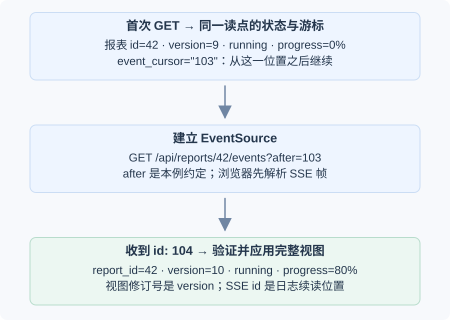
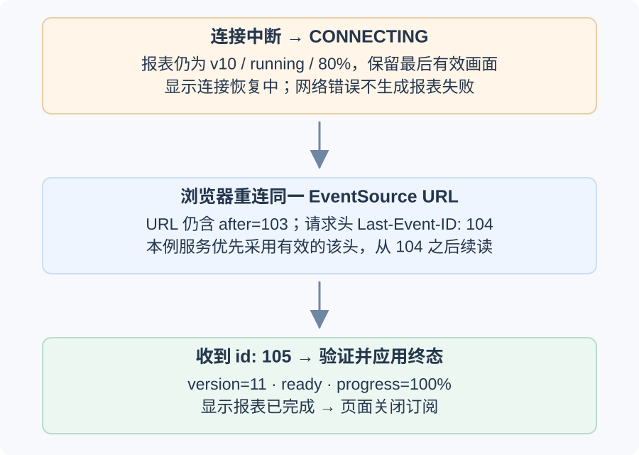
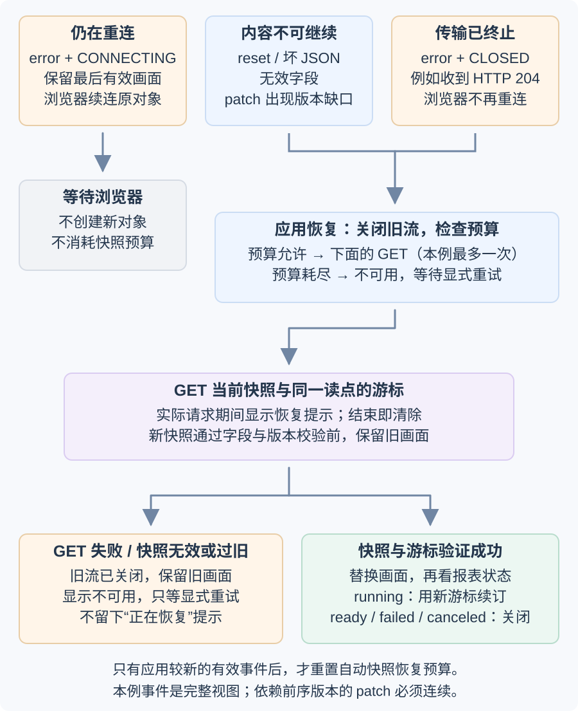
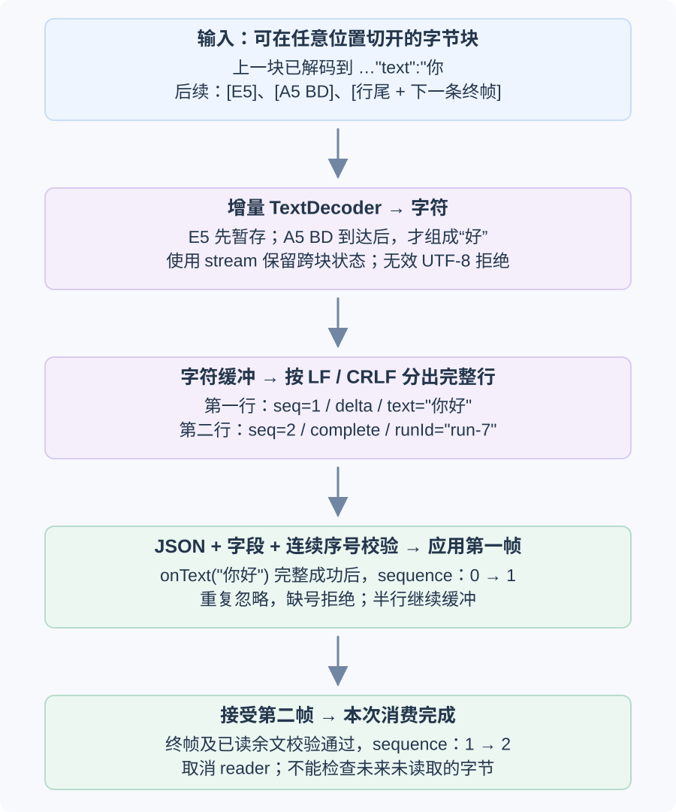

# 流式报表断线重连后，界面怎样保留正确状态？

**合成案例。** 用户打开报表 42，页面读到同一服务端读取时点的状态与事件位置：`id=42, version=9, status=running, progress=0%, event_cursor="103"`。随后页面订阅 Server-sent Events (服务器发送事件，SSE) 进度流；连接在事件 104 后中断，浏览器自动重连，服务再发送事件 105。页面要保留最后有效状态、正确合并更新，并把传输连接与报表运行分开显示。初始快照和事件沿用[实时更新该选哪种传输？](../../engineering-foundations/networking/real-time-web-updates.md)中的公开 application programming interface (应用程序编程接口，API) 案例；所有 ID 与响应均为教学用合成数据。

同一个案例里有三个不同位置：快照字段 `id=42` 标识报表；状态字段 `version=9` 是报表视图的单调修订号；`event_cursor="103"` 和 SSE 帧的 `id: 104` 是同一报表事件日志的续读位置。它们分别回答“哪个资源”“页面已有哪个状态”“从日志哪里继续”，不可互相比较。服务端需在同一一致性点返回快照及其游标；若两者独立读取，期间写入的新事件可能落在二者之间而被跳过。

主线先完整跟完报表 42 的 SSE 恢复。最后的 Fetch 小节是延伸：换用一个独立的 NDJSON 作业例子，说明自行读取字节流时，字符、完整记录、应用游标和本地取消还需要哪些处理；它不改变前面的报表接口。

## 页面要显示两种状态

报表状态来自服务端快照或已验证事件；连接状态来自 `EventSource.readyState` 和页面当前操作。网络断开时页面尚有最后一份可用快照，所以可以标出它可能过时，却不能把报表改成 `failed`。浏览器标准给 `readyState` 三种值：`CONNECTING` 表示尚未连上或正在重连，`OPEN` 表示连接已开，`CLOSED` 表示不再连接（可能是显式 `close()` 或致命错误）。

| 服务端报表状态 | EventSource 状态 | 页面投影 |
|---|---|---|
| `running` | `OPEN` | 显示“已连接”和最近已验证的进度；尚不能据此判断回放已追平 |
| `running` | `CONNECTING` | 首次显示“正在连接”；断线后显示“正在重连，已有进度可能过时” |
| `ready` | `OPEN` / 页面主动 `CLOSED` | 显示服务端终态；本例随后关闭订阅 |
| `failed` 或 `canceled` | 任意 | 显示服务端终态；网络错误不能生成这些结果 |
| `running` | 意外 `CLOSED` | 浏览器不会再自动重连；应用按有限策略重取快照或提示恢复失败 |
| `running` | 旧 EventSource 已关闭、快照 GET 正在进行 | 保留最后有效进度，连接显示关闭；另显示“正在恢复快照” |

`error` 事件不能一概当成运行失败。若 `readyState` 回到 `CONNECTING`，浏览器还会重连；若状态是 `CLOSED`，它已停止重试。原生事件对象也不把 HTTP 响应状态和正文交给页面；标准规定 HTTP `204 No Content` 可以要求 EventSource 停止重连。本文的应用在意外关闭后最多做一次快照恢复；HTTP 204 不是浏览器自动触发的快照恢复。



现在连接在事件 104 之后中断。页面保留已经收到的 v10，而原 EventSource 用浏览器记录的位置续连：



这两张图从同一个快照接续：页面先请求 `after=103`，收到事件 `id: 104` 后把视图应用到版本 10；连接中断时保留 v10。浏览器重连同一 EventSource URL，并自动附上 `Last-Event-ID: 104`。本例服务端契约优先使用这个有效请求头，从游标 104 之后续读 `id: 105`。事件 105 将完整页面视图更新为版本 11 的 `ready`，页面显示完成后关闭订阅。`event_cursor` 只由首次或恢复快照提供；后续解析位置由 EventSource 自己记录，页面不必逐帧改写订阅 URL。浏览器负责解析 `text/event-stream` 帧；页面仍须解析 JavaScript Object Notation (JavaScript 对象表示法，JSON)、检查资源 ID、字段类型和版本，再投影到界面。

## 怎样合并状态并从游标恢复？

Server-sent Events 的 `id` 供浏览器重连时发送 `Last-Event-ID`；URL 中的 `after` 是本例服务端 API 约定，因为原生 `EventSource` 初连不能设置任意请求头或请求正文。标准先更新 EventSource 的 last-event-ID，再排入 JavaScript 事件分发任务，所以它表示浏览器解析到哪里，不是应用处理器已经完成渲染、写本地存储或提交副作用的 acknowledgment (确认，ACK)。服务端可在 `retry:` 字段给出重连等待毫秒数提示；浏览器网络与实现仍会影响实际恢复时间，页面不应假定固定间隔。若本地要可靠处理每条事件，必须另有持久确认位置；只要求最新报表视图时，可以用完整快照校正状态。

报表服务按 `version` 而非 SSE `id` 合并业务视图。本例 `report.updated` 每帧携带页面需要的完整状态，因此收到更高版本可以替换当前视图，低版本或重复版本忽略。若另一个 API 发的是依赖前序状态的 patch，则只接受下一个连续版本；发现 v10 后直接收到 v12 时不能把 v12 patch 套到旧状态，应从权威快照重建。

```http
GET /api/reports/42 HTTP/1.1

HTTP/1.1 200 OK
Cache-Control: no-store
Content-Type: application/json

{"id":42,"version":9,"status":"running","progress":0,"event_cursor":"103"}
```

页面首次连接时，原生 `EventSource` 请求如下；本例服务在没有重连头时使用 `after`，并从 103 之后回放，再接到同一日志的实时尾部：

```http
GET /api/reports/42/events?after=103 HTTP/1.1
Accept: text/event-stream

HTTP/1.1 200 OK
Content-Type: text/event-stream

id: 104
event: report.updated
data: {"report_id":42,"version":10,"status":"running","progress":80}

```

连接中断后，浏览器重用原 URL，并按已解析到的 SSE `id` 发送 `Last-Event-ID`。本例服务优先使用有效的该请求头；没有请求头才使用 URL 的 `after`：

```http
GET /api/reports/42/events?after=103 HTTP/1.1
Accept: text/event-stream
Last-Event-ID: 104

HTTP/1.1 200 OK
Content-Type: text/event-stream

id: 105
event: report.updated
data: {"report_id":42,"version":11,"status":"ready","progress":100}

```

`event` 字段决定命名事件的监听器（缺省是 `message`），`data` 字段构成 `event.data`。空行结束一条 SSE 事件；没有 `data` 字段就不会派发事件，而显式的 `data:` 即使值为空也会被派发为 `event.data === ""`。因此游标过期时可发送 `event: reset\ndata: {}\n\n`；`reset` 是服务端与页面协商的事件名，不是浏览器的内建状态。收到它时，页面关闭旧 EventSource，再取一个**状态快照与游标一致**的响应，从新游标重新订阅。若恢复快照已是 v11 / `ready`，页面显示终态并停止；若仍是 `running`，则用返回的新游标继续订阅。应用也可在发现坏 JSON、无效字段时走同一恢复路径；只有改用依赖前序状态的 patch 时，才需在应用层检查版本缺口。



下面的代码从初次 GET 开始，直到报表终态或有限恢复失败；本例 `progress` 是 0–100 的百分比数值。`readSnapshot()` 将服务返回的扁平 JSON 规范化成 `{ report, event_cursor }`；两个值须来自同一一致读取位置，这是应用 API 合同，不是浏览器保证。快照请求使用 `cache: "no-store"`，避免 HTTP 缓存重用陈旧游标；服务端也以 `Cache-Control: no-store` 返回当前一致快照。示例事件负载是完整视图，所以较高版本可覆盖旧版；若负载改成 patch，应把比较条件改成 `update.version === report.version + 1`，缺号就恢复快照。

> [!example]- 代码：从首次快照到有界恢复的 EventSource 接收器
> ~~~javascript
> const statuses = new Set(["running", "ready", "failed", "canceled"]);
> const terminal = new Set(["ready", "failed", "canceled"]);
> let report;
> let source;
> let connectionState = "closed";
> let recoveryBusy = false;
> let recoveryAttempts = 0;
> let recoveryUnavailable = false;
>
> function setConnectionState(next) {
>   if (connectionState === next) return;
>   connectionState = next;
>   showConnectionState(next);
> }
>
> function validView(value, expectedId = 42) {
>   return value && value.id === expectedId &&
>     Number.isSafeInteger(value.version) && value.version >= 0 &&
>     statuses.has(value.status) && Number.isFinite(value.progress) &&
>     value.progress >= 0 && value.progress <= 100;
> }
>
> async function readSnapshot() {
>   const response = await fetch("/api/reports/42", { cache: "no-store" });
>   if (!response.ok) throw new Error("Snapshot HTTP " + response.status);
>   const body = await response.json();
>   if (!validView(body) || typeof body.event_cursor !== "string") {
>     throw new Error("Invalid snapshot or cursor");
>   }
>   return { report: body, event_cursor: body.event_cursor }; // 扁平响应来自同一一致性点
> }
>
> function closeCurrent(current) {
>   if (source !== current) return;
>   source = undefined;
>   current.close();
>   setConnectionState("closed");
> }
>
> function applyView(next) {
>   if (!validView(next) || (report && next.id !== report.id) ||
>       (report && next.version < report.version)) {
>     throw new Error("Invalid or older report view");
>   }
>   report = { id: next.id, version: next.version, status: next.status, progress: next.progress };
>   renderReport(report);
> }
>
> function subscribe(eventCursor) {
>   setConnectionState("connecting");
>   const current = new EventSource(
>     "/api/reports/42/events?after=" + encodeURIComponent(eventCursor),
>   );
>   source = current;
>   current.addEventListener("open", () => {
>     if (source === current) setConnectionState("connected");
>   });
>   current.addEventListener("report.updated", event => {
>     if (source !== current) return; // 忽略旧 EventSource 留下的任务
>     let update;
>     try {
>       update = JSON.parse(event.data);
>     } catch {
>       recoverFrom(current, "invalid JSON");
>       return;
>     }
>     if (!update || update.report_id !== report.id ||
>         !Number.isSafeInteger(update.version) || update.version < 0 || !statuses.has(update.status) ||
>         !Number.isFinite(update.progress) || update.progress < 0 || update.progress > 100) {
>       recoverFrom(current, "invalid event fields");
>       return;
>     }
>     if (update.version <= report.version) return; // 旧版本或重复视图不回退状态
>     try {
>       applyView({ id: report.id, version: update.version, status: update.status, progress: update.progress });
>     } catch {
>       recoverFrom(current, "invalid or older view");
>       return;
>     }
>     recoveryAttempts = 0; // 只在确实应用了较新、有效视图后重置预算
>     recoveryUnavailable = false;
>     if (terminal.has(report.status)) closeCurrent(current);
>   });
>   current.addEventListener("reset", () => recoverFrom(current, "server reset"));
>   current.addEventListener("error", () => {
>     if (source !== current || terminal.has(report.status)) return;
>     if (current.readyState === EventSource.CONNECTING) {
>       setConnectionState("reconnecting");
>     } else if (current.readyState === EventSource.CLOSED) {
>       recoverFrom(current, "event source closed");
>     }
>   });
> }
>
> function recoverFrom(current, reason) {
>   if (source !== current || recoveryBusy || terminal.has(report.status)) return;
>   closeCurrent(current);
>   void refreshSnapshotAndResume(reason);
> }
>
> async function refreshSnapshotAndResume(reason) {
>   if (recoveryBusy) return;
>   if (recoveryAttempts >= 1) {
>     recoveryUnavailable = true;
>     setConnectionState("closed");
>     showRefreshUnavailable(reason);
>     return;
>   }
>   recoveryAttempts += 1;
>   recoveryBusy = true;
>   showRefreshProgress(reason); // show only after the budget check, immediately before the actual snapshot GET
>   let nextCursor;
>   try {
>     const body = await readSnapshot();
>     if (report && body.report.version < report.version) {
>       throw new Error("Snapshot is older than the displayed view");
>     }
>     applyView(body.report);
>     recoveryUnavailable = false;
>     if (terminal.has(report.status)) {
>       setConnectionState("closed");
>     } else {
>       nextCursor = body.event_cursor;
>     }
>   } catch {
>     recoveryUnavailable = true;
>     setConnectionState("closed");
>     showRefreshUnavailable(reason); // 保留最后一份有效 report
>   } finally {
>     recoveryBusy = false;
>     clearRefreshProgress(); // the GET has resolved or failed; a resumed stream has its own connection state
>   }
>   if (nextCursor !== undefined) subscribe(nextCursor);
> }
>
> async function start() {
>   try {
>     const body = await readSnapshot();
>     applyView(body.report);
>     if (!terminal.has(report.status)) subscribe(body.event_cursor);
>   } catch {
>     showInitialUnavailable();
>   }
> }
>
> function retryAfterUserAction() {
>   if (!recoveryUnavailable || source || recoveryBusy || !report || terminal.has(report.status)) return;
>   recoveryUnavailable = false;
>   recoveryAttempts = 0;
>   void refreshSnapshotAndResume("user retry");
> }
>
> void start();
> ~~~

代码里的 `renderReport`、`showConnectionState`、`showRefreshProgress`、`clearRefreshProgress`、`showRefreshUnavailable` 和 `showInitialUnavailable` 是应用的显示函数。本例约定恢复提示共用一个区域：`showRefreshProgress` 用进度替换原来的不可用提示；`showRefreshUnavailable` 用错误替换进度；`clearRefreshProgress` 只清除仍在显示的进度，不擦掉错误提示。这样手动重试成功会清掉旧错误，失败则保留新的不可用提示。创建 EventSource 时先显示 `connecting`，`open` 只表示传输已连上，不代表服务端回放已追平。恢复路径先将当前 EventSource 从活动引用中移除并关闭，再检查恢复预算；只有预算允许实际 GET 时才显示“正在恢复快照”，并在 GET 成功或失败后明确清除该提示。失败会显示“恢复不可用”；成功且仍在运行则清除恢复提示后显示新流的 `connecting`。所以连接标签为 `closed` 与恢复提示是不同状态，后者只覆盖真实进行中的快照请求。自动恢复 GET 失败时，旧流已关闭且没有新流，页面只保留最后有效视图并提供显式重试。恢复最多尝试一次；收到并应用版本较新的有效 `report.updated` 事件后才重置自动恢复预算。`retryAfterUserAction()` 只接受“恢复不可用”状态，且要求没有活动流、没有正在进行的恢复、当前报表非终态；因此重复点击或在活动连接上调用都不会另建一个未跟踪的 EventSource。生产 API 还应通过认证、授权和游标保留策略保护每次 GET/订阅；游标本身不是凭证。

若应用只需最新视图，按业务版本合并完整快照并在 reset 后恢复即可。若一条日志事件代表必须完成的副作用，浏览器解析位置不够：`Last-Event-ID` 可能比应用完成位置更靠后，应持久记录连续 ACK、按事件 ID 幂等处理，并处理 ACK 与副作用之间的崩溃窗口；细节见[实时更新中快照恢复与逐事件确认的区别](../../engineering-foundations/networking/real-time-web-updates.md#断线后，客户端要重建状态还是补齐每条事件？)。

## Fetch 自定义流和 SSE 有什么不同？

| 需求 | `EventSource`（SSE） | Fetch 响应流 |
|---|---|---|
| 请求形状 | 原生接口发 GET，只提供 URL 与 `withCredentials`；不能设置任意请求头或正文 | 可选方法、请求头、正文与 `AbortSignal` |
| 帧边界 | 浏览器解析 `text/event-stream` 字段并派发事件 | `reader.read()` 返回任意字节块，应用自行解码和组帧 |
| 断线恢复 | 可恢复的断开会自动重连并维护 `Last-Event-ID`；到 `CLOSED` 则不再自动重连，服务还须实现可读游标 | 没有 EventSource 式自动续读；应用按自己的 `runId` / `seq` 重连、去重与补缺 |
| 适合本例 | 订阅报表状态变化 | 提交带授权字段或正文的异步作业，并读取自定义响应协议 |

若 API 需要自定义请求头或 POST 查询，再考虑 Fetch 响应流。`reader.read()` 给出的是任意字节块，不保证一个块刚好是一条记录；UTF-8 字符和 JSON 记录都可能跨块。需要自己持续解码、缓冲到完整分隔符、校验字段和终止条件。传输方式比较见上述实时更新说明；本节聚焦界面和 parser (解析器) 的责任。

现在切换到一个独立的合成作业案例：自定义 newline-delimited JSON (按行分隔的 JSON，NDJSON) 作业协议模型。它不再是报表 42 的 SSE 服务：模型中的 `runId` 标识一次生成作业，`seq` 是该私有日志的应用游标；它既不是 SSE 的 `id`，也不是报表 `version`。客户端用幂等键提交作业并获得稳定 `runId`，续读时带已接受的 `seq`；旧序号可重放并丢弃，跳号则拒绝，作业最终状态仍以状态接口为准。该模型限制单条帧为 8,192 个 UTF-16 代码单元、可见输出为 64 Ki 代码单元，并覆盖坏 JSON、提早 EOF、超时和本地取消；end-of-file (文件结束，EOF) 本身不等于收到终态。为看清字节和消息的区别，先缩小为同一 `run-7` 的两帧：`seq=1` 输出“你好”，`seq=2` 宣告完成。UTF-8 将“好”编码为三个字节 `E5 A5 BD`；网络可能先给出 `E5`，下次才给出 `A5 BD`。单独一个 `E5` 还不能解成字符，增量 `TextDecoder` 会暂存它，等字节完整才输出“好”。字符解出来后仍不能立刻 `JSON.parse`：还要等完整 JSON 行和换行符。



图里一条记录完整应用后，游标才从 0 到 1；缓冲中的下一条终帧通过校验后才结束消费。只收到“你好”就断流，会保留文本并报告本地读取失败，不能猜测服务器已完成。下面折叠的协议示例保留较长的英文输出与三帧序列，parser 的分块测试使用上图这组较小的中文输入；它们遵循同一条按序接受规则。

> [!example]- 自定义 Fetch/NDJSON 作业 parser 与断线案例
> 此实现是 Node Web Streams 与 Response API 上的合成协议模型，不是浏览器端到端或生产服务测试；十六组断言覆盖 UTF-8 与帧跨块、CRLF 分块边界、MIME 精确匹配、合并帧、重放与跳号、服务端错误、格式错误、提前结束、断线、超时、本地中止、回调竞争，以及终态后的已解码余文与未完成 UTF-8 字节。
>
> ~~~text
> POST /api/runs
> Idempotency-Key: submit-7f2a
> {"prompt":"Summarize the public release notes"}
>
> 202 Accepted
> {"runId":"run-7","status":"queued"}
>
> GET /api/runs/run-7/events?after=0
>
> 200 OK
> Content-Type: application/x-ndjson
>
> {"type":"delta","seq":1,"text":"The release adds "}
> {"type":"delta","seq":2,"text":"a search filter."}
> {"type":"complete","seq":3,"runId":"run-7"}
> ~~~
>
> 这个小协议展示提交幂等键、稳定作业 ID、续读序号与明确终态；它是应用契约示例，不是浏览器标准。若流在 `seq: 1` 后断开，客户端保留已应用文本和长度，用同一 `runId` 请求 `after=1`，并把 `afterSequence: 1` 与 `currentOutputChars` 传给 parser；重放的 1 被忽略，下一帧从 2 接上。下面的 parser 会逐块解码并验证序号，遇到没有终态的 EOF 时保留部分文本但不标为完成。
>
> ~~~javascript
> import assert from "node:assert/strict";
>
> const MAX_FRAME_CHARS = 8 * 1024;
> const MAX_OUTPUT_CHARS = 64 * 1024;
> const DECODE_SLICE_BYTES = 4 * 1024;
>
> function readWithSignal(reader, signal) {
>   if (!signal) return reader.read();
>   const abortReason = () => signal.reason ?? new DOMException("Aborted", "AbortError");
>   if (signal.aborted) return Promise.reject(abortReason());
>
>   return new Promise((resolve, reject) => {
>     const onAbort = () => reject(abortReason());
>     signal.addEventListener("abort", onAbort, { once: true });
>     reader.read().then(resolve, reject).finally(() => {
>       signal.removeEventListener("abort", onAbort);
>     });
>   });
> }
>
> async function consumeRun(response, {
>   runId,
>   signal,
>   afterSequence = 0,
>   currentOutputChars = 0,
>   onState = () => {},
>   onText = async () => {},
> } = {}) {
>   let state = "idle";
>   let sequence = afterSequence;
>   let outputChars = currentOutputChars;
>   let carry = "";
>   let terminal = false;
>   let errorCode;
>   let detail;
>   let reader;
>   const decoder = new TextDecoder("utf-8", { fatal: true });
>
>   const transition = next => {
>     const allowed = {
>       idle: ["connecting", "canceled"],
>       connecting: ["streaming", "completed", "failed", "canceled"],
>       streaming: ["connecting", "completed", "failed", "canceled"],
>     };
>     if (state === next) return;
>     if (!allowed[state]?.includes(next)) {
>       throw new Error("Invalid view-state transition: " + state + " -> " + next);
>     }
>     state = next;
>     onState(state);
>   };
>
>   const result = () => ({ state, sequence, outputChars, errorCode, detail });
>
>   async function acceptLine(line, hasBufferedDataAfterFrame = false) {
>     signal?.throwIfAborted();
>     if (terminal) throw new Error("Frame received after a terminal frame");
>     if (!line) throw new Error("Empty frame");
>     if (line.length > MAX_FRAME_CHARS) throw new Error("Frame exceeds the size limit");
>
>     let event;
>     try {
>       event = JSON.parse(line);
>     } catch {
>       throw new Error("Malformed JSON frame");
>     }
>
>     if (!event || Array.isArray(event) || typeof event !== "object") {
>       throw new Error("Frame must be a JSON object");
>     }
>     if (!Number.isSafeInteger(event.seq) || event.seq < 1) {
>       throw new Error("Frame has an invalid sequence number");
>     }
>     if (event.seq <= sequence) return; // replayed event already applied
>     if (event.seq !== sequence + 1) throw new Error("Event sequence gap");
>     if (typeof event.type !== "string") throw new Error("Frame has no event type");
>
>     if (event.type === "delta") {
>       if (typeof event.text !== "string") throw new Error("Delta text must be a string");
>       if (outputChars + event.text.length > MAX_OUTPUT_CHARS) {
>         throw new Error("Output exceeds the display limit");
>       }
>       if (state === "connecting") transition("streaming");
>       await onText(event.text, signal);
>       // onText 成功返回表示这一整帧已经应用；这才是可续读的位置。
>       sequence = event.seq;
>       outputChars += event.text.length;
>       signal?.throwIfAborted();
>       return;
>     }
>
>     if (event.type === "complete") {
>       if (event.runId !== runId) throw new Error("Terminal frame has the wrong runId");
>       if (hasBufferedDataAfterFrame) throw new Error("Frame buffered after terminal frame");
>       decoder.decode(); // flush fatal UTF-8 state so an incomplete byte in this read cannot hide after the terminal line
>       sequence = event.seq;
>       terminal = true;
>       transition("completed");
>       return;
>     }
>
>     if (event.type === "error") {
>       if (typeof event.code !== "string" || !event.code) {
>         throw new Error("Error frame has no error code");
>       }
>       if (hasBufferedDataAfterFrame) throw new Error("Frame buffered after terminal frame");
>       decoder.decode(); // 检查当前已读字节中的未完成 UTF-8 序列；后续网络块仍由终态协议结束
>       sequence = event.seq;
>       errorCode = event.code;
>       terminal = true;
>       transition("failed");
>       return;
>     }
>
>     throw new Error("Unknown event type");
>   }
>
>   async function feedText(text, moreBytesInRead = false) {
>     carry += text;
>     let newline;
>     while ((newline = carry.indexOf("\n")) !== -1) {
>       let line = carry.slice(0, newline);
>       carry = carry.slice(newline + 1);
>       if (line.endsWith("\r")) line = line.slice(0, -1);
>       const hasBufferedDataAfterFrame = carry.length > 0 || moreBytesInRead;
>       await acceptLine(line, hasBufferedDataAfterFrame);
>       if (terminal) return;
>     }
>     // A trailing CR may be the first half of a CRLF split across reads; measure it after the next byte decides the delimiter.
>     const pendingLineChars = carry.length - Number(carry.endsWith("\r"));
>     if (pendingLineChars > MAX_FRAME_CHARS) throw new Error("Frame exceeds the size limit");
>   }
>
>   transition("connecting");
>   try {
>     if (!response.body) throw new Error("Response has no body");
>     reader = response.body.getReader();
>     if (!response.ok) throw new Error("HTTP " + response.status);
>     const contentType = response.headers.get("content-type");
>     const mediaType = contentType?.split(";", 1)[0].trim().toLowerCase();
>     if (mediaType !== "application/x-ndjson") {
>       throw new Error("Unexpected response content type");
>     }
>
>     while (true) {
>       const { done, value } = await readWithSignal(reader, signal);
>       if (done) {
>         await feedText(decoder.decode());
>         if (terminal) return result();
>         if (carry.length) throw new Error("EOF inside an unterminated frame");
>         throw new Error("EOF before a terminal frame");
>       }
>
>       for (let offset = 0; offset < value.byteLength; offset += DECODE_SLICE_BYTES) {
>         const end = Math.min(offset + DECODE_SLICE_BYTES, value.byteLength);
>         const part = value.subarray(offset, end);
>         await feedText(decoder.decode(part, { stream: true }), end < value.byteLength);
>         if (terminal) return result();
>       }
>     }
>   } catch (error) {
>     detail = error instanceof Error ? error.message : String(error);
>     if (signal?.aborted && signal.reason?.name === "TimeoutError") {
>       transition("failed");
>     } else if (signal?.aborted) {
>       transition("canceled");
>     } else {
>       transition("failed");
>     }
>     return result();
>   } finally {
>     if (reader) {
>       try {
>         await reader.cancel();
>       } catch {
>         // Preserve the parse, read, timeout, or abort result.
>       }
>       reader.releaseLock();
>     }
>   }
> }
>
> const encoder = new TextEncoder();
> const asBytes = text => encoder.encode(text);
>
> function responseFrom(chunks, {
>   open = false,
>   status = 200,
>   contentType = "application/x-ndjson; charset=utf-8",
> } = {}) {
>   const body = new ReadableStream({
>     start(controller) {
>       for (const chunk of chunks) controller.enqueue(chunk);
>       if (!open) controller.close();
>     },
>   });
>   return new Response(body, {
>     status,
>     headers: { "content-type": contentType },
>   });
> }
>
> function responseDisconnectAfter(chunk) {
>   let sent = false;
>   const body = new ReadableStream({
>     pull(controller) {
>       if (!sent) {
>         sent = true;
>         controller.enqueue(chunk);
>       } else {
>         controller.error(new Error("Connection dropped"));
>       }
>     },
>   }, { highWaterMark: 0 });
>   return new Response(body, {
>     headers: { "content-type": "application/x-ndjson; charset=utf-8" },
>   });
> }
>
> async function check(name, response, expectedState, expectedText = "", options = {}) {
>   const states = [];
>   let text = "";
>   const result = await consumeRun(response, {
>     runId: "run-7",
>     ...options,
>     onState: state => states.push(state),
>     onText: chunk => { text += chunk; },
>   });
>   assert.equal(result.state, expectedState, name);
>   assert.equal(text, expectedText, name + " partial text");
>   return { result, states };
> }
>
> // Split one multibyte character and one record across reads; the final read
> // also contains a coalesced complete record.
> const multibyte = asBytes("好");
> const normal = await check(
>   "split UTF-8 and coalesced frames",
>   responseFrom([
>     asBytes('{"type":"delta","seq":1,"text":"你'),
>     multibyte.slice(0, 1),
>     multibyte.slice(1),
>     asBytes('"}\n{"type":"complete","seq":2,"runId":"run-7"}\n'),
>   ]),
>   "completed",
>   "你好",
> );
> assert.deepEqual(normal.states, ["connecting", "streaming", "completed"]);
> console.log("PASS normal, multibyte split, frame split, and coalesced frames");
>
> const serverError = await check(
>   "server error frame",
>   responseFrom([asBytes('{"type":"error","seq":1,"code":"MODEL_UNAVAILABLE"}\n')]),
>   "failed",
> );
> assert.equal(serverError.result.errorCode, "MODEL_UNAVAILABLE");
> console.log("PASS terminal server-error frame");
>
> const malformed = await check(
>   "malformed JSON",
>   responseFrom([asBytes("{not-"), asBytes("json}\n")]),
>   "failed",
> );
> assert.match(malformed.result.detail, /Malformed JSON/);
> console.log("PASS malformed frame split across reads");
>
> const prematureEof = await check(
>   "premature EOF",
>   responseFrom([asBytes('{"type":"delta","seq":1,"text":"partial"}\n')]),
>   "failed",
>   "partial",
> );
> assert.match(prematureEof.result.detail, /EOF before a terminal frame/);
> console.log("PASS EOF preserves partial text but does not complete");
>
> const disconnected = await check(
>   "abrupt disconnect",
>   responseDisconnectAfter(asBytes('{"type":"delta","seq":1,"text":"partial"}\n')),
>   "failed",
>   "partial",
> );
> assert.match(disconnected.result.detail, /Connection dropped/);
> console.log("PASS abrupt disconnect preserves partial text but does not complete");
>
> const timeoutController = new AbortController();
> const timeoutTimer = setTimeout(() => {
>   timeoutController.abort(new DOMException("Deadline exceeded", "TimeoutError"));
> }, 5);
> const timeout = await check(
>   "timeout",
>   responseFrom([], { open: true }),
>   "failed",
>   "",
>   { signal: timeoutController.signal },
> );
> clearTimeout(timeoutTimer);
> assert.match(timeout.result.detail, /Deadline exceeded/);
> console.log("PASS timeout remains a failure, not completion");
>
> const stopController = new AbortController();
> const stopTimer = setTimeout(() => {
>   stopController.abort(new DOMException("Stopped by user", "AbortError"));
> }, 5);
> const stopped = await check(
>   "explicit abort after partial text",
>   responseFrom([asBytes('{"type":"delta","seq":1,"text":"partial"}\n')], { open: true }),
>   "canceled",
>   "partial",
>   { signal: stopController.signal },
> );
> clearTimeout(stopTimer);
> assert.match(stopped.result.detail, /Stopped by user/);
> console.log("PASS explicit abort keeps partial text and marks only the local view canceled");
>
> const bufferedRaceController = new AbortController();
> const bufferedRaceStates = [];
> let bufferedRaceText = "";
> const bufferedRace = await consumeRun(responseFrom([
>   asBytes('{"type":"delta","seq":1,"text":"partial"}\n{"type":"complete","seq":2,"runId":"run-7"}\n'),
> ]), {
>   runId: "run-7",
>   signal: bufferedRaceController.signal,
>   onState: state => bufferedRaceStates.push(state),
>   onText: async chunk => {
>     bufferedRaceText += chunk;
>     await Promise.resolve();
>     bufferedRaceController.abort(new DOMException("Stopped while rendering", "AbortError"));
>   },
> });
> assert.equal(bufferedRace.state, "canceled");
> assert.equal(bufferedRace.sequence, 1);
> assert.equal(bufferedRace.outputChars, "partial".length);
> assert.equal(bufferedRaceText, "partial");
> assert.deepEqual(bufferedRaceStates, ["connecting", "streaming", "canceled"]);
> assert.match(bufferedRace.detail, /Stopped while rendering/);
> console.log("PASS abort after text callback returns prevents a buffered terminal frame");
>
> const trailingTerminal = await check(
>   "frame buffered after terminal",
>   responseFrom([asBytes(
>     '{"type":"complete","seq":1,"runId":"run-7"}\n{"type":"delta","seq":2,"text":"late"}\n',
>   )]),
>   "failed",
> );
> assert.match(trailingTerminal.result.detail, /Frame buffered after terminal/);
> console.log("PASS reject a frame already buffered after a terminal record");
>
> const replayedSequence = await check(
>   "duplicate sequence ignored",
>   responseFrom([asBytes(
>     '{"type":"delta","seq":1,"text":"once"}\n' +
>     '{"type":"delta","seq":1,"text":"duplicate"}\n' +
>     '{"type":"complete","seq":2,"runId":"run-7"}\n',
>   )]),
>   "completed",
>   "once",
> );
> assert.equal(replayedSequence.result.sequence, 2);
> console.log("PASS duplicate sequence is not applied twice");
>
> const sequenceGap = await check(
>   "sequence gap",
>   responseFrom([asBytes(
>     '{"type":"delta","seq":1,"text":"partial"}\n' +
>     '{"type":"complete","seq":3,"runId":"run-7"}\n',
>   )]),
>   "failed",
>   "partial",
> );
> assert.equal(sequenceGap.result.sequence, 1);
> assert.match(sequenceGap.result.detail, /Event sequence gap/);
> console.log("PASS sequence gap fails the local consumer without advancing its cursor");
>
> const terminalPrefix = '{"type":"complete","seq":1,"runId":"run-7","padding":"';
> const terminalSuffix = '"}';
> const maxLengthTerminal = terminalPrefix + "x".repeat(
>   MAX_FRAME_CHARS - terminalPrefix.length - terminalSuffix.length,
> ) + terminalSuffix;
> assert.equal(maxLengthTerminal.length, MAX_FRAME_CHARS);
> const splitCrlfLimit = await check(
>   "maximum-size frame with CRLF split across reads",
>   responseFrom([asBytes(maxLengthTerminal + "\r"), asBytes("\n")]),
>   "completed",
> );
> assert.equal(splitCrlfLimit.result.sequence, 1);
> console.log("PASS an 8192-code-unit JSON line followed by split CRLF stays within the frame limit");
>
> const sameChunkCrlfLimit = await check(
>   "maximum-size frame with CRLF in one read",
>   responseFrom([asBytes(maxLengthTerminal + "\r\n")]),
>   "completed",
> );
> assert.equal(sameChunkCrlfLimit.result.sequence, 1);
> console.log("PASS the same 8192-code-unit line also accepts CRLF in one read");
>
> const invalidMediaType = await check(
>   "NDJSON media type with a suffix is rejected",
>   responseFrom([asBytes('{"type":"complete","seq":1,"runId":"run-7"}\n')], {
>     contentType: "application/x-ndjsonx",
>   }),
>   "failed",
> );
> assert.match(invalidMediaType.result.detail, /content type/);
> assert.equal(invalidMediaType.result.sequence, 0);
> console.log("PASS application/x-ndjsonx is rejected before any frame is accepted");
>
> const terminalLineBytes = asBytes('{"type":"complete","seq":1,"runId":"run-7"}\n');
> const openTerminal = await check(
>   "terminal frame completes before an open stream reaches EOF",
>   responseFrom([terminalLineBytes], { open: true }),
>   "completed",
> );
> assert.equal(openTerminal.result.sequence, 1);
> console.log("PASS a terminal frame with a real LF completes while the stream remains open");
>
> const terminalWithPendingUtf8 = new Uint8Array(terminalLineBytes.length + 1);
> terminalWithPendingUtf8.set(terminalLineBytes);
> terminalWithPendingUtf8[terminalLineBytes.length] = 0xf0; // first byte of a four-byte UTF-8 sequence
> const pendingUtf8AfterTerminal = await check(
>   "incomplete UTF-8 byte after terminal in the same read",
>   responseFrom([terminalWithPendingUtf8], { open: true }),
>   "failed",
> );
> assert.equal(pendingUtf8AfterTerminal.result.sequence, 0);
> assert.match(pendingUtf8AfterTerminal.result.detail, /encoded data|encoding/i);
> console.log("PASS a pending UTF-8 lead byte in the same read prevents terminal success");
> ~~~

`consumeRun()` 返回的 `state` 是这次页面消费尝试的本地结果，不等于后台 `run` 的权威状态：本地超时、断线或 JSON 解析失败会得到 `failed`，但服务器上的作业仍可能运行或已经完成；显式查询状态接口后才可确认。收到合成协议的 `error` 终帧会记录 `errorCode` 并停止消费，但仍不能把任意本地 `failed` 当成服务器终态。

若一个读取块里已经同时缓冲终帧和后续的已解码内容，parser 在转入终态前拒绝它；也会 flush fatal `TextDecoder`，避免当前 `read()` 尾部未完成的 UTF-8 字节藏在解码器状态里。接受终帧后会取消 reader，不再读取未来网络数据，因此它不能证明服务端之后没有再发送内容；服务端协议仍须规定终帧后关闭流。

本地 `AbortController.abort()` 或取消 reader 只会结束当前页面对响应体的读取，不证明服务端工作停止。若产品允许取消作业，还要发取消请求并查询权威作业状态，直到服务端报告终态。`onText` 成功返回表示整帧文本已完整接收并应用，只有此后才推进 `sequence` 和输出长度；回调若先应用部分文本再拒绝，就无法安全确定续读点。解析器在等待 `onText` 时不能强行打断任意 Promise，回调必须有界并自行响应传入的取消信号，或让其完成后再处理中止。示例的竞争测试仅证明渲染回调返回后，中止会阻止消费同一缓冲区里的终态帧。解析器等待回调完成也形成背压：若回调将 Document Object Model (文档对象模型，DOM) 写入排入队列，应在队列保持较小时再读取下一块；可以用 `requestAnimationFrame` 合并可见更新，但它不提供恢复保证。路由卸载时释放 reader 和事件源，保留有用但不完整的文本，并将其标为部分结果。将收到的状态先交给本地 reducer 或事件总线再更新多个视图时，监听器重入也可能改变处理顺序；见[事件总线重入案例](./event-bus-and-observer-patterns.md)。

渲染本身也应有界：把同一帧中到达的文本增量合并后每帧更新一次，而不是每个 token 都刷新 DOM；输出很长时限制缓冲或只渲染可见窗口。状态区域可以用 `role="status"` 播报连接、完成或失败；它隐含 polite live-region 语义，不要逐字播报每个 token。

**延伸阅读：** [实时更新该选哪种传输？](../../engineering-foundations/networking/real-time-web-updates.md) 定义 SSE 的线格式、id/version 和重连边界；[API 可靠性与异步交付](../../engineering-foundations/reliability/api-reliability-and-async-delivery.md) 讨论未知结果与安全重试；[JavaScript 事件总线在监听器中重入时怎样保持顺序？](./event-bus-and-observer-patterns.md) 讨论把一个状态更新送到本地多个模块。

若应用交付的是持久 AI run 的完整事件，本篇负责传输解码、断线续读与本地取消边界；事件到达后如何把 `runId`、序号、工具调用与不完整 Markdown 安全地投影到聊天界面，见[一轮 AI 聊天怎样安全展示增量回答、工具状态与恢复操作](./streaming-ai-chat.md)。

> [!info]- 来源
> - SSE 字段解析、空 `data:` 派发、EventSource 自动重连和 `Last-Event-ID`：[WHATWG HTML Living Standard，Server-sent events](https://html.spec.whatwg.org/multipage/server-sent-events.html)，§9.2.2（EventSource 属性与构造器）、§9.2.3（CONNECTING/OPEN/CLOSED、停止重连）、§9.2.4（Last-Event-ID）、§9.2.5–9.2.6（字段解析、空行分发），标准页面 2026-11-12 更新并核对；报表 42 的 `id`、`version` 和终态沿用[实时更新协议案例](../../engineering-foundations/networking/real-time-web-updates.md)。
> - Fetch 响应状态和 `Response.body` 流：[WHATWG Fetch Standard §5.3 Response](https://fetch.spec.whatwg.org/#response-class)；`getReader()`、取消与释放 reader：[WHATWG Streams Standard](https://streams.spec.whatwg.org/)，§4.2、§4.3.3、§4.4、§4.9.3，2026-11-12 核对。
> - Fetch 请求缓存模式及 `cache: "no-store"`：[WHATWG Fetch Standard §5.4 Request](https://fetch.spec.whatwg.org/#request-class)，`no-store` 不使用 HTTP 缓存，2026-10-19 版本、2026-11-12 核对。
> - NDJSON 的 UTF-8、LF/CRLF 分隔和建议媒体类型：[NDJSON Specification 1.0.0](https://github.com/ndjson/ndjson-spec)，§3.1–3.3（2014-10-19）；本例 8,192 字符帧上限、序号、`runId` 与终态是教学协议扩展，不由 NDJSON 标准定义。
> - 增量 UTF-8 解码与 `TextDecoder` 的 `stream`/`fatal` flush 行为：[WHATWG Encoding Standard §7.2](https://encoding.spec.whatwg.org/#interface-textdecoder)，2026-10-19 版本、2026-11-12 核对。
> - `AbortController` 和 `AbortSignal` 的 API 语义：[WHATWG DOM Standard §3 Aborting ongoing activities](https://dom.spec.whatwg.org/#aborting-ongoing-activities)，2026-11-12 核对。
> - `role="status"` 的状态播报语义：[W3C WAI-ARIA 1.2，status role](https://www.w3.org/TR/wai-aria-1.2/#status)，2026-11-12 核对。
