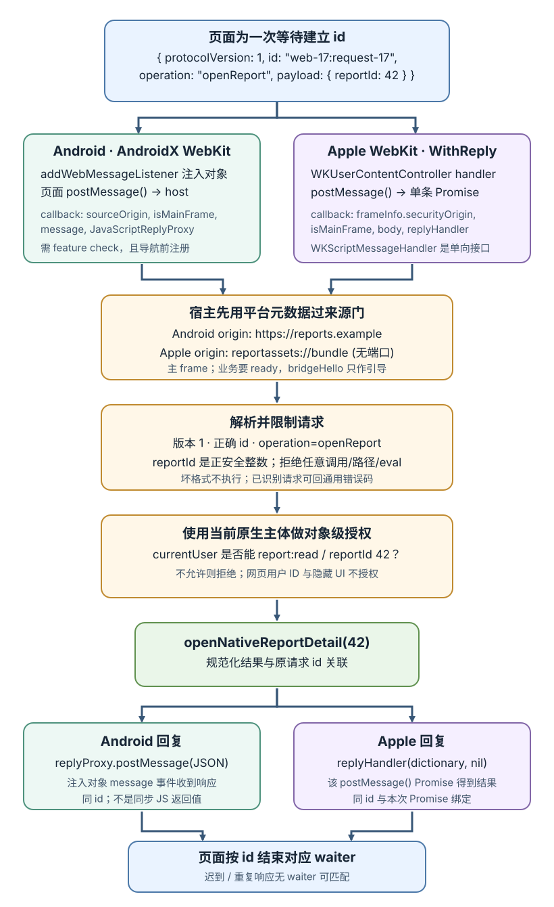
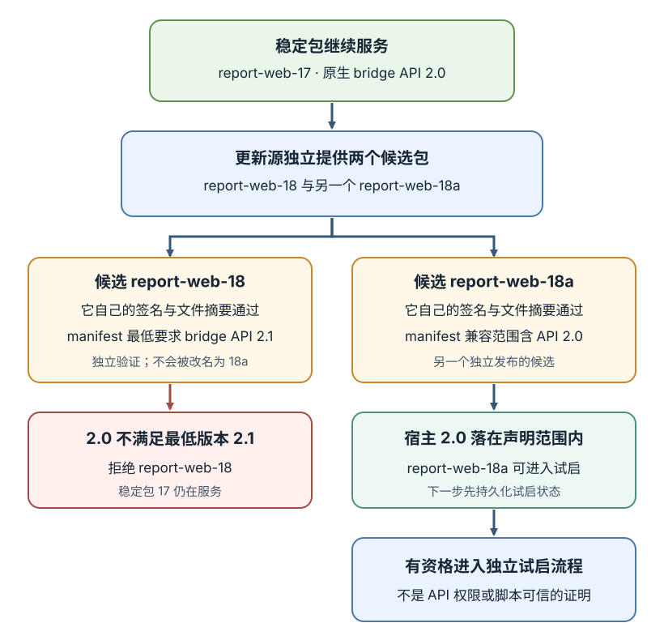
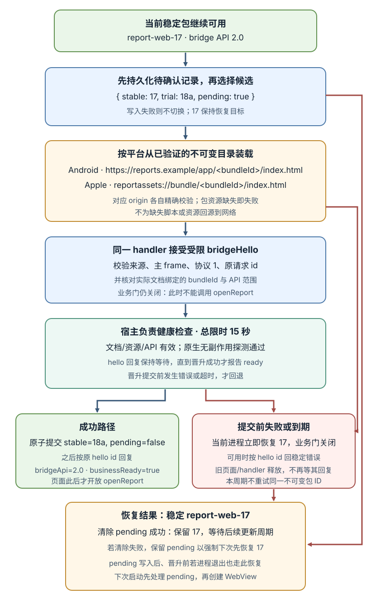

# WebView 怎样安全地开放原生能力并更新页面包？

**合成案例。** 报表应用把页面包 **report-web-17** 放在 Android 或 Apple 的 WebView 中。用户在报表 42 上点“打开详情”，页面想请宿主显示原生详情界面；稍后，服务器发布页面包 **report-web-18**，它要求 bridge API **2.1**，而当前原生应用只实现 **2.0**。本章沿两次信任判断走完：页面请求怎样被确认、授权、执行并回传；更新包怎样验证、兼容、切换或拒绝。版本、来源和返回值都是公开教学用合成数据。

这里有两个不同的版本号：bridge API 2.0/2.1 表示页面可调用的宿主能力契约；消息里的 `protocolVersion: 1` 表示 `{id, operation, payload}` 这套 envelope 字段格式。兼容的 API 版本不自动保证消息格式兼容，反过来也一样。

WebView 提供网页运行环境，原生 API 由宿主显式接入。来源检查回答“哪一个网页上下文发来消息”，参数校验回答“请求是什么”，授权回答“当前用户此刻能否做这件事”；这三项不能互相替代。Android 与 Apple WebKit 的桥接接口也不能拼成一个假想的统一 API。

## 一条消息怎样变成原生操作？

页面调用的是一个很窄的能力：打开报表详情，而不是传入类名、方法名或任意 JavaScript。合成请求如下：

~~~json
{
  "protocolVersion": 1,
  "id": "web-17:request-17",
  "operation": "openReport",
  "payload": { "reportId": 42 }
}
~~~

id 只用于把回复关联回这次等待中的页面请求；它不是身份凭证，也不代表调用已获准。宿主从 WebView 回调取得来源和 frame 元数据，不能接受正文中的 origin、isMainFrame 或 userId 来证明这些事实。

| 平台 | 桥接形状 | 一项关键边界 |
|---|---|---|
| Android 现代入口 | 异步消息对象 | 回调给来源、frame 与回复代理；匹配规则的子 frame 也会得到对象 |
| Android 旧入口 | 注入的 Java 对象 | 所有 frame 可见、没有逐消息来源；页面同步等待 Java 方法返回 |
| Apple WebKit | 单向 handler 或逐调用回复 | 回调带 frame 信息；WithReply 的 Promise 属于发起它的那次调用 |

Android 现代入口是 AndroidX WebKit 的 `WebViewCompat.addWebMessageListener()`。它从 AndroidX WebKit 1.3.0 起提供，但应用还须在运行时用 `WebViewFeature.WEB_MESSAGE_LISTENER` 确认当前 WebView 支持，并在 `loadUrl()` 等导航前注册对象。没有该能力时可以禁用原生功能或走不含桥接的网页路径，不能静默降级为无来源检查的旧接口。对象会注入所有匹配来源的 frame；`allowedOriginRules` 匹配 scheme、host、port，不匹配 path，所以每条消息仍要拒绝非主 frame。回调提供 `sourceOrigin`、`isMainFrame`、消息和 `JavaScriptReplyProxy`。

旧入口 `addJavascriptInterface()` 把带 `@JavascriptInterface` 的方法放到网页可见对象上。Android 4.2/API 17 起、且应用 target API 17 或更高时，只有带此标注的方法可从 JavaScript 调用；面向更旧 target 的应用可能暴露更多 Java 方法。无论哪种情况，对象都对 WebView 里的 frame 可见，平台不给逐消息来源身份；Java 方法在后台线程执行，而调用 JavaScript 会同步等待其返回。只适用于内容与导航都由宿主严格控制的遗留 WebView。

Apple 在创建 `WKWebView` 前把 `WKUserContentController` 放入 configuration，再注册具名 `WKScriptMessageHandler` 或 `WKScriptMessageHandlerWithReply`。WithReply 和按 `WKContentWorld` 指定 handler 的注册方式要求 iOS 14/macOS 11 或更新系统；较旧系统应关闭这条回复式能力，或另行定义并审查一个平台专属通道，不能把新 API 当成可用。普通 `WKScriptMessageHandler` 只通知宿主，不返回值；WithReply 的 `postMessage(body)` 返回属于本次调用的 Promise。Apple 没有 Android 那样的注册时 origin allowlist，因此宿主从 `WKScriptMessage.frameInfo` 读取来源与 frame，并逐次检查。

**先用宿主元数据过来源门。** Android `allowedOriginRules` 可用精确规则 `https://reports.example`；不要用 `*`。规则只看 scheme、host 和 port，不看 path；同一个来源下的 `/app/report-web-17/` 与其他路径仍是同一 origin。对象也会被提供给匹配规则的子 frame，因此回调里的 `isMainFrame` 还要为真。Apple 在 handler 回调内读取 `frameInfo.securityOrigin` 的 scheme、host、port，并检查 `frameInfo.isMainFrame`；本例注册自定义 `reportassets` handler，页面实际入口为 `reportassets://bundle/<bundleId>/index.html`，只接受 `(reportassets, bundle, 无端口)`；本例把 `WKSecurityOrigin.port` 的 0 规范成无端口。比较 HTTPS origin 时按有效端口规范化，不能把该默认值表示直接和 443 作字面比较。`WKFrameInfo` 是当前回调的瞬时资料，不是可存起来代表该 frame 永远不变的身份。

更新包下载自 `https://updates.example/packages/<bundleId>.zip`，但下载地址不会成为 WebView 的文档 origin。这里先以已经完成稳定启动握手的 report-web-17 解释业务调用；实际资源装载、`bridgeHello` 和新包试启在下一节展开。

这道检查确认的是“被允许的来源文档中的主 frame 发来消息”。在该文档里执行的每段脚本都会处于同一来源和 frame 权限下，origin/frame 不是逐段脚本的身份检查；页面供应、导航策略、第三方脚本和 XSS 因而属于桥接可信边界。若同一个 WebView 还要装载不受宿主控制的同源内容，应把它隔离到另一来源或另一 WebView，或不给它原生能力。

Apple 的 WKContentWorld 可以隔离宿主脚本与网页脚本的 JavaScript 变量；它不隔开 DOM，也不能代替 frame/origin 判断。页面要主动调用的 handler 必须安装在网页可调用的 content world。Android 来源规则或 Apple 内容世界解决的是接口暴露范围，不表示该网页能执行任意操作。

**再校验协议和实际授权。** 宿主把平台回调整理成两部分：平台提供的可信元数据，以及仍不可信的请求 body。建议顺序是：

1. 来源必须等于当前 WebView 的平台配置 origin，且消息来自主 frame；不符合就不执行操作。
2. 限制消息大小和字段，解析 protocolVersion、id、operation、payload；拒绝未知协议版本和错误类型。
3. 在业务门打开前只接受受限的 `bridgeHello` 引导操作：它必须使用协议 1、有效 id，并且自报 bundleId 与宿主绑定的实际包一致。宿主仍以实际装载记录为准。
4. `openReport` 等业务操作还要求宿主已置 `businessReady=true`，并只接受一个正的安全整数 reportId。拒绝任意类名、方法名、URL、文件路径、JavaScript 字符串或通用 evaluate 请求。
5. 从原生登录态取当前主体，检查该主体当前是否能执行 report:read 并访问请求中的报表 ID（本例是 42）。正文中的用户 ID、隐藏按钮和难猜的报表编号都不能授权。
6. 通过后才调用一个固定原生方法；再把规范化结果或稳定错误码回到同一个请求 ID。

来源或 frame 不可信时不执行。Android 可以不发回业务事件，让页面在本地 timeout 结束等待；Apple WithReply 应用通用错误调用 `replyHandler(nil, "BRIDGE_REJECTED")`，页面的原生 Promise 会 reject，并由页面端 `request()` 映射为 `BRIDGE_TRANSPORT_ERROR`。Apple 若在调用 reply handler 前释放它，Promise 也会 reject；因此不能把两端的“没有业务 envelope”都写成只会 timeout。body 格式错误时同样不执行；对已通过来源门且 ID 可用的请求，可回不泄露资源细节的 `{ protocolVersion: 1, id, ok: false, error: { code: "FORBIDDEN" } }`，其他稳定错误码也用同一形状。页面只结束该 ID 对应的等待，不把错误或 timeout 当作操作已取消。

下面的宿主算法把来源门、引导操作与业务操作放在同一入口。它是中立伪代码；其中 `bridgeHello` 的试启分支将在下一节接着解释。

> [!example]- 宿主共用入口：先验证来源与文档，再分派操作
> ~~~text
> handle(platformContext, isMainFrame, untrustedBody):
>   reject without executing unless platformContext.origin == platformContext.packageOrigin
>   reject without executing unless isMainFrame
>   reject without executing unless platformContext.callbackBelongsToBoundDocument
>     # host-owned binding from actual package loading/navigation, never a body field
>   request = parseAndValidateEnvelope(untrustedBody)
>   if this is the selected trial document and its bridgeHello is malformed, rejected,
>      has the wrong id/bundle/API, or its check fails before startupDeadline:
>     keep businessReady = false; restore stable bundle in the current process
>     clear pending durably, or retain it so the next startup restores stable first
>     return { protocolVersion: 1, id: request.id, ok: false, error: { code: "TRIAL_FAILED" } }
>       only when a valid id and live reply channel remain
>   if request.operation == "bridgeHello":
>     require valid protocol 1, id, and request.payload.bundleId == boundBundleId
>     require selectedBridgeApi in verifiedManifest.apiRange
>     run host-owned document/API checks and harmless health probe before startupDeadline
>     if trialPending: atomically persist stable=candidate, pending=false before deadline
>       # this durable commit is the recovery cutoff; a late reply timeout cannot undo it
>     businessReady = true  # only after successful checks and durable promotion
>     return { protocolVersion: 1, id: request.id, ok: true,
>              payload: { bridgeApi: selectedBridgeApi, businessReady: true } }
>   reject unless request.operation == "openReport" and businessReady
>   reject unless request.payload.reportId is a positive safe integer
>   reportId = request.payload.reportId
>   reject unless currentNativeUser may perform report:read on reportId
>   result = openNativeReportDetail(reportId)
>   return { protocolVersion: 1, id: request.id, ok: true,
>            payload: normalize(result) }
> ~~~

这里的 `bridgeHello` 是同一消息通道上的引导操作，不另开一个绕过安全门的处理器：平台 origin、主 frame、宿主维护的实际文档/包绑定、envelope 解析、协议与 ID 校验都先执行。`callbackBelongsToBoundDocument` 表示宿主装载器和导航策略把此回调绑定到当前实际加载的已验证包；它不是页面 body 自报字段，也不假设平台提供了可直接比较的文档 ID。它是 `businessReady` 仍为 false 时唯一可接受的操作；宿主完成握手前不能执行 `openReport`。

例中成功响应带回 id `web-17:request-17` 和 `{ opened: true, reportId: 42 }`。Android 把序列化后的响应字符串交给回调提供的 `replyProxy.postMessage()`；`JavaScriptReplyProxy` 对应发消息的 frame，可保留并用于向该 frame 发送多条消息，frame 导航或销毁后再发送会被静默忽略。页面从注入对象的 `message` 事件收到结果，仍须按 envelope ID 找到具体等待项。Apple 的 handler 调用 `replyHandler(responseDictionary, nil)`，该次 `postMessage()` 返回的 Promise 得到字典；Promise 已和发起调用绑定，页面适配器只需把它交给 `request()`。Android 代理与 Apple Promise 是不同的原生回包接口。

请求 ID 还负责异步顺序。页面可能先发 request-17 和 request-18，宿主处理耗时不同，response-18 可以先到；页面应按 ID 找到对应的等待项，而不是按“最早发出的请求”接收。未知 ID、已超时 ID 和重复回复都忽略。ID 只做关联，不防重放；会改变状态的操作还须在宿主按调用 ID 或业务幂等键限制重复执行。

> [!example]- 页面端请求等待与清理
> 下例的 transport.send() 是每个平台各自实现的适配器：Android 调用注入对象的 postMessage(JSON.stringify(envelope))，并把其 message 事件交给 bridge.receive(event.data)；Apple 只调用 window.webkit.messageHandlers.reportBridge.postMessage(envelope)，并把返回的原生 Promise 直接交给 request()。request() 用本次请求的 ID 检查 Promise 结果；不要在 Apple 适配器再调用一次通用 receive()。这段通用代码管理页面侧的请求 ID、乱序、超时和离页清理；它不实现原生授权，也不是 Native API 运行桩。
> 上面的 `web-17:request-17` 是便于追踪的一次合成 ID；代码实际拼出 `generation:递增序号`。协议不要求固定字符串格式，只要求每个未完成请求能被唯一关联。
> 调用时传入当前文档新建的 generation；在安全上下文且 `crypto.randomUUID` 可用时，可用它生成代号，否则由宿主或 `crypto.getRandomValues` 提供新值。这个代号只减少复用传输通道时的 ID 碰撞，不是身份凭证。
>
> ~~~javascript
> function createPageBridge(transport, generation, timeoutMs = 8000) {
>   if (typeof generation !== "string" || generation.length === 0) {
>     throw new TypeError("A page-instance generation is required");
>   }
>   const pending = new Map();
>   let nextId = 0;
>   let disposed = false;
>
>   function fail(id, code) {
>     const waiter = pending.get(id);
>     if (!waiter) return false;
>     pending.delete(id);
>     clearTimeout(waiter.timer);
>     waiter.reject(new Error(code));
>     return true;
>   }
>
>   function receive(value, expectedId) {
>     let reply;
>     try {
>       reply = typeof value === "string" ? JSON.parse(value) : value;
>     } catch {
>       return false;
>     }
>     if (!reply || reply.protocolVersion !== 1 || typeof reply.id !== "string") return false;
>     if (expectedId !== undefined && reply.id !== expectedId) return false;
>     const waiter = pending.get(reply.id);
>     if (!waiter) return false; // 超时、重复或旧页面代号的迟到响应
>     pending.delete(reply.id);
>     clearTimeout(waiter.timer);
>     if (reply.ok === true) {
>       waiter.resolve(reply.payload);
>     } else if (reply.ok === false && typeof reply.error?.code === "string") {
>       waiter.reject(new Error(reply.error.code));
>     } else {
>       waiter.reject(new Error("INVALID_BRIDGE_REPLY"));
>     }
>     return true;
>   }
>
>   function request(operation, payload, requestTimeoutMs = timeoutMs) {
>     if (disposed) return Promise.reject(new Error("BRIDGE_CONTEXT_GONE"));
>     const id = generation + ":" + (++nextId);
>     const envelope = { protocolVersion: 1, id, operation, payload };
>     return new Promise((resolve, reject) => {
>       const timer = setTimeout(() => fail(id, "BRIDGE_TIMEOUT"), requestTimeoutMs);
>       pending.set(id, { resolve, reject, timer });
>       try {
>         const response = transport.send(envelope);
>         if (response && typeof response.then === "function") {
>           response.then(
>             value => {
>               if (!receive(value, id)) fail(id, "INVALID_BRIDGE_REPLY");
>             },
>             () => fail(id, "BRIDGE_TRANSPORT_ERROR"),
>           );
>         }
>       } catch {
>         fail(id, "BRIDGE_SEND_FAILED");
>       }
>     });
>   }
>
>   function dispose() {
>     if (disposed) return;
>     disposed = true;
>     for (const id of pending.keys()) fail(id, "BRIDGE_CONTEXT_GONE");
>   }
>
>   return { request, receive, dispose };
> }
> ~~~
>
> Apple Promise 的成功回调传入该次调用的 expectedId。若 A 的 Promise 意外收到声称属于 B 的 envelope，`receive` 会在查找 pending[B] 前判为错配，A 以 `INVALID_BRIDGE_REPLY` 结束，B 仍等待自己的 Promise 并可接收正确结果。Android message 事件没有逐调用 Promise，因此按 envelope ID 匹配。
>
> 页面进入离页路径时调用 dispose()，清空计时器并以本地错误结束所有等待；Android 的后续 reply 事件或 Apple Promise 回应若在超时之后才到，会因 ID 不再 pending 而丢弃。超时和卸载只结束当前页面的等待，不保证宿主操作被撤销；如宿主已打开详情，页面也不能把“没收到回复”解释为“操作没有发生”。对有业务副作用的操作，必须另定宿主取消/查状态/幂等策略，不能自动盲目重放。原生侧在更换或销毁 WebView 时也要撤销 handler、取消对旧页面的回调并释放等待对象；若使用 BFCache，恢复时重新建立页面代号与通道，不沿用旧 pending 请求。

取消是另一条协议消息，不等于页面清掉计时器：只有当某个宿主操作本身可取消、原生侧保存了它的取消句柄并校验取消消息的请求 ID 与权限时，取消才能停止工作。对已发生的副作用，超时或取消都不能保证回滚；可以提供查询状态或业务幂等键。若操作不可取消，宿主继续完成，旧页面的迟到结果被丢弃。

更早的隐藏 iframe 自定义 URL scheme（例如 `myapp://api/location`）曾用于触发宿主拦截，但参数长度、回复通道、回调 ID 和错误处理都要自行实现。它的导航拦截不是现代 bridge 的逐消息来源/frame 通道：Android `WebResourceRequest.isForMainFrame()` 说明这次请求是否在取主 frame 文档，URL 是目标地址；隐藏 iframe 请求通常会得到 `false`，不能靠这两个字段证明调用来自哪段页面脚本。Apple 导航回调可检查 `WKNavigationAction.sourceFrame`，但这不代表 Android 拦截器也有相同元数据。旧系统若必须保留 URL scheme，只有在对应平台能建立等价的来源约束时才承载能力；若拦截器只有目标 URL，就限于 WebView 中内容和导航都由宿主全程控制的页面，并继续校验消息 schema、当前业务权限和超时。不要把它写成新桥接的等价替代。

宿主对两个平台的回调都应尽快返回：Android WebMessageListener 与 Apple 的消息处理回调运行在应用 UI/main actor 上，不能在那里等待网络或执行长耗时数据库工作；可异步查询，再把 UI 更新或回复送回平台要求的线程。Android 旧 addJavascriptInterface() 则是不同线程模型，不能照搬这条处理方式。

如果页面原本只需要浏览器已有能力，先比较 Web API 与自建桥接。例如，Android WebView 中的 navigator.geolocation 并不会绕开宿主权限：在安全 origin 上发起、且 WebView 尚无该 origin 的权限决定时，会进入 WebChromeClient.onGeolocationPermissionsShowPrompt(origin, callback)；宿主通过 callback 决定网页是否可用 Web API，原生应用还须按 Android 的运行时位置权限流程决定能否访问设备位置。这个回调只说明该网页来源请求了位置，不替宿主决定是否授权。不要只为转发一个已有 Web API 就额外开放泛化桥接方法。

## 下载更新包怎样进入桥接信任区？

页面包里的 HTML、JavaScript、CSS 和图片看似资源文件，但 WebView 执行其中的 JavaScript 后就可能调用已经开放的原生能力。包完整性、包与当前 bridge API 的兼容性、每条请求的授权是三道独立检查；签名通过不能代替 bridge 权限，bridge 权限也不能证明包来源可信。

本例在原生 bridge API 2.0 下运行 report-web-17。更新清单含不可变包 ID、所需 bridge API 范围、入口文件与资源列表、每个文件的大小和摘要。活动指针只说明宿主选中了哪个目录，不证明当前 WebView 真正在执行该目录的文件。这里的宿主装载器从选中的不可变目录读取入口 HTML、JavaScript 和其他可执行资源；包内找不到脚本或其他包资源就加载失败，不回源到同域网络。本例的内容策略也不载入包外可执行脚本；若产品需要远程脚本，该脚本供应方同样进入可信边界，不能算作已由本地包摘要验证。带原生能力的 WebView 同时限制主 frame 导航，只装载宿主认可的包入口。本例每次换包或重新载入均创建独立 WebView 和 handler，handler 捕获包 ID 与该实例的代号；宿主只接受仍然有效、且等于当前绑定的回调。切换或销毁前先关闭旧业务门、使旧绑定失效，旧实例迟到的消息不能使用新实例的权限。主 frame 导航只允许约定入口；需要重新载入时也重新建立绑定和启动握手。实际载入后，宿主把该 WebView 选中的包 ID 与消息回调上下文绑定；页面在握手里报出的包 ID 只用于发现不匹配，不单独证明脚本来源。握手通过前不开放业务方法。若产品还需在同一 origin 装载普通网页，应把它隔离到另一 WebView/来源，不能仅凭同源和主 frame 检查就授予原生能力。

1. **先恢复或启动稳定版本。** 应用启动时读持久化的稳定包记录。若上一次宿主进程退出时仍有待确认的试启记录，先恢复上一个稳定包，再创建有桥接能力的 WebView；否则启动当前稳定包。网络更新在后台进行，不阻挡首屏。
2. **从允许的更新源取独立候选。** 本例通过 `https://updates.example/packages/<bundleId>.zip` 获取包并按策略限制重定向；这是下载端点，不是 Android 或 Apple 回调应匹配的文档 origin。本例还用原生应用内信任锚验证发布者签名，覆盖 CDN/源站被攻陷的威胁；同一未认证响应里带的 hash 只比对字节，不独立证明发布者身份。
3. **临时下载并逐文件验证。** 将清单和资源写入候选目录，核对签名、不可变包 ID、文件大小和摘要；全部通过前不改变正在运行的稳定目录。签名或资源不匹配就删除候选，继续使用 report-web-17。
4. **逐个候选检查 API 范围。** `report-web-18` 的最低要求是 2.1，而宿主实现 2.0，因此拒绝它。`report-web-18a` 是更新源提供的另一个独立包，它有自己的清单、签名和资源摘要；其兼容范围包括 2.0，所以才有资格进入试启。不是把已拒绝的 18 改名成 18a。

### 候选验证通过后，怎样试启并确认稳定版本？

5. **持久化试启状态再切换。** 在启动 18a 前，先可靠持久化 `{ stable: "report-web-17", trial: "report-web-18a", pending: true }`，确认该记录已写入后再原子选择 18a。若进程在晋升提交前退出，下一次启动必须先读 pending 并恢复 17，不能仅因 18a 的文件验签通过就把它当成健康稳定包。
6. **绑定当前文档并完成握手。** 从 18a 的已验证清单取出兼容范围，按各平台的精确入口装载并建立上述宿主绑定。页面通过同一个消息入口发出 `bridgeHello`；来源、主 frame、实际文档绑定、协议和 ID 都通过校验后，才进入宿主健康检查。这时业务门仍然关闭，`openReport` 不能执行。

页面加载后先请求 `bridgeHello`，例如 `{ protocolVersion: 1, id: "web-18a:hello-1", operation: "bridgeHello", payload: { bundleId: "report-web-18a" } }`。Android 通过同一 message event 按 ID 等待；Apple 的 WithReply handler 以这次 `postMessage()` 的 Promise 回复。宿主不在握手开始时先回 API 选择结果；它让该请求等待健康检查，并且只在检查通过、原子晋升完成后回完整成功 envelope：`{ protocolVersion: 1, id: "web-18a:hello-1", ok: true, payload: { bridgeApi: "2.0", businessReady: true } }`。页面的 `request()` 先匹配这次调用的 ID，随后仅当 `payload.businessReady === true` 时开放“打开详情”入口。若宿主在 hello 中途回退，它会在可用时用同一 ID 返回错误；页面计时器只结束页面等待，宿主自己的 15 秒 deadline 才负责恢复稳定包。普通业务请求仍用默认 8 秒计时器；启动握手把页面等待设为 20 秒，给宿主在 15 秒恢复后回传错误或销毁旧页面留出时间。

候选包试启的 deadline 从 `{ stable: "report-web-17", trial: "report-web-18a", pending: true }` 持久化成功后开始，总计 15 秒，覆盖导航与包资源装载、有效 `bridgeHello`、宿主健康检查和原子晋升提交。宿主把 deadline 与 `pending` 状态的持久化转换串行化：提交 `stable=18a, pending=false` 成功就是恢复分界；只有提交前失败或到期才回退 17。

资源缺失或导航失败、握手拒绝或协议/ID/包不匹配、健康检查失败、晋升提交前持久化失败，或提交前 deadline 到期，都进入同一恢复路径：业务桥保持关闭，当前进程销毁试启 WebView 并重新装载 17；能用原回复通道时按原 ID 回稳定错误，通道已断则释放旧 handler 和等待项。清除 `pending` 成功后，本次更新周期不再试同一不可变包 ID，后续更新检查仍按既定退避策略调度；若清除写入失败则保留 pending，让下一次启动仍先恢复 17。进程在 pending 写入后、晋升提交前的任何时点退出，下一次启动也先读 pending、恢复 17，再创建 WebView。

若 `stable=18a, pending=false` 已提交，即使进程还未设置内存中的 `businessReady` 或 hello 成功回复尚未送达，18a 已是稳定包；下次启动先装载 18a，再以相同 origin/frame/协议/文档检查和稳定启动握手打开业务门。稳定 17 的重载使用相同的 origin/frame/协议/文档检查和健康门；只有 `bridgeHello` 成功才返回业务就绪信号。稳定页自身加载或握手失败时保持桥关闭并显示宿主错误/重试界面。

握手只证明所选 WebView 文档与宿主对话时使用了匹配的 envelope，并且宿主协商的 API 版本与候选清单兼容；可信内容身份来自宿主对入口与可执行资源的实际装载控制，不来自页面自报字段。页面通过试启后仍逐次验证来源、frame、操作 schema 和当前权限。若更新包切到新 origin，宿主须在导航和桥接配置中明确允许那个 origin；不要为了版本滚动而放宽成任意来源。

资源装载也因平台而异。Android `WebViewAssetLoader` 把本例已验证目录映射到 `https://reports.example/app/<bundleId>/index.html`；它本身不验证更新包签名，而且默认 path-handler 未命中可回退到网络，因此持有原生能力的装载器必须对包内资源未命中 fail closed。Apple `WKURLSchemeHandler` 只服务 WebKit 不原生处理的自定义 scheme，不能注册 `https`；本例用 `reportassets://bundle/<bundleId>/index.html`，并在 handler 中从对应不可变目录读取入口与资源。在固定 WebKit Cocoa 分支中，旧链接行为在 URL 有效且通过 no-access 检查后直接返回非 opaque；新链接行为则要求自定义 scheme 已注册 handler，本例的 `reportassets` 满足此条件，也返回非 opaque。因此在这两种分支及本例前置条件下，`WKSecurityOrigin` 可对应 `(reportassets, bundle, 无端口)` tuple；错误或 opaque/null 回调仍须拒绝。宿主要在目标 app SDK/系统组合中实测。若改为 `loadFileURL`，它的回调 origin 不能沿用上面的 custom-scheme tuple，也不能假设是 Android 的 HTTPS origin。每个平台都把选中的实际文档、入口和可执行资源绑定到具体 WebView；更新源的 HTTPS 仅负责下载，不是页面来源门的值。

应用商店分发政策还会约束下载并执行页面代码。Apple 当前审核指南限制下载或执行会改变 App 功能的代码；若产品属于指南列出的 HTML5/JavaScript 小程序等软件类别，还适用额外规则，其中包括未经 Apple 事先许可不得向这些软件开放原生平台 API。Google Play 对解释执行代码另有适用条件：JavaScript 在 WebView 中属于解释执行例外的一种，但解释代码仍不得造成违反 Play 政策的功能；这不是任意热更新的批准。原子切换、签名或桥接白名单解决的是工程信任问题，不能替代对目标分发政策的适用性判断。

页面包不应持有长期密钥、原生登录凭证或最终权限；把秘密留在原生安全存储或服务端，每次敏感调用仍从当前原生会话和业务数据做授权。按包版本记录签名/摘要验证和兼容结果，按调用记录操作、授权结果与关联 ID，可帮助定位错误和决定回滚；日志不要写入会话秘密或完整敏感 payload。

**延伸阅读：** [报表页面里的状态应该放在哪里？](./browser-storage-and-communication.md) 解释本地副本不能冒充服务端事实；[如何逐次授权租户内的报表资源？](../../engineering-foundations/security/web-security-and-authentication.md) 解释服务端主体和资源授权。WebView 宿主还必须在本地对其实际开放的每种能力单独作出当前授权决定。

> [!info]- 来源
> - **现代 Android 桥接。** Android Developers，[Access native APIs with JavaScript bridge](https://developer.android.com/develop/ui/views/layout/webapps/native-api-access-jsbridge)，Use addWebMessageListener、Initialization、Key features、addJavascriptInterface（旧入口）及线程/帧边界，2026-11-12 核对。
> - **AndroidX 接口细节。** [WebViewCompat addWebMessageListener](https://developer.android.com/reference/androidx/webkit/WebViewCompat)（1.3.0 起、需运行时 feature check、origin rule 格式、对象注入和回复代理）；[WebMessageListener 回调](https://developer.android.com/reference/androidx/webkit/WebViewCompat.WebMessageListener)（sourceOrigin、isMainFrame、replyProxy、UI 线程和 opaque file:/content: origin），2026-11-12 核对。
> - **Android 旧桥接风险和导航拦截语义。** Android Developers，[WebView addJavascriptInterface](https://developer.android.com/reference/android/webkit/WebView) 的全 frame 暴露、旧 target 的注解边界、调用线程与返回行为；[Insecure WebView native bridges](https://developer.android.com/privacy-and-security/risks/insecure-webview-native-bridges)；[WebResourceRequest](https://developer.android.com/reference/android/webkit/WebResourceRequest) 对 `isForMainFrame()` 和目标 URL 的定义，2026-11-12 核对。
> - **Apple 消息、回复和 frame。** Apple Developer Documentation，[WKScriptMessageHandler](https://developer.apple.com/documentation/webkit/wkscriptmessagehandler)、[WKScriptMessageHandlerWithReply](https://developer.apple.com/documentation/webkit/wkscriptmessagehandlerwithreply)、[WKUserContentController](https://developer.apple.com/documentation/webkit/wkusercontentcontroller)、[WKFrameInfo](https://developer.apple.com/documentation/webkit/wkframeinfo)、[WKNavigationAction.sourceFrame](https://developer.apple.com/documentation/webkit/wknavigationaction/sourceframe)，frameInfo.securityOrigin / isMainFrame、导航来源 frame 与移除接口，2026-11-12 核对。
> - **Apple WithReply 版本与 Promise 失败。** WebKit 开源 Cocoa API 头文件 [`WKScriptMessageHandlerWithReply.h`](https://github.com/WebKit/WebKit/blob/main/Source/WebKit/UIProcess/API/Cocoa/WKScriptMessageHandlerWithReply.h) 规定 reply handler 最多调用一次、传入 error 字符串会 reject JavaScript Promise、在调用前释放 handler 也会 reject；[`WKUserContentController.h`](https://github.com/WebKit/WebKit/blob/main/Source/WebKit/UIProcess/API/Cocoa/WKUserContentController.h) 标注 WithReply 和 contentWorld 指定的注册入口为 iOS 14/macOS 11 起可用。Apple WWDC20，[Discover WKWebView enhancements](https://developer.apple.com/videos/play/wwdc2020/10188/) 09:03–09:55 说明 content world 的脚本变量隔离，13:47–14:45 说明 WithReply Promise；[WKContentWorld](https://developer.apple.com/documentation/webkit/wkcontentworld) 同时说明 DOM 仍由不同 world 共用。WWDC 作为语义说明，版本边界与当前 API 由公开头文件/文档核对，2026-11-12。
> - **Apple origin 规范化。** [WKSecurityOrigin](https://developer.apple.com/documentation/webkit/wksecurityorigin) 的 scheme/host/port 属性与 [WebKit 实现](https://github.com/WebKit/WebKit/blob/e95d3cb282b586c54897b153b498c4fa46310d0a/Source/WebKit/UIProcess/API/Cocoa/WKSecurityOrigin.mm#L53-L66)，2026-11-12 核对；比较前按 origin 语义使用有效端口。
> - **WebView 中的 Web API 权限。** Android [WebChromeClient.onGeolocationPermissionsShowPrompt](https://developer.android.com/reference/android/webkit/WebChromeClient#onGeolocationPermissionsShowPrompt(java.lang.String,android.webkit.GeolocationPermissions.Callback))：无 origin 权限状态时把网页来源与 callback 交给宿主；[Request location permissions](https://developer.android.com/develop/sensors-and-location/location/permissions)：原生应用自身的位置权限类型，2026-11-12 核对。
> - **本地资源 origin 与回源行为。** Android Developers，[Load in-app content](https://developer.android.com/develop/ui/views/layout/webapps/load-local-content) 的 WebViewAssetLoader 与未命中 path 回源行为；Apple [WKURLSchemeHandler](https://developer.apple.com/documentation/webkit/wkurlschemehandler)、[setURLSchemeHandler](https://developer.apple.com/documentation/webkit/wkwebviewconfiguration/seturlschemehandler%28_%3Aforurlscheme%3A%29) 明确不能接管 `https`，以及 WebKit [`SecurityOriginData.cpp`](https://github.com/WebKit/WebKit/blob/e95d3cb282b586c54897b153b498c4fa46310d0a/Source/WebCore/page/SecurityOriginData.cpp#L211-L231) 的 Cocoa 条件分支：旧链接行为直接非 opaque，新链接行为继续看 scheme handler 是否注册；本例需同时满足 URL 有效与 no-access 检查通过。入口示例用 Android `https://reports.example/app/<bundleId>/index.html` 和 Apple `reportassets://bundle/<bundleId>/index.html`；更新源 `https://updates.example/...` 与文档 origin 分开配置，2026-11-13 核对。
> - **页面代码的应用商店分发。** Apple，[App Review Guidelines](https://developer.apple.com/app-store/review/guidelines/) §2.5.2 自包含与下载/执行功能变更代码，§4.7.2 对该类别小程序暴露原生 API 的限制；Google Play，[Developer Program Policy](https://support.google.com/googleplay/android-developer/answer/18265346) Device and Network Abuse，解释器代码例外与运行时加载脚本不得违反其他 Play 政策（该版自 2026-10-29 生效），2026-11-12 核对。具体应用是否符合政策取决于实际产品与当前规则。
