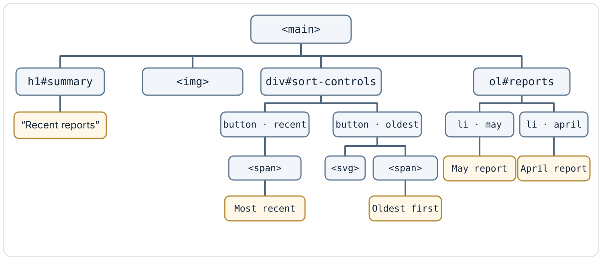
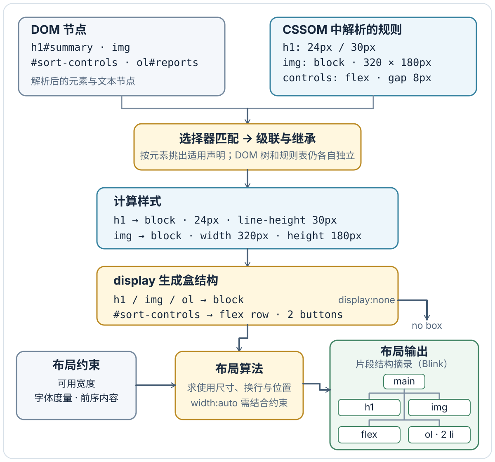
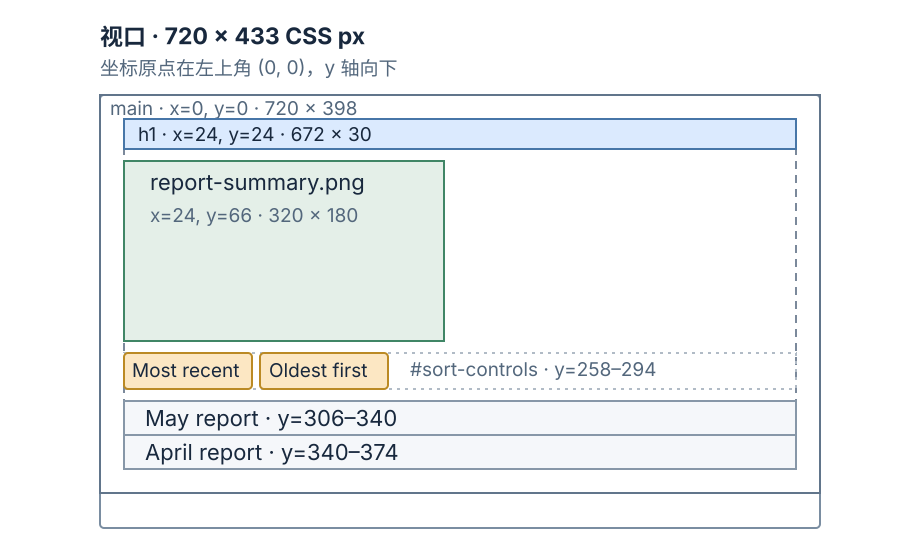
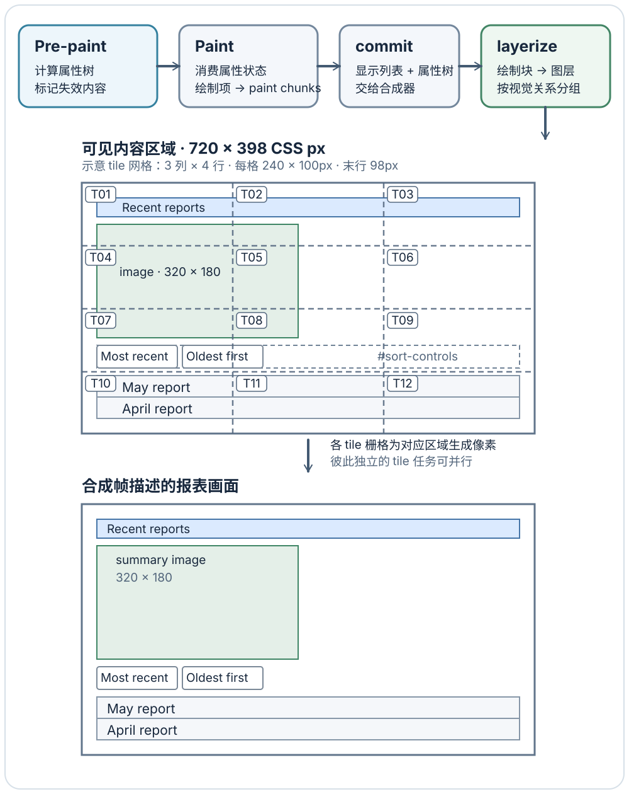

# 浏览器如何把 URL 变成第一帧？

案例背景：用户打开 Uniform Resource Locator (URL，统一资源定位符)`https://example.test/reports?sort=recent#summary`，需要看到最近报表；随后点击“最早优先”，期望列表更新。先沿初次导航走到可见页面，再从同一页跟进点击。

~~~mermaid
flowchart TD
    A[输入报表 URL] --> B[导航取得 HTML 响应]
    B --> C[逐步解析 HTML<br/>建立 DOM 并发现资源]
    C --> D[已有可显示内容<br/>当前渲染所需 CSS 就绪]
    C --> E[HTML 解析结束、模块图就绪<br/>样式不再阻塞脚本]
    D --> F[渲染机会：样式、布局、绘制<br/>栅格化与合成后显示首帧]
    E --> G[reports.js 模块求值<br/>注册筛选处理器]
    F --> H[画面可见且处理器已就绪]
    G --> H
    H --> I[点击最早优先<br/>更新 URL、选中态与行顺序]
    I --> J[后续渲染机会显示新顺序]
~~~

这张图跟踪两种不同的就绪条件：浏览器已有足够的超文本标记语言（HyperText Markup Language，HTML）和当前可显示内容所需的层叠样式表（Cascading Style Sheets，CSS）规则，可以先给出一帧；`/reports.js` 的模块依赖下载完成、HTML 解析结束且阻塞它的样式表处理完后，才注册点击处理器。两条线可以交叠推进：HTML 流还在解析时，浏览器就能获取 CSS、模块及图片；图片也可在 Document Object Model (DOM，文档对象模型) 构建和布局工作继续时下载、解码。图表示这条报表路线上的依赖，不表示所有浏览器必有同一组线程或逐步流水线。下文的成功点击假设发生在两个条件汇合之后；若用户在静态首帧出现、监听器尚未注册时就点按钮，这份 HTML 没有原生提交或其他后备动作，因此不会排序。模块或依赖获取失败、注册前脚本报错，也可能留下可见却不能筛选的页面。

## 先确定浏览器要打开什么

地址栏文本先被判定为搜索词还是 URL；这里已给出 URL，因此例子从跨文档导航开始。浏览器拆分 URL：`https`、主机和端口共同确定 origin（源）；`/reports` 与 `?sort=recent` 是请求所针对的资源，`#summary` 是文档内的位置标识，不会发给服务器。`sort=recent` 因而可以影响服务端返回的初始行序，片段则在文档中定位到 `id="summary"` 的标题。

若活动且匹配的 Service Worker（服务工作线程）正在控制此导航，它的 fetch 事件处理器（fetch handler）可以返回合成响应，也可以自己继续取网络资源；这可以让页面不必重新向源站取 HTML。Hypertext Transfer Protocol (HTTP，超文本传输协议) 响应缓存若有新鲜且匹配的响应，可以直接复用；若响应需要验证，浏览器会带条件请求确认它是否仍有效。需要走网络时，浏览器可以复用一条适用于这次请求的活动连接；若需新建连接，且系统没有可用的主机地址记录，才需要查询 Domain Name System (DNS，域名系统)。对本例的新 HTTPS 连接，浏览器按 Transport Layer Security (TLS，传输层安全协议) 验证服务端证书并保护传输，然后发送请求。若中间响应要求重定向，浏览器按 `Location` 继续导航；如果目标改变了主机或协议，后续连接条件也可能改变。实际发送的请求路径和返回的资源最终由这条导航链决定。

取得最终 HTML 响应后，浏览器不必等整个响应体下载完才开始工作。HTML 字节可以持续交给 parser（解析器）；解析器按到达的内容逐步建出新 `Document` 的 DOM，并发现外部样式表、模块和图片。完整 HTTP、DNS 与连接建立过程见[HTTP、DNS 与连接建立](../../engineering-foundations/networking/http-protocols-and-websockets.md)。

`#summary` 指向当前文档里的位置。后续应用也能用 History API 改变当前 URL，而不获取该 URL 对应的新文档。浏览器后退时，浏览器可能直接恢复符合条件的既有页面状态（back/forward cache，前进/后退缓存）；这与从 HTTP 缓存重新使用响应不是一回事。见[每次 URL 变化都会加载新文档吗？](./browser-navigation-and-history.md)和[HTTP、DNS 与连接建立](../../engineering-foundations/networking/http-protocols-and-websockets.md)。

## 响应到达时，解析和资源获取可以交叠

假设 `/reports` 返回如下 HTML。服务端已经把报表标题和初始行放进响应，浏览器可在客户端代码完成之前显示它们。

~~~html
<!doctype html>
<link rel="stylesheet" href="/reports.css">
<script type="module" src="/reports.js"></script>
<main>
  <h1 id="summary">Recent reports</h1>
  
  <div id="sort-controls">
    <button type="button" data-sort="recent" aria-pressed="true"><span>Most recent</span></button>
    <button type="button" data-sort="oldest" aria-pressed="false"><svg aria-hidden="true"></svg><span>Oldest first</span></button>
  </div>
  <ol id="reports"><li data-id="may">May report</li><li data-id="april">April report</li></ol>
</main>
~~~

浏览器可随着响应体到达开始解析，不必等完整文件。HTML parser 建立 DOM，并发现样式表、模块脚本和图片；这些独立资源可以在解析继续时并行获取，一些浏览器还会用预扫描提前发现资源。适用于当前环境的外部样式表可能阻止首次渲染。这里的普通模块脚本及其依赖在解析期间下载，但模块不会像未标记的经典同步脚本那样卡住 parser；模块要等 HTML 解析结束、依赖就绪，并且阻塞脚本的样式表不再等待，才开始求值。模块图下载就绪与处理器注册是不同的时点。JavaScript 引擎执行 `/reports.js`；渲染引擎负责把 DOM/CSS 转成可显示内容，浏览器将二者接在同一页面生命周期里。Chromium 常见组合是 V8 与 Blink，Firefox 使用 SpiderMonkey 与 Gecko，Safari 使用 JavaScriptCore 与 WebKit；这些名称说明不同组件的职责，不规定它们必须用同一进程或线程安排。具体脚本依赖关系见[脚本如何影响 HTML 解析与文档就绪？](../html-css/browser-html-and-css.md)。

**这段 HTML 中 `<main>` 的 DOM 子树**



### DOM 与 CSS 怎样变成布局用的几何？

`/reports.css` 到达后，CSS parser（CSS 解析器）会将文本解析成样式表及规则；对网页脚本可见的 CSS Object Model (CSSOM，CSS 对象模型) 用 `CSSStyleSheet`、`CSSRule` 等对象表示这些内容。CSS 规则仍不是 DOM 节点；渲染时浏览器让选择器匹配 DOM，再按级联与继承挑出适用声明。引擎内部用于匹配规则的数据结构可以各自不同。

DOM 记录节点和文本如何嵌套；CSS 规则描述这些节点怎样呈现。浏览器将两者结合，按级联和继承为元素解析 computed style（计算样式），例如标题的字号、行高和颜色。计算样式不等于最终几何：像 `width: auto` 这样的值还要结合可用空间、字体度量和相邻内容，布局算法才能算出 used value（使用值）和位置。

CSS 的 `display` 等规则会从 DOM 生成用于布局的盒结构，但二者不是一对一：`display: none` 的元素不生成盒；一个文本节点若换行，可能对应多个空间片段。布局继续根据父容器约束和前面内容的尺寸，确定每个盒或片段的宽高、坐标与顺序。Blink 将其中一种布局结果组织为 fragment tree（片段树）；Gecko 使用 frame tree（帧树），而且一个节点可能对应多个 frame。共同要点是这些中间结构携带布局结果，不是 DOM 原样的复制品。

**从节点与规则到布局片段**



案例没有提供 `/reports.css`，所以接下来的 CSS 只定义一份可复算的局部教学布局，不代表真实站点样式。为消除浏览器默认样式对坐标的影响，这份规则显式清掉 `h1` 的上外边距、图片的 inline baseline 行盒间隙、按钮默认内边距和列表缩进；全局使用 `border-box`，按钮声明的宽高因此包含边框。

```css
*, *::before, *::after { box-sizing: border-box; }
html, body { display: block; margin: 0; padding: 0; }
body { font: 16px Arial, sans-serif; }
main { display: block; width: 100%; padding: 24px; }
h1 { display: block; margin: 0 0 12px; font-size: 24px; line-height: 30px; font-weight: 700; }
img { display: block; width: 320px; height: 180px; margin: 0 0 12px; }
#sort-controls { display: flex; gap: 8px; margin: 0 0 12px; }
button { display: inline-flex; width: 128px; height: 36px; margin: 0; padding: 0; border: 1px solid; font: inherit; }
button svg { display: block; width: 16px; height: 16px; flex: none; }
#reports { display: block; margin: 0; padding: 0; list-style: none; }
#reports li { display: block; height: 34px; margin: 0; padding: 0; line-height: 34px; }
```

在本机 headless Chrome `157.0.8103.50` 中，把上方 `<main>` 子树放入测量页并应用这段 CSS；图片用本地 `data:` 占位替代外部文件，只核对布局几何，不访问站点。测得 `innerWidth=720 CSS px`、`innerHeight=433 CSS px`、`devicePixelRatio=1`。关键 `getBoundingClientRect()` 结果如下；坐标以视口左上为原点，单位均为 CSS px。

| 元素 | x, y | width × height | 推出的边缘 |
|---|---:|---:|---:|
| `main` | `0, 0` | `720 × 398` | 内容盒起点 `(24, 24)`，宽 `672` |
| `h1#summary` | `24, 24` | `672 × 30` | 下边 `54` |
| `img` | `24, 66` | `320 × 180` | 下边 `246` |
| `#sort-controls` | `24, 258` | `672 × 36` | 下边 `294`；按钮实际覆盖 `x=24…152`、`160…288` |
| `ol#reports` | `24, 306` | `672 × 68` | 下边 `374` |
| May 行 / April 行 | `24, 306` / `24, 340` | each `672 × 34` | 行边界 `306–340`、`340–374` |

可复算的纵向链是 `24 + 30 + 12 + 180 + 12 + 36 + 12 = 306`：标题、图片、按钮组是向下排列的块；只有两个按钮在 flex 行内横排。图片设为块级后，`img` 的盒直接高 `180px`，不会再受 inline 基线间隙影响；`ol` 的上下 margin 与 padding 均为零，第一行从实测的 `y=306` 开始。指定图片尺寸后，即使实际图片字节尚未解码，布局也可先按 `320×180px` 留位；晚到的字体则可能改变文字宽度并让后续内容重排。

**同一页面的实测盒位置**



### 布局结果怎样变成可以显示的像素？

布局给出了盒子与文字片段的几何，却没有画出字形或按钮背景。绘制阶段按 CSS 绘制顺序把这些几何、颜色、图片等内容转成有顺序的绘制项；一个元素可能产生多个绘制项，例如背景和文字是不同的项。图片若尚未下载或解码，它的框可以已经参与布局，但对应图像内容要等资源可用。

下面按 Chromium 的 RenderingNG 公开实现串起中间表示。Pre-paint 计算 transform、clip、effect、scroll 属性树，并标记失效的显示项或 GPU 图块。Paint 消费这份属性状态，按绘制顺序生成 display items（显示项），再把共享同一属性状态的显示项分组为 paint chunks（绘制块）。Commit 把显示列表和属性树交给合成器；layerize 再按可独立合成的视觉关系，把绘制块组织成一层或多层。接着可见空间被分成相邻 tile 区域；栅格任务为某个矩形 tile 处理覆盖到它的绘制项，互不依赖的区域可以并行栅格。同一个绘制项也可能跨过多个 tile，例如这张图的图片框横跨格子边界，各区域只需得到对应的像素部分。长页面可以复用已栅格的 tile，并在滚动时补画刚进入视口的空间范围。激活阶段产生描述 tile 摆放与视觉效果的 compositor frame（合成帧）。Viz 再把可见表面的合成帧汇总为全局合成帧，由 GPU 执行 Draw 绘出屏幕像素；下图只放大报表表面的空间关系。

**绘制块、连续 tile 区域与本页合成帧描述的画面**



图中的 `3×4` 网格只是说明空间划分的教学假设，单格为连续的 `240×100 CSS px` 矩形，最下排高 `98px`；不是对 Chromium 实际 tile 尺寸或 layer 数量的断言。为聚焦空间关系，图把可见内容投影到一个示意 layer surface；真实 layerize 可能把绘制块组织成一层或多层。上图网格取实测 `main` 外框 `720×398 CSS px`，完整位于 `720×433 CSS px` 的视口内，余下 `35px` 是页面下方空白，所以十二格都在当前画面范围内。真实引擎会按 viewport、失效范围、图层属性和设备条件选择需要更新的 tile；同一绘制项可以贡献给它覆盖到的多个 tile，空间范围决定 tile 输入，而不是把一条显示列表任意拆成不相邻的片段。网格线与控制盒虚线只是定位参考，不是页面边框；合成帧描述的画面省略这些参考线，但保留同一个标题、图片、按钮和 May、April 两行。

这些阶段和中间结构是 Chromium 的实现例，不是网页标准规定的固定线程流水线。Firefox 的公开实现说明也从 DOM/CSS 得到布局 frame，再产生 WebRender 显示列表、场景和帧，具体表示与进程安排不同。某些变化（例如只需合成器处理的滚动或视觉动画）可以跳过重新布局和绘制；报表列表顺序变化则会改变 DOM 和内容位置，浏览器需要在后续渲染机会更新受影响的布局或绘制工作。HTML 解析、资源获取与图像解码可以交叠；同一流式内容里后面的块位置仍依赖前面内容的布局结果，因此不能把整页简化成互不相关的并行方框。

## 从首帧交接到筛选更新

首帧可能先于 `load` 事件和客户端代码可交互的时点出现。比如 HTML 已显示报表，但模块脚本尚未完成下载、运行或注册点击处理器。此刻初始 HTML 已有 `sort=recent` 对应的顺序：按钮 `aria-pressed` 为 `true/false`，列表是 May 在前、April 在后。若报表由 React 服务端输出，hydration（客户端水合）还要在已有 DOM 上运行客户端代码并接入组件行为，见[Next.js 中的 hydration 与流式渲染](../frameworks/next-js.md#服务端与客户端组件在哪条线交接)。若点击没有反馈，先确认处理器何时可用；若处理器已经注册，则查看事件是否被主线程上其他工作挡住。

当用户点击“最早优先”，`/reports.js` 的处理器先用 History API（例如 `history.pushState`）把当前 URL 从 `https://example.test/reports?sort=recent#summary` 改为 `https://example.test/reports?sort=oldest#summary`。`pushState` 会新增一条同文档 history entry 并更新地址栏；它本身既不请求新 HTML，也不按查询参数替报表排序。随后仍由这个 click handler 分别把两个按钮的 `aria-pressed` 改为 `false/true`，并将列表节点顺序改成 April、May。DOM 改动立即生效；浏览器会在后续渲染机会按需重新计算样式、布局或绘制，再把新的像素送去合成。异步处理器与画面更新之间的关系见[浏览器 JavaScript 何时运行，画面何时更新？](../runtime/event-loop.md)，点击如何到达处理器见[DOM 事件如何传播，何时适合事件委托？](../browser-apis/dom-manipulation-and-events.md)，更新后可能需要的布局和绘制见[为什么一次 DOM 改动会增加布局或绘制工作？](../html-css/rendering-pipeline-and-forced-layout.md)。

| 现象 | 优先检查的阶段 |
|---|---|
| 首个 HTML 字节迟迟不到 | 重定向、缓存命中、连接建立、服务端响应和网络瀑布 |
| HTML 已到，主要内容仍迟 | 关键 CSS/脚本的阻塞关系、Largest Contentful Paint（最大内容绘制，LCP）资源发现与渲染时机 |
| 页面可见，筛选点击没有反馈 | 首先确认 `/reports.js` 已求值且按钮处理器已注册；再查主线程阻塞、处理器运行时间和后续渲染工作 |
| 内容出现后位置跳动 | 图片或字体的尺寸和到达时机、后插入内容及布局偏移记录 |

先沿测得的依赖关系定位，再决定要改请求、脚本、布局还是绘制。相同的“首屏慢”现象可能来自服务器响应、资源发现或内容渲染，单独改 CSS 选择器无法同时解释这些原因。见[如何测量并诊断网页性能问题？](../performance/performance-metrics-and-analysis.md)。

> [!info]- 来源
> - **URL、片段、History API 与导航请求。** [RFC 3986 §3.5 Fragment](https://www.rfc-editor.org/rfc/rfc3986.html#section-3.5) 说明片段用于标识主资源中的次级内容；[HTML Standard §7.2.5，History interface](https://html.spec.whatwg.org/multipage/nav-history-apis.html#the-history-interface) 规定 `pushState` 添加 history entry 并更新其 URL，Living Standard，核对日期：2026-11-11；[WHATWG Fetch Standard，HTTP-network-or-cache fetch 与 URL 处理](https://fetch.spec.whatwg.org/#http-network-or-cache-fetch)，Living Standard，核对日期：2026-11-11；[WHATWG URL Standard，origin](https://url.spec.whatwg.org/#origin)，核对日期：2026-11-11。
> - **缓存、重定向、DNS 与 HTTPS。** [RFC 9111 §4.2 新鲜度](https://www.rfc-editor.org/rfc/rfc9111.html#section-4.2) 与 [§4.3 验证](https://www.rfc-editor.org/rfc/rfc9111.html#section-4.3) 支持新鲜缓存复用与验证；[RFC 9110 §15.4](https://www.rfc-editor.org/rfc/rfc9110.html#section-15.4) 定义重定向响应；[RFC 1034 §§3.1–3.2](https://www.rfc-editor.org/rfc/rfc1034.html#section-3.1) 与 [RFC 1035](https://www.rfc-editor.org/rfc/rfc1035.html) 描述域名解析；[RFC 9113 §9.1.1](https://www.rfc-editor.org/rfc/rfc9113.html#section-9.1.1) 说明 HTTP/2 的连接复用；[RFC 8446 §§2、4.4.2–4.4.3](https://www.rfc-editor.org/rfc/rfc8446.html#section-4.4.3) 描述 TLS 1.3 握手、证书认证和安全属性。活动 Service Worker 的 fetch 处理见 [Service Workers Editor’s Draft（2026-10-29），Handle Fetch 算法](https://w3c.github.io/ServiceWorker/#handle-fetch)。核对日期：2026-11-11。
> - **HTML、资源与脚本时机。** [WHATWG HTML，Parsing HTML documents](https://html.spec.whatwg.org/multipage/parsing.html) 与 [Speculative HTML parsing](https://html.spec.whatwg.org/multipage/parsing.html#speculative-html-parsing) 说明渐进解析及实现可采用的推测式资源发现；[Scripting，script processing model](https://html.spec.whatwg.org/multipage/scripting.html#script-processing-model) 规定模块及其依赖的获取和求值时机。Living Standard，核对日期：2026-11-11。
> - **从样式表到布局结构。** [CSS Syntax Level 3 §8.1，W3C Candidate Recommendation Draft（2026-10-01）](https://www.w3.org/TR/css-syntax-3/#style-rules) 说明样式表中的规则如何解析；[CSS Object Model §6.1、§6.4，W3C Working Draft（2021-08-26）](https://www.w3.org/TR/cssom-1/#css-rules) 定义 `CSSStyleSheet` 与规则对象；[CSS Cascading and Inheritance Level 5 §§4.4–4.5](https://www.w3.org/TR/css-cascade-5/#computed-values) 区分 computed value 与 used value；[CSS Display Level 3 §2.5](https://www.w3.org/TR/css-display-3/#box-generation) 说明元素与 CSS 盒并非一一对应及 `display:none` / `display:contents` 的盒生成边界。CSS Cascading and Inheritance Level 5 为 W3C Candidate Recommendation Snapshot（2022-01-13），CSS Display Level 3 为 W3C Candidate Recommendation Draft（2026-06-05）；核对日期：2026-11-11。
> - **脚本引擎与渲染引擎的例子。** [V8](https://v8.dev/)，[JavaScriptCore](https://docs.webkit.org/Deep%20Dive/JSC/JavaScriptCore.html)，[SpiderMonkey](https://firefox-source-docs.mozilla.org/js/) 描述 JavaScript 实现；[Blink](https://www.chromium.org/blink/)，[WebKit](https://webkit.org/)，[Gecko](https://firefox-source-docs.mozilla.org/overview/gecko.html) 描述渲染引擎。核对日期：2026-11-11。
> - **从布局、绘制块到 tile 合成的实现例子。** [Chromium RenderingNG architecture，Rendering pipeline structure，stages 2–12（style 至 draw；尤其 pre-paint、paint、commit、layerize、raster、activate、aggregate）](https://developer.chrome.com/docs/chromium/renderingng-architecture#rendering-pipeline-structure)；[Chromium RenderingNG data structures，The immutable fragment tree、Property trees、Display lists and paint chunks、Compositor frames: surfaces, render surfaces and GPU texture tiles §§Tiles、Quads and surfaces](https://developer.chrome.com/docs/chromium/renderingng-data-structures)；[Firefox Rendering Overview，Frame Tree、Display List 与 WebRender](https://firefox-source-docs.mozilla.org/gfx/RenderingOverview.html) 和 [Gecko Layout Overview，frame tree 与片段](https://firefox-source-docs.mozilla.org/layout/LayoutOverview.html)。这些是公开引擎实现说明，不是统一浏览器线程规范；核对日期：2026-11-11。
>
> 查看[前端专题索引](../index.md)中相关章节。
