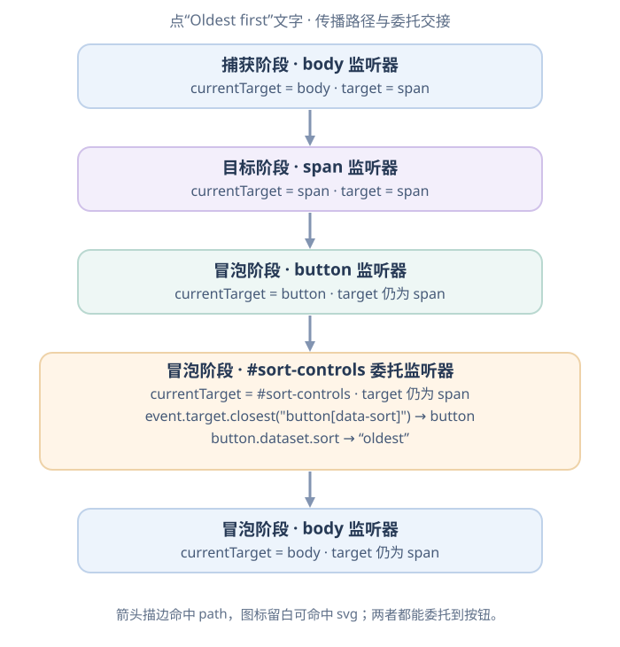

# 一次点击怎样传播到处理器，处理器该怎样注册和清理？

用户点的是“最早优先”按钮里的文字或箭头，处理器却要拿到按钮本身和它的 `data-sort`。本章回答浏览器怎样把一次输入派发给监听器、监听器该挂在哪里、怎样注册和移除，以及键盘、指针、尺寸和滚动各自的事件契约。沿用主线一的报表页，读者手上已有上一章[怎样查询和修改 DOM？](./dom-queries-and-updates.md)里的 HTML 片段（`#sort-controls`、`data-sort`、`#reports`）和能把行重排成 April、May 的 `applySort(intent, activeButton)`；本章要让一次点击调用它。

## 注册和移除监听器

`addEventListener(type, listener, options)` 给一个节点添加监听器，事件名不带 `on` 前缀，写 `"click"`、`"keydown"`。另一种写法 `element.onclick = handler` 每个元素只有一个槽位，赋新函数会替换旧的；多段代码都要监听同一事件时，用 `addEventListener()` 各自注册、各自移除。

移除有三种方式：

- **`removeEventListener()`。** 必须传入注册时的**同一个函数引用**和相同的 `capture` 设置。当场写一个新箭头函数，或者传 `handler.bind(x)` 的又一次结果，都是另一个函数，移除不会生效。
- **`{ once: true }`。** 监听器第一次运行前就被移除，适合只响应一次的事件。
- **`{ signal }`。** 把同一个 `AbortSignal` (中止信号)传给多个监听器，页面区域销毁时调用一次 `controller.abort()`，它们全部移除，不必保存每个函数引用。`AbortSignal` 本身的语义见[取消、超时和并发上限各自停得住什么？](../javascript/cancellation-timeouts-and-concurrency.md)。

~~~javascript
const region = new AbortController();
const controls = document.querySelector("#sort-controls");

function logClick(event) { console.log(event.type); }
controls.addEventListener("click", logClick);
controls.removeEventListener("click", logClick); // 同一引用，移除成功

controls.addEventListener("click", logClick, { signal: region.signal });
window.addEventListener("resize", logClick, { signal: region.signal });
region.abort(); // 两个监听器一起移除
~~~

### 监听器里的 this 指向谁

普通函数的 `this` 不由定义位置决定，而由调用方式决定：`obj.method()` 里是 `obj`，单独调用时在严格模式下是 `undefined`。DOM 调用监听器时，把注册监听器的那个节点（即后文的 `event.currentTarget`）作为 `this` 传入。箭头函数没有自己的 `this`，沿用定义处外层的值，DOM 换不掉它。所以在监听器里读节点，最稳的写法是显式读 `event.currentTarget`，不依赖 `this`：

~~~javascript
const button = document.createElement("button");
const wrapper = document.createElement("div");
wrapper.append(button);
document.body.append(wrapper);
const results = [];

wrapper.addEventListener("click", function (event) {
  results.push(this === event.currentTarget && this === wrapper
    && event.target === button);
});
wrapper.addEventListener("click", (event) => {
  results.push(event.currentTarget === wrapper && event.target === button);
});
button.dispatchEvent(new MouseEvent("click", { bubbles: true }));
results; // [true, true]
~~~

想让监听器调用某个对象的方法，常写 `el.addEventListener("click", obj.handle.bind(obj))`；这样得到的是新函数，要移除就得把它存进变量。`this` 的完整规则见[函数里的变量和 this 从哪来？](../javascript/scope-closures-and-this.md)。

## 一次点击沿哪条路径传播？

浏览器派发事件时，先确定 event path (传播路径)：从 `Window` 经 Document 一直到被点中的节点。监听器在三个阶段运行：

1. **capture phase (捕获阶段)**：从 `Window` 向内，运行用 `{ capture: true }` 注册的监听器。
2. **target phase (目标阶段)**：在目标节点上，先运行捕获监听器，再运行普通监听器。
3. **bubble phase (冒泡阶段)**：从目标的父节点向外，运行普通监听器。只有 `bubbles` 为 true 的事件才有这一段，`click` 会冒泡。

被点中的节点是哪个，取决于命中位置。点按钮上的文字时，目标是 `.sort-label` 这个 `span`；点 SVG 箭头的可见描边时是 `<path>`；点图标里没有描边的留白处则可能是 `svg`。SVG 元素是否命中，按可见的 fill/stroke 和 `pointer-events` 规则判断。

下面的代码只打印顺序：

~~~javascript
const controls = document.querySelector("#sort-controls");
const button = controls.querySelector('button[data-sort="oldest"]');
const label = button.querySelector(".sort-label");

document.body.addEventListener("click", () => console.log("body capture"), { capture: true });
label.addEventListener("click", () => console.log("span target"));
button.addEventListener("click", () => console.log("button bubble"));
controls.addEventListener("click", () => console.log("controls bubble"));
document.body.addEventListener("click", () => console.log("body bubble"));
// 点“Oldest first”文字：
// body capture → span target → button bubble → controls bubble → body bubble
~~~

图中 `#sort-controls` 一层画的是后文的委托监听器，它在事件冒泡到工具栏时接手，不是上面只打印日志的 `controls bubble`。点箭头描边时路径是 `path → svg → button → #sort-controls → body`，点图标留白时从 `svg` 开始；两条路径都不经过 `span`。

### target 与 currentTarget

在一次普通 DOM 派发里，`event.target` 始终是最初命中的节点；`event.currentTarget` 是当前正在运行的监听器所注册的节点。点文字时，`target` 一直是 `span`，`currentTarget` 依次是 `body`、`span`、按钮、工具栏、`body`。派发结束后 `currentTarget` 被重置为 `null`，所以异步回调里读它会落空，要先存成局部变量。

## 哪些事件不冒泡，影子边界又改变什么？

不是所有事件都会冒泡到祖先，依赖冒泡的代码要先确认这一点：

- **焦点。** 输入框获得、失去焦点时派发的 `focus` 和 `blur` 不冒泡；父级要统一处理焦点变化，监听会冒泡的 `focusin` 和 `focusout`。
- **元素滚动。** 元素滚动时派发的 `scroll` 不冒泡，要监听在实际滚动的那个容器上（见后文）。

Shadow DOM (影子 DOM)还会改变外部看到的目标。组件内部的节点被点击后，影子树外的监听器读到的 `target` 会被 retarget (重定向)为该组件的宿主元素，内部结构不外泄。事件能否穿出影子边界由 `composed` 决定，能否向祖先冒泡由 `bubbles` 决定，两者是不同的开关。本章其余例子都在普通文档树中。

## 事件委托：在父级处理一组子控件

冒泡让祖先能收到后代上的事件。event delegation (事件委托)利用这一点：在共同的父级注册一个监听器，处理一组子控件，包括之后才插入的控件。它适用于三个条件同时成立的场景：事件会冒泡；父级确实拥有这些子控件；能从 `event.target` 可靠地判断事件属于哪个控件。委托减少的是注册次数和插入新控件时的重新注册，每次派发和处理器本身的计算并不会变少。

报表页的工具栏正好满足这些条件。处理器从命中的节点出发，向上找到带 `data-sort` 的按钮，再交给上一章的 `applySort()`：

~~~javascript
const controls = document.querySelector("#sort-controls");

controls.addEventListener("click", (event) => {
  const target = event.target instanceof Element ? event.target : null;
  const button = target?.closest("button[data-sort]");
  if (!button || !controls.contains(button)) return;

  const intent = button.dataset.sort; // 点“最早优先”时得到 "oldest"
  applySort(intent, button);
});
~~~

主线一的 `/reports.js` 注册的就是这样一个监听器，只是那里调用重建列表的 `renderReports()`；这里换成上一章移动节点的 `applySort()`，委托部分完全相同。逐步看这次点击：

1. 用户点“Oldest first”文字，`event.target` 是 `span`；点箭头时是 `path` 或 `svg`。`instanceof Element` 排除了文本节点等非元素目标。
2. `closest("button[data-sort]")` 从目标自身开始向上找，找到“最早优先”按钮。
3. `closest()` 可能一路找到工具栏之外的祖先，`controls.contains(button)` 确认按钮属于这个工具栏。
4. 读出 `button.dataset.sort` 得到 `"oldest"`，`applySort()` 把行移成 April、May，并把两个按钮的 `aria-pressed` 改为 `"false"`、`"true"`。

处理器同步返回时，DOM 已经是新顺序；画面要等后续的渲染机会才更新。地址栏里仍是 `sort=recent`，让 URL 和前进/后退跟上这次状态变化，见[地址变了，浏览器什么时候加载新文档，界面状态何时该写进 URL？](./navigation-history-and-url-state.md)。

不适合委托的情况也来自这三个条件：`focus`、元素 `scroll` 这类不冒泡的事件；子控件归另一个组件管理，父级不该替它决定行为；或者目标无法用选择器可靠识别。

## 默认动作和传播控制是两回事

工具栏里的按钮都写了 `type="button"`。不写时，表单里的 `<button>` 默认是提交按钮，点击会提交表单（表单控件的默认行为见[表单控件怎样命名、提交和校验，才对所有人可用？](../html-css/accessible-forms-and-submission.md)）。这种浏览器自带的 default action (默认动作)和事件传播是两件事，各有各的开关：

| 方法 | 作用 | 不做什么 |
|---|---|---|
| `preventDefault()` | 取消默认动作；前提是事件 `cancelable` 为 true，且监听器不是 passive | 不停止传播 |
| `stopPropagation()` | 不再传到路径上的下一个节点；当前节点本轮其余监听器照常运行 | 不取消默认动作 |
| `stopImmediatePropagation()` | 在上一行基础上，跳过当前节点本轮其余监听器 | 不取消默认动作 |

“本轮”指同为捕获或同为普通监听器的一组。目标节点上有一个特例：浏览器先跑目标上的捕获监听器，再跑普通监听器（两轮里 `eventPhase` 都是 `AT_TARGET`）；若捕获监听器调用了 `stopPropagation()`，目标上的普通监听器也会被跳过。

### passive 监听器

滚轮或触摸监听器若不需要阻止浏览器滚动，可以声明 `{ passive: true }`。浏览器因此不必等监听器跑完再滚动；被动监听器里调用 `preventDefault()` 不起作用。DOM 标准还规定：注册在 `Window`、Document、`documentElement` 或 `body` 上的 `touchstart`、`touchmove`、`wheel`、`mousewheel` 监听器，未显式设置 `passive` 时默认就是 passive。确实要拦截滚动时，显式写 `{ passive: false }`，并在调用 `preventDefault()` 前检查 `event.cancelable`。

## 移动端的点击延迟与触摸手势

触摸手势也有默认动作。部分移动浏览器在一次轻触后会等一会儿，判断它是否是双击缩放，于是 `click` 晚到。这只在特定条件下发生；Chrome 的诊断文档说明，初始视口未针对移动设备设置时，点击可能延后最多 300 毫秒，其他浏览器各有差异。

处理顺序是：

1. 先设置与设备宽度一致的视口（viewport 元标签的含义见[页面结构怎样让所有人都能读懂和操作？](../html-css/semantic-structure-and-accessibility.md)），不要为绕开延迟而禁止用户缩放：

   ~~~html
   <meta name="viewport" content="width=device-width, initial-scale=1">
   ~~~

2. 某个控件不需要双击缩放、但仍应允许平移和双指缩放时，对它使用 `touch-action: manipulation`：

   ~~~css
   #sort-controls button[data-sort] { touch-action: manipulation; }
   ~~~

3. 不要用 `touch-action: none` 全局禁止触摸操作；除非在目标设备上实测仍有问题，也不要同时在 `touchend` 和 `click` 上触发同一动作，否则触摸后浏览器派发的 `click` 会让动作执行两次。

原生 `<button>` 自带键盘激活（Enter 和空格）；用 `role="button"` 自制的按钮要自己补上键盘行为，这就要读懂键盘事件。

## 键盘事件：按键含义、物理位置与自动重复

`keydown` 表示按下，`keyup` 表示释放；系统开启自动重复时，按住不放会持续产生 `keydown`。`key` 是当前布局和修饰键下的按键含义，`code` 是物理按键位置，`repeat` 标出自动重复。下表是美式键盘上的三个独立情形：

| 收到的 `keydown` | `key` | `code` | `repeat` |
|---|---|---|---|
| 初次按下数字 2 | `"2"` | `"Digit2"` | `false` |
| 按住 Shift 后初次按下同一键 | `"@"` | `"Digit2"` | `false` |
| 不按 Shift，长按 2 的后续自动重复 | `"2"` | `"Digit2"` | `true` |

判断“向左移动”这类语义时读 `key === "ArrowLeft"`；只有游戏控制这类要固定物理位置的场景才考虑 `code`，并要处理不同键盘布局的差异。某个动作若要求每次按下只执行一次，可以忽略 `repeat` 为 true 的事件；但这替代不了限流或服务端去重。旧的 `keypress` 和数字式 `keyCode` / `which` 是兼容接口，新代码不要用它们判断字符。

键盘事件也不等于文本变化：粘贴、语音输入和 Input Method Editor (IME，输入法编辑器)都会改变文本，却不一定一次 `keydown` 对应一个字符。观察编辑结果用 `input` 事件；需要在变化发生前处理编辑意图时，用 `beforeinput`，并结合 composition (组合输入)事件判断输入法是否还在组字。

## 指针拖动：坐标、捕获与三种结束

Pointer Events (指针事件)把鼠标、触摸和笔统一成 `pointer*` 事件。一次拖动有一个开始和三种结束：

- `pointerdown` 开始，可调用 `setPointerCapture(pointerId)`，让这个指针的后续事件都发给被拖元素，即使指针移出了它。
- `pointerup`：正常松开。
- `pointercancel`：系统接管手势，例如转成页面滚动。
- `lostpointercapture`：捕获被释放时派发，包括 `pointerup` 或 `pointercancel` 之后的自动释放，也包括意外丢失捕获。

结束事件要按 `pointerId` 匹配当前拖动，避免另一根手指或过期事件结束这次拖动。指针坐标有三个参照系：

| 属性 | 参照系 | 回答的问题 |
|---|---|---|
| `clientX / clientY` | viewport (视口) | 指针在当前可视区域的哪里 |
| `pageX / pageY` | 文档 | 指针在页面内容坐标中的哪里 |
| `screenX / screenY` | 屏幕 | 指针相对设备显示区域的位置 |

下面把一张报表卡片放进定位容器。卡片的位移等于指针 client 坐标的变化量，起点是卡片相对容器的 `offsetLeft` / `offsetTop`（这组属性的参照系见[DOM 改动后浏览器重做了什么，读几何值为什么会卡住脚本？](./rendering-pipeline-and-forced-layout.md)）。例子假设容器没有缩放或旋转、拖动期间不滚动；有变换或滚动时，要先把坐标换算到同一参照系。

~~~html

  <button id="movable-report" type="button" aria-describedby="move-report-help">
    May report
  </button>

鼠标或触摸拖动卡片；聚焦后也可用方向键移动。

~~~

~~~css
#report-canvas { position: relative; width: 24rem; height: 12rem; border: 1px solid; }
#movable-report { position: absolute; left: 0; top: 0; touch-action: none; }
~~~

~~~javascript
const card = document.querySelector("#movable-report");
let drag = null;

card.addEventListener("pointerdown", (event) => {
  const secondaryMouse = event.pointerType === "mouse" && event.button !== 0;
  if (drag || !event.isPrimary || secondaryMouse) return;
  drag = {
    pointerId: event.pointerId,
    x: event.clientX, y: event.clientY,
    left: card.offsetLeft, top: card.offsetTop,
  };
  card.setPointerCapture(event.pointerId);
});

card.addEventListener("pointermove", (event) => {
  if (!drag || drag.pointerId !== event.pointerId) return;
  card.style.left = `${drag.left + event.clientX - drag.x}px`;
  card.style.top = `${drag.top + event.clientY - drag.y}px`;
});

function finishDrag(event, canceled = false) {
  if (!drag || drag.pointerId !== event.pointerId) return;
  const start = drag;
  drag = null;
  if (canceled) {
    card.style.left = `${start.left}px`;
    card.style.top = `${start.top}px`;
  }
}

card.addEventListener("pointerup", (event) => finishDrag(event));
card.addEventListener("pointercancel", (event) => finishDrag(event, true));
card.addEventListener("lostpointercapture", (event) => finishDrag(event, true));

card.addEventListener("keydown", (event) => {
  const step = event.shiftKey ? 24 : 8;
  const moves = { ArrowLeft: [-step, 0], ArrowRight: [step, 0],
                  ArrowUp: [0, -step], ArrowDown: [0, step] };
  const move = moves[event.key];
  if (!move) return;
  event.preventDefault();
  card.style.left = `${card.offsetLeft + move[0]}px`;
  card.style.top = `${card.offsetTop + move[1]}px`;
});
~~~

正常松开时，`pointerup` 先到，把 `drag` 清空并保留新位置；随后自动释放捕获产生的 `lostpointercapture` 因 `drag` 已为空而被忽略。只有 `pointercancel` 或意外丢失捕获时，卡片才回到起点。键盘路径每个方向键 `keydown` 移动一步，所以按住方向键会连续移动；`preventDefault()` 阻止方向键滚动页面。

`touch-action: none` 禁止从卡片上开始的平移和缩放，否则触摸拖动会被浏览器当作滚动并触发 `pointercancel`。它只放在确实需要拖动的小控件上，页面其余区域照常滚动。同理，`contextmenu`、`selectstart` 的默认动作可以在特定的自定义交互上取消，但全页禁用右键菜单或文字选择会拿走浏览器本身的操作，也起不到任何安全作用。

卸载这张卡片时要注意：捕获中的元素被移出文档后，规范建议（SHOULD）把 `lostpointercapture` 改发给 `document`，卡片自己的监听器不一定收得到。所以先清空状态、释放捕获，再移除节点：

~~~javascript
function disposeCard() {
  const activeDrag = drag;
  drag = null;
  if (activeDrag && card.hasPointerCapture(activeDrag.pointerId)) {
    card.releasePointerCapture(activeDrag.pointerId);
  }
  card.remove();
}
~~~

## 窗口尺寸、元素尺寸与滚动该监听在哪里？

页面布局本身也会变化，三种变化要分开监听：

| 想知道 | 监听什么 | 注意 |
|---|---|---|
| 窗口（视口）尺寸变了 | `window` 的 `resize` | 父容器单独变大小时不会触发 |
| 某个元素自身尺寸变了 | `ResizeObserver` (尺寸变化观察器) | 用 `disconnect()` 停止观察 |
| 页面或容器滚动了 | 页面用 `window`，元素用实际滚动的那个容器 | 元素的 `scroll` 不冒泡 |

这些事件都可能高频触发，处理器只做界面确实需要的更新；需要限频时，debounce 和 throttle 的语义见[怎样包装一个函数而不弄丢参数、this 和结果？](../javascript/wrapping-functions.md)。

决定用哪种 API 时，直接检测能力，不要按浏览器品牌猜。`navigator.language` 是浏览器报告的首选语言，不是国籍；`navigator.platform` 和 `navigator.userAgent` 是平台和 user-agent 字符串，证明不了某个 API 可用，读取它们还会增加隐私暴露。更一般的能力检测与 polyfill 取舍见[用一个新 API 之前，怎样确认运行时真的支持？](../javascript/feature-availability.md)。

~~~javascript
const reportList = document.querySelector("#reports");
const lifetime = new AbortController();
let sizeObserver = null;

function recordViewportWidth() {
  reportList.dataset.viewportWidth = String(window.innerWidth);
}

if (reportList && typeof ResizeObserver === "function") {
  sizeObserver = new ResizeObserver(([entry]) => {
    if (entry) reportList.dataset.containerWidth = String(Math.round(entry.contentRect.width));
  });
  sizeObserver.observe(reportList);
} else if (reportList) {
  window.addEventListener("resize", recordViewportWidth, { signal: lifetime.signal });
  recordViewportWidth();
}

function stopObservingReport() {
  lifetime.abort();
  sizeObserver?.disconnect();
}
~~~

支持 `ResizeObserver` 时记录的是报表容器的实际宽度；退回 `resize` 时只能知道视口变化。移除这块页面区域的代码负责调用 `stopObservingReport()`，监听器和观察器一起清理。

## 交给 React 时交出的是意图

如果报表页改由 React 管理，浏览器照常派发 `click`，变化的是处理器做什么：它从按钮读出排序意图 `oldest`，交给 state (状态)更新，由 React 计算新界面并提交 DOM 变化，而不是像 `applySort()` 那样直接移动节点。浏览器这一侧交出的是事件和当前 DOM，应用拿到的是“排序变为 `oldest`”这个意图。React 管理的节点若另用 DOM API 改动，下一次提交可能把修改覆盖掉。React 怎样把意图变成界面，见[React 怎样把一次用户操作变成界面更新？](../ui-state/react-update-model.md)。

> [!info] React 19 实例：事件对象与 currentTarget（核对 React DOM v19.2.0，2026-11-12）
> - JSX 事件处理器收到的是 SyntheticEvent (合成事件)。`onClick` 在冒泡阶段运行，`onClickCapture` 对应捕获阶段；`currentTarget` 指向写了该事件属性的元素。
> - React 17 起不再池化事件对象，但每个处理器返回后，React 仍把 `event.currentTarget` 重置为 `null`；`persist()` 在 React DOM 中已无作用。所以在 `await` 之前先把值读成普通字符串：
>
>   ~~~jsx
>   // <button data-sort="oldest" onClick={handleSort}>Oldest first</button>
>   async function handleSort(event) {
>     const intent = event.currentTarget.dataset.sort;
>     await savePreference(intent);
>     setSort(intent); // 用已保存的字符串，不再读 event.currentTarget
>   }
>   ~~~
>
>   若把处理器绑在工具栏上，`currentTarget` 就是工具栏，读不到按钮的 `data-sort`。
> - React 17 把内部委托监听器从 `document` 移到了 React 根容器，这不改变 `currentTarget` 的含义。
> - 原生 `focus` / `blur` 不冒泡，React 的 `onFocus` / `onBlur` 却沿 React 树冒泡。React Native 的事件系统另有规则。

## 处理器返回之后

到这里，一次点击已经从命中的 `span` 或 `path` 冒泡到工具栏，委托监听器找到按钮、读出 `oldest`，同步把 DOM 改成 April、May，并把按钮状态写进 `aria-pressed`。处理器返回时屏幕上还是旧画面：浏览器要在下一次渲染机会重算样式、布局和绘制，而处理器里若读几何值，还可能当场逼浏览器先算布局。这是[DOM 改动后浏览器重做了什么，读几何值为什么会卡住脚本？](./rendering-pipeline-and-forced-layout.md)要回答的问题；处理器何时能运行、渲染机会排在哪里，见[事件循环怎样安排任务、微任务和渲染？](./event-loop-tasks-and-rendering.md)。应用层自己实现的发布/订阅与浏览器事件派发有相似的重入问题，见[同步事件总线在分发途中增删监听器会怎样？](../javascript/event-bus-and-observer-patterns.md)。

> [!info]- 来源
> - 监听器注册、移除匹配（回调与 capture）、`once`、`signal`、passive 默认值与 `preventDefault()` 条件：[WHATWG DOM Standard, addEventListener](https://dom.spec.whatwg.org/#dom-eventtarget-addeventlistener)，Living Standard，核对于 2026-11-12。
> - 传播路径、三阶段、目标上先捕获后普通监听器、`target` / `currentTarget`、派发结束清空 `currentTarget`、`stopPropagation` / `stopImmediatePropagation`、影子树重定向与 `composed`：[WHATWG DOM Standard, dispatching events、inner invoke](https://dom.spec.whatwg.org/#concept-event-dispatch)，Living Standard，核对于 2026-11-12。
> - 普通函数监听器以 `currentTarget` 为 `this`：[WHATWG DOM Standard, event listener invoke](https://dom.spec.whatwg.org/#concept-event-listener-invoke)；箭头函数不绑定 `this`、`bind` 返回新函数：[ECMAScript 2026 Arrow Function Definitions](https://tc39.es/ecma262/2026/multipage/ecmascript-language-functions-and-classes.html#sec-arrow-function-definitions)、[Function.prototype.bind](https://tc39.es/ecma262/2026/multipage/fundamental-objects.html#sec-function.prototype.bind)、[OrdinaryCallBindThis](https://tc39.es/ecma262/2026/multipage/ordinary-and-exotic-objects-behaviours.html#sec-ordinarycallbindthis)（§10.2.1.2）。
> - SVG 命中按可见 fill/stroke 和 `pointer-events` 判断：[SVG 2, Pointer Events property](https://www.w3.org/TR/SVG2/interact.html#PointerEventsProperty)，W3C Candidate Recommendation Snapshot（2026-10-06），核对于 2026-11-12。
> - 窗口尺寸、页面与元素滚动的事件目标（元素 `scroll` 不冒泡）：[CSSOM View](https://drafts.csswg.org/cssom-view/)，CSS Working Group Editor’s Draft，核对于 2026-11-12。
> - 初始视口未适配移动设备时，点击可能延迟至多 300 毫秒：[Chrome Performance Insights: Optimize viewport for mobile](https://developer.chrome.com/docs/performance/insights/viewport)，发布于 2025-10-08，核对于 2026-11-12。
> - `key`、`code`、修饰键与自动重复，旧 `keypress` 与文本编辑事件的边界：[UI Events](https://www.w3.org/TR/uievents/)，KeyboardEvent 与 Legacy KeyboardEvent；物理键名：[UI Events code Values](https://www.w3.org/TR/uievents-code/)，核对于 2026-11-13。键盘表按规范中的美式布局说明。
> - 指针捕获、`pointercancel`、`lostpointercapture` 与断开连接后改发 document、`touch-action`：[Pointer Events Level 3](https://www.w3.org/TR/pointerevents3/)，W3C Recommendation，2026-06-30，§§4.1、5.1、7；元素尺寸观察与 `disconnect()`：[Resize Observer](https://drafts.csswg.org/resize-observer/)，CSS Working Group Editor’s Draft。核对于 2026-11-12。
> - Navigator 的语言、平台、userAgent 与隐私要求：[WHATWG HTML, The Navigator object](https://html.spec.whatwg.org/multipage/system-state.html#the-navigator-object)，Living Standard，核对于 2026-11-12。
> - React 事件对象、`currentTarget`、React DOM 不使用 `persist()`：[React event object](https://react.dev/reference/react-dom/components/common#react-event-object)；React 17 移除事件池、委托根移入 root container、`onFocus` / `onBlur` 传播：[React 17 release notes](https://legacy.reactjs.org/blog/2020/10/20/react-v17.html)；处理器返回后清空 `currentTarget`：[React DOM v19.2.0 DOMPluginEventSystem.js L240–L252](https://github.com/facebook/react/blob/v19.2.0/packages/react-dom-bindings/src/events/DOMPluginEventSystem.js#L240-L252)。核对于 2026-11-12。
