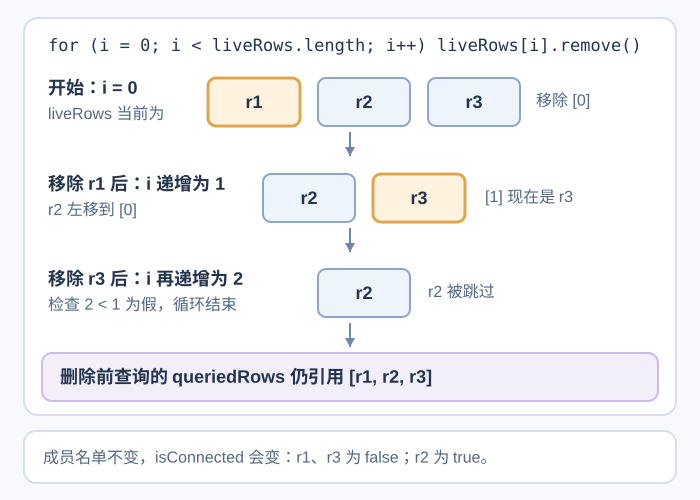

# 怎样查询和修改 DOM，才拿到并改到预期的节点？

HTML 解析完成后，页面在内存里是一棵 Document Object Model (DOM，文档对象模型)节点树；脚本查询、修改的都是这棵树，而不是 HTML 源文本。本章沿用主线一的报表页：脚本要找到排序按钮和两行报表，把行顺序从 May、April 改成 April、May，并更新按钮状态。读者手上已经有解析好的 DOM 和已注册的模块脚本（见[打开一个 URL 后，页面怎样变得可见又可交互？](./from-url-to-interactive-page.md)）；点击怎样到达处理器留给下一章。

## 本章用到的报表页片段

下面是报表页里与排序有关的部分，此时 `/reports.js` 已经求值并启用了按钮，所以不再带 `disabled`。在主线一已有的标识符（`#sort-controls`、`button[data-sort]`、`ol#reports`、行 ID `r-104` / `r-103`）之外，本章只补两处：按钮文字的 `class="sort-label"`，以及每行的 `data-date`，让脚本能直接从 DOM 读出日期。

~~~html
<h1 id="summary">Recent reports</h1>

  <button type="button" data-sort="recent" aria-pressed="true">
    Most recent
  </button>
  <button type="button" data-sort="oldest" aria-pressed="false">
    <svg width="16" height="16" viewBox="0 0 16 16"
         aria-hidden="true">
      <path d="M8 13V3m-4 4 4-4 4 4" fill="none" stroke="currentColor"
            stroke-width="1.5" stroke-linecap="round" stroke-linejoin="round" />
    </svg>
    Oldest first
  </button>

<ol id="reports">
  <li data-id="r-104" data-date="2026-05-01">May report</li>
  <li data-id="r-103" data-date="2026-04-01">April report</li>
</ol>
~~~

“最早优先”（Oldest first）按钮里有一个 SVG 箭头和一段文字；图标的意思已由文字说明，所以用 `aria-hidden="true"` 对辅助技术隐藏。本章和下一章的代码片段都假设这段 HTML 已载入，且各片段在独立页面或作用域中运行：拼进同一个脚本会重复声明 `const controls` 之类的变量。

## DOM 树里有哪些节点？

树里不只有元素。标签之间的换行缩进是文本节点，`<!-- -->` 是注释节点，整棵树的根是 Document。元素的 attribute (属性)有对应的 `Attr` 对象，但它不是树的子节点。

| `nodeType` | 节点 | 报表页中的例子 |
|---:|---|---|
| 1 | Element (元素) | `<ol>`、`<li>`、`<button>` |
| 2 | Attr (属性) | `id="reports"`，不是子节点 |
| 3 | Text (文本) | `May report` |
| 8 | Comment (注释) | `<!-- 排序控件 -->` |
| 9 | Document (文档) | `document` 本身 |

亲属 API 因此成对出现：一个看所有节点，一个只看元素。

| 问题 | 看所有节点 | 只看元素 | 差别出现在哪里 |
|---|---|---|---|
| 父节点 | `parentNode` | `parentElement` | `<html>` 的 `parentNode` 是 Document，`parentElement` 是 `null` |
| 第一个子节点 | `firstChild` | `firstElementChild` | `<ol>` 的 `firstChild` 通常是换行空白的文本节点 |
| 下一个兄弟 | `nextSibling` | `nextElementSibling` | 从 May 行找 April 行要用后者 |
| 全部子节点 | `childNodes` | `children` | 前者含文本和注释 |

名称和值也分节点类型：`nodeName` 适用于任何节点，`tagName` 只有元素才有；`nodeValue` 读单个 Text 节点的内容，在元素上是 `null`。要读元素里的全部文字，用后文的 `textContent`。

## 用选择器查询：拿到一个、拿到全部，或者拿到 null

最常用的入口是 CSS 选择器查询。`querySelector()` 返回第一个匹配的元素，没有匹配时返回 `null`；`querySelectorAll()` 返回所有匹配元素组成的 `NodeList`，没有匹配时是长度为 0 的列表。`getElementById()` 也返回元素或 `null`。选择器字符串不是合法 CSS 时，两者都抛出 `SyntaxError`，而不是返回空结果。

先拿到容器，再在容器内部查询，就不会把页面别处的同类控件当成报表控件：

~~~javascript
const controls = document.querySelector("#sort-controls");
const reports = document.querySelector("#reports");
const oldest = controls?.querySelector('button[data-sort="oldest"]') ?? null;
const rows = reports?.querySelectorAll(":scope > li[data-date]") ?? [];
~~~

`button[data-sort="oldest"]` 同时要求元素名是 `button`、`data-sort` 的值是 `oldest`。`:scope >` 把范围限定为 `#reports` 自己的直接子元素。可选链 `?.` 处理容器不存在的情况：找不到 `#reports` 时 `rows` 是空数组，容器存在但没有匹配行时是空 `NodeList`。

`document.documentElement` 是 `<html>`，`document.body` 是 `<body>`。脚本若在解析器读到 `<body>` 之前运行，`document.body` 可能还是 `null`；报表页的模块脚本在解析结束后才求值，不受影响。

## 集合有两个维度：含什么节点、会不会跟着变

能返回多个节点的 API 不止 `querySelectorAll()`。它们在两点上不同：成员里包括哪些节点，以及查询之后 DOM 再改变时成员会不会跟着变。

| 来源 | 返回类型 | 包含什么 | 查询后 DOM 改变时 |
|---|---|---|---|
| `element.children` | `HTMLCollection` | 直接子元素 | 实时反映当前树 |
| `getElementsByClassName()`、`getElementsByTagName()` | `HTMLCollection` | 匹配的后代元素，含更深层 | 实时反映当前树 |
| `element.childNodes` | `NodeList` | 元素、文本、注释等直接子节点 | 实时反映当前树 |
| `element.querySelectorAll()` | `NodeList` | 匹配的元素 | 保持查询时的成员 |

只看类型判断不了是否实时：`childNodes` 和 `querySelectorAll()` 的结果都是 `NodeList`，前者实时，后者静态。两种集合都不是数组，没有 `map()`、`sort()`；`Array.from()` 把当前成员的引用复制进一个新数组。

“静态”只固定成员名单，不冻结节点本身：名单里的节点被移出文档后，引用还在，但它的 `isConnected` 变成 `false`。“实时”也只描述每次读取看到的成员，不规定浏览器内部多久重算一次。

## 边遍历边删除，为什么会漏掉一行？

报表要显示一批新结果时，代码常先清空旧行。如果按递增索引遍历实时集合并逐个删除，就会漏删。

> [!example] 正向删除实时集合会留下 r2
> 为了看清索引，这里换一个只有三行的独立列表，`r1`、`r2`、`r3` 是教学用 ID。
>
> ~~~html
> <ul id="old-rows">
>   <li class="report" id="r1">报告 1</li>
>   <li class="report" id="r2">报告 2</li>
>   <li class="report" id="r3">报告 3</li>
> </ul>
> ~~~
>
> ~~~javascript
> const list = document.querySelector("#old-rows");
> const liveRows = list.children;
> const queriedRows = list.querySelectorAll(":scope > .report");
>
> for (let i = 0; i < liveRows.length; i += 1) {
>   liveRows[i].remove();
> }
> // 列表里还剩 r2。
> // queriedRows 仍有 3 个成员；queriedRows[0].isConnected 为 false。
> ~~~
>
> 1. `i = 0`：移除 `liveRows[0]`，即 `r1`。实时集合立刻变成 `[r2, r3]`，`r2` 前移到索引 0。
> 2. `i = 1`：此时 `liveRows[1]` 是 `r3`，移除后集合只剩 `[r2]`。
> 3. `i = 2`：条件 `2 < 1` 为假，循环结束，`r2` 被跳过。
>
> 
>
> 这时再插入新结果，旧的 `r2` 就会和新行一起显示。静态的 `queriedRows` 仍引用三个节点，其中 `r1`、`r3` 已不在文档里。

修正办法是在改树之前先取快照，或者从末尾往前删：

~~~javascript
// 两种写法二选一，都从同一份初始列表开始。
for (const row of Array.from(liveRows)) row.remove();

for (let i = liveRows.length - 1; i >= 0; i -= 1) {
  liveRows[i].remove();
}
~~~

规律是：实时集合回答“DOM 现在有哪些成员”，静态结果适合对查询那一刻确定的成员逐个操作。一边改树一边按索引读实时集合，索引就不再指向原来的节点。

## 写文字还是写标记：textContent、innerText、innerHTML

找到节点后，第一类修改是改内容。三个接口的区别在于是否解析 HTML、是否看渲染结果：

| 接口 | 读取 | 赋值 | 报表页上的用途 |
|---|---|---|---|
| `textContent` | 全部后代文本 | 用一个文本节点替换整个子树，不解析 HTML | 写入报表名称等纯文字 |
| `innerText` | 渲染后的文字：隐藏内容不计入；元素未渲染时退回后代文本 | 字符串里的换行变成 ` ` | 读写用户看得见的文本 |
| `innerHTML` | 子树的 HTML 字符串 | 把字符串当 HTML 解析 | 只插入可信或已净化的标记 |

~~~javascript
const textDemo = document.createElement("div");
document.body.append(textDemo); // 附加到页面后，innerText 才按渲染文本处理
textDemo.textContent = "<b>May</b>";
const literal = [textDemo.textContent, textDemo.children.length];
textDemo.innerText = "May\nReport";
const visibleLines = [textDemo.innerHTML, textDemo.innerText];
console.log(JSON.stringify({ literal, visibleLines }));
// literal: ["<b>May</b>", 0]
// visibleLines: ["May Report", "May\nReport"]
~~~

`textContent` 把 `<b>` 原样当文字，所以没有生成子元素。报表标题这类来自用户或服务端的字符串，一律用 `textContent` 写；把它交给 `innerHTML` 等于让数据决定页面结构和脚本，安全边界见[不可信报表标题怎样安全显示？](../../engineering-foundations/services/sessions-and-browser-boundaries.md#不可信报表标题怎样安全显示？)。

## attribute 和 property 什么时候会分开？

HTML 标记上写的是 content attribute (内容属性)，JavaScript 对象上读写的是 DOM property (DOM 对象属性)。许多 property 会 reflect (反射)同名 attribute：读写其中一个，另一个跟着变，例如 `button.id` 与 `id` 属性。但有三种常见情况两者不等价。

### 输入框的 value：默认值与当前值

`value` attribute 是默认值，`input.value` property 是当前值。HTML 用 dirty value flag (值已修改标记)区分二者：用户输入或脚本写 `input.value` 之后，标记变为 dirty，此后再改 attribute 只更新默认值；`form.reset()` 把当前值恢复为默认值并清除标记。

~~~html
<form id="filter-form">
  <label>筛选报表 <input id="report-filter" value="May"></label>
</form>
~~~

~~~javascript
const filter = document.querySelector("#report-filter");
filter.setAttribute("value", "April"); // 尚未 dirty：当前值跟着变
const beforeEdit = [filter.value, filter.defaultValue];

filter.value = "Ada";                   // 改当前值，标记变为 dirty
filter.setAttribute("value", "May");    // dirty 后只改默认值
const afterEdit = [filter.value, filter.defaultValue];

filter.form.reset();                    // 当前值回到默认值，清除 dirty
const afterReset = [filter.value, filter.defaultValue];
console.log(JSON.stringify({ beforeEdit, afterEdit, afterReset }));
// {"beforeEdit":["April","April"],"afterEdit":["Ada","May"],
//  "afterReset":["May","May"]}
~~~

`defaultValue` property 反射的正是 `value` attribute。

### 布尔属性只看存不存在

`disabled`、`checked`、`hidden` 这类 boolean attribute (布尔属性)只看是否存在，不看值。`setAttribute("disabled", "false")` 照样禁用元素；要解除，写 `button.disabled = false` 或 `removeAttribute("disabled")`。

### 禁用状态还会从 fieldset 继承

`button.disabled = false` 只移除按钮自己的属性。按钮若在禁用的 `<fieldset>` 里，它仍然被禁用，匹配 `:disabled`。例外是该 fieldset 第一个 `<legend>` 子元素里的控件，它们不继承禁用。

~~~html
<fieldset disabled>
  <legend>
    <button id="legend-button" type="button">例外位置</button>
  </legend>
  <button id="inherited-button" type="button">受 fieldset 禁用</button>
</fieldset>
<button id="own-button" type="button">自己的 disabled 属性</button>
~~~

~~~javascript
const read = (el) => [el.disabled, el.matches(":disabled")];
const own = document.querySelector("#own-button");
const inherited = document.querySelector("#inherited-button");
const legendButton = document.querySelector("#legend-button");

own.setAttribute("disabled", "false");
const ownAttribute = read(own);
own.disabled = false;
const afterClearingOwn = read(own);
inherited.disabled = false;

console.log(JSON.stringify({
  ownAttribute, afterClearingOwn,
  inherited: read(inherited), firstLegend: read(legendButton),
}));
// ownAttribute: [true, true]; afterClearingOwn: [false, false]
// inherited: [false, true]; firstLegend: [false, false]
~~~

| 控件状态 | `disabled` | `matches(":disabled")` | 原因 |
|---|---|---|---|
| 自身 `setAttribute("disabled", "false")` 后 | `true` | `true` | 布尔属性只看是否存在 |
| 再设自身 `disabled = false` 后 | `false` | `false` | 自身属性已移除 |
| 禁用 fieldset 的普通后代 | `false` | `true` | 自身未禁用，祖先 fieldset 生效 |
| fieldset 第一个 `legend` 里的后代 | `false` | `false` | 该位置不继承禁用 |

所以，问“这个控件现在能不能用”（含 fieldset 继承）时用 `matches(":disabled")`；只读写元素自己的属性时用 `disabled`。

## 改外观和附带数据：class、style 与 dataset

- **class。** `className = "selected"` 整体替换 class 字符串；`classList.add()`、`remove()`、`toggle()` 只改一个类，不会误删别处加上的类。
- **style。** `element.style.backgroundColor` 只读写行内声明，CSS property 名用小驼峰。样式表层叠出来的结果要用 `getComputedStyle(element)` 读；它为什么可能触发同步计算，见[DOM 改动后浏览器重做了什么，读几何值为什么会卡住脚本？](./rendering-pipeline-and-forced-layout.md)。
- **dataset。** `data-*` 属性通过 `dataset` 读写，名称去掉 `data-` 并转成小驼峰：`data-report-id` 对应 `dataset.reportId`。读到的值总是字符串，不存在的键读到 `undefined`。May 行的 `dataset.id` 是 `"r-104"`，`dataset.date` 是 `"2026-05-01"`。

报表页的排序状态用 `aria-pressed` 表达。它不是布尔属性，值是字符串 `"true"` 或 `"false"`，所以要用 `setAttribute("aria-pressed", "true")` 写明值，不能靠存在与否。

## 创建、移动和克隆节点

### 从数据生成节点

从数据生成一组元素时，用 `createElement()` 建节点、`textContent` 写值、`append()` 挂到树上。这里暂时离开报表，用一张独立的成绩表：三列固定为 Name、Subject、Grade，三条记录应显示为 Ron—Math—100、Jack—Calculus—70、Mar—Business—90。

~~~html
<table>
  <thead><tr><th>Name</th><th>Subject</th><th>Grade</th></tr></thead>
  <tbody id="students"></tbody>
</table>
~~~

~~~javascript
const students = [
  { name: "Ron", subject: "Math", grade: "100" },
  { name: "Jack", subject: "Calculus", grade: "70" },
  { name: "Mar", subject: "Business", grade: "90" },
];
const columns = ["name", "subject", "grade"];
const body = document.querySelector("#students");

for (const student of students) {
  const row = document.createElement("tr");
  for (const column of columns) {
    const cell = document.createElement("td");
    cell.textContent = student[column];
    row.append(cell);
  }
  body.append(row);
}
~~~

列顺序由 `columns` 数组决定，不依赖对象字段的书写顺序，表头和单元格因此始终对齐；数据值只进入文本节点，不会被当作 HTML 解析。

### 移动已有节点：把报表重排成 April、May

`append()` 把节点放到父节点末尾；传入的节点若已在文档里，它会被**移动**而不是复制。`insertBefore(node, reference)` 把节点放到参考节点之前，`remove()` 把节点移出树。报表页的排序正好利用移动：

~~~javascript
const controls = document.querySelector("#sort-controls");
const reports = document.querySelector("#reports");

function applySort(intent, activeButton) {
  if (intent !== "recent" && intent !== "oldest") return;

  const rows = Array.from(reports.querySelectorAll(":scope > li[data-date]"));
  const direction = intent === "oldest" ? 1 : -1;
  rows.sort((a, b) => direction * a.dataset.date.localeCompare(b.dataset.date));
  for (const row of rows) reports.append(row);

  for (const button of controls.querySelectorAll("button[data-sort]")) {
    button.setAttribute("aria-pressed", String(button === activeButton));
  }
}
~~~

`applySort()` 先拒绝未知的排序值，再取当前行的静态快照，转成数组排序。`data-date` 是 `YYYY-MM-DD` 格式，按字典序比较就是按时间先后比较。`intent` 为 `oldest` 时 `direction` 为 1，April（`2026-04-01`）排在前面；依次 `append()` 现有两行，就把它们移成 April、May，节点本身和它们上面的状态都保留。最后把被点按钮的 `aria-pressed` 设为 `"true"`，另一个设为 `"false"`。

主线一的 `/reports.js` 用的是另一种写法：按数据数组新建两个 `<li>`，再用 `list.replaceChildren(...rows)` 一次替换全部子节点。两种写法得到的行序相同，差别在节点身份：移动保留原来的节点对象，挂在它上面的监听器和 property（例如行内输入框的当前值）都跟着走；重建得到的是新节点，这些都要重新建立。行只是静态文字时两者等价；行里有控件或单独注册了监听器时，要先想清楚需要保留哪一种身份。

| 时点 / 意图 | 行顺序（`data-id`） | `recent` 按钮 | `oldest` 按钮 |
|---|---|---|---|
| 初始 HTML / `recent` | `r-104` → `r-103` | `aria-pressed="true"` | `aria-pressed="false"` |
| `applySort("oldest", oldestButton)` 之后 | `r-103` → `r-104` | `aria-pressed="false"` | `aria-pressed="true"` |

### 克隆节点不会带上监听器

`cloneNode(true)` 复制节点、全部后代和所有 attribute。写在标记里的 `onclick="..."` 是 attribute，会被复制；通过 `element.onclick = handler` 赋值的处理函数和 `addEventListener()` 注册的监听器都不会复制。副本若带 `id`，插入同一文档前要改成不冲突的值，并同步更新指向它的引用（例如 `aria-describedby`）。

~~~javascript
function handleReportClick(event) {
  console.log(event.currentTarget.dataset.id);
}

const source = document.querySelector('#reports [data-id="r-104"]');
const copy = source.cloneNode(true);       // 保留 data-id、data-date
copy.id = "r-104-copy";                    // 新增一个文档内唯一的 id
copy.addEventListener("click", handleReportClick); // 行为要在副本上重新注册
reports.append(copy);
~~~

May 行自身和后代都没有 `id`，副本保留 `data-id="r-104"` 和 `data-date`，代码再给它加一个唯一 `id`。运行后列表会多出第三行，所以它和上面的排序例子不是同一轮状态。

## 改完 DOM，谁来调用这些函数？

到这里，脚本已经能可靠地找到工具栏、按钮和行，能区分文字与标记、attribute 与 property，也能用 `applySort()` 把 DOM 改成 April、May。还没回答的是：用户点的可能是按钮里的文字或 SVG 箭头，脚本怎样从这次点击找到按钮、读出 `oldest` 并调用 `applySort()`？这由[一次点击怎样传播到处理器，处理器该怎样注册和清理？](./dom-events.md)接手。DOM 改完之后画面怎样跟上，则在[DOM 改动后浏览器重做了什么，读几何值为什么会卡住脚本？](./rendering-pipeline-and-forced-layout.md)展开。

> [!info]- 来源
> - 节点类型、亲属与名称字段（`parentNode` / `parentElement`、`nodeName` / `tagName` / `nodeValue`）：[WHATWG DOM Standard §4.4 Node](https://dom.spec.whatwg.org/#interface-node)、[§4.9 Element](https://dom.spec.whatwg.org/#interface-element)，Living Standard，核对于 2026-11-12。
> - `querySelector()` 返回首个匹配或 `null`，`querySelectorAll()` 返回静态结果、无匹配时为空列表，非法选择器抛 `SyntaxError`：[WHATWG DOM Standard §4.2.6 ParentNode](https://dom.spec.whatwg.org/#interface-parentnode)，Living Standard，核对于 2026-11-12。
> - `NodeList` 与 `HTMLCollection` 的成员与实时性；`children`、`childNodes`、`getElementsBy*()` 按各自接口算法定义：[WHATWG DOM Standard §4.2.10 Old-style collections](https://dom.spec.whatwg.org/#old-style-collections-node-list-and-htmlcollection)、[§4.5 Document](https://dom.spec.whatwg.org/#interface-document)，Living Standard，核对于 2026-11-12。
> - `document.body` 可为 `null`：[WHATWG HTML §3.1.1、§3.1.7 Document tree accessors](https://html.spec.whatwg.org/multipage/dom.html#dom-document-body)，Living Standard，核对于 2026-11-12。
> - `innerText` 的读取与写入、`data-*` 与 `dataset`：[WHATWG HTML, DOM](https://html.spec.whatwg.org/multipage/dom.html#the-innertext-and-outertext-properties) §3.2.4、§3.2.6.6、§3.2.7，Living Standard，核对于 2026-11-12。
> - 输入框默认值、dirty value flag 与表单 reset：[WHATWG HTML, The input element](https://html.spec.whatwg.org/multipage/input.html#the-input-element)；控件禁用与 fieldset 继承（含第一个 legend 例外）：[Enabling and disabling form controls](https://html.spec.whatwg.org/multipage/form-control-infrastructure.html#enabling-and-disabling-form-controls:-the-disabled-attribute)、[The fieldset element](https://html.spec.whatwg.org/multipage/form-elements.html#the-fieldset-element)。Living Standard，核对于 2026-11-12。
> - `element.style` 读写行内声明、`getComputedStyle()` 读取解析后的样式：[CSS Object Model (CSSOM)](https://drafts.csswg.org/cssom/) §7，CSS Working Group Editor’s Draft，核对于 2026-11-12。
> - `cloneNode()` 的复制范围（attribute 随节点复制，监听器不复制）：[WHATWG DOM Standard, clone a node](https://dom.spec.whatwg.org/#concept-node-clone)，Living Standard，核对于 2026-11-12。
